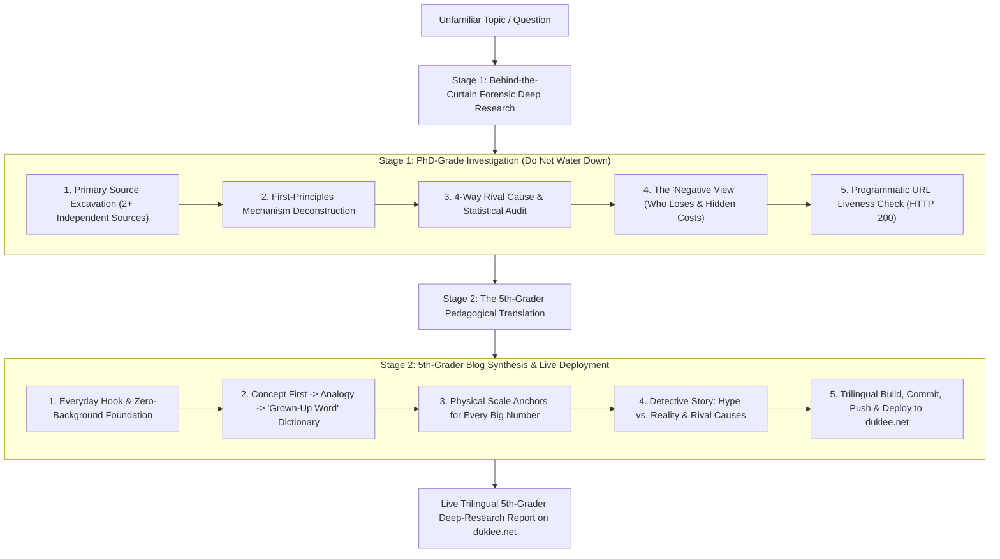

# The `fifth-grader` Deep-Research & Kid-Clear Blog Runbook
*PhD-Grade Forensic Research Behind the Curtain — 5th-Grade Crystal Clarity on the Page*

---

## Overview

When investigating a brand-new or unfamiliar domain, standard explanations fail in one of two ways:
1. **The "Expert Echo" Trap:** They parrot dense industry jargon, acronyms, and textbook abstractions that mean nothing to someone new to the field.
2. **The "Dumbed-Down Fluff" Trap:** They oversimplify so badly that they skip the actual mechanism, repeat corporate marketing myths, and hide the real numbers.

The **`fifth-grader`** skill solves both problems simultaneously by following the **Feynman Split**:
- **Behind the Curtain (Research Phase):** Execute a ruthless, primary-source forensic investigation using the full epistemic rigor of [`.agents/rules/deep-research.md`](../../rules/deep-research.md) and [`deep-dive`](../deep-dive/SKILL.md). Trace every claim to primary artifacts (papers, SEC filings, source code, regulatory records), test rival causes, audit statistics, and uncover who loses.
- **On the Page (Final Report Blog Phase):** Write and automatically deploy a trilingual (`en`, `ko`, `zh`) final report blog post on `duklee.net` via [`publish-blog`](../publish-blog/SKILL.md) where **every single idea, mechanism, number, and trade-off is built from the ground up so a smart 5th grader (10–11 years old) can completely understand it from start to finish.**

**Mandatory End-to-End Execution Rule:** Every `/fifth-grader` invocation **must automatically include writing, building, committing, pushing, and deploying a trilingual (`en`, `ko`, `zh`) blog post** on `duklee.net` without waiting for a separate user prompt to publish.

---

## The 2-Stage `fifth-grader` Workflow



---

## Stage 1: Behind-the-Curtain Forensic Deep Research

Never do shallow research just because the final explanation is written for a 5th grader. You cannot explain something simply unless you understand its exact gears underneath.

1. **Map the Unknown Territory from First Principles:**
   - Before diving into news headlines or recent controversies, answer the foundational questions: *What problem does this thing actually solve? How did people do it before? What are the physical, economic, or logical moving parts?*
2. **Primary Source Excavation & Anti-Echo Chamber ([`deep-research.md`](../../rules/deep-research.md)):**
   - Trace all key facts and numbers to **2+ structurally independent primary sources** (peer-reviewed papers, SEC 10-K/10-Q filings, official engineering specifications, GitHub repositories, clinical trial registers, or statutory texts).
   - Cross-examine front-page marketing claims against buried documentation, footnotes, or raw logs.
3. **4-Way Causal & Statistical Audit:**
   - Test claims of cause and effect against all 4 possibilities: **Direct Cause**, **Reverse Cause**, **Hidden Third Factor (Confounder)**, and **Feedback Loop**.
   - Check whether reported "averages" are skewed by extreme outliers, demand baseline denominators for percentages (e.g., *"went from 2 to 4"* rather than just *"up 100%"*), and verify whether the data actually proves the headline claim.
4. **The "Negative View" (Who Pays the Price?):**
   - Actively investigate the catch: *Why doesn't everyone already do this? What breaks? Who loses money, jobs, safety, or privacy? Who tried this before and failed?*
5. **Programmatic URL Liveness Check:**
   - Verify every external link before citing it:
     ```bash
     curl -s -o /dev/null -w "%{http_code}" -L --max-time 10 "<TARGET_URL>"
     ```
   - Keep only URLs that resolve to `HTTP 200`.

---

## Stage 2: The 5th-Grader Pedagogical Translation Rules

Once your deep research is complete, translate the entire investigation into a final report blog post governed by the **Six Laws of 5th-Grader Clarity**:

### Law 1: Assume Zero Prior Background (Never Skip Step Zero)
- Assume the reader is a bright, curious 10-year-old who has **never heard of this industry, technology, or financial system before**.
- Never start in the middle of a technical debate. First explain what the playground looks like, what the game is, and why anyone cares.

### Law 2: The "Concept First → Analogy → Grown-Up Word" Rule
- **NEVER** use an unexplained technical term, acronym, or buzzword to explain another technical term.
- Whenever you need to introduce an important domain term (so the reader learns what adults and experts call it in the real world), always follow this exact 3-step sequence:
  1. **Concept in Plain Words:** Describe what is physically or logically happening using simple, everyday words.
  2. **Everyday Analogy:** Compare it to something a 5th grader touches in real life (LEGO bricks, school lunchrooms, bicycle gears, kitchen plumbing, allowance money, library checkout cards, backpack weight, video game controllers).
  3. **The "Grown-Up Word" Label:** Only *after* the picture is crystal clear in the reader's head, say: *"Scientists / engineers / Wall Street traders have a fancy name for this: they call it **[Term]**."*

| Bad (Expert Jargon Soup) | Bad (Dumbed-Down & Vague) | Good (`fifth-grader` Deep-Research Standard) |
| :--- | :--- | :--- |
| "TSMC's CoWoS-L interposer mitigates reticle limits by stitching multiple HBM3E stacks adjacent to the compute die." | "Computer companies are making super fast chips by putting lots of parts together." | "A single laser stamp can only print a computer chip about the size of a postage stamp (`858 mm²`). To build a bigger brain, engineers place the main calculator chip and stacks of memory chips side by side on a giant silicon workbench that wires them together at lightning speed. Engineers call that workbench **CoWoS**." |

### Law 3: Mandatory "Grown-Up Words Translated" Dictionary Table
- Every `fifth-grader` report must include a dedicated **native GFM Markdown table (`| ... |`)** early in the post titled **"The Secret Decoder Ring"** (or similar) that translates the 5–7 most intimidating buzzwords or acronyms of the topic into:
  - **The Grown-Up Word / Acronym**
  - **What It Actually Means in Plain English**
  - **Everyday 5th-Grade Analogy**

### Law 4: Never Leave a Big Number Naked (Physical Scale Anchors)
- A 5th grader knows what `5 minutes`, `10 dollars`, or `a school bus` feels like, but nobody intuitively feels `13.5 nanometers`, `150 gigawatts`, or `$400 billion`.
- **Keep all exact, verified primary-source numbers**, but always pair them with a concrete physical comparison right next to the number:
  - *Microscopic sizes:* Compare to a human hair (`~75,000 nm` wide), a sheet of paper, or a grain of sand.
  - *Speeds & frequencies:* Compare to the blink of an eye (`~300 milliseconds`) or a camera shutter.
  - *Money & energy:* Compare to school lunches, houses powered, or stacking dollar bills.
  - *Probabilities & statistics:* Turn abstract percentages or Bayesian math into **100 kids in a school gym** (e.g., *"Imagine 100 healthy kids walk into the nurse's office..."*) so the reader can count the exact people on their fingers.

### Law 5: Visual Storytelling with Kid-Clear Mermaid Diagrams & Native Tables
- Include **2 to 3 Mermaid diagrams (` ```mermaid `)** (`flowchart TD`, `flowchart LR`, or `xychart-beta`) that visually walk the reader through:
  1. **How the system works step by step** (using plain-language labels inside quotes, e.g., `A["Step 1: You type a question"]`).
  2. **The Detective Test / What goes wrong** (comparing the hype story vs. the real-world bottleneck).
- **Formatting Invariants:**
  - Never use ASCII/Unicode box drawings (`┌─┬─┐`, `──►`).
  - Always wrap Mermaid node labels in double quotes (`A["..."]`) and give every subgraph an explicit alphanumeric ID (`subgraph SG1["..."]`).
  - Format all scorecards, decoder rings, rival-cause checks, and verdicts as **native GFM Markdown tables (`| ... |`)** with one row per item (zero `<br>` multi-row collapses, and escape literal pipes as `\|`).
  - Avoid raw `$$ ... $$` calculus or Greek-letter equations unless you immediately translate every piece into grade-school arithmetic (`+`, `-`, `×`, `÷`).

### Law 6: Follow the 7-Part "5th-Grader Detective" Story Arc
Structure the blog post as an engaging narrative adventure (never use dry textbook headers like `"Phase 1"` or `"Methodology"`):
1. **1. The Hook ("Wait—How Is That Even Possible?"):** Open with a vivid, relatable scene or mystery from everyday life that hooks the reader in the first 3 sentences.
2. **2. Starting from Zero ("How This Actually Works"):** Build the foundational mental model step by step from the ground floor, paired with a clear `mermaid` diagram.
3. **3. The Secret Decoder Ring:** A native Markdown table translating the topic's scary buzzwords into plain language and everyday analogies.
4. **4. The Big Claim vs. The Detective Check:** What are companies, scientists, or headlines promising? When we open the primary-source receipts, what is *actually* happening under the hood?
5. **5. The Four Suspects ("What Is Really Causing This?"):** Walk through the 4-way rival cause audit as a detective checking suspects (*Did A really cause B? Could B have caused A? Or is a sneaky third thing C behind both?*).
6. **6. The Catch ("Why Isn't Everything Perfect?"):** Explain the hidden trade-offs, physical bottlenecks, costs, and who gets hurt or left behind.
7. **7. The Final Report Card ("What We Actually Think"):** Synthesize the bottom line using clear **"If ... Then ..."** scenarios and a probability table (*Most Likely Outcome*, *What Could Go Wrong*, *Best-Case Surprise*) so the reader finishes with complete mastery.

---

## Stage 3: Trilingual Publication & Live Deployment Pipeline

Every `/fifth-grader` execution must publish across all three languages on `duklee.net` following [`publish-blog`](../publish-blog/SKILL.md):

1. **Draft All Three Language Versions Directly:**
   - **English:** `src/content/blog/<YYYY-MM-DD-slug>.md` (`lang: "en"`)
   - **Korean:** `src/content/blog_ko/<YYYY-MM-DD-slug>.md` (`lang: "ko"`) — Write in warm, vivid, crystal-clear Korean that a Korean 5th grader (`초등학교 5학년`) can effortlessly enjoy, using natural culturally resonant analogies.
   - **Chinese:** `src/content/blog_zh/<YYYY-MM-DD-slug>.md` (`lang: "zh"`) — Write in vivid, crystal-clear Simplified Chinese that a Chinese 5th grader (`小学五年级学生`) can effortlessly understand.
   - Include `"fifth-grader"` in the frontmatter `tags: [...]` array alongside the topic tags so all `fifth-grader` explainers are easily discoverable.
   - Wrap `title: "..."` and `description: "..."` in double quotes, use `/og-image.png` (or authentic primary visuals only—never AI-generated images), and use native Unicode for all inline units and currency.
2. **Verify Syntax & Build:**
   ```bash
   # Verify no stray inline LaTeX backslashes
   grep -n '\\' src/content/blog*/<YYYY-MM-DD-slug>.md

   # Verify no unquoted Mermaid subgraph titles or invalid xychart-beta syntax
   grep -nE 'subgraph [^"\[]+\(|y-axis .* [0-9.]+ to [0-9.]+' src/content/blog*/<YYYY-MM-DD-slug>.md

   # Build Astro site
   npm run build
   ```
3. **Commit, Push & Deploy:**
   ```bash
   git add src/content/blog/<YYYY-MM-DD-slug>.md src/content/blog_ko/<YYYY-MM-DD-slug>.md src/content/blog_zh/<YYYY-MM-DD-slug>.md
   git commit -m "Publish trilingual fifth-grader deep-research blog post on <Topic>"
   git push origin main
   npm run deploy
   ```
4. **Verify Live URLs (`HTTP 200`):**
   - Check `https://duklee.net/`, `https://duklee.net/ko`, `https://duklee.net/zh`, and the three newly deployed post URLs via `curl`.

---

## The `fifth-grader` Quality Checklist

Before completing a `/fifth-grader` task, verify all 10 items:

- [ ] **1. Zero-Background Test:** Could a smart 10-year-old who has never heard of this topic read from paragraph 1 to the end without getting stuck on a single sentence?
- [ ] **2. Zero Unexplained Jargon:** Every technical term or acronym is preceded by a plain-language explanation and a concrete everyday analogy.
- [ ] **3. Secret Decoder Ring Table:** Includes a native GFM Markdown table translating the key "grown-up words" into plain language and analogies.
- [ ] **4. Scale Anchors on Numbers:** Every big or microscopic primary-source metric is paired with a relatable physical comparison (e.g., hair width, school gym of 100 kids, blink of an eye).
- [ ] **5. Deep-Research Rigor Preserved:** Backed by 2+ independent primary sources, 4-way rival cause check, statistical denominator check, and "who loses / what breaks" analysis.
- [ ] **6. Visual Clarity:** Includes 2–3 valid Mermaid v11 diagrams (`flowchart` / `xychart-beta`) and native GFM Markdown tables (`| ... |` with zero ASCII box art).
- [ ] **7. Honest Verdict:** Ends with clear `"If ... Then ..."` takeaways and a probability-weighted report card table.
- [ ] **8. Link Liveness:** Every external citation returns `HTTP 200` via `curl`.
- [ ] **9. Trilingual Parity:** English (`blog`), Korean (`blog_ko`), and Chinese (`blog_zh`) versions all written with native 5th-grade clarity and tagged with `"fifth-grader"`.
- [ ] **10. Built, Pushed & Deployed:** Verified with `npm run build`, committed and pushed to `origin/main`, and deployed live via `npm run deploy`.
