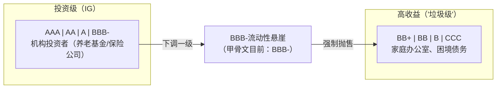
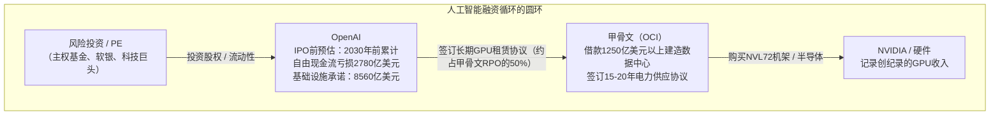
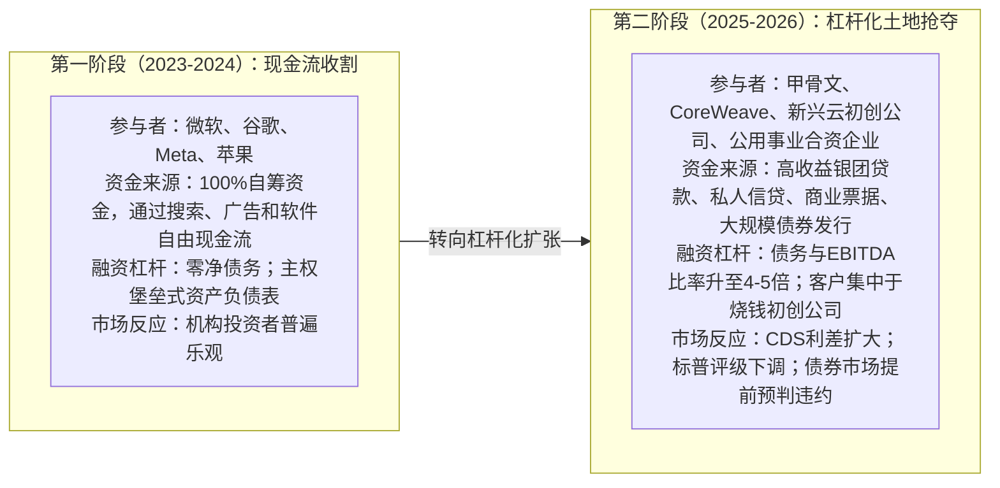

尽管股市继续庆祝数百亿美元的人工智能订单，全球信用衍生品市场刚刚发出了一个明确的预警信号。

2026年9月26日，市场评论员Hedgie (@HedgieMarkets)发布了一张来自彭博社和《金融时报》的图表，迅速在交易台上传播开来：

> “甲骨文5年期信用违约互换利差刚刚创下230基点的历史新高，是同期更广泛的55基点投资级指数的四倍。在过去一年中，利差已经翻了四倍，现在超过了2008年金融危机时期的水平。以对比，土耳其主权CDS利差为245基点。甲骨文仅比垃圾级高出一个等级，信用市场将其定价为比现代历史上最严重的金融危机还要高的违约风险。”

信用市场以无情著称。虽然股票分析师根据乐观的多年折现率和管理层指导的总可寻址市场（TAM）来定价增长，信用违约互换（CDS）交易员则仅根据一个指标进行交易：**违约和资本回收的数学概率**。

当一家拥有超过1250亿美元总债务的遗产技术巨头看到其CDS利差从40基点飙升至230基点——与更广泛的市场严重背离时，这并不是噪音。这是债券市场在定价结构性流动性危机。

甲骨文股价飙升的背后隐藏着三个生死攸关的力量的交汇：
1. **标普评级下调至BBB-**：将甲骨文置于垃圾级（投机级）的最低等级，任何进一步的下调都会触发**全球历史上最大的“堕落天使”强制抛售**。
2. **极端的OpenAI交易对手方集中度**：甲骨文6380亿美元未完成订单（RPO）的近50%与一家亏损的AI初创公司相关，该初创公司预计到2030年累计现金赤字为2780亿美元。
3. **“太大而不能倒”的国家安全赌博**：拉里·埃里森似乎押注甲骨文在五角大楼、情报机构和医疗基础设施中的深度渗透确保了在AI基础设施周期破裂时会得到联邦政府的救助。

让我们对信用机制、交易对手方风险、堕落天使传播机制以及这对更广泛的人工智能宏观经济周期意味着什么进行法医分析。

---

## 1. 解剖信号：230基点CDS利差意味着什么

要理解图表的规模，必须了解信用违约互换（CDS）的功能以及投资级技术债务的典型估值。

信用违约互换是一种场外金融衍生品，类似于保险，用于保护公司或主权违约风险。230基点的利差意味着机构债券持有者必须每年支付230,000美元以保险1000万美元的甲骨文债务，为期5年（2.30%的年利率）。

**5年期信用利差比较（2026年9月）**

| 资产/发行人 | 5年期CDS利差 | 信用评级（标普/穆迪） |
| :--- | :--- | :--- |
| 微软公司（MSFT） | ~18基点 | AAA / Aaa |
| 谷歌公司（GOOGL） | ~22基点 | AA+ / Aa2 |
| Markit CDX北美投资级指数 | 55基点 | 投资级综合 |
| 美国高收益“BB”交叉指数 | ~210 - 240基点 | 高收益 / 投机级 |
| 甲骨文公司（ORCL） | 230基点 | BBB- / Baa3（负面展望） |
| 土耳其共和国（主权） | 245基点 | B / B1（投机级主权） |

### 三个令人担忧的背离

1. **四倍于CDX指数的利差背离**：  
   Markit CDX北美投资级指数代表了125个流动的北美投资级发行人篮子。2026年9月，该指数平静地停留在55基点，反映了健康的宏观经济流动性以及可控的系统性压力。甲骨文的230基点CDS利差是其同行基准的4.18倍。这不是宏观经济贝塔；而是特定资产负债表的困境。

2. **超过2008年全球金融危机水平**：  
   在2008年雷曼兄弟破产的最深处，全球信贷市场完全冻结，银行系统中的对手方风险激增。在2008年，甲骨文5年期CDS短暂突破100-120基点。今天，230基点的CDS利差表明信用衍生品交易员认为甲骨文的违约风险**超过了历史上最严重的金融危机期间的峰值恐慌水平的两倍**。

3. **与土耳其主权债务相当**：  
   土耳其是一个新兴市场经济体，历史上外汇储备波动、通货膨胀率两位数、主权评级为投机级B/B1（245基点）。固定收益市场要求为甲骨文公司债务保险的风险溢价与为土耳其主权债务保险的风险溢价几乎相同，这表明债券交易商严重怀疑甲骨文资产负债表的杠杆风险。

---

## 2. 1250亿美元的“堕落天使”陷阱

为什么市场如此恐慌，甲骨文仍然被分类为“投资级”？

答案在于**BBB-与BB+之间的流动性悬崖**。

### 2026年7月标普评级下调
2026年7月9日，标普全球评级将甲骨文长期发行人信用评级从**BBB下调至BBB-**，维持**负面展望**。

BBB-是最低的投资级等级。在评级下调声明中，标普信用分析师指出他们低估了支持大规模人工智能扩张所需的资本投资和债务融资基础设施建设规模。标普预计甲骨文的债务与息税前利润（EBITDA）比率将在2027财年中期保持在中等4倍左右——远高于稳定投资级评级所需的2.5倍至3.0倍的上限。

### 强制抛售的机制
在公司金融中，“堕落天使”是指从投资级（BBB-或更高）下调至投机级（BB+或更低）的发行人。

这一转变不仅仅是字母的变化；它触发了机构机械抛售：
* **受监管的投资委托**：由主权财富基金、州养老金系统（如CalPERS）、企业退休计划和人寿保险公司管理的数万亿美元资金有严格的法定或信托章程，**明确禁止持有非投资级债务**。
* **指数剔除**：全球固定收益的核心基准——**彭博美国综合债券指数（“The Agg”）**以及大型ETF，如先锋总债券市场（BND）和iShares投资级公司债券ETF（LQD）——必须在每月再平衡周期结束时自动剔除任何低于BBB-/Baa3的债券。
* **抛售的规模**：截至2027财年第一季度（截至2026年8月31日），甲骨文持有约**1253亿美元的总表内债务**（长期票据1177亿美元，短期债务7.6亿美元），调整后的租赁包括在内后，债务总额可能达到**1435亿美元**。

**历史上堕落天使比较（按债务规模）**

| 公司 | 降级至垃圾级年份 | 估计债务降级规模 |
| :--- | :--- | :--- |
| 通用汽车公司（GM） | 2005 | 约300亿美元 |
| 欧佩克石油公司 | 2020 | 约350亿美元 |
| 福特汽车公司 | 2020 | 约360-780亿美元 |
| 甲骨文公司（潜在） | 2026 / 2027 | 约1250亿美元以上（创纪录） |

如果标普或穆迪将甲骨文下调一个等级至BB+，甲骨文将立即成为**全球历史上最大的堕落天使**。

美国高收益债券市场的总市值约为1.4万亿美元至1.6万亿美元。将**1250亿美元以上的甲骨文债券一夜之间抛入垃圾债券市场**将代表一个相当于整个资产类别的近8%至10%的供应冲击。高收益共同基金和ETF的流动性无法吸收如此大规模的供应，除非二级市场债券价格暴跌至70-80美分，导致所有投机级公司的借贷成本飙升。这就是为什么CDS利差扩大：衍生品交易员正在提前预判强制抛售悬崖。

---

## 3. 交易对手方定时炸弹：OpenAI的2780亿美元烧钱

如果甲骨文的债务负担如此脆弱，为什么拉里·埃里森还要加速？

催化剂是争夺人工智能云战争。亚马逊（AWS）、微软（Azure）和谷歌（GCP）在传统企业云托管中占据主导地位，甲骨文云基础设施（OCI）定位为低开销的AI计算集群供应商——与OpenAI、软银和埃隆·马斯克的xAI签订了里程碑式的合作伙伴关系。

在最近的财报电话会议上，甲骨文庆祝其剩余绩效义务（RPO）回款额创纪录的6380亿美元，推动股价飙升。

然而，信用评级机构会忽视这些头条回款额来评估**客户集中度和交易对手方的偿付能力**。

### 交易对手方脆弱性的解剖

1. **50%的回款集中在单一实体**：  
   根据标普的信用评估，**OpenAI约占甲骨文6380亿美元RPO回款额的50%**。这意味着甲骨文未来数年的大部分收入都依赖于OpenAI这家单一公司的财务生存和合同履约能力。

2. **OpenAI的2780亿美元现金赤字现实**：  
   在OpenAI计划进行公司重组和IPO前资本筹集之前，内部财务数据显示OpenAI预计2030年前累计自由现金流亏损2780亿美元。为了维持其前沿模型训练和推理管道，OpenAI预计需要**8560亿美元的总计算和基础设施支出**。

3. **致命的不对称性**：  
   * **甲骨文的义务是硬性的和不可变的**：当甲骨文与电力供应商签订15至20年的电力购买协议（PPA），租赁数千英亩的工业用地，并下达数亿美元不可取消的购买订单时，这些义务是固定的公司债务和租赁契约。
   * **OpenAI的支付能力是投机性的和可变的**：OpenAI的付款取决于来自全球主权财富基金和风险投资家的连续、不间断的数亿美元融资轮次。

如果风险资本的风险偏好减弱，或者模型能力的提升面临边际收益递减，导致企业订阅增长放缓，OpenAI将被迫重新谈判、推迟或违约其计算预订。

如果OpenAI不能按时支付，甲骨文将持有大量专门的、快速贬值的硬件，数百亿美元的月度电力和公用事业承诺，以及一个没有相应现金流来偿还的1250亿美元债务堆。

---

## 4. “太大而不能倒”：埃里森的政府保护

在病毒式评论中，Hedgie指出了埃里森心态的心理基础：

> “我认为他假设甲骨文太大、嵌入政府IT系统太深，不会被允许倒闭。这可能是真的，但这是一场赌注，赌的是其他人承担风险，而不是一种金融策略。”

埃里森是天真还是在计算主权保护？

甲骨文与美国联邦政府核心操作体系的整合几乎无法夸大：
* **五角大楼（JWCC）**：甲骨文是国防部价值90亿美元的联合战争云能力合同下的四大多云提供商之一，为战术边缘计算和最高机密的国防操作提供动力。
* **情报机构**：甲骨文政府云托管了中央情报局、国家安全局和国家情报总监的机密工作负载。
* **医疗基础设施（Cerner）**：甲骨文以280亿美元收购Cerner，将退伍军人事务部（VA）和国防部医疗系统的电子健康记录直接置于甲骨文服务器上。
* **福利发放**：社会保障署、医疗保险和内部收入署运行的事务关系数据库引擎运行在甲骨文硬件和软件上。

埃里森的论点似乎很清楚：**美国政府不能让甲骨文关门**。甲骨文数据中心的连锁破产将瞬间瘫痪国防物流、退伍军人医疗和联邦税收征收。

### 为什么“太大而不能倒”不能拯救债券持有者或股东

“太大而不能倒”（TBTF）论点的致命缺陷在于混淆了**运营的保存**与**资本的保存**。

历史为投资者在联邦救助上的赌注提供了严酷的教训：
1. **通用汽车和克莱斯勒（2009年）**：通用汽车被视为美国工业基础的关键。联邦政府通过数十亿美元的TARP融资介入。生产线从未停止，汽车工人继续生产汽车。然而**股票被清零**，优先无担保债券持有人被迫在结构化的第11章重组中接受大幅减记。
2. **房利美和房地美（2008年）**：抵押巨头是美国住房所有权的支柱。政府将它们置于永久托管状态。抵押贷款得到了支付，但普通股东几乎被清零，优先股价值下降了90%以上。

即使在最慷慨的救助情景中，如果甲骨文面临债务危机，国防部门将介入以接管或保护其**军事数据库和国家安全云区域**。

白宫不会花费数百亿美元的纳税人资金来服务为OpenAI建设投机GPU集群而发行的私人公司债券。

---

## 5. 连接点：人工智能债务超级周期

这一发展必须与我们之前对高盛2026年9月关于**超大规模人工智能资本支出**的报告进行并行分析。

在该分析中，我们记录了六家主要基础设施运营商在第二阶段人工智能资本支出（1.22万亿美元）上实现零投资回报率（0.0% ROIC）所需的**3080亿美元年度收入门槛**，以对抗残酷的5年GPU硅片折旧周期。

在第一阶段，人工智能热潮由大科技的现金奶牛资助。微软和谷歌可以每年从超额运营现金流中支付数十亿美元的GPU费用，而不必承担债务。

在第二阶段，竞赛从数十兆瓦扩展到**吉瓦级超大规模数据中心**。为了在万亿级资产负债表面前保持相关性，甲骨文选择通过**杠杆**来资助建设。

甲骨文230基点的CDS利差是第二阶段达到其财务极限的明确信号。固定收益投资者拒绝以投资级价格为下一波投机GPU基础设施提供资金。

---

## 6. 关注点：2026-2027年压力矩阵

对于技术高管、云架构师和机构投资者而言，甲骨文CDS的飙升预示着几个关键里程碑，这些里程碑将决定人工智能经济的轨迹：

| 里程碑 / 指标 | 监控阈值 | 影响 / 后果 |
| :--- | :--- | :--- |
| **标普 / 穆迪评级行动** | 评级低于BBB- / Baa3 | **堕落天使事件**：触发估计500亿至800亿美元的机构强制抛售，来自投资级债券基金。 |
| **甲骨文5年期CDS利差** | 跨过300基点 | 价格预示即将进行债务重组；债券市场实际上关闭了新的未对冲债务发行。 |
| **OpenAI资本筹集** | IPO前轮次的时间与估值 | 如果OpenAI无法筹集300亿美元以上的资金，它将被迫削减OCI集群承诺。 |
| **OCI回款（RPO）现金转换** | RPO转化为收入的实现率 | 检查6380亿美元回款是否转化为实际的GAAP运营现金流，还是仍然处于未实现的纸面状态。 |
| **高收益二级市场利差** | 美国高收益指数与甲骨文债券之间的利差 | 测量高收益债务基金是否愿意吸收甲骨文债券，还是要求折价收益率（10%以上）。 |

---

## 结论：金丝雀已鸣叫

历史上，信用市场是房间里最聪明的钱。

2007年，股市创历史新高，而ABX次级抵押贷款指数和摩根士丹利资本国际信用违约互换（CDS）指数却发出红色警报。2001年电信泡沫破灭前，世界通信和环球电讯的信用利差在公司破产重写光纤行业前几个月就已扩大。

今天，股市投资者看到甲骨文的头条回款数字，看到了人工智能超增长引擎。但信用违约互换交易员看到的是**1250亿美元的公司债务、标普评级接近垃圾级边缘，以及一家现金流烧钱的初创公司占据了订单簿的一半**。

在230基点的利差下，人工智能领域的金丝雀不仅在鸣叫。它正在喘息。
