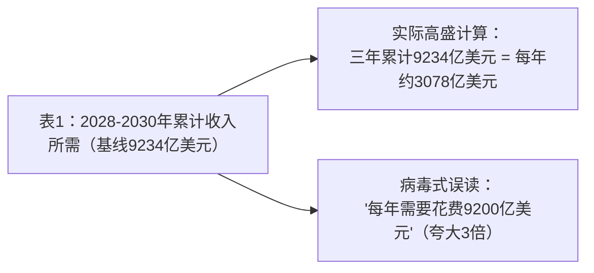
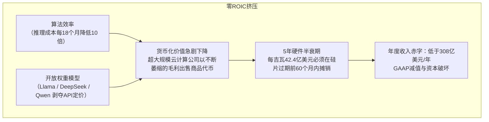

一篇图表最近在金融信息流中流传开来，立即在华尔街和AI工程社区引发了轩然大波。

该帖子由市场评论家零对冲传播，重点介绍了高盛全球投资研究和Epoch AI发布的敏感性表：

> “这可能是个问题：高盛的敏感性表显示，在最坏的情况下，如果超大规模云计算公司的资本回报率（ROIC）为0（代币成本崩溃，代币需求转向开源模型等），他们每年仍需花费9200亿美元来覆盖折旧和运营成本。”

该帖子直接触及了2026年技术景观中最为焦虑的问题：**资本回报率（ROIC）鸿沟**。

在经历了近三年的硅片采购激增、多吉瓦级电力收购和天文数字的资本支出后，投资者提出了一个直截了当的问题：*如果代币价格崩溃、开源模型商品化智能层、预期的收入风帆未能实现，会发生什么？*

然而，在分析决定数百亿美元企业估值的财务敏感模型时，精确性至关重要。

对高盛研究的法医检查揭示，尽管社交媒体上的叙述混淆了关键的会计术语和时间范围，但**实际的数学现实对宏观科技经济来说更为重要**。

让我们拆解主要报告，审计算术，剖析每吉瓦的单位经济学，并分析代币通缩与代理需求之间的生死搏斗。

---

## 1. 事实核查恐慌：三年累计 vs. 年度运行率

问题中的敏感矩阵源自高盛于2026年9月24日发布的股票研究报告，标题为：

> **“美洲科技：评估AI经济规模以证明超大规模云计算资本支出的ROIC合理性”**  
> *作者：Eric Sheridan，高盛美洲科技团队*

该报告评估了当前建设的主要美国超大规模和计算基础设施运营商：**谷歌、亚马逊、微软、Meta、甲骨文和SpaceX**。具体而言，它模型了2026-2027年“第二阶段”计算资本支出（估计为1220亿美元）的经济产出，以证明其合理性。

仔细查看发布的表格，可以发现病毒性评论的错误所在——以及它击中靶心的地方。

### 错误 #1：三年累计收入 vs. 年度支出
看看表1的标题：

表中的数字——包括在0.0% ROIC基线情况下标出的**9234亿美元**——代表2028年至2030年三年累计的收入要求，而不是年度运行率。

* **病毒性声明**：超大规模云计算公司每年需要花费920亿美元。
* **实际高盛数学**：六家超大规模云计算公司需要在三年内累计产生约**9230亿美元**，相当于整个组每年约**3078亿美元**。

病毒性帖子错误地将年度收入负担翻了三倍。

### 错误 #2：现金支出 vs. 会计盈亏平衡收入
病毒推文声称超大规模云计算公司需要“每年花费9200亿美元来覆盖折旧和运营成本。”

在公司财务中，**ROIC = NOPAT / 投资资本**。
当ROIC为**0.0%**时，净经营利润减税后（NOPAT）为零。这意味着经营收入（EBIT）为零：
$$\text{收入} = \text{现金运营费用} + \text{折旧与摊销}$$

9230亿美元三年的数字是**所需收入**，而不是增量现金支出：
1. **现金运营费用（电力、冷却、维护、电网费用）**：高盛估计为**每年约8.36亿美元/吉瓦**。在约40.6吉瓦部署的基础设施下，这等于**每年约34亿美元的实际运营现金支出**。
2. **折旧（前期资本支出的非现金摊销）**：剩余的**每年约274亿美元**代表在第二阶段部署的服务器、硅片、液体冷却分配单元和数据中心的直线会计折旧。

### 为什么纠正错误数字并不能缓解危机
将数字从920亿美元/年纠正到**308亿美元/年**纠正了阅读错误，但这并不能解决超大规模云计算公司的危机。

考虑2026年企业软件和云计算行业的基线背景：
* **亚马逊网络服务（AWS）**的全年收入约为105亿美元。
* **微软Azure**的全年收入约为75亿美元。
* **谷歌云平台（GCP）**的全年收入约为45亿美元。

今天，全球公共云基础设施市场的总收入在3200亿至3600亿美元之间——累积了近二十年的数字化转型、企业ERP迁移、数据库托管和Web服务。

高盛的敏感性表证明，超大规模云计算公司必须从AI工作负载中单独产生**相当于第二个AWS + Azure + GCP的全年收入（308亿美元/年）**，才能实现零经济利润。

如果2028-2030年的累计AI收入为200亿美元/年而不是308亿美元，ROIC将急剧转为负数。在这种情况下，世界上最大的技术资产负债表将被迫进行大规模的GAAP减值和数十亿美元的资产减记。

---

## 2. 高盛敏感性模型的拆解

为了理解高盛是如何得出这些门槛的，我们需要检查底层的机械参数：**每吉瓦（GW）资本支出（CapEx）**、电力容量和资产寿命。

### 两个敏感性矩阵

以下是高盛全球投资研究（数据来自Epoch AI和公司文件）的具体数据：

#### 表1：2028-2030年累计收入所需（亿美元）
| 每吉瓦资本支出（亿美元） | 30.0% ROIC | 25.0% ROIC | 20.0% ROIC | **15.0% ROIC（基线）** | 10.0% ROIC | 5.0% ROIC | **0.0% ROIC（盈亏平衡）** |
| :--- | :---: | :---: | :---: | :---: | :---: | :---: | :---: |
| **50.9** | 1890.9 | 1727.1 | 1563.2 | 1399.3 | 1235.4 | 1071.5 | **907.6** |
| **48.8** | 1894.4 | 1730.5 | 1566.6 | 1402.7 | 1238.8 | 1074.9 | **911.1** |
| **46.7** | 1898.1 | 1734.2 | 1570.4 | 1406.5 | 1242.6 | 1078.7 | **914.8** |
| **44.6** | 1902.2 | 1738.3 | 1574.5 | 1410.6 | 1246.7 | 1082.8 | **918.9** |
| **42.4（基线）** | 1906.7 | 1742.9 | 1579.0 | **1415.1** | 1251.2 | 1087.3 | **923.4** |
| **40.3** | 1911.7 | 1747.8 | 1584.0 | 1420.1 | 1256.2 | 1092.3 | **928.4** |
| **38.2** | 1917.3 | 1753.4 | 1589.5 | 1425.6 | 1261.7 | 1097.8 | **934.0** |
| **36.1** | 1923.5 | 1759.6 | 1595.7 | 1431.8 | 1267.9 | 1104.0 | **940.2** |
| **34.0** | 1930.4 | 1766.6 | 1602.7 | 1438.8 | 1274.9 | 1111.0 | **947.1** |

#### 表2：每吉瓦隐含年度收入所需（亿美元）
| 每吉瓦资本支出（亿美元） | 30.0% ROIC | 25.0% ROIC | 20.0% ROIC | **15.0% ROIC（基线）** | 10.0% ROIC | 5.0% ROIC | **0.0% ROIC（盈亏平衡）** |
| :--- | :---: | :---: | :---: | :---: | :---: | :---: | :---: |
| **50.9** | 18.6 | 17.0 | 15.4 | 13.8 | 12.1 | 10.5 | **8.9** |
| **48.8** | 17.9 | 16.3 | 14.8 | 13.2 | 11.7 | 10.1 | **8.6** |
| **46.7** | 17.1 | 15.6 | 14.2 | 12.7 | 11.2 | 9.7 | **8.2** |
| **44.6** | 16.4 | 15.0 | 13.5 | 12.1 | 10.7 | 9.3 | **7.9** |
| **42.4（基线）** | 15.6 | 14.3 | 12.9 | **11.6** | 10.3 | 8.9 | **7.6** |
| **40.3** | 14.9 | 13.6 | 12.3 | 11.1 | 9.8 | 8.5 | **7.2** |
| **38.2** | 14.1 | 12.9 | 11.7 | 10.5 | 9.3 | 8.1 | **6.9** |
| **36.1** | 13.4 | 12.3 | 11.1 | 10.0 | 8.8 | 7.7 | **6.5** |
| **34.0** | 12.7 | 11.6 | 10.5 | 9.4 | 8.4 | 7.3 | **6.2** |

*(来源：Epoch AI，公司数据，高盛全球投资研究)*

---

### 拆解每吉瓦的单位经济学

注意Sheridan框架的核心假设：

1. **总容量建模：约40.6吉瓦**
   将基线收入（1415.1B亿美元）除以三年每吉瓦收入（11.6B亿美元 × 3 = 34.8B亿美元）得出，六家超大规模云计算公司在2027年部署了40.66吉瓦的人工智能计算基础设施。
   * *背景*：40吉瓦相当于**整个英国的平均电力负荷**，或相当于**40座商业核电站**的输出。超大规模云计算公司正在36个月内建造相当于一个工业化国家电力需求的数据中心。

2. **前期资本强度：每吉瓦42.4亿美元**
   建设1吉瓦现代人工智能容量与传统超大规模云截然不同：
   * **硅片与加速服务器（约75-80%）**：NVIDIA Blackwell（GB200/B300）NVL72机架、Rubin集群、定制ASIC（谷歌TPU v6/v7、AWS Trainium 3）。每完全填充的高密度液体冷却机架（120kW到132kW）成本约为300万美元到350万美元，服务器本身消耗了超过300亿美元。
   * **高带宽互连（约10%）**：800G/1.6T光收发器、共封装光学、脊叶InfiniBand/ROCE网络架构。
   * **电力、冷却与建筑壳体（约10-15%）**：液冷CDU（冷却分配单元）、高压变电站、备用电池阵列、以及并网的电力设施。

3. **折旧计划：5年的硬件陷阱**
   高盛将计算硬件按5年的直线折旧计划建模，物理设施按15年的计划折旧。
   * 因为大约80%的42.4亿美元/吉瓦是计算硅片和网络，这部分资产每年折旧20%。
   * 在420亿美元/吉瓦的硅片上，这每年产生**68亿美元的纯折旧**。
   * 加上物理壳体折旧（约0.55亿美元/吉瓦）以及高盛估计的年度运营现金支出（每吉瓦电力、水、设施人员和维护费用约为0.836亿美元），每吉瓦的总基线成本为：
   $$6.8\text{B} + 0.55\text{B} + 0.84\text{B} \approx \mathbf{8.2\text{B} \text{每年每吉瓦}}$$
   * 考虑到营运资本和公司管理费用的分配，这直接与高盛模型的**0% ROIC下每吉瓦7.6亿美元至8.9亿美元的年度收入门槛**一致。

**1吉瓦人工智能基础设施的单位经济学**

**前期资本支出：                   42,400,000,000美元（42.4亿美元）**

**- 计算硅片与机架：     约34,000,000,000美元（80%）**

| - 电力、冷却与建筑： | 约8,400,000,000美元（20%） |
| :--- | :--- |
| 年度折旧费用： | 约7,350,000,000美元/年 |
| 年度现金运营支出（电力/冷却）： 约836,000,000美元/年 |  |
| 基线盈亏平衡收入（0%）： | 约7.6B - 8.2B美元/吉瓦/年 |
| 所需15% ROIC收入： | 11.6B美元/吉瓦/年 |

---

## 3. 逆向资本支出悖论的反直觉

仔细查看表1和表2，一个有趣的数学异常现象出现了：

* 在**表1（总收入）**中：每吉瓦资本支出从42.4亿美元下降到34.0亿美元时，所需的总收入略有增加（从30% ROIC下的1890.9亿美元增加到1930.4亿美元，从0% ROIC下的907.6亿美元增加到947.1亿美元）。
* 在**表2（每吉瓦收入）**中：每吉瓦资本支出下降时，隐含的每吉瓦收入急剧下降（从30% ROIC下的18.6亿美元下降到0% ROIC下的6.2亿美元）。

为什么总收入在每吉瓦资本支出下降时反而上升？

因为高盛固定了**总资本支出**（第二阶段计算资本支出1220亿美元）。如果每吉瓦的成本从42.4亿美元下降到34.0亿美元，超大规模云计算公司不会减少总体支出；他们**建造了显著更多的吉瓦容量**（从约24吉瓦扩展到约36吉瓦的新建设）。 

部署更多的吉瓦意味着更大的物理数据中心需要供电、人员、保险和维护（每吉瓦每年现金运营支出约8360万美元）。因此，运营费用在更多设施中累积，增加了总营业额，以覆盖折旧和开支。

---

## 4. 零ROIC噩梦的解剖

为什么ZeroHedge和宏观悲观者会聚焦于**0% ROIC列**？

在股权估值中，超大规模云计算公司以25倍至35倍的市盈率交易，因为投资者定价了高增量ROIC（通常为20%至30%的云业务）。如果ROIC降至0%，该资本投资的企业价值基本上被抹去。

三个结构性力量威胁将行业推向这一零ROIC情景：

### 1. 代币通缩的跑步机与Jevons悖论的失败
Epoch AI和行业基准显示，推理成本在过去12到18个月内几乎**下降了一个数量级**。
* 架构突破——如DeepSeek的多头潜在注意力（MLA）、量化FP4/FP8执行、推测性解码和混合代理架构——大幅减少了生成高质量代币所需的FLOPs。
* 在古典经济学中，**Jevons悖论**指出，随着资源变得更为高效和便宜，总消费量会增加。
* 但为了使Jevons悖论对超大规模云计算公司有利，**需求弹性必须显著超过1.0**。如果推理定价下降90%，企业代币消费仅增长三倍（300%增长），总毛收入将收缩70%。

### 2. 开放权重模型的挤压
专有前沿模型（OpenAI、Anthropic、谷歌Gemini）最初以每百万输出代币15至30美元的溢价定价。

然而，开放权重模型（Meta的Llama家族、DeepSeek、阿里巴巴的Qwen、Mistral）系统地在编码、推理和指令遵循基准上缩小了能力差距。

企业CIO越来越多地在内部集群或通过第三方基础设施（Together AI、Fireworks、Lambda Labs）部署微调的、量化的开放权重模型，成本仅为专有API的75%以上。这种动态剥夺了专有API的75%以上的软件毛利，压缩超大规模云计算公司为低毛利基础设施公用事业。

### 3. 5年GPU半衰期：电信光纤与硅片
在1999年至2000年的电信泡沫期间，电信巨头（WorldCom、Global Crossing）过度建设了横跨大陆的光纤网络。当泡沫破裂时，这些光纤在地下闲置。关键的是，**暗光纤不会生锈、退化，闲置时也不会消耗1000瓦的电力**。五年到十年后，随着互联网视频流量（YouTube、Netflix）的上升，这些光纤在几乎零增量资本支出的情况下被点亮。

**AI集群没有这样的奢侈**。
* 高功率GPU运行温度高（80°C-90°C），经历物理热应力，并需要高连续基荷电力才能保持联网。
* 更加致命的是**技术过时**：H100或B200集群在60个月内折旧在资产负债表上。但当2028年下一代架构（Rubin或2纳米定制ASIC）提供3倍至5倍更好的每瓦性能时，旧集群在当前电网电力成本下变得经济上不具竞争力。
* 如果超大规模云计算公司在第一年和第三年未能实现其420亿美元/吉瓦的建设回报，这些资产无法留待以后使用。它们成为搁浅的硅片。

---

## 5. 多头的辩护：Agentic AI和积压订单能否拯救周期？

高盛的报告不是看空的挽歌；而是为多头必须实现的数学基准设定了框架。高盛认为，2028-2030年15% ROIC所需的1.42万亿美元收入规模是通过两个主要支柱实现的：

### 1. 1.69万亿美元的云积压订单
截至2026年第二季度，三大云提供商（亚马逊、微软、谷歌）合计持有的**剩余履约义务（RPO）积压订单为1.69万亿美元**。
* 高盛指出，累计AI收入需求（1000亿至1420亿美元）约占现有合同承诺云基础设施支出的**59%**。
* 这表明企业客户已经签署了多年法律协议，承诺在云基础设施上投入巨额资金。

* 悲观者的注意事项：RPO积压订单代表企业IT总支出——包括核心关系数据库、SAP/Workday托管、虚拟桌面和对象存储。它们不是专门、不可取消的AI代币预算。如果企业宏观经济预算收紧，积压订单的客户支出率会大幅放缓。

### 2. 从聊天机器人到Agentic AI的范式转变
最终的多头辩护在于从**对话式AI到代理式AI**的结构性转变。

**代币消费比较：聊天机器人 vs. 自主代理**

**对话查询（例如ChatGPT）：**

**- 用户提示 + 回答：              约500 - 1500个代币**

**- 每次交互的成本：              <0.005美元**

**自主多步骤任务（例如代码重构 / 法医审计）：**

**- 系统提示 + AST分析：      约50,000个代币**

**- 递归反思与工具调用：      约350,000个代币**

**- 测试执行与自我纠正：      约400,000个代币**

**- 总代币消耗：             约800,000 - 2,500,000个代币**

| - 每次交互的成本： | 2.00 - 10.00美元 |
| :--- | :--- |
| 代币量级放大倍数： | 1000 - 2000倍/任务 |

当人类用户通过聊天提示与AI交互时，代币量受到人类阅读速度的限制。

相比之下，**代理式AI**系统自主运行在循环中：从代码库中获取上下文、搜索文档、执行终端命令、评估测试套件并在失败时重试。单个复杂的工程或商业任务可以轻松消耗**数百万个代币**。

如果自主代理工作流在软件工程、法律合规、供应链物流和客户服务等领域成为标准，全球代币量不仅不会增长300%，**而是增长10,000%到100,000%**。

这就是击败代币通缩跑步机并产生4720亿美元高毛利年度收入所需的代币量级爆炸。

---

## 6. 综合：资本周期审判

ZeroHedge的病毒推文在阅读表格标题时事实不准确，误将三年累计数字视为年度现金支出。

然而，就像许多市场梗一样，它的本能的悲观主义比经过净化的公司新闻稿更准确地捕捉到了核心困境：

1. **底线是生死攸关的**：即使纠正了算术错误，超大规模云计算公司仍面临**308亿美元的年度收入门槛**，仅用于覆盖现金运营支出和资产折旧。未能达到这个底线意味着负ROIC、资产减记和多重压缩。
2. **15% ROIC门槛是巨大的**：在2028-2030年生成**1.42万亿美元（4720亿美元/年）**需要AI成为现代企业历史上单一年度收入增长最大的技术转型，不到四年。
3. **与过时赛跑**：与19世纪的铁路或20世纪的电信光纤不同，GPU基础设施在两端燃烧蜡烛：高连续运营支出，以及五年半的技术过时。

接下来的24个月将揭示Agentic AI能否触发巨大的Jevons悖论扩展，填满40.6吉瓦的计算容量——还是技术行业正朝着有史以来最昂贵的折旧悬崖奔去。

---
