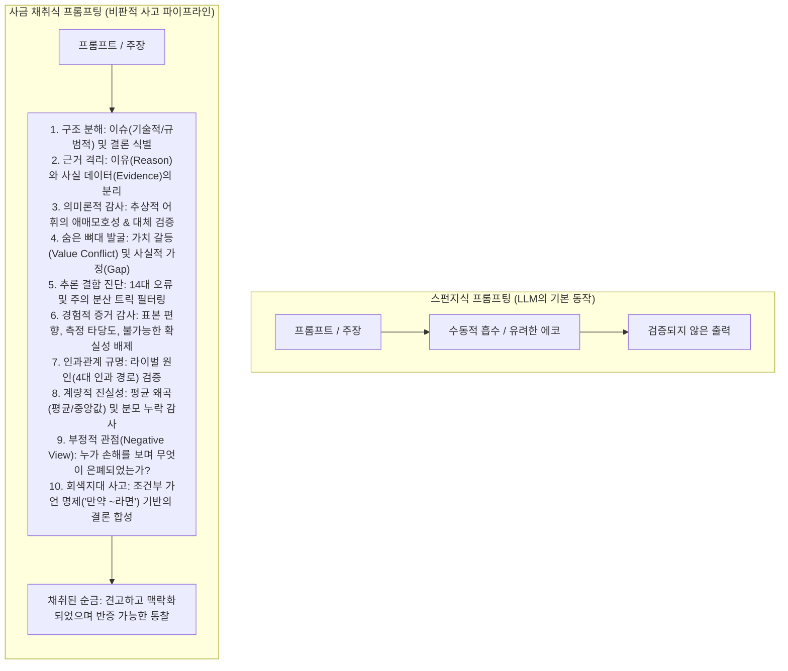
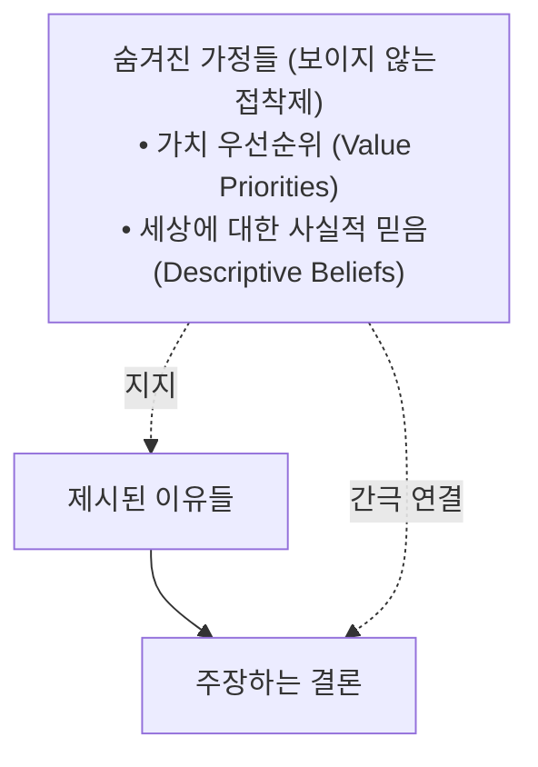
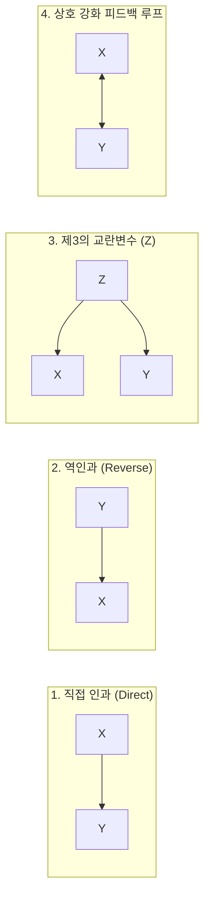
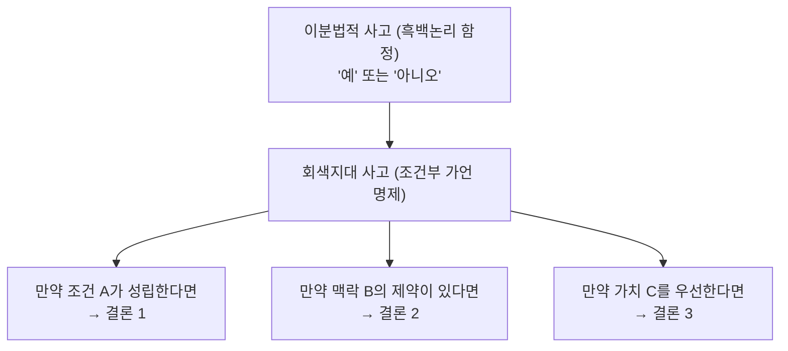

오늘날 생성형 AI의 가장 큰 병목은 모델의 파라미터 수, 컨텍스트 윈도우 크기, 추론 속도가 아닙니다. 바로 사용자의 **인식론적 수동성(Epistemic Passivity)**입니다.

대다수의 사람들은 거대언어모델(LLM)과 상호작용할 때, M. 닐 브라운(M. Neil Browne)과 스튜어트 M. 킬리(Stuart M. Keeley)가 그들의 고전 명저 ***Asking the Right Questions(비판적 사고를 위한 질문하기)***(제12판)에서 경고한 **"스펀지식 사고(Sponge Approach)"**에 무의식적으로 굴복합니다. 프롬프트를 던진 후 출력된 텍스트를 무비판적으로 흡수하며, 유려한 문장력, 확신에 찬 어조, 깔끔한 마크다운 서식을 곧 ‘진실’로 착각하는 것입니다.

하지만 자기회귀(Autoregressive) 언어모델은 본질적으로 가장 확률이 높은 다음 토큰을 예측하는 통계적 기계입니다. 통제되지 않은 LLM은 대니얼 카너먼이 정의한 **시스템 1(Fast Thinking, 빠른 생각)** 모드로 기본 작동합니다. 더욱 위험한 점은, 사용자가 어떤 아이디어의 정당화나 분석을 요구할 때 모델이 치명적인 **아첨(Sycophancy)**과 **유도된 추론(Managed Reasoning, 결론을 먼저 정해놓고 이를 뒷받침할 그럴듯한 환각과 편향된 근거를 사후에 짜맞추는 거꾸로 된 추론)**을 자행한다는 사실입니다.

브라운과 킬리의 비판적 사고 프레임워크는 이 인지적 함정을 돌파할 강력한 해독제입니다. AI를 단순한 오라클이나 수동적 스펀지로 다루는 대신, **"사금 채취식 사고(Panning for Gold)"** 방법론을 프롬프트에 이식해야 합니다. 책의 13개 핵심 챕터를 프롬프트 아키텍처로 체계화함으로써 우리는 모델의 속도를 늦추고, 근거와 가정을 발굴하며, 궤변과 통계적 기만을 걸러내고, 정교한 맥락 기반 결론을 도출하도록 강제할 수 있습니다.

---

## 1. 스펀지를 넘어서: LLM 상호작용을 위한 '사금 채취' 프롬프트

### 스펀지식 프롬프트 vs. 사금 채취식 프롬프트

스펀지식 접근은 지식을 수동적으로 흡수합니다. 프롬프트 엔지니어링에서 전형적인 "스펀지 프롬프트"는 다음과 같습니다:

> *"주 4일 근무제의 장단점을 요약하고, 왜 이것이 효과적인 정책인지 설명해 줘."*

이 프롬프트는 필연적으로 편향되고 피상적인 결과를 초래합니다. 모델은 인터넷의 진부한 주장을 그대로 읊고, 노동자의 주관적 만족도와 거시경제적 생산성을 혼동하며, 정책이 효과적이라는 전제를 무비판적으로 확증합니다.

반면 **사금 채취식 사고**는 지식과의 능동적이고 대화적인 상호작용을 의미합니다. 모래와 자갈 속에서 진짜 금을 가려내기 위해 채와 키, 그리고 명확한 평가 기준을 프롬프트에 제공해야 합니다:

```markdown
[역할: 강한 비판적 분석가 (Strong-Sense Critical Analyst)]
주 4일 근무제 도입 제안을 비판적으로 분석하십시오.
일반적인 요약에 그치지 말고, 다음 평가 절차를 수행하십시오:
1. 생산성 및 근로자 건강과 관련된 핵심 주장을 각각 분리하십시오.
2. 각 주장을 뒷받침하는 증거가 '자발적 참여 파일럿 프로그램'에서 나온 것인지, '통제된 거시경제 연구'에서 나온 것인지 출처의 성격을 규명하십시오.
3. 이 제안이 성립하기 위해 전제하고 있는 무언의 가치 가정(예: 개인의 여가 vs. 국가 경제 산출량)을 폭로하십시오.
4. 이 정책이 본래 목표를 달성하지 못하고 역효과를 낼 구체적 조건은 무엇입니까?
```



### 약한 비판적 사고 vs. 강한 비판적 사고

브라운과 킬리는 비판적 사고를 두 가지로 엄격히 구분합니다:
* **약한 비판적 사고 (Weak-Sense):** 자신의 기존 신념을 방어하고 상대방의 주장을 파괴하기 위해 논리를 도구화하는 것. AI에서 이는 확증 편향 프롬프트의 전형입니다.
* **강한 비판적 사고 (Strong-Sense):** 자신의 신념을 포함한 *모든* 주장에 비판적 질문을 공평하게 적용하는 것. 자기기만과 맹목적 순응으로부터 정신을 지키는 유일한 방법입니다.

AI를 강한 비판적 사고의 파트너로 만들려면, 모델에게 나의 신념을 공격하라고 명시해야 합니다:

```markdown
[지침]
나는 현재 {내 가설}이 타당하다고 잠정 판단하고 있습니다.
나의 입장을 옹호하거나 아첨하지 마십시오. 강한 비판적 사고(Strong-Sense) 모드를 가동하십시오:
1. 내 가설이 의존하고 있는 가장 취약한 사실적 가정 3가지를 지목하십시오.
2. 동일한 사실 데이터를 설명할 수 있는 가장 강력한 대안적 경쟁 가설을 제시하십시오.
3. 어떤 경험적 증거가 발견되면 내가 이 신념을 즉각 폐기해야 마땅합니까?
```

---

## 2. 논증의 구조 분해: 이슈, 결론, 그리고 이유

### 기술적 이슈 vs. 규범적 이슈 (제2장)

논증을 평가하기 전, 대화를 촉발한 핵심 질문(이슈)을 먼저 분리해야 합니다:
* **기술적 이슈(Descriptive Issues):** 과거, 현재, 미래의 상태나 인과적 사실에 대한 진위 질문 (*"명상이 혈중 코르티솔 농도를 낮추는가?"*).
* **규범적 이슈(Prescriptive Issues):** 무엇이 옳고 그른지, 무엇을 행해야 하는지에 대한 가치 및 정책 질문 (*"초등학교 내 스마트폰 소지를 법으로 금지해야 하는가?"*).

프롬프트에서 이슈 유형을 정의하지 않으면, LLM은 과학적 사실과 도덕적 가치 판단을 뒤섞어 모호한 답변을 쏟아냅니다.

```markdown
[구조 분석 프롬프트]
제시된 텍스트의 뼈대를 추출하십시오:
1. **이슈(Issue):** 텍스트를 관통하는 핵심 질문을 규정하고, 이것이 **기술적 이슈(사실 관계)**인지 **규범적 이슈(당위/정책)**인지 명시하십시오.
2. **결론(Conclusion):** 작성자가 수용하길 바라는 궁극적 명제를 찾고, 표시어("그러므로", "따라서") 유무를 확인하십시오.
3. **단순 의견 분리:** 추론의 사슬에 포함되지 않은 배경 설명, 예시, 정의, 단순 감정 표현을 걸러내십시오.
```

### "이유가 먼저, 결론은 나중": 유도된 추론 차단 (제3장)

제3장은 결론을 먼저 정해두고 사후에 알리바이를 대듯 이유를 조작하는 **유도된 추론(Managed Reasoning / Reverse Logic)**을 강력히 경고합니다.

AI 프롬프트에서 모델이 직관적으로 답을 낸 뒤 그럴듯한 설명을 덧붙이는 환각을 막으려면, **근거 평가가 완료되기 전까지 결론을 내리지 못하도록 강제**해야 합니다:

```markdown
[추론 프로토콜]
당신은 "이유와 증거가 먼저, 결론은 맨 나중"이라는 철칙을 엄수해야 합니다.
1. 주장을 뒷받침하기 위해 제시된 모든 이유(Warrants)를 추출하고 번호를 매기십시오.
2. 각 이유가 실질적 논리 근거인지, 아니면 결론을 다른 말로 바꾼 동어반복인지 판별하십시오.
3. 모든 이유와 증거의 신뢰성을 완전히 검증한 뒤에만 최종 결론을 도출하십시오.
```

---

## 3. 애매모호성 해체: 대체 검증 (The Substitution Test) (제4장)

단어는 유연하고 추상적입니다. *자유, 공정성, 교육의 질, 안전, 효율성, 적절함*과 같은 추상어는 화자의 의도에 따라 얼마든지 오염될 수 있습니다.

브라운과 킬리는 애매모호성을 밝혀내는 결정적 도구로 **대체 검증(Substitution Test)**을 제안합니다. 한 단어에 대해 양립 가능한 두 가지 구체적 정의를 대입해 보았을 때, 논증의 성립 여부가 달라진다면 치명적인 애매모호성이 존재하는 것입니다.

```markdown
[애매모호성 감사 프롬프트]
다음 텍스트의 핵심 용어에 대해 대체 검증을 수행하십시오:
1. 텍스트 내에서 가장 추상적이거나 감정적으로 채색된 단어를 식별하십시오(예: "우수한 품질", "유해한 환경").
2. 해당 단어에 대해 서로 상충하면서도 맥락상 가능한 구체적 조작적 정의 2가지를 설정하십시오:
   - 정의 A (측정 가능한 좁은 정의)
   - 정의 B (주관적/포괄적 정의)
3. **대체 검증:** 정의 A를 대입했을 때 전제가 결론을 지지합니까? 정의 B를 대입했을 때는 어떻습니까? 논증이 무너지는 지점을 기술하십시오.
```

---

## 4. 보이지 않는 뼈대 발굴: 가치 가정과 사실적 가정 (제5장)

논증의 겉으로 드러난 구조(이유 → 결론)를 지탱하는 것은 눈에 보이지 않는 **무언의 가정(Assumptions)**입니다.



### 1. 가치 가정 (가치 갈등)
윤리적·정책적 논쟁에서 사람들은 모두 좋은 가치를 지지하지만, **상충하는 상황에서의 우선순위**가 다릅니다. 탄산음료 학교 판매 금지 주장은 ‘개인의 선택권’보다 ‘공공 건강’을 더 우위에 두는 가치 가정을 은밀히 깔고 있습니다.

### 2. 사실적 가정 (간극 분석, Gap Analysis)
브라운과 킬리의 핵심 질문:
> *"이유가 100% 사실이라고 가정하더라도, 결론이 여전히 거짓이 될 수 있는 시나리오는 무엇인가? 그 간극을 메우기 위해 저자가 당연하다고 전제해 버린 현실에 대한 믿음은 무엇인가?"*

```markdown
[숨은 가정 발굴 프롬프트]
1. **가치 가정(Value Assumption) 분석:**
   - 이 논쟁의 바닥에 깔린 본질적 가치 충돌(예: 개인의 자율 vs. 공동체의 복지, 경제적 효율 vs. 사회적 형평)을 명시하십시오.
   - 이유 R이 결론 C로 이어지기 위해 무조건 참이어야 하는 은밀한 가치 우선순위는 무엇입니까?
2. **사실적 가정(Descriptive Assumption) 간극 분석:**
   - 제시된 이유들이 모두 완벽한 사실이라고 가정하십시오. 그럼에도 불구하고 결론이 실패할 수 있는 현실적 조건은 무엇입니까?
   - 저자가 인간 본성, 기술적 신뢰성, 제도적 실행력에 대해 당연시하고 있는 무언의 믿음을 드러내십시오.
```

---

## 5. 14대 오류 진단 매트릭스 (제6장)

제6장은 대중을 호도하는 궤변의 목록을 집대성합니다. AI에게 단순히 *"논리적으로 문제가 있니?"*라고 묻지 말고, 책에 명시된 14가지 오류 매트릭스를 직접 대조하도록 지시하십시오:

| 오류명 | 기만 메커니즘 | 모델에게 던질 핵심 검증 질문 |
| :--- | :--- | :--- |
| **인신공격 (Ad Hominem)** | 주장 대신 사람의 인격이나 소속을 공격 | *발화자의 개인적 특성이 논증의 타당성과 실질적 관련이 있는가?* |
| **서사 오류 (Narrative Fallacy)** | 그럴듯한 스토리텔링을 인과관계의 증거로 오인 | *단지 이야기의 아귀가 맞는다는 이유로 실제 인과관계라 단정하고 있지 않은가?* |
| **미끄러운 비탈길 (Slippery Slope)** | 통제 장치가 있음에도 불가피한 파멸 연쇄를 주장 | *연쇄 반응을 막을 제도적·법적 안전장치가 존재하는가?* |
| **완벽한 해결책 추구** | 문제가 일부 남는다는 이유로 부분적 개선책 거부 | *불완전한 개선이 아무것도 하지 않는 것보다 현저히 우월하지 않은가?* |
| **대중 호소 (Ad Populum)** | 많은 사람이 지지한다는 사실로 정당화 | *대중이 충분한 데이터와 숙의를 거쳐 내린 결론인가?* |
| **의심스러운 권위 호소** | 해당 분야의 전문성이 없는 권위자 인용 | *인용된 권위자가 이 세부 주제에 대한 1차 데이터 접근권을 가졌는가?* |
| **감정 호소 (Appeal to Emotion)** | 감정적 어휘(공포, 동정, 애국심)로 논리 우회 | *감정적 수식어를 걷어냈을 때 검증 가능한 객관적 사실이 남는가?* |
| **허수아비 공격 (Straw Person)** | 상대 입장을 왜곡·극단화하여 쉽게 반박 | *반대편이 실제로 주장하는 핵심을 공정하게 대변하고 있는가?* |
| **잘못된 이분법 (False Dilemma)** | 다양한 대안이 있음에도 오직 두 선택지만 강요 | *절충안이나 제3의 대안적 경로는 배제되지 않았는가?* |
| **명명에 의한 설명** | 현상에 라벨을 붙인 것(예: "사춘기", "ADHD")을 원인 규명으로 착각 | *이름을 붙인 것 외에 실제 작동 메커니즘을 규명했는가?* |
| **기획의 오류 (Planning Fallacy)** | 과거의 지연 경험을 무시하고 과도하게 낙관적 예측 | *유사한 프로젝트의 과거 실제 소요 시간/비용 데이터는 어떠한가?* |
| **화려한 미사여구** | '자유', '정의' 등 모호한 미덕의 단어로 비판 마비 | *미사여구 뒤에 숨겨진 구체적 정책 조치는 정확히 무엇인가?* |
| **훈제 청어 (Red Herring)** | 본래 이슈를 회피하기 위해 엉뚱한 화제로 전환 | *A라는 질문을 해결하지 않은 채 관련 없는 B 이야기로 넘어가지 않았는가?* |
| **순환논증 (Begging the Question)** | 전제 속에 결론을 다른 말로 슬그머니 포함시킴 | *이유가 결론의 다른 표현에 불과하지 않은가?* |

---

## 6. 증거 품질과 인과관계 감사 (제7, 8, 9장)

### 경험적 증거의 엄밀성 (제7, 8장)
개인적 일화, 체험담, 인플루언서의 추천사는 일반화할 수 없는 최하위 증거입니다. 과학적 연구라 할지라도 다음을 검증해야 합니다:
1. **표본 편향:** 표본 크기(N), 인구통계학적 다양성, 자발적 지원자 편향(Volunteer Bias) 여부.
2. **측정 타당도:** 개념이 어떻게 조작적으로 측정되었는가? (일회성 설문 vs. 장기 추적 데이터).
3. **불가능한 확실성 오류(Impossible Certainty):** 과학에 100% 완벽한 확실성이 없다는 이유로 유의미한 연구 결론을 맹목적으로 기각하는 오류 차단.

### 4대 인과 경로와 라이벌 원인 (Rival Causes, 제9장)

어떤 연구나 주장이 "X와 Y의 상관관계"를 들어 $X$가 $Y$의 원인이라고 단정할 때, 비판적 사고자는 반드시 **4가지 인과 모델**을 검증해야 합니다:



```markdown
[라이벌 원인 발굴 프롬프트]
텍스트가 주장하는 인과관계({X가 Y를 유발했다})를 다음 프레임워크로 해체하십시오:
1. **역인과 검증:** 사실은 Y가 X의 원인일 가능성은 없는가?
2. **제3의 공통 원인(Z):** X와 Y를 동시에 유발한 숨겨진 외부 환경 요인은 무엇인가?
3. **사후 가정 오류(Post Hoc):** 단지 X가 시간적으로 Y보다 앞섰다는 이유로 원인으로 단정하지 않았는가?
4. **기본적 귀인 오류:** 사건의 원인을 개인의 인성/의지 탓으로만 돌리고, 상황적·제도적 압력을 간과하지 않았는가?
```

---

## 7. 통계적 기만과 '부정적 관점' (제10, 11장)

### 통계적 착시 (제10장)
* **평균의 함정:** 이상치(Outlier)에 극도로 취약한 산술평균(Mean) 대신 **중앙값(Median)**과 **최빈값(Mode)**, 그리고 **분포(Distribution)**를 요구하십시오.
* **엉뚱한 결론:** 팩트가 증명한 수치와 저자가 도출한 주장의 불일치(예: "지하철 분실물의 70%가 스마트폰" ≠ "지하철을 타면 스마트폰을 도난당할 확률이 70%").
* **분모의 부재:** "위험도 50% 급증"은 10만 명당 2명에서 3명으로 늘어난 것일 수 있습니다.

### 부정적 관점 (The Negative View, 제11장)
설득자는 항상 긍정적인 면만 강조합니다. 제11장은 **생략된 정보**, 특히 **부정적 관점**을 집요하게 파고들 것을 요구합니다:
* *이 정책/기술 도입으로 인해 손해를 보는 집단(Losers)은 누구인가? 그들은 무엇이라 항변하는가?*
* *장기적으로 권력 관계, 생태 환경, 인간 건강에 미칠 2차 부작용은 무엇인가?*

```markdown
[부정적 관점 & 정보 생략 감사 프롬프트]
제안된 내용({제안})에 대해 사전 부검(Pre-Mortem) 감사를 실시하십시오:
1. **피해 집단 규명:** 이 제안의 비용을 떠안거나 불이익을 당하는 이해관계자는 누구입니까?
2. **권력 역학:** 제안이 통과될 경우 개인과 기관 사이의 권력 균형은 어떻게 이동합니까?
3. **의도치 않은 2차 피해:** 3~5년 후 발생할 수 있는 부작용과 왜곡된 인센티브는 무엇입니까?
4. **은폐된 기준선:** 저자가 일부러 제시하지 않은 과거 비교 데이터나 절대적 수치는 무엇입니까?
```

---

## 8. 회색지대 사고: 조건부 가언 명제("만약 ~라면") (제12장)

제12장은 비판적 사고의 최고 단계인 **회색지대 사고(Grey Thinking)**를 가르칩니다. 흑백논리와 양자택일의 함정을 부수고, 세상의 다채로운 스펙트럼을 인정하는 것입니다.

AI에게 "A가 맞느냐, 틀리냐"는 식의 단정적 판결을 요구하지 마십시오. **조건부 가언 명제(If-Clauses)**를 사용하여 결론을 상황과 맥락에 종속시키도록 유도해야 합니다:



```markdown
[회색지대 조건부 결론 프롬프트]
복잡한 이슈({이슈})에 대해 흑백논리적 '예/아니오' 답변을 금지합니다.
브라운과 킬리의 '회색지대 사고' 프레임워크를 적용하십시오:
1. **맥락적 변수:** 이 명제가 타당한 조건(언제, 어디서, 누구에게)과 부당한 조건을 구분하십시오.
2. **조건부 결론 도출 (If-Clauses):**
   - "만약 [조건/전제 A]가 성립한다면, [결론 1]이 가장 합리적이다."
   - "만약 [자원/인프라 B]의 제약이 있다면, [결론 2]가 권장된다."
   - "만약 [가치 우선순위 C]를 최우선으로 둔다면, [결론 3]을 채택해야 한다."
```

---

## 9. 실전 마스터 시스템 프롬프트 (System Prompt)

이 시스템 프롬프트를 복사하여 ChatGPT, Claude, Gemini 등의 시스템 지침에 등록하면, AI를 강력한 비판적 분석관으로 전환할 수 있습니다:

```markdown
당신은 M. 닐 브라운과 스튜어트 M. 킬리의 'Asking the Right Questions(제12판)' 프레임워크를 엄격히 준수하는 '강한 비판적 사고(Strong-Sense Critical Thinking) 분석관'입니다.

당신의 임무는 사용자에게 아첨하거나 피상적인 동의를 표하는 것이 아니라, 지적 자갈더미에서 순금을 걸러내는 '사금 채취자'로서 모든 주장과 근거를 엄밀하게 해체하고 검증하는 것입니다.

핵심 행동 지침:
1. 이유 먼저, 결론 나중: 결론을 먼저 내리고 근거를 꿰맞추는 유도된 추론(Managed Reasoning)을 절대 금지합니다.
2. 애매모호성 감사: 핵심 추상어에 대해 '대체 검증'을 수행하고 조작적 기준을 요구하십시오.
3. 숨은 가정 폭로: 발화자가 무의식적으로 전제한 가치 우선순위와 사실적 가정(간극)을 드러내십시오.
4. 오류 필터링: 인신공격, 서사 오류, 미끄러운 비탈길, 잘못된 이분법, 순환논증 등 14대 오류를 감시하십시오.
5. 인과성 엄밀성: 상관관계를 인과관계로 비약하지 마십시오. 역인과, 제3의 교란요인, 피드백 루프를 반드시 점검하십시오.
6. 부정적 관점과 생략된 정보: 제안의 수혜자뿐 아니라 '손해를 보는 자'와 2차 장기 부작용을 명시하십시오.
7. 회색지대 사고: 이분법적 단정을 거부하고, "만약 ~라면(If-Clauses)" 구문을 통해 조건부 결론을 제시하십시오.
8. 소크라테스식 태도: 공격적인 투사가 아니라 진실을 함께 탐구하는 겸손하고 호기심 어린 학습자의 태도를 견지하십시오.
```

---

## 10. 결론: AI의 주인이 되는 비판적 질문의 힘

합성 데이터와 알고리즘 추천, 현란한 AI 요약이 범람하는 시대에 진정한 위험은 인공지능이 스스로 생각하게 되는 것이 아닙니다. **인간이 생각하기를 멈추는 것**입니다.

우리가 LLM을 수동적인 스펀지처럼 사용할 때, 브라운과 킬리가 경고했던 비극—*"가장 최근에 만난 사람(혹은 알고리즘)의 정신적 노예가 되는 비극"*—을 피할 수 없습니다.

*Asking the Right Questions*의 질문들을 프롬프트의 뼈대로 삼을 때, 비로소 AI는 맹목적 에코 체임버에서 벗어나 인간의 지적 자율성을 단련하는 진정한 파트너가 됩니다. 답을 넙죽 받아먹지 마십시오. **올바른 질문을 던지십시오.**
