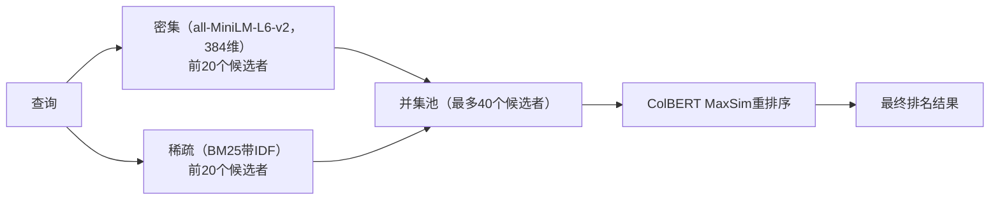
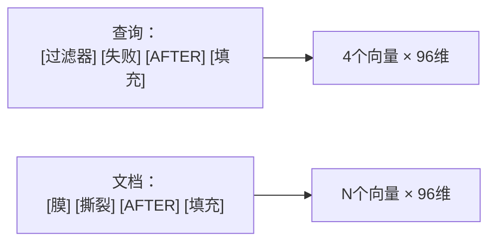

我为制药行业的质量团队构建了一个结合三种检索策略的搜索引擎。该仓库是一个教程和一个可工作的实现。以下每层的重要性以及基准测试实际显示的内容。

## 问题：受监管制药中的搜索已失效

质量保证团队每天都在搜索偏差、CAPAs、SOPs、监管引用和审计发现。这些记录充满了字母数字代码（如 `21 CFR 211.192`、`SOP-QC-7012`、`LOT-2024-MAB-8842`）、领域术语和细微的时间区别，这些区别具有实际意义。

传统搜索在这两种极端情况下都失败了：

**关键词搜索（BM25）** 能够准确匹配代码，但完全忽略了语义关系。搜索“冻结干燥器真空损失”时，你可能会错过一个名为“冻干室真空损失在主要升华干燥期间”的记录——因为BM25在“冻结干燥器”和“冻干室”之间没有找到关键词重叠。

**密集向量搜索** 捕捉了这些语义同义词，但模糊了精确标识符。搜索“21 CFR 211.192”时，密集嵌入会将监管代码视为普通的字符串，而不是精确的引用，因此你可能会得到一些通用的质量管理SOP。

单独使用任何一种方法都不够好，因为错误的搜索结果可能导致释放有问题的批次或错过监管先例。

## 架构：三种检索策略，一个管道

解决方案是运行所有三种检索策略并结合它们：



每一层都填补了其他层留下的空白：

**密集向量**（sentence-transformers/all-MiniLM-L6-v2，384维）投下了一张广泛的语义网。它们能够理解“微生物生物负荷偏移”和“腐败微生物污染”之间存在关联，即使没有任何单词重叠。在HNSW图上使用余弦相似度进行近似最近邻搜索，可以实现亚毫秒级的搜索速度。

**稀疏向量与BM25 IDF** 精确锚定具体术语。Qdrant在倒排索引中存储这些信息，并使用`models.Modifier.IDF`加权。当你搜索“21 CFR 211.192”时，稀疏索引能够找到精确的监管条款，因为字母数字标记获得了适当的词频加权。这是捕捉SOP编号、批次编号、设备标签和化学实体的层。

**ColBERT后期交互重排序** 在前两个阶段的候选池中运行。这是真正获得精度提升的地方，值得了解它是如何工作的。

## ColBERT MaxSim 实际是如何工作的

标准双编码器将整个文档压缩成一个向量。这速度快但损失了词级的细节。交叉编码器提供了这种细节，但运行速度太慢，无法在整个数据库上运行。

ColBERT找到了一个折中的方法。它将查询和文档表示为一系列的词嵌入序列：



**MaxSim** 操作符为每个查询词找到与之最相似的文档词，然后将这些最大值相加：

$$\text{分数} = \cos(\text{过滤器}, \text{膜}) + \cos(\text{失败}, \text{撕裂}) + \cos(\text{AFTER}, \text{AFTER}) + \cos(\text{填充}, \text{填充})$$

这使得ColBERT在最棘手的生物科学搜索案例中表现出色。考虑两个偏差记录：

1. **DEV-2024-1699**: 过滤器完整性测试失败 **AFTER** 批次过滤完成。严重性：关键。50,000支疫苗被拒收。
2. **DEV-2024-1710**: 过滤器完整性测试失败 **BEFORE** 批次过滤开始。严重性：轻微。无产品暴露。

BM25无法区分这些——它们的词重叠几乎相同。密集嵌入也无法区分——它们的语义距离很小。但ColBERT的词级匹配将查询词“AFTER”直接与记录1中的“AFTER”对齐，从而以高置信度将关键偏差推到首位。

## m=0 HNSW 技巧

这里有一个在生产中很重要的优化。在Qdrant中，你配置多向量索引如下：

```python
hnsw_config=models.HnswConfigDiff(m=0)
```

这禁用了ColBERT向量的HNSW图构建。为什么？因为ColBERT仅在预过滤的前K个候选者（20个来自密集向量，20个来自稀疏向量）上运行。当你仅对40个候选者进行评分时，构建包含数百万个词向量的ANN图是没有必要的。设置`m=0`可以显著节省内存和索引CPU。

## Qdrant 数据集模式

数据集在一个点中存储所有三种向量类型：

```python
client.create_collection(
    collection_name="生物科学质量记录",
    vectors_config={
        "dense": models.VectorParams(size=384, distance=models.Distance.COSINE),
        "multi": models.VectorParams(
            size=96,
            distance=models.Distance.COSINE,
            multivector_config=models.MultiVectorConfig(
                comparator=models.MultiVectorComparator.MAX_SIM,
            ),
            hnsw_config=models.HnswConfigDiff(m=0),
        ),
    },
    sparse_vectors_config={
        "sparse": models.SparseVectorParams(modifier=models.Modifier.IDF)
    },
)
```

所有三种嵌入都在客户端通过FastEmbed（ONNX运行时）生成。没有数据离开网络。这是制药行业不可或缺的——你不能将专有的药物配方或患者数据发送到外部嵌入API。

## 互逆排名融合（RRF）

在ColBERT重排序之前，密集和稀疏结果使用互逆排名融合（RRF）合并：

$$\text{RRF}(d) = \sum_{m} \frac{1}{k + \text{rank}_m(d)}$$

其中`k=60`（平滑常数）且`m`迭代检索方法。RRF不需要归一化的分数——它仅基于排名位置工作。一个文档在密集检索中排名为3，在稀疏检索中排名为5，其综合得分为`1/(60+3) + 1/(60+5)`。这自然提升了两种检索策略都同意的文档的得分。

## Pydantic AI 质量副驾

搜索引擎输入一个Pydantic AI代理，该代理生成结构化的调查报告。关键设计决策：

**通过`RunContext`进行依赖注入**。搜索管道作为类型依赖注入，而不是硬编码。代理调用`search_quality_records`作为原生工具：

```python
@agent.tool
def search_quality_records(
    ctx: RunContext[QualitySearchPipeline],
    query: str,
    severity: Optional[str] = None,
    search_method: str = "hybrid_rerank",
) -> List[Dict[str, Any]]:
    pipeline: QualitySearchPipeline = ctx.deps
    results = pipeline.hybrid_rerank_search(query, filters=..., limit=5)
    return [{"record_id": r.record_id, "title": r.title, ...} for r in results]
```

**结构化输出强制执行**。代理的输出保证是有效的`QualityInvestigationReport` Pydantic模型。没有自由文本的虚构批次编号或虚构的监管引用。该模式强制执行：

```python
class QualityInvestigationReport(BaseModel):
    summary: str
    risk_assessment: str
    regulatory_impact: List[str]
    relevant_historical_records: List[str]
    root_cause_hypothesis: str
    recommended_capa_plan: List[CapaRecommendation]
    suggested_severity: str
```

每个字段都有描述，指导LLM。如果模型无法填充某个字段，它仍然必须生成一个通过验证的内容——这使得空白可见而不是隐藏在文本中。

**本地推理通过Ollama**。代理通过Ollama的OpenAI兼容API运行在`muse-glimmer`上。没有外部API调用。LLM、嵌入和向量数据库都在本地运行。

## Langfuse 可观测性用于审计轨迹

FDA 21 CFR Part 11.10(e) 要求计算机系统维护自动化、带时间戳的审计轨迹。每次在监管调查中进行搜索查询时都必须记录：搜索了什么、检索了什么、LLM生成了什么。

仓库包含一个`docker-compose.langfuse.yml`，在本地运行Langfuse服务器+PostgreSQL。每种检索方法都装饰有`@observe_retrieval`，跟踪：

- 查询输入和活跃过滤器
- 检索的文档ID和ColBERT分数
- 检索延迟
- LLM的标记使用和完整提示快照

所有这些都保留在本地Langfuse实例中。没有遥测离开网络。

## 基准测试实际显示的内容

基准测试套件在所有四种检索策略上运行了8个GxP场景：

| 策略 | Prec@1 | Prec@3 | Recall@3 | MRR@5 | NDCG@5 |
|---|---|---|---|---|---|
| 密集（all-MiniLM） | 100% | 58.3% | 74.0% | 1.000 | 0.857 |
| 稀疏（BM25） | 100% | 70.8% | 88.5% | 1.000 | 0.967 |
| 混合（RRF） | 100% | 70.8% | 88.5% | 1.000 | 0.931 |
| 混合 + ColBERT | 100% | 70.8% | 88.5% | 1.000 | 0.949 |

需要注意的几点：

**所有方法在Precision@1上都表现良好。** 在一个25条记录的精心策划的数据集上，正确获取第一个结果并不难。区分发生在第2-5个位置。

**BM25在该数据集上优于密集向量。** 这是预期的——生物科学记录中充满了精确代码和技术术语，关键词匹配在这些地方表现优异。密集嵌入在自然语言查询中表现更好，尤其是当有同义词间隙时。

**ColBERT重排序将NDCG@5从0.931提升到0.949。** 在一个小数据集上，这是一个适度的提升。在包含数千条记录的生产语料库中，当候选池更嘈杂时，词级重排序变得更有价值。基准测试诚实地反映了这一点——真正的ColBERT胜利出现在案例研究中，而不是汇总指标中。

**案例研究是ColBERT真正发挥作用的地方。** “AFTER vs BEFORE”过滤完整性场景、“冻结干燥器 vs 冻干”同义词桥接以及精确的监管引用检索——这些都是质量保证日常工作中重要的模式。基准数据低估了实际影响，因为数据集较小且经过精心策划。

## 生产考虑

如果你在受监管环境中部署此系统：

- **锁定模型版本。** 为all-MiniLM-L6-v2、Qdrant/bm25和ColBERT模型锁定确切的模型哈希值。再现性是21 CFR Part 11.10(a)的要求。
- **ALCOA+数据完整性。** 在Qdrant载荷中存储原始元数据（记录ID、时间戳、电子签名）。使用Qdrant快照进行灾难恢复。
- **离线操作。** 使用FastEmbed（ONNX）进行嵌入，使用Ollama进行LLM推理，使用本地Langfuse进行可观测性。没有任何东西触及互联网。
- **评估模块** (`src/evaluator.py`) 计算Precision@K、Recall@K、MRR@K和NDCG@K。在你自己的真实数据上运行它，以确定系统已验证。

## 最后总结

这不仅仅是一个玩具RAG演示。三模态检索架构（密集 + 稀疏BM25 + ColBERT MaxSim）解决了生物科学质量团队每天面临的实际问题：领域术语之间的同义词桥接、精确的监管代码匹配以及细微的时间区分。`m=0` HNSW技巧使ColBERT内存高效。Pydantic AI强制执行结构化输出，使副驾无法虚构批次编号。Langfuse捕获一切以满足审计合规性。

代码是MIT许可的，并完全本地运行。如果你在制药质量保证中感到关键词搜索遗漏了半数记录，这值得一看。

**仓库**: [github.com/duksaramio/qdrant-hybrid-search-with-reranking-tutorial](https://github.com/duksaramio/qdrant-hybrid-search-with-reranking-tutorial)
