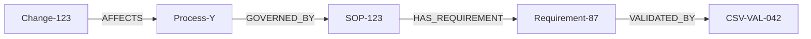
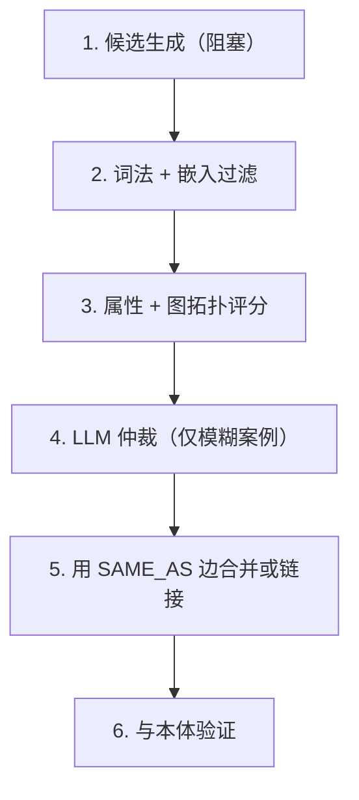

大家都在争论 GraphRAG 使用哪个图数据库。Neo4j 还是 Memgraph？Cypher 还是 openCypher？磁盘优先还是内存优先？

他们争论的是错误的层面。

数据库选择很重要，但并不是 GraphRAG 实现成功或失败的关键。它们失败在实体解析上。而且几乎没有人谈论这个问题。

## GraphRAG 的承诺

这个承诺很吸引人。向量检索 RAG 只能检索相似的文本片段。而 GraphRAG 能检索 *连接的上下文* —— 实体、关系、多跳路径。与其给 LLM 五个关于温度监测的不相关段落，不如给它一个结构化的子图：

LLM 可以在这样的结构上进行推理。而五个包含“温度”这个词的不相关段落则不行。

微软的 GraphRAG 研究支持这一点。在复杂的推理查询中，图增强检索比向量检索高出 10 个百分点以上。Neo4j 在 2026 年 5 月的一份 IDC 研究中报告称，将 AI 地基建立在知识图谱上，减少了 44% 的幻觉。一个生命科学客户从 20-40% 的幻觉率下降到 2-5%。

这些数字是真实的。但前提是图是干净的。

## 脏秘密

当你粗略地构建 GraphRAG 时会发生以下情况：

1. 你将文档分块
2. 你运行一个 LLM 提取实体和关系
3. 你将它们存储在图数据库中
4. 你在查询时遍历图

第二步会产生垃圾。不是因为 LLM 提取不好，而是因为它提取的是 *表面形式*，而不是标准实体。

从三份关于同一系统的文档中，你得到：
- "LabVantage"
- "Lab Vantage"
- "LabVantage LIMS"
- "LabVantage 8.9"
- "LIMS"
- "the LIMS system"

六个节点。一个现实世界中的实体。

现在你的图有六个不相连的集群，而它应该是一个相连的整体。你的遍历会错过关系，因为它们连接在了错误的节点上。你的实体邻域被分割了。你的社区检测产生了无意义的集群。

2025 年的研究发现，LLM 在文档片段中提取的实体有 847 个，而实际上应该是 312 个。简单地应用实体解析 —— 使图的大小减少约 40% —— 一致地提高了所有测试的 GraphRAG 变体的问答性能。

再读一遍。*移除节点改善了图*。不是因为信息错了，而是因为信息被重复了。图不是太小。它是太碎片化了。

## 实体解析才是真正的难点

大多数 GraphRAG 教程将实体解析视为一个次要问题。一个 `MERGE` 在名称上。也许是一个模糊匹配。完成。

这并不是实体解析。这只是一个带有虚幻野心的字符串比较。

真正的实体解析结合了五个信号：

**词法匹配** 捕捉了显而易见的情况。"LabVantage" vs "Lab Vantage" — 编辑距离、规范化、小写比较。这处理了大约 30% 的重复。

**嵌入相似性** 捕捉了语义等价。"质量管理系统"和"QMS"是同一件事。通过句子嵌入的余弦相似度，阈值大约在 0.88-0.92 之间。这又得到了 20-30%。

**属性匹配** 使用结构化属性。两个具有相同供应商、相同系统类型、相同部署地点的实体 —— 即使名称不同，也可能是同一个系统。

**图拓扑** 是大多数人完全忽略的部分。如果实体 A 连接到 CAPA-123、Deviation-456 和 Training-789，而实体 B 连接到相同的三个邻居，它们就是同一个实体。通过共享邻域的 Jaccard 相似度来捕获。这捕捉了两个节点名称完全不同但结构位置相同的案例。

**LLM 推理** 处理了模糊的案例。呈现候选对、它们的属性、它们的邻居，然后问："这些是同一个实体吗？" 通过链式思考或 DSPy 引导的推理。不是对每一对都这样做 —— 只是对其他信号无法解决的那些。

管道看起来像这样：

这就是 Splink 为它构建的。这就是 Senzing 做的。这也是大多数 GraphRAG 实现完全跳过的部分。

## Neo4j vs. Memgraph：实际的权衡

现在我们可以讨论数据库了。但框架很重要。

Neo4j 和 Memgraph 都支持 Cypher。都支持属性图。都支持向量索引。架构上的差异是磁盘优先还是内存优先，这有实际的影响。

**Neo4j** 是成熟的选择。Java/JVM，基于磁盘，带有页面缓存，图空间中最大的生态系统。它的 GDS 库有 65 多种算法 —— 社区检测、节点相似性、FastRP 嵌入、链接预测。它的 LLM 知识图谱构建器自动化了文本到图的管道。它的适应性 GraphRAG 框架在摄取周期中检测实体漂移和语义矛盾。如果你需要存储数十亿个节点、跨多个图实例进行联邦化，或运行复杂的分析算法，Neo4j 是答案。

**Memgraph** 是快速的选择。C++，基于内存，带有 WAL 持久性，毫秒级遍历。它的杀手功能是原子图检索 RAG —— 搜索、扩展、排名和提示组装作为一个单一的 Cypher 查询。没有多系统编排。没有需要调试的 Python 管道。一个查询，一个结果。它原生集成了 Kafka 用于流式摄取，使其成为实时知识图谱的理想选择，这些图谱不断更新。NASA 在 10 年后从 Neo4j 切换到 Memgraph，称成本和 Cypher 兼容性使迁移变得无痛。

性能差距是真实的。Memgraph 的基准测试显示，当前的延迟低至 41 倍，吞吐量高 2-5 倍。在混合工作负载的历史基准测试中，差距高达 120 倍。内存中的 C++ 与带有磁盘 I/O 的 JVM 之间的差异不是边际差异 —— 它是架构上的差异。

但性能并不是一切。Neo4j 的生态系统更深。它的社区更大。它的企业工具更成熟。如果你正在构建一个需要承载整个企业监管历史的知识图谱 —— 每个 SOP、每个偏差、每个 CAPA、每个验证记录 —— 并且你想在图上运行算法，Neo4j 的规模和 GDS 库很难被超越。

真正的问题不是“哪个更快”。而是“工作负载是什么？”

## 对于受监管 AI 的有趣之处

在受监管环境中 —— 药品、医疗器械、任何 GxP 上下文 —— 图不仅仅是一个检索基础。它是一个审计轨迹。

图中的每个关系都应携带元数据：
- 谁断言了它（第 11 部电子签名）
- 他们何时断言（时间戳，时间同步）
- 支持它的源文档的版本
- 之前的版本是什么
- 为什么它改变了（变更控制参考）

关系本身是可审计的。当检查员问“展示给我系统 X 的验证证据”，响应是一个图遍历，返回具有完整溯源信息的节点 —— 而不是一个 PDF 搜索返回“可能相关”的文档。

这就是为什么在 GxP 中实体解析变得如此关键，而通用的 RAG 实现并不理解这一点。错误地合并两个偏差记录不仅是一个检索质量问题。它是一个合规问题。审计轨迹现在是错误的。溯源链被破坏了。检查员查看合并记录时，会看到两个不同事件被归因于一个事件的证据。

因此，在 GxP 中，实体解析不能是“LLM 说它们是同一个实体，合并它们”。它需要：
- 有明确阈值的信心评分
- 对模糊案例的人工审查
- 保留原始记录的 SAME_AS 边（非破坏性合并）
- 时间跟踪以追踪替代
- 每次解析决策的完整溯源

## 没有人构建的架构

我认为正确的架构应该是这样的：

**第一层：实体解析引擎。** 在摄取时运行。结合词法、嵌入、属性、图拓扑和 LLM 信号。产生具有信心评分的标准化实体 ID。模糊案例进入人工审查。这是 Splink/Senzing 层，集成在图中。

**第二层：知识图谱。** 存储标准化实体、类型化关系、溯源元数据、时间状态和证据链。对于企业规模的分析工作负载，使用 Neo4j。对于实时代理面向的遍历，使用 Memgraph。如果负担得起，两者都使用。

**第三层：混合检索。** 向量搜索用于语义入口点。图遍历用于结构上下文。社区摘要用于全局查询。参数化 Cypher 模板用于受监管环境 —— 而不是 Text2Cypher，其中 LLM 在运行时即兴生成查询。

**第四层：AI 代理。** 它们遍历图。它们不修改图。它们使用预先编写、版本控制的 Cypher 模板。新颖的遍历是变更控制票据，而不是运行时即兴生成。

图是记录系统。LLM 是坐在其上的解释器。

## 最后一句话

图数据库是基础设施。GraphRAG 是一种应用模式。实体解析是使两者都能正常工作的前提条件。

如果你跳过了实体解析，你就不会得到 GraphRAG。你会得到可信赖的幻觉 —— 一个自信地连接错误事物的图。

数据库选择（Neo4j 还是 Memgraph）是一个真正的工程决策，有真正的权衡。但这并不是决定你的 GraphRAG 实现是否能产生准确、可审计、可信输出的决策。

这个决策是：在投资任何其他东西之前，你是否投资了实体解析。
