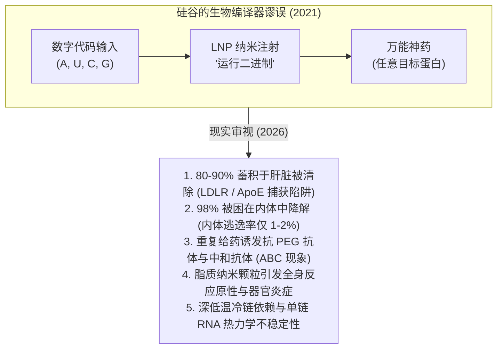
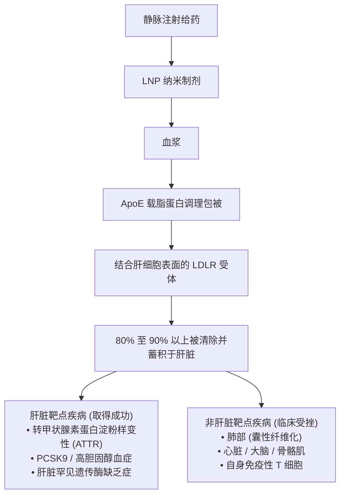
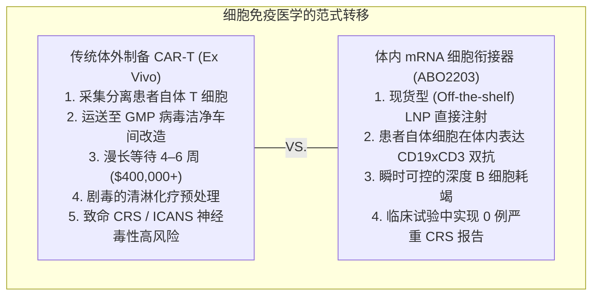
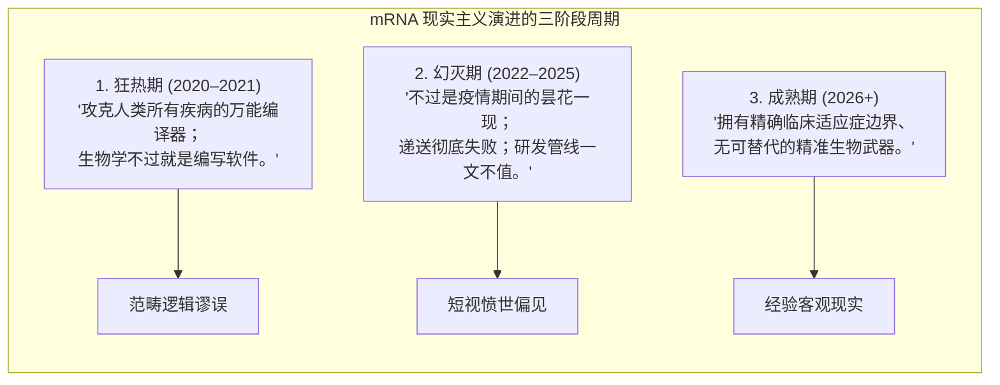

一位读者提出了一个非常直接、深刻且完全可以理解的问题：

> *“几年前，人们几乎陷入了疯狂，声称 mRNA 将彻底改变一切——生物学变成了‘软件’，我们可以在一夜之间编译出疗法。现在这种说法还成立吗？是什么熄灭了那股狂热？遇到了哪些阻碍和局限？究竟出了什么差错，mRNA 还有救吗，它是否有未来的出路？这不是我的专业领域，能否请你给出一份客观、不加粉饰的评估？”*

这是目前整个生物医药领域最核心的时代课题。而就在几天前，2026 年 10 月初，这个问题再次登上了全球行业头条：

*来源：[BioSpace](https://www.biospace.com/deals/opinion-how-abogen-went-from-covid-hype-to-a-7-8b-novartis-deal) 报道诺华为艾博生物（Abogen Biosciences）的体内 mRNA T 细胞衔接器（T-cell engager）支付 5.75 亿美元首付款、达成总额最高达 78 亿美元的合作协议（2026 年 10 月）。*

从表面上看，这令人感到极度的认知割裂：
- 在 2022 年至 2025 年之间，公众对 mRNA 的狂热跌入谷底。Moderna 的市值从 2021 年的巅峰缩水了 80% 以上。BioNTech 将数十亿美元的账面现金转向传统抗体偶联药物（ADC）。2026 年 5 月，Vertex 和 Moderna 因肺部毒性彻底终止了备受期待的吸入式囊性纤维化 mRNA 项目。CureVac 裁员 30%，并将疫苗权益出售给了 GSK。
- 然而，在 2026 年 10 月，诺华大笔一挥开出了 **5.75 亿美元的首付款支票**——作为一项总金额达 **78 亿美元交易** 的一部分——押注一款实验性 mRNA 疗法。AbbVie 近期收购了拥有体内 CAR-T 技术的 Capstan Therapeutics。默克（Merck）与 Moderna 则凭借个性化新抗原疫苗，展示出了将黑色素瘤复发或死亡风险降低 49% 的瞩目数据。

那么，究竟发生了什么？mRNA 失败了吗？当年的狂热是一场骗局吗？还是说，我们只是将一款奇迹般疫苗的运行机制，与治疗人类慢性疾病那残酷的生物物理现实混为一谈了？

以下是一份客观、基于科学事实的深度剖析，揭示“软件”隐喻为何破灭、引发这场宿醉的五大物理瓶颈，以及为什么 mRNA 正在迈入其最务实且最具决定性意义的新时代。

---

## 第一部分：“生命软件”的谬误——泡沫为何破裂

要理解问题出在哪里，必须重温 2020 至 2021 年那段狂热岁月。

当首批 COVID-19 疫苗在 SARS-CoV-2 基因序列公布仅 11 个月后便以约 95% 的保护效力走下生产线时，硅谷和华尔街便宣称生物学已被“彻底解决”。

Moderna 的官方宣讲 PPT 甚至直接将 mRNA 标榜为 **“操作系统”**（*生命之 OS*）。对于习惯软件思维的风投家而言，这个故事极具诱惑力：
- *DNA 是保存在磁盘上的源代码。*
- *mRNA 是发送给核糖体的临时二进制指令集。*
- *蛋白质是编译出来的应用程序。*
- *如果你需要一种新药，不必再浪费 10 年时间在试管里筛选数百万种化合物。只需编辑核苷酸文本文件（A、U、C、G），将其包裹，点击运行，患者的细胞就会按需编译出药物。*

在 2021 年 8 月的巅峰期，Moderna 的市值触及 **1,950 亿美元**——在仅有一款商业化产品的情况下，市值超过了拥有百年底蕴的制药巨头百时美施贵宝（BMS）或安进（Amgen）。

当时人们随之做出的预测是：mRNA 将迅速席卷医学的每一个角落：季节性流感、RSV、巨细胞病毒（CMV）、EB 病毒、HIV、癌症、心力衰竭以及罕见的遗传性酶缺乏症。

当开发者试图将疫苗的成功蓝图套用到季节性呼吸道疾病和慢性系统性疗法中时，宿醉如期而至。

### 1. 季节性疫苗的现实审视（流感与 RSV）
面对致命的全球大流行病，接种后伴随 24 小时的 38.3°C 发热、寒战和肌肉酸痛，换取挽救生命的免疫力是一个微不足道的代价。

但对于每年的季节性流感疫苗来说，这种副作用是无法被接受的。

当 Moderna 将其季节性流感候选药物（**mRNA-1010**）与现有标准治疗疫苗（如高剂量 Fluzone）进行头对头临床试验时，现实给了当头一棒。mRNA 疫苗不仅引发了显著更高比例的全身不良反应（发热、寒战、重度疲劳），而且起初难以在乙型流感毒株上证明具备更优异的抗体应答。如果一支传统的、售价 25 美元的鸡胚或重组蛋白疫苗能提供充足保护且毫无明显副反应，消费者和医疗系统绝不会容忍为了所谓的“mRNA 升级”而在床上躺倒整天。

类似的情况也发生在呼吸道合胞病毒（RSV）领域。尽管 Moderna 的 mRNA 疫苗（mRESVIA）获得了批准，但临床数据显示，与 GSK（Arexvy）和辉瑞（Abrysvo）的传统重组蛋白亚单位疫苗相比，其保护效力在连续几个流行季中的衰减更为剧烈——而后者甚至不需要严苛的冷冻储存条件。

### 2. 商业大退潮与管线大砍杀
随着新冠感染病死率大幅下降以及全球范围内接种疲劳的蔓延，疫苗销售收入断崖式暴跌。Moderna 的营收从 2022 年的 184 亿美元滑落至 2024 年的不足 35 亿美元。

在 [2024 年 9 月的年度研发日](https://investors.modernatx.com/)上，Moderna 被迫宣布了一项重大战略收缩：到 2027 年削减 11 亿美元的年度研发支出，并直接**终止了五个临床项目**，其中包括其 KRAS 癌症疫苗（mRNA-5671）、松弛素心血管项目（mRNA-0184）以及一项婴儿 RSV 项目。

与此同时，手握近 170 亿欧元大流行现金储备的 BioNTech 也得出了同样清醒的结论：单纯依靠 mRNA 是无法攻克实体瘤的。BioNTech 开始系统性地将数十亿美元转投于收购和引进**抗体偶联药物（ADC）**——例如与百利天恒/映恩生物（DualityBio）达成的超过 15 亿美元的合作——以及传统的靶向双特异性抗体。

---

## 第二部分：核心科学症结——疫苗 vs. 治疗药物

为什么 mRNA 可以在 300 天内征服新冠病毒，却数年来都无法在罕见病中成功替代一个缺失的酶？

答案深植于被当时公众舆论彻底忽视的一项基本生物学对立：**疫苗的物理作用机制与治疗药物的物理机制是完全相反的。**

| 评估维度 | 疫苗（mRNA 擅长的领域） | 治疗/蛋白质替代（mRNA 碰壁的领域） |
| :--- | :--- | :--- |
| **所需剂量** | 微克级别（≈ 10–100 µg） | 毫克级别（≈ 10–500 mg，高出 100 到 1000 倍） |
| **表达时长** | 短暂（2 到 4 天为最佳） | 持续 / 慢性（数周、数月乃至终身） |
| **给药频次** | 一生或一年 1 到 3 次 | 每周、每两周或每月重复输注 |
| **免疫原性的角色** | **功能特性（Feature）：** 先天免疫激活充当佐剂 | **致命缺陷（Fatal Bug）：** 诱发中和抗体与全身性毒性 |
| **主要靶组织** | 局部肌肉组织与引流淋巴结 | 深层全身器官（肺、心脏、大脑、骨髓） |
| **临床容错窗口** | 极大：微量蛋白即可诱发庞大的免疫记忆 | 极窄：缺失酶必须精确达到生理治疗浓度 |

### 免疫原性的双刃剑
作为疫苗，体内并不需要制造大量蛋白质。在三角肌局部表达 48 小时极微量的病毒刺突蛋白就完全足够了。

至关重要的是，**在疫苗中，免疫原性是你的盟友**。当 Katalin Karikó 和 Drew Weissman 因发现用假尿苷（Ψ）替代尿苷可以抑制失控的炎症反应而荣获 [2023 年诺贝尔生理学或医学奖](https://www.nobelprize.org/prizes/medicine/2023/press-release/)（[Karikó et al., *Immunity* 2005](https://pubmed.ncbi.nlm.nih.gov/16111635/)）时，他们使 mRNA 具备了临床可翻译性。然而，mRNA 及其脂质载体从来都不是完全“隐形”的。残留激活的先天免疫传感器（Toll 样受体 TLR7/8、MDA5）充当了内源性**佐剂**。它向树突状细胞大声报警“外来病原体入侵！”，从而引发凶猛的抗体与 T 细胞应答。

但在治疗性药物中（例如替代囊性纤维化中缺失的 CFTR 通道，或苯丙酮尿症中的苯丙氨酸羟化酶），这种一模一样的生物学反应却会带来灾难：
1. **血液清除加速（ABC 现象）：** 当你反复静脉输注脂质纳米颗粒（LNP）时，免疫系统会产生抗 PEG 和抗脂质抗体。到了第二或第三剂，脾脏中的巨噬细胞清道夫就会在纳米颗粒输送货物之前将其吞噬清除。
2. **针对药物的中和抗体：** 如果患者体内从未表达过缺失的野生型酶，免疫系统会将新翻译出的蛋白质视为外来异物，并迅速产生针对它的中和抗体。
3. **慢性器官毒性：** 你不可能让一个本就面临慢性器官衰竭的患者每两周经历一次轻度细胞因子风暴。

“生命软件”叙事的悲剧之处，就在于把蛋白质替代疗法当成了与疫苗接种完全相同的问题。事实显然并非如此。

---

## 第三部分：湿实验无法被代码绕过的三大物理路障

除了“疫苗 vs. 治疗药”的本质分歧外，mRNA 还面临着计算代码无法直接逾越的三大严酷物理和生理学路障。

### 1. LNP 的“肝脏陷阱”（体内生物分布瓶颈）
目前用于传递 mRNA 的主流载体是**脂质纳米颗粒（LNP）**——由四种化学组分构成的微型油滴：可电离阳离子脂质、辅助磷脂（DSPC）、胆固醇以及 PEG 化脂质（[Hou et al., *Nat Rev Mater* 2021](https://pubmed.ncbi.nlm.nih.gov/34394960/)）。

当你将常规 LNP 注射进人体血液中时，它们不会像互联网上的软件数据包那样自由穿梭。在几秒钟之内，血液中的蛋白质就会吸附在颗粒表面。

具体而言，纳米颗粒表面会被**载脂蛋白 E（ApoE）**大量包被。ApoE 在生物体内的本职工作是将膳食脂肪护送至**肝脏肝细胞**表面的低密度脂蛋白受体（LDLR）。

正如 [Paunovska 等人在《自然综述：遗传学》（*Nature Reviews Genetics*, 2022）](https://pubmed.ncbi.nlm.nih.gov/34983972/)中所总结的那样，**全身静脉给药的 LNP 中，有 80% 至 90% 以上会蓄积在肝脏中**。

如果你的治疗靶点恰好在肝脏——例如遗传性转甲状腺素蛋白淀粉样变性（ATTR）或胆固醇调节靶点——这是一件天大的好事。但如果你的靶器官是心脏、肺部、中枢神经系统或骨骼肌，治疗窗就会被急剧压缩。为了让哪怕 1% 的剂量到达目标器官，你必须给患者注入海量的脂质，而这会直接诱发严重的肝毒性。

**2026 年 5 月**就上演了这样令人痛心的一幕：Vertex 制药与 Moderna 正式宣布终止其联合开发的吸入式囊性纤维化 mRNA 项目 **VX-522**。为了绕开肝脏直达肺部，他们将 LNP 雾化制成吸入剂。但由于脂质载体的反复刺激在患者肺部诱发了**严重的肺部炎症反应**，迫使该试验在尚未能验证临床疗效之前就不得不遗憾叫停。

### 2. 内体逃逸税（1% 到 2% 的瓶颈限制）
即使 LNP 成功与目标细胞结合，它的真正苦旅才刚刚开始。

细胞通过受体介导的胞吞作用将纳米颗粒包裹，使其陷入一个被称为**内体（endosome）**的酸性膜泡中。为了发挥功能，mRNA 必须打破这个囊泡，逃逸进入核糖体所在的细胞质中。

究竟有多少 mRNA 能成功逃逸？

在发表于《自然·生物技术》（*Nature Biotechnology*）的一项标志性定量分析中，研究人员发现：**只有 1% 到 2% 的核酸载荷能够从内体中成功逃逸**（[Gilleron et al., *Nat Biotechnol* 2013](https://pubmed.ncbi.nlm.nih.gov/23792630/)）。

**超过 98% 的 mRNA 都被困在其中**，随后被运送至溶酶体，在尚未翻译出任何蛋白质之前就被酶彻底降解。

正因为这种胞内转运效率只有约 2%，药物研发人员不得不注射比理论需求高出 50 倍的脂质材料，才能达到具有治疗意义的蛋白质表达阈值。而这超量 50 倍的合成脂质，正是触发 Toll 样受体、补体级联激活和组织反应原性的罪魁祸首。

### 3. 热力学不稳定性与冷链挑战
与可以在猛犸象化石骨骼中完好保存数千年的双链 DNA 不同，单链 mRNA 在热力学上极其脆弱。其核糖上的 2'-羟基使磷酸二酯骨架极易发生碱催化水解。此外，人类皮肤、空气以及细菌尘埃中充斥着**核糖核酸酶（RNase）**——这是一类极其稳定、专为摧毁外源 RNA 而进化出的强大酶类。

将 mRNA 包裹进 LNP 并不能让时间静止，它只能延缓降解过程。对深低温冷冻储存（-20°C 至 -80°C）的依赖，对非大流行病日常用药构成了巨大的运营与经济障碍，尤其是在发展中国家和分散的基层门诊场景中。

---

## 第四部分：2026 年 mRNA 真正获胜的主战场

既然 mRNA 不是万能的慢性疾病编译器，那它是否就此沉沦？

**答案是坚决的：绝非如此。**

正如结构生物学界最终意识到，AlphaFold 真正的杀手级威力在于辅助实验分子置换和从头蛋白质设计，而非一键生成神药；生物技术界也已经锁定了四大前沿阵地——在这些领域中，mRNA 的物理特性不再是劣势，反而构成了**无可替代的绝对优势**。

### 1. 体内 T 细胞衔接器：艾博生物与诺华的重大突破（2026 年 10 月）
这就直接回到了本文开头读者提到的那笔 78 亿美元轰动交易：**诺华引进艾博生物的 ABO2203。**

为什么诺华会在 2026 年底为一款 mRNA 候选药物支付高达 5.75 亿美元的首付款？

**因为 ABO2203 巧妙地利用 mRNA 攻克了细胞免疫治疗中最棘手的危机：极其昂贵复杂的制备流程与严重毒性。**

传统上，通过耗竭 B 细胞来治疗严重的自身免疫性疾病（如系统性红斑狼疮或难治性类风湿关节炎）需要：
- **体外嵌合抗原受体 T 细胞（Ex vivo CAR-T）：** 从患者体内分离 T 细胞，在洁净车间中利用慢病毒进行为期一个月的基因改造，给患者实施毒性剧烈的清淋化疗，最后回输体内——每位患者花费高达 40 万至 50 万美元。
- **重组双特异性抗体（TCE）：** 输注人工合成的蛋白抗体，同时结合 B 细胞表面的 CD19 和 T 细胞表面的 CD3。由于这些抗体半衰期较长，它们常常引发难以控制、甚至危及生命的**细胞因子释放综合征（CRS）**。

艾博生物的 **ABO2203** 彻底颠覆了这一范式。它通过 LNP 递送 mRNA 序列，指导患者自身的组织在*体内*合成并分泌 CD19xCD3 双特异性 T 细胞衔接器。

为什么 mRNA 在这里展现出无与伦比的优势？
- **短暂且可控的动力学特征：** 由于 mRNA 会在体内自然降解，T 细胞衔接器的表达只维持在一个有限且可预测的时间窗口内。它足以清除致病的 B 细胞（实现免疫系统的“重启”），随后自动停机下线。
- **卓越的安全性与耐受性：** 在 2026 年公布的针对淋巴瘤和免疫性血小板减少症（ITP）的人体早期临床试验中，ABO2203 实现了深度 B 细胞耗竭，且**未见任何一例严重细胞因子释放综合征（CRS）的报道**。
- **现货型（Off-the-Shelf）可扩展性：** 不需要 GMP 细胞洁净室，没有长达数周的制备等待，无需病毒载体。直接从药房冷库取药即可注射。

这也正是驱动 **AbbVie 于 2025 年 8 月收购 Capstan Therapeutics** 的底层逻辑。Capstan 的核心候选资产 **CPTX2309** 目前正处于 I 期临床阶段（NCT06917742），它利用靶向 LNP（tLNP）将抗 CD19 CAR mRNA 直接递送至体内的 CD8+ T 细胞，在无需清淋化疗的前提下在*体内*瞬时生成 CAR-T 细胞（[Rurik et al., *Science* 2022](https://pubmed.ncbi.nlm.nih.gov/34990237/)）。

### 2. 个性化肿瘤疫苗（PCV）：新抗原的胜利
在肿瘤领域，mRNA 正在通过**个体化新抗原疗法**展现其迄今为止最严谨的临床有效性。

每位患者肿瘤内部的 DNA 突变谱都是独特且杂乱无章的。其中部分突变会编码产生突变肽段，被称为**新抗原（neoantigen）**，免疫系统能够识别它们。但由于没有两位患者拥有完全相同的新抗原组合，工业界根本无法预先批量生产“现货型”重组蛋白疫苗。

为一个病人从头合成 34 种定制重组蛋白需要耗费 9 到 12 个月并耗资数百万美元。等蛋白生产出来，患者早已离世。

**而 mRNA 将这一生产周期缩短到了数周。**

在由默克与 Moderna 主导的随机对照 IIb 期 **KEYNOTE-942** 临床试验中，手术切除后的高危 III/IV 期黑色素瘤患者分别接受默克的 PD-1 单抗 Keytruda 单药治疗，或 Keytruda 联合 **mRNA-4157 (V940)** 治疗——后者是一种编码多达 34 种患者特异性新抗原的个体化 mRNA 疫苗（[Weber et al., *Lancet* 2024](https://pubmed.ncbi.nlm.nih.gov/38246194/)）。

随访结果显示：
- **3 年随访数据（ASCO 公布）：** 联合 mRNA-4157 相比 Keytruda 单药，将患者**复发或死亡风险降低了 49%**（风险比 HR = 0.510）。
- **远处转移风险：** 将远处转移或死亡风险大幅降低了超过 **60%**（HR = 0.384）。
- 2.5 年无复发生存率（RFS）在联合组中达到了 **74.8%**，而单抗对照组仅为 **55.6%**。

与此同时，BioNTech 与基因泰克（Genentech）联合研发的 **autogene cevumeran (BNT122)** 在《自然》（*Nature*）上发表研究证实：在致命的胰腺导管腺癌（PDAC）术后患者中，对 mRNA 疫苗产生新抗原特异性 T 细胞应答的患者群体，在长达三年的随访中展现出了显著延长的无复发生存期（[Rojas et al., *Nature* 2023](https://pubmed.ncbi.nlm.nih.gov/37165196/)）。

在这一领域，mRNA 的敏捷性无可替代：肿瘤穿刺活检 → 基因测序 → AI 算法预测新抗原 → 体外快速合成打印 mRNA → 数周内完成注射。

### 3. 体内 CRISPR/Cas 基因编辑：“打完就跑（Hit-and-Run）”的极致优势
在基因编辑领域，让治疗性蛋白质在体内长期存留不仅毫无益处，反而是一场灾难。

如果使用腺相关病毒（AAV）递送 Cas9 核酸内切酶，病毒 DNA 会在宿主细胞核内长期游离存在。细胞将在长达数年内持续表达 Cas9。随着时间推移，这种持续存在的酶活性将导致**脱靶切割（off-target cuts）**、染色体易位，甚至因诱发细胞毒性 T 细胞反应而导致被编辑细胞被自身免疫系统摧毁。

**mRNA 之所以成为体内 CRISPR 递送的黄金标准，正是因为它是典型的“打完就跑”式武器。**

在 Intellia Therapeutics 与再生元（Regeneron）针对转甲状腺素蛋白淀粉样变性（ATTR）开展的 III 期 MAGNITUDE 临床试验中，候选药物 **NTLA-2001 (nex-z)** 将编码 Cas9 的 mRNA 和靶向向导 RNA（sgRNA）封装在 LNP 中进行输注（[Gillmore et al., *N Engl J Med* 2021](https://pubmed.ncbi.nlm.nih.gov/34215024/)）。
- LNP 顺着血流直奔肝脏（充分利用自然的 ApoE 肝靶向趋向性）。
- 肝细胞吞噬颗粒，核糖体翻译出 Cas9 蛋白。
- Cas9 蛋白与 sgRNA 复合体精准定位靶基因 *TTR*，执行一次精确的双链断裂以使其失活；**在 24 至 48 小时内，体内的 mRNA 与 Cas9 蛋白被彻底降解殆尽**。
- 仅需**一次性单剂输注**，异常错误折叠的靶蛋白水平便终身下降超过 90%。

因为我们*明确希望*该蛋白在完成使命后立刻消失，mRNA 在这里从本质上全面超越了任何病毒载体或重组蛋白质。

### 4. 下一代工程改造：突破肝脏藩篱
2021 年面临的那些生物物理局限，正在被化学生物学逐一攻克：

- **选择性器官靶向（SORT 脂质）：** 由德克萨斯大学西南医学中心 Daniel Siegwart 实验室开创、并由 ReCode Therapeutics 进行产业化的 SORT 技术，在传统 LNP 中巧妙加入了经过调优的“第五种脂质”（[Cheng et al., *Nat Nanotechnol* 2020](https://pubmed.ncbi.nlm.nih.gov/32251383/)）。通过改变纳米颗粒表面电荷与招募的蛋白冠，SORT LNP 能够系统性地改变体内分布，绕开肝脏，精准将药物导向**肺部或脾脏**。
- **自扩增 mRNA（saRNA）：** 由 Arcturus 和 CSL 主导推进的 saRNA 技术，引入了甲病毒复制酶机制。全球首款 saRNA 疫苗（**Kostaive / ARCT-154**）已在日本获批上市。由于 saRNA 能够在宿主细胞内自我复制扩增，它仅需**传统剂量的十分之一**（5 µg 对比 50–100 µg）即可诱导出相当乃至更强的免疫应答，极大地减轻了脂质带来的反应原性毒性。
- **环状 RNA（circRNA）：** 通过酶促反应将 RNA 末端连接闭合成环，circRNA 彻底消除了外切酶识别的游离 5' 和 3' 末端。circRNA 展现出显著更长的半衰期和更持久的翻译周期，同时不具基因组整合风险，为需要维持数周蛋白表达的疾病治疗提供了可行的桥梁。

---

## 第五部分：终审定论——一种武器，而非一门宗教

剥去资本市场的股价剧烈波动与硅谷的狂热吹捧，2026 年的我们该如何看待 mRNA？

答案需要坚决抛弃两种天真的极端偏见：

1. **科技狂热分子在应用边界上犯了错：** mRNA 绝不是所谓的“生命软件”。人体并不是一台 AWS 云服务器，输入一段代码就能期待无 Bug 运行。你不能无视肝脏趋向性、内体滞留、免疫原性或器官炎症。当不加区分地将其套用在需要长期稳定补充的慢性蛋白质替代疗法，或是已有成熟低成本替代方案的普通季节性感染上时，mRNA 必然碰壁并让市场付出数百亿美元的惨痛代价。
2. **愤世嫉俗的看空者则低估了其战略颠覆力：** 宣称 mRNA 只是“疫情期间的昙花一现”，是对目前正在肿瘤学和细胞治疗领域发生的深刻结构性变革视而不见。

mRNA 从未注定成为一颗永久持续维持浓度的慢性口服药丸。**它是一道敏捷、转瞬即逝的精准基因指令。**

当你想在四周之内训练免疫系统识破患者独特的肿瘤突变指纹时，mRNA 胜出；当你想让 Cas9 剪切掉致病基因一次随后永远消失时，mRNA 胜出；当你想把患者自身的身体转变为临时的生物反应器来产生 T 细胞衔接器，以重置自身免疫系统而免于支付 40 万美元的洁净室账单和面临致死性 CRS 时，mRNA 胜出。

狂热泡沫已经破灭。真正的科学幸存了下来。在 2026 年，mRNA 终于开始在它真正擅长的阵地上，发挥它无可替代的历史使命。

---

### 关键数据与核心参考文献
- **Novartis / Abogen 合作协议 (2026 年 10 月):** BioSpace 深度报道. [biospace.com](https://www.biospace.com/deals/opinion-how-abogen-went-from-covid-hype-to-a-7-8b-novartis-deal)
- **Moderna 管线调整与财务收缩 (2024):** Moderna 投资者关系报告. [investors.modernatx.com](https://investors.modernatx.com/)
- **诺贝尔生理学或医学奖 (2023):** Karikó, K. & Weissman, D. 卡罗林斯卡学院诺贝尔奖大会. [nobelprize.org](https://www.nobelprize.org/prizes/medicine/2023/press-release/)
- **核苷修饰与免疫规避机制:** Karikó, K. et al. *Immunity* 23, 165–175 (2005). [PubMed: 16111635](https://pubmed.ncbi.nlm.nih.gov/16111635/)
- **LNP 递送与体内生物分布综述:** Hou, X. et al. *Nature Reviews Materials* 6, 1078–1094 (2021). [PubMed: 34394960](https://pubmed.ncbi.nlm.nih.gov/34394960/)
- **RNA 治疗药物递送系统:** Paunovska, K. et al. *Nature Reviews Genetics* 23, 265–280 (2022). [PubMed: 34983972](https://pubmed.ncbi.nlm.nih.gov/34983972/)
- **内体逃逸效率定量分析:** Gilleron, J. et al. *Nature Biotechnology* 31, 638–646 (2013). [PubMed: 23792630](https://pubmed.ncbi.nlm.nih.gov/23792630/)
- **个性化黑色素瘤疫苗 IIb 期试验 (KEYNOTE-942):** Weber, J. S. et al. *The Lancet* 403, 632–644 (2024). [PubMed: 38246194](https://pubmed.ncbi.nlm.nih.gov/38246194/)
- **胰腺癌新抗原疫苗临床研究:** Rojas, L. A. et al. *Nature* 618, 144–150 (2023). [PubMed: 37165196](https://pubmed.ncbi.nlm.nih.gov/37165196/)
- **利用 mRNA LNP 实现体内 CAR-T 细胞重编程:** Rurik, J. G. et al. *Science* 375, 91–96 (2022). [PubMed: 34990237](https://pubmed.ncbi.nlm.nih.gov/34990237/)
- **体内 CRISPR-Cas9 治疗 ATTR (NTLA-2001):** Gillmore, J. D. et al. *New England Journal of Medicine* 385, 493–502 (2021). [PubMed: 34215024](https://pubmed.ncbi.nlm.nih.gov/34215024/)
- **选择性器官靶向技术 (SORT):** Cheng, Q. et al. *Nature Nanotechnology* 15, 313–320 (2020). [PubMed: 32251383](https://pubmed.ncbi.nlm.nih.gov/32251383/)
