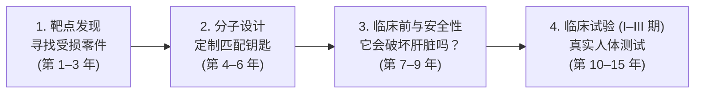

如果你一直关注科技与医疗的交叉领域，过去四年来你很可能感受到了一种日益加剧的认知割裂。

在一边，风投资本家和科技媒体大肆宣扬*“生物学已经被彻底数字化”*、神经网络将*“解决人类所有疾病”*，而传统的制药实验室即将被机架服务器全盘取代。

但在另一边，则是你切身的日常生活经验：你的主治医生并没有开出哪怕一颗“AI 发明的神药”，几家备受瞩目的 AI 生物科技明星初创公司市值暴跌了 80% 至 95%，而攻克癌症依然像十年前一样艰难而令人沮丧。

面对这种巨大的反差，任何人都会自然而然得出这样一个结论：**“生物学里的 AI，难道不又是一场雷声大雨点小、毫无实质成果的科技炒作吗？”**

直截了当地说：**你对浮夸炒作的怀疑是 100% 正当且合理的。但如果你据此认为什么都没有发生，那你将错失现代科学史上最深刻的一场范式转移。**

错不在于底层技术本身，而在于人们傲慢地将人体生物学当成了普通的软件工程。剥去硅谷铺天盖地的营销包装，2026 年留在牌桌上的绝非镜花水月。我们如今已经迎来了实实在在的人体临床试验数据：由 AI 发现与设计的候选药物正纷纷迈入 II 期和 III 期人体临床阶段，一批基石般的计算工具正在重写人类与生命世界交互的方式。

要理解为什么这一切极具价值——以及真正的物理瓶颈究竟卡在哪里——我们需要在避开晦涩学术黑话的前提下，搞清楚一款药物究竟是如何被研制出来的。

---

## 1. 药物研发难题：外星发动机的隐喻

要理解为什么 AI 在生物学中如此举足轻重，首先必须体会传统新药研发究竟荒谬在何处。

想象一下，你的身体并不是一块发条机械表，而是一座拥有 **30 万亿市民**（细胞）的庞大超级都市。在每一个细胞内部，都有成千上万个微型纳米机器在日夜运转，它们被称为**蛋白质**。这些蛋白质包办了一切：泵送氧气、修复破损 DNA、传递神经电信号、分解食物养分。

当你生病时——无论是癌症、阿尔茨海默病还是关节炎——通常是因为某一个特定的蛋白质纳米机器坏掉了、卡死了，或者过度疯狂运转。

传统的新药研发，就如同在完全没有说明书的前提下，试图去修理一艘外星飞船的引擎。这一过程包含极其漫长煎熬的四个步骤：

1. **靶点发现（寻找受损零件）：** 在人体大约 20,000 种各异的蛋白质中，究竟是哪一个在确切驱动疾病的发展？几十年来，这在很大程度上依赖学术界受过教育的猜测与漫长多年的试错摸索。
2. **分子设计 / 先导化合物优化（打造专用钥匙）：** 一旦锁定了致病蛋白，你就必须设计出一把微观“钥匙”（一个小分子化学化合物或一段蛋白质抗体），精准嵌入该蛋白质的特定活性口袋中将其关闭。难点何在？化学分子的搜索空间几乎是无穷无尽的——据估算小分子空间包含多达 10⁶⁰ 种潜在结构（比整个太阳系中的原子总数还要多）。在传统模式下，化学家只能在塑料孔板里人工混合并盲筛数十万种随机化合物，祈祷其中能碰巧有一把撞大运。
3. **临床前 / ADMET 严酷筛查（通关试炼）：** 一把在试管里能插进锁孔的分子，在复杂人体内往往形同废铁。它必须能溶解在水里、穿过细胞膜、避免刚进人体就被肝脏代谢酶消灭殆尽、不引发心脏离子通道（hERG）毒性，且不能诱发 DNA 突变。在行业术语中，这被称为 **ADMET**（*吸收、分布、代谢、排泄与毒性*）。
4. **临床试验（真正的人体大考）：** 如果一个分子奇迹般闯过了前述所有试炼，它将进入分为三期的人体临床试验：
   - **I 期（安全性）：** 在 20 到 100 名健康志愿者身上测试，确保药物不会直接对人体产生剧毒。
   - **II 期（有效性）：** 在 100 到 300 名真实患者身上测试，观察它是否真能治疗疾病。
   - **III 期（大规模验证）：** 在 1,000 到 5,000 名以上的患者中，与现行临床金标准方案开展大规模对照双盲试验。

### 严酷残酷的行业基线
在 AI 登场之前，这个流程背后的行业残酷数据触目惊心：
- **研发周期：** 从实验室最初的构想萌芽到最终摆上药房货架，平均耗时 **10 到 15 年**。
- **研发成本：** 每成功获批一款新药，平均消耗 **15 亿至 26 亿美元**（已包含全部沉没研发失败项目的分摊成本）。
- **失败概率：** **进入人体临床试验的药物候选物中，有 90% 最终以失败告终。** 大约 50% 的项目在 I 期或 II 期就因毒性无法承受或根本无效而直接夭折。

这正是衡量 AI 真实价值的唯一客观基准线。

---

## 2. 为什么此前让人觉得全是炒作而无实效？

既然传统研发模式如此千疮百孔，为什么第一波 AI 生物医药浪潮却给大众留下了雷声大雨点小的糟糕印象？

核心原因有两点：**“18 个月软件速成幻觉”** 以及 **公开资本市场的“泡沫宿醉”**。

### 18 个月软件速成幻觉
在消费级软件领域，代码迭代快如闪电。你写下几行代码，5 秒钟后在服务器上完成测试，推送到全球数以亿计的智能手机上，每周都能发布新版本。

在企业 SaaS 和移动互联网时代赚得盆满钵满的硅谷投资人们，低头审视生物学时天真地以为这不过是另一套软件技术栈。他们狂妄宣称 AI 将彻底取缔湿实验，两年之内就能端出重磅大药。

然而生物学冷酷地嘲笑了这种狂妄。你可以在 48 小时内训练好一个庞大的 AI 模型，但**你绝不可能在一块显卡上跑完真实的人类临床试验**。
- 你无法快进人体肝脏代谢药物的生物化学速率。
- 你无法靠算力凭空模拟异质性人类免疫系统在不同遗传背景下的复杂应激反应。
- 你无法快进癌症的恶化进程：观察某种抗肿瘤疗法是否能将患者生命延长 12 个月，在物理世界中就必须实打实耗费整整 12 个月的时间。

### 第一代初创企业的洗牌与出清
在 2020 至 2022 年间，大批标榜“AI 原生”的生物科技公司通过借壳 SPAC 或传统 IPO，以天文数字般的估值推向公开市场。而当它们早期的管线撞上冷酷的人体临床现实时，资本市场展开了无情的惩罚：
- **BenevolentAI：** 核心候选药（用于湿疹的 BEN-2293）在 2023 年 IIa 期临床试验中未能达到有效性终点。公司股价狂泻超过 95%，被迫大规模裁员重组。
- **Exscientia：** 市值一度冲上 30 亿美元，却因管线进度拖延与管理层剧烈动荡陷入困境，最终以极具折价的全股票方式被 Recursion 收购。
- **Recursion Pharmaceuticals：** 股价在 2021 年曾逼近 35–40 美元高位，随后长期在个位数低谷徘徊，投资者终于清醒认识到 AI 无法在一夜之间消除临床失败率。

看客们目睹了这场资本踩踏，顺理成章地下了定论：*“看吧，全都是虚无缥缈的障眼法。”*

但这种定论犯了以偏概全的错误。金融泡沫被戳破了，但底层的硬核科学却在聚光灯之外悄然完成了蜕变与成熟。

---

## 3. 说服怀疑论者：2026 年到底哪些成果真正在落地

是什么让 2026 年的生物学 AI 值得被严肃对待？因为我们如今在全链条的开发环节中，都拿到了经过同行评议审查的坚实经验证据。

以下四大经得起客观核查的里程碑式突破，足以证明这项技术正在创造真实的临床价值：

### 证据一：AI 原创设计的药物在 II 期与 III 期临床中带来真实疗效

检验 AI 的终极试金石不是漂亮的计算机屏幕渲染，而是重病患者的身体是否真正好转。在 2025 和 2026 年，第一波由 AI 发现与设计的药物顺利迈过了决定生死的关键临床门槛：

#### 1. 英矽智能（Insilico Medicine）的 Rentosertib (ISM001-055)
特发性肺纤维化（IPF）是一种致命且不可逆的肺部绝症，患者肺泡组织会逐渐纤维化疤痕化，直至窒息而亡。现有批准药物仅能微弱延缓肺功能衰退，且伴随严重的胃肠道不良反应。

英矽智能利用其生成式 AI 平台完成了两项突破：
1. 发现了一个全新的生物学靶点 **TNIK**（TRAF2 和 NCK 相互作用激酶），它与纤维化病理和细胞衰老密切相关。
2. 从零开始生成式设计了一种全新的小分子化合物（**rentosertib**），以极高特异性强力抑制 TNIK。

临床试验结果如何？在针对 IPF 患者开展的随机、双盲、安慰剂对照 IIa 期临床试验中（[2025 年 6 月发表于《自然·医学》*Nature Medicine*](https://doi.org/10.1038/s41591-025-03743-2)；[NCT05938920](https://clinicaltrials.gov/study/NCT05938920)）：
- 每日口服 60 mg 的治疗组患者在给药 12 周后，**用力肺活量（FVC）平均改善了 +98.4 mL**，而安慰剂组的肺功能则呈现正常的病情恶化衰退（**-20.3 mL**）。
- 药物展现出极高的安全性和耐受性，并在血液生物标志物中观察到了明确的抗纤维化分子信号。
- 从提出靶点假说到推进至首次人体 I 期临床，英矽智能仅耗时不到 **30 个月，花费约 260 万美元**——远低于传统大药企通常所需的 4 到 6 年时间及数千万美元的先期沉没成本。

#### 2. Relay Therapeutics 的 Zovegalisib (RLY-2608)
**PI3Kα** 基因突变是人类恶性肿瘤中最普遍的致癌驱动突变之一，存在于超过 30% 的晚期乳腺癌患者中。整整 25 年来，跨国制药巨头们前赴后继试图打造能够靶向它的药物，但无一例外付出了沉重代价。

为什么传统化学家会屡屡碰壁？因为人体内正常的（野生型）PI3K 蛋白掌管着全身的胰岛素信号与葡萄糖代谢。以往所有阻断突变型 PI3K 的传统药物，都会无差别地阻断正常的野生型 PI3K，导致患者暴发极其危险的严重高血糖症（血糖飙升）和全身皮疹，迫使大部分患者不得不终止治疗。

Relay Therapeutics 将机器学习与全原子分子动力学模拟相结合，模拟了蛋白质的*动态构象变化*——不再是死板的静态晶体结构照片，而是蛋白质在三维空间中随时间如何伸缩折叠。他们的算法模型成功捕捉到了一个极其隐蔽的**变构口袋（allosteric pocket）**——那是只有在突变型蛋白质上才会短暂敞开的隐秘后门。

他们顺势合成了全球首款突变选择性 PI3Kα 抑制剂 **zovegalisib (RLY-2608)**：
- 在临床试验中，它在已经历过多轮后线治疗失败的转移性乳腺癌患者群体中，斩获了长达 **11.0 个月** 的中位无进展生存期（mPFS）。
- 由于它完全放过了正常的野生型 PI3K，因严重高血糖导致的停药率直接降至微不足道的水平。
- 基于这一突破性成果，Relay 正式启动了全球关键性注册 **III 期 ReDiscover-2 临床试验**（[NCT06982521](https://clinicaltrials.gov/study/NCT06982521)），将 AI 指导下的结构动力学设计成功推向了晚期注册审批的主战场。

#### 3. Generate:Biomedicines (GB-0895)
与研发小分子化学药不同，Generate 采用生成式扩散模型从头设计**大型工程化蛋白质与单克隆抗体**。
- 其研发先导管线 **GB-0895** 是一款通过全计算设计、针对重度哮喘关键介质 TSLP 的单克隆抗体。
- 通过在计算机中对其结合亲和力与血清半衰期进行高维联合优化，他们打造出了一款仅需**每六个月（每年两次）**皮下注射一次的超长效分子，而传统生物制剂通常需要每两周或每月频繁注射。
- 到了 2026 年，GB-0895 已正式进入全球多中心 **III 期关键注册临床试验**（SOLAIRIA-1 与 SOLAIRIA-2）。

---

### 证据二：临床试验安全性成功率近乎翻倍（Jayatunga 严谨调研数据）

这难道仅仅是几个幸存者偏差带来的偶然个案吗？

2024 年，研究学者 Madura K.P. Jayatunga 等人在行业权威期刊 [*Drug Discovery Today*](https://doi.org/10.1016/j.drudis.2024.104009) 上发表了首个针对进入临床阶段的 AI 发现分子的全面、系统性经验实证研究。

数据统计揭示了一个极其震撼的行业转折：

| 评估指标 | 传统跨国药企历史平均水平 | AI 发现设计的候选药物 |
| :--- | :--- | :--- |
| **I 期临床成功率（安全性与耐受性）** | **40% – 65%** | **80% – 90%** |
| **II 期临床成功率（疾病真实疗效）** | **30% – 40%** | **约 40%** |
| **从发现到获批的累计概率** | **约 5% – 10%** | **约 9% – 18%（预测值）** |

为什么 I 期临床成功率能直接跃升至 80–90%？

因为 I 期的核心目的，就是检验一种分子在人体内是否具有内在的不可耐受毒性、是否溶解度极差、是否会诱发危险副反应。在传统模式下，药物化学家往往只能单维度单靶点优化：为了让分子结合更牢固，却不小心破坏了水溶性；为了救回水溶性，又意外引入了致命的肝毒性。

而先进的 AI 模型在分子合成之前就执行了**多参数多目标联合协同优化**：在实验室尚未真正合成出一克真实物理实体之前，算法就已经同时在计算机中统筹评估了结合亲和力、分子量、hERG 心脏毒性、肝微粒体代谢清除率和跨膜通透性。

---

### 证据三：从头设计自然界从未孕育的蛋白质与基因编辑工具（De Novo 设计）

在长达 40 亿年的生命进化历程中，地球生物只能受限于随机基因突变和自然选择的局限。而 AI 正在将生物学转变为一门真正的工程学科，让我们能够从零开始自由编程创造全新的生物学精密机器（*从头设计 / de novo*）。

- **Profluent 的 OpenCRISPR-1：** CRISPR 基因编辑是攻克镰刀型细胞贫血症等遗传绝症最具前景的技术，但源自天然细菌的 Cas9 蛋白存在分子量偏大、专利壁垒森严以及脱靶切割风险等缺陷。在发表于《自然》（*Nature*, 2025）并于 [GitHub](https://github.com/Profluent-AI/OpenCRISPR) 上全面开源的研究中，Profluent 利用在海量生物序列上训练的大语言模型设计出了 **OpenCRISPR-1**。该分子与自然界已知最接近的天然 SpCas9 相比存在**超过 400 个氨基酸突变**——这是一台在自然演化史上从未存在过的全新人造酶，然而它在编辑人类 DNA 时展现出的精度与剪切效率，完全媲美甚至超越了天然酶。
- **EvolutionaryScale 的 ESM-3：** 由前 Meta FAIR 生物团队创立的 [ESM-3](https://www.evolutionaryscale.ai) 是一个参数量达 980 亿的生成式生物大模型，在大自然数十亿年积累的蛋白质三维结构与序列上进行了预训练。研究团队给模型提出了一个挑战：生成一个此前从未存在过的全新绿色荧光蛋白（GFP）。模型自主生成了 **esmGFP**，它与已知亲缘关系最近的天然发光水母蛋白相比拥有 58 个突变位点。这相当于在单次计算推理中，凭空跨越了**相当于自然界 5 bug亿年的漫长演化距离**——当该分子在湿实验中被真正合成表达出来时，它在紫外灯下放射出明亮璀璨的翠绿荧光。
- **Arc 研究所的 Evo 与 Evo 2：** 先后发表在《科学》（*Science*）与 [*《自然》（Nature）*](https://www.nature.com/articles/s41586-026-10176-5) 上的研究中，[Arc 研究所](https://arcinstitute.org) 训练了上下文窗口长达整个基因组尺度（覆盖数十万个 DNA 碱基对）的基础大模型。Evo 系列不仅能理解单个孤立的蛋白质，更能深刻领悟由 DNA 启动子、RNA 调控元件与多蛋白复合体交织构成的宏大基因调控交响乐。

---

### 证据四：将湿实验从最痛苦的瓶颈泥潭中拯救出来

怀疑论者最常挂在嘴边的一个论调是：*“AlphaFold 只不过能预测静态蛋白质结构，根本变不出现成药物。”*

确实，仅凭静态结构无法直接变成一颗现成药丸，但 AlphaFold 彻底根除了结构生物学六十年来最昂贵、最折磨无数科研人员的核心死穴：**X 射线晶体学相位难题（the crystallographic phase problem）**。

六十年来，当生物物理学家用高能 X 射线轰击蛋白质晶体时，探测器只能记录下衍射光斑的强度，却永久丢失了光的相位信息。为了解开这个致命的数学谜团，历史上无数博士后不得不耗费数月乃至数年时间，用剧毒重金属（汞、铂）反复浸润晶体，或者艰难构建含硒突变体。全世界各地的冷库里曾积压抛弃了数以万计因“无法解析相位”而宣告死刑的废弃数据集。

当 DeepMind 在 [《自然》上开源 AlphaFold 2](https://doi.org/10.1038/s41586-021-03819-2) 并发布包含超过 2.14 亿个结构的 [AlphaFold 数据库](https://alphafold.ebi.ac.uk/) 时，这个困扰人类半个多世纪的绝症在一夜之间烟消云散。[Terwilliger 等人在 *Acta Crystallographica*](https://pubmed.ncbi.nlm.nih.gov/36735235/) 上发表的标志性实证研究表明：直接将 AlphaFold 预测模型用作分子置换搜索模版，自动化软件就能瞬间解出**高达 92% 至 93% 过去被判定为完全无解的棘手晶体结构**。

AlphaFold 并没有取代湿实验；它将长达数月乃至数年的盲目试错试错，转变成了几秒钟内的常规验证。

---

## 4. 无法逾越的物理高墙：为什么我们还没能治愈一切？

既然 AI 展现出了如此强大的威力，为什么我们至今没有迎来万药齐发的黄金时代？为什么生物医药依然如此缓慢且昂贵？

因为人体生物学筑起了四道冰冷、坚固且无论多强的神经网络都无法靠算力凭空抹除的物理高墙：

**THE 4 PHYSICAL BOTTLENECK WALLS**

| 1. 靶点确证之困 (Target Valid.) 制造钥匙容易；但确定这把钥匙能开对门却极其困难 | 2. 数据饥荒与负向数据黑洞模型渴望数据，但生物学数据极其嘈杂、稀缺且保密 | 3. 演化留下的意面代码人类细胞对每条被阻断的通路都有 4-5 种备用旁路 | 4. 湿实验的生物钟人体临床试验必须耗费数年 |
| :--- | :--- | :--- | :--- |

### 瓶颈一：“造对了钥匙，开错了门”（靶点确证难题）
今天的 AI 已经极其擅长设计出能够与目标蛋白质紧密结合的分子钥匙。但**牢固结合蛋白质并不等同于能够治愈疾病**。

**大约 60% 的 II 期临床试验均因无效而宣告流产。** 这意味着这些药物完全达成了计算机为它们设定的分子使命：它们完美嵌入了致病靶点 Protein X，并将其彻底封闭。然而在真实的复杂人体患者体内，阻断 Protein X 根本无法遏制疾病的发展。

人类疾病机制绝非简单的线性因果关系。阿尔茨海默病、帕金森病或胰腺癌，背后是错综复杂的免疫微环境、遗传多态性、外部表观遗传因素与代谢负反馈回路交织而成的蛛网。设计一把钥匙是纯粹的工程学问题；但搞清楚这艘外星飞船上究竟该撬动哪把锁，依然是横亘在全人类面前的未解之谜。

### 瓶颈二：数据饥荒与惨遭埋葬的负向数据黑洞
ChatGPT 这类大语言模型之所以能平地惊雷，是因为它们能够免费吞噬全人类三十年来在开放互联网上沉淀的书籍、网页和代码等数万亿字的高质量语料。

但在生命科学领域，根本不存在这样的“公开免费互联网”。
- 单次高通量湿实验（例如冷冻电镜单颗粒重构或单细胞 RNA 测序），动辄耗费数万美元真金白银。
- 最有商业价值的药物分子活性与药代动力学数据，作为核心商业机密被各大跨国药企深锁在专利金库中。
- **被埋葬的负向数据坟场：** 顶尖学术期刊永远只倾向于发表成功的结果（*“X 分子成功起效了！”*）。几乎没有任何学术期刊会收录化学家在实验室里反复析出沉淀、或者把细胞培养皿全盘毒死的那 999 种失败分子。然而 AI 模型要想真正掌握化学空间的危险边界，恰恰需要同时学习失败与成功两方面的数据。生物学 AI 始终处于严重缺乏高质量负向数据的营养不良状态。

### 瓶颈三：38 亿年演化杂乱堆叠出的“意面代码”
计算机软件由清晰优雅的抽象构建而成：逻辑门、类型系统以及完全确定性的指令集。

而人体生物学，是**长达 38 亿年残酷混乱的演化盲目拼凑出的产物**。进化从来不会停下来对底层代码进行优雅重构；进化只懂得打补丁。如果生物体出现了一个有害缺陷，进化的生存策略通常是在其周围胡乱搭建一道笨拙的代偿旁路。

这导致人类细胞内部拥有极其恐怖的冗余保护机制。如果你用 AI 设计出一款高选择性分子，干脆利落地关闭了癌细胞内部的通路 A，癌细胞通常能在几周内敏锐察觉到阻断，并迅速激活旁路 B、C 或 D，火速演化出全新的耐药性。在跨组织的全局尺度上精准模拟这种高度互联、动态演化的生命网络，远远超出了当今最强基础模型的能力上限。

### 瓶颈四：无法超频的人体生物钟
你可以给英伟达 GPU 轻易加压超频，将算力吞吐拉高一倍。但你绝对无法对人类的衰老进程或慢性病恶化速率进行“超频”。

为了在医学上严谨证实一款心血管预防药物能否有效降低高危人群的心梗复发率，你必须扎扎实实对数千名患者进行 3 到 5 年的长期随访追踪。为了证明一款肿瘤新药能否改善患者的总生存期，你只能耐心等待真实的临床生存终点被逐步触发。

人体临床试验占据了一款新药**整整 70% 的资金成本与时间跨度**。AI 固然能显著优化临床试验入组设计、匹配患者基因型并提前预警器官毒性，但它永远无法取代在活生生的人体中随着物理时间推移来确证安全与疗效的法律与伦理铁律。

---

## 5. 终局结论：属于医学的“CAD 时代”已经降临

当你把真实的临床突破与这些冷酷的物理瓶颈放在天平两端客观衡量时，整幅图景便彻底豁然开朗。

此前最大的认知误区，就在于大众误以为生物医药领域的 AI 会像 **SaaS 软件服务** 那样——即时生效、毫无物理摩擦阻力，且能完全在纯数字空间里闭环完成。

真正贴切的历史类比，是**航空航天工程中的计算机辅助设计（CAD）与计算流体力学（CFD）**。

在 CAD 和计算流体力学出现之前，设计一架新型飞机是一门高度危险、充满工匠直觉的摸索手艺。工程师们只能用木头削出缩比模型，在风洞里喷射烟雾肉眼观察气流，然后把造好的物理样机交给勇敢的试飞员飞上蓝天。无数优秀的试飞员因此机毁人亡。

CAD 的诞生并没有消灭重力。CAD 并没有免去用钛合金和碳纤维真正加工出物理机身的制造步骤。CAD 更没有取消美国联邦航空局（FAA）严苛至极的实际高空飞行安全认证。

CAD 真正做到的，是**彻底终结了成千上万次在黑暗中摸索的盲目物理试错**。它让航空工程从一门依赖直觉的工匠手艺，演变成了一门具有高预测性、理性可靠的严谨现代工程学。

**THE SHIFT: FROM SCREENING TO DESIGN**

| 传统制药工业（AI 诞生前） | 现代生物医药（AI 赋能时代） |
| :--- | :--- |
| 在塑料孔板中盲目筛选数百万种 随机未知化合物 | 针对靶点量身定制生成全新从头 设计的特异性分子 |
| 耗费 4–5 年在湿实验中逐个维度 艰难微调药理特性 | 在计算机中一次性完成多参数协同 优化（结合力、安全性与 ADMET） |
| I 期临床安全性失败率高达 40–60% | I 期临床安全性通过率大幅升至 80–90% |
| 海量无法解出相位的晶体衍射数据 在硬盘中永久吃灰 | 93% 棘手晶体结构由算法全自动完成 分子置换并精准解析 |
| 数十年间对“不可成药”靶点束手无策 | 变构口袋与动态模拟成功解锁以往 无法触碰的隐秘致病位点 |

这正是 AI 今天正在对生命科学产生的影响：
1. **它将早期先导药物发现周期从 5 年压缩至 18 个月以内**，大幅砍掉了数以千万计在临床前摸索阶段被浪费的巨额资金。
2. **它将 I 期人体临床安全性成功率从约 50% 翻倍拉升至 85% 以上**，在分子进入人体试验之前就于硅基计算机中排除了潜在器官毒性。
3. **它成功攻克了以往被视作“不可成药”的绝望靶点**（例如突变型 PI3Kα 与 TNIK），打破了传统药化数十年来无法逾越的高墙。
4. **它创造出了自然界从未孕育的全新生物学工具**（例如 OpenCRISPR-1 与人工设计的 esmGFP），让生命编程成为现实。

生物学里的 AI 全是虚假炒作吗？**绝对不是。** 资本市场的泡沫固然该被戳破，但泡沫散去后沉淀出的底层科学正在被无可辩驳地验证。

生物医药永远无法像互联网软件那样野蛮狂飙，因为这关系到真实人类的鲜活生命，而复杂的人体生理机能绝不可能在虚拟沙箱里一键编译完成。但在人类漫长的历史长河中，我们第一次不再像无头苍蝇一样在浩瀚的化学宇宙里盲目乱撞祈求奇迹。我们终于开始学会如何真正地去设计奇迹。

---

### 可验证数据与核心参考文献

1. **AI 药物临床试验基准系统调研:** Jayatunga, M. K. P. et al. "How successful are AI-discovered drugs in clinical trials? A first analysis and emerging lessons." *Drug Discovery Today* 29, 104009 (2024). [DOI: 10.1016/j.drudis.2024.104009](https://doi.org/10.1016/j.drudis.2024.104009)
2. **英矽智能特发性肺纤维化 IIa 期临床试验成果:** Ren, F. et al. "A generative AI-discovered TNIK inhibitor for idiopathic pulmonary fibrosis: a randomized phase 2a trial." *Nature Medicine* (June 2025). [DOI: 10.1038/s41591-025-03743-2](https://doi.org/10.1038/s41591-025-03743-2) | [ClinicalTrials.gov NCT05938920](https://clinicaltrials.gov/study/NCT05938920)
3. **英矽智能全新靶点与先导分子发现机制:** Ren, F. et al. "A small-molecule TNIK inhibitor targets fibrosis in preclinical and clinical models." *Nature Biotechnology* (2024). [DOI: 10.1038/s41587-024-02143-0](https://doi.org/10.1038/s41587-024-02143-0)
4. **Relay Therapeutics PI3Kα 突变选择性抑制剂关键注册 III 期临床试验 (ReDiscover-2):** [ClinicalTrials.gov NCT06982521](https://clinicaltrials.gov/study/NCT06982521)
5. **AI 从头生成式基因编辑器 (OpenCRISPR-1):** Ruffolo, J. A. et al. Profluent. "Design of highly functional genome editors by modeling the universe of CRISPR-Cas sequences." *Nature* (2025). [GitHub 开源代码库](https://github.com/Profluent-AI/OpenCRISPR)
6. **超大规模蛋白质生物大模型 (ESM-3):** EvolutionaryScale. [ESM-3 发布与技术报告](https://www.evolutionaryscale.ai) (2024).
7. **全基因组基础大模型 (Evo 2):** Arc Institute / Stanford University. "Genome modelling and design across all domains of life with Evo 2." *Nature* (2026). [DOI: 10.1038/s41586-026-10176-5](https://www.nature.com/articles/s41586-026-10176-5) | [Arc 研究所](https://arcinstitute.org)
8. **AlphaFold 2 架构突破与数据库发布:** Jumper, J. et al. "Highly accurate protein structure prediction with AlphaFold." *Nature* 596, 583–589 (2021). [DOI: 10.1038/s41586-021-03819-2](https://doi.org/10.1038/s41586-021-03819-2) | [AlphaFold 数据库](https://alphafold.ebi.ac.uk/)
9. **利用 AlphaFold 解决晶体学相位难题的实证评估:** Terwilliger, T. C. et al. "AlphaFold predictions for macromolecular crystallography." *Acta Crystallogr D Struct Biol* 79, 140–147 (2023). [PubMed: 36735235](https://pubmed.ncbi.nlm.nih.gov/36735235/)
10. **蛋白质从头扩散生成设计 (RFdiffusion):** Watson, J. L. et al. "De novo design of protein structure and function with RFdiffusion." *Nature* 620, 1089–1100 (2023). [DOI: 10.1038/s41586-023-06415-8](https://doi.org/10.1038/s41586-023-06415-8)
