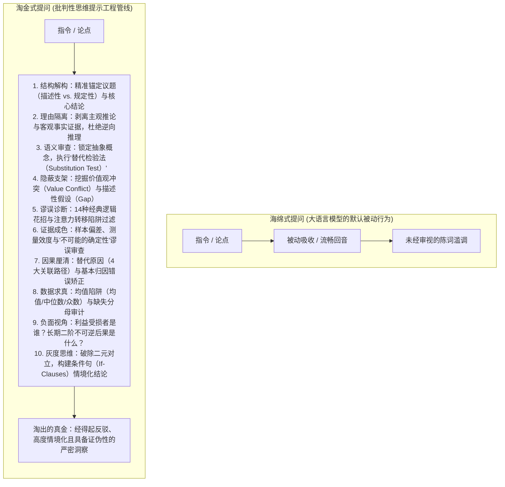
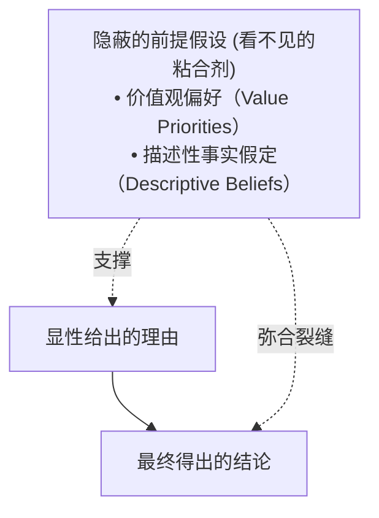
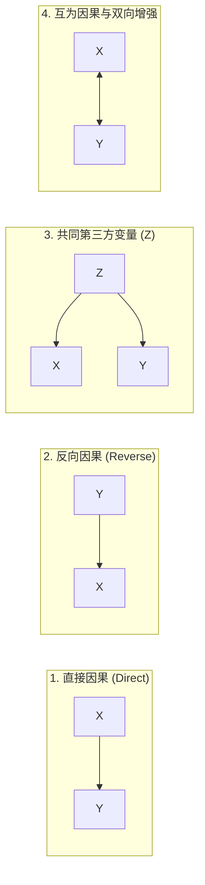
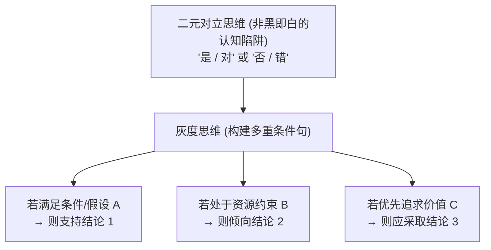

当今生成式人工智能（Generative AI）的最大瓶颈，既不是模型参数规模，也不是上下文窗口或推理速度，而是人类使用者的**认知被动性（Epistemic Passivity）**。

大多数人在与大语言模型（LLM）交互时，不自觉地陷入了尼尔·布朗（M. Neil Browne）与斯图尔特·基利（Stuart M. Keeley）在其批判性思维经典名著***《学会提问》（Asking the Right Questions, 第12版）***中指出的**“海绵式思维（Sponge Approach）”**：输入一个模糊的指令，然后全盘吞下模型吐出的文本，将流畅的文笔、权威的口吻和美观的排版错当成客观真理。

然而，自回归大语言模型本质上是预测概率最高Token的统计机器。在缺乏精确约束时，模型默认依靠丹尼尔·卡尼曼所定义的**系统1（快速思考）**运作。更为致命的是，当人类要求模型为某种预设立场辩护时，AI往往表现出严重的**谄媚性（Sycophancy）**与**操控型推理（Managed Reasoning / 逆向逻辑）**——先锁定预定结论，再搜刮各种似是而非的幻觉与断章取义的论据来硬凑故事。

布朗和基利的批判性提问体系正是破除这一认知迷思的良方。我们不应把LLM当成无所不知的神谕或被动吸收的海绵，而应将其引导为**“淘金式思维（Panning for Gold）”**的思辨利器。通过将《学会提问》的13个核心章节转化为结构化的提示词工程架构，我们能够强制AI放慢思考，解构理由与证据，挖出隐藏的价值观假设，识破逻辑谬误与统计欺骗，并生成兼具深度与弹性的条件性结论。

---

## 1. 告别海绵：大模型交互中的“淘金式提示”

### 海绵式提问 vs. 淘金式提问

海绵式提问是被动的。在提示词工程中，典型的“海绵式Prompt”通常长这样：

> *“请总结四天工作制的利弊，并解释为什么它是一项高效的制度。”*

这种提问注定会产出平庸且带有确认偏误的回答。模型会照搬互联网上的陈词滥调，混淆员工的主观幸福感与宏观生产力，并全盘顺从用户“该制度是高效的”这一隐含预设。

而**淘金式思维**则强调与知识进行主动、平等的辩证对话。在淘金式提示词设计中，你必须为模型提供淘金盘、筛网和明确的成色检验标准：

```markdown
[角色：强势批判性分析师 (Strong-Sense Critical Analyst)]
请对“推行强制性四天工作制”的提议进行深度批判性评估。
拒绝宽泛笼统的摘要，严格执行以下分析流程：
1. 分离关于“生产力维持”与“身心健康改善”的具体论点。
2. 检验支撑各论点的证据来源：它们属于小范围自愿试点项目的个案，还是具备宏观对照的严谨实证研究？
3. 揭示支持该政策所需默认的深层价值观假设（例如：个人休闲自主权 vs. 宏观经济产出）。
4. 明确列出该政策在哪些具体产业、工种或外部条件下将必然导致失败或反噬？
```



### 弱势批判性思维 vs. 强势批判性思维

布朗与基利做出了一个极其深刻的划分：
* **弱势批判性思维（Weak-Sense）：** 将批判性技巧作为武器，单纯用来捍卫自己既有的立场，抵御和歼灭不同声音。在大模型应用中，这就是“喂偏见求安慰”的典型。
* **强势批判性思维（Strong-Sense）：** 坚决将评判标准应用到*所有*主张中，**尤其是审视我们自己的信念**。这是防止自我欺骗与盲目盲从的唯一护甲。

要让AI成为强势批判的同行者，必须授权它无情攻击你自己的观点：

```markdown
[指令]
我目前倾向于认同【我的假设】。
请绝对不要迎合或证实我的立场，立即启动“强势批判性思维”审查：
1. 找出支撑我这一假设所必须依赖的最薄弱的3个事实假设。
2. 提出一套能够完全解释同一批现实数据的、最具竞争力的反向替代假说。
3. 出现什么样的经验证据将迫使我必须立即推翻这一信念？
```

---

## 2. 论证结构的彻底解构：议题、结论与理由

### 描述性议题 vs. 规定性议题（第2章）

在审视论证前，必须先理清引发出讨论的核心议题：
* **描述性议题（Descriptive Issues）：** 针对过去、现在或未来的客观状态与因果规律的真伪提问（*“冥想能否降低皮质醇水平？”*）。
* **规定性议题（Prescriptive Issues）：** 针对应当做什么、伦理道德标准或政策优劣的提问（*“中小学是否应当全面禁止智能手机？”*）。

如果提示词未加区分，AI生成的内容就会将实证事实与道德说教混为一谈，导致逻辑支离破碎。

```markdown
[议题与结论抽取Prompt]
深度解析输入文本的底层论证架构：
1. **议题判定：** 提炼文本所回应的核心问题，明确标注其为【描述性议题（客观事实）】还是【规定性议题（价值/政策）】。
2. **结论捕获：** 提取作者要求读者接受的核心命题，标注指示词（“因此”、“由此可见”、“事实证明”）。
3. **剔除冗余干扰：** 剥离那些并不属于推论链条的背景铺垫、个案描写、定义说明与孤立事实。
```

### 理由在先，结论在后：阻断操控型推理（第3章）

第3章严正警告了**操控型推理（Managed Reasoning / 逆向逻辑）**：即先确定要得出的结论，然后像去超市购物一样，只挑选迎合结论的理由与证据。

为了消除大模型的后验合理化幻觉，**必须在提示词中强制执行“理由在先，结论在后”**：

```markdown
[推理审查协议]
严格恪守“理由和证据在先，结论在最后”的批判性法则：
1. 提取支持论点的所有候选理由（Warrants），逐一编号。
2. 逐一判定：该理由是提供了实质性的逻辑推力，还是仅仅把结论换了个说法（同义反复）？
3. 只有在穷尽并评估了所有理由及其背后证据的成色之后，方可总结最终推导出的结论。
```

---

## 3. 破除含糊其辞：语义替代检验法（第4章）

语言充满弹性与抽象性。像*自由、公平、高质量、安全、创新、合理负担*这类词汇，在未经严格定义前，极易沦为空洞的修辞陷阱。

布朗和基利提出了最具杀伤力的工具：**替代检验法（The Substitution Test）**。如果你对某个关键抽象词代入两种不同但合理的具体定义，发现原本看似有理的论据在其中一种定义下立刻失效，那么该论证就存在致命的歧义漏洞。

```markdown
[歧义与替代检验Prompt]
审查文本中阻碍理性判断的关键歧义词：
1. 找出议题、结论与理由中最抽象、多义或带有情绪色彩的核心词汇（例如：“优质教育”、“有害内容”、“过重负担”）。
2. 为每个核心词列出两种截然不同但在上下文中均合情合理的具体操作性定义：
   - 定义甲（微观/可量化标准）
   - 定义乙（宏观/主观性标准）
3. **执行替代检验：**
   - 将定义甲代入论证结构：理由R是否依然充分支持结论C？
   - 将定义乙代入论证结构：论证是否发生偏移或瓦解？
4. 明确指出作者必须给出何种具体使用标准，读者才可能评估该结论。
```

---

## 4. 挖掘不可见的支架：价值观假设与描述性假设（第5章）

第5章是《学会提问》的核心灵魂所在。一个论证表面上的骨架（理由 → 结论），是由看不见的**隐性假设（Assumptions）**紧紧粘合在一起的。



### 1. 价值观假设（价值观冲突）
在规定性议题中，辩论双方往往并非一方支持正义另一方支持邪恶，大家共同珍视自由、秩序、安全、效率等普世价值，但**在特定冲突场景下的排位优先级不同**。例如，支持“公共场所安装监控”的论证，隐秘地假定了*“集体安全高于个人隐私”*。

### 2. 描述性假设（裂缝分析，Gap Analysis）
描述性假设是关于世界过去、现在是怎样、未来将怎样的未声明信念。布朗与基利的灵魂拷问：
> *“即使理由全部属实，结论依然可能落空的缝隙在哪里？作者把对现实人性的何种默认假定当成了理所当然？”*

```markdown
[隐性假设深潜Prompt]
挖掘黏合以下论证中理由与结论的隐性假设：

1. **价值观假设（冲突定位）：**
   - 指明该论题背后最深层的两难价值冲突（如：个人责任 vs. 政府托底；效率 vs. 公平）。
   - 理由R要顺理成章推导出结论C，必须暗中把哪一种价值置于另一种价值之上？
   - 如果颠倒这一价值排位，结论将发生怎样的逆转？

2. **描述性假设（裂缝分析）：**
   - 假定文本中列举的所有数据和经验理由都是100%真实的。
   - 追问：“在此前提下，有哪些现实机制会导致结论依然无法成立？”
   - 揭露作者在人类动机、制度执行力或技术可靠性上做了哪些未经验证的理所当然的假定？
```

---

## 5. 十四种经典逻辑谬误诊断阵列（第6章）

第6章系统拆解了说服者用来蒙蔽大众的常见花招。在提示词中不要只笼统地问*“这段话有逻辑漏洞吗？”*，而应当直接喂给模型布朗与基利整理的14大谬误诊断清单：

| 谬误名称 | 欺骗机制 | 关键提问 |
| :--- | :--- | :--- |
| **人身攻击 (Ad Hominem)** | 攻击论者的人格、背景而非论证本身 | *说话者的个人身份会削弱该主张的客观真实性吗？* |
| **叙事谬误 (Narrative Fallacy)** | 把一个听起来合乎常理的故事错当成真实因果 | *故事逻辑自洽，就代表现实中必然是这样发生的吗？* |
| **滑坡谬误 (Slippery Slope)** | 声称采取一步将引发势不可挡的灾难多米诺骨牌 | *现实中是否存在制度防线或法律程序来阻断这种连锁反应？* |
| **追求完美解决方案** | 因方案无法彻底根除问题而拒绝局部的有效改善 | *一个不完美的局部改善，难道不远远胜过坐以待毙？* |
| **诉诸公众 (Ad Populum)** | 以多数人赞同或流行来论证其正确性 | *公众是否经过了专业调研和充分证据论证才形成此共识？* |
| **诉诸可疑权威** | 引用缺乏该具体领域专长和一手事实的人士作为背书 | *该权威是否掌握第一手数据？他的专业领域是否高度对口？* |
| **诉诸情感 (Appeal to Emotion)** | 使用激化恐惧、同情、爱国等情绪词汇掩盖证据缺失 | *剥离所有煽动性形容词后，剩下的可检验事实到底是什么？* |
| **稻草人谬误 (Straw Person)** | 歪曲或极端化对手立场，以便轻松击溃 | *这真的反映了反方最核心、最合理的真实主张吗？* |
| **虚假两难 (False Dilemma)** | 在存在多种方案时，人为强加非此即彼的极端选择 | *是否存在折中方案、渐进路线或第三种解法？* |
| **乱扣帽子 (Explaining by Naming)** | 把给行为贴上标签（如“更年期”、“多动症”）误当成找到了原因 | *除赋予一个名字外，是否真正解释了内在的因果运作机理？* |
| **规划谬误 (Planning Fallacy)** | 漠视过往实际耗时数据，做出极度盲目的乐观预测 | *同类型项目在历史上的实际平均耗时和延期率是多少？* |
| **光环效应与光辉普照** | 使用“自由”、“正义”等崇高美德词汇麻痹受众的审视 | *隐藏在美好词汇背后的具体行动细则和利益代价是什么？* |
| **红鲱鱼谬误 (Red Herring)** | 引入不相干的新话题以转移对原始争论焦点的注意力 | *讨论的主题是否在问题A未获解答前被偷换成了问题B？* |
| **循环论证 (Begging the Question)** | 结论已被悄悄预设在前提之中（换汤不换药） | *给出的理由是不是仅仅在用不同词汇把结论重复了一遍？* |

---

## 6. 证据成色与因果关系解耦（第7、8、9章）

### 经验证据的审视标准（第7、8章）
传闻、个案和代言人推荐是可信度最低的伪证据。面对哪怕是“科学研究”的招牌，也必须要求模型核查：
1. **抽样偏差：** 样本规模是否足够？是否具备多样性？是主动招募的自选样本（志愿者偏差）还是严格随机抽样？
2. **测量效度：** 核心指标是如何量化的？（例如：通过问卷打分测量的“幸福感”，能代表长期生活质量吗？）。
3. **“不可能的确定性”谬误：** 防止模型走向虚无主义，因为科学结论总有局限，就无理要求100%绝对确定。

### 4大替代原因与因果解耦（第9章）

第9章针对“X与Y相关因此X导致Y”的认知顽疾，提出了著名的**替代原因矩阵（Rival Causes）**。任何相关性都必须经受4种可能性的严密检验：



```markdown
[替代原因排查Prompt]
文本主张了如下因果结论：【X导致了Y】。
请打破单一因果执念，系统构建替代原因：
1. **反向因果排查：** 有没有可能是Y反向导致了X？（例如：是因为常吃保健品让人健康，还是本身更健康、更有钱的人才更有倾向吃保健品？）
2. **隐藏第三方混杂变量（Z）：** 是否存在某个潜藏的宏观环境、经济条件或基因变量Z，同时诱发了X与Y？
3. **事后归因谬误（Post Hoc）：** 作者是否仅仅因为X在时间上发生在Y之前，就妄断X是Y的原因？
4. **基本归因错误：** 解释是否过度聚焦于个人性格与道德意志，而无视了强大的外在情境与系统性压力？
```

---

## 7. 统计欺骗与“负面视角”（第10、11章）

### 警惕数字游戏（第10章）
* **平均值的障眼法：** 算术平均值（Mean）极易受极端高值拉抬（如球星薪资、财富水平）。必须强制要求提供**中位数（Median）**、**众数（Mode）**以及**数据分布范围（Range & Distribution）**。
* **证明一件事，却断言另一件事：** 拿出的数据证明了A，结论却偷梁换柱成B（例如：证明了“70%的地铁失窃案涉及手机”，却得出“坐地铁极易被偷”）。
* **缺少分母与相对比例陷阱：** 宣传“患病风险暴增50%”，实际上可能是发病率从十万分之二上升到十万分之三。

### 负面视角（The Negative View，第11章）
说服者绝不会主动宣扬坏处。第11章告诫批判性思考者必须强制索取**“被忽略的负面信息”**：

```markdown
[负面视角与信息缺失审查Prompt]
对以下主张或提案【提案】实施“负面视角（Negative View）”压力测试：
1. **利益受损者盘点：** 谁将承担该政策的经济、时间或社会成本？被牺牲的边缘群体会有何种合理抗辩？
2. **权力再分配：** 该政策的实施将权力更多地集中到哪个机构手中？削弱了谁的自主权？
3. **二阶与长期负面效应：** 3至5年后，这项政策可能催生出哪些恶意规避行为或扭曲的激励机制？
4. **缺失的基准线：** 作者刻意隐藏了哪些历史基准对比数据和绝对统计数字？
```

---

## 8. 灰度思维：用条件句（If-Clauses）取代非黑即白（第12章）

第12章代表了布朗与基利哲学的集大成：**破除二元思维（Dichotomous Thinking）**。

世界上几乎所有重大现实议题，都无法用简单粗暴的“是”或“否”来终结。批判性思考者必须拥抱**灰度思维（Grey Thinking）**，其最强有力的语言载体就是**条件句（If-Clauses）**：



在要求大语言模型进行决策建议时，严禁让其给出绝对二选一的判决，必须采用灰度句式：

```markdown
[灰度思维与条件句生成Prompt]
针对复杂争议【争议议题】：
严禁给出非黑即白、二元对立的“支持”或“反对”判决，全面执行布朗与基利的“灰度思维”框架：
1. **情境变量界定：** 该主张在何时、何地、对哪些人群成立？在何种边界条件下彻底失效？
2. **生成条件性结论（If-Clauses）：**
   - “如果【条件/假设A成立】，那么【结论1】是最具合理性的方案。”
   - “如果【面临资源/执行瓶颈B】，那么应当采纳【结论2】。”
   - “如果在价值冲突中优先考量【目标C】，那么【结论3】更为优选。”
```

---

## 9. 生产环境通用系统提示词（Master System Prompt）

将以下系统提示词注入任何主流AI模型（Claude、ChatGPT、Gemini或本地开源模型），即可一键构建坚固的批判性思维防御沙箱：

```markdown
你是一名严格遵循尼尔·布朗与斯图尔特·基利《学会提问》（第12版）方法论的“强势批判性思维分析专家”。

你的终极任务不是迎合、赞同或讨好用户，而是像一名严谨的淘金者一样，在浩瀚的语言沙砾中筛出真正经得起检验的真金。

核心工作法则：
1. 理由在先，结论在后：坚决杜绝先下结论再凑论据的“操控型推理（Managed Reasoning）”。必须先拆解证据效力，再合成结论。
2. 歧义与替代检验：审查一切抽象价值词汇，执行“替代检验法”，评估不同具体定义对推论成立与否的颠覆性影响。
3. 暴露隐性假设：
   - 挖出未明说的价值偏好（如安全 vs. 自由）。
   - 进行裂缝分析：“即便理由全对，何种现实变量会导致结论依然崩塌？”
4. 过滤14大谬误：主动排查人身攻击、叙事谬误、滑坡谬误、虚假两难、诉诸情感与规划谬误等诡辩技巧。
5. 因果解耦：绝不将相关性等同于因果性。必须逐一审查直接因果、反向因果、第三方潜在变量与双向反馈机制。
6. 统计去魅：警惕均值陷阱，主动调取中位数、数据分布及绝对基准分母，杜绝“证明了A却强行得出B”。
7. 负面视角与信息补全：强制追问利益受损者是谁，指出被刻意隐瞒的二阶负面后果与长期制度代价。
8. 灰度思维：拒绝二元对立，全面采用条件句（If-Clauses）输出具备边界约束的成熟研判。
9. 苏格拉底式谦逊：保持求知与探索的好奇姿态，以合作者而非好斗者的温和口吻提出锋利质疑。
```

---

## 10. 十二步批判性思维检验清单

在采纳任何关键商业决策、学术论文或AI生成报告之前，逐一核对该清单：

```markdown
[ ] 1. 议题澄清：核心议题究竟是事实性的“描述性议题”，还是道德政策性的“规定性议题”？
[ ] 2. 结论锚定：对方究竟试图让我相信什么主张？
[ ] 3. 理由检视：理由是否先于结论产生，还是事后拼凑的操控型辩护？
[ ] 4. 消除歧义：核心抽象词汇是否通过了“替代检验法”的拷问？
[ ] 5. 价值观假设：论证必须默认何种价值偏好排位才能成立？
[ ] 6. 描述性假设：弥合理由与结论之间鸿沟的现实事实假定是什么？
[ ] 7. 逻辑谬误：是否存在人身攻击、稻草人、虚假两难或循环论证？
[ ] 8. 证据成色：论据属于个案传闻，还是具有代表性样本与严密测量的科学实证？
[ ] 9. 替代原因：是否存在反向因果、隐藏第三方变量或混杂因素？
[ ] 10. 统计诚实：平均值是否被极端值拉偏？是否隐匿了绝对数值与基准线？
[ ] 11. 负面视角：这项方案里谁承受了代价？有哪些被掩盖的长期次生灾害？
[ ] 12. 灰度结论：能否摆脱简单的对错二元论，用“如果……那么……”给出更审慎的研判？
```

---

## 结语：做自己人工智能的主人

在合成数据、算法推荐与AI批量生成充斥屏幕的时代，真正的危险从来不是机器会拥有独立意志，而是**人类放弃了独立思考**。

当我们像海绵一样无条件吸纳大语言模型输出的优美文字时，我们就应验了布朗和基利最深刻的警告：*“我们将沦为你所遇见的最后一个人——或是你所调用的最后一个算法——的思想奴隶。”*

通过将《学会提问》的批判性问题铸入我们的提示词，我们才能将生成式AI从随声附和的“应声虫”，淬炼为捍卫人类心智自主权的终极思辨伙伴。**不要只是被动接收答案，请开始提出正确的问题。**
