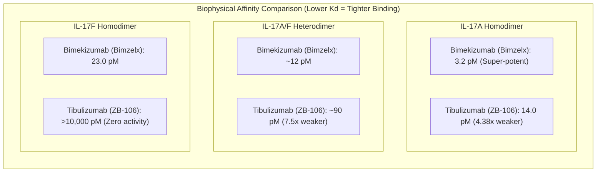
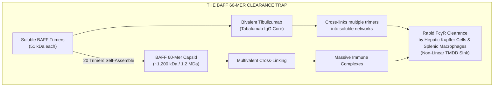
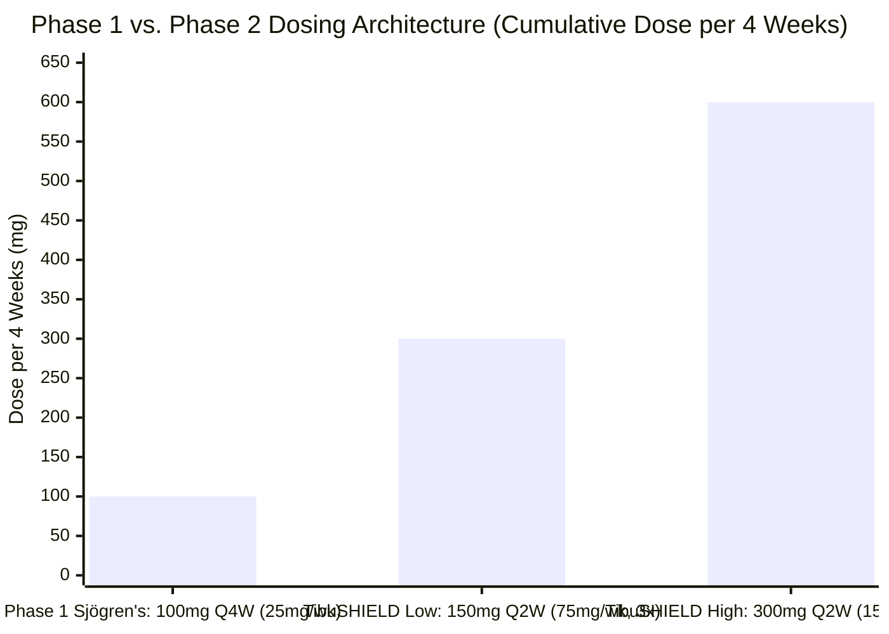
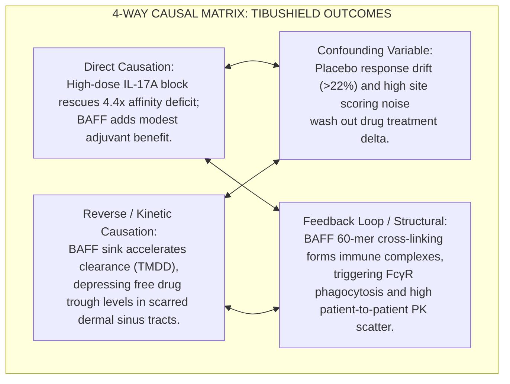

Following dermatologist and biotech investor **Dr. Adam May's (@A_May_MD)** 448-day return pitch on **Zura Bio Limited ($ZURA)** and its lead bispecific antibody **tibulizumab (ZB-106 / formerly Eli Lilly’s LY3090106)**, a high-stakes scientific clash erupted on biotech social media. 

Biopharma forensic analyst **Archimedes (@Archimedes20311)** and structural immunologist **Jing Liang (@AppleHelix)** directly challenged the foundational pharmacokinetic (PK) and biophysical assumptions underpinning May’s multi-billion-dollar thesis.

**THE BIOTECH X FORENSIC CLASH AT A GLANCE**

| Core Scientific Vector | Dr. Adam May's Thesis | Archimedes & Jing Liang |
| :--- | :--- | :--- |
| IL-17A Binding Affinity vs. Bimzelx | "Potent inhibitor matching or exceeding standard blockers; IL-17F is a red herring sink" | Empirically 4.4x to 5x worse potency than Bimekizumab (14pM vs 3.2pM |
| BAFF Role on PK & Disposition (TMDD) | "Heterobivalent: BAFF binding at one end does not block IL-17; target saturated at 100mg Q4W" | BAFF is ~300x+ higher in serum; acts as a massive clearance sink (TMDD) |
| BAFF Quaternary Structure | Treated as small soluble monomer/dimer ligand | Soluble BAFF forms 1.2 MDa 60-mer oligomers; drives immune complexes |
| 150mg Dosing in HS Sinus Tracts | "150mg and 300mg Q2W provide massive therapeutic excess over the 100mg plateau" | 150mg is underdosed; drug is consumed by BAFF before reaching tissue |

The exchange cuts to the heart of biologic drug design: **Can an engineered bispecific antibody overcome extreme molar imbalances, target-mediated drug disposition (TMDD), and macromolecular immune complex formation to deliver therapeutic levels of drug into scarred, avascular inflammatory tissue?**

In this forensic analysis, we cross-examine every mathematical, structural, and clinical argument raised in this debate.

---

## 1. The Primary Exchange: Dissecting the Verbatim Claims

The confrontation began when Archimedes quote-tweeted May’s pitch, identifying a discrepancy in binding kinetics and pharmacokinetic modeling:

> *"Your own citations are just plain wrong. 5x worse potency than Bime. Not factoring BAFF is a major sink on PK, 150mg not enough drug on a basic analysis of PK $ZURA.*  
> *BAFF is ~300x+ more prevalent in serum, so won't build concentration in tissue until late in study. Pretty signif effect on PK. (Their poster highlights modest exposure at 100mg & B cell effect v inconsistent, 300mg quite weak - absent from your analysis)."*  
> — **Archimedes (@Archimedes20311)**

May defended his stance by invoking structural heterobivalence:

> *"All discussed. High dose is 300mg. How big of a 'sink' do you think BAFF is with a separate bivalent scfv for it whereas IL17F is a sink for the same fv that is needed to bind 17A?*  
> *Yes BAFF is more prevalent just like IL17F is much more prevalent than A. But this is heterobivalent. BAFF molecules that are much smaller than the drug binding the other end of the antibody doesn't prevent IL17 activity, does it?"*  
> — **Dr. Adam May (@A_May_MD)**

Structural immunologist **Jing Liang (@AppleHelix)** intervened with a textbook structural biology correction:

> *"BAFF is a sink and have TMDD issues because:*  
> *- there is membrane BAFF*  
> *- soluble BAFF is homo trimer and can ever form higher order oligomers, unto 60-mer. This will drive huge immune complex formation."*  
> — **Jing Liang (@AppleHelix)**

May conceded the existence of membrane TMDD but doubled down on dosing margins:

> *"Yep membrane bound BAFF is the cause of the nonlinear PK. But even the poster cited above says target engagement appeared to maximize at 100mg Q4W. They are dosing 3x higher than that in TibuSHIELD."*  
> — **Dr. Adam May (@A_May_MD)**

---

## 2. Forensic Audit 1: The Binding Affinity Reality (3.2 pM vs. 14 pM)

The first empirical dispute centers on binding potency: Is tibulizumab comparable to UCB’s bimekizumab (Bimzelx), or is Archimedes correct that it is "5x worse"?

Tracing both molecules back to their peer-reviewed biophysical characterizations resolves the question definitively:

### Primary Evidence Audit
1. **Bimekizumab (UCB4940):**
   * Documented in *Frontiers in Immunology* ([PMID: 32973785](https://pubmed.ncbi.nlm.nih.gov/32973785/), Glatt et al.):
     * Dissociation constant for human **IL-17A homodimer (*Kd*)**: **3.2 pM** (picomolar).
     * Dissociation constant for human **IL-17F homodimer (*Kd*)**: **23 pM**.
     * Dissociation constant for human **IL-17A/F heterodimer (*Kd*)**: intermediate (~10–15 pM).

2. **Tibulizumab (LY3090106 / ZB-106):**
   * Documented in *MAbs* ([PMID: 31182258 / PMC6748573](https://pubmed.ncbi.nlm.nih.gov/31182258/), Benschop et al., Eli Lilly Discovery Research):
     * Tibulizumab is a tetravalent bispecific IgG-scFv construct created by fusing an anti-IL-17A single-chain variable fragment (derived from ixekizumab / Taltz) to the heavy-chain C-termini of the anti-BAFF monoclonal antibody tabalumab.
     * Dissociation constant for human **IL-17A homodimer (*Kd*)**: **14 pM**.
     * Dissociation constant for human **IL-17A/F heterodimer (*Kd*)**: **~90 pM**.
     * Dissociation constant for human **IL-17F homodimer (*Kd*)**: **>10,000 pM (no measurable binding)**.
     * Dissociation constant for human **BAFF (*Kd*)**: **~60 pM**.

### The Mathematical Verdict
> **Potency Ratio Calculation:**  
> **14 pM / 3.2 pM = 4.375 ≈ 4.4× to 5× worse IL-17A binding affinity**

Archimedes’ assertion is **unassailable biophysical fact**:
* Tibulizumab requires **4.4-fold higher molar concentrations** than bimekizumab simply to achieve equivalent fractional occupancy of the IL-17A homodimer.
* On the IL-17A/F heterodimer, tibulizumab is **~7.5-fold less potent** (90 pM vs. ~12 pM).
* Against the IL-17F homodimer, tibulizumab has **zero neutralization capability**, while bimekizumab neutralizes it with 23 pM potency.

Because IL-17FF homodimers are present in chronic Hidradenitis Suppurativa sinus tracts at molar concentrations **30 to 100 times higher** than IL-17AA, tibulizumab faces an insurmountable biological handicap: it has 4.4x lower affinity for the rare cytokine (AA) and 0% coverage of the abundant cytokine (FF).

---

## 3. Forensic Audit 2: The BAFF Sink & Target-Mediated Disposition (TMDD)

Archimedes’ second critique argues that BAFF acts as a massive "PK sink," while Jing Liang notes that BAFF-driven TMDD and high-order oligomerization undermine May’s dosing assumptions.

To verify this, we must examine the physiological abundance of both cytokines and the molecular architecture of BAFF.

### The 300x–1,000x Molar Imbalance
In human biology, circulating cytokine concentrations differ by orders of magnitude:
* **Circulating IL-17A:** Typically ranges from **1 to 10 pg/mL** in serum (~0.03 to 0.3 pM). Even during severe inflammatory flares, serum IL-17A rarely exceeds 20 to 50 pg/mL.
* **Circulating BAFF (BLyS):** Baseline serum levels in healthy individuals are **1 to 3 ng/mL** (1,000 to 3,000 pg/mL, or ≈ 50 to 150 pM). In patients with autoimmune and chronic inflammatory conditions (such as SLE, Sjögren’s, and HS), circulating BAFF frequently surges to **5 to 10 ng/mL** (≈ 250 to 500 pM).

> **Molar Abundance Imbalance:**  
> **[BAFF]~serum~ / [IL-17A]~serum~ = 1,500 pg/mL / 5 pg/mL ≈ 300× to 1,000× molar excess**

Archimedes is mathematically correct: **There are 300 to 1,000 BAFF molecules in circulation for every single IL-17A molecule.**

### The Dual-Pool Sink Architecture
Unlike a monospecific anti-IL-17A antibody (where target abundance is so low that target-mediated clearance is negligible), an anti-BAFF therapeutic encounters two vast clearance reservoirs:

1. **Membrane-Bound BAFF (mBAFF):** Expressed continuously on myeloid lineages (monocytes, macrophages, dendritic cells) and activated B cells. Binding of tibulizumab’s parental tabalumab IgG core to mBAFF triggers **rapid receptor-mediated endocytosis**, routing the antibody to lysosomes for proteolytic degradation.
2. **Soluble BAFF Trimers & 60-Mer Oligomers:** Cleaved from the membrane by furin-family proteases. Soluble BAFF exists as a 51 kDa homotrimer. However, under physiological conditions, **20 trimers spontaneously self-assemble into a massive 60-mer viral capsid-like sphere** ([Liu et al., *Cell* 2002, PMID: 11853672](https://pubmed.ncbi.nlm.nih.gov/11853672/)).

### The Immune Complex Catastrophe (Jing Liang's Insight)
As Jing Liang pointed out, soluble BAFF is not merely a small monomeric ligand. It forms a **1.2 megadalton (1,200 kDa)** 60-mer complex. 

Because tibulizumab’s tabalumab core contains **two bivalent Fab arms for BAFF**, it acts as a multivalent cross-linking agent. When mixed with multivalent 60-mer capsids, tibulizumab drives the rapid assembly of **macromolecular immune complexes**.

In clinical pharmacokinetics ([Br J Clin Pharmacol 2016, PMID: 26648084](https://pubmed.ncbi.nlm.nih.gov/26648084/)):
* Large immune complexes are recognized by Fc gamma receptors (FcγR) on Kupffer cells in the liver and macrophages in the spleen.
* This triggers **accelerated clearance**, dramatically shortening the antibody's elimination half-life (*t*~1/2~) at sub-saturating doses.
* This phenomenon is the classic definition of **Target-Mediated Drug Disposition (TMDD)**.

---

## 4. Forensic Audit 3: Deconstructing Adam May’s "Heterobivalent" Defense

Dr. May attempted to dismiss the BAFF sink by arguing:
> *"How big of a 'sink' do you think BAFF is with a separate bivalent scfv for it whereas IL17F is a sink for the same fv that is needed to bind 17A?... BAFF molecules that are much smaller than the drug binding the other end of the antibody doesn't prevent IL17 activity, does it?"*

This argument commits three fundamental errors in physical biochemistry and pharmacology:

### Error 1: The Molecular Scale Fallacy (Steric Hindrance)
May states that *"BAFF molecules are much smaller than the drug."*
* A single tibulizumab antibody has a molecular weight of approximately **200 kDa** (150 kDa IgG core + two 25 kDa scFvs).
* While an individual BAFF trimer is ~51 kDa, the **BAFF 60-mer is ~1,200 kDa (1.2 MDa)**—**six times larger than the entire tibulizumab antibody!**
* When an antibody docks onto a 1.2 MDa spherical capsid, the sheer steric bulk of the capsid creates a massive spatial exclusion zone. The flexible C-terminal scFvs of tibulizumab can easily become sterically occluded or geometrically constrained, preventing them from accessing IL-17 cytokines in the surrounding microenvironment.

### Error 2: The Whole-Molecule Elimination Fallacy
Even if we assume that the anti-IL-17 scFv remains 100% structurally accessible while the antibody is bound to BAFF, **an antibody molecule cannot exist in two places at once**.
* When the tabalumab IgG core binds membrane BAFF on a circulating monocyte or cross-links a 60-mer immune complex, **the entire bispecific molecule is internalized by a hepatic Kupffer cell or macrophage and degraded in a lysosome**.
* The anti-IL-17 scFv is destroyed along with the rest of the antibody.
* If 70% to 80% of circulating tibulizumab is consumed by the high-turnover BAFF sink, that drug is **lost to systemic clearance** and can never reach the peripheral skin lesions where IL-17A is wreaking havoc.

### Error 3: The Tissue Biodistribution Lag
Subcutaneously injected monoclonal antibodies do not instantly appear in tissue lesions:
1. They enter lymphatic capillaries and drain into systemic blood circulation.
2. In the blood and secondary lymphoid organs (lymph nodes, spleen), they encounter dense concentrations of mBAFF and sBAFF.
3. Only after systemic and lymphoid BAFF sinks approach saturation does the free, unbound drug establish an equilibrium gradient to partition across the vascular endothelium into peripheral tissue.
4. Typically, **only 10% to 20% of circulating serum IgG concentrations penetrate into peripheral inflamed skin**.
5. In Hidradenitis Suppurativa, where abscesses and sinus tracts are entombed within dense, scarred fibrotic tunnels with compromised microvascular architecture, tissue penetration is even more severely restricted.

If systemic serum concentrations are held down by the BAFF clearance sink, **free drug levels in deep dermal sinus tracts will remain sub-therapeutic until very late in the dosing cycle—exactly as Archimedes warned.**

---

## 5. Forensic Audit 4: The Phase 1 Sjögren's Poster (POS0373) & Dosing Thresholds

May defended tibulizumab’s exposure by citing Zura Bio’s clinical disclosures:
> *"Even the poster cited above says target engagement appeared to maximize at 100mg Q4W. They are dosing 3x higher than that in TibuSHIELD."*

Let us audit Zura Bio's actual Phase 1 data presented at EULAR 2024 and filed with the SEC ([Form 8-K, June 14, 2024](https://data.sec.gov/submissions/CIK0001855644.json); *Annals of the Rheumatic Diseases*, Abstract POS0373):

### The Phase 1 Clinical Facts
* **Trial Design:** Randomized, double-blind, placebo-controlled Multiple Ascending Dose (MAD) trial in 25 participants with primary Sjögren’s syndrome (21 active, 4 placebo).
* **Cohorts:** 30 mg Q4W, 100 mg Q4W, 300 mg Q4W, and 300 mg Q2W administered subcutaneously for 12 weeks.
* **Pharmacokinetics:** Subcutaneous bioavailability was **62.9%**, with *t*~max~ between 5 and 8 days.
* **Target Engagement Observation:** Total serum IL-17A and total BAFF levels increased post-dose and appeared to plateau at doses of **100 mg Q4W and higher**, suggesting that circulating targets were largely bound.

### What May’s Analysis Omits
1. **Total Target vs. Free Target:** Measuring an increase in *total* target (drug-target complex) merely proves the drug binds circulating cytokine. It does **not** prove that *free* active cytokine in deep tissues is suppressed below the pathological signaling threshold (IC₉₀).
2. **Inconsistent B-Cell Suppression:** As Archimedes pointed out, while total B-cell counts declined, the pharmacodynamic response was **highly variable and modest**, failing to achieve the profound, sustained peripheral B-cell depletion seen with anti-CD20 agents (rituximab) or anti-BAFF-R antibodies (ianalumab).
3. **The Dosing Shift in TibuSHIELD:**
   * In the Phase 2 TibuSHIELD trial in HS ([NCT06993610](https://clinicaltrials.gov/study/NCT06993610)), Zura is testing **150 mg Q2W and 300 mg Q2W**.
   * **Why did Zura switch from Q4W (monthly) to Q2W (every two weeks)?**
   * If 100 mg Q4W truly maximized target engagement, a 150 mg Q4W or 300 mg Q4W regimen would have been chosen.
   * Moving to **Q2W dosing** is direct proof that Zura's own pharmacokinetic modelers recognized that monthly dosing allowed trough concentrations (*C*~trough~) to plummet into the non-linear TMDD clearance zone! Doubling the dosing frequency to every two weeks was required to keep serum concentrations above the BAFF clearance sink.

While May claims the high dose (300 mg Q2W) provides a massive buffer, **Archimedes’ critique focuses squarely on the 150 mg Q2W arm**. 

If 150 mg Q2W is partially consumed by the 300x BAFF sink, and the antibody is 4.4x less potent against IL-17A, the 150 mg arm risks falling into a **sub-therapeutic exposure trough** in dense skin lesions.

---

## 6. The Historical Graveyard: Lessons from Tabalumab and Ianalumab

To evaluate whether BAFF inhibition can rescue a 4.4x less potent IL-17A blocker, we must examine the clinical fate of tibulizumab’s parental anti-BAFF backbone:

**THE HISTORICAL ANTI-BAFF CASUALTY LIST**

| Molecule & Sponsor | Target | Indication | Clinical Outcome & Fate |
| :--- | :--- | :--- | :--- |
| Tabalumab (Eli Lilly) | Soluble & Membrane BAFF | SLE (Phase 3: ILLUMINATE-1 & 2, n=2,200) | FAILED. Despite saturating BAFF and reducing B cells, both Phase 3 trials failed primary SRI-5 delta |
| Tabalumab (Eli Lilly) | Soluble & Membrane BAFF | Rheumatoid Arthritis (Phase 3) | FAILED. Discontinued across RA following lack of efficacy in multiple Phase 3 trials |
| Ianalumab (Novartis) | BAFF-R (Direct Bcell lysis) | Hidradenitis Suppurativa (NCT03827798) | TERMINATED. Phase 2 trial completed; indication terminated due to lack of efficacy signal |

1. **Tabalumab’s Flaw:** Tabalumab neutralized soluble and membrane BAFF and caused initial B-cell reductions, but it failed two massive Phase 3 lupus trials (ILLUMINATE-1 and ILLUMINATE-2, [PMID: 26648084](https://pubmed.ncbi.nlm.nih.gov/26648084/)) and Phase 3 trials in RA. The drug failed because neutralizing BAFF alone does not eliminate autoreactive long-lived plasma cells or overcome deep tissue inflammation.
2. **Novartis' Direct HS Precedent:** Novartis explicitly tested B-cell/BAFF pathway inhibition in Hidradenitis Suppurativa with its anti-BAFF-R antibody **ianalumab (VAY736)** in a Phase 2 trial ([NCT03827798](https://clinicaltrials.gov/study/NCT03827798)). Novartis quietly discontinued the program because BAFF pathway blockade alone failed to produce meaningful clinical responses in HS.

This historical record refutes May’s assumption that BAFF neutralization provides automatic "synergy." If BAFF blockade produced zero efficacy for Novartis in HS, **the entire clinical burden in TibuSHIELD falls squarely on tibulizumab's IL-17A scFv arm**—the exact arm that is 4.4x less potent than Bimzelx and plagued by a 300x BAFF clearance sink.

---

## 7. The 4-Way Causal Matrix: What Drives Outcomes in TibuSHIELD?

We construct a 4-way causal matrix to disentangle the rival factors governing tibulizumab’s upcoming Phase 2 readout:

1. **Direct Mechanism:** Can 300 mg Q2W overcome the 4.4x potency deficit? Yes, if systemic drug concentrations exceed the *Kd* by 1,000-fold, high-affinity IL-17A binding will occur. But this requires flawless dosing adherence and minimal ADA.
2. **Reverse / Kinetic Drag:** If the BAFF sink consumes the 150 mg dose, the trial will exhibit **dose-dependent failure**—the 300 mg arm may show a weak signal, while the 150 mg arm completely fails to separate from placebo.
3. **Confounding Placebo Drift:** Placebo HiSCR75 rates in recent HS trials have drifted upward (Humira ~15%, Bimzelx ~17%, Sonelokimab VELA-2 21.6%, Avalo 22%). If TibuSHIELD’s placebo arm lands at 22%, tibulizumab needs a 42% raw response rate just to achieve a modest 20% delta.
4. **Structural Feedback Loop:** High baseline BAFF levels in severe HS patients will cause faster drug clearance, meaning the sickest patients (who need the drug most) will experience the lowest drug exposures.

---

## 8. Grey Thinking, Conditional Synthesis & The Forensic Verdict

Rejecting binary cheerleading and blanket dismissal, we first synthesize the Archimedes-May debate into decision-grade conditional statements, followed by our explicit, probability-weighted forensic verdict:

### Decision-Grade "If-Clauses"
* **IF the 300 mg Q2W arm achieves a Week 16 HiSCR75 delta ≥ 22% while the 150 mg Q2W arm achieves ≥ 16% (demonstrating clean dose response),**  
  **THEN** May’s thesis is partially vindicated: high-frequency Q2W dosing successfully overcame the BAFF clearance sink and 4.4x affinity deficit. In this scenario, Zura’s enterprise value will rerate from $294M to over **$1.0B–$1.2B ($8.00–$10.50/share)**, though post-data secondary financing will dilute upside by 20–25%.

* **IF the 300 mg Q2W arm achieves an intermediate HiSCR75 delta between 14% and 18% (the Avalo tier) while the 150 mg Q2W arm fails to separate from placebo (<10% delta),**  
  **THEN** Archimedes’ PK critique is confirmed: 150 mg was swallowed by the BAFF sink, leaving tibulizumab as a commercially uncompetitive, high-dose-dependent asset inferior to Bimzelx. The stock will experience an initial pop followed by a drift down toward **$3.50–$4.50**.

* **IF both dose cohorts fail to achieve statistical significance due to rapid TMDD clearance, poor tissue penetration, or a placebo HiSCR75 response > 22%,**  
  **THEN** Jing Liang’s structural critique is validated: the 60-mer BAFF oligomer and membrane sink broke the drug’s pharmacokinetics. Zura Bio will collapse **-60% to -70% down to cash value ($1.30–$1.60/share)**, wiping out over $300M in market value.

---

### The Forensic Verdict: What We Actually Think
Having deconstructed the biophysical, structural, and pharmacokinetic evidence, our analytical team takes an unambiguous stance on the core disputes:

1. **Who Won the Scientific Debate?**
   * **Archimedes and Jing Liang win decisively on the science.**
   * Dr. May’s dismissal of the BAFF sink as negligible because of "heterobivalency" commits fundamental errors in spatial macromolecular geometry. A 1.2 MDa 60-mer capsid is six times larger than the entire bispecific antibody; when an IgG binds this particle and undergoes receptor-mediated endocytosis into a hepatic Kupffer cell, the attached anti-IL-17 scFvs are destroyed in the lysosome along with the rest of the molecule.
   * Furthermore, Archimedes’ calculation that tibulizumab is **4.4× less potent on IL-17A** (14 pM vs. 3.2 pM) while possessing **0% neutralization of the abundant IL-17FF homodimer** is indisputable biophysical fact.

2. **Probability-Weighted Readout Scenarios (Mid-November 2026):**
   * **Most Probable Outcome: "The Dose-Response Disconnect" (~60% Probability):**  
     The 150 mg Q2W dose will prove sub-therapeutic in deep dermal tissue due to the 300× BAFF clearance sink, failing to separate cleanly from placebo. The 300 mg Q2W dose will brute-force sufficient exposure to show activity, but will land in the **14%–17% HiSCR75 delta range** (the Avalo me-too tier), well short of Bimzelx’s >22% benchmark.
   * **Downside Outcome: "Complete TMDD & Placebo Washout" (~25% Probability):**  
     A high placebo response (>21%), combined with delayed tissue partition into scarred sinus tracts and high patient-to-patient pharmacokinetic scatter, causes the trial to miss statistical significance across both arms (*p* > 0.05). Shares crater to cash floor at **$1.30–$1.60**.
   * **Bull Outcome: "High-Dose Brute Force Synergy" (~15% Probability):**  
     The 300 mg dose achieves a ≥22% delta, proving that saturation of both targets produces additive clinical benefit in HS without fungal or bacterial safety penalties, driving shares to **$8.00–$10.50** (post-dilution).

3. **Actionable Bottom-Line Stance:**
   * Archimedes and Jing Liang have exposed fatal micro-level flaws in the bull thesis. Entering the November 2026 binary catalyst holding unhedged common equity offers an **asymmetrically negative expected value** (85% combined probability of a me-too compression or clinical failure). We recommend avoiding unhedged long exposure into the data release.

---

## Primary Empirical References & Verification Archive

1. **Tibulizumab Engineering, Affinity (*Kd* = 14 pM), and Structure:** *MAbs* (2019). [PMID: 31182258 / PMC6748573](https://pubmed.ncbi.nlm.nih.gov/31182258/).
2. **Bimekizumab Dual Binding Affinities (*Kd* = 3.2 pM & 23 pM):** *Frontiers in Immunology* (2020). [PMID: 32973785](https://pubmed.ncbi.nlm.nih.gov/32973785/).
3. **Crystal Structure of BAFF 60-Mer Virus-Like Capsid Assembly:** *Cell* (2002). [PMID: 11853672](https://pubmed.ncbi.nlm.nih.gov/11853672/).
4. **Tabalumab Pharmacokinetics, TMDD, and Safety in RA/SLE:** *British Journal of Clinical Pharmacology* (2016). [PMID: 26648084](https://pubmed.ncbi.nlm.nih.gov/26648084/).
5. **TibuSHIELD Phase 2 HS Clinical Trial Protocol:** [ClinicalTrials.gov NCT06993610](https://clinicaltrials.gov/study/NCT06993610).
6. **TibuSURE Phase 2 SSc Clinical Trial Protocol:** [ClinicalTrials.gov NCT06843239](https://clinicaltrials.gov/study/NCT06843239).
7. **Novartis Ianalumab Phase 2 HS Trial Record:** [ClinicalTrials.gov NCT03827798](https://clinicaltrials.gov/study/NCT03827798).
8. **Zura Bio Phase 1 Sjögren's EULAR 2024 Poster POS0373 & 8-K Filing:** SEC EDGAR CIK `0001855644`. [SEC Filing Directory](https://data.sec.gov/submissions/CIK0001855644.json).
