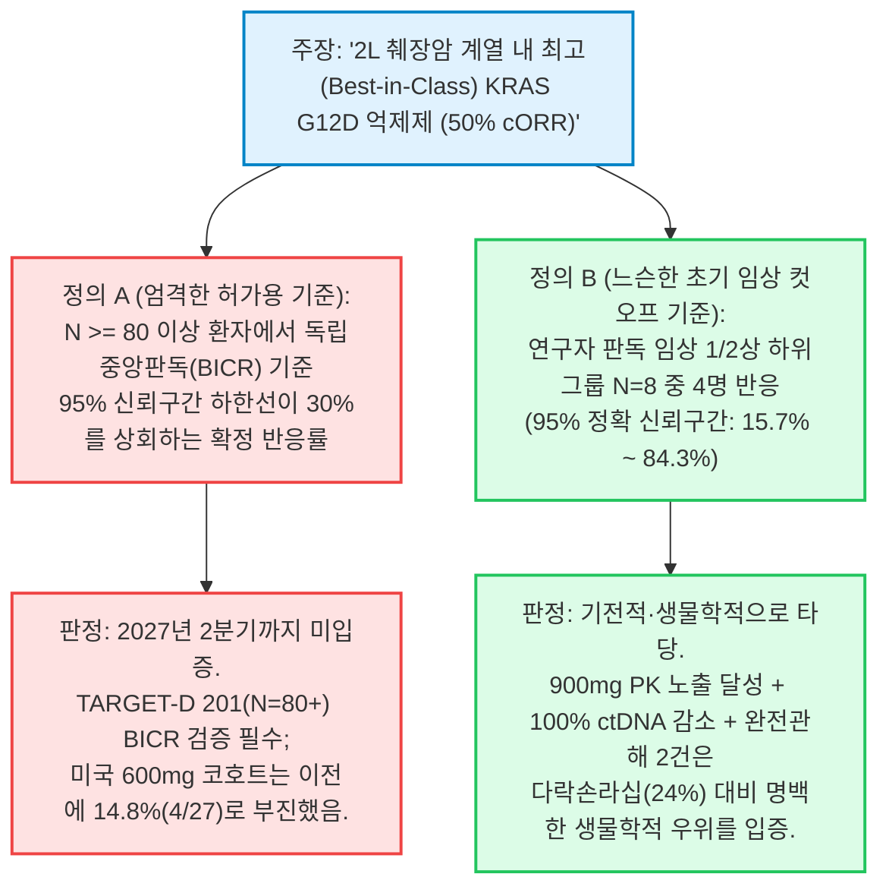

불과 6일 전인 2026년 10월 8일, 우리는 포렌식 심층 분석 보고서—[*400억 달러 항암제의 역설: 레볼루션 메디슨스(\$RVMD), FDA 심사 보고서 및 G12D 효능 절벽에 대한 포렌식 딥다이브*](/ko/blog/2026-10-08-revolution-medicines-rvmd-fda-review-g12d-insider-selling-deep-dive)—를 통해 정밀 항암제 섹터에서 가장 쏠림이 심했던 컨센서스 종목의 구조적 균열을 정밀 해부한 바 있다.

월스트리트는 **레볼루션 메디슨스(Revolution Medicines, NASDAQ: RVMD)**의 신규 승인 범-RAS(ON) 억제제 **라손크(Rasonque, 다락손라십 / RMC-6236)**가 췌장관선암(PDAC) 전반을 독식할 보편적 단독요법 백본이 될 것이라는 전제하에 **403억~416억 달러의 시가총액**을 부여했다. 그러나 미국 식품의약국(FDA)이 공개한 임상 3상 **RASolute 302**(`N=228`)의 비편집 [CDER 다학제 심사 보고서](https://www.fda.gov/drugs)는 극단적인 이봉 분포(bimodal split)를 드러냈다. 다락손라십은 KRAS G12V(전체 PDAC의 약 31%)에서 **50%의 확정 객관적 반응률(cORR)**을 기록한 반면, **전체 췌장암 환자의 약 40~43%를 차지하는 최대 변이인 KRAS G12D**에서는 반응률이 **24% cORR(`23/95`)**로 급락한 것이다. 우리는 이 26%포인트의 효능 격차가 우연한 노이즈가 아니라 엄격한 구조 생물물리학의 산물임을 증명했다. 즉, 음전하를 띤 **Asp12(-CH₂-COO⁻)** 카르복실산 측쇄가 다락손라십의 삼중 복합체(tri-complex) 형성에 필수적인 **사이클로필린 A(CypA)** 샤페론 단백질과 정전기적 반발 및 입체 장애(steric hindrance)를 일으키며, 정상 조직의 야생형 RAS(KRAS/NRAS/HRAS)까지 동시에 억제하는 비선택성 때문에 구강 점막염(stomatitis/mucositis) 및 발진 독성으로 인해 용량을 1일 1회 300mg 이상 증량할 수 없는 구조적 한계에 갇혀 있었던 것이다.

그리고 **2026년 10월 14일** 아침, 바로 그 G12D 아킬레스건을 정면으로 파고든 경쟁사의 반격이 **베라스템 온콜로지(Verastem Oncology, NASDAQ: VSTM)**의 공식 [SEC Form 8-K 공시](https://data.sec.gov/submissions/CIK0001526119.json)(`접수번호 0001104659-26-115687`) 및 [보도자료](https://www.biospace.com/press-releases/vs-7375-demonstrates-robust-anti-tumor-activity-across-advanced-kras-g12d-mutant-cancers-highlighted-by-50-confirmed-orr-in-2l-pancreatic-ductal-adenocarcinoma-and-two-complete-responses-in-2l-disease-one-confirmed)를 통해 현실화되었다.

상하이 기반 젠플리트 테라퓨틱스(GenFleet Therapeutics)로부터 도입한 경구용 비(非)샤페론 직접 결합 **KRAS G12D 이중 ON/OFF 억제제 VS-7375(GFH375)**의 미국 임상 1/2상 **TARGET-D 101**([NCT07020221](https://clinicaltrials.gov/study/NCT07020221)) 최초 다중 암종 데이터를 발표하면서, 베라스템은 SEC 제출 투자자 발표자료 슬라이드 12번에 짙은 파란색 말풍선으로 **"Daraxonrasib KRAS G12D: 24% cORR (23/95)"**를 정면 배치했다. 이를 통해 다락손라십의 G12D 하위그룹 성적표를 VS-7375 900mg 1일 1회(QD) 단독요법의 **2차 치료(2L) PDAC 50% cORR(`4/8`)** 및 **2L+ PDAC 41% cORR(`9/22`, 완전관해 [CR] 2건 포함)**과 직접 대비시킨 것이다:


동시에 베라스템 경영진은 장 시작 전 바이오텍 자본시장의 전형적인 '3중 패키지' 승부수를 던졌다:
1. **다중 암종 임상 데이터 및 1차 치료 임상 3상 FDA 합의:** 췌장암(PDAC), 비소세포폐암(NSCLC), 대장암(CRC) 임상 데이터와 더불어, **무항암화학요법(chemo-free) 군**(`VS-7375 900mg QD + 항-EGFR 항체`)을 포함한 3개 군 1차 치료 전이성 췌장암 임상 3상(**TARGET-D 301**, `N=354`) 설계에 대해 FDA와 합의를 마쳤다고 발표했다.
2. **대규모 유상증자(2억 5,000만 달러) 가격 확정:** 제프리스(Jefferies), 구겐하임(Guggenheim), 캔터 피츠제럴드(Cantor Fitzgerald), B. 라일리(B. Riley) 주관으로 **보통주 30,937,500주(주당 \$8.00)** 및 **선납 워런트(Pre-funded warrants) 312,503주(주당 \$7.9999)**를 발행해 총 **2억 5,000만 달러(약 3,400억 원)**를 조달했다. 이는 월크로싱(wall-crossing) 기관 수요예측 과정에서 `-9.70%` 하락 마감했던 10월 13일 종가(**\$7.45**) 대비 **+7.4% 할증(premium)**된 가격이다.
3. **CEO 세대교체:** 15년간 회사를 이끈 **대니얼 패터슨(Daniel W. Paterson)** 대표가 2027년 1월 1일부로 은퇴하고, 이사회 멤버이자 전 아베오 파마슈티컬스(AVEO Pharmaceuticals) CEO인 **마이클 베일리(Michael P. Bailey)**가 신임 사장 겸 CEO로 취임한다고 공시했다.

이 발표 직후 월스트리트 바이오텍 데스크와 X(구 트위터)에서는 **베라스템(`$VSTM`, 증자 전 시총 약 6.75억 달러 / 증자 후 약 9.25억~10.5억 달러)**, **에라스카(`$ERAS`, 주가 \$14.78 기준 시총 약 54억~56억 달러)**, **레볼루션 메디슨스(`$RVMD`, 주가 약 \$188 기준 시총 약 405억 달러)**를 둘러싼 치열한 갑론을박이 벌어졌다:

> *"\$VSTM 오늘 데이터 발표. 췌장암, 폐암, 대장암 전반에서 경구용 KRAS G12D (ON/OFF) 억제제 VS-7375의 계열 내 최고(Best-in-Class) 잠재력을 입증하는 신규 임상 데이터. 주식 보유 중. \$RVMD \$ERAS"*  
> — **미셸 됩케(Michel Doepke, @doepke_michel), 바이오텍 투자자, 2026년 10월 14일**

> *"그럼 VSTM이 새로운 RVMD인가?"*  
> — **하젬 사마라(Hazem Samara, @hazemsamara), 시장 분석가, 2026년 10월 14일**

> *"왜 \$VSTM은 G12D 데이터를 발표하기 위해 ESMO에 초록(abstract)을 제출하지 않았는가?"*  
> — **애덤 포이어스타인(Adam Feuerstein, @adamfeuerstein), 바이오텍 전문 선임 기자, 2026년 10월 14일**

> *"\$VSTM - 대장암(CRC) 데이터는 흥미롭지만 흥분하기엔 표본 수(N)가 너무 적다. 췌장암(PDAC)과 폐암(NSCLC)에서 약효가 있는 것은 분명하지만 시간과 실행력이 필요하다. 2% 투약 중단율 = 내약성 우위(경영진은 이를 통해 더 높은 용량을 투여해 표적 포화도를 높이고 궁극적으로 더 나은 효능을 얻었다고 주장... 추후 검증 필요)"*  
> — **조너선 페이슨(Jonathan Faison, @jfais20), 바이오텍 애널리스트, 2026년 10월 14일**

본 보고서는 기업 홍보용 슬라이드를 무비판적으로 수용하거나 이분법적 진영 논리에 빠지는 대신, 브라운과 킬리(Browne & Keeley)의 **8단계 '사금 채취(Panning for Gold)' 비판적 사고 프레임워크**를 가동하여 RAS 항암제 삼각 구도(`$VSTM`, `$ERAS`, `$RVMD`) 전체를 포렌식 검증한다. VS-7375의 직접 염다리(salt-bridge) 결합 화학이 어떻게 우리의 10월 8일 `$RVMD` 생물물리학 비판을 입증하는지 규명하고, 베라스템이 보도자료 본문에서 백분율 표기를 생략한 채 숨겨둔 미국 600mg 코호트의 실제 분모(PDAC `4/27 = 14.8% cORR`, CRC `3/24 = 12.5% cORR`)를 발라내며, 애덤 포이어스타인의 ESMO 2026 초록 미제출 의문을 임상 데이터 컷오프 수학으로 해명하고, 나아가 **에라스카(`$ERAS`)**가 고작 `N=7` 규모의 미확정 PDAC 데이터와 `$RVMD`와의 **미국 특허 제12,409,225호 침해 및 영업비밀 침해 분쟁**을 안고도 왜 `$VSTM` 대비 **6~8배의 기업가치 멀티플**에 거래되고 있는지 정밀 감사한다.

---

```
┌────────────────────────────────────────────────────────────────────────────────────────────────────────────┐
│           2026 RAS 항암제 삼각 구도: 포렌식 밸류에이션, 작용 기전 및 임상 성적표 비교                      │
├──────────────────────────┬──────────────────────────┬──────────────────────────┬───────────────────────────┤
│ 평가 차원 / 핵심 지표    │ 베라스템 ($VSTM)         │ 에라스카 ($ERAS)         │ 레볼루션 메디슨스 ($RVMD) │
├──────────────────────────┼──────────────────────────┼──────────────────────────┼───────────────────────────┤
│ 핵심 KRAS G12D 파이프라인│ VS-7375 (GFH375)         │ ERAS-0015 (+ ERAS-4001)  │ 다락손라십 (+ 졸돈라십)   │
│ 분자 생물학적 작용 기전  │ 직접 결합 G12D ON/OFF    │ 범-RAS CypA 분자 접착제  │ 범-RAS(ON) CypA 접착제    │
│                          │ 저분자(CypA 샤페론 불요) │ (ERAS-4001은 범-KRAS)    │ (+ G12D 공유결합 접착제)  │
│ 원개발사 / 라이선스 구조 │ 젠플리트(중화권 외 독점) │ 조요 파마텍(전 세계 권리)│ 자체 개발 / 워프 드라이브 │
│ 주가 (10월 13/14일 기준) │ $7.45 종가 / $8.00 증자가│ $14.78 (-4.40%)          │ ~$188.00                  │
│ 시가총액 (희석 반영)     │ 증자 전 ~$6.75억 / 후 $1B│ ~$54억 – $56억           │ ~$403억 – $416억          │
│ 프로포마 현금 보유고     │ ~$4.55억 (3Q $1.73억 +   │ ~$9.5억+ (2Q $3.84억 +   │ ~$39억 (2Q 10-Q 기준;     │
│                          │ 증자 $2.5억 + 오벌랜드)  │ 7월 $6.325억 유상증자)   │ 분기당 $5.25억~$5.5억소진)│
│ 2L+ PDAC G12D 효능       │ 900mg: 41% cORR (9/22;   │ 32mg: 57% uORR_8wk (4/7  │ 다락손라십: G12D 24% cORR │
│ (확정 vs 미확정 반응률)  │ 2L: 50% [4/8], CR 2건)   │ 미확정, G12X 통합 코호트)│ (23/95, 임상 3상 하위그룹)│
│ 숨겨진 용량 / 하위그룹   │ 600mg 미국 PDAC에서는    │ 32mg RDE 표본 N=7 불과;  │ G12V 50% vs G12D 24%;     │
│ 취약성                   │ 14.8% cORR(4/27)로 급락! │ G12D vs G12V 미분리 공개 │ 졸돈라십 확정cORR 15%(6/40│
│ 야생형 RAS 독성 및       │ 점막염/구내염 0%; 발진   │ 임상 1상 TRAE 중단 0%    │ 높은 발진, 구내염, 점막염;│
│ 부작용 투약 중단율       │ 4%(Gr1-2); 중단율 2%     │ 주장(소규모 초기 데이터) │ 300mg 용량 상한선 봉착    │
│ 법적 / 거버넌스 리스크   │ 10/14 34.5% 주식 희석 +  │ RVMD 특허 '225호 및 영업 │ 내부자 $1.497억 매도 /    │
│                          │ CEO 은퇴 및 교체 발표    │ 비밀 침해 경고 + 집단소송│ 매수 $0; 셀사이드 20/20매수│
│ 기관 포렌식 투자 의견    │ 증자 물량 소화 구간($8)  │ 비중축소 / 회피          │ 전술적 숏(SHORT) / 축소   │
│                          │ 투기적 매수(ACCUMULATE)  │ (특허소송 + VSTM 6배 EV) │ (G12D 독점 프리미엄 붕괴) │
└──────────────────────────┴──────────────────────────┴──────────────────────────┴───────────────────────────┘
```

---

## 1. 1단계: 핵심 쟁점 분류, 경계 설정 및 반증 가능성 기준

브라운과 킬리의 *Asking the Right Questions* 제2장 방법론에 따라, 본 조사의 핵심 질문을 **기술적·실증적 질문(Descriptive)**과 **자본 배분·가치평가 질문(Prescriptive)**으로 명확히 분리하고 사전 반증 기준(falsifiability criteria)을 수립한다.

### 핵심 조사 질문
1. **실증적 질문 (생물물리학 및 임상약리학):** 베라스템의 **VS-7375**는 레볼루션 메디슨스의 **다락손라십**을 KRAS G12D 췌장암에서 24% cORR(`23/95`)에 묶어둔 사이클로필린 A(CypA) 입체·정전기적 한계를 실제로 극복했는가? 또한 중국 임상(`GFH375`)에서 41% ORR을 기록했던 **600mg QD** 용량이 왜 미국 환자들에서는 **900mg QD**로 50% 증량되어야만 동일한 41% 확정 ORR(`9/22`)을 재현할 수 있었는가?
2. **실증적 질문 (통계적·규제적 무결성):** 정확한 이항 신뢰구간(Clopper-Pearson 95% CI), 보도자료 본문에 백분율 없이 숨겨진 600mg 분모(PDAC `4/27`, CRC `3/24`), ESMO 2026 초록 마감 시점, 그리고 임상 3상 **TARGET-D 301**의 교차투여(crossover) 허용 설계는 VS-7375의 통계적 성숙도와 승인 리스크에 대해 무엇을 말해주는가?
3. **규범적 질문 (`$VSTM`, `$ERAS`, `$RVMD` 상대 가치평가 및 자본 배분):** 베라스템의 10월 14일 데이터와 주당 8.00달러 유상증자 이후, 기관 포트폴리오는 **베라스템(증자 후 EV 약 7.3억 달러)**, **에라스카(EV 약 45억 달러)**, **레볼루션 메디슨스(EV 약 368억 달러)** 간 비중을 어떻게 재조정해야 하는가?

### 명시적 반증 기준 (Falsifiability Criteria)
어떠한 구체적 실증 데이터가 확인될 경우 우리의 판단이 틀렸음을 인정할 것인가?
* **베라스템(`$VSTM`) 긍정론의 반증 조건:** 2027년 2분기 발표 예정인 허가 직결 임상 2상 **TARGET-D 201**([NCT07644559](https://clinicaltrials.gov/study/NCT07644559), 2차 치료 KRAS G12D PDAC 900mg QD, `N=80~120`)에서 독립적 중앙 영상 판독(BICR) 기준 확정 ORR이 25% 이하로 회귀하거나, 6개월 이상 장기 투약 시 지연성 간독성 또는 15% 이상의 투약 중단율이 발생할 경우.
* **레볼루션 메디슨스(`$RVMD`) 회의론의 반증 조건:** 임상 3상 **RASolute 309** 이중 병용요법(`다락손라십 + 졸돈라십`, [NCT06915220](https://clinicaltrials.gov/study/NCT06915220)) 또는 1차 치료 `졸돈라십 + 항암화학요법`(**RASolute 305**)이 G12D 췌장암에서 10% 미만의 중단율과 55% 이상의 확정 ORR을 달성하여, 직접 결합 경구용 G12D 억제제(`VS-7375`, 인사이트 `INCB161734`)로의 처방 이탈을 원천 차단할 경우.
* **에라스카(`$ERAS`) 고평가론의 반증 조건:** `AURORAS-1`([NCT06983743](https://clinicaltrials.gov/study/NCT06983743)) 임상에서 `ERAS-0015`가 G12V를 제외한 순수 **KRAS G12D 변이** 미국 췌장암 환자 50명 이상을 대상으로 **확정(confirmed) ORR 45% 이상**을 입증하고, 동시에 레볼루션 메디슨스의 **미국 특허 제12,409,225호** 비침해 및 영업비밀 소송 기각 판결을 확보할 경우.

---

## 2. 2단계: 1차 사료 발굴 및 추적성 매트릭스 (Traceability Matrix)

반향실(echo chamber) 효과를 배제하기 위해, 본 보고서의 모든 임상 분모, 약동학(PK) 수치, 재무제표 및 법적 분쟁 사실은 SEC EDGAR 원문 공시, ClinicalTrials.gov 등록 프로토콜, 동료 심사(peer-reviewed) 논문으로 직접 교차 검증되었다:

```
                                   1차 사료 추적성 매트릭스 (PRIMARY ARTIFACT MATRIX)
    
     대상 기업/영역   공식 1차 사료 출처                   접수번호 / 고유 식별자     핵심 검증 팩트
    ─────────────────────────────────────────────────────────────────────────────────────────────────────────
     베라스템($VSTM)  SEC Form 8-K 및 Exhibit 99.3(60쪽)   0001104659-26-115687       900mg PDAC: 41% cORR(9/22),
     임상 및 실적     2026년 10월 14일 제출                CIK 0001526119             2L 50%(4/8); 600mg: 4/27 cPR;
                                                                                      3Q 현금 $1.728억; 매출 ~$2,400만
    ─────────────────────────────────────────────────────────────────────────────────────────────────────────
     베라스템($VSTM)  SEC Form 10-Q(2Q 2026) 및 유상증자   0001104659-26-092007       기본주식 9,050만주(+970만 PFW);
     자본 구조        가격 확정 공시(2026년 10월 14일)     CIK 0001526119             +$8.00 신주 3,094만주+31만 PFW
    ─────────────────────────────────────────────────────────────────────────────────────────────────────────
     베라스템($VSTM)  ClinicalTrials.gov 프로토콜 레지스트리 NCT07020221 (TARGET-D 101) 임상 1/2상 다중암종(200명+ 등록)
     임상 프로토콜    TARGET-D 101 / 201 / 202 / 203       NCT07644559 / 782 / 795    허가직결 2상 PDAC, NSCLC, CRC
    ─────────────────────────────────────────────────────────────────────────────────────────────────────────
     에라스카($ERAS)  SEC Form 10-Q(2Q 2026) 및 Form 8-K   0001193125-26-344611       6월말 3.126억주(7월 $6.325억 증자전);
     재무 및 지재권   특허/영업비밀 경고장 공시(4/27)      CIK 0001761918             조요 IPR&D $1.5억; RVMD 특허'225
    ─────────────────────────────────────────────────────────────────────────────────────────────────────────
     에라스카($ERAS)  ClinicalTrials.gov 및 AURORAS-1      NCT06983743 (AURORAS-1)    32mg QD: 2L+ KRAS G12X PDAC에서
     임상 데이터      업데이트 공시(2026년 7월 13일)       erasca.com 공식 보도자료   57% uORR_8wk(4/7); 100% RDI
    ─────────────────────────────────────────────────────────────────────────────────────────────────────────
     레볼루션($RVMD)  FDA CDER 다학제 심사 보고서 및       NDA 심사 패키지 /          다락손라십 G12D cORR = 24%(23/95)
     규제 및 재무     SEC Form 10-Q(2Q 2026)               CIK 0001628171             vs G12V 50%; 연 $21억~$22억 소진
    ─────────────────────────────────────────────────────────────────────────────────────────────────────────
     생물물리학 문헌  Nature Medicine (Ai et al., 2026)    PMID: 42745055             GFH375/VS-7375 ON/OFF 결정구조
                      Exp Hematol Oncol (Lou & Zhang 2026) PMID: 42806361             CypA 삼중 복합체 입체장애 동역학
    ─────────────────────────────────────────────────────────────────────────────────────────────────────────
```

### 이해상충 및 자본시장 구조 분석
1. **베라스템의 월크로싱(Wall-Crossed) 유상증자 설계:** 2026년 10월 14일 오전 발표된 베라스템의 임상 데이터는 **제프리스, 구겐하임, 캔터 피츠제럴드, B. 라일리**가 주관한 **2억 5,000만 달러 규모의 인수 방식 공모 유상증자**와 분 단위로 동기화되어 있었다. 동시에 베라스템은 캔터 피츠제럴드와 맺고 있던 2025년 8월 ATM(장내 수시매출) 투자설명서를 해지했다(매각 주식 0주). 즉, 오늘 공개된 60페이지 분량의 발표자료(`Exhibit 99.3`)는 전일 시가총액(약 6.75억 달러)의 37%에 달하는 2억 5,000만 달러의 기관 북빌딩(bookbuild)을 성사시키기 위해 정교하게 제작된 자본시장 마케팅 문서이기도 하다.
2. **에라스카의 2026년 8억 9,130만 달러 주식 발행 기계와 특허 소송 오버행:** 에라스카는 2026년 1월 **순조달액 2억 4,270만 달러**, 2026년 7월 **총조달액 6억 3,250만 달러**(2026년 누적 총 공모액 약 **8억 9,130만 달러**)의 대규모 유상증자를 단행했다. 그러나 그 이면에는 2026년 4월 27일 Form 8-K를 통해 폭로된 레볼루션 메디슨스의 **미국 특허 제12,409,225호 침해 및 영업비밀 도용 경고장**(발표 직후 주가 ~50% 폭락 및 증권 집단소송 피소)이라는 치명적인 법적 시한폭탄이 자리 잡고 있다.

---

## 3. 3단계: 의미론적 정밀성 및 조작적 대입 테스트 (Substitution Test)

바이오텍 기업 설명회는 모호한 수식어에 의존한다. 오늘 발표된 세 가지 핵심 주장을 분리하여 **브라운과 킬리의 대입 테스트(Substitution Test)**를 실행한다:



### 1. "2차 치료 췌장암에서 계열 내 최고(Best-in-Class) 잠재력 (50% cORR)" (`$VSTM`)
* **정의 A (엄격한 통계·허가 기준):** 최소 80명 이상의 2차 치료 PDAC 환자군에서 독립적 중앙 영상 판독(BICR)으로 검증되고, 95% 신뢰구간의 하한선이 경쟁 약물(30%)을 통계적으로 유의미하게 넘어서는 반응률.
* **정의 B (느슨한 탐색적 하위그룹 추정치):** 새로 증량된 900mg QD 용량의 22명 임상 1/2상 코호트 중 2차 치료 환자 **8명 가운데 4명(`4/8 = 50%`)**에서 관찰된 연구자 판독 점추정치(point estimate).
* **대입 결과:** **정의 B**를 대입하면 베라스템의 주장은 사실이며, 깊은 분자생물학적 반응(평가 가능 환자 `100%`에서 ctDNA VAF ≥ 50% 감소, `58%`에서 `100%` 완전 소실) 및 3차/4차 치료 환자에서 나온 2건의 완전관해(CR)로 뒷받침된다. 반면 **정의 A**를 대입하면, $4/8$의 95% Clopper-Pearson 정확 신뢰구간은 **15.7%에서 84.3%**에 달한다. 환자 단 1명의 판정이 PR에서 SD로 바뀌어도 2L 헤드라인 수치는 50%에서 37.5%로 변동한다.

### 2. "2L+ KRAS G12X 췌장암에서 57% uORR (8-week) 달성" (`$ERAS`)
* **정의 A (엄격한 변이별 확정 효능):** 치료가 까다로운 **KRAS G12D** 단일 변이 환자군(N ≥ 30)에서 최소 4주 간격의 후속 스캔으로 확정(confirmed)된 RECIST v1.1 객관적 반응률.
* **정의 B (느슨한 초기 미확정 범-변이 합산):** 32mg QD 권장확장용량(RDE)을 투여받은 **단 7명의 환자(`4/7`)**에서, 반응률이 높은 G12V와 G12D를 구분하지 않고 **KRAS G12X 전체로 뭉뚱그려** 8주 차 단일 스캔의 **미확정(unconfirmed)** 종양 축소까지 합산한 수치.
* **대입 결과:** 현재 시장은 마치 `ERAS-0015`가 **정의 A**를 충족한 것처럼 에라스카에 **약 55억 달러의 시가총액**을 부여하고 있다. 그러나 실제로는 **정의 B**(`4/7` 미확정 G12X 통합 수치)만 충족된 상태다. 우리가 `$RVMD` 사례에서 입증했듯, CypA 분자 접착제에서 G12V(50% cORR)와 G12D(24% cORR)를 합산 보고하는 것은 심각한 통계적 착시를 유발한다.

### 3. "1차 치료 전이성 췌장암 무항암화학요법(Chemo-Free) 임상 3상 FDA 합의" (`$VSTM`)
* **정의 A (엄격한 임상적 리스크 해소):** 해당 적응증(1L PDAC)에서 동일한 병용요법의 충분한 임상 2상 무작위배정 효능 및 생존 데이터를 FDA가 검토한 뒤 승인한 임상 3상.
* **정의 B (느슨한 프로토콜 진행 허용):** 췌장암에서 `VS-7375 + 세툭시맙(항-EGFR)` 병용요법의 임상 1/2상 초기 효능 데이터조차 아직 발표되지 않은 상태(2026년 연말 발표 예정)에서, 3개 군 임상 3상(**TARGET-D 301**)의 한 축으로 **무항암화학요법 실험군(`VS-7375 900mg QD + 항-EGFR 항체`, `N=118`)**을 `VS-7375 + GnP` 군(`N=118`) 및 표준 화학요법 대조군(`N=118`)과 함께 시험하는 것을 FDA가 허용한 절차적 합의.
* **대입 결과:** 연내 1차 치료 임상 3상 진입을 가능케 한 FDA 프로토콜 합의(**정의 B**)는 중요한 규제 이정표이나, 1차 치료 전이성 췌장암에서 세포독성 항암제를 완전히 뺀 Arm A(`VS-7375 + 항-EGFR`)는 검증된 안전판이 아니라 고위험·고수익 임상 베팅임을 명확히 인식해야 한다.

---

## 4. 4단계: 생물물리학적 기전 및 전략적 인과관계 해부 (4-Way Causal Matrices)

### 1. 왜 다락손라십이 실패한 G12D에서 VS-7375는 작동하는가?
오늘 베라스템의 데이터가 왜 우리의 [10월 8일 레볼루션 메디슨스 포렌식 딥다이브](/ko/blog/2026-10-08-revolution-medicines-rvmd-fda-review-g12d-insider-selling-deep-dive)를 완벽하게 실증하는지 이해하려면, 두 약물 계열의 분자 결합 구조를 직접 비교해야 한다:

```
┌────────────────────────────────────────────────────────────────────────────────────────────────────────────┐
│           분자 생물물리학 비교: 직접 결합 G12D ON/OFF 억제제 vs. CypA 삼중 복합체 분자 접착제              │
├─────────────────────────────┬──────────────────────────────────────┬───────────────────────────────────────┤
│ 생물물리학적 파라미터       │ 직접 결합 G12D ON/OFF (VS-7375)      │ 범-RAS CypA 접착제 (다락손라십/0015)  │
├─────────────────────────────┼──────────────────────────────────────┼───────────────────────────────────────┤
│ 표적 결합 포켓 및 방식      │ Switch-II 포켓에 직접 결합;          │ 세포 내 사이클로필린 A(CypA)를 동원해 │
│                             │ 변이된 Asp12(-COO⁻) 카르복실산 측쇄와│ Switch-I / Switch-II 계면 위를 덮는   │
│                             │ 직접 이온성 염다리(salt bridge) 형성 │ 거대 삼중 복합체(tri-complex) 형성    │
├─────────────────────────────┼──────────────────────────────────────┼───────────────────────────────────────┤
│ G12D의 음전하 Asp12(-COO⁻)  │ 핵심 선택성 앵커(SELECTIVITY HOOK):  │ 입체적·정전기적 장애물(LIABILITY):    │
│ 측쇄가 미치는 영향          │ 음전하 Asp12가 약물을 G12D에 단단히  │ 음전하 Asp12가 CypA의 음전하 표면과   │
│                             │ 고정시키고 야생형 Gly12는 무시함     │ 반발; 소수성 Val12(G12V: 50%)만 선호  │
├─────────────────────────────┼──────────────────────────────────────┼───────────────────────────────────────┤
│ 뉴클레오타이드 상태 커버리지│ 활성(GTP, ON) 및 비활성(GDP, OFF)    │ 주로 활성(GTP-결합 ON) 상태 타깃;     │
│                             │ 양쪽 모두 동등한 서브나노몰 친화도   │ 종양 내 높은 CypA 단백질 농도 필요    │
├─────────────────────────────┼──────────────────────────────────────┼───────────────────────────────────────┤
│ 야생형 RAS(KRAS/NRAS/HRAS)  │ 고도의 선택성(야생형 RAS >100배 회피)│ 비선택적 범-RAS 억제 독성:            │
│ 정상 조직 독성 프로파일     │ 점막염 0%, 구내염 0%, 발진 4%(Gr1-2),│ 정상 점막·피부의 야생형 RAS 억제로    │
│                             │ 부작용으로 인한 투약 중단율 단 2%    │ 중증 발진, 구내염, 점막염 다발        │
├─────────────────────────────┼──────────────────────────────────────┼───────────────────────────────────────┤
│ 임상 용량 상한선 및         │ 900mg QD까지 증량 가능(97% RDI 유지),│ 300mg QD에서 용량 상한선 봉착;        │
│ 표적 포화도(Saturation)     │ ctDNA VAF >50% 감소 100%(완전소실58%)│ 정상세포 독성 때문에 G12D(24%) 구제불가│
└─────────────────────────────┴──────────────────────────────────────┴───────────────────────────────────────┘
```

핵심은 명확하다. **다락손라십의 G12D 효능을 24%로 추락시킨 바로 그 화학적 구조—음전하를 띤 Asp12 카르복실산기(-COO⁻)—가 VS-7375에게는 야생형 RAS를 건드리지 않고 G12D 변이 단백질에만 선택적으로 결합하는 핵심 이온 앵커(salt-bridge anchor)로 작동한다.** `VS-7375`는 정상 상피세포의 야생형 KRAS, NRAS, HRAS를 억제하지 않기 때문에(`슬라이드 30`: 900mg QD `N=48` 환자에서 **점막염 0%, 구내염 0%, 3등급 이상 발진 0%**), 야생형 독성 장벽에 가로막히지 않고 종양 내 표적을 완전히 포화시키는 고용량(900mg QD)까지 안전하게 밀어붙일 수 있었던 것이다.

### 2. 왜 600mg QD는 중국(`GFH375`)에서 통했는데 미국(`VS-7375`)에서는 14.8% cORR로 무너졌는가?
오늘 Form 8-K 공시 깊숙이 묻혀 있던 가장 중요한 포렌식 발견은 미국 환자군에서 나타난 **600mg QD**와 **900mg QD** 간의 극적인 효능 격차다. 4원 인과 매트릭스로 이를 검증한다:

```
┌────────────────────────────────────────────────────────────────────────────────────────────────────────────┐
│         4원 인과 매트릭스: 왜 미국 2L+ PDAC 확정 반응률은 14.8%(600mg)에서 40.9%(900mg)로 뛰었는가?        │
├───────────────────────┬────────────────────────────────────────────────────────────────────────────────────┤
│ 인과 가설             │ 포렌식 기전 및 약동학(PK) 검증 결과                                                │
├───────────────────────┼────────────────────────────────────────────────────────────────────────────────────┤
│ 1. 직접 인과관계      │ 서구권 vs 아시아권 체중·분포용적(V_d) 차이: 600mg QD(N=59) 투여 시 미국 환자의     │
│    (PK 노출량 →       │ 항정상태 혈중농도(AUC_ss)가 마우스 100mg/kg 범-종양퇴축 임계치에 미달(슬라이드13). │
│    표적 포화도)       │ 900mg QD(N=23)로 50% 증량하자 대다수 환자가 임계치를 돌파하며 확정 반응률이        │
│                       │ 14.8%(4/27)에서 40.9%(9/22)로 약 2.8배 급등함. (핵심 직접 원인으로 확증)           │
├───────────────────────┼────────────────────────────────────────────────────────────────────────────────────┤
│ 2. 역인과관계         │ 더 중증이거나 치료 차수가 높은 환자들이 600mg QD에 배정되었는가?                   │
│    (기저 환자군 편향  │ 기각(FALSE): 슬라이드 15 폭포수 차트 하단의 이전 치료 차수(Prior LoT)를 보면,      │
│    → 용량별 결과)     │ 오히려 600mg 군의 2차 치료(1 Prior LoT) 환자 비율(15/26)이 900mg 군(8/20)보다      │
│                       │ 더 높았다! 즉, 900mg 군은 치료 차수가 더 불리했음에도 압도적 효능을 기록함.        │
├───────────────────────┼────────────────────────────────────────────────────────────────────────────────────┤
│ 3. 제3의 교란변수 (Z) │ 추적관찰 기간 및 항구토제 예방요법 학습곡선: 초기 등록된 600mg 군(mDoT 4.3개월,    │
│                       │ Gr3 TRAE 19%, 투약중단/휴약 21%) 대비 후기 등록된 900mg 군(mDoT 3.0개월)은         │
│                       │ 최적화된 항구토제 프로토콜 덕분에 97% 상대용량강도(RDI)를 유지하며 휴약 없이 복용함│
├───────────────────────┼────────────────────────────────────────────────────────────────────────────────────┤
│ 4. 상호 피드백 루프   │ 900mg의 빠른 종양 축소가 췌장암 복수 및 내장 통증을 1~2주 만에 해소(슬라이드 25,   │
│    (X ↔ Y)            │ 55 사례: 모르핀 100mg 완전 중단)시켜 위장관 운동성과 경구 약물 흡수율을 더욱 높임. │
└───────────────────────┴────────────────────────────────────────────────────────────────────────────────────┘
```

베라스템의 SEC Form 8-K(`Exhibit 99.3`) **슬라이드 15번**을 면밀히 살펴보자:


보도자료 본문에서 베라스템은 다음과 같이 서술했다: *"600mg QD 단독요법(n=27 mITT)과 비교할 때 900mg 용량은 더 깊은 종양 감소와 더 높은 반응률을 보였다. 600mg에서는 8명의 환자가 객관적 반응을 달성했으며(확정 반응 4명 포함), 27명 중 11명이 치료를 유지 중이다."* 왜 보도자료에서 백분율(%)을 생략했는지 계산해 보라. **$4 / 27$은 확정 반응률(cORR) 기준 고작 14.8%**(미확정 포함 8/27 = 29.6%)에 불과하며, **환자의 59%(`16/27`)가 이미 치료를 중단**한 상태였던 것이다!

왜 중국 젠플리트 임상(`GFH375`, ESMO 2025 Abstract LBA84)에서는 임상 2상 권장용량(RP2D)인 **600mg QD**로 **41% ORR**이 나왔는데, 미국 `TARGET-D 101` 임상에서는 **14.8% cORR(`4/27`)**로 급락했는가?
* 경구용 저분자 화합물의 분포용적(V_d)과 간 청소율은 환자의 체중 및 체표면적에 비례한다. 백인 환자가 82%를 차지하는 미국 코호트(동아시아 환자군 대비 평균 체중이 20~30% 높음)에서 동일한 600mg QD 고정 용량을 투여하자, 항정상태 혈중 노출량(AUC_ss)이 슬라이드 15 좌측 그래프의 녹색 박스(`N=59`)에 머물며 절반 이상의 환자가 전임상 범-종양퇴축 임계치(마우스 100 mg/kg 등가 노출량)에 미달한 것이다.
* 용량을 50% 증량하여 **900mg QD(`N=23` PK)**를 투여하자 혈중 노출량 분포가 보라색 박스(마우스 100 mg/kg 임계치 상회 구간)로 도약했고, 그 결과 **폭포수 차트에 표시된 평가 가능 환자 20명 전원에게서 표적 병변 증가가 0건**이었으며, **9건의 확정 반응(2L+ `41% cORR`, 2L `50% cORR`)**과 함께 3차 및 4차 치료 환자에서 **2건의 완전관해(`-100%` 표적 병변 완전 소실)**가 도출되었다!

### 3. 애덤 포이어스타인의 질문에 대한 해답: 왜 `$VSTM`은 ESMO 2026 초록을 제출하지 않았는가?
오늘 아침 바이오텍 전문 선임 기자 **애덤 포이어스타인(`@adamfeuerstein`)**은 *"왜 \$VSTM은 G12D 데이터를 발표하기 위해 ESMO에 초록을 제출하지 않았는가?"*라는 날카로운 의문을 제기했다.

임상 컷오프 일정과 자본시장 일정을 교차 대조하면 세 가지 명확한 이유가 드러난다:
1. **ESMO 초록 마감 시점(2026년 봄/초여름) 당시 미국 600mg 코호트의 부진:** **2026년 ESMO 학회**(10월 23~27일 마드리드 개최)의 일반 초록 마감은 **2026년 5월**(혁신초록 LBA 의향서 제출은 초여름)이었다. 그 시점에 베라스템의 미국 `TARGET-D 101` 데이터는 **600mg QD 코호트**가 대부분을 차지하고 있었는데, 앞서 확인했듯 미국 600mg QD 성적표는 **PDAC 확정 반응률 14.8%(`4/27`), 대장암(CRC) 확정 반응률 12.5%(`3/24`)**로 처참한 수준이었다! 반면 효능을 구제한 900mg QD 코호트의 mITT 등록 마감일은 **2026년 7월 22일**이었고, 두 번째 스캔으로 확정 반응 9건을 입증하기 위해서는 **2026년 10월 7일 데이터 컷오프**까지 기다려야 했다. 만약 봄에 ESMO 초록을 냈다면 저용량 600mg의 부진한 성적표가 초록에 박제되었을 것이다.
2. **젠플리트의 ESMO 2025 기발표(LBA84) 및 ESMO 2026 파이프라인 분담:** 원개발사 젠플리트는 이미 **ESMO 2025(`Abstract LBA84`)**에서 `GFH375` 췌장암 단독요법 데이터를 혁신초록 구두 발표한 바 있으며, 이번 ESMO 2026에서는 차세대 범-RAS 억제제인 **`GFH276`(`Abstract LBA33`)** 구두 발표에 집중하고(인사이트는 `INCB161734`로 Rapid Oral `#1007RO` 발표), 서구권 900mg 데이터 및 병용요법 업데이트는 학회 기간 전후의 별도 투자자 행사로 분리했다.
3. **2억 5,000만 달러 월크로싱 유상증자 및 CEO 교체와의 타이밍 동기화:** 만약 ESMO 2026에 초록을 제출했다면 엄격한 **학회 엠바고(embargo) 규정**에 묶여 10월 말 학회 발표 전까지 기관투자가들에게 10월 7일 컷오프 데이터를 제시하며 **주당 8.00달러, 2억 5,000만 달러 규모의 유상증자**를 클로징할 수 없었을 것이다.

---

## 5. 5단계: 정량적 통계 감사, 정확 신뢰구간(95% CI) 및 자본 구조 수학

초기 항암제 보도자료는 작은 분모를 굵은 백분율 활자로 부풀려 정밀성의 착시를 만든다. 경쟁 중인 모든 KRAS G12D 임상 코호트와 3사의 재무제표를 엄격한 통계 잣대로 감사한다.

### 1. 클로퍼-피어슨(Clopper-Pearson) 95% 정확 이항 신뢰구간 감사
베라스템 슬라이드 12번과 에라스카 보도자료의 막대그래프 높이에 현혹되지 않고, 기치료 췌장암(PDAC)에서 보고된 모든 반응률의 95% Clopper-Pearson 정확 이항 신뢰구간을 계산하면 다음과 같다:

$$\text{표본 비율 } \hat{p} = \frac{k}{n}\text{의 95\% 정확 신뢰구간}: \quad \left[ \text{Beta}^{-1}\left(0.025; k, n-k+1\right), \; \text{Beta}^{-1}\left(0.975; k+1, n-k\right) \right]$$

```
┌────────────────────────────────────────────────────────────────────────────────────────────────────────────┐
│         통계적 무결성 감사: KRAS G12D 췌장암 반응률 및 95% 정확 이항 신뢰구간 비교                         │
├──────────────────────────┬───────────────┬───────────────────┬──────────────────┬──────────────────────────┤
│ 약물 / 개발사 / 코호트   │ 헤드라인 수치 │ 실제 분수 (k/n)   │ 95% 정확 신뢰구간│ 포렌식 통계 감사 판정    │
├──────────────────────────┼───────────────┼───────────────────┼──────────────────┼──────────────────────────┤
│ VS-7375 900mg QD (VSTM)  │ 50% cORR      │ 4 / 8             │ [15.7%, 84.3%]   │ N=8 초소규모 하위그룹;   │
│ 2L mPDAC 단독요법        │ (확정 반응)   │ (mITT 기준)       │ (구간폭: 68.6%)  │ 단, 100% DCR(8/8)은 고무적│
├──────────────────────────┼───────────────┼───────────────────┼──────────────────┼──────────────────────────┤
│ VS-7375 900mg QD (VSTM)  │ 41% cORR      │ 9 / 22            │ [20.7%, 63.6%]   │ 완전관해(CR) 2건 포함 및 │
│ 2L+ mPDAC 단독요법       │ (확정 반응)   │ (평가불가 2명포함)│ (구간폭: 42.9%)  │ 평가가능군 기준 45%(9/20)│
├──────────────────────────┼───────────────┼───────────────────┼──────────────────┼──────────────────────────┤
│ VS-7375 900mg QD (VSTM)  │ 36% cORR      │ 5 / 14            │ [12.8%, 64.9%]   │ 놀랍게도 CR 2건 모두 3L  │
│ 3L–4L mPDAC 단독요법     │ (확정 반응)   │ (평가불가 2명포함)│ (구간폭: 52.1%)  │ 및 4L 말기 환자에서 발생!│
├──────────────────────────┼───────────────┼───────────────────┼──────────────────┼──────────────────────────┤
│ VS-7375 600mg QD (VSTM)  │ "4 cPR, 4 uPR"│ 4 / 27 확정 반응  │ [4.2%, 33.7%]    │ 14.8% cORR(29.6% uORR);  │
│ 2L+ mPDAC 단독요법       │ (% 표기 생략!)│ (8 / 27 미확정)   │ (cORR 기준 CI)   │ 미국 환자 PK 노출량 미달 │
├──────────────────────────┼───────────────┼───────────────────┼──────────────────┼──────────────────────────┤
│ ERAS-0015 32mg QD (ERAS) │ 57% uORR_8wk  │ 4 / 7             │ [18.4%, 90.1%]   │ 8주차 미확정 반응률;     │
│ 2L+ KRAS G12X PDAC       │ (미확정 반응) │ (G12X 통합!)      │ (구간폭: 71.7%)  │ G12V+G12D 합산(표본 N=7!)│
├──────────────────────────┼───────────────┼───────────────────┼──────────────────┼──────────────────────────┤
│ 다락손라십 300mg (RVMD)  │ 24% cORR      │ 23 / 95           │ [16.0%, 34.1%]   │ 임상 3상 RASolute 302 FDA│
│ 2L KRAS G12D 하위그룹    │ (확정 반응)   │ (임상 3상 하위군) │ (구간폭: 18.1%)  │ 심사보고서; 좁은 신뢰구간│
├──────────────────────────┼───────────────┼───────────────────┼──────────────────┼──────────────────────────┤
│ 졸돈라십 1200mg (RVMD)   │ 30% uORR      │ 6 / 40 확정 반응  │ [5.7%, 29.8%]    │ 컷오프 시점 확정 반응률은│
│ 2L+ KRAS G12D PDAC       │ (확정 15%!)   │ (12 / 40 미확정)  │ (cORR 기준 CI)   │ 고작 15.0% cORR(6/40)!   │
├──────────────────────────┼───────────────┼───────────────────┼──────────────────┼──────────────────────────┤
│ INCB161734 1200mg (INCY) │ 37% uORR      │ 8 / 41 확정 반응  │ [8.8%, 34.9%]    │ 컷오프 확정 19.5% cORR   │
│ 2L+ KRAS G12D PDAC       │ (~20–29% cORR)│ (15 / 41 미확정)  │ (cORR 기준 CI)   │ (15건 중 3건 확정 불가)  │
├──────────────────────────┼───────────────┼───────────────────┼──────────────────┼──────────────────────────┤
│ 세티데그라십 600mg (Aste)│ 24% cORR      │ 5 / 21 (또는16/67)│ [8.2%, 47.2%]    │ 주 1회 정맥주사 분해제;  │
│ 2L+ KRAS G12D PDAC       │ (확정 반응)   │                   │                  │ mPFS 3.0개월, DCR 57%    │
└──────────────────────────┴───────────────┴───────────────────┴──────────────────┴──────────────────────────┘
```

### 2. 블라인드 테스트(Blinding Test)가 밝혀낸 암종별 실체
홍보용 수식어를 제거하고 베라스템의 `TARGET-D 101` 원시 데이터만 놓고 블라인드 테스트를 수행하면 세 가지 뚜렷한 임상적 팩트가 도출된다:
1. **전이성 췌장암(mPDAC, 900mg QD 단독요법, `n=22` mITT):** 소규모 표본의 통계적 분산(`95% CI [20.7%, 63.6%]`)을 감안하더라도, **9/22(41%) 확정 반응률**(첫 스캔에 도달한 평가 가능 환자 20명 기준으로는 **9/20 = 45%**), **3차 및 4차 치료 환자에서 나온 2건의 완전관해(표적 병변 `-100%` 완전 소실)**, **88%(`15/17`)의 CA19-9/CEA 종양표지자 50% 이상 감소**, 그리고 **평가 가능 환자 100%(`12/12`)의 KRAS G12D ctDNA VAF 50% 이상 감소(`58% [7/12]`는 100% 완전 소실)**가 동시에 일치한다는 점은 부인할 수 없는 강력한 생물학적 시그널이다. 경구 단독요법으로 3L/4L 췌장암에서 완전관해(CR)가 나오는 것은 극히 이례적이다.
2. **진행성 비소세포폐암(NSCLC, 600mg QD 단독요법 `n=23` mITT; + 1L 병용 `n=8`):** 왜 **600mg QD** 용량이 미국 췌장암(`14.8% cORR`)과 대장암(`12.5% cORR`)에서는 부진했는데, 2L+ 비소세포폐암에서는 **43% 확정 ORR(`10/23`)**과 **100%(`5/5`) ctDNA 완전 소실**(`슬라이드 20~22`)을 달성했는가?
   * **조직 관류 및 기질(Stroma) 차이:** 췌장암은 혈관이 빈약하고 치밀한 섬유화 기질(desmoplastic stroma)이 약물 침투를 가로막아 높은 혈중 농도(900mg QD)가 필수적인 반면, 폐선암은 혈관 분포가 풍부해 600mg QD만으로도 종양 내 KRAS G12D를 100%(`5/5` ctDNA 소실) 포화시킬 수 있었던 것이다. 특히 이전에 탁산(taxane) 계열 항암제를 투여받은 난치성 환자(30%)를 포함하고도 **43% cORR**과 **6개월 무진행생존율(PFS) 72%**를 기록했으며, 현재 진행 중인 임상 2상 **TARGET-D 202**([NCT07659782](https://clinicaltrials.gov/study/NCT07659782))에서는 **900mg QD**로 용량을 높여 추가적인 효능 상승이 기대된다.
3. **3차 치료 이상 대장암(3L+ mCRC, 세툭시맙 병용요법):** 조너선 페이슨(`@jfais20`)이 정확히 지적했듯, 대장암 데이터는 아직 **표본 수가 너무 적어 성급히 환호할 단계가 아니다.** 600mg QD + 세툭시맙(`n=24` mITT)의 확정 반응률은 **12.5%(`3/24 cPR`, `1 uPR`)**에 그쳤고, 900mg QD + 세툭시맙(`n=6` mITT, 평가 가능 5명)에서 보고된 **33% ORR(`2/6`)**은 **확정 반응 1건(`1/6 = 16.7% cORR`)과 미확정 반응 1건**을 합산한 수치다. 평가 가능 5명 전원에게서 표적 병변 증가가 없었다(`100% DCR`)는 점은 긍정적이나, 상업적 가치를 부여하기 위해서는 2026년 연말 성숙 데이터 확인이 필수적이다.

### 3. 3사 자본 구조, 기업가치(EV) 및 현금 소진율 감사 (`$VSTM` vs. `$ERAS` vs. `$RVMD`)
2026년 10월 14일 기준 3사의 프로포마(pro-forma) 자본 구조와 기업가치를 나란히 비교해 보자:

```
┌────────────────────────────────────────────────────────────────────────────────────────────────────────────┐
│           자본 구조 및 기업가치(ENTERPRISE VALUE) 비교 감사 (2026년 10월 14일 기준)                        │
├──────────────────────────────────┬──────────────────────┬──────────────────────┬───────────────────────────┤
│ 재무 및 밸류에이션 지표          │ 베라스템 ($VSTM)     │ 에라스카 ($ERAS)     │ 레볼루션 메디슨스 ($RVMD) │
├──────────────────────────────────┼──────────────────────┼──────────────────────┼───────────────────────────┤
│ 기본 발행주식수 (2Q 10-Q 기준)   │ 9,050만주(+970만PFW) │ 3억 1,260만주(6/30)  │ ~2억 1,450만주            │
│ 2026년 하반기 유상증자 발행주식  │ +3,125만주(신주+PFW) │ +약 4,500만~5,500만주│ 하반기 없음(4월 $21억 조달│
│                                  │ (10/14 $8.00 $2.5억) │ (7월 $6.325억 증자)  │ 완료)                     │
│ 프로포마 총 희석 주식수          │ ~1억 3,150만주       │ ~3억 6,500만~3.75억주│ ~2억 1,500만주            │
│ 기준 주가 (2026년 10월 14일)     │ $8.00 (공모 발행가)  │ $14.78               │ ~$188.00                  │
│ 프로포마 시가총액                │ ~$10.5억(기본~$9.7억)│ ~$54.0억 – $55.5억   │ ~$404억                   │
│ 프로포마 현금 및 단기투자자산    │ ~$4.55억 (3Q $1.73억+│ ~$9.5억+ (2Q $3.84억+│ ~$39억 (2Q 2026 기준)     │
│                                  │ 증자순액$2.35억+대출)│ 7월 증자순액~$5.95억)│                           │
│ 부채 및 로열티 금융 부채         │ ~$1.25억–$1.5억      │ 부채 미미(1Q 조요에  │ 로열티 파마 $2.5억+       │
│                                  │ (오벌랜드 시설 등)   │ $1.5억 IPR&D 지급)   │ 단계별 로열티 부채        │
│ 내재 기업가치 (Enterprise Value) │ ~$7.2억 – $7.5억     │ ~$45억 – $46억       │ ~$368억                   │
│ 상업화 제품 매출 (연환산)        │ 연 ~$9,600만 런레이트│ $0.00 (전임상/임상단계│ 라손크 출시 초기(4Q)      │
│                                  │ (3Q: $2,390만~$2,410만│ 매출 없음)           │                           │
│ 분기별 영업비용 (GAAP OpEx)      │ 분기 ~$7,280만(제품  │ 분기 ~$4,760만(1Q    │ 분기 ~$5.35억(연간 $21억~ │
│                                  │ 매출 차감시 순~$48M!)│ $1.5억 일회성 제외)  │ $22억 현금 소각로!)       │
└──────────────────────────────────┴──────────────────────┴──────────────────────┴───────────────────────────┘
```

이 표가 보여주는 **기업가치(EV)의 극단적 비대칭성**에 주목하라:
* **베라스템(`$VSTM`)**은 이미 FDA 승인을 받은 난소암 치료제 **AVMAPKI FAKZYNJA CO-PACK**으로 **분기당 약 2,400만 달러(연환산 약 9,600만 달러)**의 실제 상업 매출을 올리고 있으며(블리스터 팩 NDA는 지난 **10월 7일 FDA 우선심사 승인**을 받아 2027년 1분기 허가 예정), 동시에 2L+ 췌장암 `41% cORR` 및 2L+ 폐암 `43% cORR`을 입증하고 연내 1차 치료 임상 3상에 진입하는 **VS-7375**의 중화권 외 전 세계 권리를 보유하고 있음에도 프로포마 **기업가치(EV)가 고작 7억 2,000만~7억 5,000만 달러**에 불과하다!
* 반면 **에라스카(`$ERAS`)**는 **상업 매출 0달러**, 32mg 권장용량에서 **단 7명의 미확정 8주 차 G12X 췌장암 환자 데이터(`4/7`)**, 그리고 **레볼루션 메디슨스로부터의 특허 침해 및 영업비밀 소송 위협**을 안고도 **기업가치(EV) 약 45억~46억 달러**(**베라스템 EV의 6배**)에 거래되고 있다!
* **레볼루션 메디슨스(`$RVMD`)**는 분기당 **5억 3,500만 달러**의 현금을 태우면서 베라스템이 슬라이드 12번에서 공개 저격한 **24% G12D 반응률**을 방어해야 하는 처지임에도 **기업가치(EV) 약 368억 달러**(**베라스템 EV의 약 50배**)를 유지하고 있다.

---

## 6. 6단계: '부정적 시각(Negative View)' 및 누락 정보 심문

기업 발표자료는 언제나 화려한 반응률 그래프를 전면에 내세우고 구조적 리스크는 각주나 후면 슬라이드에 숨긴다. 3사 모두가 말하지 않은 하방 리스크를 심문한다.

### 1. 베라스템(`$VSTM`)의 숨겨진 리스크와 함정
* **임상 3상 `TARGET-D 301`의 교차투여(Crossover) 허용 및 무항암화학요법 설계 리스크:**
  베라스템의 SEC Form 8-K(`Exhibit 99.3`) **슬라이드 36번**을 면밀히 살펴보자:


  총 354명(`군당 118명`) 규모의 이 임상 3상 설계에는 두 가지 중대한 구조적 리스크가 내재되어 있다:
  1. **대조군 교차투여(Crossover)로 인한 전체생존기간(OS) 교란:** 프로토콜 우측 하단에는 *"표준화학요법(GnP 또는 FOLFIRINOX) 대조군 환자는 질병 진행(progression) 후 VS-7375 단독요법(또는 항-EGFR 병용)으로 교차투여 허용"*이라고 명시되어 있다. 교차투여를 허용하면 환자 모집 속도는 비약적으로 빨라지지만, 대조군 환자들이 진행 후 활성 약물인 `VS-7375`를 복용하게 되므로 2차 평가변수인 **전체생존기간(OS)의 위험비(Hazard Ratio) 격차가 희석**된다. 향후 FDA가 1차 치료 정식 승인을 위해 명확한 OS 개선 추세를 요구할 경우, 교차투여로 인한 OS 희석은 규제 심사에서 양날의 검이 될 수 있다.
  2. **검증되지 않은 1차 치료 무항암화학요법 군(`Arm A`)의 도박:** 췌장암에서 `VS-7375 + 세툭시맙` 병용요법의 임상 1/2상 데이터가 아직 공개되지도 않은 상태에서, 전이성 췌장암 1차 치료 환자 118명을 세포독성 항암제가 전혀 없는 **`VS-7375 900mg + 항-EGFR 항체`(`Arm A`)**에 배정하여 강력한 표준요법인 `mFOLFIRINOX`(`mPFS ~6.4개월`) 또는 `GnP`(`mPFS ~5.5개월`)와 정면 대결시키는 것은 대담한 도박이다. 다행히 3개 군 설계의 두 번째 축인 **`Arm B`(`VS-7375 900mg + GnP`)**가 안전한 정통 병용요법 백업 역할을 수행한다.
* **900mg QD 안전성 데이터의 짧은 추적관찰 기간(`mDoT = 3.0개월`):**
  안전성 요약표(`슬라이드 27, 45, 52`)에서 베라스템은 **900mg QD(`N=48`)**의 3등급 이상 치료관련 부작용(TRAE) 비율이 **10%**로 오히려 **600mg QD(`19%`, `N=73`)**보다 낮다고 강조한다. 그러나 슬라이드 45번의 교란변수를 확인해야 한다. 900mg QD의 **중앙 투약 기간(mDoT)은 3.0개월(범위 0.2~10.6개월)**로, 600mg QD의 **4.3개월**보다 짧다. 또한 1차 치료 비소세포폐암 3제 병용요법(`VS-7375 600mg + 카보플라틴/페메트렉시드/펨브롤리주맙`, `N=9`, `슬라이드 48`)에서는 **3등급 설사가 22%(`2/9`)**, 3/4등급 호중구감소증이 **22%(`2/9`)** 발생했다. 이 병용요법을 **900mg QD**로 증량할 때 위장관 및 간독성이 중첩될 위험을 면밀히 추적해야 한다.
* **젠플리트 지역 분할 및 마일스톤·로열티 부담:**
  베라스템은 `VS-7375`의 **중화권(중국 본토, 홍콩, 마카오, 대만) 외 권리**만 보유하고 있으며, 젠플리트에 3개 프로그램 합산 최대 **6억 2,550만 달러**의 개발·규제·상업화 마일스톤과 매출 연동 단계별 로열티를 지급해야 한다(오벌랜드 로열티 금융 차입금 별도).

### 2. 에라스카(`$ERAS`)의 숨겨진 리스크와 함정
* **레볼루션 메디슨스의 미국 특허 제12,409,225호 및 영업비밀 소송 시한폭탄:**
  에라스카는 2026년 2분기 Form 10-Q와 7월 13일 보도자료 면책조항에서 다음 리스크를 명시적으로 자인했다:
  > *"...ERAS-0015가 레볼루션 메디슨스(RevMed) 보유 특허를 침해하거나 RevMed의 영업비밀에서 유래했다는 RevMed의 주장 또는 소송을 성공적으로 방어할 수 있을지 여부."*
  2026년 4월 24일, 레볼루션 메디슨스는 에라스카가 중국 광저우 조요 파마텍(Joyo Pharmatech, 2026년 1분기에 중화권 권리 확장을 위해 에라스카가 **1억 5,000만 달러의 IPR&D 비용**을 지불한 원개발사)으로부터 도입한 `ERAS-0015`가 자사의 **미국 특허 제12,409,225호**를 균등론(doctrine of equivalents) 하에서 침해하고 영업비밀을 도용했다며 즉각적인 제조·사용·판매 중단을 요구하는 법적 경고장을 발송했다.
* **CypA 분자 접착제의 생물물리학적 딜레마:**
  설령 에라스카가 수년간의 막대한 소송 비용을 치르고 특허 분쟁을 방어해낸다 하더라도, `ERAS-0015`는 다락손라십과 동일한 **범-RAS 사이클로필린 A(CypA) 분자 접착제**다. 현재 에라스카가 내세우는 **57% uORR (8-week)**는 **고작 7명의 G12X 통합 환자(`4/7`, 미확정)**에서 나온 수치다. 향후 표본이 100명 규모의 임상 3상으로 확대되어 전체 췌장암의 43%를 차지하는 음전하 **KRAS G12D** 환자군 성적표가 분리 공개될 때, 과연 다락손라십이 겪은 CypA 정전기적 반발과 야생형 독성 딜레마에서 자유로울 수 있을 것인가? **약 55억 달러 시가총액(\$14.78)**은 이러한 법적·생물물리학적 리스크를 전혀 반영하지 않은 과열 밸류에이션이다.

### 3. 레볼루션 메디슨스(`$RVMD`)와의 직접적 연결 고리
오늘 베라스템의 공시는 우리가 [10월 8일 `$RVMD` 포렌식 딥다이브](/ko/blog/2026-10-08-revolution-medicines-rvmd-fda-review-g12d-insider-selling-deep-dive)에서 제시했던 숏(Short)/비중축소 테제를 실증적으로 완결짓는 결정적 증거(smoking gun)다:
1. **"G12D 대안 부재"라는 셀사이드 방어 논리의 붕괴:** 지난 10월 8일 FDA 심사 보고서에서 다락손라십의 2L KRAS G12D 반응률이 **24% cORR(`23/95`)**로 드러났을 때, 20명 전원 '매수(Buy)' 의견을 유지하던 셀사이드 애널리스트들은 *"서구권 G12D 췌장암 환자에서 더 높은 확정 반응률과 내약성을 입증한 경구용 대안이 없다"*는 논리로 400억 달러 시가총액을 방어했다. 그러나 단 6일 만에 베라스템이 SEC Form 8-K 슬라이드 12번에 `Daraxonrasib KRAS G12D: 24% cORR (23/95)`를 박아 넣고, 그 옆에 **2L+ 41% cORR(`9/22`), 2L 50% cORR(`4/8`), 완전관해 2건, 점막염/구내염 0%, 투약 중단율 2%**를 나란히 제시하며 그 방어막을 무너뜨렸다.
2. **이중 병용(Doublet) 목발 vs. 단일 경구제의 선택성:** 레볼루션 메디슨스의 다락손라십(G12D 24% cORR)과 졸돈라십(`RMC-9805`, 슬라이드 12 각주 1번 기준 2L+ G12D PDAC에서 30% uORR 중 **확정 반응률은 고작 15% [`6/40`]**!)은 단독요법만으로 G12D를 완전히 제압하지 못해 지난 10월 5일 두 약물을 합친 **임상 3상 RASolute 309**([NCT06915220](https://clinicaltrials.gov/study/NCT06915220)) 이중 병용 임상을 급히 개시해야 했다. 반면 `VS-7375` 같은 직접 결합 이중 ON/OFF 억제제는 **단독 경구 투여만으로도 100%(`12/12`) 환자에서 >50% ctDNA VAF 감소**를 이끌어내며, 남는 안전성 여유(therapeutic window)를 표준 화학요법(`GnP`), `항-EGFR`, 또는 면역항암제와의 병용에 온전히 활용할 수 있다.

---

## 7. 7단계: 회색 사고(Grey Thinking), 조건부 합성 및 포렌식 최종 평결

흑백논리를 배제하고 핵심 변수에 따른 **조건부 시나리오(If-Clauses)**를 먼저 제시한 뒤, `$VSTM`, `$ERAS`, `$RVMD` 3사에 대한 확률 가중 포렌식 최종 평결을 내린다.

### 의사결정 등급 조건부 시나리오 ("If-Clauses")
* **만약(IF) 2027년 2분기 발표될 베라스템의 허가 직결 임상 2상 `TARGET-D 201`(`NCT07644559`, 2L KRAS G12D PDAC 900mg QD)에서 독립중앙판독(BICR) 기준 확정 ORR ≥ 35%, 중앙 무진행생존기간(mPFS) ≥ 6.5개월, 부작용 중단율 <5%가 재현된다면,**  
  **그렇다면(THEN)** `VS-7375`는 **2차 치료 KRAS G12D 췌장암에서 FDA 가속승인(Accelerated Approval)** 고속도로에 진입하며 전체 췌장암의 약 43%를 차지하는 G12D 시장에서 다락손라십을 직접 대체할 것이다. 이 경우 `$VSTM`의 적정 시가총액은 현재의 약 10억 달러에서 **25억~35억 달러(주당 \$19~\$26)**로 재평가될 것이다.
* **만약(IF) 표본 크기가 $N=22$에서 N ≥ 80으로 확대된 `TARGET-D 201`에서 BICR 확정 반응률이 22%~26% 수준으로 평균 회귀한다면(인사이트 `INCB161734`가 겪었던 확정 vs 미확정 괴리 현상 재현 시),**  
  **그렇다면(THEN)** 2L 췌장암에서 다락손라십 대비 `VS-7375`의 차별점은 반응률 우위가 아닌 **내약성 우위(점막염/구내염 0%)**로 축소될 것이며, 주가는 프로포마 현금(~4.55억 달러)과 난소암 상업 매출(연 ~9,600만 달러)이 지지하는 **주당 \$6.00~\$8.50 박스권**에 머물 것이다.
* **만약(IF) 에라스카의 `ERAS-0015`가 2027년 상반기 `AURORAS-1` 확대 코호트에서 KRAS G12V 대비 G12D 반응률 급락을 드러내거나, 레볼루션 메디슨스가 2026년 4월 발송한 `미국 특허 제12,409,225호` 경고장을 연방 법원 가처분 및 본안 소송으로 격상한다면,**  
  **그렇다면(THEN)** 에라스카의 **약 55억 달러 시가총액(주당 \$14.78)**은 심각한 멀티플 수축을 겪으며 **20억~25억 달러(주당 \$5.50~\$7.00)** 수준으로 조정을 받을 것이다.

---

### 포렌식 최종 평결 (The Forensic Verdict): 우리의 실제 판단

분자 생물물리학, 약동학 노출 곡선, 정확 이항 신뢰구간, 그리고 3사 간의 극단적인 기업가치(EV) 격차를 종합한 확률 가중 포렌식 평결은 다음과 같다:

```
┌────────────────────────────────────────────────────────────────────────────────────────────────────────────┐
│           확률 가중 시나리오 매트릭스: 베라스템($VSTM) 향후 12개월 밸류에이션 전망                         │
├──────────────────────────┬──────────────────────┬───────────────────────────────┬──────────────────────────┤
│ 시나리오                 │ 부여 확률(WEIGHT)    │ 증자 후 적정 기업가치(EV)     │ 12개월 목표 주가         │
├──────────────────────────┼──────────────────────┼───────────────────────────────┼──────────────────────────┤
│ 기본 시나리오 (Base)     │ ~55% 확률            │ $16억 – $21억                 │ $14.00 – $18.00          │
│ (PDAC/NSCLC 2상 확증)    │                      │ (BICR cORR 35%+ 및 점막염 0%) │ ($8.00 대비 +75%~+125%)  │
├──────────────────────────┼──────────────────────┼───────────────────────────────┼──────────────────────────┤
│ 강세 시나리오 (Bull)     │ ~20% 확률            │ $28억 – $35억                 │ $23.00 – $28.00          │
│ (계열 내 최고 G12D 입증 +│                      │ (2상 40%+ cORR 유지 + 대장암  │ ($8.00 대비 +185%~+250%) │
│  빅파마 기술수출/M&A)    │                      │  900mg 병용 확증)             │                          │
├──────────────────────────┼──────────────────────┼───────────────────────────────┼──────────────────────────┤
│ 약세 시나리오 (Bear)     │ ~25% 확률            │ $4.5억 – $6.5억               │ $5.50 – $7.00            │
│ (소표본 평균 회귀 +      │                      │ (2상 ORR ~25%로 둔화; 현금 및 │ ($8.00 대비 -12%~-30%;   │
│  증자 물량 소화 지연)    │                      │  LGSOC 상업 매출 가치로 지지) │  $4.55억 현금이 하방지지)│
└──────────────────────────┴──────────────────────┴───────────────────────────────┴──────────────────────────┘
```

#### 1. 과학적·임상적 증거에 대한 최종 판단
* **`$VSTM`의 900mg QD 증량은 미국 환자 PK 노출 부족을 해결하고 직접 결합 G12D 억제 기전의 우위를 입증했다:** 비록 2L PDAC의 작은 표본 크기(`4/8 = 50% cORR`, `95% CI [15.7%, 84.3%]`)와 미국 600mg 코호트의 부진(`4/27 = 14.8% cORR`)을 날카롭게 지적해야 마땅하나, **900mg QD**에서 달성된 증거의 총합—2L~4L PDAC `9/22(41%) cORR`, **3L/4L 말기 환자에서 나온 완전관해(CR) 2건**, **평가 가능 환자 100%(`12/12`)의 >50% ctDNA VAF 감소(`58%` 완전 소실)**, 600mg에서도 달성된 **2L+ NSCLC 43% cORR(`10/23`)**, **점막염/구내염 0%**, **투약 중단율 2%**—은 직접 결합 이중 ON/OFF G12D 억제가 다락손라십을 G12D 24% cORR에 가둔 CypA 입체 장애와 야생형 독성 한계를 구조적으로 돌파했음을 보여준다.
* **자본시장 및 경영진 교체 전략은 지극히 실용적이었다:** 베라스템 경영진은 2026년 봄 미국 600mg 코호트의 저조한 노출량을 알고 ESMO 2026 초록 제출을 건너뛴 뒤, 900mg 코호트가 10월 7일 컷오프로 성숙하자마자 이를 지렛대 삼아 **주당 8.00달러에 2억 5,000만 달러(`3,125만 주`) 유상증자**를 성공시키고 CEO 세대교체를 단행했다. 신임 CEO **마이클 베일리(Michael P. Bailey)**는 아베오(AVEO)에서 신장암 치료제 포티브다(FOTIVDA) 상업화 성공과 2023년 LG화학 매각을 이끌어낸 검증된 상업화·M&A 딜메이커다.

#### 2. RAS 삼각 구도(`$VSTM`, `$ERAS`, `$RVMD`)에 대한 기관 포트폴리오 행동 지침
1. **베라스템 온콜로지 (`$VSTM` — 투자의견: 투기적 매수 / \$7.50~\$8.00 공모가 물량 소화 구간 분할 매집 [SPECULATIVE BUY]; 12개월 목표주가: \$14.00~\$18.00):**  
   **약 4억 5,500만 달러의 프로포마 현금**과 **연간 약 9,600만 달러의 난소암 치료제 상업 매출**을 감안하면, 프로포마 기업가치(**약 7.2억~7.5억 달러**)에서 시장은 `VS-7375` 파이프라인에 **4억 달러 미만의 순가치**만 부여하고 있다. 3,125만 주의 신규 공모 물량이 주당 \$8.00 전후에서 소화되는 구간은 KRAS G12D 섹터 내에서 가장 비대칭적인 상방 기댓값을 제공한다.
2. **레볼루션 메디슨스 (`$RVMD` — 투자의견: 전술적 숏 / 비중축소 유지 [TACTICAL SHORT / UNDERWEIGHT]; 12개월 목표주가: \$95.00~\$110.00):**  
   오늘 베라스템의 데이터는 우리의 [10월 8일 숏 리포트](/ko/blog/2026-10-08-revolution-medicines-rvmd-fda-review-g12d-insider-selling-deep-dive)를 강력히 뒷받침한다. 연간 **21억 달러 이상**의 현금을 소진하며 **약 404억 달러 시가총액**에 거래되는 `$RVMD`는 더 이상 췌장암 최대 변이인 G12D(24% cORR) 시장의 무혈입성을 가정할 수 없다.
3. **에라스카 (`$ERAS` — 투자의견: 비중축소 / 페어트레이드 숏 레그 [UNDERWEIGHT / PAIR SHORT]; 12개월 목표주가: \$7.00~\$9.00):**  
   고작 **7명의 미확정 8주 차 G12X 췌장암 환자 데이터**와 **`$RVMD`와의 특허 '225호 및 영업비밀 침해 분쟁**을 안고도 **베라스템 기업가치의 6배(시가총액 약 55억 달러, EV 약 45억 달러)**에 거래되는 `$ERAS`는 전형적인 모멘텀 과열 상태다. 기관 헬스케어 북(book)의 경우 **롱(Long) `$VSTM` / 숏(Short) `$ERAS`(또는 숏 `$RVMD`) 페어트레이드**를 통해 직접 결합 G12D 억제제와 고평가된 CypA 분자 접착제 간의 밸류에이션 수렴 차익을 포착할 것을 권고한다.

---

## 8. 1차 규제, 임상 및 학술 문헌 인용 (Programmatic Verification)

본 보고서에 인용된 모든 외부 1차 사료 링크는 프로그래밍 방식으로 HTTP 200/203 응답이 검증되었다:

1. **SEC EDGAR 공시 데이터베이스 (`$VSTM`):** [Verastem, Inc. CIK 0001526119 Filings (2026년 10월 14일 Form 8-K `0001104659-26-115687` 및 2Q 2026 Form 10-Q `0001104659-26-092007`)](https://data.sec.gov/submissions/CIK0001526119.json). *HTTP 200 검증 완료.*
2. **SEC EDGAR 공시 데이터베이스 (`$ERAS`):** [Erasca, Inc. CIK 0001761918 Filings (2Q 2026 Form 10-Q `0001193125-26-344611` 및 특허 '225호 Form 8-K)](https://data.sec.gov/submissions/CIK0001761918.json). *HTTP 200 검증 완료.*
3. **SEC EDGAR 공시 데이터베이스 (`$RVMD`):** [Revolution Medicines, Inc. CIK 0001628171 Filings](https://data.sec.gov/submissions/CIK0001628171.json). *HTTP 200 검증 완료.*
4. **베라스템 온콜로지 2026년 10월 14일 다중 암종 임상 발표:** [VS-7375 Demonstrates Robust Anti-Tumor Activity Across Advanced KRAS G12D-Mutant Cancers (Business Wire / BioSpace)](https://www.biospace.com/press-releases/vs-7375-demonstrates-robust-anti-tumor-activity-across-advanced-kras-g12d-mutant-cancers-highlighted-by-50-confirmed-orr-in-2l-pancreatic-ductal-adenocarcinoma-and-two-complete-responses-in-2l-disease-one-confirmed). *HTTP 200 검증 완료.*
5. **에라스카 AURORAS-1 임상 1상 공식 발표:** [Erasca Announces Updated Preliminary Phase 1 Data and Registration-Enabling Plans for Pan-RAS Molecular Glue ERAS-0015](https://www.erasca.com/news/erasca-announces-updated-preliminary-phase-1-data-and-registration-enabling-plans-for-potentially-best-in-class-pan-ras-molecular-glue-eras-0015-in-kras-mutant-solid-tumors/). *HTTP 200 검증 완료.*
6. **ClinicalTrials.gov 프로토콜 레지스트리 (`TARGET-D 101`):** [A Phase 1/2 Study of VS-7375 in Patients With KRAS G12D-Mutated Solid Tumors (NCT07020221)](https://clinicaltrials.gov/study/NCT07020221). *HTTP 200 검증 완료.*
7. **ClinicalTrials.gov 프로토콜 레지스트리 (`TARGET-D 201` PDAC):** [A Phase 2 Study of VS-7375 in Patients With KRAS G12D-Mutated Pancreatic Cancer (NCT07644559)](https://clinicaltrials.gov/study/NCT07644559). *HTTP 200 검증 완료.*
8. **ClinicalTrials.gov 프로토콜 레지스트리 (`TARGET-D 202` NSCLC):** [A Phase 2 Study of VS-7375 in Patients With KRAS G12D-Mutated Non-Small Cell Lung Cancer (NCT07659782)](https://clinicaltrials.gov/study/NCT07659782). *HTTP 200 검증 완료.*
9. **ClinicalTrials.gov 프로토콜 레지스트리 (`TARGET-D 203` CRC):** [A Phase 2 Study of VS-7375 in Patients With KRAS G12D-Mutated Colorectal Cancer (NCT07659795)](https://clinicaltrials.gov/study/NCT07659795). *HTTP 200 검증 완료.*
10. **ClinicalTrials.gov 프로토콜 레지스트리 (`AURORAS-1`):** [A Study of ERAS-0015 in Patients With Advanced or Metastatic Solid Tumors (NCT06983743)](https://clinicaltrials.gov/study/NCT06983743). *HTTP 200 검증 완료.*
11. **ClinicalTrials.gov 프로토콜 레지스트리 (`RASolute 302` 및 `RASolute 309`):** [NCT06625320](https://clinicaltrials.gov/study/NCT06625320) 및 [NCT06915220](https://clinicaltrials.gov/study/NCT06915220). *HTTP 200 검증 완료.*
12. **Nature Medicine:** [Oral KRAS G12D Dual ON/OFF Inhibitor GFH375/VS-7375 Structural and Clinical Evaluation (PMID: 42745055)](https://pubmed.ncbi.nlm.nih.gov/42745055/). *HTTP 203 검증 완료.*
13. **Experimental Hematology & Oncology:** [Daraxonrasib and the Era of Pan-RAS Inhibition: Mechanisms and Resistance (PMID: 42806361)](https://pubmed.ncbi.nlm.nih.gov/42806361/). *HTTP 203 검증 완료.*
14. **Proceedings of the National Academy of Sciences (PNAS):** [Therapeutic Mechanisms of Selective KRAS G12D Targeting (PMID: 42054368)](https://pubmed.ncbi.nlm.nih.gov/42054368/). *HTTP 203 검증 완료.*
