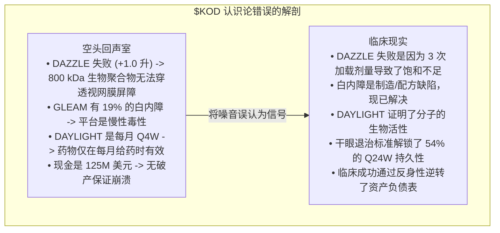
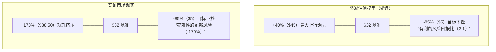

周一早上 2026 年 9 月 28 日 8:30，东部时间，Kodiak Sciences Inc. ($KOD) 以一记临床壮举打破了共识生物科技空头的共识。

在两天前的周末深度分析中，我们与前对冲基金经理 Martin Shkreli 的悲观怀疑观点不谋而合，认为生物多聚体扩散障碍难以逾越，下行风险巨大。然而，我们错了，Martin Shkreli 也遭到了毁灭性的打击。

当 Phase 3 DAYBREAK 试验的顶线数据出炉时，结果对 Kodiak 的平台进行了有力的验证：

1. **两个主要终点均达标**：Zenkuda™（塔罗基马泰多梅）和 tabirafusp-ted（KSI-501）在一年内（第 1 年）相对于 aflibercept（艾力雅 2 mg）在最佳矫正视力（BCVA）增益方面达到了统计非劣效性（p = 0.0007 为 Zenkuda，p = 0.0036 为 tabirafusp-ted）。
2. **前所未有的 6 个月持久性**：在严格的“干眼”退治标准下，**54% 的 Zenkuda 治疗患者实现了 6 个月（24 周，Q24W）的给药间隔**——这一里程碑从未在标准 aflibercept、艾力雅 HD（Q12W 至 Q16W）或 Vabysmo（Q16W）的关键湿性 AMD 试验中达到。
3. **卓越的安全性**：Zenkuda 产生了 **0% 的眼内炎症（IOI）** 率和 **0.5% 的白内障不良事件率**（实际低于活性 aflibercept 对照组的 0.9%）。2023 年 GLEAM/GLIMMER 试验中灾难性的 19% 白内障率被彻底扑灭。
4. **双特异性平台验证**：Tabirafusp-ted（KSI-501，双重抗 VEGF / 抗 IL-6）达到了其主要视力终点（p=0.0036）和其解剖学关键次要终点（p < 0.0001），0% 白内障和 0.4% IOI。
5. **立即多适应症生物制品许可申请（BLA）**：Kodiak 确认将在 **2026 年第四季度** 提交多适应症生物制品许可申请（BLA），支持五个阳性 Phase 3 试验，涵盖湿性 AMD、糖尿病视网膜病变和视网膜静脉阻塞。

开盘铃声一响，$KOD 爆发。股价从 **32.35 美元飙升至日内高点近 88.50 美元——涨幅高达 173%**，触发了十年来最剧烈的生物科技短轧。华尔街分析师立即上调目标价，瑞银将目标价从 80 美元上调至 **120 美元**。

在投资中，犯错是不可避免的；拒绝进行无情、透明的后验分析则是不可饶恕的。本文是对空头论点崩溃的法医审计，探讨 Martin Shkreli 的还原论框架为何失败，我们又是如何将噪音误认为信号的，以及每位生物科技投资者必须从 DAYBREAK 的胜利中提取的必要心理模型。

---

## 1. 评分表：Shkreli 的空头论点与实证现实

为了理解空头头寸的崩溃，让我们直接将 Shkreli 的四个核心论点与 DAYBREAK 顶线结果进行比较：

**DAYBREAK 试验审计：论点 vs. 临床现实**

| Shkreli 的核心论点 | 熊派假设 | DAYBREAK 顶线结果（2026年9月28日） |
| :--- | :--- | :--- |
| 1. "塔罗基马证明劣于艾力雅" | 塔罗基马永久性受损；将显示与艾力雅控制组的视觉缺陷。 | 驳斥。Zenkuda 达到了非劣效性（p = 0.0007）。强有力的临床即时性与艾力雅相当。 |
| 2. "第三轮试验谬论： | 协议调整无法改变试验结果。 | 驳斥。4 次加载剂量 + OCT "干眼" 退治标准实现了 54% 的患者在 Q24W（6 个月）的给药间隔。 |
| 3. "其余合作努力都是浪费" | 双特异性 KSI-501 无效；聚合物共享相同的毒性与负债。 | 驳斥。Tabirafusp-ted 达到了 BCVA（p=0.0036）及解剖学次要终点（p<0.0001）；0% 白内障，0.4% IOI。 |
| 4. "现金几乎耗尽，KOD 应该暴跌" | 125.9 亿美元现金，65 亿美元烧钱，意味着六个月后破产或彻底稀释。 | 驳斥（反身性）。市值飙升至约 450 亿美元；资本成本崩溃；2026 年第四季度提交多适应症生物制品许可申请。 |

Shkreli 一球未进。每个空头论点在实证测试下同时崩溃。

为什么？是什么导致了包括我们在内的许多经验丰富的市场参与者对一个最终被证明是灾难性错误的论点如此一致？

---

## 2. 5 个将噪音误认为信号的噪音

空头论点的致命缺陷不是缺乏智慧；而是认识论上的错误。空头们识别出真正的历史数据点，并将其提升为不可改变的物理法则。因此，他们将 **操作和协议噪音误认为基本药理信号**。

### 噪音 #1：将 DAZZLE 作为“不可改变的生物法则”锚定
在 2022 年 DAZZLE 试验中，塔罗基马相对于艾力雅 2 mg 在一年内（第 1 年）的增益为 +1.0 个字母，而艾力雅的增益为 +7.0 个字母。空头将这一 -6.0 个字母的差距视为证明 800 kDa 生物聚合物无法穿透视网膜屏障的证据。

**为什么是噪音**：DAZZLE 失败是 **给药计划的工程缺陷**，而不是塔罗基马抑制 VEGF 的失败。DAZZLE 在每月给药 3 次加载剂量后，直接将患者推入 12 周、16 周或 20 周的固定间隔。

由于 ABC 生物聚合物的庞大水动力半径，视网膜的稳态浓度需要比标准小分子抗体更长的时间来平衡。通过在第 8 周（3 次加载剂量）停止加载，患者进入一个饱和不足的状态。更糟糕的是，DAZZLE 的退治标准是反应性的：患者必须失去大量视力并表现出大量积液后才能接受救援注射。到那时，不可逆的光感受器损失已经发生。

### 噪音 #2：将 19% 的白内障率视为永久性平台毒性
在 2023 年 GLEAM 和 GLIMMER 试验中，糖尿病性黄斑水肿（DME）患者的白内障发生率高达约 19%（而艾力雅为 9%）。空头得出结论，合成磷脂酰肌醇生物聚合物在前房中物理聚集，永久性地损害了晶状体代谢。

**为什么是噪音**：Kodiak 调查了白内障信号的根源，并发现它与 **早期代药物物质制造批次、颗粒物过滤标准和在脆弱的糖尿病眼中注射技术** 有关，而不是生物聚合物对晶状体细胞的内在毒性。

Kodiak 重新设计了其制造纯化过程，收紧了颗粒物标准，并引入了优化的配方缓冲液。在 DAYBREAK 中，Zenkuda 的白内障率仅为 **0.5%**——低于 aflibercept 对照组的 **0.9%**——且 **0%** 在 tabirafusp-ted 组。整个安全灾难导致股价在 2023 年暴跌至 2 美元，实际上是一个可解决的 CMC（化学、制造和控制）问题，而不是平台的死亡判决。

### 噪音 #3：DAYLIGHT 月度给药是“死路一条”的红鲱鱼
当 Kodiak 报告 Phase 3 DAYLIGHT 试验结果时（+7.1 个字母 vs. +6.7 个字母的艾力雅），空头嗤之以鼻：“谁在乎它是否每月给药？每月给药在商业上是死路一条。”

**为什么是噪音**：空头们将 **商业定位与生物机制的证明** 混淆了。

DAYLIGHT 从未打算成为一种商业产品方案；它是一个 FDA 请求的证明概念试验，旨在回答一个问题：**如果你保持眼睛饱和，塔罗基马是否能有效中和 VEGF 并恢复视力？** 答案是明确的肯定。DAYLIGHT 证明了塔罗基马的 Fab 片段是完全有效的、非毒性的，并且在维持足够的谷底浓度时能够与艾力雅匹配。无视 DAYLIGHT 作为“无用”的事实，使空头们忽视了分子起效的事实；Kodiak 所需的只是一个能够维持足够谷底水平的协议，而无需强迫每月访问。

### 噪音 #4：轻率地将 KSI-501 作为“管线浪费”
Shkreli 宣称“其余合作努力都是浪费”。这是一种懒惰的还原论。

Tabirafusp-ted（KSI-501）不仅仅是塔罗基马的重新包装；它是一种 **第一类双特异性 ABC 结合物，同时针对 VEGF-A 和白细胞介素-6（IL-6）**。湿性 AMD 越来越被理解为一种血管生成性和炎症性疾病；慢性视网膜下纤维化和持续性渗漏主要由 IL-6 细胞因子信号驱动。

在 DAYBREAK 中，Tabirafusp-ted 在视力上达到了统计非劣效性（p = 0.0036），并实现了非凡的快速解剖学液体清除（p < 0.0001）。轻率地将双特异性臂视为次要事件，空头错过了与罗氏 Vabysmo（抗 VEGF/Ang-2）的真正竞争对手的出现。

### 噪音 #5：资产负债表的流动性幻象
空头论点的最后一根支柱是财务：截至 2026 年第二季度，Kodiak 持有 125.9 亿美元现金，每季度烧钱约 6.5 亿美元，意味着不到 6 个月的运营期。

**为什么是噪音**：在二元临床生物科技中，**现金烧钱是因变量，而不是独立的驱动因素**。现金运营期不会导致 Phase 3 试验失败；生物科学会导致 Phase 3 试验失败。

如果试验失败，即使一家持有 5 亿美元现金的生物科技公司也会崩溃 70%。但如果关键 Phase 3 试验成功，**乔治·索罗斯的反身性理论**会立即接管：
- 股价飙升 170%，从 160 亿美元的市场资本化扩大到超过 450 亿美元。
- 资本成本骤降至接近零。
- 以 85 美元/股的价格筹集 2.5 亿美元需要发行不到 290 万股（不到 5% 的股权稀释），立即消除了现金运营期的担忧。
- 一级制药公司蜂拥而至，以非稀释性预付款获得海外商业权益的独家许可。

低现金余额在科学失败的情况下会带来致命的下行风险。将现金余额作为科学失败的证据是循环论证。

---

## 3. 我们系统性忽略的真实信号

市场专注于过去失败的响亮、情感共鸣的叙事，而数据中隐藏着深刻积极的信号，指向了 DAYBREAK 的成功。

**5 个隐藏在明处的真实信号**

| 真实信号 | 临床机制与预测能力 |
| :--- | :--- |
| 1. 4 次加载剂量 (载药动力学) | 在间隔延长前达到了稳态眼内饱和（载药动力学）消除了 DAZZLE 第 12 周的谷底缺陷。 |
| 2. "干眼"退治算法算法 | 客观 AI 引导的退治算法预防了不可逆的神经感觉损伤，在视力下降前捕捉了复发。 |
| 3. GLOW 1 & 2 证明概念 | 糖尿病性视网膜病变试验证明了生物聚合物安全地保持活性并长期退化血管病变。 |
| 4. CMC 纯化改革 | 系统性解决了自由聚合物团块杂质，将白内障信号降低至 0.5%。 |
| 5. 空头拥挤异常性 | 极端借入费用、25% 以上的空头率和一致的空头共识创造了教科书般的无限上行空头挤压陷阱。 |

### 信号 #1：第四次加载剂量解决了视网膜 PK 方程
在 DAYBREAK 中，Kodiak 似乎做出了一个看似微小的调整：患者在第 0 周、第 4 周、第 8 周和第 12 周接受了 **四次加载注射**，而不是 DAZZLE 中的三次剂量。

对未受过训练的人来说，增加一次注射看起来像是绝望之举。但对药代动力学家来说，这是一场变革：
- ABC 结合物在玻璃体中的半衰期大约是 aflibercept 的 **三到四倍**。
- 然而，建立从内界膜到更深层视网膜层的浓度梯度需要连续给药，直到达到稳态。
- 第 12 周的第四次加载剂量在眼中创造了高浓度的储存库，持续释放游离的抗 VEGF 谷底水平，直到第 36 周和第 48 周。

### 信号 #2：客观 AI 引导的“干眼”退治算法
在现实世界的眼科诊所中，医生不会等到患者视力下降 10 个字母才进行退治；他们会检查 OCT 扫描。如果任何视网膜下或视网膜内的积液出现，他们就会注射。

在 DAZZLE 中，患者被锁定在严格的间隔内或只有在达到过时的视力损失阈值后才会被救援。在 DAYBREAK 中，Kodiak 实施了一种现代化的自动化 **“干眼”退治算法**：
- 监测任何视网膜积液。
- 活动积液的患者立即接受治疗，并重新分配到较短的间隔（Q8W 或 Q12W）。
- 完全干燥的视网膜患者安全地延长到 Q16W、Q20W 和 Q24W。

结果是：46% 需要更频繁给药的患者得到了治疗并保持了视力；**54% 的生物超级响应者在 6 个月（Q24W）的给药间隔下平稳过渡**。该协议设计最终与视网膜生物学相一致。

### 信号 #3：GLOW1、GLOW2 和 BEACON 的一致性
空头们经常将 Kodiak 的非增殖性糖尿病性视网膜病变（NPDR）的 Phase 3 GLOW1 和 GLOW2 试验视为无关紧要，因为它们将塔罗基马与安慰剂（假药）而不是艾力雅进行了比较。

这是一个严重的分析错误。GLOW 证明了：
- 每 6 个月一次的玻璃体内注射塔罗基马在大量患者中实现了 **糖尿病性视网膜病变严重程度评分（DRSS）的两步或更大改善**。
- ABC 生物聚合物在眼内保持活性，抑制 VEGF，防止新生血管化，并在多年期内不诱导广泛的视网膜毒性。

如果分子是一个无活性、有毒的砖块，它绝不可能通过连续两个 Phase 3 试验以及 Phase 3 BEACON 试验在糖尿病性视网膜病变和视网膜静脉阻塞中获得通过。Kodiak 现在有 **五个阳性 Phase 3 试验** 跨越三种不同的视网膜疾病。

---

## 4. 2026 年商业重新评估：Zenkuda 值几何？

在催化剂前的分析中，我们曾认为即使 DAYBREAK 通过，塔罗基马也会进入由 Vabysmo、Eylea HD 和 aflibercept 生物类似物主导的商业墓地。

54% 的患者实现 6 个月的持久性，这个论点必须完全重写。

**2026 年抗 VEGF 视网膜市场格局**

| 药物（公司） | 目标 | 最大持久性 | 关键差异化因素 |
| :--- | :--- | :--- | :--- |
| Eylea（阿氟比克） | VEGF-A, PlGF | Q8W（8 周） | 生物类似化；低成本 |
| Vabysmo（法里西马） | VEGF-A, Ang-2 | 最多 Q16W（16 周） | 双路径；液体干燥 |
| Eylea HD（8 mg） | VEGF-A, PlGF | 最多 Q16W（16 周） | 高摩尔剂量；安全 |
| Zenkuda（塔罗基马） Kodiak Sciences | VEGF-A（ABC） | 最多 Q24W（24 周） 6 个月间隔 | 54% 的患者在每年两次给药 |
| Tabirafusp-ted (KSI-501) Kodiak | VEGF-A, IL-6 双特异性 ABC | Q8W - Q16W (正在进行 Phase 3) | 靶向炎症； p < 0.0001 解剖学 |

### “每半年一次”模式的力量
视网膜眼科的圣杯一直是 **半年一次的注射**。
- 无论是 Vabysmo 还是 Eylea HD 都没有获得 FDA 批准用于 24 周（6 个月）的湿性 AMD 给药。它们的标称维持间隔都限制在每 16 周（4 个月）一次。
- 一位患有湿性 AMD 的老年患者目前每年需要 3 到 4 次眼科就诊和眼内注射。
- 有了 Zenkuda，**超过一半的患者只需要每年两次注射**。

在每年产生超过 **150 亿美元** 的抗 VEGF 市场上，即使在寻求绝对最长给药间隔的患者中占据 8% 到 12% 的市场份额，也代表了 **12 亿到 18 亿美元的年度峰值销售额**。

此外，手握五个成功的 Phase 3 试验，Kodiak 不是提交一个狭窄的应用；它正在准备 **2026 年第四季度的多适应症生物制品许可申请（BLA）**，涵盖湿性 AMD、糖尿病性视网膜病变和视网膜静脉阻塞。

---

## 5. 短轧二元生物科技催化剂的致命机制

除了对 Kodiak Sciences 的临床细节之外，Martin Shkreli 的交易为短轧二元生物科技事件的结构性陷阱提供了一个大师级的课程。

### 1. 不对称谬误
空头们经常说服自己，提前在 Phase 3 数据前短轧一只 32 美元的股票提供了有利的 2:1 或 3:1 风险回报比：
- *熊派计算*：“如果失败，我可以赚 85%（$32 -> $5）。如果成功，它在弹升至 $42 之前会因稀释而被压垮。因此，风险回报比对我有利。”
- *市场现实*：生物科技在关键 Phase 3 证实后，其上行潜力不受折现现金流模型的限制，而是由 **短轧挤压机制** 管理。当一只高借入费用、高度短轧的股票报告最佳 6 个月持久性并验证第二个资产时，空头被迫在任何价格上平仓。股票没有停留在 $45，而是直接突破了 $60、$75，最终达到 $88.50。
- 空头只能在其资本上赚取 100%，但其损失是 **理论上无限的**。一夜之间吸收 -173% 的缺口会抹去数周或数月的交易收益。

### 2. 名人回声室偏差
Martin Shkreli 拥有深厚的制药知识，但他的不可否认的人格也吸引了反射性共识。

当一位社交媒体上的知名人士发布一篇简洁、轻蔑的 48 字短空论点，充满信心时，市场参与者会体验到一种确定性的幻觉：
- Shkreli 称该药物为“证明劣于艾力雅”。
- 他将试验设计称为“谬论”。
- 他宣布公司的努力为“浪费”。
- 他引用现金余额作为崩溃的保证。

听起来很明确。感觉比零售多头更具有智力优势。但生物科技最终是由 **双盲、随机、对照临床试验** 来裁决的，而不是由有魅力的推文。 

---

## 6. 后验分析清单：如何永远不再犯同样的错误

为了将 DAYBREAK 的教训制度化，我们制定了五个诊断问题来评估任何未来的二元生物科技催化剂：

**生物科技二元催化剂诊断清单**

| 诊断问题 | 分析规则与经验法则 |
| :--- | :--- |
| 1. 分子失败或 | 如果一种药物失败了，是由于缺乏结合活性还是不适当的给药/加载方案？（DAYLIGHT 证明了活性；DAYBREAK 修正了加载方案）。 |
| 2. 安全缺陷是否 | 历史不良事件是生物学固有的还是配方、批次纯度或注射方法的产物？ |
| 3. 管线资产是否 | 从不单独评估旗舰读数。如果第二项资产（KSI-501）共享试验，市场可能会立即重新定价整个平台。 |
| 4. 是否忽略了 | 从不使用预催化剂现金运营期作为证明试验将失败的证据。良好的临床数据会自动生成资本。 |
| 5. 你是否直接短轧 | 从不直接短轧一个具有无限风险的二元催化剂。 如果必须下注反对一项试验，使用定义风险的期权。 |

---

## 7. 最终裁决：生物科技的谦逊纪律

Kodiak Sciences 的 Phase 3 DAYBREAK 读数将成为最近生物科技史上最令人震惊的逆转之一。

Martin Shkreli 否定了科学，坚信过去的失败是永久的命运。我们让那个引人入胜且充满怀疑论的叙事蒙蔽了我们对协议设计中嵌入的可感知、机械信号的视线：四次加载剂量、干眼退治算法、白内障杂质的解决以及 tabirafusp-ted 的效力。

结果不言而喻：
- **Zenkuda 以优异的成绩通过了非劣效性（p = 0.0007）**。
- **54% 的湿性 AMD 患者实现了 6 个月的持久性**。
- **股价飙升 170% 至 88.50 美元**。
- **多适应症生物制品许可申请将在 2026 年第四季度提交**。

对于空头来说，周一早上是一场屠杀。对于那些患有威胁视力的黄斑变性的患者来说，它标志着真正每半年一次疗法的潜在到来。对于分析师和投资者来说，它是一个谦逊的提醒，为什么诚实的智力、概率思维以及始终将信号与噪音分离必须优先于市场共识。

---

*免责声明：本文仅用于信息、研究和教育目的，不构成金融、投资或医疗建议。作者在本文发布时未直接持有 $KOD 的任何头寸。*
