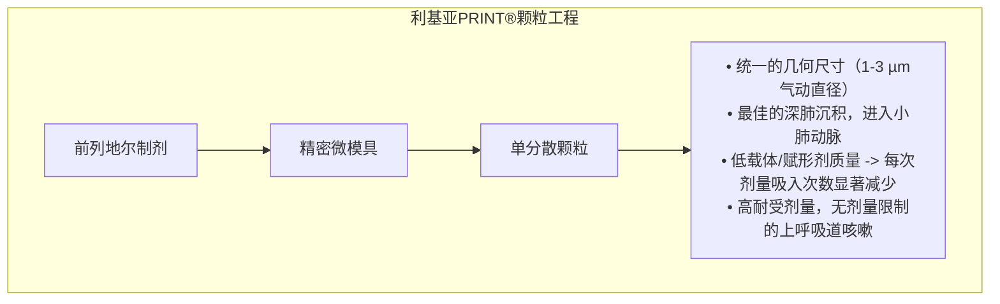
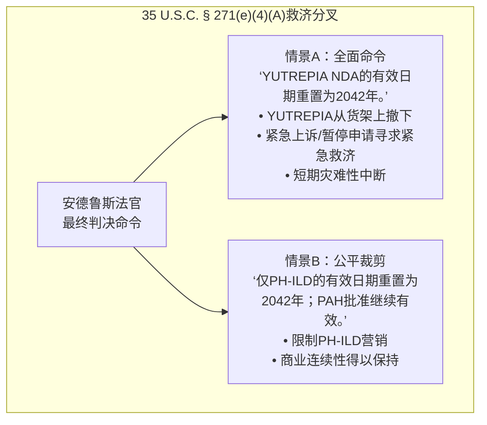
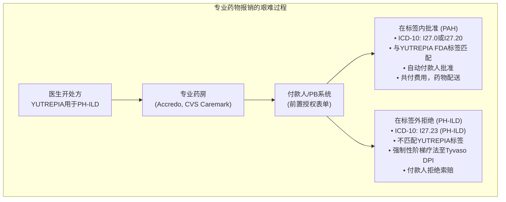

就在其对科迪奥科学（$KOD）的高调做空言论被第三阶段DAYBREAK试验结果完全推翻仅一周后，前对冲基金经理和制药高管马丁·夏尔利再次在社交媒体上发表激进言论。

这一次，夏尔利转守为攻，成为利基亚公司（$LQDA）的积极多头：

> “这将使$LQDA看涨，我认为股价会回到之前的高位。”  
> 
> *引用并回复自己的帖子：*  
> “在$LQDA上，不会重新提交NDA或暂停，也不会出现其他BS。我已经在30天内提交了一个PAS来移除一个适应症。这非常简单直接。不要相信空头。FDA不会因为一项适应症的诉讼而要求赞助商重新提交整个NDA。”  
> — **马丁·夏尔利（@MartinShkreli），2026年10月5日**

夏尔利的这一论点背景是市场惨烈的抛售。2026年9月30日，德拉瓦州地方法院法官理查德·G·安德鲁斯裁定，利基亚的商业干粉前列地尔药物YUTREPIA®侵犯了优特泰克斯（$UTHR）的美国专利11,826,327（简称‘327专利）的第1项和第14项。

利基亚的股价在单个交易日内暴跌超过57%，从70.69美元跌至30.26美元，继续下跌至26.64美元（日内跌幅6.98%），市值蒸发超过38亿美元。

空头立即宣布YUTREPIA®终结，声称根据35 U.S.C. § 271(e)(4)(A)条款，联邦法院将迫使FDA撤销YUTREPIA®的新药申请（NDA）批准，触发新的30个月哈奇-瓦克斯曼暂停令，并从药房货架上撤下该产品。

夏尔利声称空头对FDA程序一无所知：利基亚只需提交一个优先审批补充（PAS），在30天内移除侵权适应症，继续销售不受限制的肺动脉高压（PAH）适应症，并迅速回升至之前的高位（70美元以上）。

夏尔利的说法是否正确，这是一次史诗级的买入机会？还是他的论点过于简化，忽视了严格的FDA PDUFA时间限制、巨大的市场损失以及专业药房支付防火墙的复杂性？

我们对利基亚的法律地位、监管途径、临床经济学和资产负债表进行了法医调查，以确定我们是否同意或不同意夏尔利的观点。

---

## 1. 分解夏尔利的多头论点：四个基础支柱

夏尔利的论点基于四个相互交织的主张：

**马丁·夏尔利的$LQDA多头论点分解**

| 核心主张 | 夏尔利的论点及底层逻辑 |
| :--- | :--- |
| 1. 无需重新提交NDA | 新的NDA重新提交和30个月的哈奇-瓦克斯曼暂停令是熊市谣言；批准后标签修改不会重置NDA。 |
| 2. 30天的PAS机制 | 作为曾经的制药公司管理者（Retrophin/Turing），夏尔利声称通过PAS移除适应症需要30天且非常简单。 |
| 3. FDA适应症可分立性 | FDA不会因单一使用而撤销对安全、已批准药物的非侵权适应症的批准。 |
| 4. “回到之前的高位” | 仅PAH业务（以及非处方使用）就足以证明70美元以上的估值；60%的跌幅是过度反应。 |

为了评估这一论点是否站得住脚，我们必须首先了解利基亚实际销售什么，赚取多少现金，以及在德拉瓦州法庭上发生了什么。

---

## 2. 公司深度剖析：利基亚和YUTREPIA是什么

与未盈利的临床生物科技公司不同，利基亚公司（$LQDA）是一家成熟的商业制药公司，拥有一个FDA批准的重磅药物疗法。

### PRINT® 技术和临床价值主张
利基亚的核心资产是YUTREPIA®（吸入型前列地尔粉末），使用其专有的PRINT®（粒子复制在非润湿模板中）工程颗粒技术开发：

前列地尔是一种合成的前列腺素类似物，设计用于直接诱导肺动脉和全身动脉血管床的血管舒张，并抑制血小板聚集。

超过十年来，优特泰克斯（$UTHR）一直主导着市场，其产品Tyvaso®（吸入型前列地尔）占据了主导地位。然而，Tyvaso®需要一个超声雾化器，每次使用需要10-15分钟，每天四次，需要每天拆卸、清洗和携带笨重的硬件。

虽然优特泰克斯最终推出了Tyvaso DPI®（与曼恩科恩公司合作的Technosphere干粉吸入器），Tyvaso DPI®需要多次高阻力药筒以供患者逐步调整剂量。相比之下，YUTREPIA®的PRINT技术每胶囊输送更高的前列地尔载荷，咳嗽发生率更低，使其在使用便捷性和剂量调整方面更具临床优势。

### 2026年第二季度财务审计：现金流引擎
市场往往将专利诉讼视为每个被告都是濒临破产的生物科技公司，烧尽最后一分钱。利基亚2026年第二季度的财务报告揭示了完全不同的景象：

**利基亚公司（$LQDA）2026年第二季度财务审计**

| 指标 | 2026年第二季度结果（2026年8月报告） |
| :--- | :--- |
| 总收入 | 1.717亿美元 |
| YUTREPIA净产品销售收入 | 1.704亿美元（环比增长31%） |
| GAAP净利润 | 7470万美元 |
| 非GAAP调整后EBITDA | 9630万美元 |
| 现金和现金等价物 | 2.842亿美元（环比增加6140万美元） |
| 活跃治疗患者 | 超过5000名活跃患者 |
| 唯一处方提交次数 | 超过5900名独特患者启动 |
| 年化销售额运行率 | 约6.816亿美元 |

**关键结论：** 利基亚在运营基础上非常盈利。它正在产生正的自由现金流，资产负债表上有2.842亿美元的现金，年度化销售额运行率为近7亿美元。它不需要筹集股权，没有立即的现金悬崖，也不会因法律费用而被饿死。

---

## 3. 专利战：‘793的胜利 vs. ‘327的突袭

要理解当前的危机，必须追溯优特泰克斯和利基亚之间长达数年的法律拉锯战。

**三轮战争：优特泰克斯 vs. 利基亚**

| 轮次 / 战场 | 主题事项 | 结果 |
| :--- | :--- | :--- |
| 第一轮（2020-2024）：《793专利战》 | 通过吸入前列地尔治疗PAH的方法 | 利基亚胜。PTAB撤销所有主张；联邦巡回上诉法院确认；最高法院拒绝审理。 |
| 第二轮（2022-2025）：排他性阻断 | 3年监管排他性 Tyvaso DPI的排他性。 | 优特泰克斯延迟，利基亚胜。 FDA于2025年5月23日最终批准YUTREPIA。 |
| 第三轮（2024-2026）：《327专利审判》 | 治疗PH-ILD的方法 (美国专利11,826,327)。 | 优特泰克斯在第1项和第14项上胜诉。德拉瓦州法院于2026年9月30日裁定该专利有效并被侵犯。 |

### 2026年9月30日德拉瓦州的裁决
2023年末，优特泰克斯获得了美国专利11,826,327（简称‘327专利），该专利具体涉及通过吸入前列地尔治疗与间质性肺病相关的肺动脉高压（PH-ILD）的方法。该专利有效期至2042年12月。

优特泰克斯在德拉瓦州地方法院（由理查德·G·安德鲁斯法官审理）起诉了利基亚。由于利基亚的FDA批准标签覆盖了PAH和PH-ILD两种适应症，利基亚承认其标签在‘327专利有效的情况下侵犯了第1项和第14项，但辩称这些主张无效，因为它们是显而易见且缺乏书面描述的。

2026年9月30日，安德鲁斯法官宣判：
1. **第1项和第14项是有效的并被侵犯。**
2. 第2项、第3项、第15项和第16项是**无效的**。
3. 双方被要求在一周内（即2026年10月7日前）提交拟议的最终判决和补救措施。

优特泰克斯立即宣布将寻求法院命令，根据35 U.S.C. § 271(e)(4)(A)指示FDA撤销利基亚YUTREPIA的NDA批准。

利基亚回应称，将上诉至联邦巡回上诉法院，并向FDA提交NDA补充，自愿移除YUTREPIA标签上的PH-ILD适应症。

---

## 4. 为什么夏尔利看多：监管逻辑

马丁·夏尔利的看多论点建立在揭示他认为的零售和机构投资者的非理性恐慌。

### 他攻击的空头论点：
空头认为：
1. 根据35 U.S.C. § 271(e)(4)(A)，安德鲁斯法官有法定职责命令FDA将YUTREPIA NDA的有效日期重置为2042年。
2. FDA将撤销整个药物的批准。
3. 利基亚将被迫重新提交505(b)(2) NDA。
4. 优特泰克斯将在新的NDA上起诉，触发新的30个月哈奇-瓦克斯曼法定暂停令。
5. YUTREPIA将被从市场上撤下2.5年，摧毁利基亚的现金流并使其破产。

### 夏尔利的反驳：
夏尔利逐点拆解了这一论点：
* **“无需重新提交NDA”**：利基亚已经持有批准的NDA。当专利问题影响到某个适应症时，赞助商不会从头开始提交新的药物申请；他们提交的是效果/标签补充。
* **“没有暂停令”**：30个月的哈奇-瓦克斯曼暂停令仅适用于首次提交含有橙皮书列名专利的第IV段认证的原研药或仿制药。寻求移除适应症的补充申请不包含第IV段认证，也不会触发30个月的暂停令。
* **“FDA不会因一个适应症的专利侵权而撤销整个NDA”**：分子本身是批准的且证明了安全性。PAH适应症已经在‘793诉讼中被证明不侵权。FDA不会因为一个次要适应症的专利侵权而撤销有效的、不侵权的适应症的市场授权。
* **“我已在30天内提交了一个PAS”**：凭借他在管理公开上市的生物制药公司的背景，夏尔利声称通过优先审批补充（PAS）移除适应症是一个常规的、30天的行政调整。
* **“回到之前的高位”**：PAH业务保持完整，YUTREPIA每季度产生超过1.7亿美元的收入，夏尔利认为60%的跌幅是纯粹的市场失灵，股票将重新估值回到70美元以上。

---

## 5. 法医现实检查1：PAS能否在30天内移除适应症？

从这里开始，我们的深入研究开始与夏尔利的自信断言相分歧。夏尔利声称PAS可以在“30天内”完成的说法 **在监管上是不准确的**。

### FDA框架：21 CFR § 314.70
根据管理后市补充的联邦法规，对批准NDA的更改分为三个严格的层级：

**FDA批准后补充层级（21 CFR § 314.70）**

| 机制 | 管理描述 | PDUFA审查目标/时间 |
| :--- | :--- | :--- |
| 1. 优先审批补充 [21 CFR 314.70(b)] | “重大变更”，可能对安全或疗效产生重大影响。 | 标准：6到10个月优先：4到6个月 |
| 2. 30天内实施的变更 (CBE-30) [314.70(c)] | “中等变更”，具有中等潜在影响。 | 递交后30天内可分发产品，无需FDA批准。 |
| 3. 年度报告 [21 CFR 314.70(d)] | “小变更”（潜在影响最小）。 | 每年报告提交。无需事前获得批准。 |

现在，删除批准的治疗适应症属于哪一层级？

根据21 CFR § 314.70(b)(2)(v)(C)的规定：
> “任何关于适应症、剂量或给药方式的变更，包括删除适应症，” **被定义为重大变更，需要优先审批补充（PAS）。**

### 夏尔利“30天”主张的关键缺陷
1. **夏尔利混淆了PAS与CBE-30：**  
   著名的“30天”时钟存在于CBE-30补充（§ 314.70(c)）下。赞助商提交数据，如果FDA在30天内没有反对，赞助商可以开始分发产品。但在§ 314.70(b)下，PAS **不能在获得FDA正式批准信之前实施**！
2. **PDUFA VII绩效时间表：**  
   根据处方药用户费法案（PDUFA VII），标签/疗效PAS的标准审查时间是 **6个月**（或如果涉及临床数据，则最长10个月）。如果获得优先或加速行政处理，时间是 **4个月**。
3. **FDA能否加速PAS？**  
   可以。当联邦法院发出要求移除适应症的命令时，FDA的药物评估与研究中心（CDER）可以授予加速行政处理。但在历史上最快的先例中，行政删除PAS需要 **60到90天**，在此期间，修订的草稿标签、容器标签、包装盒和处方信息必须正式交换并签署。

称其为“超级简单的30天过程”忽略了FDA审查队列和联邦标签合规性的现实。

---

## 6. 法医现实检查2：35 U.S.C. § 271(e)(4)(A)禁令风险

利基亚在未来14天内面临的最大风险不是FDA——而是德拉瓦州地方法院的理查德·G·安德鲁斯法官。

### 法律困境
根据专利法，35 U.S.C. § 271(e)(4)(A)明确规定：
> “对于侵权行为...法院应命令涉及侵权的药物或兽用生物制品的批准日期不得早于侵权专利的到期日。”

注意法律语言：**“法院应命令...”**（强制性，非酌情决定）。

在标准的哈奇-瓦克斯曼诉讼中，审判在最终FDA批准之前完成。法院发出§ 271(e)(4)(A)命令，FDA仅在专利到期前不予批准。

然而，YUTREPIA处于一个极其罕见的状况：**它已于2025年5月23日获得最终批准，并已商业销售16个月！**

### 安德鲁斯法官能否分割适应症？
优特泰克斯要求 **情景A**：法院命令FDA撤销整个NDA批准。优特泰克斯认为§ 271(e)(4)(A)指的是“药物的批准”，而不是适应症。

利基亚将主张 **情景B**：根据联邦衡平原则和联邦巡回上诉法院关于方法使用专利的判例，救济措施必须严格针对侵权的治疗方法（PH-ILD），而保留未侵权的PAH适应症。

此外，优特泰克斯已请求根据35 U.S.C. § 283条款，向利基亚发出临时和永久禁令，禁止在PH-ILD适应症从所有商业渠道的瓶子和包装中移除YUTREPIA之前进行分发。

如果安德鲁斯法官在FDA批准PAS之前发出禁令，利基亚可能会面临 **2到4个月的商业发货禁运**，在此期间包装将进行过渡。

---

## 7. 法医现实检查3：失去PH-ILD的商业灾难

这是马丁·夏尔利论点中的核心盲点。夏尔利将移除PH-ILD适应症视为一个微不足道的监管细节，轻描淡写地认为YUTREPIA的业务将不受影响继续进行。

**实际上，PH-ILD是前列地尔市场的整个增长引擎。**

**PAH vs. PH-ILD：商业与竞争现实**

| 指标 / 维度 | PAH（WHO组1） | PH-ILD（WHO组3） |
| :--- | :--- | :--- |
| 美国患者患病率竞争格局 | 约45,000 – 50,000患者高度拥挤：Winrevair（sotatercept）、Uptravi、Opsumit、Tadliq、Adempas。 | 约70,000 – 100,000患者独家垄断：Tyvaso是唯一获批的疗法，此前没有其他选择。 |
| 增长轨迹市场份额总市场（美国） | 成熟，缓慢增长（2-4%）约50% – 55%的市场份额约15亿美元 | 快速扩张（年增长25-35%）约45% – 50%的市场份额约20-25亿美元 |
| 利基亚标签状态 | 完全无限制 | 失去‘327专利，直到2042年 |

### PAH战场与PH-ILD金矿
1. **PAH受到默克的Winrevair（sotatercept）的围攻：**  
   在PAH中，吸入型前列地尔不再是新的疗法。默克的突破性激活素信号抑制剂Winrevair（sotatercept）于2024年获批，正在迅速改变临床指南，直接逆转肺血管重塑。吸入型前列地尔在PAH中的应用正逐渐退居二线，成为后续组合疗法的一部分。
2. **PH-ILD是前列地尔扩张的整个理论依据：**  
   优特泰克斯的收入从13亿美元激增至超过25亿美元，这完全是因为Tyvaso通过2021年的INCREASE试验解锁了PH-ILD。在治疗伴有肺间质纤维化和低氧的肺动脉高压方面，医生只有吸入型前列地尔这一类药物可选。
3. **失去PH-ILD意味着利基亚失去了近50%的患者群体和市场的高增长部分。**

### 专业药房与前置授权防火墙
零售多头经常争论：*"医生喜欢YUTREPIA！他们将为PH-ILD患者开处方！"*

这暴露出他们对高成本专业药物的分发和报销机制的深刻误解：

前列地尔疗法的成本在180,000美元至250,000美元/患者/年之间。没有患者会自掏腰包支付这笔费用。

每一张处方都必须通过商业保险公司、医疗保险优势计划和药房福利管理公司的严格前置授权（PA）流程。
* 付款人提交要求时，肺科医生需要使用ICD-10代码（例如，I27.23表示与肺疾病和/或低氧相关的肺动脉高压）来证明患者的特定诊断。
* 当PBMs的理赔引擎扫描处方时，如果YUTREPIA的FDA标签中没有PH-ILD，**索赔将被自动拒绝**。
* 保险公司将要求患者使用Tyvaso DPI——该药持有标签内适应症——而不是批准非FDA批准的标签外使用，以支付200,000美元/年的生物制剂费用。

### 诱导侵权陷阱（GSK v. Teva）
利基亚的销售代表能否悄悄告诉医生YUTREPIA在PH-ILD中也能有效？

**绝对不行。** 根据联邦巡回上诉法院在GSK LLC v. Teva Pharmaceuticals USA, Inc.（2020/2021）和最近最高法院在Hikma v. Amarin（2026）中重申的标准：
* 如果仿制药或505(b)(2)赞助商剔除了专利适应症（“瘦标签”），但其营销材料、医生网络研讨会、临床再版或销售代表推广、鼓励或诱导使用剔除的适应症，**赞助商将因35 U.S.C. § 271(b)诱导侵权而承担责任。**
* 优特泰克斯将部署法医审计，并派遣“秘密购物者”调查员参加医学会议。一旦利基亚暗示PH-ILD疗效，优特泰克斯将对他们提起诱导侵权诉讼，寻求**三倍损害赔偿**和利润返还。
* 利基亚将被迫实施铁腕的公司合规政策，严格禁止其销售团队与ILD肺科医生接触或讨论间质性肺疾病。

---

## 8. 估值审计：没有PH-ILD的利基亚真正值多少钱？

马丁·夏尔利声称LQDA将回到之前的高位（70美元以上）。

让我们构建一个严格的财务模型来确定70美元是否在PAH标签下是数学上可能的。

**利基亚公司（$LQDA）情景估值矩阵**

| 估值输入 | 事前判决（双适应症） | 事后的PAH适应症仅存 |
| :--- | :--- | :--- |
| 总可寻址市场 | $35 – $40亿美元 | $15 – $18亿美元 |
| 峰值市场份额 | 35%覆盖PAH + PH-ILD | 30%覆盖PAH仅存 |
| 峰值年收入 | $13亿美元 | $5.1亿美元 |
| 营业利润率 | 42% | 35% |
| 峰值净利润 | $5.46亿美元 | $1.785亿美元 |
| 稀释后发行在外股数 | 8950万股 | 8950万股 |
| 峰值每股收益 | $6.10 | $1.99 |
| 目标市盈率 | 12.0倍 | 14.0倍（调整现金后） |
| 明示企业价值 | $65.5亿美元 | $25亿美元 |
| 现金在手（2026年第二季度） | $2.84亿美元 | $2.84亿美元 |
| 公平市值 | $68.3亿美元 | $27.8亿美元 |
| 明示公平价值/股 | $76.35 | $31.10 |

### 估值审计洞察：
1. **70美元以上的估值需要PH-ILD：**  
   当利基亚在2026年9月以超过70美元的价格交易时，市场预期峰值销售额为 **13亿美元以上**，在PAH和PH-ILD两种适应症上均等采用。这就是如何获得每股6.00美元的收益能力和证明70美元以上股票价值的方法。
2. **仅PAH的峰值收入上限约为5亿美元：**  
   在PAH市场成熟且受到sotatercept和口服药物挑战的情况下，YUTREPIA可以合理地捕获吸入型PAH市场的25%到35%份额。这将产生约4.5亿到5.5亿美元的峰值销售额。
3. **利基亚作为纯PAH玩家的公平价值为30到38美元：**  
   采用健康的14倍市盈率，加上峰值每股1.99美元的收益和2.84亿美元的现金余额，给出的股权价值为 **2.78亿到3.4亿美元**，或 **30到38美元/股**。
4. **26.64美元便宜吗？是的。会回到70美元吗？不。**  
   在 **26.64美元**（市值23.8亿美元）时，利基亚的企业价值仅为 **21亿美元**，不到其当前年度化收入运行率的3.5倍！由于恐慌和被迫抛售，市场已经大幅低估。但反弹至公平价值意味着反弹至 **32到36美元**，而不是回到70美元以上。

---

## 9. 四种前景情景及概率

**利基亚（$LQDA）概率矩阵**

| 情景 | 概率 | 核心机制 | 12个月目标价格 |
| :--- | :--- | :--- | :--- |
| 1. 夏尔利超级多头谋论 | 5% | FDA在30天内批准PAS，法院允许全面销售，大规模非处方使用。（不现实；需要忽略支付防火墙） | $65 – $75 |
| 2. 基本案：干净PAH剥离与稳定化 | 60% | 安德鲁斯法官裁决清晰地移除PH-ILD；FDA在3到5个月内批准PAS，PAH销售继续。（从当前26.64美元价格上涨28%到58%） | $34 – $42 |
| 3. 熊市陷阱：侵权禁令黑市 | 25% | 安德鲁斯法官授予全面禁令；YUTREPIA被撤下，包装被冻结，直到新包装获批。（临时运营现金流量冻结） | $18 – $22 |
| 4. 长期机会：上诉逆转 | 10% | 联邦巡回上诉法院在2027/28年逆转安德鲁斯法官对‘327专利有效性的裁决；PH-ILD恢复到标签上。（长期看涨期权，专利法） | $55 – $65 |

---

## 10. 独立裁决：我们是否同意或不同意夏尔利？

经过我们的法医监管、临床、法律和财务审计，我们对马丁·夏尔利的论点作出最终裁决：

| 独立裁决 |
| :--- |
| 1. 在机制上：我们部分同意夏尔利 • 夏尔利正确指出空头的末日叙事，即全面撤销NDA和新的30个月哈奇-瓦克斯曼暂停令是法律胡言。 • 夏尔利正确指出利基亚不会破产；拥有2.84亿美元现金和7470万美元季度净利润，公司基础稳健。 • 在26.64美元时，股价被严重低估，定价在灾难性的全面停顿中。 |
| 2. 在结论及价格目标上：我们强烈不同意夏尔利 • 夏尔利在监管上是错误的：根据21 CFR § 314.70(b)，删除适应症的PAS是重大变更，需要4到6个月。 • 夏尔利在商业上是错误的：PH-ILD几乎占了前列地尔市场的50%。专业药房前置授权防火墙将阻止非处方使用。 • 夏尔利在估值上是幻想的：利基亚在70美元以上被定价为一个多十亿美元的PAH + PH-ILD双寡头。去掉PH-ILD，公平价值为32到38美元。 • 称专利损失永久减半你的可寻址市场为看多是纯粹的智力表演。 |

### 投资者总结
如果你以 **26.64美元** 买入利基亚（$LQDA），你买入的是一个运营盈利的业务，拥有2.84亿美元现金和一个优越的干粉吸入器，以恐慌引发的大幅折价交易。利基亚股价有望在 **32到38美元**（+20%到+45%）的水平上反弹，这是在安德鲁斯法官确定判决形式和确认PAH销售可以继续后的高概率均值回归。

然而， **不要相信夏尔利关于轻松回到70美元以上的幻想**。‘327专利裁决对利基亚的长期收益潜力造成了永久性的、数亿美元的打击。夏尔利的48字推文混淆了监管程序，忽视了支付机制，将一个受损的业务视为无瑕的胜利。

在生物科技投资中，就像在科迪奥科学（$KOD）的空头方面一样，将复杂的监管法律和临床报销视为“超级简单”是最快将噪音误认为信号的方式。

---

*免责声明：本文在[stock.duklee.net](https://stock.duklee.net)上发布，仅用于信息和研究目的，不构成财务、投资、法律或监管建议。作者在发布时未持有$LQDA、$UTHR或$KOD的任何头寸。*
