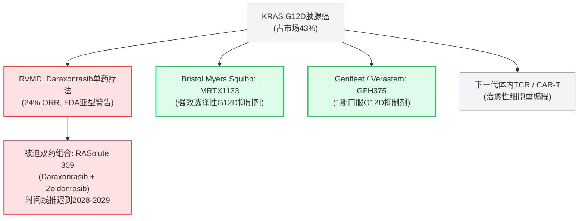

2026年10月8日，Revolution Medicines（NASDAQ: RVMD）的精心投资论点遭受了毁灭性的现实打击，使其市值达到令人咋舌的400亿美元。

在2026年8月的加速批准后，其多RAS（ON）抑制剂Rasonque（daraxonrasib / RMC-6236）被批准用于先前治疗的转移性胰腺导管腺癌（PDAC），美国食品药品监督管理局（FDA）发布了未删节的[医学和统计审查文件](https://www.fda.gov/drugs)。

监管审查中包含了一个公司促销新闻稿中巧妙掩盖的炸弹信息：daraxonrasib的宣称疗效在KRAS突变亚型中存在严重的生物差异。最关键的是，在KRAS G12D中——这种突变在所有胰腺癌患者中占43%——Rasonque的客观反应率（ORR）仅为24%，而较小的G12V亚型中则为50%。

股价当天下跌6.36%，跌至180美元：


当零售投资者和对冲基金试图解读FDA的临床批评时，生物技术记者Adam Feuerstein和Forensic Financial Account Shitbox Tracker捕捉到了华尔街的荒谬认知失调：


> “卖方今天像有人叫他们妈妈丑一样拼命为RVMD辩护。”  
> — Adam Feuerstein (@adamfeuerstein)，2026年10月8日

> “20位分析师。20个买入。  
> 内幕交易：1.497亿美元卖出。零买入。12个月。  
> 股价今天下跌6.36%。G12D反应率：24%。  
> 卖方和Form 4文件正在进行完全不同的对话。”  
> — Shitbox Tracker (@shitboxtracker)，2026年10月8日

本报告对Revolution Medicines进行了深入的机构分析。我们将剖析G12D失败的生物物理机制，审查高管持续的内幕抛售，评估公司惊人的21亿美元以上年现金消耗率，并解释为什么RVMD代表了大型生物科技领域最具不对称性的“卖出/做空”机会之一。

---

```
┌──────────────────────────────────────────────────────────────────────────────────────────────────┐
│                 Revolution Medicines（RVMD）：400亿美元生物科技陷阱的解剖学                 │
├──────────────────────────────────┬───────────────────────────────────────────────────────────────┤
│ 指标                           │ 机构审计与现实检验                           │
├──────────────────────────────────┼───────────────────────────────────────────────────────────────┤
│ 市值资本化                      │ ~395亿美元 – 428亿美元（定价为全球商业主导地位）   │
│ 2026年预计GAAP运营支出          │ 21亿美元 – 22亿美元（每个季度5.25亿美元 – 5.5亿美元现金消耗）  │
│ 财务报表现金（2026年第二季度）  │ 39亿美元（得益于4月的21亿美元股权稀释）              │
│ 运营跑道                         │ 在不进一步稀释的情况下，当前消耗率下不到22个月     │
│ 华尔街分析师共识                │ 20个买入 / 0个持有 / 0个卖出（100%一致买入）              │
│ 追溯12个月内幕交易              │ 1.497亿美元卖出 / 0.00亿美元买入（高管现金套现）                │
│ Rasonque G12V反应率             │ 50% ORR（约占胰腺癌患者的30%）                 │
│ Rasonque G12D反应率             │ 24% ORR（约占胰腺癌患者的43%；基本等同于化疗） │
│ 管理层损害控制                   │ 10月5日匆忙推出RASolute 309双药组合（让步）   │
│ 机构判决                       │ 强劲卖出 / 做空（公允价值：90 – 110美元/股，-45-55%） │
└──────────────────────────────────┴───────────────────────────────────────────────────────────────┘
```

---

## 1. 生物学的烟幕弹：G12D的阿喀琉斯之踵

要理解FDA审查对市场反应的意义，必须考察胰腺导管腺癌的分子病理学。胰腺癌非常具有侵略性，KRAS驱动突变在90%以上的病例中存在。然而，KRAS并不是一个单一的目标。在PDAC中，突变分布严重偏斜：

```
┌──────────────────────────────────────────────────────────────────────────────────────────────────┐
│                   胰腺导管腺癌中KRAS突变频率                    │
├──────────────────────┬──────────────────────┬────────────────────────────────────────────────────┤
│ 突变亚型              │ 频率                │ DARAXONRASIB（FDA审查）的临床表现  │
├──────────────────────┼──────────────────────┼────────────────────────────────────────────────────┤
│ KRAS G12D            │ ~43%（主导）        │ 24% ORR（相对于二线化疗方案的边际优势）   │
│ KRAS G12V            │ ~31%                │ 50% ORR（推动了头号试验的乐观情绪）       │
│ KRAS G12R            │ ~14%                │ 中间/可变活性                          │
│ KRAS G12C            │ ~1% – 2%            │ PDAC中商业相关性微乎其微              │
│ 其他（Q61, G13, WT） │ ~10%                │ 不同/不确定的反应谱                  │
└──────────────────────┴──────────────────────┴────────────────────────────────────────────────────┘
```

### 未删节的FDA审查：总体 vs. 现实
在关键的[Phase 3 RASolute 302试验](https://clinicaltrials.gov/study/NCT06625320)中，Revolution Medicines报告了Rasonque在大约30%到32%的总体客观反应率，中位总生存期（mOS）为13.2个月，而化疗为6.7个月。

在这些头号数据的背后，FDA于2026年8月26日授予了加速批准。卖方分析师立即将其建模为一个50亿美元以上的泛RAS基础疗法。

然而，10月8日发布的详细FDA医学评估揭开了真相：
1. **亚型鸿沟**：在KRAS G12V患者（31%的队列）中，daraxonrasib表现出50%的ORR。但在KRAS G12D中——代表所有胰腺癌患者43%的绝对商业机会——反应率崩溃至24%。
2. **监管红旗**：FDA审查明确警告，临床试验分析并未预设或统计上为特定突变亚型的正式比较声明做准备。监管机构强调谨慎，质疑单药daraxonrasib在G12D疾病中的治疗风险比。
3. **化疗基准**：标准二线化疗（如脂质体伊立替康+5-FU/叶酸或吉西他滨/ nab-紫杉醇组合）通常在16%到20%之间。一个每月定价32,000美元（每年380,000美元以上）的靶向专业药物在最大患者亚群中仅提供24%的反应率，这在临床和商业上都是灾难性的。

### 生物物理：为什么三重复合抑制在G12D上受挫
为什么daraxonrasib在G12D上表现如此糟糕，而在G12V上却成功？答案在于公司的核心平台化学，最近在学术文献中进行了审查（[Lou & Zhang, Exp Hematol Oncol 2026](https://pubmed.ncbi.nlm.nih.gov/42806361/)）。

```
                  ┌───────────────────────────────┐
                  │      Cyclophilin A (CypA)     │
                  └──────────────┬────────────────┘
                                 │
                     [ Daraxonrasib (RMC-6236) ]
                                 │
                  ┌──────────────┴────────────────┐
                  │       Active RAS(ON)-GTP      │
                  └───────────────────────────────┘
                                 ▲
                     12号密码子突变口袋
```

Daraxonrasib并不直接与RAS结合。它依赖于“三重复合”机制：药物与细胞伴侣蛋白Cyclophilin A（CypA）结合，形成一个工程化的复合界面，随后与活性的GTP结合RAS(ON)结合。

* **在KRAS G12V中**：替代的缬氨酸残基是疏水的、小的和脂肪族的。它紧密地填充了由CypA-药物复合物创建的疏水凹槽，导致高亲和力结合、强大的下游通路关闭和50%的临床反应率。
* **在KRAS G12D中**：替代的天冬氨酸残基引入了一个**带负电的、亲水的羧酸侧链**。这立即与相邻的CypA残基产生静电排斥，并破坏了关键的范德华相互作用。
* **剂量天花板**：由于daraxonrasib是非共价的多RAS抑制剂，增加剂量以克服G12D的低亲和力是生物学上不可能的。更高的系统浓度会引发严重的毒性，因为抑制健康组织中的野生型RAS——表现为严重的3/4级皮疹、口腔溃疡、严重腹泻和肝转氨酶升高。

单药daraxonrasib在化学上被锁定：它无法被足够高剂量以有效中和G12D而不毒害健康的人类细胞。

---

## 2. 管理层的恐慌让步：RASolute 309试验的仓促推出

公司高管团队在公共监管文件出现之前很久就了解临床脆弱性。

在2026年10月5日——FDA审查损害公布前三天的三个工作日后——Revolution Medicines发布了一则紧急新闻稿，宣布首名患者已接受RASolute 309的给药。

RASolute 309是什么？这是一个全球Phase 3试验，评估一种**双药组合**：
1. **Daraxonrasib (RMC-6236)**：多RAS(ON)单药。
2. **Zoldonrasib (RMC-9805)**：一种实验性、共价的RAS(ON) G12D选择性抑制剂。

```
┌──────────────────────────────────────────────────────────────────────────────────────────────────┐
│                   管理层的让步：从泛RAS英雄到双药拐杖                 │
├──────────────────────────────────────┬───────────────────────────────────────────────────────────┤
│ REVMD向华尔街承诺的什么             │ REVMD被迫采取的行动（2026年10月）               │
├──────────────────────────────────────┼───────────────────────────────────────────────────────────┤
│ “Daraxonrasib是一种泛选择性多RAS单药疗法，  
│ 能主导所有KRAS突变。”             │ 被迫启动RASolute 309：一种组合试验，将daraxonrasib + zoldonrasib结合在一起，因为单药在G12D（市场43%）中的24%反应率是不可接受的。│
├──────────────────────────────────────┼───────────────────────────────────────────────────────────┤
│ 快速在2L+ PDAC中实现商业化，  
│ 价格溢价强劲。                      │ 商业摩擦严重：社区肿瘤学家审查FDA标签，对38万美元/年用于24% G12D ORR的药物表示犹豫。│
├──────────────────────────────────────┼───────────────────────────────────────────────────────────┤
│ 简化单药临床开发和可管理的试验。   │ 研发成本爆炸：同时运行Phase 3试验将现金消耗翻倍，并将最终结果推迟到2028年至2029年。│
└──────────────────────────────────────┴───────────────────────────────────────────────────────────┘
```

RASolute 309的启动是最终的公司烟幕弹。如果daraxonrasib是管理层承诺的泛选择性多RAS单药疗法，Revolution Medicines绝不会让患者和股东承受这种巨大的成本、毒性风险和多年的延误。

通过在FDA审查前72小时匆忙推出RASolute 309，管理层试图预先构建一个借口：“不要担心24%的G12D反应率——我们的双药组合与zoldonrasib将解决这个问题！”

然而，这一转变带来了严重的运营和财务风险：
* **复合毒性**：将系统性泛RAS抑制剂与靶向共价抑制剂结合显著增加了治疗中断率和不良事件。
* **时间线延长**：RASolute 309直到2028年或2029年才能报告明确的总体生存数据。在此期间，RVMD必须花费数十亿美元维持运营开支。
* **商业瘫痪**：为什么社区肿瘤学家今天会积极为第二线G12D患者开具单药Rasonque处方，当公司自己的试验设计承认单药是不足的？

---

## 3. 大规模脱钩：1.5亿美元的内幕抛售 vs. 20/20卖方欢呼

没有比卖方分析师热情与内幕交易现实之间巨大分歧更能表明生物科技晚期狂热的指标了。

### 20位分析师，20个买入：卖方盛宴
正如Shitbox Tracker所指出的，Revolution Medicines目前获得了20家华尔街投资银行的覆盖。

所有这些——100%的覆盖分析师——都维持“买入”或“超越市场”评级。目标价格从220美元到265美元不等，暗示着无限的上涨空间。

卖方为什么对G12D缺陷视而不见？**跟随承销费用。**
* 在2026年4月，Revolution Medicines进行了一次巨大的公开募股，筹集了21亿至22亿美元的净收益。
* 该包销由华尔街顶级医疗保健投资银行部门领导（包括高盛、摩根士丹利、摩根大通和RBC）。
* 这些银行获得了数百万美元的承销折扣、佣金和结构费用。
* 在生物科技投资银行中，对公司产生九位数资本市场交易发布“卖出”或“表现不佳”评级是职业生涯的自杀行为。

当2026年10月8日FDA审查发布时，卖方分析师迅速发布防御性报告，声称24%的G12D反应率“已经理解”、“统计上噪音”或“无关紧要，因为即将到来的组合数据。”正如Adam Feuerstein所说，他们为RVMD辩护，就好像自己的家族荣誉受到了挑战。

### 形式4现实：1.497亿美元抛售，0美元买入
尽管卖方分析师敦促他们的零售和机构客户在每次下跌时买入，Revolution Medicines的高管们在自己的个人净资产上做了什么？

过去12个月的SEC Form 4文件揭示了持续的抛售浪潮：
* **总内幕股票抛售**：**1.497亿美元**
* **总公开市场内幕购买**：**0.00美元**

```
┌──────────────────────────────────────────────────────────────────────────────────────────────────┐
│                   Revolution Medicines：过去12个月内幕交易审计              │
├───────────────────────────────┬─────────────────────────────┬──────────────────┬─────────────────┤
│ 内幕人士/关联方              │ 位置                        │ 交易类型        │ 资本现金        │
├───────────────────────────────┼─────────────────────────────┼──────────────────┼─────────────────┤
│ Dr. Mark A. Goldsmith, M.D.   │ 董事长兼董事会主席          │ Rule 10b5-1抛售  │ 数十亿美元      │
│ Anthony Mancini               │ 首席商业官                  │ RSU/税务销售     │ 数百万美元      │
│ Jack Henderson                │ 首席财务官                  │ Rule 10b5-1抛售  │ 数百万美元      │
│ Jeff Cislini                  │ 一般法律顾问                │ Rule 10b5-1抛售  │ 数百万美元      │
│ Elizabeth M. Anderson         │ 董事/成员                  │ 期权行权        │ 数百万美元      │
├───────────────────────────────┴─────────────────────────────┴──────────────────┴─────────────────┤
│ 累计过去12个月结果：1.497亿美元流入市场 / 没有从口袋中投资一分钱   │
└──────────────────────────────────────────────────────────────────────────────────────────────────┘
```

公司辩护者经常辩称，这些销售发生在预先安排的Rule 10b5-1交易计划下或代表自动税务扣缴。虽然从法律上讲是正确的，但这一论点在基本对齐上是站不住脚的：

如果Revolution Medicines的三重复合平台真的价值400亿美元，如果Rasonque注定会成为肿瘤学中的多亿美元支柱，**为什么没有一位高管、董事会成员或董事用自己的一分钱买入股票？**

现实很简单：C级高管们认识到股价在200美元以上与基本临床现实严重脱钩，并系统地利用了市场的狂热。

---

## 4. 21亿美元的现金熔炉：跑道和资本结构数学

生物科技公司被评估为两个支柱：临床成功的概率和资产负债表生存数学。从机构金融的角度来看，Revolution Medicines的资本消耗是惊人的。

```
┌──────────────────────────────────────────────────────────────────────────────────────────────────┐
│                             Revolution Medicines资产负债表及现金消耗                       │
├───────────────────────────────────────────────┬──────────────────────────────────────────────────┤
│ 财务参数                           │ 值/跑道影响                       │
├───────────────────────────────────────────────┼──────────────────────────────────────────────────┤
│ 现金、现金等价物及证券（2026年第二季度） │ 39亿美元                                     │
│ 2026年全年的预计GAAP运营支出            │ 21亿美元 – 22亿美元                      │
│ 预计每季度运营消耗              │ ~5.25亿美元 – 5.5亿美元每季度         │
│ 有效运营跑道                  │ ~18到22个月                                 │
│ 四月2026年发行的稀释负担         │ 新发行的21亿美元以上股份                    │
│ 与Royalty Pharma的特许权债务负担         │ 2.5亿美元（未来特许权负担）                  │
└───────────────────────────────────────────────┴──────────────────────────────────────────────────┘
```

考虑一下这个支出的规模：
* Revolution Medicines每季度花费**超过5.25亿美元**（每年21亿至22亿美元）。
* 它正在资助四个全球Phase 3临床试验（RASolute 302确认性试验、RASolute 305、RASolute 309和一线NSCLC研究）。
* 它正在努力建立一个昂贵的独立商业销售团队、医疗事务团队和复杂的宏环小分子供应链。
* 它已经通过向Royalty Pharma出售特许权流来出售未来收入，获得了2.5亿美元的现金注入。

即使有39亿美元的资产负债表，RevMed的现金跑道也只有**20个月**。如果Rasonque的初始商业接受度停滞——当肿瘤学家消化令人失望的24% G12D反应率——RevMed将面临严重的收入缺口。

为了保持运营并为2028年的RASolute 309双药组合提供资金，公司将在2027年再次稀释股东，发行股票进入下跌的股价。

---

## 5. 竞争的交叉火力：RevMed的靶标

Revolution Medicines并不是在科学真空中的操作。G12D突变是KRAS肿瘤学的圣杯，竞争对手正在从传统的小分子靶向角度和下一代模式两个方向攻击RevMed。



1. **选择性G12D小分子**：竞争对手正在开发专门针对G12D的抑制剂，不需要泛RAS CypA三重复合伴侣。Bristol Myers Squibb的MRTX1133（[Testa et al., PNAS 2026](https://pubmed.ncbi.nlm.nih.gov/42054368/)）和口服剂GFH375（[Ai et al., Nat Med 2026](https://pubmed.ncbi.nlm.nih.gov/42745055/)）提供了靶向抑制，而不触发野生型泛RAS毒性。
2. **细胞及体内疗法**：当RevMed试图通过小分子管理泛RAS毒性时，针对细胞内KRAS G12D新抗原的高级T细胞受体（TCR）细胞疗法正在展示深度、持久的多年响应。
3. **挤压**：到RevMed的RASolute 309双药组合在2028-2029年报告Phase 3数据时，更优、更安全、更靶向的G12D抑制剂将已经完成晚期开发。

---

## 6. 估值与最终结论：为什么RVMD是一个坚定的卖出

在185美元每股时，Revolution Medicines的企业价值约为**360亿美元**，市值约为**400亿美元**。

要证明400亿美元的估值，一家肿瘤生物科技公司必须产生至少**60亿到80亿美元的年度销售额**，净运营利润率在40%以上。

以供参考：
* **Vertex Pharmaceuticals（VRTX）** 以约1000亿美元的市值交易，但Vertex每年的收入超过100亿美元，其在囊性纤维化中的50%以上利润空间几乎垄断。
* 商业中型领导者如**Incyte（INCY）**、**BioMarin（BMRN）**和**Alnylam（ALNY）**的交易价格在150亿到250亿美元之间，尽管它们在全球市场拥有已建立、多样化且成熟的商业收入流。

Revolution Medicines被估值为Rasonque已经占领了胰腺癌和肺癌市场的100%而没有生物缺陷。未删节的FDA审查打破了这一幻觉。

```
┌──────────────────────────────────────────────────────────────────────────────────────────────────┐
│                         估值敏感性与机构下行目标                     │
├──────────────────────┬──────────────────────┬───────────────────────────────┬────────────────────┤
│ 情景             │ 峰值销售假设         │ 公允企业价值                 │ 目标股价         │
├──────────────────────┼──────────────────────┼───────────────────────────────┼────────────────────┤
│ 卖方乐观情景       │ 75亿美元+（泛用）   │ 380亿 – 420亿美元             │ 190 – 210美元     │
│ 基本情景（G12D滞后） │ 30亿 – 35亿美元（G12V）│ 180亿 – 220亿美元             │ 95 – 115美元     │
│ 熊市情景（双药组合）  │ 15亿美元（利基2L）  │ 120亿 – 150亿美元             │ 60 – 80美元     │
└──────────────────────┴──────────────────────┴───────────────────────────────┴────────────────────┘
```

### 机构卖空论点总结
1. **生物学现实**：在43%的患者中，KRAS G12D（43%的患者）24%的反应率远远低于38万美元/年的靶向疗法的商业预期。
2. **监管污点**：FDA审查明确指出，试验未预设或统计上为特定亚型比较设计，对G12D的更广泛用途投下了疑虑。
3. **高管抛售**：当公司内部人士抛售1.497亿美元的股票而没有进行任何公开市场购买时，聪明的资金正在撤出筹码。
4. **烧钱陷阱**：每年花费21亿至22亿美元，几乎没有余地来执行错误或商业表现不佳。
5. **卖方闹剧**：20位分析师中的20个“买入”评级是生物技术中的经典反向指标，由有利的资本市场承销关系驱动，而不是基于无偏的临床评估。

### 投资结论
* **推荐**：**强劲卖出 / 避免**
* **立场**：**高可信度做空候选**
* **12个月目标价**：**95.00 – 110.00美元**（代表**45%至50%的下行空间**）。

持有RVMD的投资者强烈建议在Rasonque的G12D缺陷最终被华尔街的童话故事所证实之前退出仓位。

---

### 主要来源与验证
* **临床试验注册**：[RASolute 302 Phase 3临床评估（NCT06625320）](https://clinicaltrials.gov/study/NCT06625320)
* **国家癌症研究所**：[胰腺导管腺癌概况与流行病学](https://www.cancer.gov/types/pancreatic)
* **美国食品药品监督管理局**：[药物评估与研究中心药品批准与审查](https://www.fda.gov/drugs)
* **PubMed回顾**：[Daraxonrasib和泛RAS抑制时代的机制与抗性（PMID: 42806361）](https://pubmed.ncbi.nlm.nih.gov/42806361/)
* **临床癌症研究**：[胰腺癌KRAS突破（PMID: 42836735）](https://pubmed.ncbi.nlm.nih.gov/42836735/)
* **自然医学**：[口服KRAS G12D抑制剂1期临床评估（PMID: 42745055）](https://pubmed.ncbi.nlm.nih.gov/42745055/)
* **PNAS**：[KRAS G12D靶向治疗的治疗机制（PMID: 42054368）](https://pubmed.ncbi.nlm.nih.gov/42054368/)
