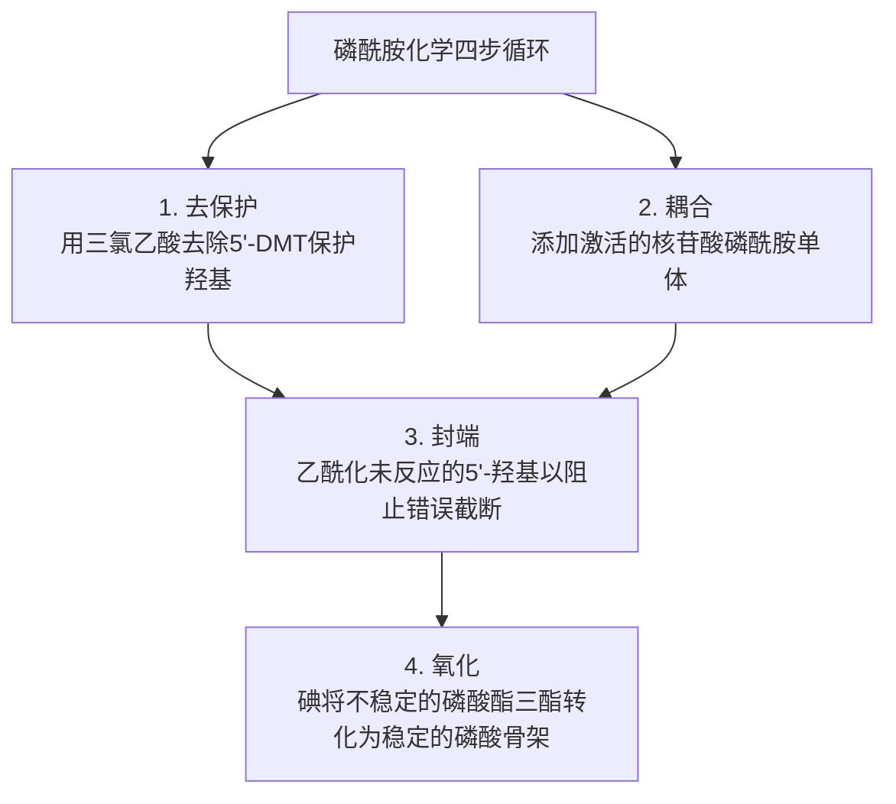
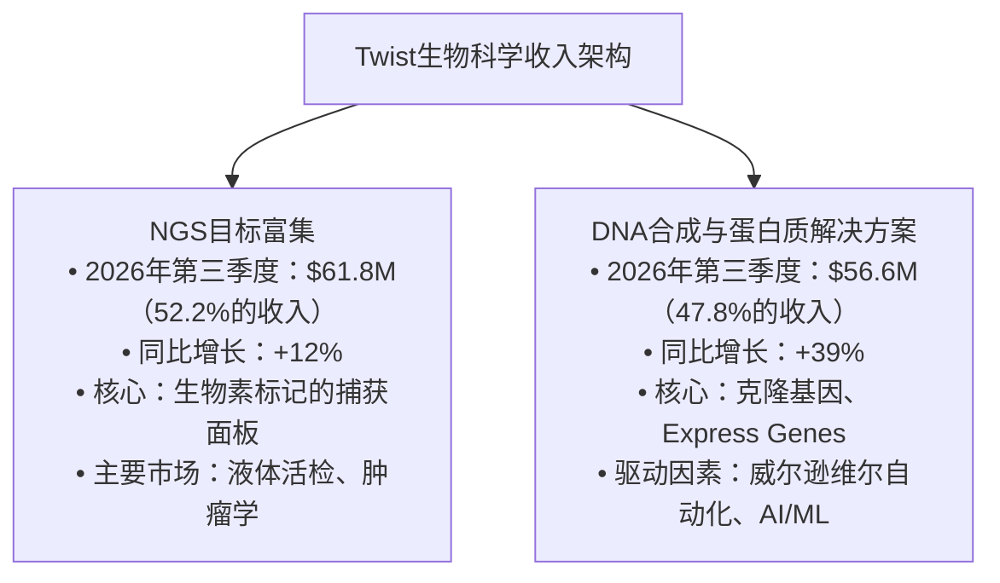
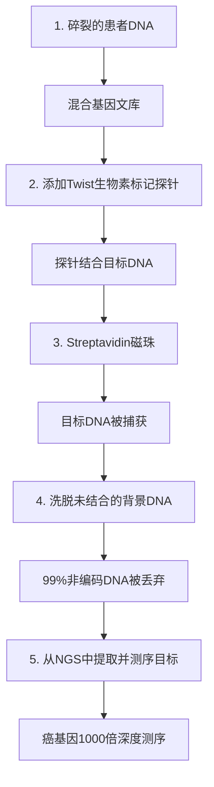
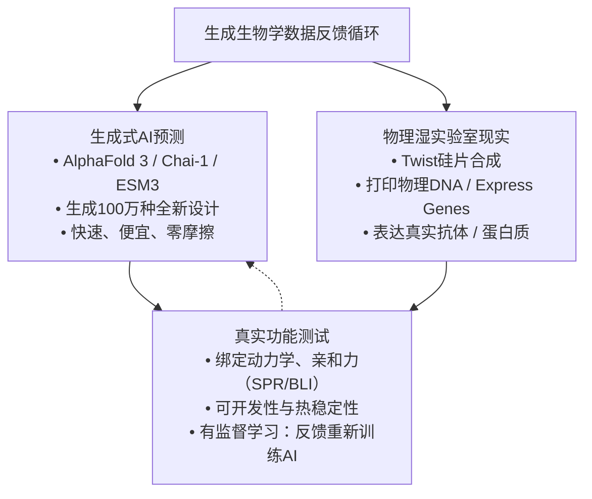

在生成式人工智能和计算生物学的淘金热中，市场参与者多年来一直在寻找生物技术领域的等同于英伟达（NVIDIA）的基础设施。

投资者寻找的是基础物理基础设施：能够向每个生成蛋白质设计模型、生物科技初创公司和跨国制药巨头出售关键硬件和消耗品的不可或缺的“镐和铲”平台，无论个别药物候选物的成功与否。

在过去的几年里，这一头衔几乎无可争议地属于Twist生物科学公司（NASDAQ: TWST）。

成立于2013年，Twist通过借用半导体行业的制造剧本，而非发明新的生物机制，彻底革新了基因工程。通过将化学DNA合成微型化到硅芯片上，而不是传统的96孔塑料板，Twist将化学反应体积减少了99.8%，降低了试剂成本，并解锁了一个高通量的制造引擎，能够并行合成数百万种独特的寡核苷酸。

自2026年9月至10月初，Twist的市场热情达到了顶峰：
- 伴随着与Eli Lilly的TuneLab平台的正式数据合作，华尔街分析师将目标股价推高至212美元。
- 股票从8月份的120美元区间飙升至10月5日超过202美元，推高了Twist的市值超过125亿美元。
- 即使在最近的调整至170-185美元区间后，Twist的市盈率仍高达25-27倍2026财年预期收入。

**Twist生物科学（$TWST）概览（2026年10月）**

| 指标 | 数据/价值 |
| :--- | :--- |
| 股票价格范围（2026年10月） | $170.00 – $185.00（峰值：$202.36于10月5日） |
| 52周范围 | $27.42 – $202.36（从谷值到峰值增长638%） |
| 发行后流通股 | 约6380万股股票 |
| 市值 | 约$110亿 – $118亿 |
| 企业价值（EV） | 约$106亿 – $114亿 |
| 现金及流动性投资（预估） | 约$4.55亿 – $4.8亿（包括8月$3亿的增资） |
| 总债务/可转换债券 | 约$0（干净的资产负债表） |
| 2026年第三季度收入（截至6月30日） | $1.184亿（同比增长23%） |
| 2026年全年收入指引 | $4.56亿 – $4.57亿（同比增长21%） |
| 2026年第三季度毛利率 | 52.8%（环比增长120个基点；从2024财年的42.6%增长） |
| 2026年第三季度调整后EBITDA亏损 | -$1130万（目标2026年第四季度盈亏平衡） |
| 2026年第三季度GAAP净亏损 | -$3510万 |
| 核心收入引擎 | NGS目标富集（52%），DNA合成（48%） |

然而，这种天价估值使Twist受到了严格的审视。

就在几天前，前对冲基金经理马丁·舍里利（Martin Shkreli）发布了一封广泛传播的呼吁，与Recursion制药（$RXRX）和Ginkgo生物工厂（$DNA）一起做空Twist生物科学，他痛斥“AI药物开发项目”并声称生物科技泡沫一旦面对IND启用毒理学和临床试验现实就会蒸发。

虽然舍里利在Twist的商业模式上犯了一个根本性的错误——Twist不开发临床药物，也不资助IND启用动物毒理学——但他的做空呼吁无意中突显了公司核心的财务脆弱性：

Twist生物科学是坚不可摧的精密硬件垄断企业，正在逐步实现持续盈利？还是一个工业受限的消耗品制造商，以不切实际的软件SaaS估值泡沫交易？

以下是关于Twist生物科学的科学、运营、财务和估值的法医调查。

---

## 1. 核心技术引擎：硅半导体与塑料板

要理解为什么Twist在合成DNA方面享有经济护城河，首先必须了解DNA制造的物理化学过程。

自1980年代初Marvin Caruthers开发的磷酰胺化学法以来，标准的工业方法一直是用于合成人工DNA。在这个循环的化学过程中，四种保护的脱氧核苷磷酰胺单体（腺嘌呤、胞嘧啶、鸟嘌呤、胸腺嘧啶）依次耦合、封端、氧化和去保护，附着在固体支持物上，逐个构建寡核苷酸：

### 传统瓶颈：96孔塑料板
历史上，商业DNA合成供应商——如Integrated DNA Technologies（丹纳赫）、Thermo Fisher Scientific和GenScript——都在96孔或384孔塑料微滴板中执行这一化学循环。

这种传统方法遭受了严重的物理限制：
1. **昂贵试剂体积过大**：每个塑料孔需要50至200微升昂贵的有机化学试剂进行每次耦合循环。
2. **大量废物**：单个板运行消耗大量有害溶剂（乙腈、二氯甲烷、吡啶），必须被捕获和处置。
3. **通量天花板**：合成100,000种不同的寡核苷酸需要超过一千个物理塑料板，成千上万的液体转移步骤和一支庞大的机器人液体处理器。
4. **大规模筛选成本高昂**：因为每个孔代表一个独立的宏观反应室，合成复杂的变体库或密集寡核苷酸池的成本为每碱基几分钱，使得大规模筛选经济上不可行。

### Twist的突破：半导体硅芯片
Twist的创始洞察——由首席执行官埃米莉·勒普鲁斯特和联合创始人比尔·班亚伊和比尔·佩克构思——是用光刻蚀的硅半导体芯片取代塑料微滴板：

**传统96孔微滴板 vs Twist硅芯片**

| 架构维度 | 传统96孔微滴板 | Twist硅芯片 |
| :--- | :--- | :--- |
| 反应支持材料 | 聚苯乙烯/塑料 | 硅半导体 |
| 每次运行的离散反应位点 | 96或384 | > 1,000,000 离散位点 |
| 反应室体积 | 50 – 200微升 | 梦升到纳升 |
| 试剂消耗 | 100%（基线） | ~0.2%（99.8%减少） |
| 合成密度 | 宏观规模孔 | 9,600簇/121孔 |
| 每次运行的输出 | 个体寡核苷酸在管中 | 大规模多重池 |
| 大规模寡核苷酸成本 | 每碱基0.10 – 0.30美元 | 每碱基不到0.001美元 |
| 主要应用 | 标准PCR引物 | 目标捕获、AI、池 |

Twist的硅芯片具有标准微滴板的精确尺寸，但其表面含有9,600个簇，每个簇包含121个微型硅反应孔。

通过在微蚀刻硅表面上路由化学试剂，Twist在单个芯片上合成了多达116万种不同的寡核苷酸。

操作影响是惊人的：
- **99.8%试剂减少**：通过将反应体积从微升减少到皮升，Twist消耗了传统供应商所使用的昂贵磷酰胺试剂的一小部分。
- **优越的均匀性**：在传统池合成中，随机变异会导致寡核苷酸代表性不均。Twist的微机械流体表面确保了均匀的化学暴露，导致低错误率和极高的序列表示保真度。
- **亚分币定价**：对于需要数百万种不同寡核苷酸的应用——如CRISPR指导RNA库、大规模并行报告试验（MPRAs）和目标富集探针——Twist打破了成本曲线，将合成成本从几分钱降至每序列几分钱。

### 酶合成辩论：为什么TdT未能颠覆Twist
在过去五年里，合成生物学倡导者热捧酶促DNA合成——使用末端脱氧核苷酸转移酶（TdT）酶——作为将化学磷酰胺合成淘汰的技术。初创公司如DNA Script、Camena Bioscience和Codexis筹集了数亿美元，承诺无毒化学的桌面DNA打印机。

然而，到2026年，酶促合成完全未能颠覆Twist的商业护城河。为什么？

1. **耦合效率与截断**：化学磷酰胺合成的步骤耦合效率为99.5%至99.8%。即使耦合效率下降到98.5%，当合成序列长度超过100碱基对时，也会导致指数级产量崩溃（(0.985¹⁰⁰ ≈ 22%)全长产量 vs (0.995¹⁰⁰ ≈ 60.5%))。工程TdT酶在大规模生产中难以匹配化学保真度。
2. **试剂经济学**：工程TdT酶和可逆终止核苷酸类似物的生产成本异常高昂。虽然桌面酶促打印机对于需要4个引物的学术实验室在两小时内方便，但对于合成500,000个序列的寡核苷酸池来说，经济上是不可行的。
3. **密度限制**：酶促反应需要水性、酶友好的微环境，难以在高密度硅芯片的皮升尺度上进行微型化。

Twist内部保留了酶促化学的研究，但在大规模、低成本商业生产中，**基于硅的磷酰胺仍然是无可争议的工业之王**。

---

## 2. 财务审计：拆解收入引擎

Twist生物科学在其三大主要商业支柱以及先进的探索部门报告其运营情况：

### 收入引擎1：下一代测序（NGS）目标富集（现金生成器）
虽然一般投资者认为Twist是一家“基因合成”公司，但其最大的也是最盈利的业务是**下一代测序（NGS）目标富集**，在2026年第三季度产生了**61.8百万美元的收入**（占总收入的52%）。

#### 目标富集机制
全基因组测序（WGS）读取人类DNA的全部30亿个碱基对。然而，在临床诊断中——如通过血液检测（液体活检）检测体细胞突变或通过鉴定遗传疾病变异——全基因组测序在经济上是浪费的。超过98%的基因组由非编码序列组成，这意味着诊断实验室会花费数百美元测序无信息的DNA以达到足够的读深。

目标富集通过使用**生物素标记的单链DNA/RNA探针**来解决这一问题，这些探针特异性地结合到感兴趣的靶标区域（例如，所有20,000个人类蛋白质编码基因的“外显子面板”，或500个癌症基因如*EGFR*、*KRAS*、*TP53*和*BRAF*的精选面板）：

#### Twist的护城河：80倍碱基折价和测序成本降低
为什么Twist从传统的NGS巨头Illumina和Agilent Technologies那里夺取了大量市场份额？

答案在于**序列捕获均匀性**，用**80倍碱基折价**来量化：
- 在传统探针制造中，探针浓度不均意味着某些基因组靶标被过度代表，而其他靶标则几乎未被捕获。
- 为了确保最弱的目标至少被测序30次，实验室必须过度测序整个样本，浪费测序试剂在被读取1000次的目标上。
- Twist的硅合成平台以近乎完美的分子均匀性打印探针，实现了接近1.4的80倍碱基折价（相比之下，传统池的折价超过2.5）。
- **经济价值主张**：较低的80倍碱基折价减少了实现临床诊断深度所需的测序读数，**20%至40%**。对于每年运行数十万患者样本的大型诊断测序中心，切换到Twist可以节省数千万美元的测序运行成本。

#### 客户锁定：监管不变性
目标富集探针不是通用商品。当诊断公司——如**Guardant Health**、**Natera**、**Grail**、**Foundation Medicine**和**Exact Sciences**——开发实验室开发测试（LDT）或向FDA提交体外诊断（IVD）试剂盒进行510(k)或PMA审批时，Twist的特定定制探针序列被验证到官方监管档案中。

切换探针供应商需要：
1. 完整的试验重新设计和优化。
2. 进行昂贵的多年度临床一致性研究。
3. 向FDA或CLIA/CAP检查员提交补充备案。

因此，**Twist的NGS收入具有极高的粘性、高利润率的定期收入**，随着癌症筛查和最小残留病（MRD）测试的全球需求扩大而自动增长。

---

### 收入引擎2：DNA合成与蛋白质解决方案（DSPS）（高增长引擎）
在2026年第三季度产生了**56.6百万美元**，并以**39%的年增长率加速**，DNA合成与蛋白质解决方案代表了Twist的技术展示。

该部门包括：
1. **寡核苷酸池**：用于高通量CRISPR指导筛选、大规模并行报告试验和蛋白质工程的数百万个单链寡核苷酸库（长度可达300个碱基对）。
2. **克隆基因及基因片段**：双链、序列验证的合成基因克隆到表达载体中，用于合成生物学、农业生物技术和学术研究。
3. **生物制药发现服务**：*体外*抗体发现库（Library-of-Libraries、GPCR/离子通道库、VHH单域纳米抗体）和高通量抗体表达。

#### 游戏改变者：威尔逊维尔未来工厂与Express Genes
多年来，Twist生物科学的弱点在于交货时间。虽然竞争对手GenScript利用中国低成本实验室技术人员手动克隆基因，耗时10至14天，Twist的集中半导体过程往往需要15至22个营业日才能发货克隆基因。

为了解决这个问题，Twist投资了超过1亿美元，建造了**“未来工厂”**——位于俄勒冈州威尔逊维尔的110,000平方英尺先进制造设施，于2023年1月开始商业发货。

威尔逊维尔设施引入了端到端的机器人自动化：
- 自动化硅片处理、酶装配、分子克隆和菌落挑选。
- 内部下一代测序质量控制（QC）在数小时内验证克隆的正确性。

在**2023年11月**，Twist利用威尔逊维尔推出了**Express Genes**，将克隆基因的交货时间缩短至**5至7个营业日**。

到2025年和2026年，Twist进一步推进了这一运营前沿：
- 在2025年中，Twist将快速交货扩展到**所有基因片段**，在短短**2个营业日内发货**。
- 学术Express Genes促销活动在短短**4个营业日内**提供验证的克隆基因。
- **动态激增定价**：Twist实施了分层定价，允许生物制药客户在紧急截止日期支付显著的溢价附加费，直接扩大了毛利率。

运营结果令人瞩目：Express Genes完全消除了GenScript的速度优势，推动DSPS部门的收入增长率在2026年第三季度达到39%，并使毛利率从中40%的范围扩展到50%以上。

---

### 收入引擎3：AI与生成生物学的交汇点——Eli Lilly TuneLab合作

为什么Twist的股价在2026年9月点燃，飙升至超过200美元每股？

催化剂是机构投资者意识到**Twist是生成式生物学中生成AI的关键物理瓶颈**。

#### “垃圾进，垃圾出”危机在AI药物设计中的困境
在过去两年中，计算模型——如DeepMind的**AlphaFold 3**、Chai Discovery的**Chai-1**、David Baker的**RFdiffusion / ProteinMPNN**（荣获2024年诺贝尔化学奖）和EvolutionaryScale的**ESM3**——使生成数亿种新型蛋白质结构变得轻而易举。

然而，计算预测并不能治愈疾病。一个AI模型可以生成在计算机屏幕上看起来很漂亮的蛋白质，但无法折叠、瞬时在水中聚集或非特异性地结合到人血浆蛋白上。

为了训练准确的模型，AI药物发现平台需要**主动学习循环**：它们必须物理合成数千种预测变体，在真实的湿实验室功能测试中进行测试，并将真实的结合和开发数据反馈到神经网络中。

#### 2026年9月16日的Eli Lilly TuneLab协议
2026年9月16日，**Eli Lilly公司**通过与Twist Bioscience合作其AI/ML平台**Lilly TuneLab**，正式确立了这一范式：
- **指定数据提供商**：Twist被选中为TuneLab的专有模型提供高通量、标准化的抗体表征数据，包括**AbLab**，Lilly的预测抗体开发性模型。
- **首选协议集成**：TuneLab生态系统内的研究人员可以订购高通量抗体生产和生物物理表征，直接从Twist在标准化的“TuneLab首选”协议下进行。
- **联邦AI训练**：通过这些运行生成的实验结合和稳定性数据可以贡献回联邦训练管道，不断改进AI的预测能力，同时保留知识产权。

这一合作作为一项深刻的证明概念：**即使是拥有无限资本的900多亿美元的制药巨擘也无法绕过高通量合成生物学的物理要求**。Twist是将数字代码转化为生物现实的物理打印机。

---

### 收入引擎4：DNA数据存储（异步月球计划）

除了其核心商业运营外，Twist继续推进其探索部门：**DNA数字数据存储**。

#### 物理论点
全球数据创建正以指数级增长，预计在几十年内将耗尽世界硅闪存和磁带的供应。磁带在10到30年内会退化，并需要消耗兆瓦电力的气候控制仓库。

DNA代表了自然的终极归档介质：
- **信息密度**：一克合成DNA理论上可以存储**215PB**（215百万GB）的数字数据。所有世界数据可以物理上装入一个鞋盒中。
- **极端耐用性**：封装的DNA在室温下无需电力即可保持数千年可读（如通过从永久冻土中提取完整的猛犸象DNA进行测序所证明）。
- **非过时性**：只要人类文明拥有生物技术，读取DNA的能力将永远不会过时。

#### 当前商业状况
Twist正在开发一种专门的超高密度**硅存储合成芯片**，设计用于以生物级DNA成本的几分之一写入数据（由于数据存储寡核苷酸可以容忍化学错误通过Reed-Solomon纠错算法）。

Twist与微软、Illumina和西部数据共同创立了**DNA数据存储联盟**。虽然这一部门目前产生少量收入，代表纯粹的R&D，但它代表了全球归档云存储市场的不对称长期看涨期权。

---

## 3. 短线卖家后记：Scorpion资本2022年攻击与2026年现实

任何对Twist生物科学的法医调查都必须解决一个显而易见的问题：**历史上对公司的空头攻击**。

2022年11月15日，活跃的空头卖家**Scorpion资本**发布了一份长达236页的报告，指控Twist生物科学是“下一个Wirecard”和“现金烧毁技术骗局”：
- **核心指控**：Scorpion指控Twist的硅片合成平台是“一场骗局”，公司的制造并非自动化，而是依赖于手工劳动，毛利率被人为夸大，通过将生产成本错误地分配到研发中，威尔逊维尔未来工厂将无法实现。
- **市场反应**：Twist的股价在发布当天下跌超过20%，最终在2023年生物科技熊市期间跌至20美元区间。

**Scorpion资本2022年指控 vs 2026年审计现实**

| 2022年空头论点指控 | 2026年审计运营现实 |
| :--- | :--- |
| “硅片技术是骗局/手工移液欺诈” | Twist每运行发送超过100万种寡核苷酸；经过Eli Lilly、Guardant Health、Natera和全球顶级制药公司的验证。 |
| “威尔逊维尔未来工厂是浪费” | 威尔逊维尔于2023年1月全面开放；2023年11月推出Express Genes；产能翻倍。 |
| “毛利率是假的，将崩溃为负” | 毛利率从2024财年的42.6%扩大到2026年第三季度的52.8%，由真实的制造规模经济效益驱动。 |
| “收入是虚构的/客户流失巨大” | 2022财年收入20.36亿美元增长至2025财年的37.66亿美元，并指导2026财年达到45.7亿美元（四年复合增长率125%）。 |
| “证券集体诉讼将使公司破产” | 2026年通过1.705亿美元保险支持的和解案解决，完全清除了责任。 |

四年的运营后记是明确的：**Scorpion资本的核心论点被现实世界的制造执行彻底拆解**。

Twist完成了威尔逊维尔工厂，推出了Express Genes，将毛利率从40%扩大到超过52%，收入超过45亿美元，并与世界上最复杂的生物制药机构建立了深厚的商业关系。2026年因该证券集体诉讼而达成的1.705亿美元和解案正式结束了这一章节。

然而，2022年欺诈指控的反驳并不自动证明2026年的估值。这将我们带到了财务解剖。

---

## 4. 财务健康、毛利率轨迹和稀释解剖

为了评估Twist作为今天投资的价值，我们必须审计其财务报表、现金消耗和资本结构。

**Twist生物科学五年财务轨迹**

| 指标（百万美元） | 2022财年 | 2023财年 | 2024财年 | 2025财年 | 2026财年指导/估计 |
| :--- | :--- | :--- | :--- | :--- | :--- |
| 总收入 | 20.36 | 24.51 | 31.30 | 37.66 | 45.60 – 45.70 |
| 同比收入增长 | +54% | +20% | +28% | +20% | +21% |
| 毛利润 | 8.43 | 8.97 | 13.33 | 19.09 | ~24.20 |
| 毛利率 % | 41.4% | 36.6% | 42.6% | 50.7% | 52.8% – 53.0% |
| 研发费用 | 12.03 | 10.69 | 9.37 | 9.42 | ~9.80 |
| 销售和管理费用 | 18.97 | 18.94 | 18.85 | 20.11 | ~21.50 |
| 调整后EBITDA亏损 | -123.6 | -107.3 | -63.5 | -34.2 | -8.0至-12.0 |
| GAAP净亏损 | -217.9 | -204.6 | -154.8 | -108.4 | -85.0至-95.0 |
| 现金及流动性资产 | 50.50 | 33.64 | 27.64 | 21.00 | ~460.0（增发后） |

### 关键财务要点：

1. **收入复利增长**：Twist的收入从2022财年的20.36亿美元增长到预计2026财年的45.7亿美元，代表了四年复合年增长率（CAGR）22.4%。
2. **毛利率运营杠杆**：毛利率在2023财年首次因威尔逊维尔设施的初始折旧和设置阶段而触底，达到36.6%。随着生产量的增加，毛利率在2025财年扩大到50.7%，并在2026年第三季度达到52.8%。管理层的目标是维持超过50%的毛利率，这一目标已被明确实现。
3. **接近调整后EBITDA盈亏平衡**：在2026年第三季度，Twist的调整后EBITDA亏损收窄至-1130万美元。管理层重申指导，Twist有望在2026年第四季度实现调整后EBITDA盈亏平衡，标志着一个重要的运营里程碑。
4. **GAAP净亏损仍然显著**：尽管调整后EBITDA有所改善，Twist在GAAP基础上仍然严重亏损，预计2026财年净亏损在-8500万美元至-9500万美元之间，主要由非现金股票薪酬（约5000万美元以上）和设施折旧驱动。

### 2026年8月增发：利用AI狂热
在2026年8月4日，Twist管理层利用强劲的市场情绪，执行了一次增发：
- **发行股份**：312.5万普通股以每股96.00美元（加上行使的绿鞋选择权46.875万股）。
- **总收益**：3亿美元。
- **增发后资产负债表**：将净发行收益与6月30日的现金余额（1.668亿美元）相加，Twist的总流动现金缓冲区约为4.6亿至4.8亿美元。

**战略评估**：虽然现有股东遭受了约5.5%的股权稀释，但从公司金融角度看，时机非常理想。通过以每股96美元的价格锁定3亿美元，Twist永久消除了所有持续经营和破产风险，确保其有足够的现金跑道，无需再次进入资本市场即可实现GAAP自给自足。

---

## 5. 估值矩阵：多头案例 vs 空头案例

拥有坚不可摧的资产负债表、53%的毛利率和主导的市场定位，为什么像马丁·舍里利这样的精明市场参与者会围绕空头理论进行循环？

答案是**估值倍数扭曲**。

**Twist生物科学估值基准：与生命科学同行比较**

| 公司（股票代码） | 市值 | 2026年收入 | 同比增长 | 毛利率 | P/S倍数 |
| :--- | :--- | :--- | :--- | :--- | :--- |
| Twist生物科学（TWST） | 115亿美元 | 4.57亿美元 | +21% | 52.8% | ~25.2倍 |
| Illumina（ILMN） | 198亿美元 | 44.5亿美元 | +3% | 67.5% | ~4.4倍 |
| Repligen（RGEN） | 78亿美元 | 6.8亿美元 | +12% | 50.2% | ~11.5倍 |
| Danaher（DHR） | 185亿美元 | 242亿美元 | +4% | 59.8% | ~7.6倍 |
| Thermo Fisher（TMO） | 205亿美元 | 438亿美元 | +5% | 41.5% | ~4.7倍 |
| NVIDIA（NVDA） [参考] | 3100亿美元 | 125亿美元 | +105% | 75.0% | ~24.8倍 |

### 多头案例：生物领域的“英伟达”
支持Twist的倡导者认为，当将传统生命科学估值倍数应用于TWST时，这些倍数已经过时：
1. **生物基础的基础设施**：生成式AI模型（AlphaFold 3、Chai-1、TuneLab）正在引发蛋白质设计的结构性超级周期。Twist是所有数字生物学必须通过的物理门户。
2. **毛利率扩张至60%以上**：随着威尔逊维尔设施的利用率提高和Express Genes的高端采用增长，毛利率可以扩张至60%以上，在成熟期实现20%以上的营业利润率。
3. **诊断垄断的粘性**：液体活检和最小残留病筛查正处于商业初期。随着Grail和Guardant在全球临床采用扩大，Twist的NGS探针特许权使用费和订单将以两位数的复合增长率持续增长十年。
4. **零临床二元风险**：与Recursion（$RXRX）不同，Twist不会因单一二期临床试验失败而生或死。Twist在现金支付中获得，无论成败。

### 空头案例：25倍销售的现实检查
怀疑论者和空头卖家以严格的数学现实进行反击：
1. **硬件经济学在软件倍数**：Twist目前以**约25倍的未来销售**交易——与英伟达的峰值倍数相同。但英伟达的毛利率为75%，年增长率超过100%。Twist是一个以53%毛利率和21%年增长率增长的物理消耗品制造业务。
2. **资本支出和物理摩擦**：与纯软件公司复制成本为零不同，合成DNA的扩展需要物理硅片、昂贵的有害化学处理、自动化机器人冷冻库、洁净室和人类技术人员。
3. **生物制药VC敏感性**：Twist的基因合成和寡核苷酸池客户中有一部分是受风险投资支持的早期生物技术初创公司。如果高利率或临床试验失败导致技术生物投资资金冷却，对合成基因的需求将迅速萎缩。
4. **倍数压缩的脆弱性**：在生命科学工具领域，顶级高增长业务很少能长期维持10倍至12倍的销售倍数。如果Twist的价格对销售倍数从25倍压缩到行业标准的12倍，即使它达到所有收入目标，股价也会失去超过50%的价值。

---

## 6. 战略结论与机构评分卡

Twist生物科学是现代生物科技中最令人瞩目的运营成功故事之一。在过去十年中，Emily Leproust及其团队成功地执行了竞争对手未能完成的任务：他们将半导体为基础的DNA合成转变为高通量、商业主导的现实，并击败了激进的空头指控，将公司定位在生成生物学革命的交汇点。

**Twist生物科学（$TWST）机构评分卡**

| 维度 | 评级 | 法医分析 |
| :--- | :--- | :--- |
| 技术与知识产权护城河 | ★★★★★ (9.5/10) | 无可争议的硅磷酰胺领导者；99.8%试剂减少难以轻易复制。 |
| 运营执行 | ★★★★☆ (8.5/10) | 威尔逊维尔上线；Express Genes交货时间压缩 GenScript；Q4 2026调整后EBITDA盈亏平衡按计划进行。 |
| 监管客户锁定 | ★★★★★ (9.0/10) | NGS目标富集验证到诊断LDT/IVD档案中；切换成本创造极大的粘性。 |
| 资产负债表与偿债能力 | ★★★★★ (9.5/10) | 约4.6亿至4.8亿美元的资产负债表后现金；无债务；完全通过盈利能力去风险化。 |
| 估值与倍数风险 | ★☆☆☆☆ (2.5/10) | 以约25倍销售交易，市值在175-185美元。高度易受严重倍数压缩至10-12倍范围影响。 |

### 最终裁决：

- **从商业与科学角度来看**：Twist生物科学是一家**A+级旗舰企业**。马丁·舍里利将Twist描述为“因IND毒理学而注定失败的AI药物开发”是完全错误的。Twist是一家首屈一指的镐和铲供应商，无论临床失败与否都能收取收入。
- **从投资角度来看**：在**175-185美元每股（市值超过110亿美元）**，Twist生物科学被定价为绝对完美。尽管长期的结构性顺风仍然强大，但当前25倍的未来销售收入倍数几乎没有容错空间。
- **行动建议**：寻求拥有AI生物技术浪潮物理层的投资者应赞赏Twist的运营执行，但要保持耐心。任何宏观经济波动或对AI热潮的旋转都可能导致股价急剧回调至**95-115美元区间（12-14倍销售）**，提供进入一代生物技术垄断的绝佳入场点。

---

### 验证的主要来源与引用
- **Twist生物科学投资者关系**：[SEC文件、新闻稿及财务报告](https://investors.twistbioscience.com)
- **Twist生物科学公司门户**：[公司概述和技术架构](https://www.twistbioscience.com/company)
- **Twist基因合成与Express Genes**：[Express Genes规格与交货时间](https://www.twistbioscience.com/products/genes/express-genes)
- **Twist NGS目标富集**：[杂交捕获与外显子面板](https://www.twistbioscience.com/products/ngs)
- **Twist生物制药解决方案**：[抗体发现与表征](https://www.twistbioscience.com/products/biopharma)
- **Twist DNA数据存储**：[世纪档案与高密度合成](https://www.twistbioscience.com/products/dna-data-storage)
- **SynBioBeta**：[Twist威尔逊维尔未来工厂运营分析](https://www.synbiobeta.com)
