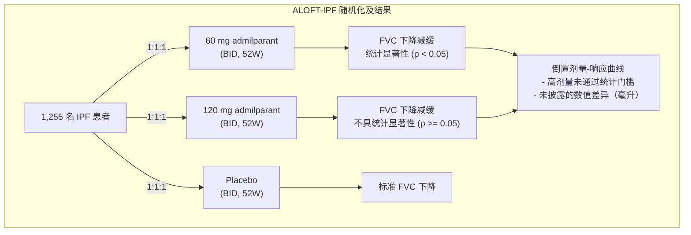
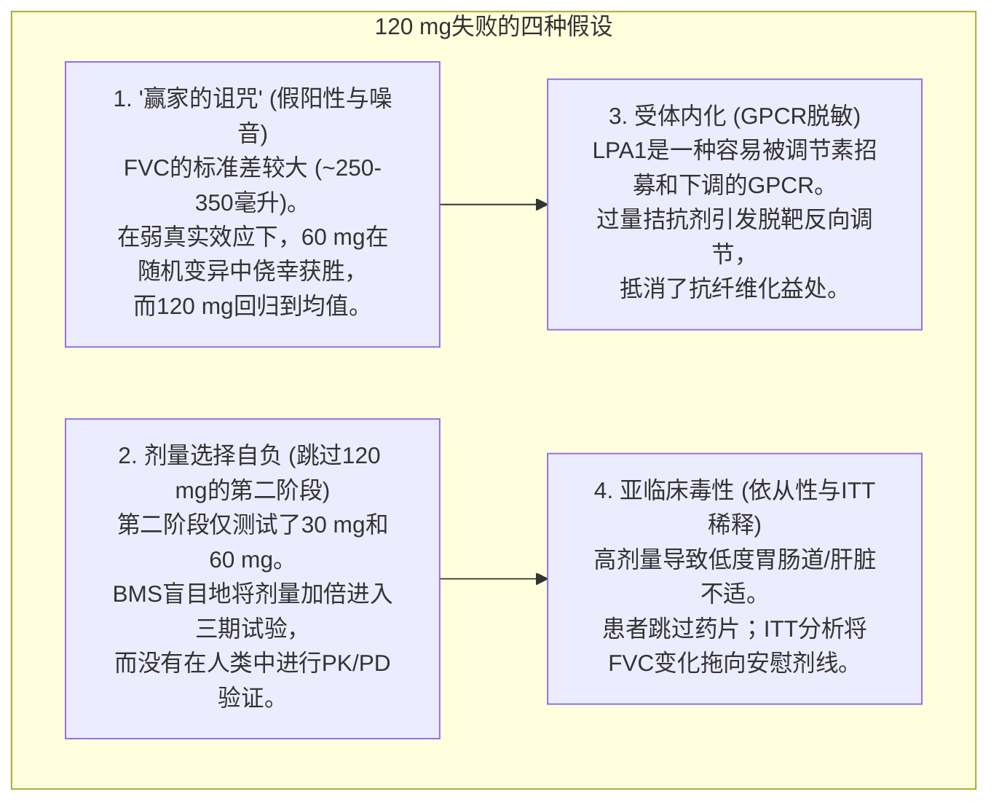
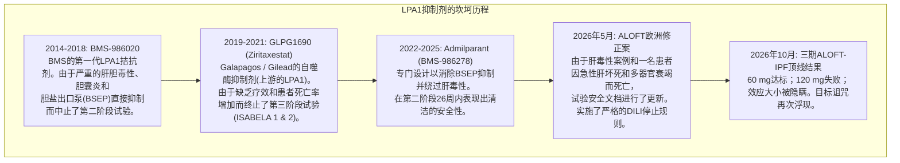
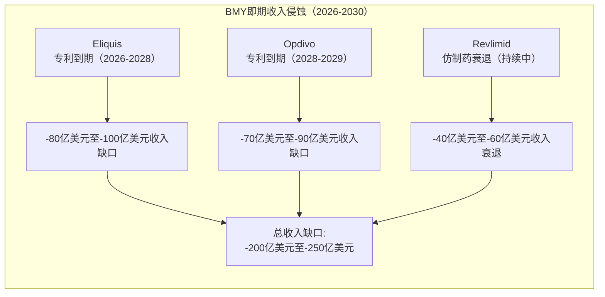
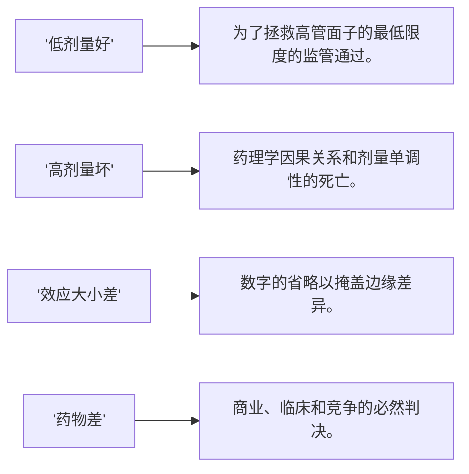

2026年10月12日，**百时美施贵宝（NYSE: BMY）**发布了一份备受期待的新闻稿，宣布其针对成人特发性肺纤维化（IPF）患者的ALOFT-IPF三期临床试验达到了主要终点，评估药物为admilparant（BMS-986278）。

对于市场观察者而言，仅从头条新闻来看，这似乎是一个在停滞多年的治疗创新中取得的明确临床胜利。

然而，在开盘铃声响起后的几分钟内，华尔街生物科技专家和临床药理学家们仔细阅读了新闻稿的细节后，纷纷质疑。股价仅微跌 **-0.77% 至 $59.12**。

资深生物科技记者 **亚当·费尔斯坦** 立即将此新闻标记为 *"重要的BMY新闻"，而分析师账号 **@Lord_of_Biotech** 则尖锐地指出了研究剂量组之间的矛盾：

> *"试验在60 mg剂量下达到了主要终点...而在120 mg剂量下，admilparant减缓了FVC的下降，但 **并未达到统计显著性**。"*

前生物科技对冲基金经理 **马丁·夏尔基** 直截了当地用四行法医解剖，迅速在金融推特上走红：

> *"低剂量好*  
> *高剂量坏*  
> *效应大小差*  
> *药物差"*  
> — **马丁·夏尔基 (@MartinShkreli)，2026年10月12日**

夏尔基是仅仅在争强好胜，还是BMS刚刚向生物科技界呈现了一个教科书上的“表面胜利”，隐藏了一个根本缺陷、缺乏竞争力且药理学可疑的资产？

在这一深入的法医调查中，我们将审计以下内容：
1. **ALOFT-IPF顶线数据**：BMS证明了什么，未能证明什么，以及它故意隐瞒的关键数字。
2. **拆解夏尔基的四行判决**：监管面纱，剂量响应单调性的完全破裂，以及公关混淆的迹象。
3. **药理学之谜**：为什么将剂量从60 mg加倍到120 mg会失去统计显著性？（假阳性“赢家诅咒”，跳过120 mg剂量的第二阶段研究，GPCR脱敏，以及亚临床依从性偏差）。
4. **LPA1类的诅咒与安全风险**：BMS-986020的幽灵，Galapagos的自噬酶灾难，以及2026年5月因致命肝坏死而实施的欧洲临床试验修正案。
5. **与勃林格殷格翰的Nerandomilast头对头**：为什么勃林格殷格翰的FIBRONEER-IPF三期数据在所有临床指标上都完胜admilparant。
6. **监管计算与商业估值**：计算BMS的专利悬崖，ALOFT-PPF试验的风险，以及admilparant的公允价值必须折让超过60%。

---

**百时美施贵宝：ALOFT-IPF admilparant 法医审计**

| 维度/临床指标 | BMS新闻稿叙事 | 法医药理学现实 |
| :--- | :--- | :--- |
| 主要终点状态 | "60 mg剂量达到了主要终点" | 120 mg剂量 **未达到统计显著性** (p >= 0.05) |
| 剂量-响应单调性 | 以整体积极的轮廓呈现 | 完全破裂；剂量响应违反药物因果性 |
| 报告的FVC效应大小（毫升） | 被省略/隐瞒 | 未报告的毫升差异强烈暗示边际效应（约40-50毫升） |
| 第二阶段剂量探索 | 直接从第二阶段过渡到第三阶段 | 120 mg剂量从未在第二阶段测试；剂量选择完全是自负 |
| 肝脏安全性概况 | "耐受性良好，低停药率" | 2026年5月的修正案增加了肝毒性停药规则，在死亡后强制执行 |
| 竞争态势 vs. BI (勃林格殷格翰) | "首创的LPA1方法" | 被Nerandomilast碾压 (两剂量均达标，+69.5毫升，p<0.001) |
| 峰值销售预期 | 20-30亿美元重磅炸弹 | 被归类为第二梯队的利基产品；实际峰值价值<7亿美元 |

---

## 1. 三期ALOFT-IPF试验发生了什么？

根据官方的 **百时美施贵宝新闻稿**（[链接](https://news.bms.com/news/corporate-financial/2026/Bristol-Myers-Squibb-Announces-Phase-3-ALOFT-IPF-Trial-Evaluating-Admilparant-in-Adults-with-Idiopathic-Pulmonary-Fibrosis-Met-Primary-Endpoint/default.aspx)），三期 **ALOFT-IPF** 试验（[NCT06003426](https://clinicaltrials.gov/study/NCT06003426)，协议IM027-068）招募了大约 **1,255名成人患者**（年龄≥40岁），诊断为特发性肺纤维化（IPF）。

试验设计为一项随机、双盲、安慰剂对照试验，评估两种活性治疗组与安慰剂（1:1:1随机化）至少52周的效果：
* **组1**：60 mg口服每日两次（BID）
* **组2**：120 mg口服每日两次（BID）
* **组3**：匹配的安慰剂每日两次

患者允许作为单药治疗或在稳定的标准治疗基础上（Boehringer Ingelheim的尼达尼布/欧夫或罗氏的吡非尼酮/埃布瑞）进行治疗。

主要终点是 **从基线到第52周的绝对变化的肺活量（FVC）**。

### 顶线发现
BMS揭示了两个关键事实：
1. **60 mg剂量达到了主要终点**，显示出与安慰剂相比，在第52周绝对变化的肺活量具有统计显著性改善。
2. **120 mg剂量未达到统计显著性**，仅表明它“减缓了肺活量的下降，但未达到统计显著性。”

注意新闻稿中完全缺失的内容：
* **无毫升（mL）差异**：BMS未披露60 mg和120 mg剂量组或安慰剂组的平均或调整后的平均肺活量变化（mL）。
* **无p值**：除了断言60 mg剂量“具有统计显著性”外，没有提供任何实际的p值。
* **无置信区间**：未提供95%置信区间来评估治疗效果的精确度或变异性。
* **无次要终点指标**：未提供疾病进展时间、急性IPF加重、全因死亡或呼吸系统住院的数据。

在机构临床试验分析中，数据省略绝非偶然。当赞助商生成了一个明确、决定性的临床结果时，会将数字散布在子项目中。当它以定性语言为掩护时，它是在管理叙事风险。

---

## 2. 分解夏尔基的四行解剖

马丁·夏尔基的反应穿透了生物制药公关的委婉语，揭露了试验的根本结构性缺陷。让我们逐行分析，以药理学和金融的精确度：

### 第一行：“低剂量好”
在纸上，60 mg组达到了 $p < 0.05$。在公司监管事务部门眼中，这构成了一个“注册性试验的积极结果”。它使BMS能够发布新闻稿，声称试验达到了主要终点，与FDA和EMA会面，并尝试组装新药申请（NDA）。

然而，在多臂临床试验中，一个剂量达到 $p < 0.05$ 而另一个剂量未达到的情况是制药开发中最古老的对冲之一。如果你测试多个活性剂量组对单个对照组，至少一个剂量通过名义显著性阈值的概率会随着随机性的增加而大幅上升，除非施加了铁一般的多重性惩罚。

### 第二行：“高剂量坏”
这是核心科学失败。药理学以剂量-响应单调性定律为基础：如果一种治疗性分子通过靶标受体起作用，增加其生物可用系统浓度应产生等效或更优的生物靶标抑制，直到受体饱和（E_max 拐点）。

当60 mg“有效”而120 mg（活性药物暴露增加100%）失败时，药物违反了剂量与疗效之间的基本因果关系。正如我们下面所探讨的，这意味着60 mg的结果可能是统计上的偶然，或者药物在较高剂量下表现出严重的药理学缺陷。

### 第三行：“效应大小差”
在特发性肺纤维化中，肺活量的保存以毫升/年为单位测量。
* 历史标准治疗（尼达尼布和吡非尼酮）相对于安慰剂每年减缓肺活量下降约 **~100至125毫升/年**（相当于约50%的相对减少）。
* 现代竞争对手 **nerandomilast**（勃林格殷格翰）在三期试验中显示了调整后的平均差异为 **+69.5毫升**（18 mg BID）和 **+45.6毫升**（9 mg BID）。

为什么BMS没有提供admilparant 60 mg的毫升差异？因为如果差异是+80毫升或+100毫升，那将是年度头条新闻。拒绝提供数字几乎可以肯定表明60 mg的效果是 **边际的**—很可能在 **+35毫升至+55毫升** 之间，勉强达到了统计显著性（p ≈ 0.03 或 $0.04$），而120 mg组则进入了非显著性（p ≥ 0.10）。

### 第四行：“药物差”
一个展示倒置剂量-响应曲线、未披露的边缘效应大小且有肝毒性历史的药物无法赢得医生的信心，无法赢得支付者的高价定价，并无法击败现代竞争对手。从投资和临床应用角度来看，它是一个商业死胡同。

---

## 3. 为什么120 mg剂量失败？四种药理学假设

一个主要制药公司如何在花费数亿美元进行1,255名患者的三期试验后，最终得出一个更高剂量失败的结论？

### 假设1：赢家的诅咒与统计侥幸
特发性肺纤维化以高患者间变异性著称。在临床试验中，52周FVC下降的标准差通常在 **250毫升至350毫升** 之间。在这种噪声背景下，安慰剂组的预期疾病下降约为 -150至 -220毫升/年。

如果admilparant的真实治疗效应较弱——仅能保存35至45毫升的肺容量——信号与噪声比非常糟糕。在一个具有两个活性剂量组的试验中：
* 随机分配可能会将稍微进展较慢的患者或较少的脱落分配到60 mg组，使其观察到的差异推高到 +55毫升，并产生名义上的 $p = 0.038$。
* 120 mg组经历普通统计回归到均值，落在 +30毫升，并产生 $p = 0.14$。

在这种假设下，**60 mg剂量并未“比120 mg剂量效果更好”；相反，两个剂量均不具备临床稳健的疗效，60 mg只是在随机临床试验的随机性中侥幸获胜。**

### 假设2：剂量选择自负（跳过120 mg的第二阶段）
要理解BMS如何最终得到一个失败的三期试验，必须审视第二阶段试验（[NCT04308681](https://clinicaltrials.gov/study/NCT04308681)），其结果发表在《美国呼吸与危重病医学杂志》（[PubMed: 39393084](https://pubmed.ncbi.nlm.nih.gov/39393084/)）：

在第二阶段，BMS评估了：
* 安慰剂
* 30 mg BID admilparant
* 60 mg BID admilparant

经过26周，60 mg剂量在IPF组中显示出 **62%的速率下降**，相对于安慰剂在预测的肺活量百分比（ppFVC）下降率上减少了69%，并且在进行性肺纤维化（PPF）上减少了69%。然而，30 mg剂量则显示出次优且不一致的分离。

关键在于：**BMS从未在第二阶段测试过120 mg剂量。**

BMS因60 mg第二阶段信号而兴奋，临床领导层做出了一个激进且未经深思的决定。他们基于线性剂量递增将预期产生更大疗效的假设，任意决定直接将未经测试的 **120 mg BID剂量** 用于关键的全球三期ALOFT项目。

跳过第二阶段的剂量范围研究而直接进入最高剂量的三期试验是药物开发中的严重罪行。BMS在没有实有人体疗效数据的情况下冒险押注数亿美元，最终失败了。

### 假设3：GPCR生物学，受体内化与脱敏
Admilparant是 **Lysophosphatidic Acid Receptor 1 (LPA1)** 的拮抗剂，这是一种与 **rhodopsin-like G-protein-coupled receptor (GPCR)** 相关的受体，与 Gαi/o、Gαq/11 和 Gα12/13 耦合。在正常生理中，LPA激活LPA1以刺激细胞存活、迁移和细胞骨架张力。在肺纤维化中，持续的LPA1信号传导在肺成纤维细胞和肺泡上皮细胞中驱动异常修复、肌成纤维细胞分化和血管通透性。

然而，GPCR药理学通常是非线性的。高系统浓度的小分子拮抗剂可以诱导：
1. **受体内化与脱敏**：慢性高亲和力占据可以改变GPCR的交通，导致内吞作用或改变单体与同二聚体/异二聚体受体复合物之间的基线平衡。
2. **脱靶交叉作用**：在120 mg BID达到的高微摩尔峰值浓度（C_max）下，对相关受体（如LPA2或LPA3）的选择性开始减弱。在某些肺损伤模型中，LPA2信号传导在上皮屏障维持中具有保护、抗凋亡的作用。如果高剂量的admilparant意外地拮抗或干扰LPA2，它可能会中和在60 mg剂量下观察到的抗纤维化益处。

尽管生物学家喜欢构建理论上的“钟形”或 hormetic 曲线来解释失败的高剂量组，但 **FDA的肺部疾病部门历来对事后非单调解释持极度怀疑态度**。没有预设的体外和体内模型预测倒U形曲线，监管机构将其视为不稳定的分子的初步证据。

### 假设4：亚临床毒性与ITT依从性衰减
在 **意向治疗（ITT）** 原则下分析临床试验时，每个被随机分配到某组的患者都会被包括在52周的FVC最终分析中，无论他们实际吞服了多少药片。

BMS在其新闻稿中声称：“由于不良事件导致的停药率很低，与安慰剂相似。” 但正式的研究停药是一个极端的结果。在患者停药之前会发生什么？
* 由于轻微的恶心、疲劳或亚临床腹痛而中断剂量或暂时休假。
* 患者不依从：每天只服用一颗药片而不是两颗，因为120 mg剂量让他们感觉不适。

如果120 mg组的患者经历了亚临床毒性，导致实际世界依从性下降，那么他们52周内的有效药物暴露量会下降。在ITT分析中，依从性差会将治疗组的平均FVC斜率拉回到安慰剂下降线。

---

## 4. 安全阴影：LPA1靶点的诅咒与2026年5月的修正案

为了理解生物科技投资者为何如此敏感于admilparant的概况，必须了解LPA1抑制剂的历史。

### BMS-986020的幽灵
Admilparant并非BMS首次涉足LPA1。十年前，BMS开发了 **BMS-986020**，这是一种第一代LPA1拮抗剂。在第二阶段试验中，BMS-986020成功减缓了IPF患者的肺活量下降。然而，由于严重的肝胆毒性（表现为显著的ALT/AST升高和急性胆囊炎病例），该计划不得不完全放弃。后续研究揭示了BMS-986020抑制了肝转运体，特别是 **Bile Salt Export Pump (BSEP)**。

BMS化学家合成了admilparant（BMS-986278），专门设计以消除BSEP抑制。多年来，BMS宣称admilparant是一种清洁、对肝脏安全的分子。

### 2026年5月的致命肝坏死警报
这个干净的叙述在2026年5月破裂了。欧洲监管文件显示，BMS被迫在欧洲临床试验站点实施紧急修正案。

修正案正式将肝损伤重新分类为“重要潜在风险”，并实施了严格的药物诱导肝损伤（DILI）停止规则、强制性的肝功能测试和立即重新测试协议。

触发因素是什么？ALOFT项目中一系列与肝相关的不良事件，包括 **一名患者因急性肝坏死和自身免疫性溶血性贫血而死亡**。

虽然BMS正确指出试验时是盲的——不确定死亡患者是否接受了admilparant或安慰剂——并强调许多患者有复杂的共病，但这一揭示在肺部社区引起了轩然大波。

当结合以下几点时，监管风险倍增：
1. 一个具有已知肝毒性机制的药物类别，
2. 由于致命肝坏死而被迫在中期试验中实施的修正案，
3. 一个三期试验结果，其中高剂量莫名其妙地失去疗效，

监管审查将更加严格，以确定120 mg失败是否由隐藏的低度肝压力驱动，导致临床医生暂停给药或患者停止治疗。

---

## 5. 头对头：勃林格殷格翰的Nerandomilast彻底摧毁了Admilparant

对于BMS来说，最终的悲剧是ALOFT-IPF试验并非孤立进行。它是在勃林格殷格翰的FIBRONEER-IPF试验阴影下进行的。

勃林格殷格翰，纤维化肺疾病全球无出其右的巨头（拥有当前标准治疗Ofev），最近公布了其口服 **PDE4B选择性抑制剂nerandomilast** 的三期结果（[勃林格殷格翰新闻稿](https://www.boehringer-ingelheim.com/us/press-release/boehringers-nerandomilast-meets-primary-endpoint-pivotal-phase-iii-fibroneer-ipf-study)）。

比较这两个项目的机构概况：

**头对头三期审计：Nerandomilast vs. Admilparant**

| 临床指标/特征 | Nerandomilast（勃林格殷格翰） | Admilparant（百时美施贵宝） |
| :--- | :--- | :--- |
| 作用机制 | 口服PDE4B选择性抑制剂 | 口服LPA1受体拮抗剂 |
| 里程碑试验名称 | FIBRONEER-IPF（1,177名患者） | ALOFT-IPF（1,255名患者） |
| 评估的活性剂量 | 9 mg BID & 18 mg BID | 60 mg BID & 120 mg BID |
| 主要终点结果（第52周绝对FVC变化） | 两剂量均高度显著 - 18 mg BID：p < 0.001 - 9 mg BID：p < 0.01 | 60 mg：显著（p < 0.05） 120 mg：失败（p >= 0.05） |
| 剂量-响应关系 | 课本中的单调性：较高剂量 = 更大疗效 | 倒置/非单调性：较高剂量失去显著性 |
| 52周FVC差异报告（毫升） | 透明地公布： - 18 mg BID：+69.5毫升 - 9 mg BID：+45.6毫升 | 隐瞒/未公布：未在新闻稿中提供毫升数字（表明虚弱） |
| 背景抗纤维化使用 | 证明了一致性，无论是否使用背景Ofev/Esbriet | 未揭示亚组表现 |
| 安全审查 | 预期的类腹泻；无致命肝坏死惊吓 | 2026年5月的DILI修正案；致命急性肝坏死报告 |
| 监管信心 | 接近100%的FDA批准确定性，带有清洁的双剂量组合包 | 单边边缘剂量审查，FDA顾问委员会的质疑 |
| 商业定位 | 无可争议的下一代市场领导者 | 受损的第二梯队追随者 |

对比是毁灭性的。
* 勃林格殷格翰运行了一个教科书项目：两个剂量都达标，效果大小被透明地公布（+69.5毫升和+45.6毫升），剂量顺序完美无瑕，生物理论被无可辩驳地证明。
* 百时美施贵宝运行了一个模糊的项目：高剂量失败，效果大小被隐瞒，剂量-响应关系破裂，过去的安全部分仍有疑虑。

在现实世界的临床肺病学中，当医生决定给一个因IPF而死亡的病人开什么药时，为什么他们会选择一个具有破环剂量-响应关系和未声明效果大小的LPA1抑制剂，而不是一个被干净、无可辩驳的三期疗效支持的PDE4B抑制剂？

---

## 6. 监管计算与ALOFT-PPF的悬而未决

百时美施贵宝能否通过FDA批准admilparant？

### 统计分析计划（SAP）陷阱
一切都取决于ALOFT-IPF统计分析计划中预设的 **多重性测试层次结构**。
* **如果BMS使用了层次测试程序**，要求首先测试120 mg剂量，然后再测试60 mg剂量，那么120 mg剂量的失败意味着60 mg剂量不能正式声称统计显著性！在严格的门控下，层次结构顶部的失败会推翻下游剂量的正式显著性声明。
* **如果BMS分劈alpha**（例如，通过Bonferroni或图形方法分配α = 0.025给120 mg剂量和α = 0.025给60 mg剂量），那么60 mg剂量可以合法地声称统计显著性——前提是其p值低于0.025。

BMS在其新闻稿中表示60 mg剂量“具有统计显著性”，这表明可能使用了alpha分劈或Hochberg程序。即使技术上符合SAP，**FDA并不简单因为一个剂量组跨越了任意的alpha阈值就批准药物。**

FDA的肺部顾问委员会将提出以下问题：
1. *为什么120 mg剂量失败，如果这个分子激活了LPA1？*
2. *60 mg结果是否是一个假阳性离群值？*
3. *患者四分位数的暴露-反应（PK/PD）曲线是什么样的？*
4. *BMS能否证明60 mg提供了临床意义上的益处（传统上认为至少为50毫升的肺活量保存超过52周）？*

### ALOFT-PPF的悬而未决（2027年初）
Admilparant目前正在评估一个配套的三期试验：**ALOFT-PPF**（[NCT06025578](https://clinicaltrials.gov/study/NCT06025578)），招募大约 **1,057名** 进行性肺纤维化（PPF）患者。

ALOFT-PPF顶线数据预计在2027年初公布。IPF中120 mg剂量失败的阴影笼罩着PPF试验。进行性肺纤维化是一个比IPF更异质的患者群体，包括自身免疫性ILD、类风湿性关节炎相关的ILD和过敏性肺炎。

如果admilparant的真实效应大小不足以在相对均匀的IPF群体中推动120 mg剂量通过终点线，那么在更异质的PPF群体中，ALOFT-PPF提供模糊或失败读出的概率已经大幅增加。

---

## 7. 估值影响：百时美施贵宝（BMY）的专利悬崖

为了理解更广泛的财务影响，必须从百时美施贵宝的公司资产负债表来看待admilparant。

百时美施贵宝正面临现代制药史上最残酷的 **专利悬崖**：
* **Revlimid**：已经陷入剧烈的仿制药衰退（从峰值12亿美元以上跌至不到5亿美元）。
* **Eliquis**：与辉瑞联合销售；预计在2026年至2028年间在美国仿制药进入（12亿美元以上的全球特许权）。
* **Opdivo**：百时美施贵宝的基础PD-1抗癌药物（9亿美元以上的特许权）；专利从2028年开始过期。

百时美施贵宝领导层反复向华尔街保证，其“新产品组合”——以Camzyos（mavacamten）、Sotyktu（deucravacitinib）、Cobenfy（KarXT）和 **admilparant** 为锚点——将填补这一灾难性的20亿美元以上的收入缺口。

华尔街共识模型预计 **20亿美元至30亿美元** 的风险调整后峰值销售额，前提是admilparant在IPF和PPF两种适应症上都能取得全面的三期成功。

### 重新评估admilparant的真实价值
30亿美元的共识估计现在已死到临头。
1. **仅批准60 mg剂量**：由于120 mg剂量失败，admilparant将没有剂量调整灵活性。如果患者对60 mg剂量没有反应，医生无法增加剂量。
2. **第二线地位**：勃林格殷格翰的Nerandomilast将占据第一线添加疗法的大部分市场份额。肺科医生不会选择一个具有破环剂量-响应关系和未声明效应大小的药物，而选择一个在三期试验中以$p < 0.001$获胜的药物。
3. **支付者推回**：药品福利管理人（PBMs）将要求大幅折扣。为什么为一个仅表现出轻微肺活量保存的药物支付高端专科定价？
4. **现实的峰值销售额**：在乐观的情况下，如果60 mg获得FDA批准，ALOFT-PPF勉强通过，峰值年度销售额将被限制在 **5亿美元至7.5亿美元**——比之前的乐观预期减少了75%。

这解释了为什么BMY股价在消息公布后下跌：精明的资金认识到，BMS在2028年之后增长战略的关键支柱已经崩溃。

---

## 8. 结论：大型制药公司的“纸面胜利”

生物制药行业已经掌握了“纸面胜利”的艺术。当一项试验产生有问题、矛盾或令人失望的数据时，公司通讯部门会遵循一个熟悉的剧本：
1. 在头条中强调试验“达到了主要终点”。
2. 在正文部分埋藏失败的高剂量组。
3. 完全删除确切的数值效应大小、p值和置信区间。
4. 引用首席医疗官赞扬“总体发现”和“首创创新”。

马丁·夏尔基的病毒式四行批评并非出于愤世嫉俗；它是一种 **法医临床知识** 的练习：

百时美施贵宝可能最终仍能通过60 mg剂量将admilparant带过FDA的终点线。但在临床医学和竞争生物制药市场的严酷领域，你不能通过粉饰来赢得标准治疗地位。

在勃林格殷格翰的Nerandomilast等待在监管大门的另一边，拥有无懈可击的三期数据，admilparant的倒置剂量陷阱将BMS本应成为下一个肺部重磅药物的试验变成了剂量选择自负的警示故事。

---

### 验证的独立参考与主要来源
* **百时美施贵宝ALOFT-IPF三期临床试验官方顶线公告**：  
  [BMS新闻稿（2026年10月12日）](https://news.bms.com/news/corporate-financial/2026/Bristol-Myers-Squibb-Announces-Phase-3-ALOFT-IPF-Trial-Evaluating-Admilparant-in-Adults-with-Idiopathic-Pulmonary-Fibrosis-Met-Primary-Endpoint/default.aspx)
* **ALOFT-IPF注册性三期临床试验**：  
  [ClinicalTrials.gov标识符：NCT06003426](https://clinicaltrials.gov/study/NCT06003426)
* **ALOFT-PPF注册性三期临床试验**：  
  [ClinicalTrials.gov标识符：NCT06025578](https://clinicaltrials.gov/study/NCT06025578)
* **Admilparant（BMS-986278）二期临床试验结果**：  
  [ClinicalTrials.gov标识符：NCT04308681](https://clinicaltrials.gov/study/NCT04308681)  
  *美国呼吸与危重病医学杂志*：[PubMed: 39393084](https://pubmed.ncbi.nlm.nih.gov/39393084/)
* **Admilparant在肺纤维化中的药理动力学特征**：  
  *呼吸研究*：[PubMed: 42458495](https://pubmed.ncbi.nlm.nih.gov/42458495/)
* **勃林格殷格翰FIBRONEER-IPF三期顶线结果**：  
  [勃林格殷格翰官方新闻稿](https://www.boehringer-ingelheim.com/us/press-release/boehringers-nerandomilast-meets-primary-endpoint-pivotal-phase-iii-fibroneer-ipf-study)
