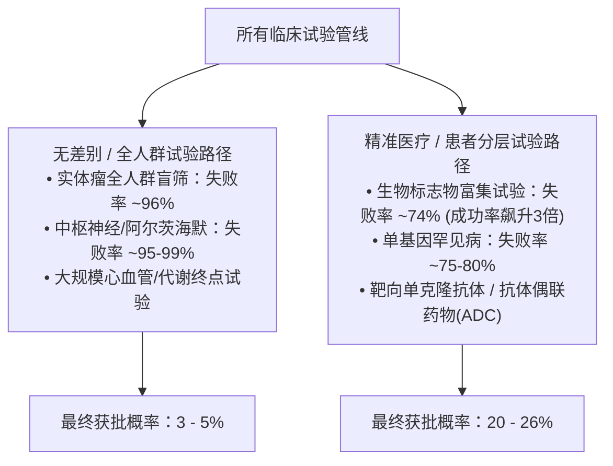

每当一家极具潜力的临床期生物科技（Biotech）公司在公布2期或3期顶线数据后股价一夜暴跌80%时，个人投资者和市场观察者总会提出同一个核心疑问：**“如今的临床试验是真的比过去更容易失败了，还是仅仅因为24小时财经媒体的轰炸让我们产生了这种错觉？”**

在过去的五十年里，全球生物医药领域经历了一场史无前例的技术大爆发。我们从1970年代粗糙的动物模型表型筛选，一路跨越至重组DNA技术、高通量自动化化学筛选、机器人结晶学、人类基因组测序、冷冻电镜（Cryo-EM），以及如今基于人工智能的从头蛋白质设计。

按照常理，半个世纪以来指数级飞跃的科学工具理应大幅提升新药研发的确定性，推动临床试验失败率稳步下降。

然而，真实的底层历史数据却给出了完全相反的残酷答案。

**从生物医药行业开始系统性追踪临床试验数据的1970年代算起，直到2026年今天，临床试验的失败率在持续上升（UP），而累计研发成功率则在不断下滑（DOWN）。**

* **1970年代至1980年代（塔夫茨大学CSDD基准）：** 进入人体临床1期的新药候选分子中，大约每**5个就有1个（20%~23%）**能够最终获得FDA批准上市。（临床综合失败率：**77%~80%**）
* **2000年代至2010年代（Nature Biotech、BIO、MIT研究）：** 从临床1期走到最终上市的累计批准概率（LOA）大幅滑落至**9.6%~13.8%**。（临床综合失败率：**86%~90.4%**）
* **2011–2020年基准队列（BIO / Informa / QLS Advisors）：** 全行业所有适应症的综合研发成功率降至**7.9%**，创下**92.1%的累计失败率历史极值**。
* **现代（IQVIA艾昆纬R&D趋势报告）：** 2021年受全球疫情干扰以及同质化肿瘤管线过度拥挤影响，单年度综合成功率暴跌至**5.0%**（年化失败率**95.0%**）的绝对低谷；随后在2023年回升至**10.8%**，并在2024~2026年稳定在**11%~12%**的区间。

**从临床1期到FDA获批的候选药物累计淘汰率（50年历史变迁）**

| 研究机构及报告名称 | 分析样本队列区间 | 累计临床成功率 (PoS) | 总体累计失败率 |
| :--- | :--- | :--- | :--- |
| 塔夫茨CSDD (DiMasi) | 1970–1982年 IND 申报药物 | ~20.0% – 23.0% | 77.0% – 80.0% |
| 塔夫茨CSDD (DiMasi) | 1981–1992年 IND 申报药物 | ~16.0% – 19.0% | 81.0% – 84.0% |
| 默克/Nature (Kola) | 1991–2000年 大药企研发管线 | ~11.0% | 89.0% |
| 塔夫茨CSDD (DiMasi) | 1993–2004年 IND 申报药物 | ~16.0% (自研) / 19% (全量) | 81.0% – 84.0% |
| Nature Biotech (Hay) | 2003–2011年 行业全景数据 | 10.4% (总体) / 15.3% (主导) | 89.6% (总体) |
| BIO / Biomedtracker | 2006–2015年 行业全景数据 | 9.6% (总体) / 11.9% (非肿瘤 | 90.4% (总体) |
| MIT (Wong, Siah, Lo) | 2000–2015年 Citeline数据库 | 13.8% (路径法) / 6.9%(阶段) | 86.2% / 93.1% |
| BIO / Informa / QLS | 2011–2020年 行业全景数据 | 7.9% (全适应症平均) | 92.1% (总体平均) |
| IQVIA Institute | 2021年 全球管线极值低谷 | 5.0% (单年度谷底) | 95.0% (单年度谷底) |
| IQVIA Institute | 2023–2025年 管线效率复苏期 | 10.8% – 11.7 (CPPI指数) | 88.3% – 89.2% |

为什么在科学飞速发展的背景下，药物研发的失败率反而居高不下甚至恶化？候选药物究竟在哪个阶段因何夭折？为什么现代药物研发正在撕裂成两个极端的平行世界——一个世界里试验几乎注定全军覆没，而另一个依靠精准医疗的世界成功率却飙升了三倍？

本篇深度研究报告将全面解构过去50年的临床试验历史数据，剖析制约现代生物医药的深层生物学机制与商业经济激励。

---

## 1. 临床试验追踪的源起（1962–1976）

要理解现代临床试验的淘汰率，必须首先回到现代“三期临床监管框架”的诞生起点。

### 1962年之前：只需证明安全即可上市的时代
在1962年以前，美国药品监管主要由1938年通过的《联邦食品、药品和化妆品法案》（FD&C Act）管辖。在当时的法规下，药企只需证明候选药物无毒且**安全（Safe）**即可上市销售，法律上并没有强制要求证明药物具有实质性的**临床疗效（Efficacy）**。当时的人体临床试验通常松散无序、缺乏统一的对照组，也不存在阶段化的严格监管关卡。

### 1962年《科夫沃-哈里斯修正案》（Kefauver-Harris Amendments）
全球制药史上最重大的转折点发生在1960年代初的**“反应停（沙利度胺，Thalidomide）悲剧”**。这种原本用于治疗孕妇晨吐反应的镇静剂，在欧洲和英国导致上万名新生儿出现严重的肢体短小畸形（海豹肢症）。尽管FDA女审查官弗朗西丝·凯尔西（Frances Kelsey）因数据存疑坚决阻击该药在美国上市，使得美国避免了大规模灾难，但该事件直接促成了美国国会的紧急立法。

1962年10月，约翰·F·肯尼迪总统正式签署了**《科夫沃-哈里斯药物修正案》**。该法案确立了现代新药研发的三大不可动摇的基石：
1. 药企在开展人体临床试验之前，必须向FDA提交正式的**新药临床试验申请（IND）**。
2. 试验开展前必须取得每一位受试者的书面**知情同意（Informed Consent）**。
3. 最为关键的是，申办方必须通过具备科学资质专家所开展的“充分且良好受控的研究”，依法提供证明药物疗效的**“实质性证据（Substantial Evidence of Efficacy）”**。

为了落实这一法案，FDA将人体试验制度化为沿用至今的三期临床监管路径：
* **临床1期（Phase 1）：** 20~100名健康志愿者（或晚期癌症患者），评估人体药理学、安全性、耐受性、药代动力学（PK）及最大耐受剂量（MTD）。
* **临床2期（Phase 2）：** 100~300名目标疾病患者，初步验证生物学概念验证（PoC）、早期疗效信号以及探索最佳剂量反应曲线。
* **临床3期（Phase 3）：** 1,000~5,000名以上多中心随机双盲试验，在大样本人群中对比现有标准疗法（SOC）或安慰剂，最终确证疗效与安全性。
* **上市申请审查（NDA / BLA）：** 监管机构专业团队对临床有效性、安全性及化学制造控制（CMC）进行全面审查。

**现代药物研发的三期临床监管关卡架构**

| 研发监管阶段 | 典型样本规模 | 核心考核目标 | 历史最主要的失败致因 |
| :--- | :--- | :--- | :--- |
| 临床1期 | 20 – 100名志愿者 | 安全性、耐受性、PK/PD | 意外的急性毒性、严重不良代谢性质 |
| 临床2期 | 100 – 300名目标患者 | 概念验证(PoC)、剂量探索 | 缺乏临床疗效 (占淘汰总数的50-60%) |
| 临床3期 | 1,000 – 5,000+名患者 | 关键确证性、优效性对比 | 未能击败标准疗法/安慰剂 (~50%失败) |
| 上市审查 (NDA) | 全量研发档案评审 | 收益风险比、生产质量 | 生产工艺(CMC)缺陷、数据合规漏洞 |

### 研发失败率“会计核算”的诞生（1975–1976）
随着三期临床监管流程的确立，经济学家和药理学家开始系统统计“究竟有多少药物在管线中阵亡”：
* **沃德尔与拉萨尼亚（1975）：** 威廉·沃德尔（William Wardell）与路易斯·拉萨尼亚（Louis Lasagna）在专著《监管与药物研发》中，首次量化了1962年新法案实施后的“药品研发延迟”以及各阶段的管线流失率。
* **塔夫茨大学CSDD成立（1976）：** 1976年，拉萨尼亚与沃德尔在罗彻斯特大学创立了**药物研发研究中心（CSDD）**，并于1984年整体搬迁至**塔夫茨大学（Tufts University）**。在著名卫生经济学家**约瑟夫·迪马西（Joseph A. DiMasi）**的主持下，塔夫茨CSDD建立了自1963年以来全球最权威的新分子实体（NME）长期追踪数据库。
* **商业数据库的崛起（1980年代~2000年代）：** 随后，Citeline旗下的**Pharmaprojects**（1980年）、科睿唯安旗下的**CMR International**（1981年）、**BioMedTracker**以及2000年上线的**ClinicalTrials.gov**，使得对全球临床试验全生命周期的量化追踪步入大数据时代。

---

## 2. 阶段性失败的病理学解剖：基准线与淘汰机制

临床试验在不同阶段的淘汰风险具有高度的非对称性。候选药物在每个阶段所面临的生化关卡截然不同。

### 临床1期：安全性与药代动力学筛选
* **平均晋级成功率：** **~52% – 66%** *（失败率：34% – 48%）*
* **核心目标：** 厘清药物在人体内的吸收、分布、代谢与排泄（ADME/PK），界定剂量限制性毒性（DLT）。
* **主要失败诱因：** 急性器官毒性（肝毒性、心脏QT间期延长、神经毒性）、不可耐受的不良反应、脱靶毒性，或致命的药代动力学缺陷（如半衰期极短无法维持体内有效浓度、水溶性极差或首过消除过强）。

### 临床2期：药效的火葬场，“死亡之谷（Valley of Death）”
* **平均晋级成功率：** **~24% – 35%** *（失败率：65% – 76%）*
* **核心目标：** 首次将药物推向真实患者，完成生物学概念验证（PoC），通过2a和2b期确立最佳量效关系。
* **主要失败诱因：** **临床2期是整个制药工业最具杀伤力的瓶颈关卡。全球超过70%的2期临床试验以失败告终。** 导致惨败的压倒性元凶是**“缺乏临床疗效（Lack of Efficacy）”**，占2期所有失败归因的50%~60%。体外细胞实验和小鼠动物模型极易误导科学家；一旦药物置身于人体复杂的内环境与异质性病理机制中，往往根本无法扭转疾病进展。

### 临床3期：吞噬巨资的灾难性休克
* **平均晋级成功率：** **~50% – 65%** *（失败率：35% – 50%）*
* **核心目标：** 在几千名异质性极高的患者群体中，证明药物相对于现有标准疗法（SOC）或安慰剂具有统计学显著的优效性或非劣效性。
* **主要失败诱因：** 尽管已经通过了1期安全性和2期疗效验证，**仍有近一半的3期临床走向毁灭**：
  1. **主要疗效终点未达标（占失败的50~55%）：** 在严格筛选的小规模2期试验中观察到的效应量（Effect Size），在大规模多中心患者中被迅速稀释，或者安慰剂组的效果远超预期（在抑郁症、精神类及中枢神经退行性疾病中尤为严重）。
  2. **罕见严重毒性浮出水面（占失败的17~20%）：** 发生率在千分之一级别的严重特异质毒性（如药物性肝衰竭、血栓性微血管病），在几百人的2期试验中极难察觉，但在3,000人以上的3期试验中会瞬间破坏药物的获益/风险比。
  3. **商业战略流产（占失败的15~22%）：** 3期耗时漫长（通常3~5年），若在此期间竞品抢先上市并建立了更高的疗效壁垒，申办方只能忍痛砍掉失去商业价值的管线。

### 新药上市审查（NDA / BLA）：最后门槛
* **平均获批成功率：** **~85% – 92%** *（失败率：8% – 15%）*
* **核心目标：** 监管机构专业评审，完成药品上市核准与标签谈判。
* **主要失败诱因：** 收到FDA完全回复函（CRL）的原因极少是因为绝对疗效不足，而往往源于**生产制造与质量控制（CMC）缺陷**（车间无菌违规、批次间稳定性差、数据真实性问题），或者亚组统计分析存在重大瑕疵。

**候选药物为何折戟沉沙？（Harrison, Nat Rev Drug Discov）**

| 失败原因类别 | 临床2期淘汰占比 (%) | 临床3期淘汰占比 (%) |
| :--- | :--- | :--- |
| 缺乏临床疗效 (Lack of Efficacy | 52% | 54% |
| 安全性与毒性 (Safety/Toxicity) | 24% | 17% |
| 商业与战略性调整 (Commercial) | 15% | 22% |
| 药代动力学/剂型/操作问题 (PK) | 9% | 7% |

---

## 3. 跨越50年的临床转化权威矩阵

为了彻底探明临床失败率究竟是在上升还是下降，我们将过去半个世纪中顶尖学术期刊与权威机构的里程碑式研究汇编成了全景矩阵：

**50年临床阶段转化率数据：跨机构里程碑研究综合矩阵**

| 核心研究与第一作者 | 分析时间跨度 1期 → 2期 | 2期 → 3期 | 3期 → 申报 | 1期累计胜率(PoS) |  |
| :--- | :--- | :--- | :--- | :--- | :--- |
| DiMasi et al. (1991, 1995) | 1970–1982年 | ~75.0% | ~50.0% | ~65.0% | ~20.0% – 23.0% |
| DiMasi (2001) | 1981–1992年 | ~71.0% | ~44.0% | ~65.0% | ~16.0% – 19.0% |
| Kola & Landis (Merck, 2004) | 1991–2000年 | ~65.0% | ~35.0% | ~55.0% | ~11.0% |
| DiMasi et al. (2010) | 1993–2004年 | 71.0% | 45.0% | 60.0% | 16.0% (总体19%) |
| Hay et al. (Nat Biotech 2014) | 2003–2011年 | 64.5% | 32.4% | 60.1% | 10.4% |
| Thomas et al. (BIO 2016) | 2006–2015年 | 63.2% | 30.7% | 58.1% | 9.6% |
| Wong, Siah, Lo (MIT 2019) | 2000–2015年 | 66.4% | 58.3%* | 59.0% | 13.8% (阶段6.9%) |
| Thomas et al. (BIO 2021) | 2011–2020年 | 52.0% | 28.9% | 57.8% | 7.9% |
| IQVIA Institute (2021–2025) | 2021–2024年 | 波动 | 波动 | 3期回升 | 5.0% → 10.8% |

数据呈现出毫无争议的演进轨迹：
* **1970~1980年代：** 新药候选物的最终获批成功率维持在**16%~23%**区间，总体失败率约为**77%~84%**。
* **2000年代：** 成功率跌落至**10%~14%**，失败率攀升至**86%~90%**。
* **2010年代：** BIO对12,728次临床转化的系统统计显示，全行业综合研发成功率跌破一成至**7.9%**，总体失败率达到前所未有的**92.1%**。
* **临床2期的阵亡率恶化最为触目惊心：** 晋级成功率从1970年代的**约50%断崖式暴跌至2011–2020年的28.9%**。

---

## 4. 解构“反摩尔定律”：为何药物研发越来越难？

2012年，杰克·斯坎内尔（Jack W. Scannell）在《Nature Reviews Drug Discovery》上发表了震撼业界的论文，将计算机芯片制造领域著名的“摩尔定律（Moore's Law）”倒写，提出了生物医药著名的**“反摩尔定律（Eroom's Law）”**：自1950年以来，全球制药工业每投入10亿美元经通胀调整后的研发费用，所产出的新药数量大约每9年就会腰斩一次。

过去50年间临床试验失败率的阶梯式抬升，正是支撑反摩尔定律的最核心动力。其背后存在四大结构性推动力：

**推高临床试验失败率的四大结构性支柱**

| “比披头士更动听”悖论 (Better than the Beatles) | 廉价高效的仿制药占领标准疗法。新药不能仅击败安慰剂，必须战胜已被临床充分验证的完美基准药物。 |
| :--- | :--- |
| 穷尽“低垂果实”后的生物复杂性 (Biological Complexity) | 简单清晰的靶点被消耗殆尽。研发重心被迫转向阿尔茨海默病（失败率99.6%）、异质性实体瘤耐药、自免疫网络等极其顽固的多基因疾病。 |
| “低成本快速试错”的主动战略 (Fail Fast, Fail Cheap) | 阿斯利康5R框架等跨国药企的机制变革。为了避免5亿美元的3期覆灭，企业主动抬高2期出线门槛，故意在早期淘汰边缘资产。 |
| 监管尺度的步步收紧与终点实化 (Regulatory Ratchet) | 糖尿病心血管安全性评估（CVOT）强制要求万名受试者；FDA更青睐总生存期（OS）等硬性终点，替代易于达标的生物标志物。 |

### 1. “比披头士更动听”悖论（Better than the Beatles Problem）
设想一下：如果今天的流行音乐界规定，披头士、皇后乐队、迈克尔·杰克逊的所有经典专辑全部永久免费向公众开放，新音乐人如果要卖出一张新唱片，必须在盲听测试中证明自己的新歌比《Hey Jude》还要优秀，整个唱片业会变成什么样？

这就是现代生物医药每天都在直面的一幕：
* **1970~1980年代：** 许多高发疾病缺乏行之有效的疗法。开发第一代β受体阻滞剂、ACE抑制剂或H2拮抗剂，只要能证明自己**优于安慰剂（Placebo）**，即可轻松通过审批并席卷市场。
* **今天：** 阿托伐他汀（立普妥）、氨氯地平、奥美拉唑、二甲双胍、舍曲林等拯救无数生命的传奇药物，早已全部专利到期，沦为每片只需几毛钱的廉价仿制药。
* 一款全新的降脂药或降压药，绝不可能仅仅依靠证明自己比淀粉糖丸管用就能获批上市。它必须在耗资数亿美元、历时数年的大规模试验中，证明自己相较于这些完美的基准疗法具备显著的优效性或不可替代的临床差异化。

### 2. 生物学复杂性的硬着陆
1962年后的前三十年，制药业迅速采摘了人体生物学中最易摘取的“低垂果实”——机制清晰的酶抑制剂、单受体阻断剂。

随着这些明确靶点被开采完毕，研发资本别无选择，只能硬着头皮撞向最棘手的复杂生物学高墙：
* **神经退行性疾病（阿尔茨海默病、帕金森、ALS）：** 在1998年至2021年间，全球开展了超过400项阿尔茨海默病临床试验，累计失败率高达**99.6%**。血脑屏障的通透阻隔、极高的病理异质性、症状出现前不可逆的突触脱失，让千亿资本化为泡影。
* **实体瘤的克隆演进与免疫逃逸：** 肿瘤不是静态的靶子，而是一个动态演化的达尔文系统。单靶点小分子药物极易诱导耐药突变，加之致密的免疫抑制微环境，导致未经精准筛选的全人群实体瘤临床**失败率常年高于95%**。

### 3. “快速试错（Fail Fast, Fail Cheap）”的主动战略悖论
药理经济学中一个极具反常识的结论是：**“早期临床失败率的走高，往往是药企战略进化的标志。”**

在1990年代，大药企常常抱着侥幸心理，将2期疗效模棱两可的分子强行推入3期，妄图通过扩大人群挽救数据。这种投机换来的是接踵而至的3期天价崩盘。

痛定思痛之后，跨国药企重构了研发管线治理模型：
* **阿斯利康的“5R框架”（Morgan et al., 2018）：** 2011年起，阿斯利康推行5R准则（正确的靶点、组织、安全性、患者及商业价值），并在2期设立了极为严苛的靶标结合与生物标志物出线门槛。
* 这种自我革命直接导致**阿斯利康的2期淘汰率飙升**，但由于把注定失败的分子提前扼杀，其候选药物从提名到完成3期的最终转化成功率反而从历史基线的**4%跃升至19%**。
* 换言之，**现代临床2期失败率的攀升，很大程度上是药企主动为之的风险防卫机制**——在2期花费3,000万美元扼杀隐患，胜过在3期耗资5亿美元给失败陪葬。

---

## 5. 大分裂：精准医疗如何重塑新药研发格局

尽管宏观统计显示全行业失败率高达92%，但如果仅仅停留在这个整体数字上，就会彻底错过现代医学最深刻的革命：**无差别广谱试验与精准医疗试验的剧烈分化。**

### 1. 生物标志物革命：成功率直接翻倍
扭转临床失败率上升趋势的最强有力武器，是**基于患者筛选的预测性生物标志物（Biomarkers）**：
* **BIO 2006–2015 报告数据：**
  * 配备选择性生物标志物的管线累计胜率：**25.9%** *（失败率：**74.1%**）*
  * 未配备生物标志物的管线累计胜率：**8.4%** *（失败率：**91.6%**）*
  * *结论：* 生物标志物将临床成功概率**直接提升了3.1倍**。
* **MIT 2019 研究（Wong, Siah, Lo）：**
  * 肿瘤学中无标志物管线：最终获批率仅为**1.6%** *（**98.4%的淘汰率**）*
  * 肿瘤学中配备标志物管线：最终获批率升至**10.7%** *（**89.3%的淘汰率**）*
  * *结论：* 在全行业失败率最高的抗癌药领域，生物标志物将获批几率**拉升了近7倍**。

### 2. 罕见病孤儿药的天然优势
在BIO 2011–2020的数据池中，罕见病展现出了极佳的抗风险韧性：
* **罕见病从1期到获批的成功率高达17.0%**，是传统慢性常见病（5.9%）的近3倍。
* 大多数罕见病属于发病机制极其明确的单基因遗传病（如脊髓性肌萎缩症、囊性纤维化），由于致病机理与药物靶向高度吻合，加之缺乏竞品和监管机构的快速通道扶持，使得临床转化效率远超传统大病种。

### 3. 分子形态差异：大分子生物药压倒小分子化药
* **塔夫茨CSDD（2010）：** 重组蛋白抗体类生物药的整体获批率为**32.0%**，远高于小分子化药的**13.0%**。
* **BIO（2021）：** 生物大分子获批率为**9.1%**，依然大幅领先小分子化药的**5.7%**。
* 单抗药物能以极高的亲和力精确识别细胞表面抗原，几乎不会引发小分子化学药普遍存在的肝脏CYP450代谢相互作用和未知化学毒性。

---

## 6. 各疾病领域成败全景榜（BIO 2011–2020）

对于生物科技投资者而言，各治疗领域的底层成功率是必须焊死在估值模型中的关键基准：

**各治疗领域临床阶段转化率与最终成功率对照表（BIO 2011–2020）**

| 适应症分类 | 1期 → 2期 | 2期 → 3期 | 3期 → 申报 | 申报 → 获批 | 总体成功率 | 总体失败率 |
| :--- | :--- | :--- | :--- | :--- | :--- | :--- |
| 血液学 (Hematology) 代谢性疾病感染性疾病眼科疾病自身免疫 / 过敏心血管疾病神经退行/中枢神经肿瘤学 (Oncology全量泌尿系统疾病 | 61.3% 56.7% 56.6% 59.8% 55.6% 59.7% 54.7% 48.8% 45.4% | 49.3% 39.8% 38.8% 33.7% 30.6% 24.3% 27.6% 24.6% 18.2% | 70.3% 65.6% 62.6% 60.0% 63.8% 55.4% 53.6% 47.7% 50.0% | 90.9% 88.5% 91.5% 90.8% 94.6% 88.9% 86.8% 92.5% 87.5% | 19.3% 13.1% 12.6% 11.0% 10.3% 7.1% 7.0% 5.3% 3.6% | 80.7% 86.9% 87.4% 89.0% 89.7% 92.9% 93.0% 94.7% 96.4% |
| 全行业总体平均水平 | 52.0% | 28.9% | 57.8% | 90.6% | 7.9% | 92.1% |

* **血液疾病：** 凭借**19.3%的超高成功率**傲视全行业。血液系统疾病可以通过抽血轻松进行实时活检与PK/PD监测，完全缓解（CR）等替代终点极具说服力。
* **肿瘤学：** 吸收了全行业超40%的研发资本，但全量成功率仅为**5.3%（失败率94.7%）**。每4个进入2期的抗癌药，有3个以上死于途中。
* **中枢神经（CNS）：** **93.0%的淘汰率**。高安慰剂反应与主观认知问卷的波动，给临床统计制造了无解的噪点。

---

## 7. 现代篇章（2020–2026）：疫情巨震、复苏与AI的清醒现实

2020年至2026年，全球生物医药研发效率经历了一场前所未有的剧烈震荡：

### 2021年的至暗时刻：综合成功率5.0%
IQVIA艾昆纬年度报告显示，全球药物研发综合成功率在2021年跌入**5.0%的历史至暗深渊**：
1. **疫情对临床执行的破坏：** 医护挤兑、患者脱落、监测受阻，导致全球大量非新冠临床试验出现严重偏离方案。
2. **同质化“Me-too”泡沫破裂：** 2020~2021年的流动性泛滥催生了数百个高度同质化的PD-1/PD-L1联合试验与TIGIT靶点跟随项目。当这些低质量试验在2021年密集公布数据时，崩盘潮直接砸烂了当年的统计中枢。

### 2023–2025年的反弹：回归10.8%与CPPI 11.7
2023年综合成功率回升至**10.8%**，创下2018年以来新高。2024年IQVIA临床项目生产力指数（CPPI）进一步攀升至**11.7**：
* **适应性试验设计普及：** 基于贝叶斯统计的中期分析允许试验在早期剔除劣势组，极大优化了3期转化率。
* **分散化临床（DCT）：** 借助远程可穿戴设备和线上随访，患者流失率大幅改善。
* **管线聚焦与去泡沫化：** 2022~2024年的高利率环境迫使Biotech狠下心肠砍掉边缘管线，把有限的现金全力集中在最具把握的核心资产上。

### AI冷思考：算法是否已经改写临床胜率？
过去几年中，生成式AI与AlphaFold引发了资本狂潮。那么，AI到底有没有降低临床试验失败率？

来自杰克·斯坎内尔与安德烈亚斯·本德（Andreas Bender）等学者的深度审计指出：**“AI确实缩短了早期的先导化合物发现周期，但截至目前，AI并未显著降低人体临床2期和3期的失败率。”**

AI能把分子合成与优化的时间从4年压缩到1年。然而，一旦算法设计的分子被注射进真实患者体内，它依然要接受人体复杂生理机能的严酷审判。**“如果底层的生物学假说是错的，算法设计得再精妙，也逃不过在人体临床中失败的命运。”**

---

## 8. 生物医药投资者的四大铁律

总结50年的临床试验成败史，生物科技投资者必须牢固确立四大风险定价法则：

1. **不要把1期安全性当成疗效背书：** 散户最容易为“1期安全性完美”而买单。但历史上**三分之二的药物都能顺利通过1期**。1期只证明药物没有立刻毒死健康人，丝毫不能证明它能够治愈目标疾病。
2. **警惕无生物标志物的2期豪赌：** 2期的自然失败率是**71%**，抗癌药高达**75%**。在缺乏明确生物标志物分层的情况下押注泛人群实体瘤或CNS的2期试验，无异于买彩票。
3. **谨防“2期胜者诅咒”：** **近半数的3期临床以失败告终。** 许多药企在小样本未设盲的2期中过度解读微小的亚组获益，强行推向3,000人确证性试验，最终在统计学严密检验下原型毕露。
4. **分子形态与靶点验证永远高于技术炒作概念：** 过去三十年的数据已经反复证明，单抗、ADC以及单基因罕见病管线的成功率，永远是传统复杂多基因化药的2到3倍。

---

## 9. 参考文献与原始研究来源

1. **DiMasi, J. A., Hansen, R. W., Grabowski, H. G., & Lasagna, L. (1991).** Cost of innovation in the pharmaceutical industry. *Journal of Health Economics*, 10(2), 107–142. [DOI: 10.1016/0167-6296(91)90001-4](https://doi.org/10.1016/0167-6296(91)90001-4).
2. **DiMasi, J. A. (1995).** Success rates for new drugs entering clinical testing in the United States. *Clinical Pharmacology & Therapeutics*, 58(1), 1–14. [PMID: 7628176](https://pubmed.ncbi.nlm.nih.gov/7628176/).
3. **DiMasi, J. A. (2001).** Risks in new drug development: approval success rates for investigational drugs. *Clinical Pharmacology & Therapeutics*, 69(5), 297–307. [PMID: 11371997](https://pubmed.ncbi.nlm.nih.gov/11371997/).
4. **Kola, I., & Landis, J. (2004).** Can the pharmaceutical industry reduce attrition rates? *Nature Reviews Drug Discovery*, 3(8), 711–715. [PMID: 15286737](https://pubmed.ncbi.nlm.nih.gov/15286737/).
5. **DiMasi, J. A., Feldman, L., Seibring, A., & Cafarella, A. (2010).** Trends in risks associated with new drug development: success rates for investigational drugs. *Clinical Pharmacology & Therapeutics*, 87(3), 272–277. [PMID: 20130567](https://pubmed.ncbi.nlm.nih.gov/20130567/).
6. **Pammolli, F., Magazzini, L., & Riccaboni, M. (2011).** The productivity crisis in pharmaceutical R&D. *Nature Reviews Drug Discovery*, 10(6), 428–438. [PMID: 21629293](https://pubmed.ncbi.nlm.nih.gov/21629293/).
7. **Scannell, J. W., Blanckley, A., Boldon, H., & Warrington, B. (2012).** Diagnosing the decline in pharmaceutical R&D efficiency. *Nature Reviews Drug Discovery*, 11(3), 191–200. [PMID: 22378269](https://pubmed.ncbi.nlm.nih.gov/22378269/).
8. **Hay, M., Thomas, D. W., Craighead, J. L., Economides, C., & Rosenthal, J. (2014).** Clinical development success rates for investigational drugs. *Nature Biotechnology*, 32(1), 40–51. [PMID: 24406927](https://pubmed.ncbi.nlm.nih.gov/24406927/).
9. **Thomas, D. W., Burns, J., Audette, J., Carroll, A., Dow-Hygelund, C., & Hay, M. (2016).** *Clinical Development Success Rates 2006–2015.* Biotechnology Innovation Organization (BIO), Biomedtracker, Amplion. [BIO Report Archive](https://www.bio.org/).
10. **Harrison, R. K. (2016).** Phase II and phase III failures: 2013–2015. *Nature Reviews Drug Discovery*, 15(12), 817–818. [PMID: 27811931](https://pubmed.ncbi.nlm.nih.gov/27811931/).
11. **Morgan, P., Brown, D. G., Lennard, S., et al. (2018).** Impact of a five-dimensional framework on R&D productivity at AstraZeneca. *Nature Reviews Drug Discovery*, 17(3), 167–181. [PMID: 29348674](https://pubmed.ncbi.nlm.nih.gov/29348674/).
12. **Wong, C. H., Siah, K. W., & Lo, A. W. (2019).** Estimation of clinical trial success rates and related parameters. *Biostatistics*, 20(2), 273–286. Corrigendum in *Biostatistics*, 20(2), 366. [PMID: 29394327](https://pubmed.ncbi.nlm.nih.gov/29394327/) / [PMC6409418](https://www.ncbi.nlm.nih.gov/pmc/articles/PMC6409418/).
13. **Dowden, H., & Munro, J. (2019).** Trends in clinical success rates and therapeutic focus. *Nature Reviews Drug Discovery*, 18(7), 495–496. [PMID: 31267073](https://pubmed.ncbi.nlm.nih.gov/31267073/).
14. **Ringel, M. S., Scannell, J. W., Baedeker, M., & Schulze, U. (2020).** Breaking Eroom's Law. *Nature Reviews Drug Discovery*, 19(12), 833–834. [PMID: 33177699](https://pubmed.ncbi.nlm.nih.gov/33177699/).
15. **Thomas, D. W., et al. (2021).** *Clinical Development Success Rates and Contributing Factors 2011–2020.* Biotechnology Innovation Organization (BIO), Informa Pharma Intelligence, QLS Advisors. [BIO Report Archive](https://www.bio.org/).
16. **IQVIA Institute for Human Data Science (2022–2025).** *Global Trends in R&D: Overview through 2021, 2022, 2023, and 2024.* IQVIA Institute Annual Reports. [IQVIA Institute](https://www.iqvia.com/insights/the-iqvia-institute/reports).
