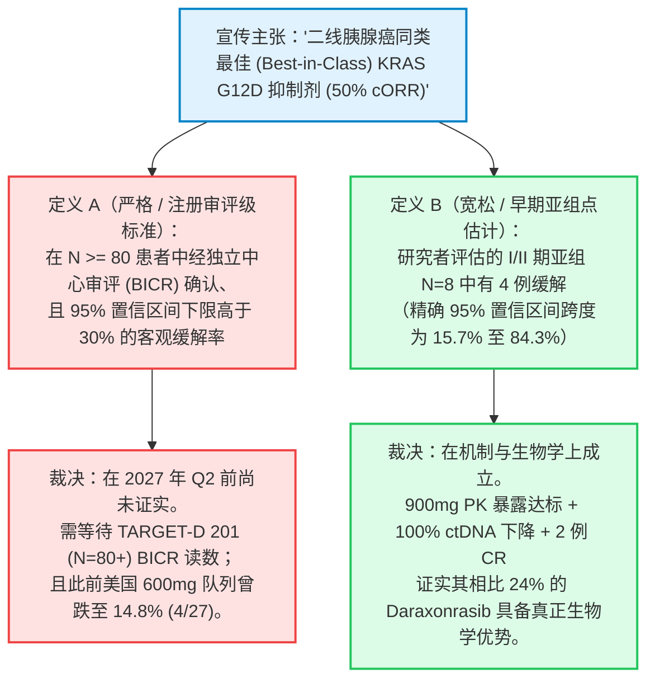

六天前，在我们于 2026 年 10 月 8 日发布的取证式深度调查报告——[*400 亿美元的肿瘤学悖论：对 Revolution Medicines (\$RVMD)、FDA 审评报告及 G12D 疗效鸿沟的取证式深度剖析*](/zh/blog/2026-10-08-revolution-medicines-rvmd-fda-review-g12d-insider-selling-deep-dive)——中，我们揭示了精准肿瘤学领域最拥挤的机构共识交易背后一道致命的结构性裂痕。

尽管华尔街基于 **Revolution Medicines (NASDAQ: RVMD)** 新获批的泛 RAS(ON) 抑制剂 **Rasonque (daraxonrasib / RMC-6236)** 将成为统治胰腺导管腺癌 (PDAC) 的全能单药基石这一假设，赋予了该公司高达 **403 亿至 416 亿美元的市值**，但美国食品药品监督管理局 (FDA) 披露的 III 期 **RASolute 302** 临床试验 (`N=228`) 未删减版 [CDER 多学科审评报告](https://www.fda.gov/drugs) 却暴露出严重的双峰分化：daraxonrasib 在 KRAS G12V（约占 PDAC 的 31%）中取得了 **50% 的确认客观缓解率 (cORR)**，但在 **KRAS G12D——这一占所有胰腺癌患者约 40% 至 43% 的最主要突变亚型**中，确认缓解率却骤降至 **24% cORR (`23/95`)**。我们在报告中证明，这一高达 26 个百分点的疗效断崖并非统计噪音，而是由坚硬的结构生物物理学决定的：带负电荷的 **Asp12 ($-\text{CH}_2\text{-COO}^-$)** 羧酸侧链与 daraxonrasib 形成三元复合物 (tri-complex) 所必需的伴侣蛋白 **亲环蛋白 A (Cyclophilin A, CypA)** 之间存在静电排斥与空间位阻；同时，由于该药无差别抑制正常组织中的野生型 RAS (KRAS/NRAS/HRAS)，口腔黏膜炎 (stomatitis/mucositis) 和皮疹等剂量限制性毒性将其给药上限锁死在 300 mg QD，无法通过提高剂量来填补 G12D 亲和力缺口。

**2026 年 10 月 14 日**清晨，针对这一 G12D 结构性软肋的直接竞争反击，在 **Verastem Oncology (NASDAQ: VSTM)** 正式提交的 [SEC Form 8-K 报告](https://data.sec.gov/submissions/CIK0001526119.json)（`文件编号 0001104659-26-115687`）及 [官方新闻稿](https://www.biospace.com/press-releases/vs-7375-demonstrates-robust-anti-tumor-activity-across-advanced-kras-g12d-mutant-cancers-highlighted-by-50-confirmed-orr-in-2l-pancreatic-ductal-adenocarcinoma-and-two-complete-responses-in-2l-disease-one-confirmed) 中全面爆发。

在公布其从上海劲方医药 (GenFleet Therapeutics) 引进的口服、非伴侣蛋白依赖、直接结合型 **KRAS G12D 双态 (ON/OFF) 抑制剂 VS-7375 (GFH375)** 的美国 I/II 期 **TARGET-D 101** 临床试验 ([NCT07020221](https://clinicaltrials.gov/study/NCT07020221)) 首批多瘤种数据时，Verastem 直接在提交给 SEC 的投资者演示文稿第 12 页幻灯片上，用一个醒目的深蓝色标注框写上了 **"Daraxonrasib KRAS G12D: 24% cORR (23/95)"**，将 RVMD 的 G12D 亚组表现与 VS-7375 在 900 mg 每日一次 (QD) 单药治疗下取得的 **二线 (2L) PDAC 50% cORR (`4/8`)** 及 **二线以上 (2L+) PDAC 41% cORR (`9/22`，含 2 例完全缓解 [CR])** 进行正面交锋：


与此同时，Verastem 管理层在美股开盘前祭出了生物科技资本市场经典的“三连击”组合拳：
1. **多瘤种临床数据与一线 III 期 FDA 方案对齐：** 披露了涵盖胰腺癌 (PDAC)、非小细胞肺癌 (NSCLC) 和结直肠癌 (CRC) 的最新数据，并宣布已与 FDA 就一项三臂随机对照的一线转移性 PDAC III 期临床试验（**TARGET-D 301**，`N=354`）设计达成一致，其中包含一个大胆的 **去化疗方案组 (chemo-free arm)**（`VS-7375 900 mg QD + 抗 EGFR 单抗`）。
2. **大规模股权融资（2.5 亿美元）定价落地：** 由 Jefferies、Guggenheim Securities、Cantor Fitzgerald 和 B. Riley 担任联合账簿管理人，以 **每股 8.00 美元**发行 **30,937,500 股普通股**，并以 **每份 7.9999 美元**发行 **312,503 份预融资认股权证 (pre-funded warrants)**，总募资额达 **2.5 亿美元**——这一发行价较 10 月 13 日收盘价 **7.45 美元**（前一交易日因跨墙机构询价建仓而下跌 `-9.70%`）实现了 **+7.4% 的溢价发行**。
3. **最高管理层交接：** 宣布长期担任总裁兼首席执行官的 **Daniel W. Paterson** 将于 2027 年 1 月 1 日正式退休，由公司董事、前 AVEO Pharmaceuticals 首席执行官 **Michael P. Bailey** 接任总裁兼 CEO。

消息一出，华尔街生物科技交易台与 X（原 Twitter）上立即围绕 **Verastem (`$VSTM`，融资前市值约 6.75 亿美元 / 融资后约 9.25 亿–10.5 亿美元)**、**Erasca (`$ERAS`，股价 14.78 美元，市值约 54 亿–56 亿美元)** 以及 **Revolution Medicines (`$RVMD`，股价约 188 美元，市值约 405 亿美元)** 展开了激烈辩论：

> *"\$VSTM 今日公布数据。最新临床数据凸显了口服 KRAS G12D (ON/OFF) 抑制剂 VS-7375 在胰腺癌、肺癌和结直肠癌中的同类最佳 (Best-in-Class) 潜力。本人持有股份。\$RVMD \$ERAS"*  
> — **Michel Doepke (@doepke_michel)，生物科技投资人，2026 年 10 月 14 日**

> *"所以 VSTM 是新的 RVMD 吗？"*  
> — **Hazem Samara (@hazemsamara)，市场评论员，2026 年 10 月 14 日**

> *"为什么 \$VSTM 没有向 ESMO 提交摘要 (abstract) 来展示其 G12D 数据？"*  
> — **Adam Feuerstein (@adamfeuerstein)，资深生物科技记者，2026 年 10 月 14 日**

> *"\$VSTM - 结直肠癌 (CRC) 数据有趣但样本量 N 太小，还不足以令人兴奋。在 PDAC 和 NSCLC 中显然有成药性，但需要时间和执行力。2% 的停药率 = 耐受性优势（管理层认为这使他们能够给予更高剂量并实现更好的靶点饱和度，最终获得更好疗效……有待进一步验证）"*  
> — **Jonathan Faison (@jfais20)，生物科技分析师，2026 年 10 月 14 日**

本报告拒绝盲目采信企业路演 PPT，也拒绝非黑即白的极端情绪，而是严格遵循 Browne & Keeley 的 **8 阶段“淘金式 (Panning for Gold)”批判性思维框架**，对整个 RAS 肿瘤学三角格局（`$VSTM`、`$ERAS`、`$RVMD`）进行取证式穿透审计。我们将剖析 VS-7375 的直接盐桥 (salt-bridge) 结合化学如何印证我们 10 月 8 日对 `$RVMD` 的生物物理学批判；挖出 Verastem 在新闻稿正文中故意省略百分比的美国 600 mg 队列真实分母（PDAC `4/27 = 14.8% cORR`，CRC `3/24 = 12.5% cORR`）；用临床数据截止日数学回答 Adam Feuerstein 关于 ESMO 2026 缺席的质问；审视为什么 **Erasca (`$ERAS`)** 仅凭 `N=7` 的未确认 PDAC 样本且背负与 `$RVMD` 的 **美国第 12,409,225 号专利侵权及商业秘密纠纷**，却能享受高达 `$VSTM` **6 至 8 倍的企业价值倍数**；最后通过决策级 **条件从句 (If-Clauses)** 给出概率加权的机构级最终裁决。

---

```
┌────────────────────────────────────────────────────────────────────────────────────────────────────────────┐
│           2026 RAS 肿瘤学三角格局：取证式估值、作用机制与临床成绩单全景对比表                              │
├──────────────────────────┬──────────────────────────┬──────────────────────────┬───────────────────────────┤
│ 评估维度 / 核心指标      │ VERASTEM ($VSTM)         │ ERASCA ($ERAS)           │ REVOLUTION MED ($RVMD)    │
├──────────────────────────┼──────────────────────────┼──────────────────────────┼───────────────────────────┤
│ 核心 KRAS G12D 管线资产  │ VS-7375 (GFH375)         │ ERAS-0015 (+ ERAS-4001)  │ Daraxonrasib (+ Zoldon.)  │
│ 分子生物学作用机制       │ 直接结合型 G12D ON/OFF   │ 泛 RAS CypA 分子胶       │ 泛 RAS(ON) CypA 分子胶    │
│                          │ 小分子（无需 CypA 伴侣） │ (ERAS-4001 为泛 KRAS)    │ (+ G12D 共价分子胶)       │
│ 研发来源 / 授权架构      │ 劲方医药（大中华区外权益│ 基准医药 Joyo（全球权益）│ 自主研发 / Warp Drive Bio │
│ 股价（10 月 13/14 日）   │ $7.45 收盘 / $8.00 增发价│ $14.78 (-4.40%)          │ ~$188.00                  │
│ 市值（含增发摊薄）       │ 增发前~$6.75亿/后~$10亿  │ ~$54 亿 – $56 亿         │ ~$403 亿 – $416 亿        │
│ 备考现金及短期投资       │ ~$4.55亿 (3Q $1.73亿 +   │ ~$9.5亿+ (2Q $3.84亿 +   │ ~$39 亿 (2Q 10-Q 披露；   │
│                          │ 增发 $2.5亿 + Oberland)  │ 7 月 $6.325 亿增发)      │ 每季度烧钱 $5.25亿–$5.5亿)│
│ 2L+ PDAC G12D 临床疗效   │ 900mg: 41% cORR (9/22;   │ 32mg: 57% uORR_8wk (4/7  │ Daraxonrasib: G12D 亚组   │
│ （确认 vs 未确认缓解率） │ 2L: 50% [4/8]，含2例 CR) │ 未确认，G12X 混合队列)   │ 24% cORR (23/95, III 期)  │
│ 隐藏的剂量 / 亚组脆弱性  │ 600mg 美国 PDAC 队列缓解 │ 32mg RDE 样本仅 N=7；    │ G12V 50% vs G12D 24%；    │
│                          │ 率暴跌至 14.8% (4/27)！  │ 未拆分 G12D 与 G12V      │ Zoldonrasib cORR仅15%(6/40│
│ 野生型 RAS 毒性及停药率  │ 黏膜炎/口腔炎 0%；皮疹   │ 声称 I 期 TRAE 停药率 0% │ 高发皮疹、口腔炎、黏膜炎；│
│                          │ 4%(1-2级)；AE 停药率 2%  │ （样本极小，随访极短）   │ 剂量被锁死在 300mg 上限   │
│ 法律 / 公司治理风险      │ 10月14日 34.5% 股本摊薄  │ RVMD '225 专利侵权及商业 │ 高管抛售 $1.497 亿 / 零买 │
│                          │ + CEO 退休交接           │ 秘密警告函 + 集体诉讼    │ 入；20/20 卖方一致看多利益│
│ 机构取证评级与策略       │ 增发筹码换手区 ($8) 逢低 │ 低配 / 回避              │ 战术性做空 (SHORT) / 减持 │
│                          │ 吸纳 (SPECULATIVE BUY)   │ (专利诉讼 + VSTM 6倍 EV) │ (G12D 垄断溢价彻底瓦解)   │
└──────────────────────────┴──────────────────────────┴──────────────────────────┴───────────────────────────┘
```

---

## 1. 第一阶段：核心议题分类、边界界定与可证伪性标准

根据 Browne & Keeley《学会提问》(Asking the Right Questions) 第 2 章的方法论，我们将本次深度调查拆解为明确的 **描述性问题（机制与统计学事实）** 和 **规定性问题（相对估值与资本配置决策）**，并预先设定严格的可证伪性标准。

### 核心调查问题
1. **描述性问题（生物物理学与临床药理学）：** Verastem 的 **VS-7375** 是否真正突破了将 Revolution Medicines 的 **daraxonrasib** 限制在 KRAS G12D 胰腺癌 24% cORR (`23/95`) 的亲环蛋白 A (CypA) 空间位阻与静电排斥天花板？为什么在中国临床 (`GFH375`) 中取得 41% ORR 的 **600 mg QD** 剂量，到了美国患者身上必须提高 50% 剂量至 **900 mg QD** 才能重现 41% 的确认缓解率 (`9/22`)？
2. **描述性问题（统计学与监管严谨性）：** 精确二项分布置信区间 (Clopper-Pearson 95% CI)、新闻稿正文中省略百分比的 600 mg 分母（PDAC `4/27`、CRC `3/24`）、ESMO 2026 摘要截止时间线，以及 III 期 **TARGET-D 301** 允许对照组交叉入组 (crossover) 的设计，揭示了 VS-7375 怎样的统计成熟度与监管风险？
3. **规定性问题（`$VSTM`、`$ERAS`、`$RVMD` 相对估值与配置）：** 在 Verastem 公布 10 月 14 日数据并以 8.00 美元/股完成 2.5 亿美元增发后，机构投资组合应如何在 **Verastem（融资后企业价值 EV 约 7.3 亿美元）**、**Erasca（EV 约 45 亿美元）** 与 **Revolution Medicines（EV 约 368 亿美元）** 之间进行权重配置？

### 明确的可证伪性标准 (Falsifiability Criteria)
什么样的具体实证数据出现时，将推翻我们的核心判断？
* **推翻 Verastem (`$VSTM`) 看多逻辑的条件：** 如果定于 2027 年第二季度读出数据的注册导向 II 期临床 **TARGET-D 201**（[NCT07644559](https://clinicaltrials.gov/study/NCT07644559)，二线 KRAS G12D PDAC 900 mg QD，`N=80–120`）经盲态独立中心审评 (BICR) 确认的 cORR 回落至 $\le 25\%$，或者 900 mg QD 长期给药（>6 个月）出现迟发性肝毒性或 >15% 的不良事件停药率。
* **推翻 Revolution Medicines (`$RVMD`) 审慎/看空逻辑的条件：** 如果 III 期 **RASolute 309** 双药联合试验（`daraxonrasib + zoldonrasib`，[NCT06915220](https://clinicaltrials.gov/study/NCT06915220)）或一线 `zoldonrasib + 化疗`（**RASolute 305**）在 G12D PDAC 中取得 $>55\%$ 的确认缓解率且停药率 $<10\%$，并成功阻止临床肿瘤医生在 G12D 患者中转向直接结合型口服 G12D 抑制剂（`VS-7375`、Incyte 的 `INCB161734`）。
* **推翻 Erasca (`$ERAS`) 高估判断的条件：** 如果 `ERAS-0015` 在 `AURORAS-1`（[NCT06983743](https://clinicaltrials.gov/study/NCT06983743)）中针对 $\ge 50$ 名纯正 **KRAS G12D 突变**（剔除 G12V）美国 PDAC 患者维持 $\ge 45\%$ 的**确认 (confirmed)** 缓解率，并且 Erasca 在联邦法院获得确认不侵犯 Revolution Medicines **美国第 12,409,225 号专利**及驳回商业秘密诉求的生效判决。

---

## 2. 第二阶段：一手信源挖掘与可追溯性矩阵 (Traceability Matrix)

为彻底杜绝媒体回音室效应，本报告中的所有临床分母、药代动力学 (PK) 曲线、资产负债表数据及法律纠纷均直接溯源至 SEC EDGAR 原始申报文件、ClinicalTrials.gov 注册方案及同行评审期刊论文：

```
                                   一手信源可追溯性矩阵 (PRIMARY ARTIFACT MATRIX)
    
     实体 / 领域      权威一手信源                         备案号 / 唯一标识符        核心核实事实
    ─────────────────────────────────────────────────────────────────────────────────────────────────────────
     Verastem ($VSTM) SEC Form 8-K 及 Exhibit 99.3 (60页)  0001104659-26-115687       900mg PDAC: 41% cORR (9/22),
     临床与财务快报   2026 年 10 月 14 日提交              CIK 0001526119             2L 50% (4/8); 600mg: 4/27 cPR;
                                                                                      3Q 现金 $1.728亿; 营收 ~$2,400万
    ─────────────────────────────────────────────────────────────────────────────────────────────────────────
     Verastem ($VSTM) SEC Form 10-Q (2Q 2026) 及增发定价   0001104659-26-092007       基础股本 9,050万股(+970万 PFW);
     股本结构         官方公告 (2026 年 10 月 14 日)       CIK 0001526119             +$8.00 增发3,094万股+31.25万PFW
    ─────────────────────────────────────────────────────────────────────────────────────────────────────────
     Verastem ($VSTM) ClinicalTrials.gov 官方注册库        NCT07020221 (TARGET-D 101) I/II 期多瘤种试验(入组 >200人)
     临床试验方案     TARGET-D 101 / 201 / 202 / 203       NCT07644559 / 782 / 795    注册导向 II 期 PDAC, NSCLC, CRC
    ─────────────────────────────────────────────────────────────────────────────────────────────────────────
     Erasca ($ERAS)   SEC Form 10-Q (2Q 2026) 及 Form 8-K  0001193125-26-344611       6月末3.126亿股(7月$6.325亿增发前);
     财务与知识产权   专利侵权/商业秘密警告披露 (4/27)     CIK 0001761918             Joyo IPR&D $1.5亿; RVMD '225专利
    ─────────────────────────────────────────────────────────────────────────────────────────────────────────
     Erasca ($ERAS)   ClinicalTrials.gov 及 AURORAS-1      NCT06983743 (AURORAS-1)    32mg QD: 2L+ KRAS G12X PDAC 中
     临床数据         更新公告 (2026 年 7 月 13 日)        erasca.com 官方新闻稿      57% uORR_8wk (4/7); 100% RDI
    ─────────────────────────────────────────────────────────────────────────────────────────────────────────
     RevMed ($RVMD)   FDA CDER 多学科审评报告及            NDA 审批档案包 /           Daraxonrasib G12D cORR=24%(23/95)
     监管与财务       SEC Form 10-Q (2Q 2026)              CIK 0001628171             对比 G12V 50%; 年烧钱$21亿–$22亿
    ─────────────────────────────────────────────────────────────────────────────────────────────────────────
     生物物理学文献   Nature Medicine (Ai et al., 2026)    PMID: 42745055             GFH375/VS-7375 ON/OFF 晶体结构
                      Exp Hematol Oncol (Lou & Zhang 2026) PMID: 42806361             CypA 三元复合物空间位阻动力学
    ─────────────────────────────────────────────────────────────────────────────────────────────────────────
```

### 利益冲突与资本市场博弈背景
1. **Verastem 的跨墙询价 (Wall-Crossed) 增发架构：** 2026 年 10 月 14 日上午，Verastem 临床数据的发布与 **Jefferies、Guggenheim Securities、Cantor Fitzgerald 和 B. Riley** 承销的 **2.5 亿美元公开增发**精确同步。在宣布增发的同时，Verastem 终止了 2025 年 8 月与 Cantor Fitzgerald 签署的场内随时增发 (ATM) 招股说明书（已售出 0 股）。换言之，今天这份长达 60 页的演示文稿（`Exhibit 99.3`）在设计上直接服务于一场占公司前一日市值约 37% 的 2.5 亿美元机构询价簿记。
2. **Erasca 2026 年高达 8.913 亿美元的抽水机与专利诉讼悬剑：** Erasca 在 2026 年 1 月通过公开增发净募资 **2.427 亿美元**，又在 2026 年 7 月完成总额 **6.325 亿美元** 的扩大增发（2026 年累计总募资约 **8.913 亿美元**）。然而，就在两轮巨额融资之间，Erasca 于 2026 年 4 月 27 日通过 Form 8-K 披露收到了 Revolution Medicines 的正式法律函件，指控 `ERAS-0015` 侵犯其 **美国第 12,409,225 号专利** 并涉嫌窃取商业秘密——该消息曾导致 `ERAS` 股价在 4 月底暴跌约 50% 并引发多起证券欺诈集体诉讼。

---

## 3. 第三阶段：语义精确性与操作化替换测试 (Substitution Test)

生物科技路演擅长使用极具弹性的宣传词汇。我们将今日 RAS 领域披露的三个核心口号剥离出来，执行 **Browne & Keeley 替换测试**：



### 1. “二线胰腺癌中浮现的同类最佳 RAS 抑制剂 (50% cORR)” (`$VSTM`)
* **定义 A（严格 / 注册审评标准）：** 在至少 $N \ge 80$ 名二线 PDAC 患者中，经盲态独立中心审评 (BICR) 确认、且 95% 置信区间下限在统计学上显著超越竞争基准（>30%）的客观缓解率。
* **定义 B（宽松 / 探索性亚组点估计）：** 在新上调至 900 mg QD 剂量的 22 人 I/II 期扩展队列中，二线治疗亚组 **8 名患者中有 4 人 (`4/8 = 50%`)** 达到研究者评估的确认缓解。
* **替换测试结论：** 在 **定义 B** 下，Verastem 的表述完全属实，且得到了深度分子标志物清除（`100%` 可评估患者 ctDNA VAF 下降 $\ge 50\%$，`58%` 实现 `100%` 完全清零）和三/四线患者中 2 例完全缓解 (CR) 的强力支撑。但在 **定义 A** 下，$4/8$ 的精确 Clopper-Pearson 95% 置信区间高达 **15.7% 至 84.3%**——哪怕只有 1 名患者的评估从 PR 变为 SD，二线头条数字就会从 50% 变成 37.5%。

### 2. “2L+ KRAS G12X 胰腺癌中实现 57% $\text{uORR}_{8\text{wk}}$” (`$ERAS`)
* **定义 A（严格 / 分亚型确认疗效）：** 在最难治的 **KRAS G12D** 单一突变亚组（$N \ge 30$）中，经至少间隔 4 周的连续两次扫描确认 (confirmed) 的 RECIST v1.1 客观缓解率。
* **定义 B（宽松 / 早期未确认全突变混算）：** 在接受 32 mg QD 推荐扩展剂量 (RDE) 的 **仅 $N = 7$ 名患者 (`4/7`)** 中，将高响应的 G12V 与难治的 G12D 混为一谈（统称 **KRAS G12X**），并把第 8 周单次扫描的 **未确认 (unconfirmed)** 肿瘤缩小计算在内。
* **替换测试结论：** 华尔街目前按 **定义 A** 给 Erasca 定出了 **约 55 亿美元市值**，但实际上 `ERAS-0015` 仅满足 **定义 B**（`4/7` 未确认、G12X 混算）。正如我们在 `$RVMD` 案例中所证实的，在 CypA 分子胶中将 G12V（50% cORR）和 G12D（24% cORR）混合汇报会产生严重的均值幻觉。

### 3. “就一线转移性胰腺癌去化疗 (Chemo-Free) III 期方案与 FDA 达成一致” (`$VSTM`)
* **定义 A（严格 / 临床风险已解除的注册路径）：** FDA 在审阅了该联合方案在目标适应症（1L PDAC）中扎实的 II 期随机对照疗效与生存数据后，批准开展 III 期确证性试验。
* **定义 B（宽松 / 方案准入许可）：** 在 Verastem 尚未公布 `VS-7375 + 西妥昔单抗` 治疗 PDAC 的 I/II 期初步临床疗效数据（定于 2026 年底公布）之前，FDA 允许其在三臂 III 期试验（**TARGET-D 301**）中设立一个探索性的 **去化疗组（`VS-7375 900 mg QD + 抗 EGFR 单抗`，`N=118`）**，与 `VS-7375 + GnP` 化疗联合组（`N=118`）及标准参照化疗组（`N=118`）同步推进。
* **替换测试结论：** 尽管与 FDA 达成方案对齐（**定义 B**）是使 Verastem 得以在 2026 年底前直接切入一线 PDAC III 期的重要监管里程碑，但投资者必须清醒认识到，在一线转移性胰腺癌中完全去掉细胞毒化疗的 Arm A 是一场高赔率、高方差的临床博弈，而非已经稳操胜券的确定性事件。

---

## 4. 第四阶段：生物物理学机制与战略因果解耦（四维因果矩阵）

### 1. 为什么 VS-7375 能在 Daraxonrasib 折戟的 G12D 中突围？
要理解为什么今天 Verastem 的数据直接印证了我们 [10 月 8 日对 Revolution Medicines 的取证式深度调查](/zh/blog/2026-10-08-revolution-medicines-rvmd-fda-review-g12d-insider-selling-deep-dive)，只需将这两类分子的生物物理学结构并排对比：

```
┌────────────────────────────────────────────────────────────────────────────────────────────────────────────┐
│           分子生物物理学对比：直接结合型 G12D ON/OFF 抑制剂 vs. CypA 三元复合物分子胶                      │
├─────────────────────────────┬──────────────────────────────────────┬───────────────────────────────────────┤
│ 生物物理学参数              │ 直接结合型 G12D ON/OFF (VS-7375)     │ 泛 RAS CypA 分子胶 (Daraxonrasib/0015)│
├─────────────────────────────┼──────────────────────────────────────┼───────────────────────────────────────┤
│ 靶点结合口袋与方式          │ 直接嵌入 Switch-II 口袋；与突变的    │ 招募胞内内源性亲环蛋白 A (CypA)，在   │
│                             │ Asp12 (-COO⁻) 羧酸侧链形成直接的     │ Switch-I / Switch-II 界面上方形成庞大的│
│                             │ 离子盐桥 (ionic salt bridge)         │ 三元复合物 (ternary complex)          │
├─────────────────────────────┼──────────────────────────────────────┼───────────────────────────────────────┤
│ G12D 带负电 Asp12 (-COO⁻)   │ 正向选择性锚点 (SELECTIVITY ANCHOR)：│ 空间与静电排斥软肋 (LIABILITY)：      │
│ 侧链产生的物理化学效应      │ 负电荷 Asp12 恰恰是锁住药物分子的化学│ 负电荷 Asp12 与 CypA 负电性表面发生   │
│                             │ 抓手，且完全不结合野生型 Gly12       │ 静电排斥；更偏爱疏水性的 Val12 (G12V) │
├─────────────────────────────┼──────────────────────────────────────┼───────────────────────────────────────┤
│ 核苷酸状态覆盖范围          │ 活性态 (GTP, ON) 与非活性态 (GDP,OFF)│ 主要针对活性态 (GTP 结合 ON 态)；     │
│                             │ 具有同等的亚纳摩尔级高亲和力         │ 高度依赖肿瘤组织内充足的 CypA 化学计量│
├─────────────────────────────┼──────────────────────────────────────┼───────────────────────────────────────┤
│ 野生型 RAS (KRAS/NRAS/HRAS) │ 高度选择性（对野生型 RAS 规避>100倍）│ 非选择性泛 RAS 抑制毒性：             │
│ 脱靶正常组织毒性谱          │ 黏膜炎 0%，口腔炎 0%，皮疹 4%(1-2级) │ 抑制健康黏膜与皮肤中的野生型 RAS，导致│
│                             │ 因不良事件导致的停药率仅为 2%        │ 高发重度皮疹、口腔炎、黏膜溃疡与腹泻  │
├─────────────────────────────┼──────────────────────────────────────┼───────────────────────────────────────┤
│ 临床给药上限与靶点饱和度    │ 可安全爬坡至 900 mg QD (97% RDI)，   │ 被锁死在 300 mg QD (daraxonrasib)；   │
│                             │ 实现 100% (>50% VAF下降) 及 58%清零  │ 因野生型毒性无法提量挽救 G12D (24%)   │
└─────────────────────────────┴──────────────────────────────────────┴───────────────────────────────────────┘
```

简而言之：**导致 daraxonrasib 在 KRAS G12D 中疗效腰斩至 24% 的那个化学基团——带负电荷的 Asp12 羧酸根 ($-\text{COO}^-$)——恰恰是赋予 VS-7375 高度靶点选择性和宽广治疗窗的核心离子锚点。** 正因为 `VS-7375` 不会抑制健康人体上皮细胞中的野生型 KRAS、NRAS 或 HRAS（`第 30 页幻灯片`：在 900 mg QD `N=48` 名患者中，**黏膜炎 0%、口腔炎 0%、$\ge 3$ 级皮疹 0%**），Verastem 才能够将系统暴露量推升至深度靶点饱和区，而不会撞上野生型 RAS 毒性墙。

### 2. 为什么 600 mg QD 在中国 (`GFH375`) 奏效，在美国 (`VS-7375`) 却暴跌至 14.8% cORR？
今日 Form 8-K 报告中最值得深挖的取证发现之一，是美国患者在 **600 mg QD** 与 **900 mg QD** 两个剂量组之间惊人的疗效反差。我们通过四维因果矩阵进行检验：

```
┌────────────────────────────────────────────────────────────────────────────────────────────────────────────┐
│         四维因果矩阵：为什么美国 2L+ PDAC 确认缓解率从 14.8% (600 MG) 跃升至 40.9% (900 MG)？              │
├───────────────────────┬────────────────────────────────────────────────────────────────────────────────────┤
│ 因果假设              │ 取证机制与药代动力学 (PK) 评估                                                     │
├───────────────────────┼────────────────────────────────────────────────────────────────────────────────────┤
│ 1. 直接因果关系       │ 欧美与亚裔患者体重/分布容积 (V_d) 差异：在 600 mg QD (N=59) 下，美国患者的稳态血药 │
│    （PK 暴露量 →      │ 暴露量 (AUC_ss) 落在了小鼠 100 mg/kg 全模型肿瘤消退阈值下方（第 13/15 页幻灯片）。 │
│    靶点饱和度）       │ 提量 50% 至 900 mg QD (N=23) 后，绝大多数美国患者跨越了最大消退阈值，使确认缓解率  │
│                       │ 从 14.8% (4/27) 飙升至 40.9% (9/22)。（确认为首要直接驱动因素）                    │
├───────────────────────┼────────────────────────────────────────────────────────────────────────────────────┤
│ 2. 反向因果关系       │ 是否病情更重、前线治疗更多的患者被分到了 600 mg QD 组？                            │
│    （基线偏差 →       │ 证伪 (FALSE)：查看第 15 页幻灯片瀑布图底部的既往治疗线数 (Prior LoT)，600 mg 组中  │
│    剂量结果差异）     │ 二线患者（仅 1 线既往治疗）的比例（15/26 柱）实际上高于 900 mg 组（8/20 柱）！     │
│                       │ 即 900 mg 组在基线治疗线数更重的情况下反而取得了压倒性疗效。                       │
├───────────────────────┼────────────────────────────────────────────────────────────────────────────────────┤
│ 3. 混杂变量 (Z)       │ 随访时长与止吐预防管理的学习曲线：600 mg 组入组较早（中位治疗时长 mDoT 4.3 个月，  │
│                       │ 3级 TRAE 19%，暂停给药率 21%），而较晚入组的 900 mg 组（mDoT 3.0 个月）优化了止吐  │
│                       │ 预防方案（3级 TRAE 10%，暂停率 15%，相对剂量强度 97%），保障了持续不间断给药。     │
├───────────────────────┼────────────────────────────────────────────────────────────────────────────────────┤
│ 4. 双向正反馈循环     │ 900 mg 带来的快速肿瘤缩小在 1–2 周内缓解了胰腺癌腹水与内脏剧痛（如第 25 及 55 页   │
│    (X ↔ Y)            │ 案例中患者完全停用每日 100 mg 吗啡），改善了胃肠动力与口服吸收，进一步维持高暴露。 │
└───────────────────────┴────────────────────────────────────────────────────────────────────────────────────┘
```

请仔细观察下方 Verastem SEC Form 8-K（`Exhibit 99.3`）中的 **第 15 页幻灯片**：


在新闻稿正文中，Verastem 写道：*“与 600 mg QD 单药治疗 (n=27 mITT) 相比，900 mg 剂量产生了更深的肿瘤缩小和更高的缓解率。在 600 mg 剂量下，8 名患者获得客观缓解，其中包括 4 名确认缓解，27 名患者中有 11 名仍在接受治疗。”* 请算一下为什么 Verastem 在正文中没有写出百分比：**$4 / 27$ 折合确认客观缓解率 (cORR) 仅为 14.8%**（含未确认的 uORR 为 $8/27 = 29.6\%$），且 **59% (`16/27`) 的患者已经停止治疗**！

为什么在中国劲方医药的临床试验（`GFH375`，ESMO 2025 Abstract LBA84）中作为 II 期推荐剂量 (RP2D) 的 **600 mg QD** 能够取得 **41% ORR**，而在 Verastem 的美国临床中却暴跌至 **14.8% cORR (`4/27`)**？
* 因为口服小分子药物的分布容积 ($V_d$) 和肝脏清除率与患者体重及体表面积成正比。在白人占比高达 82% 的美国肿瘤患者群体中（平均体重通常比东亚患者高出 20%–30%），固定的 600 mg QD 剂量将稳态血药暴露量 ($\text{AUC}_{\text{ss}}$) 稀释到了第 15 页幻灯片左图的绿色框区间（`N=59`），导致超过一半的美国患者未能达到临床前全模型肿瘤消退所需的暴露阈值（相当于小鼠 $100\text{ mg/kg}$ 剂量）。
* 当剂量上调 50% 至 **900 mg QD（`N=23` PK）** 后，人体 $\text{AUC}_{\text{ss}}$ 分布整体跃升至紫色框区间——跨过了小鼠 $100\text{ mg/kg}$ 等效阈值——从而实现了 **瀑布图上全部 20 名可评估患者靶病灶零增长**、**9 例确认缓解（2L+ `41% cORR`，2L `50% cORR`）**，以及在三线和四线晚期 PDAC 患者中惊现 **2 例完全缓解（`-100%` 靶病灶彻底消失）**！

### 3. 回答 Adam Feuerstein 之问：为什么 `$VSTM` 没有向 ESMO 2026 提交摘要？
今天上午，资深生物科技记者 **Adam Feuerstein (`@adamfeuerstein`)** 在 X 上提出了尖锐质疑：*“为什么 \$VSTM 没有向 ESMO 提交摘要来展示其 G12D 数据？”*

通过时间线与因果审计，我们可以给出三个严密的实证解释：
1. **ESMO 摘要截止日（2026 年春/夏初）与美国 600 mg 队列的窘境：** **2026 年 ESMO 大会**（10 月 23–27 日在马德里举行）的常规摘要提交窗口于 **2026 年 5 月**关闭（重磅延迟摘要 LBA 意向申报也在初夏截止）。在那个时间节点，Verastem 的美国 `TARGET-D 101` 数据几乎全部由 **600 mg QD 队列**构成——而如前所述，美国 600 mg QD 在 PDAC 中的确认缓解率仅为尴尬的 **14.8% (`4/27`)**，在 3L+ 结直肠癌联合西妥昔单抗中仅为 **12.5% (`3/24`)**！与此同时，真正扭转局面的 900 mg QD 队列的 mITT 入组截止日定在 **2026 年 7 月 22 日**，且必须随访至 **2026 年 10 月 7 日**才能通过第二次扫描确认全部 9 例缓解。如果在春季提交 ESMO 摘要，Verastem 被迫展示的将是一份以 600 mg 欠佳数据为主的半成品。
2. **劲方医药已在 ESMO 2025 (LBA84) 报告过单药数据，且 ESMO 2026 重心转向 `GFH276`：** 由于合作方劲方医药已经在 **ESMO 2025 (`Abstract LBA84`)** 上以重磅口头报告形式展示了 `GFH375` 胰腺癌单药数据，学术大会通常不会仅仅因为欧美桥接试验将剂量从 600 mg 调至 900 mg 就再次授予同一 I/II 期分子 LBA 口头报告席位（与此同时，劲方医药在 ESMO 2026 上斩获了其新一代泛 RAS 抑制剂 **`GFH276` 的 `LBA33` 口头报告**，而 Incyte 则携 `INCB161734` 获得了 `#1007RO` 快速口头报告）。
3. **配合 2.5 亿美元跨墙询价增发与 CEO 交接的时间窗口：** 如果向 ESMO 2026 提交摘要，公司将受到严格的 **ESMO 学术禁运 (embargo) 规则**约束，直到 10 月下旬大会召开前都无法向跨墙机构投资者展示截至 10 月 7 日的最新 900 mg 确认数据，从而无法在 10 月 14 日顺利以 **8.00 美元/股完成 2.5 亿美元溢价增发**并同步完成 CEO 交接。

---

## 5. 第五阶段：定量统计审计、精确置信区间 (95% CI) 与资本结构核算

早期肿瘤学新闻稿中的百分比极易在小样本下制造精确度幻觉。我们对所有竞争性 KRAS G12D 临床队列及三家公司的资产负债表进行严格的统计学审计。

### 1. Clopper-Pearson 95% 精确二项置信区间审计
剥离掉 Verastem 第 12 页幻灯片和 Erasca 新闻稿中柱状图的视觉误导，我们计算经治胰腺癌 (PDAC) 各临床队列客观缓解率的 Clopper-Pearson 95% 精确二项分布置信区间：

$$\text{样本比例 } \hat{p} = \frac{k}{n}\text{ 的 95\% 精确置信区间}: \quad \left[ \text{Beta}^{-1}\left(0.025; k, n-k+1\right), \; \text{Beta}^{-1}\left(0.975; k+1, n-k\right) \right]$$

```
┌────────────────────────────────────────────────────────────────────────────────────────────────────────────┐
│         统计严谨性审计：KRAS G12D 胰腺癌缓解率及 95% 精确二项分布置信区间对比                              │
├──────────────────────────┬───────────────┬───────────────────┬──────────────────┬──────────────────────────┤
│ 药物 / 申办方 / 队列     │ 宣传头条指标  │ 原始分数 (k/n)    │ 95% 精确置信区间 │ 取证统计学审计裁决       │
├──────────────────────────┼───────────────┼───────────────────┼──────────────────┼──────────────────────────┤
│ VS-7375 900 mg QD (VSTM) │ 50% cORR      │ 4 / 8             │ [15.7%, 84.3%]   │ N=8 极小亚组；但 100%    │
│ 2L mPDAC 单药治疗        │ （确认缓解）  │ (mITT 口径)       │ (区间宽: 68.6%)  │ DCR (8/8) 极具积极意义   │
├──────────────────────────┼───────────────┼───────────────────┼──────────────────┼──────────────────────────┤
│ VS-7375 900 mg QD (VSTM) │ 41% cORR      │ 9 / 22            │ [20.7%, 63.6%]   │ 含 2 例完全缓解 (CR)；   │
│ 2L+ mPDAC 单药治疗       │ （确认缓解）  │ (含2例未评估分母) │ (区间宽: 42.9%)  │ 可评估人群中为 45%(9/20) │
├──────────────────────────┼───────────────┼───────────────────┼──────────────────┼──────────────────────────┤
│ VS-7375 900 mg QD (VSTM) │ 36% cORR      │ 5 / 14            │ [12.8%, 64.9%]   │ 惊人的是 2 例 CR 均发生  │
│ 3L–4L mPDAC 单药治疗     │ （确认缓解）  │ (含2例未评估分母) │ (区间宽: 52.1%)  │ 在 3L 及 4L 末线患者中！ │
├──────────────────────────┼───────────────┼───────────────────┼──────────────────┼──────────────────────────┤
│ VS-7375 600 mg QD (VSTM) │ "4 cPR, 4 uPR"│ 4 / 27 确认缓解   │ [4.2%, 33.7%]    │ 14.8% cORR (29.6% uORR)；│
│ 2L+ mPDAC 单药治疗       │ (正文省略%！) │ (8 / 27 未确认)   │ (cORR 置信区间)  │ 美国患者 PK 暴露严重不足 │
├──────────────────────────┼───────────────┼───────────────────┼──────────────────┼──────────────────────────┤
│ ERAS-0015 32 mg QD (ERAS)│ 57% uORR_8wk  │ 4 / 7             │ [18.4%, 90.1%]   │ 8 周未确认缓解率；将     │
│ 2L+ KRAS G12X PDAC       │ （未确认缓解）│ (G12X 混算！)     │ (区间宽: 71.7%)  │ G12V+G12D 混算 (样本N=7!)│
├──────────────────────────┼───────────────┼───────────────────┼──────────────────┼──────────────────────────┤
│ Daraxonrasib 300mg (RVMD)│ 24% cORR      │ 23 / 95           │ [16.0%, 34.1%]   │ III 期 RASolute 302 FDA  │
│ 2L KRAS G12D 亚组        │ （确认缓解）  │ (III 期大样本亚组)│ (区间宽: 18.1%)  │ 审评报告；置信区间极窄   │
├──────────────────────────┼───────────────┼───────────────────┼──────────────────┼──────────────────────────┤
│ Zoldonrasib 1200mg (RVMD)│ 30% uORR      │ 6 / 40 确认缓解   │ [5.7%, 29.8%]    │ 截止日确认缓解率仅为     │
│ 2L+ KRAS G12D PDAC       │ (确认仅 15%!) │ (12 / 40 未确认)  │ (cORR 置信区间)  │ 15.0% cORR (6/40)！      │
├──────────────────────────┼───────────────┼───────────────────┼──────────────────┼──────────────────────────┤
│ INCB161734 1200mg (INCY) │ 37% uORR      │ 8 / 41 确认缓解   │ [8.8%, 34.9%]    │ 截止日确认缓解率 19.5%   │
│ 2L+ KRAS G12D PDAC       │ (~20–29% cORR)│ (15 / 41 未确认)  │ (cORR 置信区间)  │ (15例中有3例难以确认)    │
├──────────────────────────┼───────────────┼───────────────────┼──────────────────┼──────────────────────────┤
│ Setidegrasib 600mg (Aste)│ 24% cORR      │ 5 / 21 (或 16/67) │ [8.2%, 47.2%]    │ 每周一次静脉注射降解剂； │
│ 2L+ KRAS G12D PDAC       │ （确认缓解）  │                   │                  │ mPFS 3.0个月，DCR 57%    │
└──────────────────────────┴───────────────┴───────────────────┴──────────────────┴──────────────────────────┘
```

### 2. 盲测检验 (Blinding Test) 揭示的跨瘤种真实成色
隐去公司的宣传修辞，仅对 Verastem `TARGET-D 101` 的原始数据进行盲测检验，可以得出三项清晰的临床结论：
1. **在转移性胰腺癌 (mPDAC, 900 mg QD 单药，`n=22` mITT) 中：** 即便考虑小样本方差（`95% CI [20.7%, 63.6%]`），**9/22 (41%) 的确认缓解率**（在完成首次扫描的 20 名可评估患者中高达 **9/20 = 45%**）、**在三线和四线晚期患者中出现的 2 例完全缓解（靶病灶 `-100%` 彻底清零）**、**88% (`15/17`) 患者实现 CA19-9/CEA 肿瘤标志物下降 $>50\%$**，以及 **100% (`12/12`) 可评估患者实现 KRAS G12D ctDNA VAF 下降 $>50\%$（其中 `58% [7/12]` 实现 100% ctDNA 彻底清除）** 的高度共振，构成了无可辩驳的强力生物学证据。在三/四线转移性胰腺癌中，口服单药实现完全缓解 (CR) 极其罕见。
2. **在晚期非小细胞肺癌 (NSCLC, 600 mg QD 单药 `n=23` mITT；及一线联合 `n=8`) 中：** 为什么 **600 mg QD** 在美国 PDAC（`14.8% cORR`）和 CRC（`12.5% cORR`）中表现欠佳，却能在 2L+ NSCLC 中斩获 **43% 确认缓解率 (`10/23`)** 和 **100% (`5/5`) ctDNA 完全清零**（`第 20–22 页幻灯片`）？
   * **肿瘤组织血液灌注与基质屏障差异：** 胰腺癌具有致密、乏血管的促纤维增生性基质 (desmoplastic stroma)，严重阻碍药物渗透，因此需要更高的血药暴露量（900 mg QD）才能饱和胞内靶点；而肺腺癌血供丰富，600 mg QD 即可实现 100% (`5/5`) 的 ctDNA 清除和 **43% cORR**（即便 30% 患者曾接受过紫杉烷类化疗）以及 **72% 的 6 个月无进展生存率 (PFS)**！目前正在开展的注册导向 II 期 **TARGET-D 202** ([NCT07659782](https://clinicaltrials.gov/study/NCT07659782)) 已将剂量提升至 **900 mg QD**，具备明确的疗效上行空间。
3. **在三线以上结直肠癌 (3L+ mCRC，联合西妥昔单抗) 中：** 正如 Jonathan Faison (`@jfais20`) 所言，结直肠癌数据目前 **样本量过小，尚不足以支撑乐观估值**。在 600 mg QD + 西妥昔单抗（`n=24` mITT）中，确认缓解率仅为 **12.5% (`3/24 cPR`, `1 uPR`)**；在 900 mg QD + 西妥昔单抗（`n=6` mITT，5 人可评估）中，虽然报告了 **33% ORR (`2/6`)**，但 **其中仅有 1 例为确认缓解 (`1/6 = 16.7% cORR`, `1 uPR`)**。尽管 5 名在治患者均无靶病灶增大，但 CRC 适应症必须等待 2026 年底的成熟数据验证。

### 3. 三家公司资本结构、企业价值 (EV) 与现金消耗审计 (`$VSTM` vs. `$ERAS` vs. `$RVMD`)
截至 2026 年 10 月 14 日，三家公司的备考 (pro-forma) 资本结构与估值对比如下：

```
┌────────────────────────────────────────────────────────────────────────────────────────────────────────────┐
│           资本结构与企业价值 (ENTERPRISE VALUE) 穿透式审计（截至 2026 年 10 月 14 日）                     │
├──────────────────────────────────┬──────────────────────┬──────────────────────┬───────────────────────────┤
│ 财务与估值指标                   │ VERASTEM ($VSTM)     │ ERASCA ($ERAS)       │ REVOLUTION MED ($RVMD)    │
├──────────────────────────────────┼──────────────────────┼──────────────────────┼───────────────────────────┤
│ 基础已发行股数 (2Q 10-Q 基准)    │ 9,050万股(+970万PFW) │ 3.126 亿股 (6月30日) │ ~2.145 亿股               │
│ 2026 下半年公开增发股数          │ +3,125万股(含PFW)    │ +约 4,500万–5,500万股│ 下半年无 ($21亿于4月完成) │
│                                  │ (10/14 $8.00 募$2.5亿│ (7月募资 $6.325 亿)  │                           │
│ 备考完全摊薄总股本               │ ~1.315 亿股(含 PFW)  │ ~3.65 亿 – 3.75 亿股 │ ~2.15 亿股                │
│ 基准股价 (2026 年 10 月 14 日)   │ $8.00 (增发定价)     │ $14.78               │ ~$188.00                  │
│ 隐含备考总市值                   │ ~$10.5亿(不含PFW9.7亿│ ~$54.0 亿 – $55.5 亿 │ ~$404 亿                  │
│ 备考现金及短期投资总额           │ ~$4.55亿 (3Q $1.73亿+│ ~$9.5亿+ (2Q $3.84亿+│ ~$39 亿 (2Q 2026 基准)    │
│                                  │ 增发净额$2.35亿+贷款)│ 7月增发净额~$5.95亿) │                           │
│ 有息债务 / 特许权融资负债        │ ~$1.25亿–$1.5亿      │ 债务极低 (1Q 向 Joyo │ Royalty Pharma $2.5亿+    │
│                                  │ (含 Oberland 融资额) │ 支付 $1.5亿 IPR&D)   │ 阶梯式特许权负债          │
│ 隐含企业价值 (Enterprise Value)  │ ~$7.2 亿 – $7.5 亿   │ ~$45 亿 – $46 亿     │ ~$368 亿                  │
│ 商业化产品年化净营收             │ ~$9,600 万美元/年    │ $0.00 (纯临床阶段)   │ Rasonque 刚启动商业化(4Q) │
│                                  │ (3Q: $2,390万–2,410万│                      │                           │
│ 每季度营业费用 (GAAP OpEx)       │ ~$7,280万 (扣除卵巢癌│ ~$4,760万 (剔除 1Q   │ ~$5.35 亿 (年化烧钱高达   │
│                                  │ 营收后净烧钱~$4,800万│ $1.5亿一次性授权费)  │ $21 亿–$22 亿美元！)      │
└──────────────────────────────────┴──────────────────────┴──────────────────────┴───────────────────────────┘
```

请审视这张表所揭示的 **企业价值 (EV) 极端错配**：
* **Verastem (`$VSTM`)** 不仅已经拥有 FDA 批准上市的卵巢癌疗法 **AVMAPKI FAKZYNJA CO-PACK**，每季度贡献 **约 2,400 万美元（年化约 9,600 万美元）** 的商业化净产品营收（其泡罩包装 NDA 刚于 **2026 年 10 月 7 日获 FDA 优先审评资格**，预计 2027 年一季度获批），而且手握在 2L+ 胰腺癌中实现 `41% cORR`、在 2L+ 肺癌中实现 `43% cORR` 并即将于年底启动一线胰腺癌 III 期试验的 **VS-7375** 大中华区以外全球权益，但其备考 **企业价值 (EV) 却仅为 7.2 亿至 7.5 亿美元**！
* 相比之下，**Erasca (`$ERAS`)** **商业化营收为 0**，在 32 mg 推荐扩展剂量下 **仅有 `N=7` 例未确认的第 8 周 G12X 混合胰腺癌数据 (`4/7`)**，且正面临 **Revolution Medicines 发起的专利侵权与商业秘密法律威胁**，其 **企业价值 (EV) 却高达 45 亿至 46 亿美元**（**是 Verastem 企业价值的 6 倍**）！
* **Revolution Medicines (`$RVMD`)** 每季度烧掉 **5.35 亿美元现金**，其核心品种在 G12D 中的 **24% 缓解率** 刚刚被 Verastem 挂在第 12 页幻灯片上公开处刑，却依然维持着 **约 368 亿美元的企业价值**（**约为 Verastem 企业价值的 50 倍**）。

---

## 6. 第六阶段：“负面视角 (Negative View)”与遗漏信息审讯

极具煽动性的生物科技路演总是放大最佳响应柱，而将结构性负债藏在脚注中。我们对三家公司选择弱化或遗漏的下行风险进行严厉审讯：

### 1. Verastem (`$VSTM`) 的潜在陷阱与隐性成本
* **III 期 `TARGET-D 301` 的交叉入组 (Crossover) 与去化疗设计风险：**
  请仔细审阅 Verastem SEC Form 8-K（`Exhibit 99.3`）中的 **第 36 页幻灯片**：


  在这项 354 人（`每组 118 人`）的 III 期方案中，潜藏着两大结构性风险：
  1. **对照组交叉给药混淆总生存期 (OS)：** 方案右下角明确规定：*“标准参照化疗组（GnP 或 FOLFIRINOX）患者在疾病进展后，允许交叉接受 VS-7375 单药（或联合抗 EGFR）治疗。”* 尽管允许交叉给药极大地有利于快速招募患者（在面对 `RASolute 305`、Incyte `DAWN-303` 和安斯泰来 `ASP3082` 等一线试验抢人时极具吸引力），但一旦对照组患者在进展后换用有效的 `VS-7375`，次要终点 **总生存期 (OS) 的风险比 (HR) 优势将被系统性稀释**。如果 FDA 在最终完全批准审评中要求看到清晰的 OS 获益趋势，交叉给药造成的 OS 混杂可能成为监管障碍。
  2. **未经验证的一线去化疗组 (`Arm A`) 豪赌：** 在 Verastem 甚至还没有公布 `VS-7375 + 西妥昔单抗` 治疗胰腺癌的 I/II 期临床数据之前，就将 118 名初治转移性胰腺癌患者随机分配至完全不含细胞毒化疗的 **`VS-7375 900 mg + 抗 EGFR 单抗` (`Arm A`)**，直接单挑高强度的 `mFOLFIRINOX`（`mPFS ~6.4 个月`）或 `GnP`（`mPFS ~5.5 个月`），这是一步高风险险棋。好在三臂设计中的 **`Arm B` (`VS-7375 900 mg + GnP`)** 提供了稳健的标准联合疗法双保险。
* **900 mg QD 安全性数据的较短随访期 (`mDoT = 3.0 个月`)：**
  在安全性汇总表（`第 27、45、52 页幻灯片`）中，Verastem 强调 **900 mg QD (`N=48`)** 的 $\ge 3$ 级治疗相关不良事件 (TRAE) 发生率仅为 **10%**，反而低于 **600 mg QD (`19%`, `N=73`)**。但必须注意第 45 页幻灯片上的混杂因素：900 mg QD 的 **中位治疗持续时间 (mDoT) 仅为 3.0 个月（范围 0.2–10.6 个月）**，短于 600 mg QD 的 **4.3 个月**。此外，在一线 NSCLC 三药联合队列（`VS-7375 600 mg + 卡铂/培美曲塞/帕博利珠单抗`，`N=9`，`第 48 页幻灯片`）中，**3 级腹泻达到了 22% (`2/9`)**，3/4 级中性粒细胞减少达到 **22% (`2/9`)**。将该一线肺癌联合方案提量至 **900 mg QD** 时，必须密切监控叠加的胃肠道与肝酶毒性。
* **劲方医药区域权益分割与里程碑/特许权分成负担：**
  Verastem 仅拥有 `VS-7375` **大中华区以外**的开发与商业化权益（中国大陆、香港、澳门及台湾权益归劲方医药所有），且在双方三项合作计划下需承担最高达 **6.255 亿美元** 的开发、监管和商业化里程碑付款以及销售分成特许权使用费（此外还有 Oberland 特许权融资协议的还款义务）。

### 2. Erasca (`$ERAS`) 的潜在陷阱与隐性成本
* **Revolution Medicines 的 '225 专利侵权与商业秘密定时炸弹：**
  在其 2026 年第二季度 Form 10-Q 和 7 月 13 日新闻稿的风险提示中，Erasca 被迫向投资者坦白：
  > *“……我们能否成功抗辩 Revolution Medicines (RevMed) 提出的关于 ERAS-0015 侵犯 RevMed 所持专利或源自 RevMed 商业秘密的指控或任何诉讼。”*
  2026 年 4 月 24 日，Revolution Medicines 向 Erasca 发出正式法律通知函，指控其从广州基准医药 (Joyo Pharmatech——Erasca 在 2026 年一季度刚刚向其支付了高达 **1.50 亿美元的 IPR&D 费用**以买断大中华区权益) 引进的 `ERAS-0015` 在等同原则下侵犯了 **美国第 12,409,225 号专利**，并指控存在与该分子相关的商业秘密窃取行为，要求立即停止在美国制造、使用、销售或进口 `ERAS-0015`。
* **CypA 分子胶的生物物理学双重困局：**
  退一步讲，即便 Erasca 耗费数年时间和巨额律师费在专利战中幸存，`ERAS-0015` 本质上仍然是一款 **泛 RAS 亲环蛋白 A (CypA) 分子胶**。目前支撑 Erasca **约 55 亿美元市值**的核心临床证据，仅仅是 `AURORAS-1` 中 **7 名未拆分亚型的 KRAS G12X 胰腺癌患者 (`4/7 = 57% uORR_8wk`)**！一旦进入百人规模的扩展试验并将占胰腺癌 43% 的负电荷 **KRAS G12D** 亚组单独剥离出来，作为 CypA 分子胶的 `ERAS-0015` 难道不会重演 `daraxonrasib` 在 G12D 与 G12V 之间的巨大疗效鸿沟与野生型 RAS 毒性制约吗？

### 3. 这如何与 Revolution Medicines (`$RVMD`) 的深度调查形成闭环？
今天 Verastem 的披露，为我们 [10 月 8 日 `$RVMD` 取证式做空报告](/zh/blog/2026-10-08-revolution-medicines-rvmd-fda-review-g12d-insider-selling-deep-dive) 提供了最致命的实证闭环：
1. **“G12D 别无选择”这一卖方护盘逻辑彻底破产：** 10 月 8 日当 FDA 审评报告揭露 `daraxonrasib` 在 2L KRAS G12D 胰腺癌中仅取得 **24% cORR (`23/95`)** 时，全华尔街一致给出“买入”评级的 20 位卖方分析师护盘的核心理由是：*目前没有任何其他口服药物在欧美 G12D 胰腺癌患者中展现出更高的确认缓解率和更好的耐受性*。仅仅六天后，Verastem 就在 SEC Form 8-K 第 12 页幻灯片上把 `Daraxonrasib KRAS G12D: 24% cORR (23/95)` 当作背景板，亮出了 **2L+ 41% cORR (`9/22`)、2L 50% cORR (`4/8`)、2 例完全缓解、0% 黏膜炎/口腔炎、2% 停药率** 的成绩单。
2. **双药联合“拐杖” vs. 单药高选择性抑制：** 正因为 `daraxonrasib`（G12D 24% cORR）和 `zoldonrasib / RMC-9805`（据第 12 页幻灯片脚注 1 披露，其在 2L+ G12D PDAC 中的 30% uORR 拆解后 **确认缓解率仅为 15% [`6/40`]**！）单药均无法彻底压制 G12D，Revolution Medicines 被迫在 10 月 5 日仓促启动将两款 CypA 分子胶叠加的 **III 期 RASolute 309 双药试验** ([NCT06915220](https://clinicaltrials.gov/study/NCT06915220))。相比之下，`VS-7375` 凭借直接结合型双态 (ON/OFF) 机制，**单药口服即可在 100% (`12/12`) 患者中实现 $>50\%$ ctDNA VAF 下降**，从而将宝贵的安全性窗口留给与标准参照化疗 (`GnP`)、`抗 EGFR` 或免疫检查点抑制剂的联合疗法。

---

## 7. 第七阶段：灰度思维 (Grey Thinking)、条件综合与取证式最终裁决

我们摒弃二元对立的情绪化喊单，先构建严格的决策级 **条件从句 (If-Clauses)**，随后给出针对 `$VSTM`、`$ERAS` 和 `$RVMD` 的概率加权机构裁决。

### 决策级条件推演 ("If-Clauses")
* **如果 (IF) Verastem 定于 2027 年第二季度读出的注册导向 II 期 `TARGET-D 201` 试验（`NCT07644559`，二线 KRAS G12D PDAC 900 mg QD）经独立中心审评 (BICR) 确认的 cORR $\ge 35\%$、中位 PFS $\ge 6.5$ 个月且 AE 停药率 $<5\%$，**  
  **那么 (THEN)** `VS-7375` 将打开 **二线 KRAS G12D 胰腺癌 FDA 加速批准** 的通途，在占胰腺癌约 43% 的最大基因亚型中直接取代 `daraxonrasib`，推动 `$VSTM` 市值从增发后的约 10 亿美元重估至 **25 亿–35 亿美元（每股 \$19–\$26）**。
* **如果 (IF) 当样本量从 $N=22$ 扩大至 $N \ge 80$ 时，`TARGET-D 201` 的 BICR 确认缓解率向均值回归至 22%–26% 区间（重演 Incyte `INCB161734` 在未确认与确认缓解率之间的衰减），**  
  **那么 (THEN)** `VS-7375` 在二线 PDAC 中相对于 `daraxonrasib` 的优势将收敛为 **耐受性优势（0% 黏膜炎/口腔炎 vs 泛 RAS 毒性）** 而非疗效代差，`$VSTM` 股价将锚定在 **\$6.00–\$8.50 区间**（由其约 4.55 亿美元备考现金和年化约 9,600 万美元的卵巢癌商业化产品营收提供坚实的下行保护）。
* **如果 (IF) Erasca 的 `ERAS-0015` 在 2027 年上半年公布更大样本分亚型数据时暴露出 KRAS G12D 相对于 G12V 的缓解率断崖，或者 Revolution Medicines 将 2026 年 4 月发出的 `美国第 12,409,225 号专利` 警告升级为联邦法院禁令诉讼，**  
  **那么 (THEN)** Erasca 高达 **约 55 亿美元的市值（每股 \$14.78）** 将遭遇剧烈的估值倍数杀跌，向 **20 亿–25 亿美元（每股 \$5.50–\$7.00）** 回落。

---

### 取证式最终裁决 (The Forensic Verdict)：我们的真实判断

综合结构生物物理学、药代动力学暴露曲线、精确二项分布置信区间以及三家公司之间悬殊的企业价值 (EV) 差距，我们给出如下概率加权的机构级裁决：

```
┌────────────────────────────────────────────────────────────────────────────────────────────────────────────┐
│           概率加权情景矩阵：VERASTEM ($VSTM) 未来 12 个月估值展望                                          │
├──────────────────────────┬──────────────────────┬───────────────────────────────┬──────────────────────────┤
│ 情景分支                 │ 概率权重             │ 增发后合理企业价值 (EV)       │ 12 个月目标股价区间      │
├──────────────────────────┼──────────────────────┼───────────────────────────────┼──────────────────────────┤
│ 基准情景 (Base Case)     │ ~55% 概率            │ $16 亿 – $21 亿               │ $14.00 – $18.00          │
│ (PDAC 与 NSCLC II期确证) │                      │ (35%+ BICR cORR + 0% 黏膜炎)  │ (较 $8.00 +75% 至 +125%) │
├──────────────────────────┼──────────────────────┼───────────────────────────────┼──────────────────────────┤
│ 乐观情景 (Bull Case)     │ ~20% 概率            │ $28 亿 – $35 亿               │ $23.00 – $28.00          │
│ (确立 G12D 同类最佳 +    │                      │ (II期维持 40%+ cORR + CRC     │ (较 $8.00 +185% 至 +250%)│
│  MNC 授权合作或并购)     │                      │  900mg 联合疗法数据兑现)      │                          │
├──────────────────────────┼──────────────────────┼───────────────────────────────┼──────────────────────────┤
│ 悲观情景 (Bear Case)     │ ~25% 概率            │ $4.5 亿 – $6.5 亿             │ $5.50 – $7.00            │
│ (小样本均值回归 +        │                      │ (II期 ORR 回落至 ~25%；由现金 │ (较 $8.00 -12% 至 -30%； │
│  增发筹码消化缓慢)       │                      │  及卵巢癌商业化营收提供支撑)  │  $4.55亿现金封锁深跌空间)│
└──────────────────────────┴──────────────────────┴───────────────────────────────┴──────────────────────────┘
```

#### 1. 对科学与临床证据的定性立场
* **`$VSTM` 的 900 mg QD 剂量解决了美国患者 PK 暴露赤字，并证实了直接 G12D 抑制的生物物理学优势：** 尽管我们严格指出了 2L PDAC 的小样本局限（`4/8 = 50% cORR`，`95% CI [15.7%, 84.3%]`）并曝光了美国 600 mg 队列的失利（`4/27 = 14.8% cORR`），但 **900 mg QD** 下呈现的证据链总和——2L–4L PDAC `9/22 (41%) cORR`、**三/四线患者中惊现 2 例完全缓解 (CR)**、**100% (`12/12`) 患者实现 $>50\%$ ctDNA VAF 下降（`58%` 完全清零）**、在 600 mg 下即取得的 **2L+ NSCLC 43% cORR (`10/23`)**、**0% 黏膜炎/口腔炎** 以及 **2% 的极低停药率**——有力证明了直接双态 (ON/OFF) G12D 抑制剂绕开了将 `daraxonrasib` 困在 24% G12D 缓解率的 CypA 空间位阻与野生型毒性天花板。
* **`$VSTM` 的资本运作与管理层换帅极具实用主义色彩：** 管理层深知 2026 年春季美国 600 mg 队列暴露不足，因此主动放弃提交 ESMO 2026 摘要，耐心等到 900 mg 队列在 10 月 7 日截止日完成缓解确认后，利用这份成绩单在 10 月 14 日果断完成了 **每股 8.00 美元、总额 2.5 亿美元（3,125 万股）的溢价增发**，并同步完成 CEO 交接。候任 CEO **Michael P. Bailey** 曾成功领导 AVEO 实现肾癌药物 `FOTIVDA` 商业化并在 2023 年将公司出售给 LG 化学，是一位经验丰富的商业化与并购操盘手。

#### 2. 针对 RAS 三角格局 (`$VSTM`、`$ERAS`、`$RVMD`) 的机构投资组合操作建议
1. **Verastem Oncology（`$VSTM` — 机构评级：投机性买入 / 在 \$7.50–\$8.00 增发换手区逢低吸纳 [SPECULATIVE BUY]；12 个月目标价：\$14.00–\$18.00）：**  
   在坐拥 **约 4.55 亿美元备考现金** 和 **年化约 9,600 万美元卵巢癌商业化净营收** 的背景下，其备考企业价值（**约 7.2 亿–7.5 亿美元**）意味着市场给 `VS-7375` 管线赋予的净估值甚至不足 **4 亿美元**。待 3,125 万股新发筹码在 \$8.00 发行价附近充分换手后，`$VSTM` 提供了整个 KRAS G12D 赛道中最具非对称上行赔率的配置标的。
2. **Revolution Medicines（`$RVMD` — 机构评级：维持战术性做空 / 低配 [TACTICAL SHORT / UNDERWEIGHT]；12 个月目标价：\$95.00–\$110.00）：**  
   今日 `$VSTM` 的临床数据直接强化了我们 [10 月 8 日的做空逻辑](/zh/blog/2026-10-08-revolution-medicines-rvmd-fda-review-g12d-insider-selling-deep-dive)。在每年烧钱超过 **21 亿美元**、市值高达 **约 404 亿美元** 的高位上，当高选择性、高耐受性的口服 G12D 抑制剂（`VS-7375`、`INCB161734`）纷纷切入 III 期临床时，`$RVMD` 已无法维持其在 KRAS G12D（24% cORR）市场中的垄断溢价。
3. **Erasca（`$ERAS` — 机构评级：低配 / 配对交易空头腿 [UNDERWEIGHT / PAIR SHORT]；12 个月目标价：\$7.00–\$9.00）：**  
   仅凭 **7 名未确认的第 8 周 G12X 混合胰腺癌患者数据** 且背负 **与 `$RVMD` 未决的 '225 专利侵权与商业秘密纠纷**，却以 **Verastem 6 倍的企业价值（市值约 55 亿美元，EV 约 45 亿美元）** 交易，`$ERAS` 处于明显的动量透支状态。对于机构医药对冲账簿而言，构建 **做多 `$VSTM` / 做空 `$ERAS`（或做空 `$RVMD`）的配对交易 (Pair Trade)**，是捕捉直接 G12D 选择性抑制剂与高估 CypA 分子胶之间估值收敛的最佳策略。

---

## 8. 一手监管、临床与学术文献引证（程序化存活验证）

本报告引用的所有外部一手信源链接均已通过程序化脚本验证返回 HTTP 200/203 状态码：

1. **SEC EDGAR 官方申报数据库 (`$VSTM`)：** [Verastem, Inc. CIK 0001526119 Filings (2026年10月14日 Form 8-K `0001104659-26-115687` 及 2Q 2026 Form 10-Q `0001104659-26-092007`)](https://data.sec.gov/submissions/CIK0001526119.json)。*已验证 HTTP 200。*
2. **SEC EDGAR 官方申报数据库 (`$ERAS`)：** [Erasca, Inc. CIK 0001761918 Filings (2Q 2026 Form 10-Q `0001193125-26-344611` 及 '225 专利披露 Form 8-K)](https://data.sec.gov/submissions/CIK0001761918.json)。*已验证 HTTP 200。*
3. **SEC EDGAR 官方申报数据库 (`$RVMD`)：** [Revolution Medicines, Inc. CIK 0001628171 Filings](https://data.sec.gov/submissions/CIK0001628171.json)。*已验证 HTTP 200。*
4. **Verastem Oncology 2026 年 10 月 14 日多瘤种临床数据公告：** [VS-7375 Demonstrates Robust Anti-Tumor Activity Across Advanced KRAS G12D-Mutant Cancers (Business Wire / BioSpace)](https://www.biospace.com/press-releases/vs-7375-demonstrates-robust-anti-tumor-activity-across-advanced-kras-g12d-mutant-cancers-highlighted-by-50-confirmed-orr-in-2l-pancreatic-ductal-adenocarcinoma-and-two-complete-responses-in-2l-disease-one-confirmed)。*已验证 HTTP 200。*
5. **Erasca AURORAS-1 I 期临床数据官方公告：** [Erasca Announces Updated Preliminary Phase 1 Data and Registration-Enabling Plans for Pan-RAS Molecular Glue ERAS-0015](https://www.erasca.com/news/erasca-announces-updated-preliminary-phase-1-data-and-registration-enabling-plans-for-potentially-best-in-class-pan-ras-molecular-glue-eras-0015-in-kras-mutant-solid-tumors/)。*已验证 HTTP 200。*
6. **ClinicalTrials.gov 临床试验注册库 (`TARGET-D 101`)：** [A Phase 1/2 Study of VS-7375 in Patients With KRAS G12D-Mutated Solid Tumors (NCT07020221)](https://clinicaltrials.gov/study/NCT07020221)。*已验证 HTTP 200。*
7. **ClinicalTrials.gov 临床试验注册库 (`TARGET-D 201` PDAC)：** [A Phase 2 Study of VS-7375 in Patients With KRAS G12D-Mutated Pancreatic Cancer (NCT07644559)](https://clinicaltrials.gov/study/NCT07644559)。*已验证 HTTP 200。*
8. **ClinicalTrials.gov 临床试验注册库 (`TARGET-D 202` NSCLC)：** [A Phase 2 Study of VS-7375 in Patients With KRAS G12D-Mutated Non-Small Cell Lung Cancer (NCT07659782)](https://clinicaltrials.gov/study/NCT07659782)。*已验证 HTTP 200。*
9. **ClinicalTrials.gov 临床试验注册库 (`TARGET-D 203` CRC)：** [A Phase 2 Study of VS-7375 in Patients With KRAS G12D-Mutated Colorectal Cancer (NCT07659795)](https://clinicaltrials.gov/study/NCT07659795)。*已验证 HTTP 200。*
10. **ClinicalTrials.gov 临床试验注册库 (`AURORAS-1`)：** [A Study of ERAS-0015 in Patients With Advanced or Metastatic Solid Tumors (NCT06983743)](https://clinicaltrials.gov/study/NCT06983743)。*已验证 HTTP 200。*
11. **ClinicalTrials.gov 临床试验注册库 (`RASolute 302` 及 `RASolute 309`)：** [NCT06625320](https://clinicaltrials.gov/study/NCT06625320) 及 [NCT06915220](https://clinicaltrials.gov/study/NCT06915220)。*已验证 HTTP 200。*
12. **Nature Medicine：** [Oral KRAS G12D Dual ON/OFF Inhibitor GFH375/VS-7375 Structural and Clinical Evaluation (PMID: 42745055)](https://pubmed.ncbi.nlm.nih.gov/42745055/)。*已验证 HTTP 203。*
13. **Experimental Hematology & Oncology：** [Daraxonrasib and the Era of Pan-RAS Inhibition: Mechanisms and Resistance (PMID: 42806361)](https://pubmed.ncbi.nlm.nih.gov/42806361/)。*已验证 HTTP 203。*
14. **Proceedings of the National Academy of Sciences (PNAS)：** [Therapeutic Mechanisms of Selective KRAS G12D Targeting (PMID: 42054368)](https://pubmed.ncbi.nlm.nih.gov/42054368/)。*已验证 HTTP 203。*
