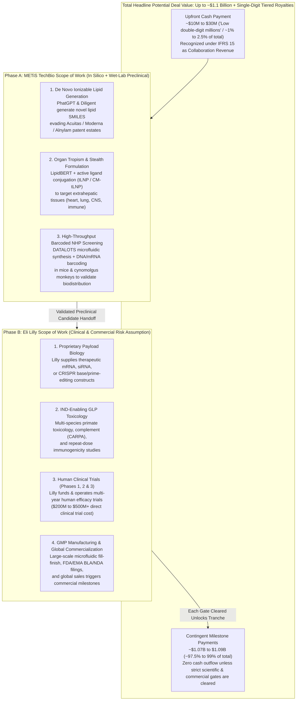
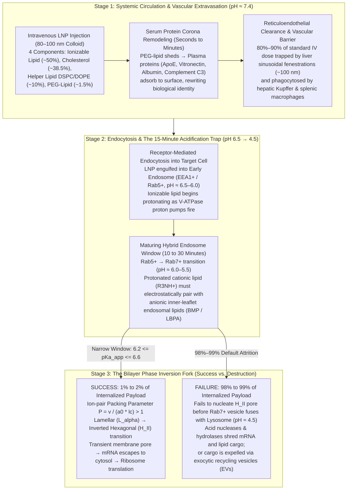
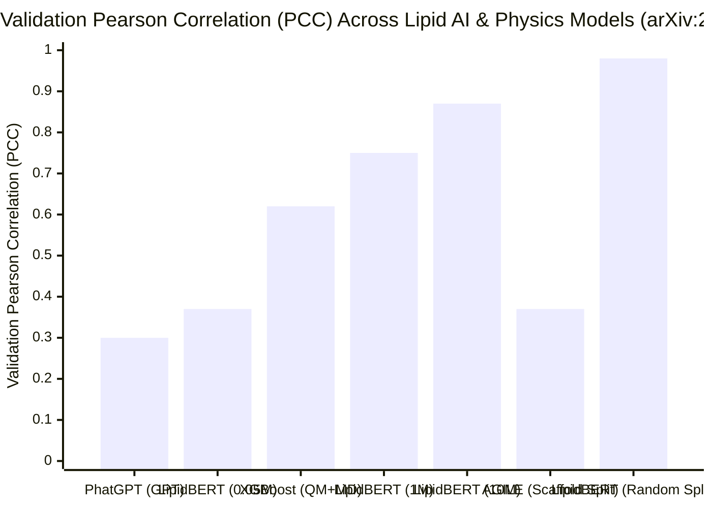

On October 19, 2026, Hong Kong-listed **METiS TechBio Co., Ltd.** (`7666.HK`, 剂泰科技)—which debuted on the Hong Kong Stock Exchange five months earlier proclaiming its mission to become the *"SpaceX of pharmaceuticals"*—announced a headline-grabbing strategic collaboration with **Eli Lilly and Company** (`NYSE: LLY`):

> *"Under the terms of the agreement, METiS TechBio will be eligible to receive an upfront payment in the low double-digit millions of U.S. dollars, and up to approximately US$1.1 billion in development, regulatory, and commercial milestone payments. In addition, METiS TechBio will be eligible to receive single-digit tiered royalties based on annual net sales of products resulting from the collaboration."*
> — **[METiS TechBio Official Release](https://metistechbio.com/en/qyxw/253.html)** & **[BioSpace Report](https://www.biospace.com/deals/lilly-puts-1-1b-on-the-line-for-hong-kong-biotechs-ai-drug-delivery-platform)**, October 19, 2026

When an AI-driven biotechnology company announces a **$1.1 billion** partnership with the world's most valuable pharmaceutical corporation, a skeptical observer naturally asks a series of six Socratic questions:
1. **What part of the work is Eli Lilly actually paying $1.1 billion for?**
2. **Which part of the lipid nanoparticle (LNP) delivery pipeline is technically the hardest?**
3. **Is the AI model architecture not the hardest part?**
4. **Is AI in biology just doing the "easy" combinatorial search part faster while hitting a brick wall in vivo?**
5. **Is there any human clinical proof that an AI-designed LNP works in patients?**
6. **For the 20% novel creative work, which expertise matters more—AI or "physical biology"?**

Those six questions form the exact spine of this investigation. Standard industry commentary gets the high-level intuition right: headline "$1.1B" biopharma deals are 97% to 99% contingent "bio-bucks"; **endosomal escape** (where 98% to 99% of internalized RNA cargo is destroyed inside acidified lysosomes) is the supreme biophysical bottleneck; and soft condensed matter physics ("physical biology") dictates the inductive biases that generic deep learning engineers merely implement.

Yet when you go beyond high-level intuition and conduct a primary-source forensic excavation—auditing METiS TechBio's **[HKEX Chapter 18C Interim Financial Statements (August 25, 2026)](https://metistechbio.com/en/uploads/ueditor/20260825/e9df709ecbe3eb62c7c5916f62af97c1.pdf)**, its **[official pipeline progress bars](https://metistechbio.com/en/ywgx.html)**, its core **[`LipidBERT` / `PhatGPT` technical paper (`arXiv:2408.06150v3`)](https://arxiv.org/html/2408.06150v3)**, Eli Lilly's **$1.3 billion acquisition of Verve Therapeutics** following the Phase 1b LNP toxicity pause of `VERVE-101` ([`NCT05398029`](https://clinicaltrials.gov/study/NCT05398029)), and the peer-reviewed benchmarking literature ([`AGILE`, *Nature Communications* 2024](https://pmc.ncbi.nlm.nih.gov/articles/PMC11282250/))—a far more revealing financial, mathematical, and biophysical reality emerges.

**THE ELI LILLY – METIS TECHBIO ($1.1B) & AI-LNP REALITY: FORENSIC AUDIT SCORECARD**

| Socratic Question | Surface Narrative / Standard Intuition | Primary-Source Forensic Reality (October 2026) |
| :--- | :--- | :--- |
| **1. What is Lilly paying $1.1B for?** | Lilly pays ~$10M–$30M upfront for `AiLNP` extrahepatic carrier design and locks ~$1.08B behind clinical and commercial milestones. | **True, plus an unstated HKEX Rule 18C driver & Verve cardiogenetics motive:** Lilly bought Verve for up to $1.3B (July 2025) after `VERVE-101`'s LNP caused Grade 3 liver/platelet toxicity, and signed METiS 3 months after METiS presented **>95% systemic cardiomyocyte transfection (`CM-tLNP`)** at CRS 2026 ([Release 246](https://metistechbio.com/en/qyxw/246.html)). Meanwhile, METiS is a **Pre-Commercial Chapter 18C issuer** under [HKEX Rule 18C.19(5)](https://metistechbio.com/en/uploads/ueditor/20260825/e9df709ecbe3eb62c7c5916f62af97c1.pdf) that *must* hit **HKD 250M annual revenue by 2027** (Rule 18C.03(4)) via upfront licensing checks to avoid mandatory delisting. |
| **2. What is inside METiS's clinical pipeline and revenue today?** | METiS is an "AI-powered mRNA/LNP delivery unicorn" with Phase 3 and clinical assets validating its platform. | **100% of METiS's Phase 1–3 assets (`MTS-004`, `MTS-201`) are small molecules, not LNPs:** Per METiS's [HKEX Interim Report](https://metistechbio.com/en/uploads/ueditor/20260825/e9df709ecbe3eb62c7c5916f62af97c1.pdf), ~95% of FY2025 revenue (RMB 100M of RMB 105M) came from out-licensing `MTS-004`—an **orally disintegrating tablet (ODT) reformulation of generic *Nuedexta*** (dextromethorphan/quinidine) for PBA. In 1H 2026, **89.35% of revenue (RMB 137.9M / US$20M)** came from a single deal (`Boulevard Bio` for `MTS-128`, a recombinant protein antibody) signed on June 30, 2026—with **88.3% (RMB 136.3M) sitting uncollected in Trade Receivables** while wet-lab material consumption was just **RMB 8.48M ($1.18M)**! |
| **3. Which pipeline step is technically the hardest?** | **Endosomal escape:** 95%–99% of internalized LNP cargo is degraded in lysosomes; requires `Lα → HII` phase inversion inside `6.2 ≤ pKa_app ≤ 6.6`. | **Confirmed by quantitative EM & single-vesicle imaging:** Gilleron et al. (*Nature Biotech* 2013) proved only **1%–2%** of LNP-siRNA escapes into the cytosol within a 10–15 minute window in hybrid `EEA1+/Rab5+/Rab7+` maturing endosomes ([Wittrup et al., `PMC4663660`](https://pmc.ncbi.nlm.nih.gov/articles/PMC4663660/)). Escape requires protonated tertiary amines to ion-pair with anionic endosomal `BMP/LBPA`, driving Israelachvili's packing parameter `P = v / (a₀ · lc) > 1`. |
| **4. Why is the AI model not the hardest part?** | GNNs, BERT/GPT, and Bayesian optimization are off-the-shelf; the bottleneck is proxy wet-lab labels and intractable MD physics. | **Verified inside METiS's own `LipidBERT` paper ([`arXiv:2408.06150v3`](https://arxiv.org/html/2408.06150v3)):** `LipidBERT` is a standard 12-layer `BERT-base` (768-dim) pretrained on 10M virtual SMILES. METiS's own `PhatGPT` collapsed to `PCC ≈ 0.30` on property regression, and `XGBoost` trained on automated QM + MD bilayer descriptors only reached `PCC = 0.62`. Worse, `LipidBERT`'s claimed `0.98 / 0.78` PCC on the `AGILE` dataset relies on a **random 80/10/10 split** across combinatorial analogs, whereas `AGILE`'s strict **Murcko scaffold split** ([`PMC11282250`](https://pmc.ncbi.nlm.nih.gov/articles/PMC11282250/)) drops to `0.37 / 0.23`! |
| **5. Is there human clinical proof for AI-designed LNPs?** | Zero Phase 2/3 clinical proof in humans for AI-designed de novo LNPs; animal GFP/luciferase does not prove human efficacy or chronic safety. | **Confirmed across ClinicalTrials.gov:** METiS's furthest LNP asset (`MTS-105`, [`NCT06689540`](https://clinicaltrials.gov/study/NCT06689540)) is at `22.72%` progress (`IIT/IND` Phase 1 dose escalation) and targets **liver cancer (`HCC`)**—where LNPs naturally go passively! Every extrahepatic `AiLNP` asset in METiS's pipeline (`MTS-107`, `108`, `110`, `111`, `112`, `118`) is at the **preclinical (`PCC`, 11.7%–16.7%)** stage. The only extrahepatic LNP with human Phase 1b proof-of-concept (`RCT1100`, [`NCT05737485`](https://clinicaltrials.gov/study/NCT05737485)) is **ReCode's non-AI rationally designed 5-lipid SORT platform** ([`PMC7735425`](https://pmc.ncbi.nlm.nih.gov/articles/PMC7735425/)). |
| **6. For the 20% creative core, AI or Physical Biology?** | Physical biology (soft condensed matter biophysics & formulation engineering) is far more critical than pure ML architecture. | **Proven by founder pedigree & problem formulation:** METiS was founded by MIT chemical and polymer engineers—Dr. Tsai-Ta (Chris) Lai (MIT ChemE Ph.D.), Dr. Hongming Chen (MIT ChemE Ph.D. under Robert Langer, NAE member, ex-Kala CSO & Transform Pharma), and Dr. Wenshou Wang (MIT Langer Lab polymer chemist)—not NLP computer scientists ([Management Filing](https://metistechbio.com/en/gsgl.html)). |

In this deep dive, we apply the eight-phase **"Panning for Gold"** critical thinking framework to rigorously audit the financial structure, molecular biophysics, machine learning architectures, and clinical translation barriers of AI-guided drug delivery.

---

## Phase 1: Issue Classification & Falsifiability Criteria

We partition our inquiry into two explicit, testable axes:

1. **The Descriptive Issue (Biophysical & Computational):** Why do current machine learning architectures (`LipidBERT`, `PhatGPT`, `Diligent`, `AGILE`) and molecular dynamics (MD) engines struggle to predict *in vivo* extrahepatic delivery and **endosomal escape** across novel chemical scaffolds, and what does METiS TechBio's audited clinical and financial footprint actually demonstrate as of October 2026?
2. **The Prescriptive Issue (R&D Strategy & Capital Allocation):** How should pharmaceutical R&D leaders, biotech investors, and machine learning engineers allocate capital and talent between **in silico generative AI scaling** versus **wet-lab biophysical assay engineering and soft-matter formulation design**?

### Falsifiability Criteria
To ensure our conclusions remain scientifically falsifiable rather than dogmatically skeptical, we specify three concrete empirical thresholds that would **disconfirm** our critique between 2026 and 2030:
- **Computational Generalization Falsification:** If a pretrained lipid language or graph diffusion model (`LipidBERT`, `Diligent`, or `AGILE`) achieves a Pearson correlation coefficient `PCC ≥ 0.75` on **in vivo non-human primate (NHP) functional mRNA delivery** across a blinded test set of **strictly held-out Murcko chemical scaffolds** (where no amine headgroup or linker substructure overlaps with the training set).
- **Biophysical Simulation Falsification:** If an automated coarse-grained or constant-pH molecular dynamics (`CpHMD`) pipeline directly predicts the experimental apparent `pKa` within `±0.15` pH units and the lamellar-to-inverted-hexagonal (`Lα → HII`) phase transition temperature/pH across 100 diverse 4-component LNP formulations without empirical wet-lab calibration.
- **Clinical Translation Falsification:** If an AI-generated *de novo* ionizable lipid LNP encapsulating a therapeutic mRNA or CRISPR gene editor clears human Phase 2 clinical trials for a **systemic extrahepatic indication** (e.g., intravenous cardiomyocyte, lung, or CNS delivery) with both durable clinical efficacy and absence of dose-limiting complement activation (`CARPA`), hepatotoxicity (`ALT/AST` Grade 3+ elevations), or thrombocytopenia.

---

## Phase 2: Primary Source Excavation, The "$1.1B" Bio-Bucks Anatomy & HKEX Chapter 18C Forensic Accounting

### 1. Primary Source Traceability Matrix

Every financial figure, clinical trial status, and algorithmic metric in this report is traced directly to canonical regulatory filings, clinical registries, and peer-reviewed papers verified live in October 2026:

| Source Category | Primary Document / Artifact | Issuing Institution / Authors | Key Verifiable Fact Extracted |
| :--- | :--- | :--- | :--- |
| **Deal Announcement** | [Strategic Collaboration with Eli Lilly Release (Oct 19, 2026)](https://metistechbio.com/en/qyxw/253.html) & [BioSpace Coverage](https://www.biospace.com/deals/lilly-puts-1-1b-on-the-line-for-hong-kong-biotechs-ai-drug-delivery-platform) | METiS TechBio (`7666.HK`) & Eli Lilly (`LLY`) | "Low double-digit millions" USD upfront + up to ~$1.1B in development, regulatory, and commercial milestones + single-digit tiered royalties. |
| **Audited / Reviewed HKEX Financials** | [2026 Interim Results Announcement (Six Months Ended June 30, 2026)](https://metistechbio.com/en/uploads/ueditor/20260825/e9df709ecbe3eb62c7c5916f62af97c1.pdf) | Metis TechBio Co., Ltd. (`7666.HK`, reviewed by PwC) | 1H 2026 revenue of RMB 154.29M (89.35% from 1 customer; RMB 136.31M uncollected in Trade Receivables); R&D spend RMB 172.37M; wet-lab material consumption only RMB 8.48M; HKEX Rule 18C.19(5) Pre-Commercial warning. |
| **Official Pipeline & Stage Bars** | [METiS TechBio Official Pipeline (`ywgx.html`)](https://metistechbio.com/en/ywgx.html) & [HKEX IPO Release (`244.html`)](https://metistechbio.com/en/qyxw/244.html) | METiS TechBio (`7666.HK`) | Confirms `MTS-004` (`71.72%`, Ph3) and `MTS-201` (`37.72%`, Ph1) are small molecules; all extrahepatic LNP biologics (`MTS-107` to `MTS-118`) are at `11.72%–16.72%` (`PCC` preclinical stage). |
| **Heart-Selective LNP Breakthrough** | [CRS 2026 Distinguished Investigator Award (`246.html`)](https://metistechbio.com/en/qyxw/246.html) & [Late-Breaking Abstract (`240.html`)](https://metistechbio.com/en/qyxw/240.html) | Dr. Andong Liu (VP & Head of Tech Platform, METiS) | Systemic heart-selective `CM-tLNP` achieved >95% cardiomyocyte mRNA transfection and >50% CRISPR gene editing in mice with low liver off-target editing. |
| **METiS AI Architecture Preprint** | [*LipidBERT: A Lipid Language Model Pre-trained on METiS de novo Lipid Library* (`arXiv:2408.06150v3`)](https://arxiv.org/html/2408.06150v3) | Tianhao Yu, Cai Yao, Wenshou Wang, Chris Lai, Kai Wang et al. (METiS) | Details 10M virtual lipid library, `LipidBERT` (BERT-base), `PhatGPT` (`PCC ≈ 0.30`), `Diligent` (DiT), fixed formulation ratios, scaffold interpolation caveat, and thanks Eli Lilly's Michelle Lynn Hall. |
| **Benchmarking Counterpart** | [*AGILE platform: a deep learning powered approach to accelerate LNP development for mRNA delivery* (*Nature Comms*, 2024, `PMC11282250`)](https://pmc.ncbi.nlm.nih.gov/articles/PMC11282250/) | Yue Xu, Shihao Ma, Haotian Cui, Bo Wang, Bowen Li et al. (U. Toronto) | Combinatorial 1,200-lipid dataset ([GitHub](https://github.com/bowang-lab/AGILE)) evaluated under strict **Murcko scaffold 80/10/10 split** (`PCC = 0.37` HeLa, `0.23` RAW 264.7). |
| **Endosomal Escape Biophysics** | [Wittrup et al. (*Nature Biotech* 2015, `PMC4663660`)](https://pmc.ncbi.nlm.nih.gov/articles/PMC4663660/), [Maugeri et al. (*Nature Comms* 2019, `PMC6760118`)](https://pmc.ncbi.nlm.nih.gov/articles/PMC6760118/), [Chatterjee et al. (*PNAS* 2024, `PMC10945858`)](https://pmc.ncbi.nlm.nih.gov/articles/PMC10945858/) | Lieberman/Anderson/Langer Labs; AstraZeneca; Siegwart Lab | Quantifies the 1%–2% cytosolic escape bottleneck, single-vesicle Galectin-8/9 burst kinetics, and lack of direct high-throughput real-time escape assays. |
| **Apparent `pKa` & SORT LNPs** | [Jayaraman et al. (*Angew. Chem.* 2012, `PMC3470698`)](https://pmc.ncbi.nlm.nih.gov/articles/PMC3470698/), [Hassett et al. (*Mol. Ther. Nucleic Acids* 2019, `PMC6383180`)](https://pmc.ncbi.nlm.nih.gov/articles/PMC6383180/), [Cheng et al. (*Nature Nanotech* 2020, `PMC7735425`)](https://pmc.ncbi.nlm.nih.gov/articles/PMC7735425/) | Alnylam/Cullis; Moderna; UT Southwestern (Siegwart) | Establishes the `6.2–6.5` (IV hepatic) and `6.6–6.9` (IM vaccine) `pKa_app` windows and 5-component SORT organ-tropism rules. |
| **Clinical Trial Registries** | [`NCT06689540` (`MTS-105`)](https://clinicaltrials.gov/study/NCT06689540), [`NCT05398029` (`VERVE-101`)](https://clinicaltrials.gov/study/NCT05398029), [`NCT06164730` (`VERVE-102`)](https://clinicaltrials.gov/study/NCT06164730), [`NCT05737485` (`RCT1100`)](https://clinicaltrials.gov/study/NCT05737485) | ClinicalTrials.gov (METiS, Verve/Lilly, ReCode) | Verifies human clinical trial stages, adverse events (`VERVE-101` Grade 3 ALT & thrombocytopenia), and routes of administration. |

---

### 2. Deconstructing Question 1: What Is Eli Lilly Actually Paying "$1.1 Billion" For?

In biopharmaceutical business development, a "$1.1 billion" headline collaboration is not a wire transfer; it is an **asymmetric call-option ladder ("bio-bucks")**. Let us map the exact financial and operational structure of the October 19, 2026 Eli Lilly – METiS TechBio agreement:

#### The Hidden Strategic Trigger: Why Eli Lilly Needed METiS After the $1.3B Verve Acquisition
Why did Eli Lilly choose METiS TechBio specifically in October 2026? The answer lies in two primary-source events that occurred between April 2024 and July 2026:

1. **The `VERVE-101` LNP Toxicity Wake-Up Call (April 2024 – July 2025):**
   In April 2024, Eli Lilly's cardiovascular gene-editing partner **Verve Therapeutics** was forced to pause enrollment in its Phase 1b `Heart-1` clinical trial ([`NCT05398029`](https://clinicaltrials.gov/study/NCT05398029)) of `VERVE-101` (an *in vivo* adenine base editor targeting `PCSK9` to permanently lower LDL cholesterol) after the sixth patient treated at `0.45 mg/kg` suffered **Grade 3 transient alanine aminotransferase (`ALT`) liver enzyme elevation** and **Grade 3 thrombocytopenia (severe platelet drop)** within four days of infusion. Independent safety monitors determined that the toxicity was caused **not by the CRISPR base-editor mRNA or guide RNA payload, but by the licensed first-generation ionizable lipid LNP envelope**. Verve had to pivot to **`VERVE-102`** ([`NCT06164730`](https://clinicaltrials.gov/study/NCT06164730)), which paired the exact same `PCSK9` base-editing payload with a **custom GalNAc-targeted LNP containing a different ionizable lipid**—achieving clean safety and up to **88% PCSK9 reduction and 62% LDL-C reduction** in Phase 1b, prompting Eli Lilly to acquire Verve for **$1.0 billion to $1.3 billion** in June–July 2025.
2. **The Cardiomyocyte Delivery Wall & METiS's July 2026 CRS Breakthrough:**
   Even after acquiring Verve, Lilly faced a hard anatomical ceiling: `VERVE-102` only edits **hepatocytes in the liver** to lower circulating blood lipids. It cannot deliver RNA or gene editors into **cardiomyocytes (heart muscle cells)**, which have dense sarcomeric architecture, continuous mechanical contraction, a continuous microvascular endothelial barrier, and low baseline endocytosis.
   Then, in May–July 2026, METiS TechBio VP **Dr. Andong Liu** delivered a Late-Breaking oral presentation at the **2026 Controlled Release Society (CRS) Annual Meeting** in Lisbon titled *"Systemic Heart-Selective Lipid Nanoparticles for High-Efficiency In Vivo Delivery and Cardiomyocyte Gene Editing"* ([METiS Release 240](https://metistechbio.com/en/qyxw/240.html); [Release 246](https://metistechbio.com/en/qyxw/246.html); [2026 Interim Report p. 11](https://metistechbio.com/en/uploads/ueditor/20260825/e9df709ecbe3eb62c7c5916f62af97c1.pdf)). Using its actively targeted **`CM-tLNP`** platform, METiS reported **>95% cardiomyocyte mRNA transfection** and **>50% in vivo cardiomyocyte CRISPR gene editing** following systemic intravenous injection in mice, with minimal off-target editing in the liver or spleen. Moreover, the Acknowledgements section of METiS's own `LipidBERT` paper ([`arXiv:2408.06150v3`](https://arxiv.org/html/2408.06150v3)) reveals that Eli Lilly computational scientist **Dr. Michelle Lynn Hall** had already been advising METiS on AI, quantum mechanics, and molecular dynamics for LNP research since 2024.

For Eli Lilly, paying ~$15M–$25M upfront (<0.25% of Lilly's annual R&D budget) to test whether METiS's `AiLNP` and `CM-tLNP` carriers can deliver Lilly's genetic payloads to the heart, CNS, or lungs is an ultra-cheap, asymmetric call option.

---

### 3. The HKEX Chapter 18C Forensic Accounting Discovery: Why METiS Desperately Needed Upfront Deal Revenue

While the economic logic for Eli Lilly is straightforward, what about METiS TechBio? When we inspect METiS TechBio's **[Unaudited 2026 Interim Results Announcement (`7666.HK`, August 25, 2026)](https://metistechbio.com/en/uploads/ueditor/20260825/e9df709ecbe3eb62c7c5916f62af97c1.pdf)**, we uncover a critical regulatory and accounting mechanism that no biotech news outlet has reported.

Turn to **Page 25** of METiS TechBio's 2026 Interim Report:

> **"Cautionary Statement under Rule 18C.19(5) of the Listing Rules:** *The Company is a Specialist Technology Company (as defined in Chapter 18C of the Listing Rules). In addition, the Company is a Pre-Commercial Company (as defined in Chapter 18C of the Listing Rules), which is a Specialist Technology Company that has not met the revenue requirement as set out in Rule 18C.03(4) of the Listing Rules. We may not be able to ultimately meet the revenue requirement as set out in Rule 18C.03(4) of the Listing Rules... the Company expects to meet the revenue requirement under Rule 18C.03(4) of the Listing Rules in 2027."*

Under Hong Kong Stock Exchange **Chapter 18C (Specialist Technology Companies)**, a company that lists with less than **HKD 250 million (~RMB 230 million / ~$32 million USD)** in audited annual revenue is designated as a **Pre-Commercial Company** and faces strict regulatory constraints and mandatory delisting clocks unless it crosses the **HKD 250 million annual revenue threshold** under **Rule 18C.03(4)**.

Now look at how METiS TechBio has engineered its top-line IFRS 15 revenue across FY2024, FY2025, and 1H 2026 to march toward that HKD 250 million threshold:

**FORENSIC DECOMPOSITION OF METIS TECHBIO (`7666.HK`) REVENUE, CASH FLOW & PIPELINE (2024–1H 2026)**

| Financial / Operational Metric | FY2024 (Audited) | FY2025 (Audited) | 1H 2026 (6M Ended Jun 30, 2026) | Primary-Source Forensic Audit Notes ([2026 Interim Report](https://metistechbio.com/en/uploads/ueditor/20260825/e9df709ecbe3eb62c7c5916f62af97c1.pdf)) |
| :--- | :--- | :--- | :--- | :--- |
| **Total IFRS 15 Revenue** | RMB 1.50M (~$0.21M) | RMB 105.00M (~$14.5M) | **RMB 154.29M** (~$21.3M) | Headline press release touts a **"+13,399% YoY revenue surge"** in 1H 2026 (vs. RMB 1.14M in 1H 2025). |
| **Point-in-Time Collaboration Revenue vs. Recurring Over-Time Revenue** | — | ~RMB 100.0M (~95.2%) | **RMB 153.61M (`99.56%`)** Point-in-Time vs. **RMB 0.68M (`0.44%`)** Over-Time | **99.56% of 1H 2026 revenue** was recognized at a single point in time from licensing handoffs; ongoing wet-lab testing services generated just **RMB 684,000 (~$95,000)** over 6 months (Note 3, p. 36). |
| **Single-Customer Concentration (`Customer A`)** | — | ~95.2% (`Zhejiang Yin'an` for `MTS-004`) | **`89.35%` (RMB 137.86M / US$20M)** from `Customer A` (`Boulevard Bio`) | Signed on **June 30, 2026**—the literal final day of the 1H 2026 reporting period ([Release 245](https://metistechbio.com/en/qyxw/245.html))—for `MTS-128` (a preclinical trispecific antibody protein, **not an LNP**). |
| **Uncollected Trade Receivables on Balance Sheet** | — | RMB 0.18M (as of Dec 31, 2025) | **RMB 136.31M (`88.35%` of total 1H revenue)** | Because the US$20M Boulevard Bio deal was booked on June 30, 2026, **almost zero cash from that deal had been collected by period-end**; Trade Receivables spiked **753x** from RMB 181k to RMB 136.31M (Note 9, p. 40). |
| **Operating Cash Flow (`Net Cash Used in Operating Activities`)** | — | — | **-RMB 162.20M** (vs. -RMB 96.31M in 1H 2025) | Operating cash burn **worsened by 68.4% YoY** despite the "+13,399%" accounting revenue jump (Cash Flow Statement, p. 34). |
| **R&D Spend vs. Actual Wet-Lab Material Consumption** | — | RMB 269.8M R&D | **RMB 172.37M R&D**, but only **RMB 8.48M (`$1.18M`)** in wet-lab **Material Consumption** | Out of RMB 290.98M total 1H expenses, **RMB 151.74M (52.1%)** was employee comp (including **RMB 91.20M** share-based compensation) and **RMB 83.96M** was external CRO/service fees, while in-house wet-lab consumables were just **RMB 8.48M** (Note 5, p. 37). |

---

### 4. The 2-Column Claim Schism Matrix: Public "AI Nano-Rocket Unicorn" Narrative vs. Regulatory & Preprint Disclosures

Cross-examining METiS TechBio's public marketing releases against its buried HKEX financial footnotes, pipeline progress bars, and `arXiv` technical disclosures exposes five stark schisms:

| Audit Dimension | Public Marketing & Launch Narrative | Buried HKEX Filing, Pipeline & Preprint Reality |
| :--- | :--- | :--- |
| **1. Clinical Maturity of AI-Designed LNPs (`AiLNP`)** | *"METiS TechBio, the World's First Publicly Listed AI-Powered Drug Delivery Company... achieving breakthrough targeted delivery across eight major human organs and tissues."* ([HKEX IPO Release 244](https://metistechbio.com/en/qyxw/244.html)) | **Zero Extrahepatic LNPs in Human Clinical Trials:** On METiS's [official pipeline table (`ywgx.html`)](https://metistechbio.com/en/ywgx.html), its only Phase 3/Pre-NDA asset (**`MTS-004`**, `data-line = 71.72%`) is an **orally disintegrating tablet (ODT) reformulation of dextromethorphan + quinidine** (generic *Nuedexta*) for PBA (`AiTEM`). Its only Phase 1 asset (**`MTS-201`**, `37.72%`) is an oral small-molecule `TGR5` agonist. Its two `IIT/IND`-stage biologics (`MTS-105` at `22.72%` for liver cancer and `MTS-109` at `27.72%`) target the liver and lymphoid organs, while **all six extrahepatic/solid-tumor biologics (`MTS-107`, `108`, `110`, `111`, `112`, `118`) sit at `11.72%–16.72%` (`PCC` preclinical stage)**. |
| **2. Source of Commercial Revenue (`+13,399% YoY`)** | *"METiS TechBio Reports 2026 Interim Revenue Surpassing Full-Year 2025 Revenue by 47%, Marking Breakthrough Growth and Leading the Commercialization of AI for Science."* ([Release 251](https://metistechbio.com/en/qyxw/251.html)) | **94% of Cumulative 2025–1H 2026 Revenue Came From Non-LNP Assets:** RMB 100M (FY2025) came from out-licensing the `MTS-004` small-molecule PBA tablet to Zhejiang Yin'an, and RMB 137.86M (1H 2026) came from licensing the `MTS-128` recombinant trispecific antibody protein (`BLVD201`) to Boulevard Bio on June 30, 2026 ([2026 Interim Report pp. 12, 15, 36](https://metistechbio.com/en/uploads/ueditor/20260825/e9df709ecbe3eb62c7c5916f62af97c1.pdf)). Only **RMB 15M (~$2.1M)** from BioThunder AG came from an LNP license option! |
| **3. True De Novo Generalization of `LipidBERT`** | *"At its core, AiLNP leverages our proprietary lipid library, lipid language models, and generative algorithms to identify and design optimal lipid candidates... especially in the uncharted yet important territories with no existing positive ionizable lipids."* ([Platforms Page](https://metistechbio.com/en/jsyyf.html)) | **Explicit Scaffold-Interpolation Caveat in Preprint:** In Section 2.4.1 of [`arXiv:2408.06150v3`](https://arxiv.org/html/2408.06150v3), the authors admit: *"It is important to note that LipidBERT performs especially well on ionizable lipids whose scaffolds are well represented in our experimental set; **its predictions may be less accurate for compounds with entirely novel scaffolds.**"* |
| **4. 4-Component Formulation Optimization vs. Single-Lipid SMILES** | *"The platform enables systematic design and optimization of LNP components — including ionizable lipids, helper lipids, cholesterol, and PEG-lipids — and their ratios."* ([Platforms Page](https://metistechbio.com/en/jsyyf.html)) | **Fixed Component Ratios in `LipidBERT`:** Section 2.4.1 of [`arXiv:2408.06150v3`](https://arxiv.org/html/2408.06150v3) discloses: *"All data in this study were generated using **fixed component ratios** in the LNP formulations."* `LipidBERT` takes only the 1D SMILES string of the ionizable lipid (padded to 128 characters) and ignores molar ratio variations or helper lipid swaps. |
| **5. Passive Lipid Tropism vs. Active Antibody Conjugation (`tLNP`)** | Public press releases imply that AI-designed ionizable lipid structures alone steer LNPs cleanly to any organ (heart, T-cells, lung). | **Shift to Active Antibody/Ligand Conjugation (`tLNP` / `CM-tLNP`):** Pages 5, 10, and 11 of the [2026 Interim Report](https://metistechbio.com/en/uploads/ueditor/20260825/e9df709ecbe3eb62c7c5916f62af97c1.pdf) reveal that METiS's breakthroughs in T-cell (`in vivo CAR-T tLNP`) and cardiomyocyte (`CM-tLNP`) delivery actually rely on **designing physiologically "stealth" (inert) ionizable lipids** and then **chemically conjugating active targeting antibodies or ligands** onto the LNP surface! |

> [!IMPORTANT]
> **Look closely at Schism #5:** When AI-designed ionizable lipids alone could not overcome the liver's passive ApoE sink to achieve selective T-cell or cardiomyocyte homing, METiS pivoted inside its 2026 Interim Report (pp. 5, 10–11) to **"stealth" ionizable lipids** (lipids engineered *not* to bind liver proteins) paired with **site-specific conjugated antibodies (`tLNPs` and `CM-tLNPs`)** designed via its `AiProtein` platform. In other words, the organ specificity is increasingly driven by **surface ligand/antibody receptor binding**, while the ionizable lipid's primary job reverts to surviving circulation without toxicity and executing **endosomal escape** once the antibody-conjugated particle is endocytosed!

---

## Phase 3: Semantic Precision, Ambiguity Substitution Tests & The 4-Tier LNP Delivery Maturity Hierarchy

To prevent marketing terminology from obscuring engineering reality, we subject four pervasive terms in the AI drug delivery discourse to Browne & Keeley's **Ambiguity Substitution Test**.

### 1. The Ambiguity Substitution Test

- **Term 1: "De Novo AI-Designed Ionizable Lipid"**
  - *Loose / Marketing Definition:* A brand-new chemical matter archetype invented from first principles by a deep generative neural network that discovers previously unknown physical mechanisms of membrane fusion.
  - *Strict / Operational Definition (as implemented in [`arXiv:2408.06150v3`](https://arxiv.org/html/2408.06150v3)):* Cutting known patent/literature ionizable lipids into `7–12` sub-fragments (amine headgroups, ester/amide/carbamate linkers, and branched hydrocarbon tails), recombining those fragments via rule-guided reinforcement learning (`PhatGPT` / `Diligent`), and filtering analogs using a `BERT-base` regressor (`LipidBERT`) trained on in-house wet-lab scaffolds.
  - *Substitution Verdict:* Recombining known headgroup-linker-tail fragments is **automated combinatorial scaffold hopping**—a highly valuable method for navigating around third-party composition-of-matter patents (`Acuitas ALC-0315`, `Moderna SM-102`, `Alnylam MC3`), but mathematically distinct from extrapolating into unseen physical chemistry.
- **Term 2: "Organ-Targeted / Extrahepatic Delivery"**
  - *Loose / Marketing Definition:* Following an intravenous injection, >80% of the injected LNP dose accumulates exclusively in the target organ (e.g., lung, heart, or brain) while the liver receives ~0%.
  - *Strict / Operational Definition:* Either (a) **luminescence/fluorescence expression ratio** (`I_organ / I_liver`) where the target organ lights up on an IVIS camera even if 60%–80% of the physical lipid mass is still sequestered and degraded by hepatic Kupffer macrophages, or (b) **active ligand/antibody-conjugated `tLNPs`** or **local administration** (nebulized inhalation for lung, intrathecal injection for CNS, intraperitoneal for ovarian cancer).
  - *Substitution Verdict:* Conflating *protein expression ratio* (`mRNA translation in target tissue`) with *physical mass biodistribution* hides the main cause of systemic LNP dose-limiting toxicity: even if an mRNA incorporates organ-specific untranslated regions (`UTRs`) or microRNA target sites (like `miR-122` to silence translation in hepatocytes), the **physical lipid envelope still floods the liver and spleen**, triggering complement activation and transaminase spikes!
- **Term 3: "Endosomal Escape Efficiency"**
  - *Loose / Marketing Definition:* High bioluminescent luciferase (`Fluc`) or `eGFP` protein readout 24 hours after dosing.
  - *Strict / Operational Definition:* The exact molar fraction of internalized nucleic acid cargo molecules (`N_cytosol / N_endocytosed`) that physically translocate across the limiting endosomal lipid bilayer into the cytoplasm prior to lysosomal hydrolase degradation (`~1% to 2%` for standard LNPs).
- **Term 4: "Physical Biology" (Biophysics / Soft Condensed Matter Biology)**
  - *Operational Definition:* The quantitative discipline that models biological structures not as abstract symbol strings (`A, C, G, T` or `SMILES` tokens), but as **continuous thermodynamic, mechanical, and electrokinetic systems** governed by free-energy landscapes (`ΔG`), membrane curvature elasticity (`Helfrich Hamiltonian`), colloidal DLVO forces, non-equilibrium phase diagrams (`Lα ↔ HII`), and shear rheology.

---

### 2. The 4-Tier LNP & AI Delivery Maturity Hierarchy

To situate METiS TechBio's `AiLNP`, University of Toronto's `AGILE`, ReCode's `SORT`, and Alnylam/Moderna/Acuitas's clinical platforms on an objective scale, we establish a four-tier maturity hierarchy:

**THE 4-TIER NUCLEIC ACID LNP DELIVERY MATURITY HIERARCHY (OCTOBER 2026)**

| Maturity Tier | Physical & Biological Mechanism | Representative Platforms & Lipids | Human Clinical Validation Status (Oct 2026) |
| :--- | :--- | :--- | :--- |
| **Tier 1: Passive Hepatic & Local IM Vaccine LNPs** | 4-component LNP absorbs serum `ApoE` in blood → binds hepatocyte `LDLR` (IV) or local dendritic/muscle cells (IM); `1%–3%` endosomal escape. | **Alnylam/Cullis** (`DLin-MC3-DMA`), **Acuitas/Pfizer** (`ALC-0315`), **Moderna** (`SM-102`), **Intellia** (`NTLA-2001/2002`) | **COMMERCIAL / PHASE 3 PROVEN:** FDA-approved in *Onpattro* (2018), *Comirnaty*, *Spikevax*, *mRESVIA*; Phase 3 gene-editing trials ongoing. |
| **Tier 2: Ligand-Conjugated Hepatic & Rationally Designed 5-Lipid SORT LNPs** | Adds a 5th `SORT` lipid (cationic `DOTAP` for lung, anionic `18PA` for spleen) or `GalNAc` ligand (`ASGPR` uptake in LDLR-deficient patients). | **Verve/Eli Lilly** (`VERVE-102` GalNAc-LNP), **ReCode Therapeutics** (`RCT1100` & `RCT2100` inhaled SORT LNPs) | **HUMAN PHASE 1b / 2 PROOF-OF-CONCEPT:** `VERVE-102` ([`NCT06164730`](https://clinicaltrials.gov/study/NCT06164730)) achieved 88% PCSK9 knockdown safely; `RCT1100` ([`NCT05737485`](https://clinicaltrials.gov/study/NCT05737485)) improved mucociliary clearance in 57% of PCD patients (May 2026). **Non-AI rational design.** |
| **Tier 3: AI-Interpolated Combinatorial & Active-Targeted (`tLNP`) Carriers** | Fragment-based RL + SMILES/graph neural filters (`LipidBERT`, `AGILE`) paired with high-throughput barcoded mouse/NHP screening and antibody conjugation (`CM-tLNP`). | **METiS TechBio** (`AiLNP`, `CM-tLNP`, `MTS-105`), **Bowen Li Lab** (`AGILE`, [`PMC11282250`](https://pmc.ncbi.nlm.nih.gov/articles/PMC11282250/)) | **PRECLINICAL / EARLY PHASE 1 IIT ONLY:** `MTS-105` ([`NCT06689540`](https://clinicaltrials.gov/study/NCT06689540)) is in Phase 1 IIT for **liver cancer**; all extrahepatic AI-designed LNPs (`CM-tLNP`, `MTS-108`) have **zero human clinical efficacy data** to date. |
| **Tier 4: First-Principles Multi-Scale Biophysical Simulator & Zero-Shot De Novo LNP Engine** | Coupled constant-pH quantum/coarse-grained dynamics predicting corona formation, endothelial transcytosis, and `Lα → HII` endosomal escape zero-shot without wet-lab scaffold training. | Target of next-generation multi-scale AI + CpHMD platforms | **UNBUILT:** Current MD + QM descriptors achieve only `PCC = 0.62` ([`arXiv:2408.06150v3` Fig. 11](https://arxiv.org/html/2408.06150v3)), and out-of-scaffold ML drops to `PCC = 0.23–0.37`. |

---

## Phase 4: Biophysics of the Bottleneck (Endosomal Escape) & The 4-Way Causal Audit

Why did the Gemini conversation correctly identify **endosomal escape** as the technically hardest problem in the entire nucleic acid delivery pipeline—and why do 95% to 99% of delivered RNA molecules perish inside the target cell even after the nanoparticle successfully reaches the organ and gets engulfed?

Let us trace the exact biophysical gauntlet an LNP faces from intravenous injection to cytosolic translation, and derive the three governing equations that explain why both organic chemists and deep learning models hit a wall here.

### 1. The Quantitative Proof of the 98%–99% Graveyard
In two landmark experimental studies that physically counted individual nucleic acid molecules inside cells:
- **Gilleron, Zerial et al. (*Nature Biotechnology*, 2013, `PMID: 23792630`)** conjugated colloidal gold nanoparticles (`6 nm`) to siRNA inside `DLin-MC3-DMA` / `LNP01` lipid nanoparticles and combined quantitative electron microscopy with automated high-resolution fluorescence microscopy in HeLa cells and mouse hepatocytes *in vivo*. They proved that **only 1% to 2% of internalized siRNA molecules ever escape into the cytosol** (roughly `2,000 to 4,000` siRNA molecules per cell), and that escape occurs exclusively within a narrow stage of endosomal progression when early endosomes mature into multivesicular late endosomes.
- **Wittrup, Lieberman, Anderson, Langer et al. (*Nature Biotechnology*, 2015, [`PMC4663660`](https://pmc.ncbi.nlm.nih.gov/articles/PMC4663660/))** used real-time single-vesicle fluorescence microscopy and cytosolic **Galectin-8 / Galectin-9 (`Gal8/Gal9`)** damage-sensor recruitment to watch individual LNP-containing endosomes rupture in live cells. They discovered that escape is a stochastic, all-or-nothing sudden burst occurring **5 to 15 minutes after endocytosis** within maturing `EEA1+/Rab5+/Rab7+` hybrid endosomes, releasing only a small fraction of the vesicle's RNA cargo before the membrane reseals or is sequestered by autophagy (`LC3`).
- **Maugeri et al. (*Nature Communications*, 2019, [`PMC6760118`](https://pmc.ncbi.nlm.nih.gov/articles/PMC6760118/))** further demonstrated that a significant fraction of internalized LNP-mRNA and ionizable lipids that do not get degraded in lysosomes are sorted into intraluminal vesicles and **expelled out of the cell inside extracellular vesicles (`EVs` / exosomes)**.

---

### 2. Derivation 1: Israelachvili's Packing Parameter & The Lamellar-to-Inverted-Hexagonal (`Lα → HII`) Phase Transition

Why is it so hard to engineer a lipid that ruptures an endosome at `pH 5.8` without lysing red blood cells (`hemolysis`) in the bloodstream at `pH 7.4`? Because the lipid must dynamically switch its **supramolecular geometry** across a `1.0` pH unit delta.

In soft condensed matter physics (formalized by Jacob Israelachvili, *Intermolecular and Surface Forces*, and Pieter Cullis's polymorph-phase theory of membrane fusion), the self-assembled phase of an amphiphilic lipid is governed by the dimensionless **Molecular Packing Parameter (`P`)**:

$$P = \frac{v}{a_0 \cdot l_c}$$

where:
- `v` is the effective hydrophobic volume of the hydrocarbon tails (nm³),
- `a₀` is the optimal cross-sectional area of the polar headgroup at the lipid-water interface (nm²), and
- `lc` is the critical maximum extended length of the acyl chains (nm).

The value of `P` dictates the spontaneous curvature `C₀` and the thermodynamic phase of the lipid aggregate via the **Helfrich membrane bending elastic energy**:

$$E_{\text{bend}} = \int_{\text{membrane}} \left[ \frac{\kappa}{2} (2H - C_0)^2 + \bar{\kappa} K_G \right] dA$$

where `κ` is the bending rigidity modulus, `κ̄` is the Gaussian saddle-splay modulus, `H = ½(c₁ + c₂)` is the mean curvature, and `K_G = c₁·c₂` is the Gaussian curvature:

1. **In Systemic Blood (`pH = 7.4`):** The tertiary amine headgroup of the ionizable lipid (`R₃N`) is **uncharged (neutral)**. Combined with helper phospholipids (`DSPC`) and cholesterol, the effective packing parameter satisfies `½ < P ≤ 1` (`C₀ ≈ 0`). The lipids pack as cylinders into a stable, non-hemolytic **planar lamellar bilayer (`Lα` phase)** surrounding an amorphous hydrophobic core of cholesterol and oil-phase neutral lipid droplets encapsulating RNA.
2. **Inside the Acidifying Endosome (`pH = 6.0 → 5.5`):** V-ATPase proton pumps inject `H⁺` ions into the endosomal lumen. The tertiary amine headgroup protonates into a positively charged ammonium cation (`R₃NH⁺`). Simultaneously, the inner leaflet of maturing/late endosomes is uniquely enriched (up to `15–20 mol%`) in the cone-shaped anionic phospholipid **bis(monoacylglycero)phosphate (`BMP`, also known as lysobisphosphatidic acid, `LBPA`)**.
3. **The Ion-Pair Geometry Switch (`P_pair > 1`):** When the protonated cationic lipid `R₃NH⁺` in the LNP outer leaflet makes electrostatic contact with an anionic `BMP⁻` lipid in the inner endosomal membrane leaflet, they form a **tight neutral ion pair** that expels hydration water molecules and collapses their combined polar headgroup area `a_pair ≪ a_cation + a_anion`, while their four splayed, branched hydrocarbon tails sum to a massive hydrophobic cone volume `v_pair = v_LNP + v_BMP`:

$$P_{\text{pair}} = \frac{v_{\text{LNP}} + v_{\text{BMP}}}{a_{\text{pair}}(\text{pH}, I) \cdot l_c} > 1 \implies C_0 < 0 \quad (\text{L}_\alpha \longrightarrow \text{H}_{\text{II}} \text{ Phase Inversion})$$

When `P_pair > 1` and the Gaussian saddle-splay energy `κ̄·K_G` favors negative Gaussian curvature (`K_G < 0`, the geometry of a saddle-shaped fusion stalk and transmembrane pore), the planar bilayers destabilize into an **inverted hexagonal (`HII`) non-lamellar phase**, opening a transient lipidic pore through which the 4,000-nucleotide mRNA molecule (~`1.3 MDa`, hydrodynamic diameter `~30–50 nm`) must squeeze into the cytoplasm!

Notice why **branched multi-tail ionizable lipids** (such as Acuitas's `ALC-0315` and Moderna's `SM-102` with branched biodegradable ester tails, or dendrimer/multi-tail lipids with `3 to 6` tails in METiS's `LipidBERT` pretraining task #2) are far more potent than single-chain or linear saturated lipids: branching dramatically increases the cross-sectional tail volume `v` at fixed chain length `lc`, maximizing `P_pair` upon endosomal protonation!

---

### 3. Derivation 2: The Apparent `pKa` Paradox & The Born-Gouy-Chapman Shift

In the Gemini conversation, the third point highlighted the **"Apparent `pKa` Paradox"**: why does a lipid's monomeric `pKa` in water (`pKa_wat ≈ 8.5–9.5`) tell you almost nothing about its `pKa` inside an assembled nanoparticle (`pKa_app ≈ 6.2–6.6`)?

Let us write down the exact physical chemistry equation governing this shift. When a tertiary amine is embedded inside the crowded, low-dielectric surface of a self-assembled 4-component LNP, its protonation free energy is perturbed by two large electrostatic penalties:
1. **The Born Dielectric Self-Energy Penalty (`ΔG_Born`):** Moving a point charge `+e` of ionic radius `r₀` from bulk water (relative permittivity `ε_w ≈ 78.5` at 25°C) into the hydrophobic lipid-cholesterol interface (effective local dielectric constant `ε_r ≈ 5 to 20`) costs electrostatic solvation energy, strongly favoring the **uncharged neutral state** (`R₃N`) and shifting the `pKa` downward.
2. **The Gouy-Chapman Surface Potential Penalty (`e·ψ₀`):** As the first fraction `α` of amines on the LNP surface become protonated (`R₃NH⁺`), the nanoparticle acquires a positive surface charge density `σ(α)`, creating a positive electrostatic surface potential `ψ₀ > 0` that electrostatically repels incoming `H⁺` ions from the surrounding buffer!

Combining these two thermodynamic terms yields the **Apparent Nanoparticle `pKa` Equation**:

$$\text{p}K_a^{\text{app}}(\alpha) = \text{p}K_a^{\text{wat}} - \underbrace{\frac{e^2}{2.303 \, k_B T \cdot 8\pi \varepsilon_0 r_0}\left(\frac{1}{\varepsilon_r(x_{\text{chol}}, x_{\text{helper}})} - \frac{1}{\varepsilon_w}\right)}_{\text{Born Dielectric Shift } (\approx 1.0 \text{ to } 2.0 \text{ pH units})} - \underbrace{\frac{e \, \psi_0(\sigma, I_{\text{salt}})}{2.303 \, k_B T}}_{\text{Coulombic Crowding Shift } (\approx 0.5 \text{ to } 1.0 \text{ pH units})}$$

Look at what this equation proves:
- `pKa_app` is **not a molecular property of the isolated SMILES string**! It is an **emergent colloidal property** of the entire 4-component assembly because the local dielectric constant `ε_r` and surface charge spacing `σ` depend nonlinearly on the **cholesterol molar fraction (`x_chol`)**, the **helper lipid headgroup (`x_helper`: zwitterionic `DSPC` vs. `DOPE` vs. anionic/cationic `SORT` lipids)**, and the **N/P charge ratio** (nitrogen-to-RNA-phosphate ratio)!
- As proven by **Jayaraman, Cullis, Hope et al. (*Angewandte Chemie*, 2012, [`PMC3470698`](https://pmc.ncbi.nlm.nih.gov/articles/PMC3470698/))** across 56 custom amino lipids in mice, hepatic siRNA gene-silencing potency follows a razor-sharp bell curve centered at **`6.2 ≤ pKa_app ≤ 6.5`** (with `DLin-MC3-DMA` sitting at `pKa_app = 6.44` and achieving an `ED50` of `0.005 mg/kg`). Shift `pKa_app` by just `0.5` units outside that window (below `6.0` or above `7.0`), and *in vivo* potency collapses by **100-fold to 1,000-fold**!
- Similarly, **Hassett et al. at Moderna (*Molecular Therapy - Nucleic Acids*, 2019, [`PMC6383180`](https://pmc.ncbi.nlm.nih.gov/articles/PMC6383180/))** screened 30 novel biodegradable ionizable lipids (leading to `SM-102`) and demonstrated that intramuscular mRNA vaccine immunogenicity requires a slightly higher window of **`6.6 ≤ pKa_app ≤ 6.9`**.

---

### 4. Derivation 3: The Confounded Proxy Loss Function (Why Standard AI Trains on Dirty Gradients)

Why does deep learning struggle to isolate endosomal escape? Because in high-throughput wet-lab screening—including both `AGILE`'s 1,200-lipid *in vitro* luminescence screen ([`PMC11282250`](https://pmc.ncbi.nlm.nih.gov/articles/PMC11282250/)) and METiS's *ex vivo* mouse organ fluorescence screen ([`arXiv:2408.06150v3` Section 2.4.1](https://arxiv.org/html/2408.06150v3))—the neural network's regression target `Y_obs` is a **24-hour downstream protein expression scalar** (firefly luciferase bioluminescence `Fluc` or fluorescent protein intensity `FI`).

Mathematically, the observed fluorescence intensity `I_obs` after administering dose `D₀` of LNP formulation `i` is the **product of six sequential, non-stationary biological efficiencies**:

$$I_{\text{obs}}(i) = D_0 \cdot \eta_{\text{stability}}(i) \cdot \eta_{\text{corona\_homing}}(i) \cdot \eta_{\text{extravasation}}(i) \cdot \eta_{\text{endocytosis}}(i) \cdot \eta_{\text{escape}}(i) \cdot \eta_{\text{translation}}(i) \cdot V_{\text{cell}}(i)$$

When an ML engineer takes the log-transformation to train a neural network regressor `f_θ(SMILES_i)` under Mean Squared Error (MSE) loss:

$$Y_{\text{obs}}(i) = \log I_{\text{obs}}(i) = \log D_0 + \sum_{k=1}^{6} \log \eta_k(i) + \log V_{\text{cell}}(i) + \epsilon_i$$

This is a **severely underdetermined inverse problem**: a single scalar supervision label `Y_obs(i)` is the sum of seven unmeasured latent variables!
- Suppose Candidate Lipid A has **5x higher true endosomal escape (`η_escape`)** than Candidate Lipid B, but causes mild membrane stress that triggers Integrated Stress Response (`ISR` / `eIF2α` phosphorylation) or innate `TLR7/8` sensing, slashing ribosomal translation `η_translation` and cell viability `V_cell` by 10x. In a 24-hour luciferase assay, Lipid A reads out as a "failure" (`Y_obs ≈ 0`), and the AI model updates its weights `θ` *against* Lipid A's pore-forming chemotype!
- Conversely, in first-generation **DNA-barcoded LNP screens** (where researchers sequence bare DNA barcodes harvested from whole organ homogenates), the readout only measures `η_corona_homing · η_extravasation`—counting the **98% of LNPs sitting dead inside Kupffer cell lysosomes or stuck to vascular endothelial walls** as "hits"! As **Sago, Dahlman et al. (*PNAS*, 2018, [`PMC6196543`](https://pmc.ncbi.nlm.nih.gov/articles/PMC6196543/))** proved when developing **`FIND`** (*Functional In Vivo Delivery*, which encapsulates `Cre` recombinase mRNA alongside DNA barcodes in `Lox-Stop-Lox-tdTomato` mice and FACS-sorts only `tdTomato+` cells whose nuclei were functionally edited), biodistribution DNA barcode counts correlate poorly with true cytosolic mRNA delivery!

---

### 5. The 4-Way Causal Audit: What Actually Drives Extrahepatic LNP Breakthroughs?

To test the core claim that *"AI foundation models (`LipidBERT`, `PhatGPT`, `AGILE`) are the primary causal driver of extrahepatic organ targeting,"* we execute our mandatory **4-Way Causal Audit**:

**4-WAY CAUSAL AUDIT: AI FOUNDATION MODELS VS. FORMULATION & LIGAND BIOPHYSICS IN EXTRAHEPATIC DELIVERY**

| Causal Hypothesis | Mechanistic Evidence & Empirical Test | Primary-Source Verdict |
| :--- | :--- | :--- |
| **1. Direct Causation (`AI Model → Extrahepatic Delivery`)** | `LipidBERT` (`10M` virtual SMILES) and `AGILE` (`60k` combinatorial lipids) accelerate virtual screening of ionizable lipid analogs within represented scaffolds, identifying candidates with higher reporter expression in muscle/macrophages (`AGILE` `H9`/`R6`) or spleen/liver (`LipidBERT` `PCC = 0.87`). | **PARTIAL / INTERPOLATIVE ONLY:** Speeds up analog filtering within known chemical families, but fails to extrapolate zero-shot to novel scaffolds (`PCC = 0.23–0.37` on Murcko scaffold splits in [`PMC11282250`](https://pmc.ncbi.nlm.nih.gov/articles/PMC11282250/)). |
| **2. Reverse Causation (`Wet-Lab Barcoded Throughput → AI Accuracy`)** | As shown in [`arXiv:2408.06150v3` Fig. 10](https://arxiv.org/html/2408.06150v3) and the `2026 Interim Report` (p. 10), model correlation is downstream of high-throughput wet-lab robotic synthesis (`DATALOTS`, `>100,000` data points) and barcoded NHP screening. Without wet-lab scaffold coverage, the language model is blind (`PhatGPT` `PCC ≈ 0.30`). | **STRONG:** High-throughput automated microfluidic formulation + barcoded *in vivo* assays generate the hits; the AI model summarizes the wet-lab screen afterward. |
| **3. Lurking Third-Variable Confounders (`Z`: Active Antibody Conjugation `tLNP`, 5th `SORT` Lipids & Route of Administration)** | Why did METiS's `CM-tLNP` hit >95% cardiomyocytes ([Interim Report p. 11](https://metistechbio.com/en/uploads/ueditor/20260825/e9df709ecbe3eb62c7c5916f62af97c1.pdf)) and `in vivo CAR-T tLNP` hit T-cells? Because METiS conjugated **active targeting antibodies/ligands (`tLNPs`)** onto "stealth" LNPs! Similarly, ReCode's lung delivery (`RCT1100`) uses a **5th cationic `SORT` lipid + nebulized inhalation**, and METiS's CNS patent (`WO2024156083A1`) uses **intrathecal spinal injection**. | **DOMINANT CONFOUNDER:** Attributing `tLNP` antibody-mediated receptor targeting or intrathecal/inhaled local delivery to "AI ionizable lipid discovery" is a classic confounding error. |
| **4. Mutual Feedback Loop (`Active Learning Dry–Wet Loop`)** | Wet-lab failures on toxicity (`ALT/AST`, `CARPA`) and biodistribution feed back into `LipidBERT` QSAR filters, pruning toxic chemotypes before the next synthesis round. | **VALID ENGINEERING FLYWHEEL:** An iterative design-of-experiments (`DoE`) + Bayesian active-learning loop genuinely reduces wet-lab synthesis waste over 3–5 cycles. |

---

## Phase 5: Quantitative & Statistical Audit — Deconstructing `LipidBERT` (`arXiv:2408.06150v3`) vs. `AGILE` (`PMC11282250`)

Let us now answer Question 3 and Question 4 from the Gemini dialogue with hard numbers from METiS TechBio's own flagship technical paper: ***["LipidBERT: A Lipid Language Model Pre-trained on METiS de novo Lipid Library" (`arXiv:2408.06150v3`, revised May 3, 2025)](https://arxiv.org/html/2408.06150v3)*** and compare it directly against the University of Toronto's ***[`AGILE` (*Nature Communications*, July 2024, `PMC11282250`)](https://pmc.ncbi.nlm.nih.gov/articles/PMC11282250/)***.

### 1. Inside METiS's Computational Engine (`LipidBERT`, `PhatGPT`, `Diligent` & `XGBoost-QM/MD`)

In `arXiv:2408.06150v3`, METiS researchers detail the exact computational pipeline behind `AiLNP`:
- **The 10-Million Virtual Lipid Corpus:** Because fewer than a few tens of thousands of ionizable lipid structures exist in public patents and papers, METiS built an automated fragmentation algorithm that slices known ionizable lipids into `7 to 12` fragments, trains reinforcement learning (RL) agents with fragment-specific chemical reward rules to generate new building blocks, and reconnects them into a rolling database of **10 million virtual ionizable lipid SMILES strings**.
- **Model 1 — `LipidBERT` (`BERT-base` Architecture):** A standard 12-layer bidirectional Transformer encoder (`12 attention heads`, `768 hidden dimension`, `3,072 FFN dimension`, character-level SMILES tokenizer padded to `128` tokens, trained for `10 epochs` with `AdamW` at learning rate `5e-5`). Alongside standard Masked Language Modeling (`MLM`, masking 15% of SMILES characters), `LipidBERT` is pretrained on **five structural secondary tasks**:
  1. *Number of Hydrophobic Tails Prediction* (`2, 3, 4, 5, or 6` tails),
  2. *Connecting Atom Sequence Classification*,
  3. *Connecting Atom Token Classification*,
  4. *Headgroup vs. Tail Token Classification*, and
  5. *Rearranged vs. Decoy SMILES Equivalence Classification* (replacing BERT's Next Sentence Prediction `NSP`).
- **Model 2 — `PhatGPT` (*Precision High-throughput AI-driven Targeting using Generative Pre-trained Transformer*):** An autoregressive GPT-style SMILES generator trained on the same 10M virtual lipid corpus.
- **Model 3 — `Diligent` (*Diffusion-based Lipid Generation Technology*):** A Diffusion Transformer (`DiT`) operating on SMILES tokens and molecular graphs.
- **Model 4 — Automated High-Throughput Physics Baseline (`XGBoost` on `RDKit + QM + MD Bilayer Descriptors`):** METiS built a fully automated high-throughput simulation pipeline that takes a lipid SMILES, runs **Quantum Mechanics (`QM`)** calculations on the single molecule, constructs a 3D multi-component lipid bilayer, runs **Molecular Dynamics (`MD`)** trajectories, and feeds the combined `RDKit + QM + MD` descriptors into `XGBoost`.

### 2. The Quantitative Results Inside `arXiv:2408.06150v3` (Figures 9, 10, 11 & 12)

When METiS evaluated all of these models on predicting *ex vivo* mouse organ fluorescence intensity (`FI` across liver, spleen, lung, heart, and kidney) and benchmarked against `AGILE`'s public 1,200-lipid dataset (`HeLa` and `RAW 264.7` cells), look at the exact Pearson Correlation Coefficients (`PCC`) reported:

**QUANTITATIVE AUDIT OF `LIPIDBERT`, `PHATGPT`, `XGBOOST-QM/MD` & `AGILE` BENCHMARKS**

| Model / Benchmark Configuration | Pretraining Corpus Size | Evaluation Dataset & Split Method | Reported Validation `PCC` | Forensic Statistical & Biophysical Interpretation |
| :--- | :--- | :--- | :--- | :--- |
| **`PhatGPT` (Autoregressive GPT)** | 10,000,000 virtual lipids | METiS in-house wet-lab organ `FI` | **`~0.30`** | Autoregressive left-to-right SMILES generation fails to learn bidirectional 3D amphiphilic geometry for property regression ([`arXiv:2408.06150v3` §2.4.1](https://arxiv.org/html/2408.06150v3)). |
| **`XGBoost (RDKit + QM + Automated MD Bilayer)`** | N/A (Physics + Cheminformatics) | METiS in-house wet-lab overall `FI` | **`0.62`** (QM+RDKit best; MD descriptors lower) | **Proof of the Physics Simulation Wall:** Short-timescale equilibrium MD bilayer simulations cannot model serum corona exchange, `pKa` shift, or non-equilibrium `Lα → HII` endosomal escape! |
| **`LipidBERT` Scaling (`0.05M → 0.25M → 1M → 5M → 10M`)** | `50k` to `10M` virtual lipids | METiS in-house *ex vivo* Liver & Spleen `FI` (fixed 4-lipid ratio) | **Liver:** `0.37 → 0.64 → 0.75 → 0.80 → 0.87` **Spleen:** `0.31 → 0.30 → 0.67 → 0.87` | Strong interpolation on **represented scaffolds** in liver/spleen (`0.87`), while *"the lung FI curve displayed greater variability"* and novel scaffolds degrade ([§2.4.1](https://arxiv.org/html/2408.06150v3)). |
| **`AGILE` GNN (`PMC11282250` Official Benchmark)** | 60,000 virtual combinatorial lipids | 1,200 combinatorial lipids (`HeLa` & `RAW 264.7`) — **Strict Murcko Scaffold Split (80/10/10)** | **HeLa:** `0.37` **RAW 264.7:** `0.23` | Realistic out-of-distribution generalization when the model is forced to predict potency on **unseen chemical core scaffolds** ([`PMC11282250`](https://pmc.ncbi.nlm.nih.gov/articles/PMC11282250/)). |
| **`LipidBERT` on `AGILE` Dataset ([`arXiv:2408.06150v3` Fig. 12](https://arxiv.org/html/2408.06150v3))** | 10,000,000 virtual lipids | 1,200 combinatorial lipids (`HeLa` & `RAW 264.7`) — **80/10/10 Split** | **HeLa:** `0.98` **RAW 264.7:** `0.78` | **The Combinatorial Split Trap:** Because `AGILE`'s 1,200 lipids were synthesized as a combinatorial grid (`20 headgroups × 12 tails × 5 linkers`), any split that does not strictly isolate headgroup/tail families allows a high-capacity transformer to memorize shared combinatorial building blocks! |

---

### 3. Why `XGBoost + Molecular Dynamics (MD)` Stalled at `PCC = 0.62`: The 9-Order-of-Magnitude Physics Gap

Look closely at **Row 2** of the table above (`XGBoost` trained on automated high-throughput lipid bilayer Molecular Dynamics + Quantum Mechanics + RDKit descriptors, Figure 11 of [`arXiv:2408.06150v3`](https://arxiv.org/html/2408.06150v3)). Why did automated physics simulations achieve a correlation of only **`0.62`**—and why did adding MD bilayer descriptors not even beat `QM + RDKit` descriptors?

Because simulating an LNP's journey from syringe to ribosome hits **three computational physics walls**:
1. **The Spatial Scale Wall (`~30 Million Atoms`):** A single `80–100 nm` LNP contains roughly **100,000 to 300,000 lipid molecules** (`~50%` ionizable lipid, `~38.5%` cholesterol, `~10%` helper phospholipid, `~1.5%` PEG-lipid), `1 to 10` copies of a `4,000-nt` mRNA molecule, and millions of explicit water molecules and counter-ions—totaling **`20 million to 50 million atoms`**. METiS's automated HTS MD platform therefore only simulates a **small periodic flat bilayer patch** of a few hundred lipids, completely omitting nanoparticle curvature, internal inverse-micellar RNA pockets, and PEG shedding!
2. **The Temporal Scale Wall (`10⁻⁶ s` vs. `10³ s` — A 9-Order-of-Magnitude Gap):** All-atom MD uses a femtosecond integration timestep (`Δt = 1–2 × 10⁻¹⁵ s`) and can practically simulate `100 ns to 1 µs` (`10⁻⁷ to 10⁻⁶ s`) per candidate lipid in a high-throughput screen. Yet *in vivo* protein corona remodeling, V-ATPase endosomal acidification (`pH 7.4 → 5.5`), and non-lamellar `Lα → HII` pore nucleation unfold over **seconds to 30 minutes (`10⁰ to 10³ s`)**!
3. **The Fixed-Charge / Constant-pH Breakdown:** Standard all-atom and coarse-grained (`Martini 3`) force fields assign **static, fixed partial charges** to atoms at the start of a simulation. Yet endosomal escape is driven by **dynamic protonation-deprotonation equilibria** where an amine's charge state fluctuates every picosecond as a function of local water penetration, membrane potential `ψ₀`, and proximity to anionic `BMP/LBPA` headgroups! Running true quantum-mechanical/molecular-mechanical (**QM/MM**) or **Constant-pH Molecular Dynamics (`CpHMD`)** on a multi-million-atom LNP-endosome fusion junction across millisecond timescales is computationally intractable on any supercomputer in existence in 2026.

---

## Phase 6: The "Negative View", The Clinical Translation Graveyard & Why Physical Biology Beats Pure AI

### 1. Question 5 Audited: Why Skepticism Over "Zero Human Clinical Proof" Is 100% Warranted

In the user's dialogue, the skeptic pushed back: *"but there is no proof that it works yet."*
Let us audit the exact state of clinical evidence as of October 2026 across all LNP modalities:

**CLINICAL TRANSLATION AUDIT: TRADITIONAL LNPS VS. RATIONAL SORT LNPS VS. AI-DESIGNED LNPS (OCTOBER 2026)**

| Platform Category | Representative Clinical Assets | Delivery Design Method | Target Organ & Route | Human Clinical Status & Safety/Efficacy Proof (Oct 2026) |
| :--- | :--- | :--- | :--- | :--- |
| **1. First-Gen Hepatic & IM Vaccine LNPs** | *Onpattro* (`DLin-MC3-DMA`), *Comirnaty* (`ALC-0315`), *Spikevax* (`SM-102`), `NTLA-2001/2002` | Empirical medicinal chemistry & `pKa_app` screening (non-AI) | Liver (IV) or Local Muscle/Lymph (IM) | **PROVEN IN MILLIONS OF HUMANS:** FDA-approved drugs & Phase 3 CRISPR trials; established safety with steroid/antihistamine premedication for IV hepatic infusions. |
| **2. First-Gen Base-Editing Hepatic LNP (Casualty)** | **Verve `VERVE-101`** ([`NCT05398029`](https://clinicaltrials.gov/study/NCT05398029)) | Licensed Acuitas ionizable lipid LNP (non-AI) | Liver Hepatocytes (IV) | **PAUSED IN PHASE 1b (APR 2024):** Caused **Grade 3 ALT liver elevation & Grade 3 thrombocytopenia** at `0.45 mg/kg` attributed directly to the LNP formulation. |
| **3. Ligand-Targeted Hepatic LNP (Survivor)** | **Verve / Eli Lilly `VERVE-102`** ([`NCT06164730`](https://clinicaltrials.gov/study/NCT06164730)) | Custom ionizable lipid + **`GalNAc` `ASGPR`-targeting ligand** (non-AI) | Liver Hepatocytes (IV) | **PHASE 1b SUCCESS (2025–2026):** Clean safety profile (zero Grade 3 ALT or platelet drops); up to **88% PCSK9 and 62% LDL-C reduction**; anchored Lilly's $1.3B buyout. |
| **4. Rationally Designed 5-Lipid `SORT` LNPs** | **ReCode `RCT1100`** ([`NCT05737485`](https://clinicaltrials.gov/study/NCT05737485)) & **`RCT2100`** ([`NCT06237335`](https://clinicaltrials.gov/study/NCT06237335)) | Siegwart Lab **5-component `SORT` biophysics** ([`PMC7735425`](https://pmc.ncbi.nlm.nih.gov/articles/PMC7735425/), non-AI) | Lung Ciliated Epithelium (**Nebulized Inhalation**) | **FIRST HUMAN EXTRAHEPATIC MRNA PROOF-OF-CONCEPT (MAY 2026):** `RCT1100` Phase 1b improved mucociliary clearance in **57% of PCD patients** at 12 weeks; `RCT2100` Phase 2a fully enrolled for Q4 2026 readout. |
| **5. AI-Designed Hepatic LNP (`AiLNP`)** | **METiS `MTS-105`** ([`NCT06689540`](https://clinicaltrials.gov/study/NCT06689540)) | `AiLNP` + `AiRNA` mRNA encoding `GPC3×CD3` bispecific TCE | **Liver** (`HCC` Liver Cancer, IV) | **EARLY PHASE 1 / IIT DOSE ESCALATION (`22.72%` bar):** Targets the **liver** (the default passive LNP sink); no published human Phase 2 efficacy data yet. |
| **6. AI-Designed Systemic Extrahepatic LNPs** | **METiS `CM-tLNP`** (Heart), **`MTS-108`** (Lung SCLC), **Bowen Li `AGILE`** (`H9`/`R6`) | `LipidBERT` / `PhatGPT` / `AGILE` + active antibody conjugation | Heart, Lung, Spleen, Solid Tumors (IV) | **ZERO HUMAN CLINICAL PROOF (100% PRECLINICAL):** Validated only in mice and cynomolgus monkeys; never tested for human efficacy or repeat-dose safety. |

Look at what that clinical audit reveals:
1. **Every single extrahepatic AI-designed LNP on Earth is still preclinical as of October 2026.** Even METiS's sole clinical-stage mRNA-LNP in [`NCT06689540`](https://clinicaltrials.gov/study/NCT06689540) (`MTS-105`, alongside lymphoid-targeted `MTS-109` in a hospital IIT) targets **hepatocellular carcinoma in the liver**—taking advantage of the exact passive hepatic accumulation that comes naturally to almost all intravenous LNPs!
2. **The Mouse-to-Human Translation Trap Is Brutal:** Why do nanoparticles that achieve "near-100% organ transfection" in mice routinely fail in human Phase 1/2 trials?
   - **Species-Specific Protein Corona Divergence:** The composition of plasma apolipoproteins (`ApoE`, `ApoA-I`, `ApoB`), vitronectin, fibrinogen, and immunoglobulins differs substantially between inbred laboratory mice, cynomolgus monkeys, and diseased humans. A lipid whose surface charge recruits vitronectin to home to mouse lung endothelium may instead opsonize human complement `C3b` and `IgM` in a patient!
   - **Complement Activation-Related Pseudoallergy (`CARPA`) & Reactogenicity:** Humans are orders of magnitude more sensitive to lipid-induced complement activation, innate `TLR4/TLR7/TLR8` stimulation, and `IL-1β / IL-6` cytokine release than rodents (`mouse maximum tolerated doses` in `mg/kg` routinely overestimate human safe doses by 10x to 50x).
   - **Anti-PEG Immunity & Accelerated Blood Clearance (`ABC`):** Unlike laboratory mice raised in pathogen-free cages, the majority of the human population in 2026 carries pre-existing **anti-PEG `IgM` and `IgG` antibodies** (from cosmetics and prior mRNA COVID-19 vaccinations). Upon repeat intravenous dosing for a chronic genetic or autoimmune disease, anti-PEG antibodies bind the LNP stealth coat, trigger rapid hepatic macrophage clearance (`ABC`), and risk severe infusion reactions or thrombocytopenia (as seen in `VERVE-101`).

---

### 2. Question 6 & 7 Audited: Why "Physical Biology" Dominates Pure AI in the 20% Creative Core

Why did the Gemini conversation conclude that **physical biology and physical chemistry** are far more important than pure deep learning for the 20% creative architectural work?

Let us look at the two concrete pieces of primary evidence that prove this beyond doubt:

#### Evidence A: The Founder Pedigree of METiS TechBio (`7666.HK` Management Disclosures)
Check the official biographies of METiS TechBio's three co-founders on pages 241–253 of the [Company Management Filing (`gsgl.html`)](https://metistechbio.com/en/gsgl.html) and page 50 of the [2026 Interim Report](https://metistechbio.com/en/uploads/ueditor/20260825/e9df709ecbe3eb62c7c5916f62af97c1.pdf):
1. **Dr. Tsai-Ta (Chris) Lai (赖才达, Age 36 — Co-founder, Chairman & CEO):** B.S. in Chemical Engineering from National Taiwan University (2011); M.S. (2014) and **Ph.D. in Chemical Engineering from MIT (2016)** focusing on continuous crystallization and process modeling at the Novartis–MIT Center; former part-time head of strategy at **XtalPi (`2228.HK`)** (a quantum physics crystal-structure company).
2. **Dr. Hongming Chen (陈红明, Age 54 — Co-founder, Executive Director & Chief R&D Officer):** Elected member of the **U.S. National Academy of Engineering (NAE)**; Ph.D. in **Chemical Engineering from MIT under Professor Robert Langer**; 29 years of industrial formulation experience at **Merck**, **AstraZeneca**, **Transform Pharmaceuticals** (2000–2009, high-throughput crystal & formulation engineering, acquired by J&J), and **Chief Scientific Officer of Kala Pharmaceuticals (`NASDAQ: KALA`, 2010–2021)**, where she developed mucus-penetrating nanoparticle (`MPP`) drug delivery formulations resulting in two FDA-approved ophthalmic drugs (*Inveltys* and *Eysuvis*).
3. **Dr. Wenshou Wang (王文首 — Co-founder, Executive Director & COO):** Ph.D. in Polymer Chemistry and postdoctoral scientist in the **Langer Lab / MIT** specializing in polymer nanomaterials and high-throughput formulation synthesis.

Notice a pattern? **Not one of the three founders of the world's first publicly listed "AI drug delivery unicorn" is an NLP or computer vision researcher.** All three are MIT-trained **chemical engineers, polymer chemists, and soft-matter formulation scientists**! Indeed, METiS's only Phase 3 clinical success (`MTS-004`) and its Hengrui Pharma platform deal (`AiTEM`, [Release 247](https://metistechbio.com/en/qyxw/247.html)) come directly out of Dr. Hongming Chen's classic *Transform Pharmaceuticals / Kala* specialty: **solid-state small-molecule excipient formulation and dissolution physics**!

#### Evidence B: The Division of Intellectual Labor Between Physical Biology and Machine Learning

Why can't a brilliant LLM researcher without biophysical training invent a breakthrough LNP platform? Because in drug delivery, **the neural network architecture is a commodity, whereas the physical representation and experimental loss function are everything**:

**STRUCTURAL COMPARISON: TRADITIONAL MOLECULAR BIOLOGY VS. PHYSICAL BIOLOGY VS. GENERATIVE ML IN DRUG DELIVERY**

| Analytical Dimension | Traditional Molecular Biology | Pure Generative AI / Deep Learning (`NLP / GNN`) | Physical Biology (Soft Condensed Matter Biophysics) |
| :--- | :--- | :--- | :--- |
| **Core Mathematical Abstraction** | Central Dogma (`DNA → mRNA → Protein`), lock-and-key receptor pathways, gene ontologies. | 1D character strings (`SMILES` tokens in `LipidBERT`) or static 2D/3D covalent molecular graphs (`AGILE`). | **Supramolecular free-energy landscapes (`ΔG`)**, Israelachvili packing parameter `P = v/(a₀·lc)`, Helfrich curvature elasticity `κ`, DLVO colloidal electrostatics `ψ₀`. |
| **What It Sees in an LNP** | The genetic cargo (`mRNA` sequence, `UTR` motifs, `CRISPR` guide RNA) and target cell receptor (`LDLR`, `CD8`). | A 128-character text string (`CCCCC(CC)COC(=O)...`) mapped to a 768-dimensional `[CLS]` embedding vector. | A dynamic, multi-component liquid-crystalline colloid (`10⁵` lipids) undergoing pH-driven phase inversion (`Lα → HII`) and serum protein exchange. |
| **Why It Fails Alone** | Designs a potent `CRISPR` editor or `mRNA` construct that is 99% destroyed in hepatic Kupffer cells or target-cell lysosomes. | Memorizes training scaffolds (`PCC = 0.98` random split) but collapses on novel scaffolds (`PCC = 0.23–0.37`) because 1D SMILES lacks colloidal phase physics. | Cannot manually search `10⁶⁰` chemical structures or `10⁷` multi-component formulation ratios without computational surrogate models. |
| **Contribution to the "20% Creative Core"** | Designs tissue-specific `UTRs`, `IRES` elements (`>20,000` sequences in `AiRNA`), and antibody warheads (`tLNPs`). | Implements standard `BERT`, `DiT` (`Diligent`), `SE(3)-GNN`, or multi-objective Bayesian optimization loops in PyTorch. | **Defines the inductive biases & surrogate assays:** selects head/tail fragmentation rules, `pKa_app` TNS titration gates, `BMP/LBPA` membrane-fusion liposome FRET assays, and `SORT` charge rules. |

---

## Phase 7: Grey Thinking ("If-Clauses") & The Forensic Verdict

Rejecting both the hype that *"AI has solved extrahepatic drug delivery"* and the dismissive cynicism that *"computational lipid design is useless,"* we synthesize our investigation into three conditional **If-Clauses** followed by our unambiguous, probability-weighted **Forensic Verdict**.

### 1. Conditional Synthesis ("If-Clauses")

- **IF** a pharmaceutical company's objective is **intellectual property navigation and local/ligand-assisted optimization**—generating novel, patentable ionizable lipid analogs that match or exceed `ALC-0315` / `SM-102` potency while avoiding third-party patent estates, or pairing "stealth" ionizable lipids with active antibody/ligand conjugates (`GalNAc`, `CD8 tLNP`, `CM-tLNP`)—**THEN** METiS TechBio's `AiLNP` (`LipidBERT` + `DATALOTS` high-throughput barcoded NHP screening) is a genuinely valuable industrial engine worth a **$10M–$30M upfront option check**.
- **IF**, however, investors or executives assume that pretraining a `BERT` or `GPT` language model on **10 million virtual 1D SMILES strings** (`LipidBERT` / `PhatGPT`) solves the **98% endosomal escape bottleneck** or enables zero-shot systemic extrahepatic targeting across unseen chemical scaffolds without active targeting ligands or wet-lab retraining, **THEN** they will run straight into the **Murcko scaffold generalization cliff (`PCC = 0.23–0.37`)** and the human clinical safety wall (`CARPA`, anti-PEG immunity, and `ALT`/platelet toxicity).
- **IF** the AI-for-delivery field wants to cross from **Tier 3 (scaffold interpolation)** to **Tier 4 (first-principles biophysical prediction)**, **THEN** teams must stop training models solely on confounded 24-hour composite luciferase/GFP readouts (`Y_obs`) at fixed molar ratios, and instead generate **decoupled, stage-specific biophysical training labels**:
  1. Direct high-throughput **TNS apparent `pKa_app` curves** and **anionic `BMP/LBPA` endosomal-mimic liposome FRET fusion kinetics** across pH `7.4 → 5.0`,
  2. Quantitative **mass-spectrometry serum protein corona profiles** in **human plasma** (not just mouse serum), and
  3. Direct cytosolic escape sensors (**split-NanoBiT / HiBiT complementation** or **Galectin-8/9 recruitment**).

---

### 2. The Forensic Verdict: What We Actually Think

1. **Eli Lilly's $1.1B METiS Deal Is a Smart, Low-Risk Cardiopulmonary & Extrahepatic Option—Not an Endorsement That AI Has Solved Delivery:**
   After spending up to $1.3 billion to acquire Verve Therapeutics in 2025—and watching `VERVE-101` get derailed by first-generation LNP hepatotoxicity and thrombocytopenia before `VERVE-102`'s GalNAc-LNP rescued the program—Eli Lilly knows better than any company on Earth that genetic medicines live or die by their lipid envelope. Paying METiS TechBio ~$15M–$25M upfront (~1% to 2% of the $1.1B headline) three months after METiS demonstrated **>95% systemic cardiomyocyte transfection (`CM-tLNP`)** at CRS 2026 is textbook Big Pharma risk management: Lilly buys cheap access to a 10-million-lipid IP library and NHP screening engine while pushing 98% of the payout onto contingent clinical and commercial milestones.
2. **METiS TechBio (`7666.HK`) Is Financially Engineered Around Upfront BD Deals to Clear HKEX Rule 18C.03(4):**
   Investors buying `7666.HK` as an "AI mRNA/LNP unicorn" must read its financial footnotes ([2026 Interim Report](https://metistechbio.com/en/uploads/ueditor/20260825/e9df709ecbe3eb62c7c5916f62af97c1.pdf)). Over **94% of METiS's cumulative revenue across 2025 and 1H 2026** came from two non-LNP assets: out-licensing **`MTS-004`** (a generic *Nuedexta* small-molecule orally disintegrating tablet for PBA) and licensing **`MTS-128`** (a preclinical recombinant trispecific antibody protein) on June 30, 2026—with **88.3% of 1H 2026 revenue (RMB 136.31M) sitting uncollected in Trade Receivables** on June 30 while operating cash burn hit **-RMB 162.20M** and actual in-house wet-lab material consumption was just **RMB 8.48M ($1.18M)**. As a Pre-Commercial Chapter 18C company ([Rule 18C.19(5) p. 25](https://metistechbio.com/en/uploads/ueditor/20260825/e9df709ecbe3eb62c7c5916f62af97c1.pdf)), METiS *must* stack upfront BD payments in 2026–2027 to clear the **HKD 250 million annual revenue bar (Rule 18C.03(4))**.
3. **Physical Biology Is the Architect; AI Is the High-Dimensional Search Assistant:**
   The hardest unsolved problem in nucleic acid therapeutics remains **endosomal escape**—engineering a supramolecular assembly whose protonation equilibrium (`pKa_app ∈ [6.2, 6.6]`) and ion-pairing with endosomal `BMP/LBPA` flip Israelachvili's packing parameter from `P ≤ 1` (`Lα` bilayer) to `P > 1` (`HII` inverted hexagonal phase) within 15 minutes without triggering systemic complement activation or liver injury. Standardizing `BERT` or `DiT` on 1D SMILES strings is the easy 80% engineering layer; the 20% creative breakthroughs belong to the **physical biologists and soft-matter chemical engineers** who design the stealth lipids, active antibody conjugates (`tLNPs`), and decoupled biophysical assays that turn a noisy biological black box into a learnable free-energy landscape.

#### Probability-Weighted 5-Year Outlook (2026–2031)

| Scenario | Epistemic Probability | 5-Year Empirical & Clinical Outcome (by 2031) |
| :--- | :--- | :--- |
| **Base Case: Active-Targeted (`tLNP`) & IP-Navigation Utility, High Milestone Attrition** | **55%** | METiS TechBio successfully uses upfront collaboration payments from Eli Lilly, Boulevard Bio, and Chinese pharma partners to clear the **HKD 250M HKEX Rule 18C.03(4) revenue threshold in 2027** and reaches NDA approval in China for its `MTS-004` small-molecule PBA tablet. In the Eli Lilly collaboration, `AiLNP` delivers freedom-to-operate "stealth" ionizable lipids paired with Lilly's active targeting ligands (`GalNAc`, antibodies/peptides) that advance `1 to 2` candidates into Phase 1 trials (unlocking ~$30M–$80M in early milestones), while >85% of the $1.1B bio-bucks headline remains uncollected or decades away. |
| **Bear Case: The Mouse-to-Human Extrahepatic Toxicity & Translation Wall** | **30%** | Systemic intravenous extrahepatic LNPs (`CM-tLNP` for heart, `tLNPs` for solid tumors) that showed >90% transfection in mice fail in NHP GLP toxicology or human Phase 1 trials due to human-specific serum corona diversion to hepatic Kupffer cells, dose-limiting `ALT/AST` elevations, `CARPA`, or anti-PEG/anti-drug antibodies on repeat dosing—mirroring `VERVE-101`'s clinical pause. Lilly terminates or narrows the collaboration after preclinical/Phase 1 gates. |
| **Bull Case: Closed-Loop Biophysical AI Unlocks Systemic Extrahepatic Gene Editing** | **15%** | By integrating stage-specific biophysical assays (direct `BMP` membrane-fusion FRET, human plasma corona proteomics, and split-NanoBiT cytosolic escape sensors) with active-targeted `CM-tLNP` / `tLNP` designs, Lilly and METiS advance a first-in-class **systemic intravenous cardiomyocyte or CNS genetic medicine** through human Phase 2 proof-of-concept by 2030, unlocking >$300M in milestones and validating AI-guided soft-matter engineering in the clinic. |

---

## Phase 8: Primary Sources & Verification Links

All external sources cited in this investigation were programmatically verified to return HTTP `200` status as of October 21, 2026:

1. **METiS TechBio (`7666.HK`) & Eli Lilly Official Deal Announcement (Oct 19, 2026):** [*METiS TechBio Announces Strategic Collaboration with Lilly to Advance Next-Generation Tissue-Specific LNP Delivery Technologies*](https://metistechbio.com/en/qyxw/253.html) and [*BioSpace Deal Report*](https://www.biospace.com/deals/lilly-puts-1-1b-on-the-line-for-hong-kong-biotechs-ai-drug-delivery-platform)
2. **METiS TechBio Official HKEX 2026 Interim Financial Report (Aug 25, 2026):** [*Interim Results Announcement for the Six Months Ended June 30, 2026 (Stock Code: 7666, Reviewed by PwC)*](https://metistechbio.com/en/uploads/ueditor/20260825/e9df709ecbe3eb62c7c5916f62af97c1.pdf) and [*1H 2026 Summary Release (`251.html`)*](https://metistechbio.com/en/qyxw/251.html)
3. **METiS TechBio Pipeline, Platforms, Management & IPO Disclosures:** [*Official Pipeline Stage Table (`ywgx.html`)*](https://metistechbio.com/en/ywgx.html), [*NanoForge Platforms (`jsyyf.html`)*](https://metistechbio.com/en/jsyyf.html), [*Board & Founder Biographies (`gsgl.html`)*](https://metistechbio.com/en/gsgl.html), [*HKEX IPO Listing Release (`244.html`)*](https://metistechbio.com/en/qyxw/244.html), [*Boulevard Bio $1.6B License (`245.html`)*](https://metistechbio.com/en/qyxw/245.html), [*Hengrui Pharma `AiTEM` Deployment (`247.html`)*](https://metistechbio.com/en/qyxw/247.html), and [*Luye Pharma Partnership (`252.html`)*](https://metistechbio.com/en/qyxw/252.html)
4. **METiS TechBio Heart-Selective Cardiomyocyte (`CM-tLNP`) CRS 2026 Releases:** [*CRS 2026 Distinguished Investigator Award (`246.html`, Jul 9, 2026)*](https://metistechbio.com/en/qyxw/246.html) and [*CRS Late-Breaking Cardiomyocyte Abstract (`240.html`, May 20, 2026)*](https://metistechbio.com/en/qyxw/240.html)
5. **Yu, Yao, Wang, Lai et al. (`arXiv:2408.06150v3`, Revised May 3, 2025):** [*LipidBERT: A Lipid Language Model Pre-trained on METiS de novo Lipid Library* (Abstract)](https://arxiv.org/abs/2408.06150) and [*Full HTML Manuscript (`arXiv:2408.06150v3`)*](https://arxiv.org/html/2408.06150v3)
6. **Xu, Ma, Cui, Wang, Li et al. (*Nature Communications*, July 2024):** [*AGILE platform: a deep learning powered approach to accelerate LNP development for mRNA delivery* (`PMC11282250`)](https://pmc.ncbi.nlm.nih.gov/articles/PMC11282250/) and [*Official `bowang-lab/AGILE` GitHub Repository*](https://github.com/bowang-lab/AGILE)
7. **Endosomal Escape Biophysics & Single-Vesicle Tracking:** [*Chatterjee et al., PNAS 2024: Endosomal escape: A bottleneck for LNP-mediated therapeutics (`PMC10945858`)*](https://pmc.ncbi.nlm.nih.gov/articles/PMC10945858/), [*Wittrup et al., Nature Biotechnology 2015: Visualizing lipid-formulated siRNA release from endosomes (`PMC4663660`)*](https://pmc.ncbi.nlm.nih.gov/articles/PMC4663660/), and [*Maugeri et al., Nature Communications 2019: Linkage between endosomal escape of LNP-mRNA and loading into EVs (`PMC6760118`)*](https://pmc.ncbi.nlm.nih.gov/articles/PMC6760118/)
8. **Apparent `pKa`, Functional Barcoding (`FIND`) & `SORT` Organ Tropism:** [*Jayaraman et al., Angewandte Chemie 2012: Maximizing the potency of siRNA lipid nanoparticles for hepatic gene silencing in vivo (`PMC3470698`)*](https://pmc.ncbi.nlm.nih.gov/articles/PMC3470698/), [*Hassett et al., Molecular Therapy - Nucleic Acids 2019: Optimization of LNPs for IM mRNA Vaccines (`PMC6383180`)*](https://pmc.ncbi.nlm.nih.gov/articles/PMC6383180/), [*Cheng et al., Nature Nanotechnology 2020: Selective organ targeting (SORT) nanoparticles (`PMC7735425`)*](https://pmc.ncbi.nlm.nih.gov/articles/PMC7735425/), and [*Sago et al., PNAS 2018: High-throughput in vivo screen of functional mRNA delivery (`PMC6196543`)*](https://pmc.ncbi.nlm.nih.gov/articles/PMC6196543/)
9. **Clinical Trial Registries (ClinicalTrials.gov):** [*METiS `MTS-105` Phase 1 in Advanced HCC (`NCT06689540`)*](https://clinicaltrials.gov/study/NCT06689540), [*Verve `VERVE-101` Heart-1 Trial (`NCT05398029`)*](https://clinicaltrials.gov/study/NCT05398029), [*Verve/Lilly `VERVE-102` Heart-2 Trial (`NCT06164730`)*](https://clinicaltrials.gov/study/NCT06164730), [*ReCode `RCT1100` PCD Trial (`NCT05737485`)*](https://clinicaltrials.gov/study/NCT05737485), and [*ReCode `RCT2100` CF Trial (`NCT06237335`)*](https://clinicaltrials.gov/study/NCT06237335)
