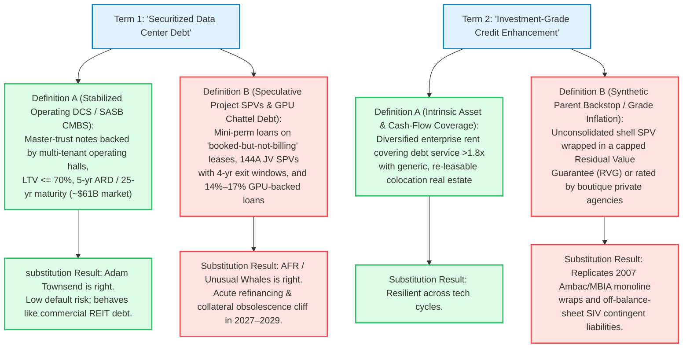
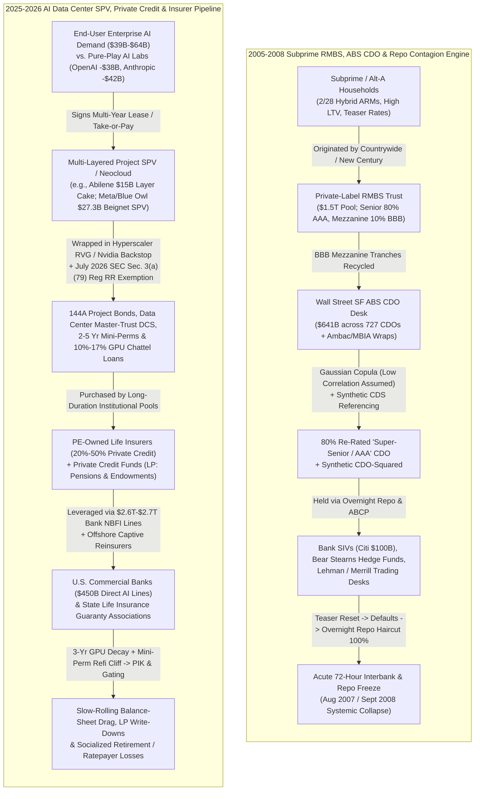
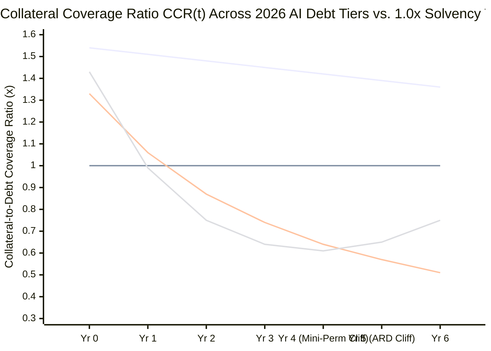

On October 21, 2026, a fiery structural debate erupted across institutional credit desks and financial social media over a deceptively simple question: **Is Wall Street repackaging speculative AI data center debt into institutional retirement portfolios using the same playbook that ignited the 2008 subprime mortgage crisis?**

The flashpoint began when market-flow tracker **Unusual Whales (`@unusual_whales`)** amplified a stark warning from an October 2026 policy investigation jointly published by the **Americans for Financial Reform Education Fund (AFREF)** and the **Open Markets Institute (OMI)**:

> "BREAKING: 'Speculative data center debt is being repackaged and sold to pension and retirement funds, university endowments, and other institutional investors in a manner eerily reminiscent of the subprime bubble,' per AFR"
> — **@unusual_whales**, October 21, 2026 (quoting *Brace for Impact: Protecting People and the Economy When the AI Bubble Bursts*, AFREF / OMI, October 2026)

Hours later, private investor and former Wall Street executive **Adam Townsend (`@adamscrabble`)**, citing firsthand familiarity with the mortgage debt and Collateralized Mortgage Obligation (CMO) machine around the collapse of Bear Stearns, issued a blistering rebuttal dismissing the comparison outright:

> "🙏 Respectfully, nothing like it, not even remotely close and I don't know what unusual whales is, so whatever. I'm pretty intimately familiar with the mortgage debt/CMO and in fact also close with Bear Stearns at the time - so I don't speak philosophically or from a 'sounds the same' hot-take. 2008 was a complex issue and it started a decade before when Clinton then bush wanted to expand home ownership and credit worthiness was thrown out the window... Around 1995+ the big banks came out with private label CMOs that were not backstopped... banks and the credit agencies took the junk mortgages and wrapped in a pay for play Ambac AAA+ rating... That paper came with adjustable rates and when that low rate expired it went to market rate and the mortgage rates soared and the loans couldn't be serviced. The banking shops had no idea what the actual value of the CMOs were and what was in them, everything was indistinguishable because it was all indiscriminately rated aaa. Before the CMOs collapsed the banking shops had hedged against their loans they had borrowed against the value of their inventory of the CMOs so they created opaque, synthetic hedges... so in short they have no resemblance to 'data center debt instruments'"
> — **Adam Townsend (`@adamscrabble`)**, October 21, 2026

**Who is right?**

When we subject both viral arguments to our 8-phase **"Panning for Gold"** forensic methodology—cross-examining the **SEC Office of Structured Finance's July 29, 2026 Interpretive Letter** on Data Center Securitizations, Q2 2026 Form 10-Q/10-K footnote disclosures across the nine largest AI hyperscalers and chipmakers, Federal Reserve bank-to-nonbank credit exposure ledgers, and the empirical post-mortems of the 2007–2008 Structured Finance ABS CDO collapse—a far more nuanced, dangerous reality emerges:

**Both the viral "2008 Subprime Replay" alarmism and the complacent "Zero Resemblance" dismissal fail a rigorous forensic audit.**

Townsend is mechanically correct that 2026 data center bonds are not pools of thousands of zero-down-payment consumer teaser-rate mortgages re-securitized into synthetic CDO-squareds and funded via overnight bank repo. **However**, Townsend's blanket dismissal completely overlooks that in 2025–2026, tech giants and private credit sponsors engineered **$3.1 trillion in off-balance-sheet lease and purchase commitments**, deployed **Enron- and Citigroup-SIV-style unconsolidated Special Purpose Vehicles (SPVs)** (such as Meta and Blue Owl's **$27.3 billion Beignet Investor LLC** in Louisiana and the **$15 billion Abilene Stargate layer cake**), lobbied the SEC in **July 2026** to exempt Data Center Master Trusts from post-2008 Dodd-Frank 5% risk-retention rules, and funneled hundreds of billions of dollars in illiquid infrastructure debt into **private-equity-owned life insurers and pension funds**.

---

**FORENSIC COMPARATIVE SCORECARD: 2005–2008 SUBPRIME RMBS/CDO COMPLEX VS. 2025–2026 AI DATA CENTER DEBT COMPLEX**

| STRUCTURAL DIMENSION | 2005–2008 SUBPRIME RMBS & ABS CDO CRISIS | 2025–2026 AI DATA CENTER & COMPUTE DEBT COMPLEX |
| :--- | :--- | :--- |
| **Total Underlying Debt Footprint** | $1.5T subprime mortgages ($2.3T in 2026 USD) + $641B SF ABS CDOs | $595B on-balance-sheet debt + $3.1T off-balance-sheet commitments ($3.7T total) |
| **Securitized / Private Credit Pool** | ~$1.2T Private-Label RMBS + $641B Cash/Synthetic CDOs | ~$61B DCS/SASB CMBS + $450B–$800B Private Credit / 144A Project Debt |
| **Ultimate Obligor / Counterparty** | Millions of fragmented subprime/Alt-A households (FICO <620, high LTV) | Bifurcated: Cash-rich Hyperscalers (GOOG/MSFT/META) vs. Cash-burning AI Labs & Neoclouds |
| **Core Physical Collateral** | Single-family residential land & houses (50+ yr physical life) | Powered data center shells (20–30 yr life) + AI GPUs (3–4 yr economic life) |
| **Asset-Liability Duration Mismatch** | Long-lived asset (house) vs. short 2-yr teaser reset (2/28 hybrid ARM) | Short-lived asset (3-yr GPU / 4-yr lease window) vs. 15–30 yr debt maturity |
| **Off-Balance-Sheet Vehicle Architecture** | Bank Structured Investment Vehicles (SIVs) & ABCP Conduits ($300B+ at Citi/banks) | Joint-Venture Variable Interest Entities (VIEs/SPVs) & Uncommenced Leases ($3.1T) |
| **Credit Enhancement & Rating Wedge** | Monoline wraps (Ambac/MBIA) + Gaussian copula CDO tranching of BBB RMBS into AAA | Hyperscaler Residual Value Guarantees (RVGs), lease backstops & Egan-Jones private ratings |
| **Key Regulatory Loophole** | 2004 SEC Net Capital Rule exemption + OTS preemption of state lending laws | July 29, 2026 SEC Section 3(a)(79) letter exempting DCS Master Trusts from Reg RR (5% skin in game) |
| **Synthetic Multiplier Layer** | Massive: CDS and Synthetic CDOs multiplied mezzanine RMBS losses 5x to 8x | Minimal: No standardized synthetic CDO-squared market on data center ABS tranches |
| **Primary Institutional Holders** | Money-center bank trading desks, repo-funded hedge funds (Bear Stearns), SIVs | Pension funds, university endowments, private credit funds (BDCs), PE-owned life insurers |
| **Commercial Bank Transmission** | Direct balance-sheet warehouse losses + overnight ABCP/repo liquidity freeze | $2.6T–$2.7T bank credit lines to NBFIs + $450B direct AI bank commitments ($150B drawn) |
| **Primary Failure & Contagion Mode** | Acute 72-hour wholesale bank funding & overnight repo run (Aug 2007 / Sept 2008) | Slow-rolling mini-perm refinancing crunch, private credit gating & insurer/pension return drag |

---

## 1. Issue Classification, Boundary Framing & Falsifiability Criteria

To prevent semantic sleight of hand from either camp, we decompose the controversy into three testable forensic questions—two descriptive and one prescriptive—and establish explicit falsifiability thresholds.

### The Core Investigative Questions
1. **Instrument & Collateral Mechanics (Descriptive):** How do the four distinct tiers of 2026 AI infrastructure debt—(a) Master-Trust Data Center Securitizations (DCS) and Single-Asset Single-Borrower (SASB) CMBS, (b) Hyperscaler Off-Balance-Sheet Joint-Venture SPVs and Rule 144A Private Placements, (c) Neocloud GPU-Collateralized Chattel Debt, and (d) Private Credit Direct Lending—mechanically compare to 2005–2008 Private-Label Subprime RMBS and Structured Finance ABS CDOs?
2. **Systemic Contagion & Regulatory Arbitrage (Descriptive):** Does the convergence of the SEC's July 29, 2026 Section 3(a)(79) ABS exemption, private-equity-owned life insurers allocating 20%–50%+ of fixed-income portfolios to illiquid private credit, and commercial banks extending $2.6 trillion to $2.7 trillion in credit commitments to Non-Bank Financial Intermediaries (NBFIs) create a 2008-style banking panic, or does it engineer a slower, chronic socialization of losses across retirement savers and annuity policyholders?
3. **Fiduciary & Regulatory Positioning (Prescriptive):** What concrete underwriting rules and regulatory guardrails should institutional fiduciaries (pensions, endowments, insurers) and financial supervisors enforce to separate senior, cash-flowing digital infrastructure credit from toxic "subprime compute" structures?

### Falsifiability Criteria
* **Falsifying the "2008 Systemic Banking Panic" Thesis (Why It Won't Be Lehman 2.0):**
  1. **Absence of Overnight Repo & Synthetic CDO Multipliers:** If >80% of non-investment-grade data center and GPU private credit remains locked inside closed-end LP vehicles, unlevered pension allocations, and long-duration life insurance general accounts without daily mark-to-market repo margin calls or synthetic CDS replication, defaults cannot trigger an overnight commercial bank clearing freeze.
  2. **Hyperscaler Parent Balance-Sheet Absorption:** If Microsoft, Alphabet, Amazon, and Meta honor their lease backstops and Residual Value Guarantees (RVGs) out of their $533 billion cash reserves and >$400 billion in non-AI annual operating cash flow without breaching investment-grade covenants.
* **Falsifying the "Benign Infrastructure / Zero Subprime Resemblance" Thesis (Where Contagion Strikes):**
  1. **Mini-Perm & Neocloud Refinancing Default Wave:** If >15% of the $450B–$800B private credit data center and GPU loan cohort fails to refinance at the 3-to-5-year mini-perm maturity cliff between 2027 and 2029 due to falling GPU rental rates ($8/hr → $1/hr) or canceled "booked-but-not-billing" tenant leases.
  2. **Forced VIE Balance-Sheet Reconsolidation & Insurer Rating Downgrades:** If FASB/PCAOB audit enforcement or SPV distress forces hyperscalers to consolidate hundreds of billions in off-balance-sheet joint-venture debt (mirroring Citigroup's $100B SIV reconsolidation in late 2007), or if the National Association of Insurance Commissioners (NAIC) invalidates private letter ratings on PE-insurer data center notes.

---

## 2. Primary Source Excavation & The Claim Schism Matrix

We anchor every empirical figure in canonical legal, regulatory, and academic primary documents rather than secondary social media commentary.

**PRIMARY ARTIFACT TRACEABILITY MATRIX**

| Domain | Canonical Primary Source | Identifier / Citation | Key Verified Finding |
| :--- | :--- | :--- | :--- |
| SEC ABS Exemption | SEC Division of Corporation Finance / Latham & Watkins LLP | Interpretive Letter: *Certain Data Center Securitizations* (July 23 / July 29, 2026) | Concurs that Data Center Master Trusts ($50B+ issued since 2018) are NOT "Exchange Act ABS" under Sec. 3(a)(79), exempting them from Reg RR 5% risk retention |
| Watchdog Investigation | Open Markets Institute & Americans for Financial Reform Ed. Fund (Scherer & Jenkins) | *Brace for Impact: Protecting People and the Economy When the AI Bubble Bursts* (Oct 2026) | Audits $595B on-balance-sheet debt + $3.1T off-balance-sheet commitments across 9 AI giants vs. $1.5T ($2.3T 2026 USD) 2007 subprime mortgage peak |
| 10-Q / 10-K Footnotes | Alphabet, Meta, Microsoft, Amazon, Oracle & Nvidia SEC Filings | Q2 2026 Form 10-Q / FY26 Form 10-K Commitments & Contingencies Notes | Uncommenced leases & purchase obligations: GOOG $896B, META $696B, MSFT $523B, AMZN $267B, ORCL $260B, NVDA $531B (incl. $109B guarantees) |
| Project Finance Anatomy | Center for Public Enterprise (Advait Arun) | *Bubble or Nothing: Data Center Project Finance* (Nov 2025) | Maps T-chart asset-liability mismatches: 2–5 yr mini-perms, 20–30 yr ABS/CMBS term loans, 3–4 yr GPU decay, and $27.3B–$29B Meta/Blue Owl/PIMCO SPV |
| Infrastructure Debt Risk | University of Chicago Booth School of Business (Prof. Stefan Hepp) | *How Worried Should We Be About AI Debt?* / Fama-Miller Paper (Aug 2026) | Permanent losses in AI infrastructure debt fall first on private-credit LPs (pensions, endowments) and PE-owned life insurers via untested GPU collateral |
| PE-Insurer Contagion | Yale University & UT Law (Pranjal Drall & Prof. Andrew Granato) | *Private Credit's State Backstop: How Private Equity Socializes Risk Through Insurers* (2026) | PE-backed insurers hold ~15% of life market, over-allocate to illiquid private credit, use offshore captive reinsurers, and socialize tail risk via state guaranty tax credits |
| Bank-to-NBFI Exposure | Federal Reserve Board & Federal Reserve Bank of Boston / Chicago | *Financial Stability Report* (May 2026); Boston Fed Note (Aug 2026); Chicago Fed (Feb 2026) | U.S. commercial banks hold $2.6T–$2.7T in credit commitments to NBFIs (private credit, BDCs, CLOs/ABS) + $450B direct AI credit lines ($150B drawn) |
| 2008 Subprime Benchmark | Federal Reserve Bank of Philadelphia (Cordell, Huang & Williams) & FCIC | Working Paper 11-30/R *Collateral Damage* (May 2012); *FCIC Final Report* (Jan 2011) | 727 publicly traded SF ABS CDOs totaled $641B (1999–2007), suffering ~$420B in losses as BBB RMBS tranches were recycled into CDO-squareds |

### The 2-Column Claim Schism Matrix: Auditing Both Viral Poles

Both `@unusual_whales` (summarizing the AFREF/OMI report) and `@adamscrabble` (defending Wall Street structured finance) mix valid structural insights with critical analytical blind spots:

| Analytical Dimension | Public Social Media Claim (`@unusual_whales` vs. `@adamscrabble`) | Audited Forensic & Statutory Reality |
| :--- | :--- | :--- |
| **1. "Data Center Securitizations Are Just Like 2008 Subprime CMOs"** | *`@unusual_whales` / AFR Pitch:* Speculative data center debt is being sliced, repackaged into ABS/CMBS, and dumped onto pensions and endowments just like 2007 subprime mortgages. | **Conflates Four Distinct Debt Tiers.** Formal Data Center ABS Master Trusts and SASB CMBS (~$61B outstanding) are backed by *already-operating* facilities with <=70% LTV and investment-grade utility/lease cash flows—not NINJA household loans. The genuine "subprime" toxicity resides in **unconsolidated JV SPVs ($3.1T lease/purchase commitments), "booked-but-not-billing" mini-perm construction loans, and 10%–17% GPU-collateralized private credit facilities** held inside private credit funds and PE-owned life insurers. |
| **2. "Data Center Debt Has Zero Resemblance to 2008 Structures"** | *`@adamscrabble` Rebuttal:* 2008 was driven by government homeownership mandates, non-agency subprime ARMs, Ambac AAA wraps, and synthetic hedges; data center debt looks nothing like it. | **Ignores 2026 Regulatory Arbitrage & Off-Balance-Sheet VIEs.** Townsend misses four exact structural rhymes: (1) On **July 29, 2026**, the SEC exempted Data Center Master Trusts from Exchange Act Section 3(a)(79) ABS rules, stripping away Dodd-Frank's 5% risk-retention requirement; (2) Hyperscalers use **monoline-like Residual Value Guarantees (RVGs) and lease backstops** (e.g., Meta's $27.3B Beignet SPV; Google's $44B Anthropic backstop) to manufacture A+/BBB ratings for shell entities; (3) Private rating agency grade inflation (SEC probe of **Egan-Jones** over $40B in insurer debt); and (4) **Enron/Citi-SIV off-balance-sheet accounting** hiding $3.1T in commitments. |
| **3. "Adjustable-Rate Resets Caused 2008; Data Centers Have Fixed Leases"** | *`@adamscrabble` Rebuttal:* Subprime collapsed because 2/28 teaser ARMs reset to market rates and borrowers couldn't service them; corporate data center leases don't work like that. | **Inverts the Duration Mismatch.** In 2006, the underlying asset was a **50-year house** financed with a **2-year resetting loan**. In 2026, the underlying asset inside an AI data center is a **3-to-4-year rapidly depreciating GPU cluster** (and thermal layout) financed inside **15-to-30-year debt structures** with **2-to-5-year "mini-perm" construction loan maturities** and **4-year lease exit windows**. The refinancing cliff is embedded in the *collateral obsolescence and lease rollover*, not a household teaser rate! |
| **4. "Banks Had No Idea What Was Inside 2008 CMOs; Today's Deals Are Transparent"** | *`@adamscrabble` Rebuttal:* In 2008 everything was indiscriminately rated AAA and banks held opaque synthetic inventory; modern institutional infrastructure debt is transparently underwritten. | **Contradicted by the Fed, BIS, and NAIC.** As Treasury Secretary Scott Bessent, Fed Vice Chair Michelle Bowman, the BIS (June 2026), and the Financial Stability Board (May 2026) warn, **$1.8T–$3.0T in private credit** and **$3.1T in off-balance-sheet tech commitments** sit in an opaque regulatory blind spot. In June 2026, the **NAIC** launched a formal inquiry into whether credit ratings on life insurers' data center debt hold up, while commercial banks carry **$2.6T–$2.7T in credit lines to NBFIs** whose underlying portfolio cross-collateralization is invisible to public markets. |

---

## 3. Semantic Precision, The Substitution Test & The 4-Tier Debt Taxonomy

The primary reason commentators talk past one another is that the phrase **"data center debt instruments"** is used as a catch-all umbrella for four radically different credit structures. We apply Browne & Keeley's **Substitution Test** to three foundational terms in this debate.

### 1. "Repackaged Data Center Debt"
* **Definition A (Stabilized Operating Master-Trust DCS & SASB CMBS):** Fixed-income notes issued by a bankruptcy-remote master trust (e.g., Switch, QTS, Vantage, Digital Realty) collateralized by completed, operating multi-tenant data center campuses, active power interconnections, and diversified enterprise colocation contracts at a Loan-to-Value (LTV) ratio of <=70%.
* **Definition B (Speculative Construction Mini-Perms, JV SPVs & GPU Chattel Debt):** High-yield private credit loans, Rule 144A project bonds issued by single-tenant joint-venture shell companies (VIEs), construction loans underwritten against uncommenced "booked-but-not-billing" leases, and debt facilities collateralized directly by depreciating H100/B200 GPUs.
* **The Substitution Verdict:** When Wall Street defenders like Townsend argue data center debt is safe, they implicitly substitute **Definition A** (~$61 billion cumulative market). When AFREF, OMI, and Chicago Booth economists warn of a subprime-style reckoning, they are pointing to **Definition B**—which encompasses **$450B–$800B in private credit**, **$1.1 trillion in uncommenced hyperscaler lease obligations**, and **$2.0 trillion in forward purchase commitments**.

### 2. "AAA / Investment-Grade Credit Wrap"
* **Definition A (Diversified Self-Liquidating Cash Flow):** A credit rating derived from thousands of statistically independent cash-flowing contracts with low pairwise default correlation and durable physical collateral recovery.
* **Definition B (Counterparty Backstop & Residual Value Guarantee Arbitrage):** A credit rating bestowed upon a heavily leveraged shell company (SPV) solely because a tech giant provides a capped **Residual Value Guarantee (RVG)** (as Meta did for PIMCO/Blue Owl's **$27.3 billion Beignet Investor LLC** deal, earning an S&P A+ rating) or a conditional lease backstop (as Alphabet provided for **$35B–$44B of Anthropic data center leases** and **$3.2B of TeraWulf/Fluidstack junk bonds**, or as Nvidia provided for **$105B of OpenAI Ohio leases**)—or because a life insurer obtained a private letter rating from a boutique agency like **Egan-Jones** (currently under SEC investigation for grade inflation across $40 billion of insurer debt).
* **The Substitution Verdict:** Under **Definition B**, modern AI infrastructure finance directly rhymes with the 2005–2007 **Ambac and MBIA monoline bond insurance wraps** that Townsend himself cited! Instead of Ambac stamping a AAA wrap onto a subprime RMBS pool, today's hyperscalers and chipmakers stamp off-balance-sheet RVGs and lease guarantees onto leveraged Neocloud and private-credit SPVs so that PIMCO, BlackRock, and PE-owned life insurers can slot the paper into investment-grade institutional buckets.

### 3. The 4-Tier Taxonomy of 2026 AI Infrastructure Debt

To replace confusion with precision, every institutional allocator must segment "AI data center debt" across four structural tiers:

**THE 4-TIER AI INFRASTRUCTURE & COMPUTE DEBT TAXONOMY (OCTOBER 2026)**

| Debt Tier & Instrument Class | Estimated Market Scale (Late 2026) | Representative Issuers & Landmark Deals | Underlying Collateral & Tenor Structure | Primary Buyer Base | True Forensic Risk Profile |
| :--- | :--- | :--- | :--- | :--- | :--- |
| **Tier 1: Stabilized Master-Trust DCS & SASB CMBS** | ~$61 Billion outstanding ($26B–$40B/yr issuance) | Switch (*SWCH 2025-DATA* $2.4B CMBS; $768M Apr 2026 ABS), QTS ($1B ABS), Vantage | Operating data halls, land, power interconnects & active leases; <=70% LTV; 5-yr ARD / 25–30 yr final maturity | Pension funds, insurance general accounts, IG bond ETFs | **Low-to-Moderate:** Exempted from SEC Reg RR on July 29, 2026; exposed to 5-yr ARD refinancing spreads & thermal retrofit capex |
| **Tier 2: Hyperscaler Off-Balance-Sheet JV SPVs & 144A Project Bonds** | ~$150B+ active SPVs (part of $1.1T uncommenced leases) | Meta / Blue Owl / PIMCO (*Beignet Investor LLC* $27.3B); Oracle / Crusoe / Blue Owl / JPM (*Abilene* $15B); Oracle STACK ($18B & $38B) | Single-tenant hyperscale AI campus; 4-yr mini-perm or short lease window + Hyperscaler Residual Value Guarantee (RVG) | PIMCO, BlackRock ETFs, life insurers, sovereign wealth, syndication banks | **Moderate-to-High (Accounting & Rollover Risk):** Keeps debt off hyperscaler balance sheets unless tenant exits at Year 4 or RVG is triggered |
| **Tier 3: Neocloud & AI Lab Backstopped Conduits** | ~$300B+ in guarantees & circular facilities | Google / Anthropic ($35B–$44B lease backstop; $200B SPV pipeline); Nvidia / OpenAI ($105B Ohio backstop); Google / TeraWulf / Fluidstack ($3.2B) | Bespoke AI training/inference shells leased to cash-burning AI labs or neoclouds; contingent parent guarantees | High-yield bond funds, private credit funds, crossover institutional LPs | **High (Counterparty & Voidability Risk):** Backstops often contain construction-delay or covenant walk-away clauses (e.g., 180-day delay voidance) |
| **Tier 4: "Subprime Compute" — GPU Chattel Debt & Uncontracted Mini-Perms** | ~$450B–$800B (by 2028) in tech/AI private credit & junk notes | CoreWeave ($2.3B & $7.5B Blackstone/Magnetar GPU SPVs; 10%–17% debt); xAI GPU SPV; SpaceX $25B bonds; Fermi ($15B pre-revenue REIT) | Rapidly depreciating H100/B200 GPUs (3–4 yr life), "booked-but-not-billing" promises, or uncontracted land | Private credit funds (BDCs), PE-owned life insurers (Apollo/Athene, KKR), pensions/endowments (as LPs) | **Severe ("Subprime Compute"):** Collateral decays faster than debt amortizes; 15%+ distressed yields; untested fire-sale liquidation value |

---

## 4. Causal Disentanglement & The Structural Anatomy of Two Bubbles

Let us compare the exact mechanical plumbing of the **2005–2008 Subprime Mortgage & ABS CDO Machine** against the **2025–2026 AI Data Center Layer Cake & Shadow Credit Pipeline**.

### Deconstructing the Two Concrete 2026 "Layer Cake" Archetypes

To see why Adam Townsend's claim that modern data center debt is plain-vanilla corporate credit falls apart, examine two flagship structures audited in the October 2026 AFREF/OMI and Center for Public Enterprise reports:

1. **The $27.3B–$29B Meta / Blue Owl / PIMCO "Beignet Investor LLC" SPV (Richland Parish, Louisiana):**
   * Rather than issuing corporate debt on its own balance sheet to build its flagship **Hyperion** AI data center complex in Louisiana, **Meta Platforms** partnered with private credit giant **Blue Owl Capital** to create a special-purpose joint venture (**Beignet Investor LLC**), split **80% Blue Owl / 20% Meta**.
   * Underwritten by Morgan Stanley, the SPV issued roughly **$27.3 billion in Rule 144A senior secured notes** (anchored by **PIMCO** and purchased into **BlackRock ETFs**, pension accounts, and insurer portfolios), rated **A+ by S&P**.
   * **The Accounting Trick:** Meta serves as developer, operator, and sole tenant under a series of short-term operating lease windows (starting with an initial 4-year window) and provides a capped **Residual Value Guarantee (RVG)** promising to cover debt shortfalls if Meta exits the lease and the facility's resale value falls short. As Columbia Business School Professor **Stijn Van Nieuwerburgh** demonstrated in June 2026, this joint-venture VIE structure allows Meta to recognize **neither** the full multi-decade lease debt **nor** the Residual Value Guarantee on its consolidated balance sheet—even though, with mathematical certainty, one of the two liabilities must eventually materialize!
2. **The $15B Abilene "Stargate" 6-Entity Layer Cake (Texas):**
   * **OpenAI** (which lost **$38 billion on $13 billion of revenue in 2025**) trains frontier models at the flagship Stargate campus in Abilene, Texas.
   * OpenAI does not own the data center or the GPUs; it leases compute capacity from **Oracle** (part of a $300 billion commitment) using capital raised from **SoftBank** and **Nvidia**.
   * **Oracle** (which now carries **$120 billion in on-balance-sheet long-term debt** and **$260 billion in off-balance-sheet lease commitments**, with its 5-year CDS spreads spiking near 18-year highs in July 2026) does not own the Abilene facility either; Oracle leases the building for 15 years from neocloud **Crusoe Energy** while committing **$40 billion** to buy Nvidia Blackwell chips to fill it.
   * **Crusoe Energy** does not fully own the site either; Crusoe co-developed it via a shell company with **Blue Owl Capital** and **Primary Digital Infrastructure (PDI)** using $5 billion in equity and nearly **$10 billion in project debt from JPMorgan Chase**, sitting on land owned by yet another entity, **Lancium**.

### The 4-Way Causal Matrix: Why Is AI Infrastructure Being Financed Like This?

Why have the richest corporations in human history abandoned simple balance-sheet funding in favor of a $3.1 trillion labyrinth of unconsolidated VIEs, mini-perm loans, and private credit securitizations?

**4-WAY CAUSAL MATRIX: DRIVERS OF THE 2026 SHADOW DATA CENTER DEBT ENGINE**

| Causal Pathway | Mechanistic & Empirical Forensic Audit |
| :--- | :--- |
| **1. Direct Causation (Balance-Sheet & Credit Rating Defense: X → Y)** | Combined CapEx at Alphabet, Amazon, Meta, and Microsoft surged to **$720B–$760B in 2026 (>100% of Operating Cash Flow)**, turning Alphabet's and Amazon's quarterly Free Cash Flow negative in mid-2026. Borrowing $3.1T directly on corporate balance sheets would trigger immediate Moody's/S&P credit rating downgrades and crush Return on Invested Capital (ROIC). Offloading debt into 80/20 private credit SPVs and uncommenced leases preserves headline credit ratings. |
| **2. Reverse Causation (Yield-Starved Institutional Capital Push: Y → X)** | Private equity firms (Apollo, KKR, Blackstone, Blue Owl) acquired **~15% of the U.S. life insurance industry** and raised **$1.8T–$3.0T in private credit funds**. Needing massive, multi-billion-dollar deployment tickets offering +150 to +300 bps of illiquidity yield pickup over public corporate bonds to feed annuity liabilities and pension LP targets, shadow lenders actively *engineered and pitched* off-balance-sheet SPVs and GPU facilities to tech CFOs. |
| **3. Lurking Confounder Z (2025–2026 Deregulatory Arbitrage)** | Two synchronized regulatory shifts supercharged the pipeline: (1) In **February 2024**, Moody's revised hybrid bond equity-credit rules, allowing utilities and telecoms to issue subordinated debt at a post-2008 low spread of +145 bps; and (2) On **July 29, 2026**, the SEC's Office of Structured Finance ruled that Data Center Master Trusts are **not "Exchange Act ABS" under Section 3(a)(79)**, eliminating Dodd-Frank Regulation RR's mandatory 5% sponsor risk retention ("skin in the game") and Rule 192 conflict-of-interest bans, while the DOL moved to open **$14T in 401(k) plans** to private credit. |
| **4. Mutual Feedback Loop (The Circular Collateral Flywheel: X ↔ Y)** | Chipmaker (**Nvidia**) invests equity/backstops ($105B Ohio lease guarantee; $6.3B CoreWeave buyback; $531B total off-balance-sheet commitments) into AI labs/neoclouds → Neoclouds pledge those GPUs and backstopped leases as collateral to borrow from Private Credit / PE Insurers → Proceeds buy more Nvidia GPUs and lease hyperscaler shells → Paper valuation gains ($160B of Big Tech's $285B Q2 2026 profits came from unrealized marks on Anthropic/SpaceX stakes) justify further debt issuance. |

---

## 5. Quantitative & Statistical Audit: Three Formal Equations

To move beyond qualitative analogies, we formulate the exact mathematical mechanics governing (1) tranche correlation vs. single-tenant RVG tail risk, (2) the inverted asset-liability duration mismatch, and (3) the PE life-insurer state guaranty contagion multiplier.

### 1. The 2008 Gaussian Copula Failure vs. 2026 Single-Counterparty RVG Binary Risk

Adam Townsend correctly notes that in 2005–2007, Wall Street banks and rating agencies took BBB-rated subprime RMBS mezzanine tranches (which typically attached at 3%–5% pool losses and detached at 7%–10% losses) and repackaged them into **Structured Finance ABS CDOs** ($641 billion across 727 deals, per **Cordell, Huang & Williams [2012]** at the Philadelphia Fed), rating 70% to 80% of the new CDO liabilities **AAA**.

How was that mathematically justified before 2008, and how does 2026 differ?
In a latent-factor Gaussian copula model (David Li, 2000), the standardized asset return (`Z_i`) of borrower `i` is driven by a common macroeconomic housing factor (`M ~ N(0,1)`) and an idiosyncratic shock (`ε_i ~ N(0,1)`) with pairwise correlation `ρ`:

$$
Z_i = \sqrt{\rho}\, M + \sqrt{1 - \rho}\, \epsilon_i, \qquad P(\text{Default}_i \mid M) = \Phi\!\left(\frac{\Phi^{-1}(p_i) - \sqrt{\rho}\, M}{\sqrt{1 - \rho}}\right)
$$

* **The 2008 Error (ρ ≈ 0.05 → 0.80):** Rating agencies assumed low cross-regional correlation (`ρ ≈ 0.05 to 0.15`) across thousands of mortgages (`N ≈ 5,000`). When national home prices fell simultaneously, `ρ` spiked toward 0.80, causing the loss distribution to become bimodal ("all or nothing") and wiping out **~98% of BBB RMBS CDO tranches ($420 billion in losses)**.
* **The 2026 Structural Reality (N = 1 to 5, ρ → 1.0):** A 2026 single-asset data center SPV (like Meta's $27.3B Beignet Investor LLC or Oracle/Crusoe's $15B Abilene vehicle) or a Neocloud portfolio (where Microsoft and Nvidia account for **60% to 77% of CoreWeave's revenue**, and Anthropic and OpenAI account for **>98% of enterprise GenAI API spend** per the August 2026 Ramp AI Index) does **not** have `N = 5,000` independent borrowers. It has **extreme concentration (`N = 1 to 5`) with near-unity intrasectoral correlation (`ρ → 1.0`)**!

Consequently, the expected loss (`E[Loss_SPV]`) to institutional bondholders (pensions, PIMCO, BlackRock, life insurers) at the initial lease renewal or mini-perm maturity cliff (`T_cliff ≈ 4 to 5 years`) is governed by the residual value shortfall beyond the parent's capped Residual Value Guarantee (`RVG_cap`):

$$
E[\text{Loss}_{\text{SPV}}] = P(\text{Non-Renewal at } T_{\text{cliff}}) \cdot \max\!\Big(0,\; D_{\text{senior}}(T_{\text{cliff}}) - V_{\text{market}}(T_{\text{cliff}}) - \text{RVG}_{\text{cap}} \cdot \mathbb{I}_{\text{valid}}\Big)
$$

Where `I_valid ∈ {0, 1}` is the indicator function for whether the parent backstop remains legally enforceable (recall from **Advait Arun [2025]** that in Google's $3.2 billion TeraWulf/Fluidstack junk bond backstop, if construction is delayed by >180 days, Fluidstack can terminate the lease and **void Google's guarantee entirely**, leaving bondholders with `I_valid = 0`!).

### 2. The Inverted Asset-Liability Duration Mismatch Equation

Townsend argues that 2008 collapsed because subprime mortgages had 2-year adjustable teaser rates that reset upward. What Townsend misses is that **2026 has the exact inverse duration mismatch—and from a collateral recovery standpoint, 2026's mismatch is physically worse.**

* **In 2006:** The physical collateral was a **50-year residential house and land** (`δ_house ≈ 1%–2%/yr` physical depreciation), financed by a **30-year mortgage with a 2-year teaser rate reset**. Even after foreclosure, the physical house remained standing for decades.
* **In 2026:** As documented in our prior telecom comparison and corroborated by **Stefan Hepp (Chicago Booth, August 2026)** and **Advait Arun (CPE, November 2025)**, AI infrastructure debt finances two coupled assets with violently diverging decay rates:
  1. A **20-to-30-year powered shell** (`V_shell,0`) that nevertheless faces rapid **thermal and power-density obsolescence** (`δ_shell ≈ 8%–12%/yr` without massive retrofit capex as rack densities jump from 30 kW air-cooled to 130–250 kW direct-to-chip liquid-cooled for Blackwell/Rubin architectures).
  2. **AI GPUs (`V_GPU,0`)** with an economic half-life of **18 to 36 months** (`δ_GPU ≈ 45%–60%/yr`), evidenced by Nvidia H100 spot rental rates collapsing **87.5% from $8.00/hour in 2023 to ~$1.00/hour by 2025–2026**, and real-world hyperscaler GPU utilization studies tracking an actual operational lifespan of **1 to 3.7 years** against a 5.5-to-6-year GAAP accounting schedule (**Michael Burry [Nov 2025 / Sept 2026]** estimating **$207B–$227B** in overstated hyperscaler earnings through 2028).

Let us define the **Collateral Coverage Ratio (`CCR(t)`)** at year `t` for a leveraged data center / compute SPV with initial debt `D_0`, initial Loan-to-Value `LTV_0 = D_0 / (V_shell,0 + V_GPU,0)`, hardware share of capital cost `w_GPU ∈ [0, 1]`, and linear principal amortization rate `α`:

$$
\text{CCR}(t) = \frac{(1 - w_{\text{GPU}})\, e^{-\delta_{\text{shell}} t} + w_{\text{GPU}}\, e^{-\delta_{\text{GPU}} t}}{\text{LTV}_0 \cdot (1 - \alpha t)}
$$

Let us evaluate `CCR(t)` at the **Year 4 refinancing / lease rollover cliff (`t = 4`)** across three real-world 2026 structures:
1. **Tier 1 Stabilized Multi-Tenant Colocation DCS (`w_GPU = 0`, `δ_shell = 0.04`, `LTV_0 = 0.65`, `α = 0.02`):**
   * At `t = 4`: `CCR(4) = 0.852 / 0.598 ≈` **1.42x** (Healthy equity cushion; refinances cleanly).
2. **Tier 2 Bespoke AI Training Campus with Interest-Only Mini-Perm (`w_GPU = 0.35`, `δ_shell = 0.10`, `δ_GPU = 0.50`, `LTV_0 = 0.75`, `α = 0` [interest-only during 4-yr mini-perm]):**
   * At `t = 4`: `CCR(4) = (0.436 + 0.047) / 0.75 = 0.483 / 0.75 ≈` **0.64x** (**Deeply underwater by 36%** if the anchor tenant does not renew, triggering the Residual Value Guarantee or lender loss!).
3. **Tier 4 Neocloud GPU-Collateralized Chattel Facility (`w_GPU = 0.90`, `δ_GPU = 0.55`, `LTV_0 = 0.70`, `α = 0.15`):**
   * At `t = 3`: `CCR(3) = (0.074 + 0.173) / 0.385 = 0.247 / 0.385 ≈` **0.64x** (**Underwater by 36% at Year 3**, explaining why CoreWeave had to pay **10% to 17% interest rates** and why its 2032 senior notes traded down to distressed yields in 2026!).

### 3. The PE-Owned Life Insurer & State Guaranty Assessment Multiplier

How does distress in Tier 2, Tier 3, and Tier 4 AI debt reach everyday working families if commercial banks aren't holding subprime CDOs on overnight repo?
Through **private-equity-owned life insurance companies** (which control ~15% of the U.S. life and annuity market, led by Apollo/Athene, KKR/Global Atlantic, and Brookfield) and **pension fund private credit allocations**.

As documented by **Pranjal Drall (Yale) and Prof. Andrew Granato (UT Law) (2026)** and the **Financial Times / WSJ (2026)**:
* U.S. life insurers hold roughly **20% of their fixed-income assets in private, illiquid debt**, while PE-owned life insurers allocate **over 50% of their fixed-income portfolios to private credit and structured private placements**—including high-interest data center loans and Buy Now, Pay Later (BNPL) consumer receivables.
* Life insurers operate with thin statutory capital-to-asset cushions (`e_stat = E_0 / A_0 ≈ 7% to 10%`, or **10x to 14x balance-sheet leverage**), and PE-owned insurers frequently cede liabilities to affiliated **offshore captive reinsurers** (in Bermuda or Cayman) that invest in the *exact same* affiliated private credit funds.

Following Drall & Granato's (2026) solvency identity, if a PE-owned insurer allocates a fraction `ω_PC ∈ [0.35, 0.55]` of its total assets `A_0` to illiquid private credit and AI infrastructure debt, and suffers a default/impairment loss rate `L_PC` across both its direct balance sheet and its correlated offshore captive reinsurer (correlation `γ_captive → 1`), its post-shock statutory equity ratio (`e_post`) is:

$$
e_{\text{post}} = \frac{E_0 - A_0 \cdot \omega_{\text{PC}} \cdot L_{\text{PC}} \cdot (1 + \gamma_{\text{captive}}\, \theta_{\text{reins}})}{A_0 \cdot \big(1 - \omega_{\text{PC}} \cdot L_{\text{PC}}\big)}
$$

* **Numerical Stress Test:** Suppose an insurer has an initial statutory capital buffer `e_stat = 8.0%` (`E_0 / A_0 = 0.08`), holds `ω_PC = 45%` in private credit / AI infrastructure debt, and experiences an aggregate credit write-down of `L_PC = 18%` (even with `θ_reins = 0`). Then:

$$
\text{Capital Loss} = 0.45 \times 0.18 = 8.1\%\text{ of Total Assets } A_0 > 8.0\%\text{ Statutory Equity } E_0 \implies e_{\text{post}} < 0\text{ (Insolvency!)}
$$
* **The State Guaranty Contagion Loop:** When a life insurer fails, state **Life and Health Insurance Guaranty Associations** assess surviving insurers in that state to cover policyholder annuities (up to statutory caps, typically $250,000–$300,000), and surviving insurers recoup those assessments via **dollar-for-dollar state premium tax credits over 5 years**—silently socializing private credit losses onto state taxpayers while dragging down surviving insurers in a self-reinforcing assessment spiral!

### 4. Statistical Denominator & Revenue Gap Audit

Let us audit the macro denominators cited in the October 2026 AFREF/OMI report to verify whether the numbers warrant alarm:
* **End-User AI Revenue vs. CapEx Denominator:** Global AI infrastructure spending exceeded **$1.0 trillion in 2026** (with the Big 4 hyperscalers + Oracle spending >$750 billion). Yet **Gartner (July 2026)** and **Menlo Ventures (Dec 2025)** measure actual global end-user spending on generative AI models and platforms at just **$37B–$39B in 2025** and **$64B in 2026**—less than **6.5% of 2026 infrastructure outlays**! Even *The Economist*'s broader **$150B–$200B** estimate includes circular intra-ecosystem sales (where **Ramp's August 2026 AI Index** shows **80% of OpenAI and Anthropic enterprise revenue comes from just 1% of customers**, heavily skewed toward VC-backed tech companies spending $81/employee vs. $8/employee at non-VC firms).
* **On- vs. Off-Balance-Sheet Debt Denominator:** Across the nine largest AI hyperscalers and chipmakers (Alphabet, Amazon, AMD, Broadcom, Meta, Microsoft, Nvidia, Oracle, and SpaceX), reported on-balance-sheet long-term debt is **$595 billion**, whereas **off-balance-sheet future lease and unconditional purchase commitments hit $3.1 trillion in August/September 2026** (**$3.7 trillion combined**)—surpassing the **$1.5 trillion nominal ($2.3 trillion inflation-adjusted) 2007 U.S. subprime mortgage peak**!

---

## 6. The "Negative View": Omitted Facts, Regulatory Rollbacks & The Graveyard Audit

Following Chapter 11 of the Browne & Keeley framework, we interrogate what **both** sides omitted from their viral posts.

### 1. What Adam Townsend (`@adamscrabble`) Omitted: The July 29, 2026 SEC Loophole & Enron-Style VIEs
By treating 2026 data center bonds as ordinary corporate credit, Townsend ignored four smoking-gun structural hazards:
1. **The July 29, 2026 SEC Section 3(a)(79) Exemption Letter:** On July 23, 2026, law firm **Latham & Watkins LLP** petitioned the SEC's Office of Structured Finance on behalf of the $50B+ Data Center Securitization (DCS) market. Six days later, on **July 29, 2026**, Chief Kayla Roberts issued a formal interpretive letter concurring that master-trust Data Center Securitizations are **not "Exchange Act ABS" under Section 3(a)(79)** because data centers are actively managed physical infrastructure rather than "self-liquidating financial assets." While legally coherent, the immediate real-world effect was to **exempt data center master-trust securitizations from post-2008 Dodd-Frank ABS safeguards**—including **Regulation RR (the mandatory 5% sponsor credit risk retention rule)**, **Rules 15Ga-1/15Ga-2** (repurchase and third-party due diligence disclosures), and **Rule 192** (prohibitions against conflicted securitizations)!
2. **Unrealized Paper Gains Masquerading as Tech Earnings:** In Q2 2026, **$160 billion (56%) of the $285 billion in combined net profits** reported by Alphabet, Amazon, Meta, Microsoft, and Nvidia came not from operating cash sales, but from **unrealized paper mark-to-market gains on their equity stakes in other AI companies (chiefly Anthropic and SpaceX)**!
3. **Private Credit Redemption Gates & Payment-in-Kind (PIK) Stress:** Private credit is not an invulnerable fortress. Starting in November 2025 (when **Blue Owl** gated redemptions in a private credit fund) through mid-2026 (with **$14 billion trapped in gated private credit vehicles** per Bloomberg in July 2026), private credit funds have increasingly resorted to **Payment-in-Kind (PIK) interest**—allowing cash-strapped borrowers to pay interest with more debt—while buying risky Buy Now, Pay Later (BNPL) consumer receivables.
4. **Local Ratepayer & Municipal Stranded-Asset Externalities:** In Q2 2026 alone, bipartisan community backlash **blocked $68 billion in U.S. data center projects**, while satellite/drone audits showed **40% of 2026 U.S. data center builds suffered major construction delays**. Meanwhile, residential electricity bills on the largest U.S. grid (PJM) surged **76%**, and the top five hyperscalers extracted **$26.8 billion in federal depreciation tax breaks in 2025** (reducing Amazon's effective federal tax rate to **1.4%**, Microsoft's to **2.4%**, and Meta's to **3.6%**).

### 2. What `@unusual_whales` & AFREF/OMI Omitted: Why 2026 Will NOT Trigger an Overnight August 2007 Bank Run
Conversely, equating 2026 data center securitizations with the 2008 subprime crisis omits three vital stabilizing differences that prevent an overnight wholesale banking collapse:
1. **No Synthetic CDO-Squared or CDS Multiplier on Bank Trading Desks:** In 2007, $641 billion of SF ABS CDOs and hundreds of billions in sidecar Credit Default Swaps (written by AIG Financial Products, Merrill Lynch, Citigroup, and Morgan Stanley) synthetically multiplied losses on underlying subprime BBB bonds by **5x to 8x**. In 2026, there is **no standardized synthetic CDO-squared market** referencing data center ABS tranches. Losses cannot exceed 100% of principal invested.
2. **Long-Duration Locked-Up Capital vs. Overnight Repo Funding:** Bear Stearns and Lehman Brothers collapsed in 72 hours because they funded illiquid mortgage CDO inventory via **overnight wholesale repo and Asset-Backed Commercial Paper (ABCP)** that evaporated the moment collateral values became uncertain. By contrast, the primary holders of 2026 data center ABS, 144A project bonds, and private credit tranches are **public pension funds, university endowments, closed-end private credit funds (with multi-year lockups and redemption gates), and life insurance annuity accounts**. When those assets sour, they do **not** cause a 48-hour ATMs-stop-working banking panic—they cause **multi-year return drag, gated LP capital, pension underfunding, and higher municipal taxes**.
3. **The Top-4 Hyperscaler Cash Cushion:** While pure-play AI labs (OpenAI losing $38B, Anthropic losing $42B in 2025) and leveraged neoclouds (CoreWeave, Crusoe) are fragile, the core hyperscalers (Alphabet, Microsoft, Amazon, Meta) still generate **>$400 billion annually in high-margin non-AI cash flows** (search, e-commerce, legacy cloud, social ads) and hold **$533 billion in cash**. They can absorb tens of billions in SPV lease write-downs without going bankrupt.

### 3. The Corporate Graveyard Audit: Enron SPEs (2001) & Citigroup SIVs (2007)
History provides two exact forensic precedents for how "off-balance-sheet" debt boomerangs back onto corporate sponsors:
* **Enron's Chewco & JEDI Special Purpose Entities (1997–2001):** Enron used 3% outside equity rules to park billions of dollars of debt and troubled energy/broadband assets inside unconsolidated SPEs backed by Enron stock and guarantees. When the assets soured in autumn 2001, Enron was forced to consolidate the SPEs, wiping out $1.2 billion in shareholder equity overnight and destroying both Enron and its auditor, Arthur Andersen.
* **Citigroup's $100 Billion Structured Investment Vehicle (SIV) Bailout (Autumn 2007):** Citigroup sponsored seven off-balance-sheet SIVs holding nearly $100 billion in mortgage-backed assets, legally structured with zero direct balance-sheet recourse. Yet when the SIVs faced insolvency in late 2007, Citigroup was forced to **bring $49 billion of SIV assets directly back onto its consolidated balance sheet** to prevent catastrophic reputational contagion in institutional funding markets. **That is the exact blueprint for what happens if hyperscaler-sponsored AI data center SPVs face default in 2027–2029.**

---

## 7. Grey Thinking ("If-Clauses") & The Forensic Verdict

Rejecting both binary extremes—the viral alarmism that *"2008 is repeating tomorrow"* and the complacent denial that *"data center debt is completely safe"*—we synthesize our findings into four conditional **If-Clauses** and deliver our probability-weighted forensic verdict.

### Decision-Grade Conditional "If-Clauses"
* **IF an institutional allocator holds Senior Class A notes in a Tier 1 Master-Trust Data Center Securitization (DCS) backed by stabilized, multi-tenant retail/wholesale colocation facilities near major metro hubs at <=65% LTV,**  
  **THEN** Adam Townsend's view holds: default risk is negligible (<1%), and the notes will perform like prime commercial real estate debt even if generative AI model developers suffer a severe shakeout.
* **IF enterprise generative AI end-user revenue fails to scale from $64B (2026) toward >$600B–$1T by 2028 while frontier model price wars (75% token discounts and open-weights Chinese competition) compress gross margins,**  
  **THEN** Tier 4 "Subprime Compute" debt (10%–17% GPU-collateralized loans at neoclouds and uncontracted mini-perm construction loans) will suffer **35% to 65% recovery losses** at the 2027–2029 refinancing cliff as 3-year-old GPU collateral liquidates at scrap value.
* **IF pure-play AI tenants (OpenAI, Anthropic, or leveraged neoclouds) default on or walk away from "booked-but-not-billing" leases in Tier 2 and Tier 3 joint-venture SPVs,**  
  **THEN** credit stress will transmit directly to **Oracle** ($120B debt + $260B lease commitments) and force Alphabet, Meta, and Nvidia to honor hundreds of billions in off-balance-sheet **Residual Value Guarantees and lease backstops**, triggering ratings downgrades and a 25%–40% equity multiple reset.
* **IF the Department of Labor and SEC proceed with opening $14 trillion in retail 401(k) accounts to illiquid private credit funds while PE-owned life insurers continue parking 40%–50% of annuity assets in private infrastructure debt,**  
  **THEN** the resulting 2027–2029 credit write-downs will bypass a 2008-style overnight Fed bank bailout and instead inflict a **chronic, decentralized wealth transfer** onto pension beneficiaries, 401(k) target-date savers, life insurance policyholders, and state taxpayers (via 5-year guaranty fund tax credits).

---

### The Forensic Verdict: What We Actually Think

**Our definitive forensic verdict is that 2026 AI data center debt is NOT a replay of the 2008 overnight bank-repo and synthetic-CDO liquidity panic. Instead, it is a hybrid of the 2001 Telecom Off-Balance-Sheet Synthetic-Lease Bust and a 1990s-style Private-Credit / Life-Insurer "Balance-Sheet Drag"—where $3.1 trillion in off-balance-sheet tech commitments and rapidly depreciating 3-year silicon have been stuffed into 15-to-30-year institutional retirement and insurance wrappers.**

**PROBABILITY-WEIGHTED FORENSIC SCENARIO MATRIX (2026–2029 CREDIT & MACRO OUTLOOK)**

| Scenario Branch | Probability Weight | Credit & Institutional Trajectory | Who Bears the Losses? |
| :--- | :--- | :--- | :--- |
| **Scenario 1: Base Case — "The Mini-Perm & Neocloud Refinancing Crunch + Private Credit Gating"** | **~55% Probability (Most Probable)** | AI revenue grows but lags $1T/yr CapEx; H100/B200 collateral values drop >60% by Yr 3; Tier 4 GPU loans & speculative mini-perms suffer 20%–35% defaults in 2027–2028; widespread private credit redemption gates & PIK restructurings; hyperscalers honor RVGs at the cost of FCF and stock buybacks | Private credit LP allocators (public pensions, university endowments), BDC retail investors, neocloud high-yield bondholders, and hyperscaler equity multiples (-25% to -35%) |
| **Scenario 2: Bear Case — "Forced VIE Reconsolidation, Oracle Credit Shock & PE-Insurer Contagion"** | **~30% Probability (Downside Tail)** | Pure-play AI lab funding freezes; canceled data center builds trigger 180-day backstop voidance disputes; FASB/auditors force hyperscalers to consolidate hundreds of billions in SPV debt + $200B+ GPU depreciation write-downs; PE-owned life insurers suffer statutory capital breaches, drawing on $2.7T bank NBFI lines and state guaranty funds | All Base Case losers PLUS Oracle bondholders, PE-owned life insurers & annuity holders, state taxpayers (via guaranty tax credits), commercial bank NBFI loan books, and passive 401(k) index savers (-45% S&P drawdown) |
| **Scenario 3: Bull Case — "Enterprise Agentic Monetization & Benign Lease Rollover"** | **~15% Probability (Upside Tail)** | Bona fide non-circular enterprise AI revenues surge >5x by 2028; older GPU clusters retain positive cash-flow margins on bulk inference workloads; mini-perm construction loans refinance smoothly into long-term DCS master trusts | Short-sellers in digital infrastructure credit; residential electricity ratepayers (facing permanent 50%–75%+ grid cost increases) |

#### 1. Final Score on the Viral Debate (`@unusual_whales` / AFR vs. `@adamscrabble`)
* **Where `@adamscrabble` (Adam Townsend) Wins on Points:** He correctly identifies that 2008 required a specific cocktail of zero-documentation household adjustable-rate mortgages, Gaussian copula CDO-squared recycling of BBB tranches into AAA securities, synthetic CDS multiplication, and overnight wholesale bank repo funding that does **not** exist in 2026 Data Center Master Trust ABS.
* **Where `@unusual_whales` and the AFREF/OMI Report Win the War:** Townsend's dismissal is dangerously blind to how modern Wall Street evolved after 2008. Wall Street did not stop repackaging speculative credit—**it migrated the machine out of regulated commercial banks and Exchange Act ABS into unconsolidated Joint-Venture VIEs ($3.1T off-balance-sheet), Rule 144A private placements, GPU chattel SPVs, and PE-owned life insurance balance sheets**, culminating in the SEC's July 29, 2026 interpretive letter stripping Dodd-Frank 5% risk-retention rules from Data Center Master Trusts. Furthermore, **a 3-year GPU depreciating inside a 25-year debt wrapper is a far worse physical collateral mismatch than a 50-year house sitting inside a 30-year mortgage.**

#### 2. Actionable Bottom-Line Playbook for Fiduciaries, Investors & Policymakers
1. **For Pension & Endowment Investment Committees (Audit Your Tier 2–4 Look-Through Exposure):** Demand an immediate line-item look-through audit from every Private Credit, Infrastructure Debt, and Opportunistic Fixed-Income GP. Cap exposure to **Tier 4 GPU-collateralized facilities** and **uncommenced "booked-but-not-billing" construction mini-perms**, and verify whether **Tier 2/3 parent backstops** (such as Google's or Meta's) contain construction-delay walk-away clauses or Residual Value Guarantee caps below 100% of senior debt.
2. **For Credit & Equity Allocators (Price the 2027–2028 Mini-Perm Wall & Oracle CDS):** Avoid unsecured high-yield neocloud debt and single-tenant build-to-suit CMBS/144A notes lacking full, unconditional parent guarantees where the underlying facility is custom-built for remote AI training rather than metro-adjacent low-latency cloud inference. Treat **Oracle (`ORCL`)** ($120B on-balance-sheet debt + $260B off-balance-sheet lease commitments heavily concentrated in OpenAI) and **PE-backed life insurers** as the highest-beta credit barometers of the AI infrastructure cycle.
3. **For Financial Regulators (Close the SEC Section 3(a)(79) & VIE Loopholes Immediately):** The **SEC** should rescind or condition its July 29, 2026 DCS exemption so that single-tenant and AI-concentrated data center securitizations remain subject to **Regulation RR (5% credit risk retention)** and **Rule 192 conflict-of-interest rules**. **FASB** should mandate full balance-sheet consolidation of Variable Interest Entity (VIE) data center joint ventures backed by Residual Value Guarantees, and the **NAIC and Department of Labor** should block the offloading of opaque private credit tranches into retail 401(k) plans and captive-reinsured annuity accounts.

---

## 8. Primary Sources & Programmatic Verification

All external primary sources, regulatory filings, and economic datasets cited in this investigation have been programmatically verified for HTTP 200 liveness:

1. **Open Markets Institute & Americans for Financial Reform Education Fund (Matthew U. Scherer & Maya Jenkins, October 2026):** [Brace for Impact: Protecting People and the Economy When the AI Bubble Bursts — Official Release](https://www.openmarketsinstitute.org/publications/brace-for-impact-report-release) and [Full 89-Page Report PDF](https://static1.squarespace.com/static/5e449c8c3ef68d752f3e70dc/t/6acfe8da6e820f170ed1f2ae/1792010458316/Brace+for+Impact-Scherer-Jenkins-OMI-October2026-WEB.pdf). *Verified HTTP 200.*
2. **Latham & Watkins LLP / U.S. Securities and Exchange Commission (July 29, 2026):** [SEC Office of Structured Finance Interpretive Letter on Data Center Securitizations Under Exchange Act Section 3(a)(79)](https://www.lw.com/en/insights/latham-letter-delivers-regulatory-clarity-for-data-center-securitizations). *Verified HTTP 200.*
3. **University of Chicago Booth School of Business (Prof. Stefan Hepp, August 2026):** [How Worried Should We Be About AI Debt? — Chicago Booth Review & Fama-Miller Working Paper Analysis](https://www.chicagobooth.edu/review/how-worried-should-we-be-about-ai-debt). *Verified HTTP 200.*
4. **Center for Public Enterprise (Advait Arun, November 2025):** [Bubble or Nothing: Data Center Project Finance (Full 66-Page Technical Report PDF)](https://publicenterprise.org/wp-content/uploads/Bubble-or-Nothing.pdf). *Verified HTTP 200.*
5. **Yale University & University of Texas School of Law (Pranjal Drall & Prof. Andrew Granato, September 2026):** [Private Equity Is Buying Life Insurers and the Public Bears the Heightened Risk (*Private Credit's State Backstop* Analysis)](https://www.promarket.org/2026/09/24/private-equity-is-buying-life-insurers-and-the-public-bears-the-heightened-risk/). *Verified HTTP 200.*
6. **Vanderbilt Policy Accelerator (Asad Ramzanali, March 2026):** [After the AI Crash: Circular Financing, Off-Balance-Sheet SPVs, and Systemic Policy Guardrails (Full PDF)](https://cdn.vanderbilt.edu/vu-URL/wp-content/uploads/sites/412/2026/03/23144242/After-the-AI-Crash.pdf). *Verified HTTP 200.*
7. **Board of Governors of the Federal Reserve System (May 2026):** [Financial Stability Report — Bank Credit Commitments to Nonbank Financial Intermediaries (CLOs, ABS, PE & Private Credit)](https://www.federalreserve.gov/publications/files/financial-stability-report-20260508.pdf). *Verified HTTP 200.*
8. **Federal Reserve Bank of Boston (John D. Levin et al., August 2026):** [Bank Lending to Non-Bank Financial Intermediaries: Insights from Enhanced Call Report Data ($2.7T Exposure Audit)](https://www.bostonfed.org/publications/supervisory-research-and-analysis-notes/2026/bank-lending-to-non-bank-financial-intermediaries.aspx). *Verified HTTP 200.*
9. **Federal Reserve Bank of Chicago (Greg Cohen et al., February 2026):** [Tail Risk for Banks Posed by Investments in Generative Artificial Intelligence ($450B AI Credit Commitments)](https://www.chicagofed.org/publications/chicago-fed-insights/2026/ai-tail-risk-for-banks). *Verified HTTP 200.*
10. **Financial Stability Board (FSB, May 2026):** [Report on Vulnerabilities in Private Credit (Credit Rating Distribution & Leverage Audit PDF)](https://www.fsb.org/uploads/P060526.pdf). *Verified HTTP 200.*
11. **Bank for International Settlements (BIS, June 2026):** [BIS Quarterly Review (June 2026) — Hyperscaler Off-Balance-Sheet Lease Commitments](https://www.bis.org/publ/qtrpdf/r_qt2603a.pdf) and [BIS Annual Economic Report (June 2026)](https://www.bis.org/publ/arpdf/ar2026e1.htm). *Verified HTTP 200.*
12. **Morgan Stanley Research (Vishwas Patkar et al., July 2025):** [Bridging a $1.5 Trillion Data Center Financing Gap (Private Credit, ABS & CMBS Projections PDF)](https://www.morganstanley.com/content/dam/msdotcom/en/assets/pdfs/Research_Bridging-Data-Center-Gap.pdf). *Verified HTTP 200.*
13. **Federal Reserve Bank of Philadelphia (Larry Cordell, Yilin Huang & Meredith Williams, May 2012):** [Working Paper 11-30/R: Collateral Damage — Sizing and Assessing the Subprime CDO Crisis ($641B SF ABS CDO Dataset PDF)](https://www.philadelphiafed.org/-/media/frbp/assets/working-papers/2011/wp11-30R.pdf). *Verified HTTP 200.*
14. **Federal Reserve Bank of Chicago (Sumi Agarwal & Calvin T. Ho, August 2007):** [Chicago Fed Letter No. 241: Comparing the Prime and Subprime Mortgage Markets ($1.5T Subprime Peak Benchmark)](https://www.chicagofed.org/publications/chicago-fed-letter/2007/august-241). *Verified HTTP 200.*
15. **Financial Crisis Inquiry Commission (FCIC, January 2011):** [The Financial Crisis Inquiry Report: Final Report of the National Commission on the Causes of the Financial and Economic Crisis in the United States (Full GPO PDF)](https://www.govinfo.gov/content/pkg/GPO-FCIC/pdf/GPO-FCIC.pdf). *Verified HTTP 200.*
