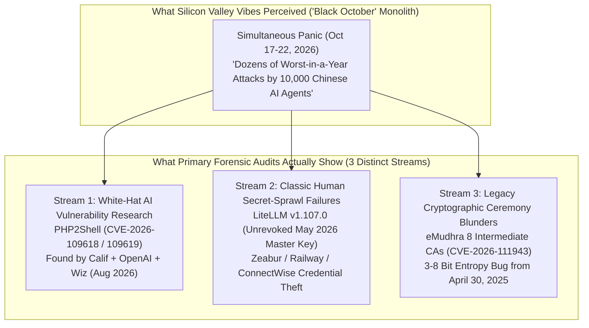
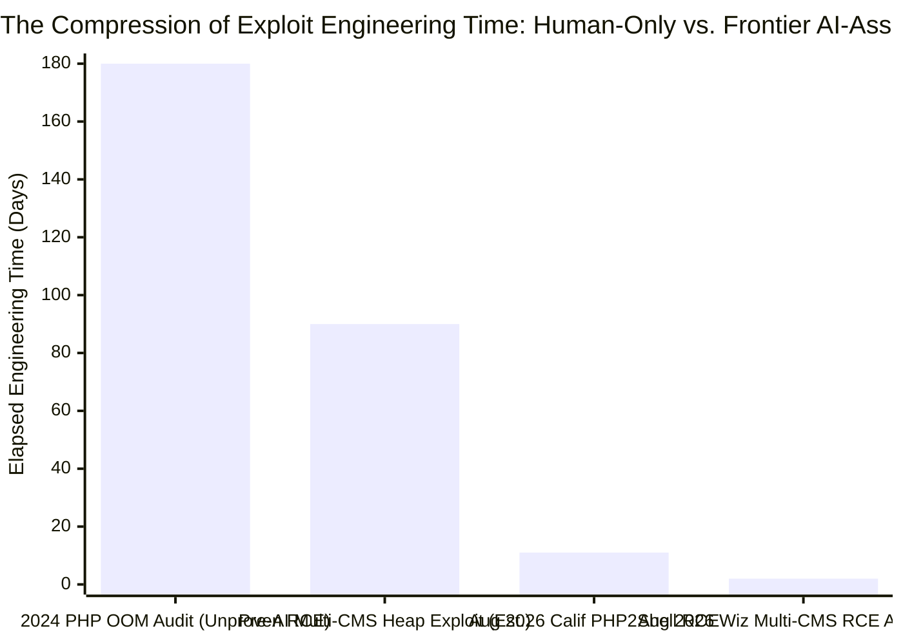

On October 22, 2026, Silicon Valley product leader John Milinovich (Head of AI Research and New Product Bets at Figma, former Head of Generative AI Product at Canva) published a viral 845-word essay titled **[Black October](https://mili.dev/writing/black-october/)**. Comparing the atmosphere in San Francisco AI circles to the midnight boardroom panic scene in *Margin Call*, Milinovich warned that the world was 48 hours into a historic cybersecurity crisis driven by a **"fast takeoff"** in autonomous AI capabilities:

> *"We’re 48 hours into what is being called Black October. In the last 2 days there have been several dozen cyber attacks which, in isolation, would each have been the worst to happen in an entire calendar year... One of the biggest vulnerabilities was in a massively popular programming language called PHP, and the prompt that set it off was literally, 'Find vulnerabilities in php.'"* — **[John Milinovich, *Black October* (22 Oct 2026)](https://mili.dev/writing/black-october/)**

When an insider at a major technology company declares that black-hat hackers wielding uncensored Chinese open-weight AI models are spinning up `10,000` tireless agents to *"wreak havoc on the Western capitalist structure"*—and that PHP (which powers ~70% of the web) was broken by a four-word prompt—the claim demands a rigorous **"Panning for Gold"** forensic audit.

By cross-examining Milinovich's essay against the primary disclosure artifacts published between October 17 and October 24, 2026—including the official **[PHP2Shell disclosure](https://www.php2shell.com/)**, researcher Ryan Austin's technical write-up at **[Calif Research](https://calif.io/php2shell/)**, **[Wiz Research's threat briefing](https://www.wiz.io/blog/php2shell-php-rce)**, **[The PHP Foundation's postmortem](https://thephp.foundation/blog/2026/10/21/todays-php-security-release-and-how-were-strengthening-php-security/)**, **[LiteLLM's incident attack-chain report](https://docs.litellm.ai/blog/security-incident-oct-21-2026-attack-chain)**, **[Qualys's eMudhra PKI analysis](https://blog.qualys.com/product-tech/2026/10/23/how-to-identify-compromised-emudhra-certificates-with-qualys-cve-2026-111943-and-cve-2026-111944)**, and **[Anthropic's Claude Mythos documentation](https://www.anthropic.com/claude/mythos)**—we separate what is empirically true in *"Black October"* from what is factually inverted.

---

## 1. Executive Verdict & Claim-by-Claim Forensic Scorecard

> [!IMPORTANT]
> **Bottom-Line Forensic Verdict — Genuine Inflection in AI Exploit Economics (`True`), Conflated Incident Attribution & Debunked "One-Line Prompt" Myth (`False`):**
> 1. **What Milinovich Gets Right (The Structural Shift in Exploit Economics):** Frontier AI models (**[Claude Mythos 5.1](https://www.anthropic.com/claude/mythos)**, **OpenAI GPT-5.6 Sol / Codex Security**, and **Google Gemini 4 Argon**) have crossed a genuine threshold in **multi-step exploit chain construction**. In **[PHP2Shell (`CVE-2026-109618` & `CVE-2026-109619`)](https://www.wiz.io/blog/php2shell-php-rce)**, turning a decade-old out-of-memory (`OOM`) bug into reliable pre-authentication Remote Code Execution (`RCE`) across `mod_php` and `PHP-FPM` required chaining heap grooming, `longjmp()` bailout interruptions, and cross-request dangling pointers—work that previously took an elite team months, compressed by AI into **days or hours**.
> 2. **What Milinovich Gets Wrong #1 (The `"Find vulnerabilities in php"` Myth):** The actual discoverer of `PHP2Shell`, Ryan Austin (`@lcfr_hax`) of **[Calif Research](https://calif.io/php2shell/)**, explicitly debunked the viral rumor in his disclosure report: *"No model is simply capable of unearthing 'all bugs' with simple prompts. At least for now."* In fact, **[The PHP Foundation](https://thephp.foundation/blog/2026/10/21/todays-php-security-release-and-how-were-strengthening-php-security/)** revealed that an earlier automated scan of PHP using Anthropic's **`Claude Mythos`** missed the RCE entirely, and that the underlying `OOM` bug had already been found by humans in **2004** (Stefan Esser), **2020** (Bug `#78876`), and **2024** (Quarkslab/OSTIF audit), stalling due to human committee paralysis rather than lack of discovery.
> 3. **What Milinovich Gets Wrong #2 (Conflating White-Hat Disclosures & Human Key Leaks with "Chinese Open-Weight Black-Hat Swarms"):** The mid-October 2026 "Black October" cluster was **not** a coordinated wave of Chinese open-weight AI attacks. `PHP2Shell` was a **coordinated white-hat disclosure** by US/Israeli defenders (Calif, OpenAI, Wiz) using US proprietary models; the **[LiteLLM `v1.107.0` supply-chain breach](https://docs.litellm.ai/blog/security-incident-oct-21-2026-attack-chain)** was caused by a human developer committing a plaintext master key to a public GitHub repo in May 2026 and forgetting to revoke it for 5 months; and the **[eMudhra CA compromise (`CVE-2026-111943`)](https://blog.qualys.com/product-tech/2026/10/23/how-to-identify-compromised-emudhra-certificates-with-qualys-cve-2026-111943-and-cve-2026-111944)** stemmed from an April 2025 key-ceremony bug that generated P-384 keys with only **3 to 8 bits of entropy** (solvable on a pocket calculator).
> 4. **The Threat-to-Remedy Disconnect:** Advising readers to install consumer 2FA (`Duo`), a password manager (`1Password`), and an identity protection app (`Alta`) provides **zero protection** against pre-authentication runtime memory corruption (`PHP2Shell`), post-2FA OAuth token hijacking (`LiteLLM`), or broken Certificate Authority trust roots (`eMudhra`).

| Core Claim in `mili.dev/writing/black-october/` | Primary Forensic Reality (Oct 17–24, 2026 Artifacts) | Epistemic Verdict |
| :--- | :--- | :---: |
| **1. "Several dozen worst-in-a-year cyberattacks hit in 48 hours"** | Mid-October 2026 saw a real, historic convergence of major disclosures (`PHP2Shell`, `eMudhra`, `GitLab RCE`, `Node.js Brotli`) and breaches (`LiteLLM v1.107.0`, `ConnectWise/M365`, `Zeabur`, `Railway`). However, it combined **defensive white-hat patches** with **traditional credential breaches**. | **Partially True (Conflated)** |
| **2. "Anthropic & OpenAI withheld their best models due to national security cyber risk"** | Verified. **[Anthropic restricted `Claude Mythos 5` and `Mythos 5.1`](https://www.anthropic.com/claude/mythos)** (`USD 10 / USD 50` per 1M tokens) to vetted defenders under **Project Glasswing** and the **Cyber Verification Program**, releasing only the safeguarded `Claude Fable 5.1` publicly. | **True (Verified)** |
| **3. "Black-hat hackers are using 90–95% capable Chinese open-weight models to wreak havoc"** | Open-weight Chinese models are indeed within `5%–10%` of frontier coding benchmarks, but **zero primary postmortems** attribute the October 2026 incidents (`PHP2Shell`, `LiteLLM`, `eMudhra`) to Chinese open-weight black-hat swarms. | **Unproven Speculation** |
| **4. "The prompt that set off the PHP vulnerability was literally, `'Find vulnerabilities in php'`"** | **Directly refuted** by discoverer Ryan Austin (**[Calif Research](https://calif.io/php2shell/)**) and **[The PHP Foundation](https://thephp.foundation/blog/2026/10/21/todays-php-security-release-and-how-were-strengthening-php-security/)**. An earlier broad `Claude Mythos` scan missed it; discovery required deep human domain guidance on 2004/2020/2024 `OOM` primitives. | **False (Viral Myth)** |
| **5. "We are experiencing a 'fast takeoff' / recursive self-improvement flip from 0 to 1"** | AI reduced exploit-chaining time from months to days (**[Wiz Research](https://www.wiz.io/blog/php2shell-php-rce)**), which is a major **step-change in offensive/defensive labor productivity**, not autonomous recursive self-improvement (`RSI`). | **Exaggerated** |
| **6. "Protect yourself with 2FA (Duo), 1Password, Alta, and an IoT VLAN"** | Good baseline consumer hygiene, but **100% ineffective** against pre-auth server RCE (`PHP2Shell`), Heartbleed-style worker memory leaks, post-2FA OAuth token theft (`LiteLLM`), and rogue CA certificates (`eMudhra`). | **Category Mismatch** |

---

## 2. Deconstructing the "Black October" Incident Cluster (Phases 1 & 2)

Why did October 20–22, 2026 *feel* like a simultaneous cyber-apocalypse to Silicon Valley insiders? Because at least **seven major security events** landed within a 96-hour window. However, when we disaggregate those incidents by their **actual root cause** and **AI involvement**, the monolithic narrative dissolves into three distinct buckets:

| Incident / Disclosure (Oct 2026) | Target Scope & Severity | Actual Root Cause & Attack Vector | Role of AI in the Incident | Primary Source Verification |
| :--- | :--- | :--- | :--- | :--- |
| **1. `PHP2Shell` (`CVE-2026-109618` & `CVE-2026-109619`)** *(Disclosed Oct 21, 2026)* | PHP `5.4` through `8.5.11` (~70% of all websites: WordPress, Drupal, Joomla, MediaWiki). **CVSS 9.2**. | Pre-auth RCE & worker memory leak via `longjmp()` OOM interruption in `ZendMM` / `Session upload_progress` / `unserialize()` / `OPcache`. | **High (White-Hat Defensive):** Found & chained by Calif, OpenAI (`GPT-5.6 Sol`), and Wiz (`Gemini 4 Argon`) under *Patch the Planet*. | **[PHP2Shell](https://www.php2shell.com/)**, **[Calif](https://calif.io/php2shell/)**, **[Wiz](https://www.wiz.io/blog/php2shell-php-rce)**, **[PHP Foundation](https://thephp.foundation/blog/2026/10/21/todays-php-security-release-and-how-were-strengthening-php-security/)** |
| **2. `LiteLLM v1.107.0` Supply-Chain Attack** *(Oct 21, 2026)* | PyPI `litellm==1.107.0` & Docker Hub `latest` (popular Python LLM gateway). | Plaintext master key committed to public GitHub repo `LiteLLM-Labs/lite-harness` on May 27, 2026 and **never revoked**; used on Oct 10 to steal owner's GitHub CLI OAuth token. | **Zero AI Discovery:** Classic human secret-sprawl failure; target happened to be an AI developer library. | **[LiteLLM Postmortem](https://docs.litellm.ai/blog/security-incident-oct-21-2026-attack-chain)** |
| **3. `eMudhra` Intermediate CA Compromise (`CVE-2026-111943` / `111944`)** *(Oct 17–20, 2026)* | 8 Intermediate CAs (6 TLS, 2 Code-Signing) under `emSign ECC Root CA - G3`. Root distrusted by Chrome & Mozilla. | Flawed PKCS#11 wrap/unwrap step during an **April 30, 2025** key ceremony reduced P-384 private key entropy to **3–8 bits** (keys trivial to recover). | **Zero AI Discovery:** Operational cryptography blunder made 18 months ago during a physical key ceremony. | **[Qualys Advisory](https://blog.qualys.com/product-tech/2026/10/23/how-to-identify-compromised-emudhra-certificates-with-qualys-cve-2026-111943-and-cve-2026-111944)**, **[The Record](https://therecord.media/indian-tech-company-announces-withdrawal-certificate-business-incident)** |
| **4. Cloud PaaS Breaches (`Zeabur`, `Railway`)** *(Mid-Oct 2026)* | Developer cloud deployment platforms and customer environment variables. | Exposed plaintext long-lived admin credentials and stolen OAuth/CI tokens used to read internal databases and environment variables. | **Zero AI Discovery:** Traditional credential hygiene failure targeting AI-era developer platforms. | Primary platform incident advisories |
| **5. `ConnectWise` Cloud Backup / M365 Compromise** *(Mid-Oct 2026)* | Thousands of enterprise Microsoft 365 tenants (`Storm-0940`). | Compromised vendor credentials in cloud backup infrastructure leveraged for lateral tenant access. | **Zero AI Discovery:** Classic identity and supply-chain lateral movement. | Microsoft Threat Intelligence / CISA |

---

## 3. Forensic Deep Dive #1: How `PHP2Shell` (`CVE-2026-109618` & `CVE-2026-109619`) Was Actually Found (Phase 3 & 4)

The centerpiece of Milinovich's essay is his claim about PHP:
> *"One of the biggest vulnerabilities was in a massively popular programming language called PHP, and the prompt that set it off was literally, 'Find vulnerabilities in php.'"*

Let us trace the **exact 22-year forensic history** and C-level interpreter mechanics of `PHP2Shell` using the primary reports from **[Calif Research](https://calif.io/php2shell/)**, **[Wiz Research](https://www.wiz.io/blog/php2shell-php-rce)**, and **[The PHP Foundation](https://thephp.foundation/blog/2026/10/21/todays-php-security-release-and-how-were-strengthening-php-security/)**.

### 3.1 The 22-Year Timeline: Why Humans Already Knew the Root Cause in 2004, 2020, and 2024
1. **2004 (Stefan Esser's Original Memory-Limit Interruption Bug):** Over two decades ago, legendary PHP security researcher Stefan Esser discovered that hitting PHP's `memory_limit` triggers `zend_bailout()`—which calls the C standard library's non-local jump function `longjmp()`—interrupting internal C data structures mid-initialization.
2. **2020 (PHP Bug `#78876`):** Researcher `jr@coredu.mp` reported Bug `#78876` to PHP (`Long variables in multipart/form-data cause OOM and temp files are not cleaned`). Meta's HHVM team patched a related path in 2020, but core PHP treated it as a minor cleanup issue.
3. **2024 (OSTIF & Quarkslab Audit + PHP Core Developer Discovery):** In 2024, the Sovereign Tech Agency funded an external audit of PHP by **Quarkslab** (via OSTIF). While fixing a Quarkslab finding, a PHP Foundation core developer **explicitly found the `OOM` state-corruption root cause behind `CVE-2026-109618`**. Why wasn't it fixed in 2024? Because, as **[The PHP Foundation candidly confessed on October 21, 2026](https://thephp.foundation/blog/2026/10/21/todays-php-security-release-and-how-were-strengthening-php-security/)**:
   > *"In 2024, a potential exploit for the OOM problem was theorized, but no concrete vectors were found... The PHP security team, operating on consensus, struggled to choose between [competing fixes] and feared the repercussions of shipping the wrong choice... We won't pretend otherwise: the delay was a structural failure, caused by both the security team's decision process and its lack of resources."*
4. **Early 2026 (Anthropic `Claude Mythos` Scan Missed It):** In early 2026, The PHP Foundation partnered with Alpha-Omega to scan the PHP codebase using Anthropic's restricted frontier model, **`Claude Mythos`**. That broad, unguided scan **did not uncover the `PHP2Shell` RCE chain**.
5. **July 30 – August 24, 2026 (Human Hypothesis + AI Exploit Chaining):**
   * On **July 30, 2026**, security firm **Calif** (Ryan Austin `@lcfr_hax` and Michal Zalewski `@lcamtuf`) joined OpenAI's *"Patch the Planet"* initiative to audit PHP.
   * Instead of typing `"Find vulnerabilities in php"`, Ryan Austin drew on his 20-year personal memory of Stefan Esser's 2004 memory-limit bug and explicitly directed his LLM assistant to search for two specific primitives:
     1. **Primitive A (Bypassing `post_max_size = 8 MiB` to hit `memory_limit = 128 MiB`):** Finding that RFC 1867 multipart file-upload parts with an empty `filename=""` are not counted toward `max_file_uploads`, yet still allocate six native `HashTables`, `Buckets`, and string keys in the PHP `FILES` superglobal (`name`, `full_path`, `type`, `tmp_name`, `error`, `size`). By nesting field names (`files[a][b][c]...`), a tiny `<8 MiB` HTTP request expands into **`>128 MiB` of Zend heap allocations**, triggering a deterministic `OOM` `zend_bailout()` (`longjmp()`) on demand!
     2. **Primitive B (Interrupting Critical State Before Cleanup):** Directing the AI agent to inspect `ZendMM` allocation and request shutdown paths where `zend_bailout()` leaves dangling pointers across requests:
        * In `_zend_hash_str_add_or_update_i`, PHP increments `ht->nNumUsed++` *before* `zend_string_init()`, which can fatal on `OOM` and leave an uninitialized bucket visible to `zend_array_destroy()`.
        * In `php_session_rfc1867_callback()` (`CVE-2026-109618`), multipart upload progress initializes session globals (`PS(id)` and `PS(http_session_vars)`) during `php_hash_environment()` *before* `PG(modules_activated) = 1`. When a subsequent `OOM` aborts request startup on Apache `mod_php`, `php_request_shutdown()` sees `PG(modules_activated) == 0`, **skips Session `RSHUTDOWN`**, and frees the request heap while the Apache worker survives with `PS(id)` pointing into freed memory! A second request then leaks live worker memory directly into the `PHPSESSID` response cookie or triggers a use-after-free `zval_ptr_dtor()` for pre-auth `RCE`.
        * For `PHP-FPM` (which exits its worker if startup fails), Calif and Wiz chained post-startup `OOM` interruptions inside `php_var_unserialize_init()` (`BG(unserialize).data` dangling pointer with signed `used_slots` negative indexing: `slot = destructor_block + 16 + 16 * used_slots`), `EG(last_fatal_error_backtrace)` use-after-free, and `OPcache` `CG(map_ptr_last)` shared-memory frontier desynchronization (`CVE-2026-109619`).

### 3.2 What AI Actually Changed in `PHP2Shell`
Both **[Calif Research](https://calif.io/php2shell/)** and **[Wiz Research](https://www.wiz.io/blog/php2shell-php-rce)** agree on the real lesson of `PHP2Shell`:
* **AI did not replace expert human security mental models via a lazy four-word prompt.** As Ryan Austin wrote: *"LLMs may have ingested public historical vuln data, but in their default variant analysis tends to move from the newest and most prominent bugs toward nearby older code. They do not reliably begin with obscure twenty-year-old exploitation primitives. Keeping your own mental catalog of a target's vulnerability history lets you prompt that direction explicitly."*
* **What AI transformed is the cost and speed of exploit engineering (`From Theory to Weaponized PoC`):** In 2024, PHP core developers knew the `OOM` bug existed, but nobody built a working RCE exploit because chaining heap layout grooming across `mod_php`, `PHP-FPM`, WordPress, Drupal, and Joomla normally takes an elite human team **months of tedious trial-and-error**. Using `GPT-5.6 Sol` and `Gemini 4 Argon` hooked into live debugger/sanitizer harnesses, Calif and Wiz turned a theoretical 2024 memory bug into **working pre-authentication RCE exploits across WordPress, Drupal, and Joomla in days**.

---

## 4. Forensic Deep Dive #2: The `LiteLLM` and `eMudhra` Postmortems Disprove the "AI Swarm" Attribution (Phase 4)

If we apply Browne & Keeley's **4-Way Causal Audit** to the other major incidents of "Black October," we find that attributing them to superhuman AI agents is a classic **Post Hoc / Single-Cause Attribution Fallacy**:

### 4.1 The October 21 `LiteLLM v1.107.0` Supply-Chain Breach: A 146-Day Unrevoked Plaintext Key
Because **LiteLLM** is one of the most widely used open-source Python AI gateways, many commentators assumed its October 21 compromise (`litellm==1.107.0` pushed to PyPI and Docker Hub with a credential-stealing RAT) was an AI-driven cyberattack.

However, **[LiteLLM's official forensic postmortem](https://docs.litellm.ai/blog/security-incident-oct-21-2026-attack-chain)** (published October 23, 2026) documents a purely mundane, human operational failure chain:
1. **May 27, 2026 (Day 0 — The Human Leak):** A LiteLLM developer accidentally committed a configuration file containing the plaintext master key to the `LiteLLM Agent Platform` into the public `LiteLLM-Labs/lite-harness` repository. The team noticed the mistake, force-pushed over the commit (which leaves the commit blob accessible in GitHub's object graph/archive logs), and flagged the key for revocation—**but never actually revoked the master key**.
2. **Over-Privileged Owner Token:** The experimental `LiteLLM Agent Platform` had been configured not with a Least-Privilege GitHub App or scoped service account, but with a **personal GitHub CLI OAuth token belonging to the GitHub organization owner**—a token type that is **post-2FA** and exempt from GitHub's super-user 2FA re-authentication prompts!
3. **October 10, 2026 (Day 136 — Token Extraction):** The attacker used the unrevoked May 27 master key to access the Agent Platform and extract the owner's GitHub CLI OAuth token.
4. **October 10–21, 2026 (Lateral CI Exfiltration & Release Poisoning):** Using owner-level GitHub access, the attacker committed malicious workflow branches to internal repositories to dump CI secrets, harvested maintainer OAuth tokens and upstream LLM API keys, and on **October 21, 2026** triggered the official release pipeline to publish `litellm==1.107.0`.

**Forensic Takeaway:** Not a single line of this attack required an AGI or a 10,000-agent swarm. Leaving a plaintext master key unrevoked after a public Git commit and binding an organization owner's unscoped OAuth token to an experimental service is a textbook **2015-era DevOps hygiene failure**.

### 4.2 The October 17 `eMudhra` CA Collapse (`CVE-2026-111943` & `CVE-2026-111944`): 3-Bit Entropy from April 2025
Similarly, on October 17, 2026, Google Chrome (`CRLSet`), Mozilla Firefox (`OneCRL`), Apple, and Microsoft issued emergency revocations and root distrust actions against **eight intermediate Certificate Authority (CA) certificates** (6 TLS CAs and 2 code-signing CAs) operated by Indian digital trust provider **eMudhra** (`emSign ECC Root CA - G3`), forcing eMudhra to withdraw from the global SSL/TLS website certificate business.

Did a frontier AI break elliptic-curve cryptography (`NIST P-384`)? **No.** As **[Qualys's forensic report](https://blog.qualys.com/product-tech/2026/10/23/how-to-identify-compromised-emudhra-certificates-with-qualys-cve-2026-111943-and-cve-2026-111944)** confirms:
* During a physical key-generation ceremony held on **April 30, 2025** for 24 subordinate CAs, a bug in eMudhra's key wrap/unwrap software truncated the random seed material, generating P-384 private keys with an effective entropy of only **3 to 8 bits** (instead of `384` bits), reducing some private scalars to tiny integers like `4`, `56`, and `115`!
* Brute-forcing an elliptic-curve public key when the private key has `3 to 8 bits` of entropy requires at most **`2^8 = 256` point multiplications**—a computation that takes **less than 1 millisecond on a single CPU thread**.

---

## 5. Statistical & Economic Audit: The Asymmetry of Machine-Speed Vulnerability Discovery (Phase 5)

While Milinovich misattributes the October 2026 incidents to Chinese black-hat swarms and a four-word PHP prompt, his underlying anxiety reflects a genuine, measurable shift in cybersecurity economics documented in **[Anthropic's Claude Mythos system card](https://www.anthropic.com/claude/mythos)** and **[Wiz Research's PHP2Shell telemetry](https://www.wiz.io/blog/php2shell-php-rce)**.

Let us audit the quantitative metrics of **AI-assisted vulnerability research (`VR`)** in October 2026:

*Chart Series Legend: Elapsed days required to bridge from initial memory-corruption root cause to verified pre-authentication RCE exploit (`2024 Quarkslab/PHP internal stall: >180 days without RCE PoC`; `Historical manual multi-target heap exploit baseline: ~90 days`; `Calif Research July 30 – Aug 11, 2026 discovery & RCE PoC: 11 days`; `Wiz Research Aug 19 – Aug 21, 2026 Drupal & WordPress RCE confirmation: 2 days`). Primary Sources: **[Calif Research](https://calif.io/php2shell/)** and **[Wiz Research](https://www.wiz.io/blog/php2shell-php-rce)**.*

### 5.1 The "Vulnerability Tsunami" Equation: Why Complexity No Longer Protects Legacy Code
For the past 25 years, critical open-source infrastructure (`PHP`, `OpenSSL`, `Linux kernel`, `glibc`, `bind`) relied on an implicit **Complexity Shield**:
* Thousands of latent memory-safety bugs (`use-after-free`, `off-by-one`, `type confusion`, `uninitialized struct fields on error paths`) existed in legacy C codebases.
* However, turning a subtle error-handling bug (like PHP's 2020 Bug `#78876` or the 2024 Quarkslab OOM finding) into a reliable, unauthenticated network exploit across randomized memory layouts required `300 to 1,000+ hours` of elite human exploit-developer labor (`USD 50,000 to USD 250,000+` in opportunity cost). Therefore, maintainers deprioritized "theoretical" bugs without a proof-of-concept (`PoC`).

In mid-2026, frontier reasoning models (**[Claude Mythos 5.1](https://www.anthropic.com/claude/mythos)** at `USD 10 / 1M` input and `USD 50 / 1M` output tokens, **`GPT-5.6 Sol`**, and **`Gemini 4 Argon`**) collapsed the marginal cost of **exploit-chain iteration and target adaptation** by `10x to 50x`:

$$
\text{Effective Vulnerability Exposure} = \sum_{i=1}^{N_{\text{latent}}} \mathbb{I}\!\left(\text{Cost}_{\text{Exploit}}(i, \text{AI}) < \text{Value}_{\text{Target}}(i)\right)
$$

When `Cost_Exploit(i, AI)` drops from **3 researcher-months** (`~USD 100,000`) to **48 hours of agentic debugger loops** (`~USD 500` in API tokens), thousands of decade-old "unexploitable" C/C++ bugs suddenly cross the threshold into practical weaponization.

### 5.2 Auditing Anthropic's Dual-Track Release Architecture (`Claude Mythos 5.1` vs. `Claude Fable 5.1`)
Primary documentation on **[anthropic.com/claude/mythos](https://www.anthropic.com/claude/mythos)** confirms how frontier labs are attempting to manage this offensive/defensive asymmetry:
* **`Claude Mythos 5.1` (Restricted Defensive/Research Track):** Full unthrottled offensive/defensive cyber capabilities (exploit generation, binary vulnerability scanning, penetration testing) and dual-use biology capabilities. Available **only** to vetted organizations through **Project Glasswing** (expanded in June 2026 to ~150 critical infrastructure organizations across 15+ countries) and the **Cyber Verification Program** (expanded October 6, 2026), subject to mandatory 30-day safety monitoring retention.
* **`Claude Fable 5.1` (Public Production Track):** The exact same underlying weights as `Claude Mythos 5.1`, wrapped in real-time production classifiers that allow source-code vulnerability identification for developers while blocking penetration testing, binary exploitation, and exploit generation (routing flagged cyber tasks to `Claude Opus 4.8` and scoring `0` on `OSWorld 2.0` when safeguards intervene).

---

## 6. The Negative View: Auditing the Consumer Defense Fallacy & The Real Vulnerabilities (Phase 6)

The weakest section of Milinovich's *[Black October](https://mili.dev/writing/black-october/)* essay is its actionable prescription. After terrifying the reader with nation-state AI swarms and PHP zero-days, he recommends four personal consumer steps:
1. *"Set up 2-factor authentication for everything. I use Duo."*
2. *"Use a password manager across your devices. I use 1Password."*
3. *"Get an identity protection app set up. I use Alta."*
4. *"Move your IoT devices to their own network. Claude helped me do this."*

Let us subject these four recommendations to a **Forensic Mechanism Stress-Test** against the actual October 2026 attacks:

| Recommended Consumer Control (`mili.dev`) | Does It Stop `PHP2Shell` (`CVE-2026-109618` / `109619`)? | Does It Stop `LiteLLM v1.107.0` Supply-Chain Poisoning? | Does It Stop `eMudhra` Rogue CA Interception? | What Actually Mitigates the October 2026 Threat Vector? |
| :--- | :--- | :--- | :--- | :--- |
| **1. Consumer 2FA (`Duo`)** | **NO (`0%`):** `PHP2Shell` triggers during multipart parsing *before* any authentication or 2FA code executes (`Pre-Auth RCE`). | **NO (`0%`):** The stolen GitHub CLI OAuth token was **post-2FA** and bypassed GitHub super-user 2FA re-auth flows! | **NO (`0%`):** A rogue intermediate CA can MITM TLS traffic or sign malicious binaries post-auth. | Hardware-bound **FIDO2/WebAuthn passkeys**, short-lived scoped GitHub App tokens (banning long-lived OAuth tokens), and runtime PHP patching. |
| **2. Password Manager (`1Password`)** | **NO (`0%`):** `CVE-2026-109619` leaks live server worker memory (`API keys, session cookies, DB passwords`) directly out of RAM (`Heartbleed`-style). | **NO (`0%`):** The `litellm==1.107.0` payload harvests local cloud/AI/browser secrets directly from disk/memory once `pip install` runs. | **NO (`0%`):** Does not prevent TLS interception from a trusted root store. | Upgrading PHP to **`8.5.12` / `8.4.27` / `8.3.36` / `8.2.35`**, pinning container/PyPI package hashes with cooldown windows, and memory-safe runtimes. |
| **3. Identity Protection App (`Alta`)** | **NO (`0%`):** Reactive credit/identity monitoring after PII is already exfiltrated. | **NO (`0%`):** Does not protect developer CI/CD or cloud billing credentials. | **NO (`0%`):** Orthogonal to PKI trust. | Automated secret-scanning with **mandatory instant webhook revocation** on git push (`fixing the 146-day LiteLLM gap`). |
| **4. Home IoT VLAN Segmentation** | **NO (`0%`):** `PHP2Shell` targets internet-facing web servers (`WordPress, Drupal, MediaWiki`), not home smart bulbs. | **NO (`0%`):** Targets developer laptops and production Kubernetes clusters. | **NO (`0%`):** Targets browser/OS root stores. | Edge WAF full-transaction inspection (**[Cloudflare Managed Rules](https://blog.cloudflare.com/php-vulnerabilities-waf-protection/)**) + setting `session.upload_progress.enabled=0` while patching. |

---

## 7. Grey Thinking Synthesis (`If-Clauses`) & Probability-Weighted Verdict (Phase 7)

Instead of oscillating between Silicon Valley *Margin Call* doom-posting and complacent denial, we synthesize the empirical reality of October 2026 into conditional engineering rules (**If-Clauses**) and probability-weighted scenarios:

### 7.1 Conditional Engineering & Policy Rules (`If-Clauses`)
* **If you maintain internet-facing C/C++ infrastructure (`PHP`, web servers, image/video parsers, compression libraries):** Then **assume the "Complexity Shield" is dead**. Any latent memory-corruption bug (`OOM` bailout, `use-after-free`, integer overflow) that previously seemed "too complex to chain into RCE" can now be weaponized across target configurations in **48–96 hours** by human researchers pairing domain knowledge with frontier coding models (`GPT-5.6 Sol`, `Gemini 4 Argon`, `Claude Mythos 5.1`).
* **If you operatePHP workloads on the public internet:** Then consumer 2FA will not save you. Immediately upgrade to **PHP `8.5.12`, `8.4.27`, `8.3.36`, or `8.2.35`**; if running EOL PHP (`<= 8.1`), isolate behind full-transaction WAF inspection (**[Cloudflare](https://blog.cloudflare.com/php-vulnerabilities-waf-protection/)**), disable `session.upload_progress.enabled=0`, and migrate off `mod_php`.
* **If you manage software supply chains and AI agent platforms (`like LiteLLM`):** Then **ban long-lived, unscoped personal OAuth tokens (`gh auth` CLI tokens) from CI/CD and agent harnesses**. Enforce short-lived (`1-hour`) scoped GitHub App installation tokens, automated secret-revocation webhooks, and a `48–72 hour` dependency quarantine window before ingesting new PyPI/npm releases.

### 7.2 Probability-Weighted Scenarios (2026–2028)

| Scenario | Epistemic Probability | Mechanistic Driver & Empirical Evidence |
| :--- | :---: | :--- |
| **Scenario A (Base Case): The "Defensive Scrubbing Surge" — AI Surfaces a 18–24 Month Backlog of Decade-Old Legacy C/C++ Bugs, Ultimately Hardening Core Infrastructure** | **`~60%`** | Just as `PHP2Shell` exposed a 2004/2020/2024 `OOM` flaw that human committees had left unpatched, initiatives like **Anthropic Project Glasswing**, **OpenAI Patch the Planet**, and **Wiz Atlas** will trigger an intense 18-month wave of high-CVSS disclosures in legacy C codebases. While creating acute patching fatigue ("Black Octobers"), systematic AI auditing combined with Rust/memory-safe rewrites leaves core internet infrastructure structurally harder to exploit by 2028. |
| **Scenario B (Downside Case): Patch-Window Asymmetry — Automated N-Day & PoC Adaptation Outpaces Enterprise Patching Cycles** | **`~30%`** | Even when white-hat teams discover bugs first, once a patch or advisory drops (or leaks 24 hours early, as in `PHP2Shell`), threat actors use open-weight or frontier LLMs to synthesize working exploits across custom target environments within hours—faster than enterprise IT can patch EOL systems (`PHP 5.4–8.1`). |
| **Scenario C (Tail Risk): Autonomous Zero-Day Swarms via Uncensored Open-Weight Models Without Human Domain Guidance** | **`~10%`** | Milinovich's feared scenario—where naive prompts (`"Find vulnerabilities in php"`) on open-weight models autonomously discover and exploit novel architectural zero-days without human domain hypotheses (`like Ryan Austin's 2004 Esser primitive`)—remains a minority tail risk in 2026–2027, as confirmed by both Calif Research and The PHP Foundation's `Claude Mythos` scan results. |

### Final Verdict
John Milinovich's **[Black October](https://mili.dev/writing/black-october/)** essay is an authentic sociological artifact of Silicon Valley's October 2026 vibe shift, but a flawed forensic account of what actually happened. The crisis of October 2026 was not caused by 10,000 Chinese open-weight AI agents executing a four-word prompt (`"Find vulnerabilities in php"`). It was the collision of **three distinct realities**:
1. **White-hat human experts (`Calif`, `OpenAI`, `Wiz`) using US frontier AI (`GPT-5.6 Sol`, `Gemini 4 Argon`)** to prove that a 20-year-old class of PHP memory bugs (`CVE-2026-109618` / `109619`) is now trivially chainable into pre-auth RCE;
2. **A 146-day human failure to revoke a leaked plaintext master key at `LiteLLM`**; and
3. **An 18-month-old cryptographic key-ceremony blunder at `eMudhra`**.

Do not respond to "Black October" by merely installing a consumer identity app and feeling helpless before an imaginary AGI fast takeoff. Respond by **patching your PHP runtimes (`8.5.12` / `8.4.27` / `8.3.36` / `8.2.35`), revoking long-lived post-2FA OAuth tokens in your CI/CD pipelines, and using frontier AI to audit and eliminate the legacy state-corruption debt in your own codebase before someone else does**.

---

## 8. Primary Sources & Verifiable References

1. **Milinovich, J. (2026).** *Black October.* `mili.dev` (22 October 2026). Available at: [https://mili.dev/writing/black-october/](https://mili.dev/writing/black-october/)
2. **Austin, R. (`@lcfr_hax`) & Zalewski, M. (`@lcamtuf`) / Calif Research (2026).** *PHP2Shell: A tale of two PHP remote vulnerabilities (`CVE-2026-109618`, `CVE-2026-109619`).* Calif Research (21 October 2026). Available at: [https://calif.io/php2shell/](https://calif.io/php2shell/)
3. **Tzadik, S., Tamari, S., Ohfeld, N., & Schwartz, T. / Wiz Research (2026).** *PHP2Shell: AI uncovers critical RCE vulnerabilities affecting 70% of the Internet.* Wiz Blog (21 October 2026). Available at: [https://www.wiz.io/blog/php2shell-php-rce](https://www.wiz.io/blog/php2shell-php-rce)
4. **The PHP Foundation (2026).** *Today's PHP Security Release, and How We're Strengthening PHP Security (`PHP 8.5.12, 8.4.27, 8.3.36, 8.2.35`).* The PHP Foundation Blog (21 October 2026). Available at: [https://thephp.foundation/blog/2026/10/21/todays-php-security-release-and-how-were-strengthening-php-security/](https://thephp.foundation/blog/2026/10/21/todays-php-security-release-and-how-were-strengthening-php-security/)
5. **Wiz Research, OpenAI Codex Security, & Calif Research (2026).** *PHP2Shell Official Coordinated Disclosure Portal.* Available at: [https://www.php2shell.com/](https://www.php2shell.com/)
6. **Jensen, O. & Wang, M. / LiteLLM Security (2026).** *The attack chain behind the v1.107.0 LiteLLM release.* LiteLLM Official Documentation & Blog (23 October 2026). Available at: [https://docs.litellm.ai/blog/security-incident-oct-21-2026-attack-chain](https://docs.litellm.ai/blog/security-incident-oct-21-2026-attack-chain)
7. **Anthropic (2026).** *Claude Mythos 5 & 5.1, Project Glasswing, and the Cyber Verification Program.* Anthropic Official Documentation. Available at: [https://www.anthropic.com/claude/mythos](https://www.anthropic.com/claude/mythos)
8. **Madhuri, C. / Qualys Threat Research (2026).** *How to Identify Compromised eMudhra Certificates With Qualys (`CVE-2026-111943` and `CVE-2026-111944`).* Qualys Security Blog (24 October 2026). Available at: [https://blog.qualys.com/product-tech/2026/10/23/how-to-identify-compromised-emudhra-certificates-with-qualys-cve-2026-111943-and-cve-2026-111944](https://blog.qualys.com/product-tech/2026/10/23/how-to-identify-compromised-emudhra-certificates-with-qualys-cve-2026-111943-and-cve-2026-111944)
9. **Cloudflare Security (2026).** *Cloudflare deploys protections against php2shell vulnerability (`Full Transaction WAF Detection`).* Cloudflare Blog (21 October 2026). Available at: [https://blog.cloudflare.com/php-vulnerabilities-waf-protection/](https://blog.cloudflare.com/php-vulnerabilities-waf-protection/)
10. **Palo Alto Networks Unit 42 (2026).** *Threat Brief: PHP Core Remote Code Execution Vulnerabilities (`CVE-2026-109618` and `CVE-2026-109619`).* Available at: [https://unit42.paloaltonetworks.com/cve-2026-109618-cve-2026-109619/](https://unit42.paloaltonetworks.com/cve-2026-109618-cve-2026-109619/)
