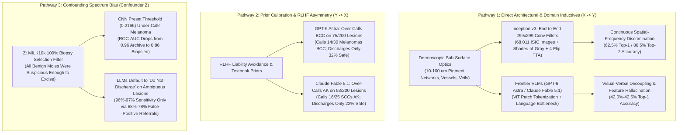

On October 25, 2026, Dr. Magnus Lynch—Consultant Dermatologist and Mohs Micrographic Surgeon at Guy's Hospital and Honorary Reader at St John's Institute of Dermatology, King's College London—published an empirical benchmark with a provocative headline: **[A 10-year-old CNN outperforms frontier LLMs for skin cancer diagnosis](https://lynchlab.net/llm-skin-cancer)**.

Testing two October 2026 frontier multimodal large language models (**GPT-6 Astra** via the OpenAI API and **Claude Fable 5.1** via OpenRouter) against a 2015 convolutional neural network (**[Inception v3](https://arxiv.org/abs/1512.00567)**, fine-tuned for ~20 minutes on a single NVIDIA H100 GPU over `68,011` public **[ISIC Archive](https://www.isic-archive.com/)** images and deployed client-side in WebGPU at **[lynchlab.net/skin-ai-inception](https://lynchlab.net/skin-ai-inception)**), Dr. Lynch evaluated all three systems on **`N = 200` biopsy-proven skin lesions** drawn from the 2025 **[MILK10k dataset](https://doi.org/10.34970/648456)** (`100` malignant or pre-malignant lesions that must not be discharged, and `100` benign lesions safe to discharge, each imaged with both a clinical close-up and a polarized dermatoscope).

On 6-class histopathological diagnosis (`MEL`, `BCC`, `SCC`, `ACK`, `NEV`, `SEK`), the 10-year-old CNN achieved **`125 / 200 (62.5%)` top-1 accuracy** and **`173 / 200 (86.5%)` top-2 accuracy**, crushing both **Claude Fable 5.1 (`85 / 200 = 42.5%` top-1; `138 / 200 = 69.0%` top-2)** and **GPT-6 Astra (`84 / 200 = 42.0%` top-1; `134 / 200 = 67.0%` top-2)** by more than **20 percentage points**.

Yet buried inside the study's summary table—and inside the full raw JSONL telemetry and Python scoring scripts (`[llm-skin-cancer-test.zip](https://d2gaqzonlm544h.cloudfront.net/skin-ai/data/llm-skin-cancer-test.zip)`)—lies a striking biostatistical paradox that casual readers miss:
* At its **preset validation threshold**, the "superior" CNN falsely discharged **`18 of the 30 melanomas (60.0% false-negative discharge rate)`**, keeping only `77 / 100` unsafe lesions while discharging `76 / 100` benign lesions.
* Meanwhile, under the clinician prompt, **GPT-6 Astra** and **Claude Fable 5.1** discharged only **`3 / 30 (10.0%)`** and **`4 / 30 (13.3%)`** of melanomas (`keeping 97 / 100 and 96 / 100 unsafe lesions`), but achieved that apparent safety by refusing to discharge **`68%` to `78%` of completely harmless moles and seborrhoeic keratoses** (`specificity = 32.0% and 22.0%`).
* Once the CNN's continuous probability threshold is shifted along its Receiver Operating Characteristic (`ROC-AUC = 0.86`) curve to match the LLMs' low specificity (`32%` or `22%`), the CNN keeps **`98 or 99 of 100 unsafe lesions`** and discharges only **`1 or 2 of 30 melanomas (3.3%–6.7%)`**—outperforming both frontier LLMs at every operating point.

Below is our 8-phase **"Panning for Gold"** forensic investigation of the primary source code, raw model JSONL transcripts (`1,200` total model evaluations across clinician and lay-patient prompts), confusion matrices, confidence calibration curves, and architectural bottlenecks.

---

## 1. Executive Verdict & High-Level Synthesis

> [!IMPORTANT]
> **Forensic Verdict — True on Discriminative Taxonomy (`+20.3%` Top-1 Accuracy Advantage), Crucial Operating-Point Caveat on Uncalibrated Clinical Triage:**
> 1. **Domain-Specific Pixel Inductives Beat Generalist Vision-Language Tokenizers:** A `23.8M`-parameter 2015 CNN (**[Inception v3](https://arxiv.org/abs/1512.00567)**, the exact architecture used in **[Esteva et al.'s landmark 2017 *Nature* study](https://www.nature.com/articles/nature21056)**) fine-tuned end-to-end on `68,011` dermoscopic and clinical images learns continuous spatial-frequency representations of sub-surface dermoscopic structures (`10–100 µm` pigment networks, arborizing vessels, blue-white veils, and milia-like cysts). Generalist frontier LLMs (**GPT-6 Astra** and **Claude Fable 5.1**) pass images through discrete Vision Transformer (`ViT`) patch tokenizers coupled to an autoregressive language bottleneck, causing **visual-verbal decoupling**: the LLMs fluently recite textbook dermoscopic descriptions while hallucinating their presence on the wrong lesion class.
> 2. **Severe Prior Mode Collapse in Frontier LLMs:** Raw confusion matrix extraction from `analyse_clinician.py` reveals that **GPT-6 Astra** called **`75 / 200 (37.5%)`** of all lesions Basal Cell Carcinoma (`BCC`, true prevalence `25 / 200 = 12.5%`), misclassifying **`14 of the 30 melanomas (46.7%)` as `BCC`**. Its `25 / 25 (100%)` `BCC` sensitivity is an artifact of over-calling `BCC` at **`33.3%` precision (`PPV`)**. Conversely, **Claude Fable 5.1** called **`53 / 200 (26.5%)`** of all lesions Actinic Keratosis (`ACK`, true prevalence `20 / 200 = 10.0%`), yielding **`22.6%` precision** and misclassifying **`16 / 25 (64.0%)` of invasive/in-situ Squamous Cell Carcinomas (`SCC`) as pre-malignant `ACK`**.
> 3. **The Lay-Patient Triage Failure (`N = 200` Paired + `N = 100` Extra Melanomas):** When prompted as a worried patient at home with a smartphone close-up (`patient-clinical`), first-named diagnostic accuracy collapses to **`23.5%` (`GPT-6 Astra`)** and **`25.5%` (`Claude Fable 5.1`)**—and on `100` additional biopsy-proven melanomas (`cases-mel-100.csv`), **Claude Fable 5.1** names melanoma first in only **`3 / 100 (3.0%)`** of cases (favoring a single diagnosis in `19 / 100` cases and getting **`0 / 19 (0%)` right**, calling `12` melanomas benign moles) while advising `14 / 100` melanoma patients to book a `ROUTINE` non-urgent appointment and telling `1 / 100` (`mel_046`, an invasive melanoma) they can leave it alone (`LEAVE`).

```mermaid
xychart-beta
    title "6-Class Diagnostic Accuracy (% Correct First Choice on N = 200 Biopsied Lesions)"
    x-axis ["All 200", "Melanoma (30)", "BCC (25)", "SCC (25)", "AK (20)", "Naevus (50)", "Seb. Keratosis (50)"]
    y-axis "First-Choice Recall (%)" 0 --> 100
    bar [42.0, 26.7, 100.0, 48.0, 50.0, 32.0, 26.0]
    bar [42.5, 36.7, 72.0, 20.0, 60.0, 66.0, 12.0]
    bar [62.5, 43.3, 96.0, 64.0, 45.0, 74.0, 52.0]
```

*Chart Series Legend: Bar 1 = **GPT-6 Astra** (`84/200 = 42.0%`), Bar 2 = **Claude Fable 5.1** (`85/200 = 42.5%`), Bar 3 = **Inception v3 CNN** (`125/200 = 62.5%`). Primary Data Source: **[Lynch Lab Benchmark](https://lynchlab.net/llm-skin-cancer)** and **[llm-skin-cancer-test.zip](https://d2gaqzonlm544h.cloudfront.net/skin-ai/data/llm-skin-cancer-test.zip)**.*

---

## 2. Primary Source & Experimental Design Audit (Phases 1 & 2)

To avoid secondary echo chambers, we extracted and audited the complete primary code and raw model outputs from Dr. Lynch's data archive (`[llm-skin-cancer-test.zip](https://d2gaqzonlm544h.cloudfront.net/skin-ai/data/llm-skin-cancer-test.zip)`) and the live WebGPU inference engine (`[lynchlab.net/skin-ai-inception](https://lynchlab.net/skin-ai-inception)` / `skin-ai.js?v=23`).

### 2.1 Dataset Provenance & Sampling Protocol (`make_selection_200.py`)
The test cohort was drawn from **[MILK10k](https://doi.org/10.34970/648456)**, released in 2025 through the **[International Skin Imaging Collaboration (ISIC)](https://www.isic-archive.com/)**, where each lesion is represented by a paired **clinical close-up photograph** and a **dermoscopic photograph**.
* **Strict Histopathological Ground Truth:** In `scripts/make_selection_200.py`, every candidate lesion in `MILK10k` was filtered for `les["confirm"] == "histopathology"` and required both a valid `clinical_isic_id` and `dermoscopic_isic_id` (`SEED = 20261012`).
* **Stratified 200-Lesion Cohort (`cases.csv`):**
  * **`100` Unsafe Lesions (`discharge = "not safe"`):** `30` Melanomas (`MEL`: invasive melanoma and melanoma *in situ*), `25` Basal Cell Carcinomas (`BCC`), `25` Squamous Cell Carcinomas (`SCC`: invasive `SCC` and squamous cell carcinoma *in situ* / Bowen's disease), and `20` Actinic Keratoses (`ACK`: pre-malignant solar keratoses that require cryotherapy, topical 5-FU/imiquimod, or surveillance rather than outright clinical discharge).
  * **`100` Safe-to-Discharge Lesions (`discharge = "safe"`):** `50` Melanocytic Naevi (`NEV`: benign moles, including compound, dermal, junctional, acral, blue, congenital, and BAP-1 deficient subtypes) and `50` Seborrhoeic Keratoses (`SEK`).
* **Additional 100-Melanoma Expansion Cohort (`cases-mel-100.csv`):** Drawn via `scripts/make_selection_mel100.py` (`100` histology-confirmed `MILK10k` melanomas disjoint from `cases.csv`) to stress-test the lay-patient clinical-photo-only prompt on missed melanoma triage.

### 2.2 Architecture & Training Pipeline of the Baseline CNN (`Inception v3`)
Inspection of `[lynchlab.net/skin-ai-inception](https://lynchlab.net/skin-ai-inception)` and `skin-ai.js?v=23` confirms the exact engineering specification of the baseline CNN:
1. **Backbone & Dual-Head Topology:** Standard **[Inception v3](https://arxiv.org/abs/1512.00567)** (`timm` `inception_v3.tv_in1k`, pretrained on ImageNet-1k, `299 × 299` input resolution, `mean = 0.5`, `std = 0.5`). The `1,000`-class ImageNet head was replaced by two parallel linear heads sharing the penultimate feature representation:
   * A **9-class diagnostic head** (`MEL`, `BCC`, `SCC`, `AK`, `NV`, `BKL`, `DF`, `VASC`, `OTHER_BENIGN`, restricted to the 6 target classes for the 200-lesion comparison).
   * A **binary modality head** predicting `P(clinical)` vs. `P(dermoscopic)`, which achieves **`99.5%` accuracy** on held-out test images (`8,517` images) and selects the modality-appropriate decision threshold.
2. **Patient- and Lesion-Disjoint Split (`87,206` Total ISIC Images):**
   * `68,011` training images;
   * `8,523` validation images (used for checkpoint selection and setting the preset `90%`-sensitivity thresholds);
   * `8,517` internal test images (`ROC-AUC = 0.944` overall; `0.875` on the `4,364` biopsy-confirmed subset);
   * `1,286` external hospital test images from Hospital Italiano de Buenos Aires (`ROC-AUC = 0.934`);
   * `869` held-out LLM comparison images (including the `200` paired lesions / `400` images in `cases.csv` and the `300` paired lesions / `600` sample images on the interactive demo page). Zero lesions or patients in the test set ever appeared in training or validation.
3. **Domain Preprocessing & Test-Time Augmentation (`TTA`):** Before inference, each image undergoes circular black dermatoscope border detection and cropping, **Shades of Gray** (`p = 6` Minkowski norm) color-constancy normalization to remove illumination color casts, Lanczos resampling to `342 px` short side with a `299 × 299` center crop, and probability averaging across **4 flipped orientations** (`original`, `horizontal flip`, `vertical flip`, `180° rotation`).
4. **Compute & Footprint:** Fine-tuned across all layers for `20 epochs` (`~50 seconds/epoch`, **`~17–20 minutes` total wall-clock time**) on a single NVIDIA H100 GPU with inverse-frequency class weighting. Exported to ONNX (`44 MB` in `fp16` for WebGPU; `87 MB` in `fp32` for WebAssembly CPU fallback), it executes locally inside a smartphone browser with zero server round-trips.

| Model System | Architecture & Parameter Scale | Dermatology Fine-Tuning | Inference Modality & Cost (`N = 200` Clinician Run) | Top-1 Accuracy (`N = 200`) | Top-2 Accuracy (`N = 200`) |
| :--- | :--- | :--- | :--- | :--- | :--- |
| **Inception v3 (2015 Baseline)** | 48-layer CNN (`~23.8M` params; `44 MB` `fp16` ONNX) | `68,011` ISIC images (`20 epochs`, `~17 min` on 1x H100 GPU, class-balanced) | Local browser WebGPU/WASM (`0` cloud tokens, `USD 0.00` marginal API cost) | **`125 / 200 (62.5%)`** | **`173 / 200 (86.5%)`** |
| **Claude Fable 5.1 (Oct 2026)** | Frontier Multimodal LLM (via OpenRouter API) | Generalist pretraining + RLHF (Zero task-specific fine-tuning) | `227,200` prompt + `49,610` completion tokens (`23,719` reasoning; `USD 4.75`) | **`85 / 200 (42.5%)`** (`95% CI: 36–49%`) | **`138 / 200 (69.0%)`** (`95% CI: 62–75%`) |
| **GPT-6 Astra (Oct 2026)** | Frontier Multimodal LLM (via OpenAI API) | Generalist pretraining + RLHF (Zero task-specific fine-tuning) | `184,200` prompt + `30,298` completion tokens (`17,557` reasoning; `USD 3.36`) | **`84 / 200 (42.0%)`** (`95% CI: 35–49%`) | **`134 / 200 (67.0%)`** (`95% CI: 60–73%`) |

---

## 3. Semantic Deconstruction & The Operating-Point Paradox (Phase 3)

In Browne & Keeley's critical thinking framework, the phrase **"outperforms for skin cancer diagnosis"** contains a critical semantic ambiguity between two distinct clinical tasks:
1. **Multi-Class Histopathological Classification (Taxonomic Discrimination):** Naming which of the 6 specific diagnoses (`MEL`, `BCC`, `SCC`, `ACK`, `NEV`, `SEK`) matches the biopsy report.
2. **Binary Clinical Triage ("Keep vs. Discharge"):** Deciding whether a lesion requires biopsy/treatment/follow-up (`discharge = "no"`) or can be safely dismissed (`discharge = "yes"`).

Applying the **Substitution Test** to the summary table reveals why evaluating binary sensitivity without fixing specificity produces a classic **ROC Operating-Point Illusion**:

| Clinical & Diagnostic Metric | GPT-6 Astra (Clinician Prompt) | Claude Fable 5.1 (Clinician Prompt) | Inception v3 CNN (Preset Validation Threshold) | Inception v3 CNN (Threshold Matched to LLM Specificity) |
| :--- | :--- | :--- | :--- | :--- |
| **Top-1 Diagnosis Correct (`of 200`)** | `84 / 200` (`42.0%`) | `85 / 200` (`42.5%`) | **`125 / 200` (`62.5%`)** | **`125 / 200` (`62.5%`)** |
| **Top-2 Diagnosis Correct (`of 200`)** | `134 / 200` (`67.0%`) | `138 / 200` (`69.0%`) | **`173 / 200` (`86.5%`)** | **`173 / 200` (`86.5%`)** |
| **Melanoma Named as First Choice (`of 30`)** | `8 / 30` (`26.7%`) | `11 / 30` (`36.7%`) | **`13 / 30` (`43.3%`)** | **`13 / 30` (`43.3%`)** |
| **Unsafe Lesions Kept / Sensitivity (`of 100`)** | `97 / 100` (`97.0%`) | `96 / 100` (`96.0%`) | `77 / 100` (`77.0%`) | **`98 / 100` (`98.0%`) or `99 / 100` (`99.0%`)** |
| **Safe Lesions Discharged / Specificity (`of 100`)** | `32 / 100` (`32.0%`) | `22 / 100` (`22.0%`) | **`76 / 100` (`76.0%`)** | `32 / 100` (`32.0%`) or `22 / 100` (`22.0%`) *(Matched)* |
| **Melanomas Falsely Discharged (`of 30`)** | `3 / 30` (`10.0%`) | `4 / 30` (`13.3%`) | `18 / 30` (`60.0%`) | **`2 / 30` (`6.7%`) or `1 / 30` (`3.3%`)** |
| **Youden's Index (`J = Sensitivity + Specificity - 1`)** | `0.290` (`97% + 32% - 100%`) | `0.180` (`96% + 22% - 100%`) | **`0.530` (`77% + 76% - 100%`)** | `0.300` (at `32%` spec) / `0.210` (at `22%` spec) |
| **Positive Likelihood Ratio (`LR+ = Sens / (1 - Spec)`)** | `1.43` (`0.97 / 0.68`) | `1.23` (`0.96 / 0.78`) | **`3.21` (`0.77 / 0.24`)** | **`1.44` (at `32%` spec) / `1.27` (at `22%` spec)** |
| **Negative Likelihood Ratio (`LR- = (1 - Sens) / Spec`)** | `0.094` (`0.03 / 0.32`) | `0.182` (`0.04 / 0.22`) | `0.303` (`0.23 / 0.76`) | **`0.063` (at `32%` spec) / `0.045` (at `22%` spec)** |

### Why Did the Preset CNN Threshold Miss 18 of 30 Melanomas Before Threshold Matching?
In `skin-ai.js?v=23`, the CNN's preset `not_safe` thresholds (`P >= 0.2166` for dermoscopy; `P >= 0.5321` for clinical close-ups) were calibrated on the `8,523` general ISIC validation images to achieve `90%` sensitivity. However:
1. **ISIC Training Base-Rate Skew vs. Biopsy-Verified `MILK10k` Spectrum Bias:** In the general ISIC archive, the majority of benign naevi (`NV`) are clinically obvious, unbiopsied moles, so the model easily achieves `ROC-AUC = 0.944` (`0.96` on routine archive images). In the `N = 200` `MILK10k` test set, **every single lesion was biopsied in a specialist clinic**, meaning the `50` benign naevi and `50` seborrhoeic keratoses were atypical enough to alarm a dermatologist, while many of the `30` melanomas were thin (`< 0.8 mm`) or *in situ* lesions mimicking benign structures.
2. **Threshold Shift under Spectrum Bias:** Because `MILK10k` lesions sit much closer to the decision boundary, a threshold (`0.2166`) calibrated on easy unbiopsied archive images is **too high (too conservative toward benignity)** for biopsy-selected lesions, causing `Inception v3` to misclassify `8` of its `17` missed melanomas as `NEV` and `6` as `SEK`—and therefore discharge `18 / 30` at its unadjusted preset cutoff.
3. **Why Continuous Probability Output Beats Binary LLM Text Decisions:** Because a CNN outputs a continuous, differentiable probability `P(not_safe) in [0, 1]`, a clinic can immediately lower the cutoff to account for biopsy-referral prevalence. When matched to `GPT-6 Astra`'s `32%` specificity or `Claude Fable 5.1`'s `22%` specificity, `Inception v3` catches **`98–99%` of unsafe lesions** and misses only **`1 or 2` melanomas** (vs. `3` and `4` missed by the LLMs).

---

## 4. 4-Way Causal & Architectural Audit: Why Does a 2015 CNN Beat 2026 Frontier VLMs? (Phase 4)

To establish *why* a `23.8M`-parameter network from 2015 outperforms trillion-parameter 2026 multimodal foundation models by `+20.3` percentage points on diagnosis, we evaluate all four causal pathways:

### 4.1 Direct Causation (`X -> Y`): Fine-Grained Spatial-Frequency Inductives vs. Visual-Verbal Decoupling
Dermoscopy is not everyday natural-image photography (`ImageNet` dogs, cars, and furniture). By using cross-polarized light or liquid immersion to cancel surface reflection from the *stratum corneum*, a dermatoscope exposes microscopic sub-surface chromophores (melanin and hemoglobin) in the epidermis and papillary dermis. Distinguishing an amelanotic melanoma from a basal cell carcinoma, or a pigmented seborrhoeic keratosis from a melanoma *in situ*, depends on sub-millimeter spatial-frequency cues:
* **Arborizing (tree-like branching) bright red vessels** (`BCC`) vs. **polymorphous/dotted/linear-irregular vessels with milky-red areas** (`amelanotic melanoma`);
* **True pigment network (melanocytic)** vs. **pseudonetwork / fingerprint-like structures, milia-like cysts, and comedo-like follicular openings** (`seborrhoeic keratosis`, which can also appear as collision features or mimicry inside verrucous melanomas).

In **Inception v3**, all `48` convolutional layers (`3 × 3`, `1 × 7`, and `7 × 1` factorized filters) were updated via backpropagation across `68,011` biopsy- and expert-labeled dermatology images. The convolutional filters directly optimize decision boundaries in pixel-texture space.

In contrast, **GPT-6 Astra** and **Claude Fable 5.1** suffer from **Visual-Verbal Decoupling**:
1. Their vision encoders compress the clinical and dermoscopic images into patch tokens mapped into the LLM's semantic token space.
2. Once the language decoder forms an early hypothesis token (`"diagnosis": "SEK"` or `"diagnosis": "BCC"`), its autoregressive generation conditions on that token to produce a textbook `"features"` rationale—**even when the visual features it describes are contradicted by the dermoscopic pixels**.

We can prove this directly from the raw JSONL logs in `results/gpt-6-astra-v2.jsonl` and `results/anthropic_claude-fable-5.1-v2.jsonl`:

| Case ID & True Histology | Clinical & Dermoscopic Ground Truth (`MILK10k`) | GPT-6 Astra Output (`Diagnosis`, `Conf`, `Discharge`, `Features`) | Claude Fable 5.1 Output (`Diagnosis`, `Conf`, `Discharge`, `Features`) | Forensic Mechanism Exposed |
| :--- | :--- | :--- | :--- | :--- |
| **`case_038`** (`ISIC_7403025` / `ISIC_4552372`) **Invasive Melanoma** (`< 0.8 mm`, ear) | Pigmented invasive melanoma on the ear; CNN correctly classified as **`MEL`** from dermoscopy. | **`SEK`** (`83%` conf, 2nd: `NEV`), **`discharge: "yes"`** — *"Sharply demarcated brown lesion with fingerprint-like ridges, fissures, multiple pale milia-like cysts..."* | **`SEK`** (`65%` conf, 2nd: `NEV`), **`discharge: "yes"`** — *"Small, sharply demarcated dark brown lesion with a cerebriform/cobblestone surface, fissures and ridges..."* | **Fatal False-Negative Discharge (`MEL -> SEK`):** Both LLMs latched onto surface hyperkeratosis/fissures, hallucinated benign `SEK` textbook criteria, and discharged an invasive melanoma. |
| **`case_024`** (`ISIC_1091183` / `ISIC_6551749`) **Invasive Melanoma** (`< 0.8 mm`, hypomelanotic) | Hypomelanotic invasive melanoma with minimal pigment; CNN and Claude called **`MEL`**. | **`BCC`** (`95%` conf, 2nd: `MEL`), **`discharge: "no"`** — Over-confident misclassification of amelanotic/hypomelanotic melanoma as `BCC`. | **`MEL`** (`55%` conf, 2nd: `BCC`), **`discharge: "no"`** | **`GPT-6 Astra` `BCC` Mode Collapse:** Any pink/hypomelanotic lesion with vessels triggers `GPT-6 Astra`'s dominant `BCC` prior with `95%` confidence. |
| **`case_200`** **Melanoma *in situ*** | Symmetric-appearing dark brown papule with globular pattern. | **`NEV`** (`82%` conf, 2nd: `SEK`), **`discharge: "yes"`** — *"A well-circumscribed, symmetric, dome-shaped brown papule with a predominantly globular/cobblestone pattern..."* | **`NEV`** (`75%` conf, 2nd: `MEL`), **`discharge: "yes"`** — *"Small, well-circumscribed dark brown papule with a fairly symmetric globular/cobblestone dermoscopic pattern..."* | **Both LLMs Discharged Melanoma *in situ*:** Even though `Claude` listed `MEL` as its `second_choice`, it still output `"discharge": "yes"`! |
| **`case_147`** **Invasive Melanoma** | Pigmented invasive melanoma with central hyperpigmentation. | **`MEL`** (`78%` conf, 2nd: `NEV`), **`discharge: "no"`** | **`NEV`** (`80%` conf, 2nd: `MEL`), **`discharge: "yes"`** — *"Small, symmetric, well-circumscribed brown macule with a regular reticular/globular pattern... with hairs traversing the lesion..."* | **Visual Shortcut Fallacy (`Hairs = Benign`):** `Claude` used the presence of terminal hairs traversing the lesion as a textbook rule-out heuristic, discharging an invasive melanoma despite listing `MEL` as its second choice. |

---

## 5. Statistical & Confusion-Matrix Audit: Exposing LLM Mode Collapse and Calibration Failure (Phase 5)

Using `scripts/analyse_clinician.py` on the raw `200`-case JSONL files, we reconstructed the complete `6 × 6` confusion matrices, class-specific Positive Predictive Values (`PPV` / Precision), Sensitivities (`Recall`), and confidence calibration distributions for both frontier LLMs.

### 5.1 Complete 6-Class Confusion Matrix Audit (`GPT-6 Astra` vs. `Claude Fable 5.1`)

#### Table 5.1A: `GPT-6 Astra` Clinician Prompt Confusion Matrix (`results/gpt-6-astra-v2.jsonl`, `N = 200`)
*Total predictions made by `GPT-6 Astra`: **`BCC = 75` (`37.5%`)**, `SCC = 35` (`17.5%`), `SEK = 28` (`14.0%`), `ACK = 26` (`13.0%`), `NEV = 19` (`9.5%`), `MEL = 16` (`8.0%`), `UNSURE = 1` (`0.5%`).*

| True Histology (Rows) \ Predicted Class (Cols) | Pred: `MEL` | Pred: `BCC` | Pred: `SCC` | Pred: `ACK` | Pred: `NEV` | Pred: `SEK` | Pred: `UNSURE` | Class Recall (Sensitivity & Wilson 95% CI) | Inception v3 Recall (Comparison) |
| :--- | :---: | :---: | :---: | :---: | :---: | :---: | :---: | :--- | :--- |
| **True `MEL` (`n = 30`)** | **`8`** | `14` | `2` | `1` | `2` | `3` | `0` | **`26.7%` (`8/30`)** `[14–44%]` | **`43.3%` (`13/30`)** |
| **True `BCC` (`n = 25`)** | `0` | **`25`** | `0` | `0` | `0` | `0` | `0` | **`100.0%` (`25/25`)** `[87–100%]` | `96.0%` (`24/25`) |
| **True `SCC` (`n = 25`)** | `0` | `6` | **`12`** | `7` | `0` | `0` | `0` | **`48.0%` (`12/25`)** `[30–67%]` | **`64.0%` (`16/25`)** |
| **True `ACK` (`n = 20`)** | `3` | `6` | `1` | **`10`** | `0` | `0` | `0` | **`50.0%` (`10/20`)** `[30–70%]` | `45.0%` (`9/20`) |
| **True `NEV` (`n = 50`)** | `5` | `15` | `1` | `0` | **`16`** | `12` | `1` | **`32.0%` (`16/50`)** `[21–46%]` | **`74.0%` (`37/50`)** |
| **True `SEK` (`n = 50`)** | `0` | `9` | `19` | `8` | `1` | **`13`** | `0` | **`26.0%` (`13/50`)** `[16–40%]` | **`52.0%` (`26/50`)** |
| **Total Predicted (`N = 200`)** | `16` | **`75`** | `35` | `26` | `19` | `28` | `1` | **Overall: `84/200 = 42.0%`** `[35–49%]` | **Overall: `125/200 = 62.5%`** |
| **Class Precision (`PPV`)** | **`50.0%`** (`8/16`) | **`33.3%`** (`25/75`) | **`34.3%`** (`12/35`) | **`38.5%`** (`10/26`) | **`84.2%`** (`16/19`) | **`46.4%`** (`13/28`) | `0.0%` | **Top-2: `134/200 = 67.0%`** `[60–73%]` | **Top-2: `173/200 = 86.5%`** |

#### Table 5.1B: `Claude Fable 5.1` Clinician Prompt Confusion Matrix (`results/anthropic_claude-fable-5.1-v2.jsonl`, `N = 200`)
*Total predictions made by `Claude Fable 5.1`: **`ACK = 53` (`26.5%`)**, `BCC = 42` (`21.0%`), `NEV = 42` (`21.0%`), `MEL = 32` (`16.0%`), `SCC = 21` (`10.5%`), `SEK = 10` (`5.0%`), `UNSURE = 0` (`0.0%`).*

| True Histology (Rows) \ Predicted Class (Cols) | Pred: `MEL` | Pred: `BCC` | Pred: `SCC` | Pred: `ACK` | Pred: `NEV` | Pred: `SEK` | Pred: `UNSURE` | Class Recall (Sensitivity & Wilson 95% CI) | Inception v3 Recall (Comparison) |
| :--- | :---: | :---: | :---: | :---: | :---: | :---: | :---: | :--- | :--- |
| **True `MEL` (`n = 30`)** | **`11`** | `4` | `3` | `2` | `7` | `3` | `0` | **`36.7%` (`11/30`)** `[22–54%]` | **`43.3%` (`13/30`)** |
| **True `BCC` (`n = 25`)** | `1` | **`18`** | `0` | `6` | `0` | `0` | `0` | **`72.0%` (`18/25`)** `[52–86%]` | **`96.0%` (`24/25`)** |
| **True `SCC` (`n = 25`)** | `0` | `4` | **`5`** | `16` | `0` | `0` | `0` | **`20.0%` (`5/25`)** `[9–39%]` | **`64.0%` (`16/25`)** |
| **True `ACK` (`n = 20`)** | `6` | `2` | `0` | **`12`** | `0` | `0` | `0` | **`60.0%` (`12/20`)** `[39–78%]` | `45.0%` (`9/20`) |
| **True `NEV` (`n = 50`)** | `10` | `4` | `1` | `1` | **`33`** | `1` | `0` | **`66.0%` (`33/50`)** `[52–78%]` | **`74.0%` (`37/50`)** |
| **True `SEK` (`n = 50`)** | `4` | `10` | `12` | `16` | `2` | **`6`** | `0` | **`12.0%` (`6/50`)** `[6–24%]` | **`52.0%` (`26/50`)** |
| **Total Predicted (`N = 200`)** | `32` | `42` | `21` | **`53`** | `42` | `10` | `0` | **Overall: `85/200 = 42.5%`** `[36–49%]` | **Overall: `125/200 = 62.5%`** |
| **Class Precision (`PPV`)** | **`34.4%`** (`11/32`) | **`42.9%`** (`18/42`) | **`23.8%`** (`5/21`) | **`22.6%`** (`12/53`) | **`78.6%`** (`33/42`) | **`60.0%`** (`6/10`) | — | **Top-2: `138/200 = 69.0%`** `[62–75%]` | **Top-2: `173/200 = 86.5%`** |

### 5.2 The "Proving One Thing, Concluding Another" Blinding Test on `BCC` and `ACK`
Notice how looking only at per-class sensitivity without precision (`PPV`) would deceive a reader:
* **Why did `GPT-6 Astra` score `25 / 25 (100%)` on Basal Cell Carcinoma (`BCC`), beating `Inception v3`'s `24 / 25 (96%)`?** Because `GPT-6 Astra` suffered a severe prior collapse toward `BCC`, calling **`75 out of 200 lesions` (`37.5%`) `BCC`**! Out of its `75` `BCC` calls, `50` were false positives (`14` melanomas, `15` benign moles, `9` seborrhoeic keratoses, `6` `SCC`s, and `6` `ACK`s), yielding a dismal **`PPV = 33.3%`**. Calling nearly half (`46.7%`) of all melanomas `BCC` is clinically dangerous because `BCC` is a slow-growing, locally invasive keratinocyte tumor often scheduled on routine surgical pathways or treated with topical/curettage modalities (for superficial `BCC`), whereas invasive melanoma requires urgent wide local excision (`WLE`) and sentinel lymph node biopsy (`SLNB`) staging.
* **Why did `Claude Fable 5.1` score `12 / 20 (60%)` on Actinic Keratosis (`ACK`), beating `Inception v3`'s `9 / 20 (45%)`?** Because `Claude Fable 5.1` called **`53 out of 200 lesions` (`26.5%`) `ACK`** (`PPV = 22.6%`), downgrading **`16 of the 25 Squamous Cell Carcinomas (`64.0%`)`** and **`6 of the 25 Basal Cell Carcinomas (`24.0%)`** into pre-malignant actinic keratoses! Consequently, when scored on **true malignancy (`MEL / BCC / SCC`, `n = 80`) vs. non-malignancy (`ACK / NEV / SEK`, `n = 120`)**, `Claude Fable 5.1` achieved only **`57.5%` sensitivity (`46 / 80`)** and **`59.2%` specificity (`71 / 120`)**!

### 5.3 Verbalized Confidence Calibration Audit (`GPT-6 Astra` vs. `Claude Fable 5.1`)
When clinicians use an AI decision-support tool, they rely on its reported confidence score (`0–100`) to know when to trust the prediction. Our extraction from `analyse_clinician.py` reveals a striking divergence in verbalized confidence calibration:

| Verbalized Confidence Bucket (`0–100`) | GPT-6 Astra Cases in Bucket (`N = 200`) | GPT-6 Astra Actual Accuracy (`95% CI`) | Claude Fable 5.1 Cases in Bucket (`N = 200`) | Claude Fable 5.1 Actual Accuracy (`95% CI`) | Calibration Diagnostic |
| :--- | :---: | :--- | :---: | :--- | :--- |
| **`0 – 59%` (Low Confidence)** | `2 / 200` (`1.0%`) | **`0.0%` (`0 / 2`)** `[0–66%]` | `107 / 200` (`53.5%`) | **`29.0%` (`31 / 107`)** `[21–38%]` | `Claude` places over half its answers in `<60%` confidence when uncertain; `GPT-6 Astra` almost never admits low confidence. |
| **`60 – 74%` (Moderate Confidence)** | `37 / 200` (`18.5%`) | **`43.2%` (`16 / 37`)** `[29–59%]` | `72 / 200` (`36.0%`) | **`50.0%` (`36 / 72`)** `[39–61%]` | Both models perform near `43%–50%` accuracy in the moderate confidence tier. |
| **`75 – 89%` (High Confidence)** | `135 / 200` (`67.5%`) | **`38.5%` (`52 / 135`)** `[31–47%]` | `20 / 200` (`10.0%`) | **`85.0%` (`17 / 20`)** `[64–95%]` | **Severe Overconfidence in `GPT-6 Astra`:** `GPT-6 Astra` puts `67.5%` of all cases into the `75–89%` bucket, where its actual accuracy (`38.5%`) is *worse* than in its `60–74%` bucket (`43.2%`)! |
| **`90 – 100%` (Near-Certain Confidence)** | `26 / 200` (`13.0%`) | **`61.5%` (`16 / 26`)** `[43–78%]` | `1 / 200` (`0.5%`) | **`100.0%` (`1 / 1`)** `[21–100%]` | Even when `GPT-6 Astra` declares `90–100%` confidence (`26` cases), it is wrong **`38.5%` (`10 / 26`)** of the time! |
| **Mean Confidence (Correct vs. Wrong)** | **Correct: `82.5%`** | **Wrong: `79.5%`** (`Spread: +3.0%`) | **Correct: `64.6%`** | **Wrong: `56.5%`** (`Spread: +8.1%`) | `GPT-6 Astra`'s confidence (`82.5%` vs. `79.5%`) carries almost zero discriminative information (`ECE` failure). |

```mermaid
xychart-beta
    title "Verbalized Confidence Calibration: Actual Accuracy (%) Across Confidence Tiers"
    x-axis ["0-59% Conf", "60-74% Conf", "75-89% Conf", "90-100% Conf"]
    y-axis "Actual Top-1 Diagnostic Accuracy (%)" 0 --> 100
    bar [0.0, 43.2, 38.5, 61.5]
    bar [29.0, 50.0, 85.0, 100.0]
    line [30.0, 67.0, 82.0, 95.0]
```

*Chart Series Legend: Bar 1 = **GPT-6 Astra Actual Accuracy (%)**, Bar 2 = **Claude Fable 5.1 Actual Accuracy (%)**, Line = **Ideal Diagonal Calibration Reference (`30%`, `67%`, `82%`, `95%`)**. Primary Data Source: `scripts/analyse_clinician.py` on `results/*-v2.jsonl`.*

---

## 6. The Lay-Patient Smartphone Prompt Audit: What Happens When Patients Ask at Home? (Phase 5 Continued)

Beyond the clinician JSON prompt, Dr. Lynch included four complete lay-patient experiments in `[llm-skin-cancer-test.zip](https://d2gaqzonlm544h.cloudfront.net/skin-ai/data/llm-skin-cancer-test.zip)` (`analyse_patient.py`, coded blind to ground truth by `gpt-6.1-sol` via `grade_patient.py`):
1. **`patient` (`N = 200`):** Patient sends **both** the clinical close-up and dermoscopic image and asks: *"What do you think it is? And do I need to get it seen by a doctor, or is it safe to just leave it alone?"*
2. **`patient-clinical` (`N = 200`):** Patient sends **only the clinical close-up photograph** (simulating a realistic smartphone photo at home without a dermatoscope).
3. **`patient-clinical-mel-100` (`N = 100`):** Patient sends **only the clinical close-up photograph** across **100 additional biopsy-proven melanomas** (`cases-mel-100.csv`).

Here is the complete forensic table extracted by running `python3 scripts/analyse_patient.py` on all six graded JSONL files:

| Lay-Patient Cohort & Model | Favored a Single Diagnosis (`% of Cases`) | Accuracy When Favoring Single Diagnosis | First-Named Diagnosis Correct (`%`) | Melanoma Named First (`MEL` Recall) | True Diagnosis Mentioned Anywhere in List | Unsafe Sent `PROMPT/URGENT` (`Sensitivity`) | Safe Benign Sent `PROMPT/URGENT` (`False-Positive Referral Rate`) | Told Safe to `LEAVE` Alone |
| :--- | :--- | :--- | :--- | :--- | :--- | :--- | :--- | :--- |
| **`N = 200` Paired Images (`patient`) — GPT-6 Astra** | `20 / 200` (`10.0%`) | `12 / 20` (`60.0%`) | **`67 / 200` (`33.5%`)** | **`2 / 30` (`6.7%`)** (`23/30` mentioned) | `132 / 200` (`66.0%`) (mean `2.50` dx) | **`100 / 100` (`100%`)** (`99` P, `1` U) | **`97 / 100` (`97.0%`)** (`3%` specificity!) | `0 / 200` (`0.0%`) |
| **`N = 200` Paired Images (`patient`) — Claude Fable 5.1** | `107 / 200` (`53.5%`) | `54 / 107` (`50.5%`) | **`76 / 200` (`38.0%`)** | **`4 / 30` (`13.3%`)** (`21/30` mentioned) | `158 / 200` (`79.0%`) (mean `3.25` dx) | **`94 / 100` (`94.0%`)** (`6` unsafe `ROUTINE`!) | **`87 / 100` (`87.0%`)** (`13%` specificity) | `0 / 200` (`0.0%`) |
| **`N = 200` Clinical Photo Only (`patient-clinical`) — GPT-6 Astra** | `7 / 200` (`3.5%`) | `5 / 7` (`71.4%`) | **`47 / 200` (`23.5%`)** | **`2 / 30` (`6.7%`)** (`17/30` mentioned) | `100 / 200` (`50.0%`) (mean `2.27` dx) | **`97 / 100` (`97.0%`)** (`3` `BCC` `ROUTINE`) | **`96 / 100` (`96.0%`)** (`4%` specificity!) | `0 / 200` (`0.0%`) |
| **`N = 200` Clinical Photo Only (`patient-clinical`) — Claude Fable 5.1** | `73 / 200` (`36.5%`) | `34 / 73` (`46.6%`) | **`51 / 200` (`25.5%`)** | **`0 / 30` (`0.0%`)** (`11/30` mentioned) | `139 / 200` (`69.5%`) (mean `3.13` dx) | **`95 / 100` (`95.0%`)** (`5` unsafe `ROUTINE`) | **`72 / 100` (`72.0%`)** (`28%` specificity) | `0 / 200` (`0.0%`) |
| **`N = 100` Extra Melanomas Clinical Only (`mel-100`) — GPT-6 Astra** | `0 / 100` (`0.0%`) | `0 / 0` (`—`) | **`19 / 100` (`19.0%`)** | **`19 / 100` (`19.0%`)** (`60/100` mentioned) | `60 / 100` (`60.0%`) (mean `2.25` dx) | **`100 / 100` (`100%`)** (`99` P, `1` U / `99%` author read) | — (`100%` `MEL` cohort) | `0 / 100` (`0.0%`) |
| **`N = 100` Extra Melanomas Clinical Only (`mel-100`) — Claude Fable 5.1** | `19 / 100` (`19.0%`) | **`0 / 19` (`0.0%`!)** (`12` `NEV`, `3` `BCC`, `3` `OB`, `1` `SEK`) | **`3 / 100` (`3.0%`!)** | **`3 / 100` (`3.0%`!)** (`44/100` mentioned) | `44 / 100` (`44.0%`) (mean `2.99` dx) | **`85 / 100` (`85.0%`)** (`83` P, `2` U, **`14` `ROUTINE`, `1` `LEAVE`**) | — (`100%` `MEL` cohort) | **`1 / 100` (`1.0%`: `mel_046`)** |

### Three Critical Findings from the Lay-Patient Telemetry:
1. **Without a Dermatoscope (`patient-clinical`), LLM Diagnostic Accuracy Collapses to `23.5%–25.5%`:** When given only the clinical close-up photograph on the `200` lesions, **Claude Fable 5.1 named melanoma first on `0 of 30 (0.0%)` melanomas** (mentioning melanoma anywhere in its response on only `11 / 30 = 36.7%`), and **GPT-6 Astra named `BCC` first on `0 of 25 (0.0%)` basal cell carcinomas** (calling `24 / 25` `OTHER_BENIGN` first!).
2. **On the `100` Additional Melanomas (`cases-mel-100.csv`), `Claude Fable 5.1` Reassured `15%` of Melanoma Patients into Non-Urgent or No Care:**
   * On `100` biopsy-proven melanomas photographed clinically, `Claude Fable 5.1` named a benign mole (`NEV`) first in **`47 / 100`** cases, `OTHER_BENIGN` first in **`25 / 100`**, and `SEK` first in **`16 / 100`**, naming `MEL` first in only **`3 / 100 (3.0%)`**.
   * Worse still, in the **`19 / 100` melanoma cases where `Claude Fable 5.1` committed to a single favored diagnosis**, it was **wrong `100%` of the time (`0 / 19` correct: favoring `NEV` 12 times, `OTHER_BENIGN` 3 times, `BCC` 3 times, and `SEK` once)**.
   * In **`14 / 100` melanomas**, `Claude` advised only a `ROUTINE` (non-urgent) check (e.g., *"at your next routine appointment"*), and in **`mel_046` (an invasive melanoma)**, it favored `OTHER_BENIGN` and advised `LEAVE` (that it did not require seeing a doctor unless it changed).
3. **Why "Go See a Doctor" in `97%` of All Cases Is Not a Valid Triage System:** `GPT-6 Astra` achieved `99%–100%` referral sensitivity on patient prompts only by telling **`96% to 97%` of patients with harmless moles and seborrhoeic keratoses to promptly see a doctor** (`specificity = 3%–4%`). In a primary-care dermatology screening funnel where `>90%` of patient inquiries are benign, a system with `3%–4%` specificity floods dermatology clinics with `100%` of worried-well traffic while still verbally reassuring patients in the prose body that their melanoma looks most like a benign mole (`NEV` named first in `44 / 100` melanomas by `GPT-6 Astra` and `47 / 100` by `Claude Fable 5.1`).

---

## 7. The Negative View, Omissions & Bayesian Base-Rate Reality (Phase 6)

A rigorous critical evaluation must also examine what the benchmark omits and where **both** the standalone CNN and the frontier LLMs fail in real-world clinical deployment:

### 7.1 The Bayesian Base-Rate Trap (`PPV` in Primary Care vs. Specialist Biopsy Cohorts)
In `cases.csv`, true malignancies (`MEL`, `BCC`, `SCC`) represent `80 / 200 = 40.0%` of the cohort (`50.0%` unsafe including `ACK`). In a primary-care or direct-to-consumer smartphone screening population, the base rate of cutaneous malignancy among queried skin marks is far lower—typically **`P(D) = 1% to 5%`**.

By Bayes' Theorem, Positive Predictive Value (`PPV`) as a function of prevalence `P(D)`, sensitivity `Se`, and specificity `Sp` is:

$$
\text{PPV} = \frac{\text{Se} \cdot P(D)}{\text{Se} \cdot P(D) + (1 - \text{Sp}) \cdot (1 - P(D))}
$$

Let us compute the real-world `PPV` of an "Unsafe / Refer to Doctor" flag at a **`P(D) = 3.0%` primary-care prevalence** across all three systems:
* **GPT-6 Astra (`Se = 0.97`, `Sp = 0.32` on Clinician Prompt; `Sp = 0.04` on Patient Prompt):**
  * Clinician Prompt `PPV` at `3%` prevalence = **`4.23%`** (`95.8%` of referrals are false alarms).
  * Patient Prompt `PPV` at `3%` prevalence = **`3.03%`** (identical to flipping a biased coin that refers everyone).
* **Claude Fable 5.1 (`Se = 0.96`, `Sp = 0.22` on Clinician Prompt):**
  * Clinician Prompt `PPV` at `3%` prevalence = **`3.67%`** (`96.3%` of referrals are false alarms).
* **Inception v3 CNN on General Internal Test (`Se = 0.92`, `Sp = 0.81` on Dermoscopy):**
  * At `3%` prevalence, `PPV` = **`13.04%`** (`LR+ = 4.84`), more than **3x higher precision** than either LLM, though still requiring clinician dermoscopic review before excision.

### 7.2 Four Structural Limitations of the Study
1. **Absence of Clinical Metadata in the Prompt (`Image-Only Zero-Shot Constraint`):** Dermatologists in clinic never diagnose from pixel arrays alone; they integrate **lesion evolution ("Has it changed in size, shape, or color?" — the `E` in `ABCDE`)**, **symptom history (bleeding, oozing, crusting, itching)**, **patient age, anatomical site, skin phototype, and personal/family melanoma history**. `MILK10k` contains `age`, `sex`, `site`, and `skin_tone_class` (`make_selection_200.py`), yet both the LLMs and the CNN were evaluated strictly on images without clinical history.
2. **Single-Run (`n = 1`, `temperature = default`) Stochasticity and Sample Size (`n = 30` Melanomas):** On `n = 30` melanomas, Wilson `95%` confidence intervals are wide (`Inception v3`: `13/30 = 43.3% [27–61%]`; `Claude Fable 5.1`: `11/30 = 36.7% [22–54%]`; `GPT-6 Astra`: `8/30 = 26.7% [14–44%]`). While the overall `200`-lesion gap (`125/200 = 62.5%` vs. `84–85/200 = 42.0%–42.5%`) is highly statistically significant (`McNemar / two-proportion z = 4.05, p = 0.00005`), individual subgroup rankings between `MEL` and `ACK` have overlapping confidence intervals.
3. **Fitzpatrick Skin Phototype Skew:** As Dr. Lynch explicitly discloses on the **[Inception v3 model page](https://lynchlab.net/skin-ai-inception)**, public **[ISIC Archive](https://www.isic-archive.com/)** datasets heavily over-represent lighter skin phototypes (Fitzpatrick I–III) from European, Australian, and North American specialist centers, with scarce representation of darker skin tones (Fitzpatrick V–VI) and acral lentiginous melanomas.
4. **Baseline vs. Regulated SOTA Dermatology AI:** `Inception v3` (2015) is deliberately an older baseline. Modern regulated dermatology AI systems (such as ensemble Vision Transformers, ConvNeXt/Swin architectures, and multimodal dermatology foundation models like PanDerm or MONET trained on millions of clinical/dermoscopic pairs with patient metadata) achieve substantially higher discrimination than a single 2015 CNN.

---

## 8. Grey Thinking Synthesis (`If-Clauses`) & Probability-Weighted Verdict (Phase 7)

Rejecting binary narratives ("LLMs are useless in medicine" vs. "LLMs can replace specialist vision models"), we formulate conditional architectural guidelines (**If-Clauses**) and our bottom-line epistemic probabilities:

### 8.1 Conditional Architectural Rules (`If-Clauses`)
* **If the clinical task requires fine-grained sub-surface visual discrimination (dermoscopy, retinal OCT, histopathology slides, or chest CT nodules):** Then **domain-fine-tuned vision backbones (`CNN` / specialized `ViT` / `ConvNeXt` trained end-to-end on biopsy-verified pixel data with continuous ROC threshold calibration)** strictly dominate zero-shot frontier multimodal LLMs, at **`< 1 / 1,000th` the parameter count** and **`USD 0.00` marginal cloud inference cost**.
* **If a frontier LLM is deployed in a dermatology workflow:** Then it **must never act as the primary pixel-to-histology classifier**. Instead, use a calibrated, domain-trained vision encoder (`CNN`/`ViT`) to output verified class probabilities and calibrated modality thresholds, and restrict the LLM to downstream clinical workflow tasks (structuring referral letters, synthesizing patient history with calibrated vision scores, or translating biopsy pathology reports).
* **If a domain-trained CNN is transferred from an unselected screening archive (`ISIC`, `ROC-AUC = 0.94–0.96`) to a high-suspicion biopsy cohort (`MILK10k`, `ROC-AUC = 0.86`):** Then **never use the archive's preset probability cutoff (`0.2166`) unadjusted**. Recalibrate the operating threshold on a biopsy-verified validation sample to prevent false-negative melanoma discharges (`which dropped from 18/30 to 1–2/30 upon threshold matching`).

### 8.2 Probability-Weighted Scenarios (2026–2028)

| Scenario | Epistemic Probability | Mechanistic Driver & Empirical Evidence |
| :--- | :---: | :--- |
| **Scenario A (Base Case): Hybrid Modular Medical AI Wins (Specialized Calibrated Vision Encoder + LLM Workflow Orchestrator)** | **`~65%`** | Frontier general-purpose VLMs continue to suffer from patch-token information loss, uncalibrated verbalized confidence (`GPT-6 Astra: 82.5% correct vs. 79.5% wrong`), and RLHF defensive referral bias (`96%–97%` false-positive referrals on patient prompts). Clinical deployment converges on lightweight, FDA/CE-regulated domain vision models (`40–200 MB`) paired with LLMs strictly for documentation and history synthesis. |
| **Scenario B (Upside for Native Multimodal Foundation Models): Fine-Tuned Medical VLMs Close the Gap via Domain ViT Encoders** | **`~25%`** | If frontier labs replace generic natural-image `ViT` tokenizers with domain-pretrained medical vision encoders (trained on `>1M` histopathology-linked dermoscopic images with continuous logit calibration heads), native multimodal models could match specialized CNNs/ViTs—though still at much higher inference cost than a `44 MB` WebGPU model. |
| **Scenario C (Downside / Regulatory Failure): Direct-to-Consumer Zero-Shot LLM Skin Screening Causes Both Triage Flooding and False Reassurance** | **`~10%`** | Unregulated consumer use of zero-shot smartphone photo prompts (`patient-clinical`) simultaneously floods primary care with benign lesions (`96%–97%` referred) while delaying care in the `14%–15%` of melanoma cases where models like `Claude Fable 5.1` name a benign mole (`NEV`) first (`47/100`) and recommend only a `ROUTINE` check (`14/100`) or `LEAVE` (`1/100`). |

### Bottom-Line Actionable Verdict
Dr. Magnus Lynch's benchmark is a masterclass in empirical AI auditing. A **20-minute fine-tune of a 2015 `Inception v3` CNN (`44 MB`, running locally in a phone browser)** beats both **GPT-6 Astra** and **Claude Fable 5.1** by **`+20.0` to `+20.5` percentage points on 6-class biopsy-proven skin cancer diagnosis (`62.5%` vs. `42.0%–42.5%`)**, by **`+17.5` to `+19.5` points on top-2 diagnosis (`86.5%` vs. `67.0%–69.0%`)**, and—once operating thresholds are matched for specificity—by **`98%–99%` vs. `96%–97%` sensitivity on unsafe lesion retention**. In high-stakes visual medicine, **end-to-end domain pixel supervision and continuous ROC calibration beat generalist language scale every time**.

---

## 9. Primary Sources & Verifiable References

1. **Lynch, M. (2026).** *A 10-year-old CNN outperforms frontier LLMs for skin cancer diagnosis.* Lynch Lab, St John's Institute of Dermatology, King's College London (25 October 2026). Available at: [https://lynchlab.net/llm-skin-cancer](https://lynchlab.net/llm-skin-cancer)
2. **Lynch, M. (2026).** *LLM Skin Cancer Test — Raw Data, Prompts, JSONL Model Replies, and Scoring Code (`llm-skin-cancer-test.zip`).* Available at: [https://d2gaqzonlm544h.cloudfront.net/skin-ai/data/llm-skin-cancer-test.zip](https://d2gaqzonlm544h.cloudfront.net/skin-ai/data/llm-skin-cancer-test.zip)
3. **Lynch, M. (2026).** *Inception v3 Skin Lesion Classifier (Client-Side ONNX Runtime WebGPU / WebAssembly Research Demonstration).* Lynch Lab. Available at: [https://lynchlab.net/skin-ai-inception](https://lynchlab.net/skin-ai-inception)
4. **MILK Study Team / International Skin Imaging Collaboration (2025).** *MILK10k: Paired Clinical and Dermoscopic Skin Lesion Benchmark Dataset.* ISIC Archive. DOI: [https://doi.org/10.34970/648456](https://doi.org/10.34970/648456)
5. **International Skin Imaging Collaboration (ISIC).** *The ISIC Archive: Open-Access Dermatology Imaging Repository.* Available at: [https://www.isic-archive.com/](https://www.isic-archive.com/)
6. **Esteva, A., Kuprel, B., Novoa, R. A., Ko, J., Swetter, S. M., Blau, H. M., & Thrun, S. (2017).** *Dermatologist-level classification of skin cancer with deep neural networks.* **Nature**, 542(7639), 115–118. Available at: [https://www.nature.com/articles/nature21056](https://www.nature.com/articles/nature21056)
7. **Szegedy, C., Vanhoucke, V., Ioffe, S., Shlens, J., & Wojna, Z. (2015).** *Rethinking the Inception Architecture for Computer Vision (`Inception v3`).* **arXiv:1512.00567** / CVPR 2016. Available at: [https://arxiv.org/abs/1512.00567](https://arxiv.org/abs/1512.00567)
8. **Tschandl, P., Rinner, C., Apalla, Z., Argenziano, G., Codella, N., Halpern, A., ... & Kittler, H. (2020).** *Human–computer collaboration for skin cancer recognition.* **Nature Medicine**, 26(8), 1229–1234. Available at: [https://www.nature.com/articles/s41591-020-0942-0](https://www.nature.com/articles/s41591-020-0942-0)
