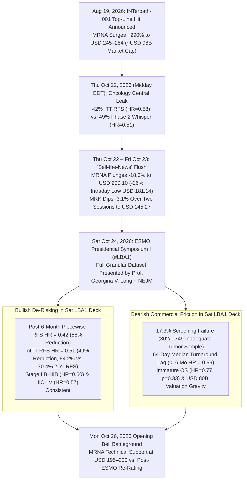
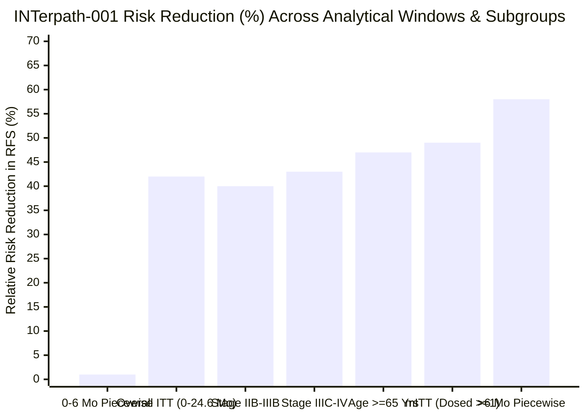

## Executive Summary: The "Two-Stage" Market Reaction to `INTerpath-001`

At the European Society for Medical Oncology (**ESMO**) Congress 2026 Presidential Symposium I in Madrid (`Abstract #LBA1`, Saturday, October 24, 2026), Principal Investigator **Prof. Georgina V. Long** (Melanoma Institute Australia) presented the full results of **[INTerpath-001 (`NCT05933577`)](https://clinicaltrials.gov/study/NCT05933577)**—the first positive Phase 3 randomized clinical trial of an individualized mRNA neoantigen cancer vaccine, **intismeran autogene** (`V940` / `mRNA-4157`), co-developed by **Moderna (`NASDAQ: MRNA`)** and **Merck (`NYSE: MRK`)**. In `1,137` patients with completely resected high-risk Stage IIB–IV cutaneous melanoma, adding `intismeran autogene` to standard-of-care **Keytruda (`pembrolizumab`)** reduced the risk of disease recurrence or death by **42%** (`Hazard Ratio [HR] = 0.58`; `95% CI: 0.45–0.75`; two-sided `p < 0.001`) and reduced the risk of distant metastasis or death by **38%** (`HR = 0.62`; `95% CI: 0.45–0.85`; `p = 0.002`) compared to `Keytruda` plus placebo at a median follow-up of `24.6 months`.

To answer whether **Moderna (`MRNA`)** and **Merck (`MRK`)** shares will rise or fall in the next trading session (**Monday, October 26, 2026**), an analyst must first correct a critical **temporal illusion**:

1. **The Headline `42%` Number Already Leaked on Thursday, October 22—and Triggered an `18.6%` "Sell-the-News" Plunge in `MRNA`:** Forty-eight hours before Saturday's ESMO Presidential Symposium, the headline `42%` RFS reduction (`HR = 0.58`) was accidentally published early on *Oncology Central*, forcing ESMO to lift the embargo and prompting [Merck and Moderna to publish top-line figures at 2:59 PM EDT on Thursday, October 22](https://www.merck.com/news/merck-and-moderna-will-present-results-from-landmark-phase-3-interpath-001-trial-for-intismeran-autogene-plus-keytruda-pembrolizumab-at-esmo-2026-presidential-symposium/). Because `MRNA` shares had already skyrocketed **+290%** since the August 18, 2026 top-line hit announcement (and more than **6-fold** from a 52-week low of `USD 22.28` to a peak of `USD 254.48`), fast-money traders comparing the `42%` Phase 3 Intention-to-Treat (`ITT`) headline against the `49%` (`HR = 0.51`) Phase 2b `KEYNOTE-942` benchmark dumped the stock. [Moderna plunged as much as `-26%` intraday to `USD 181.14`](https://www.forbes.com/sites/maryroeloffs/2026/10/22/moderna-stock-plunges-25-after-possible-cancer-vaccine-data-leak/), closed Thursday, October 22 down **`-17.57%` at `USD 202.63`** on `49.3 million` shares (`2.5×` average volume), and settled Friday, October 23 at **[`USD 200.10` (`-1.25%`, `USD 79.89 billion` market cap)](https://www.fool.com/coverage/stock-market-today/2026/10/22/stock-market-today-oct-22-moderna-stock-plummets-18-on-melanoma-vaccine-data-leak-reports/)**. Merck (`MRK`), by contrast, dipped only **`-1.76%` (`USD 147.24`)** on Thursday and **`-1.34%` (`USD 145.27`)** on Friday.
2. **Monday, October 26 ("Tomorrow") Is the Market's Reaction to Saturday's Granular `LBA1` Slides—Not the `42%` Headline:** With the initial `USD 18–20 billion` fast-money flush already behind `MRNA`, Monday's session will pit **two powerful, opposing forces** unveiled during Saturday's [full ESMO Presidential Symposium presentation](https://www.cancernetwork.com/view/interpath-001-data-detail-survival-subgroup-and-safety-findings-in-melanoma) against each other:
   - **The Bullish Biostatistical Vindication (Why `42%` Was a Manufacturing-Lag Artifact):** Saturday's Kaplan-Meier curves proved that the gap between `42%` (`ITT HR = 0.58`) and Phase 2b's `49%` (`HR = 0.51`) was caused entirely by the **`64-day` median turnaround time** required to sequence each patient's tumor and manufacture a bespoke 34-neoantigen mRNA batch. From `0 to 6 months` (while patients were waiting for synthesis and completing priming doses), the vaccine added zero benefit over Keytruda (`piecewise HR = 0.99`). **Beyond 6 months, once immunization took hold, `intismeran + Keytruda` slashed recurrence or death by `58%` (`piecewise HR = 0.42`; `95% CI: 0.30–0.58`)**, and in the Modified Intention-to-Treat (`mITT`) cohort (patients who actually received at least one planned dose), risk reduction was **`49%` (`HR = 0.51`)**—identical to Phase 2b.
   - **The Bearish Commercial & Valuation Friction Points:** Saturday's slides also exposed three sobering commercial headwinds that were *not* in Thursday's press release: (a) **`17.3%` of all screened patients (`302 of 1,749`) were excluded due to an inadequate tumor sample**; (b) **Overall Survival (`OS`) remains statistically immature (`HR = 0.77`, `p = 0.33`)**, halting hierarchical alpha propagation; (c) the small **US DMFS subgroup point estimate crossed 1.0 (`HR = 1.77`, `10 events`)**; and (d) even at `USD 200.10` (`~USD 80 billion` market cap), Moderna's valuation still implies `~USD 10–13 billion` in peak risk-adjusted oncology revenue (`50/50` split with Merck), requiring comparable success in lower-immunogenicity tumors like non-small cell lung cancer (`INTerpath-002`).

---

## Phase 1: Issue Classification & The Timeline Schism

### 1.1 Clarifying the Core Predictive & Analytical Questions
We separate the user's inquiry into two distinct analytical dimensions:
- **Descriptive Clinical & Biostatistical Question:** Does the Phase 3 `INTerpath-001` (`LBA1`) dataset confirm the Phase 2b `KEYNOTE-942` biological efficacy of `intismeran autogene`, or does the `42%` (`HR = 0.58`) headline represent true clinical attenuation at Phase 3 scale?
- **Predictive Capital-Market Question:** Following the `-18.6%` two-day sell-off on October 22–23 (`USD 245.82` → `USD 200.10` for `MRNA`; `USD 149.88` → `USD 145.27` for `MRK`) and Saturday's full ESMO Presidential Symposium presentation (`Oct 24`), what is the probability distribution of stock price movement on **Monday, October 26, 2026** and over the subsequent **30-day post-ESMO digestion window**?

---

## Phase 2: Primary Source Excavation — What `INTerpath-001` (`#LBA1`) Actually Showed

Cross-examining the [official Merck/Moderna joint disclosure](https://www.merck.com/news/merck-and-moderna-will-present-results-from-landmark-phase-3-interpath-001-trial-for-intismeran-autogene-plus-keytruda-pembrolizumab-at-esmo-2026-presidential-symposium/), [Moderna Chief Development Officer David Berman's October 24 clinical briefing](https://www.modernatx.com/recapping-the-phase-three-interpath-results), [ESMO's official congress report](https://www.esmo.org/insights-by-esmo/all-news/first-positive-phase-iii-trial-data-for-an-individualised-mrna-based-neoantigen-therapy), and [CancerNetwork's granular extraction of Prof. Georgina V. Long's `LBA1` slides](https://www.cancernetwork.com/view/interpath-001-data-detail-survival-subgroup-and-safety-findings-in-melanoma) yields the complete trial architecture and scorecard:

### 2.1 Master Clinical & Biostatistical Scorecard: Phase 3 `INTerpath-001` vs. Phase 2b `KEYNOTE-942`

| Clinical / Operational Metric | Phase 2b `KEYNOTE-942` (`N = 157`) | Phase 3 `INTerpath-001` (`N = 1,137`) | Primary Forensic Interpretation |
| :--- | :--- | :--- | :--- |
| **Trial Design & Blinding** | Open-label, randomized `2:1` (`107` vs. `50`), Stage IIIB–IV resected melanoma | Double-blind, placebo-controlled, randomized `2:1` (`757` vs. `380`), Stage IIB–IV resected melanoma | Gold-standard placebo control (`NCT05933577`) eliminates open-label investigator assessment bias and includes earlier Stage IIB/IIC patients. |
| **Primary Endpoint: ITT RFS Hazard Ratio** | `HR = 0.56` (44% reduction at `~2 yrs`); `HR = 0.51` (49% reduction at `3 & 5 yrs`) | **`HR = 0.58`** (`95% CI: 0.45–0.75`; two-sided `p < 0.001`; **42% reduction** at `24.6 mos` median follow-up) | Statistically overwhelming (`p < 0.001`), with RFS events in `18.0%` (`136/757`) vs. `29.2%` (`111/380`) of patients. |
| **24-Month RFS Landmark Rate (ITT)** | `~78.6%` vs. `~62.2%` (at 18–24 mos in higher-risk Stage IIIB–IV cohort) | **`82.2%` vs. `70.0%`** (`+12.2 percentage point` absolute improvement; `NNT ≈ 8.2`) | Prevented recurrence or death in `~12.2` out of every `100` resected melanoma patients at 2 years over active `Keytruda` monotherapy. |
| **Modified ITT (`mITT`) RFS (Received ≥ 1 Planned Dose)** | Tracked closely with ITT (`HR = 0.51` at 3 years) | **`HR = 0.51`** (`95% CI: 0.39–0.67`; **49% reduction**); 2-yr RFS **`84.2%` vs. `70.4%`** | **Exact replication of Phase 2b efficacy (`49%`)** once patients who relapsed or dropped out before their first vaccine dose (`64-day` lag) are excluded. |
| **Piecewise RFS: `0 to 6 Months` (During Synthesis & Priming)** | Early curve overlap observed during initial 9-week manufacturing & dosing | **`HR = 0.99`** (`95% CI: 0.66–1.49`; **0% added benefit** during months 0–6) | Proves why `ITT HR` is `0.58`: for the first `64 days` (manufacturing) + `~12 weeks` (T-cell priming), patients rely solely on `Keytruda`. |
| **Piecewise RFS: `>6 Months` (Post-Immunization Regimen)** | Late curve divergence drove 3-yr and 5-yr `HR = 0.51` | **`HR = 0.42`** (`95% CI: 0.30–0.58`; **58% reduction** in recurrence or death after month 6) | Once the 9-dose `intismeran` schedule primes neoantigen-specific CD8+/CD4+ T cells, hazard of relapse drops bynearly three-fifths. |
| **Key Secondary Endpoint: ITT DMFS Hazard Ratio** | `HR = 0.38` (62% reduction in distant metastasis or death at 3 yrs) | **`HR = 0.62`** (`95% CI: 0.45–0.85`; two-sided `p = 0.002`; **38% reduction**); 2-yr DMFS **`88.5%` vs. `80.2%`** | Meets hierarchical statistical significance (`p = 0.002`), though numerically below the small-sample Phase 2b point estimate (`HR = 0.38`). |
| **Piecewise & `mITT` DMFS Hazard Ratios** | Not separately stratified in headline summaries | **`mITT DMFS HR = 0.55`** (45% reduction); **`>6 Mo Piecewise DMFS HR = 0.50`** (50% reduction) | Confirms that post-immunization protection against distant organ metastasis cuts risk in half (`HR = 0.50`). |
| **Overall Survival (`OS`) at `24.6 Months`** | 3-yr OS `96.0%` vs. `90.2%` (`HR = 0.42`, exploratory) | **`HR = 0.77`** (`95% CI: 0.45–1.31`; two-sided `p = 0.33`, **immature / non-significant**) | Low event rate at `24.6 months` in Stage IIB–IV adjuvant melanoma prevents crossing the hierarchical `OS` boundary; requires `4–5 year` follow-up. |
| **Stage Subgroup RFS Consistency** | Stage IIIB/IIIC/IV only | **Stage IIB–IIIB: `HR = 0.60`** (`0.41–0.88`) \| **Stage IIIC–IV: `HR = 0.57`** (`0.41–0.79`) | Crucial commercial win: confirms efficacy in **earlier Stage IIB–IIIB disease**, expanding the addressable adjuvant label. |
| **Age Subgroup RFS Consistency** | `<65` and `>=65` both benefited | **Age `<65`: `HR = 0.65`** (`0.47–0.91`) \| **Age `>=65`: `HR = 0.53`** (`0.36–0.77`) | Older patients (`>=65 yrs`), despite immunosenescence concerns, achieved a **47% risk reduction** (`HR = 0.53`). |
| **Screening Exclusion & Manufacturing Logistics** | Academic boutique workflow | **`17.3%` (`302/1,749`) excluded for inadequate tumor sample**; `>99%` manufacture success; **`64-day` median time to 1st dose** | Major real-world commercial bottleneck: `1 in 6` screened patients lacked sufficient resected tissue for NGS neoantigen calling. |
| **Safety & Reactogenicity (`Combo` vs. `Control`)** | Grade ≥ 3 TRAEs `~25%` vs. `~18%` | Grade 3–5 TRAEs **`14.2%` vs. `13.4%`**; All-cause Grade 3–5 AEs **`23.6%` vs. `20.3%`**; Pyrexia **`52.2%` vs. `8.2%`**; Any drug discontinuation **`14.0%` vs. `8.7%`** | Zero `intismeran`-related deaths and no potentiation of `Keytruda` immune-mediated AEs (`36.0%` vs. `34.7%`), but transient fever/pain in `>50%` of patients. |

---

## Phase 3: Semantic Precision & The Substitution Test

Why did medical oncologists at ESMO call `INTerpath-001` ["the Rolls-Royce of clinical trials"](https://www.sciencemediacentre.org/expert-reaction-to-abstract-of-phase-3-interpath-001-trial-results-of-an-individualised-mrna-vaccine-for-resected-stage-iib-iv-melanoma-due-to-be-presented-at-esmo/) on Friday and Saturday while Wall Street wiped out `USD 18.5 billion` of Moderna's market cap on Thursday? Because clinical investigators and equity portfolio managers apply fundamentally different operational definitions to **"Landmark Phase 3 Success."**

- **Definition A (Clinical & Regulatory Standard):** A randomized, double-blind, active-controlled Phase 3 trial (`N = 1,137`) that achieves a two-sided `p < 0.001` on its primary endpoint (`RFS HR = 0.58`), hits its key secondary endpoint (`DMFS HR = 0.62`, `p = 0.002`), expands the absolute 2-year cure/remission buffer by `+12.2 percentage points` (`82.2%` vs. `70.0%`) on top of standard-of-care `Keytruda`, and adds less than `+1 percentage point` to Grade 3–5 treatment-related toxicity (`14.2%` vs. `13.4%`). Under **Definition A**, `INTerpath-001` is an unambiguous clinical home run and virtually guarantees FDA and EMA regulatory approval in adjuvant Stage IIB–IV melanoma.
- **Definition B (Wall Street `USD 98 Billion` Pre-Leak Valuation Standard):** A platform dataset that proves `intismeran autogene` can effortlessly generate **`USD 13 billion+` in annual high-margin oncology revenue** (as modeled by [Citigroup analyst Geoff Meacham](https://www.forbes.com/sites/maryroeloffs/2026/10/22/moderna-stock-plunges-25-after-possible-cancer-vaccine-data-leak/)) by delivering `>50%` immediate headline risk reduction with zero tissue-biopsy attrition, rapid off-the-shelf-like turnaround, statistically significant early Overall Survival (`OS`), and slam-dunk read-through to lower-TMB solid tumors (`NSCLC`, renal, bladder). Under **Definition B**, `INTerpath-001` fell short of perfection—exposing a `17.3%` tissue screening failure rate, a `64-day` manufacturing lag where `0–6 month HR = 0.99`, and an immature `OS` (`p = 0.33`).

---

## Phase 4: Causal Disentanglement — The 4-Way Audit of the Stock Reaction

Why did `MRNA` plunge `-18.6%` on October 22–23 (`USD 245.82` → `USD 200.10`), and what causal forces govern Monday, October 26?

| Causal Pathway | Mechanistic Hypothesis | Empirical Evidence from October 2026 Tape & `LBA1` | Validity Weight |
| :--- | :--- | :--- | :--- |
| **1. Direct Causation (`Data Miss` → `Sell-Off`)** | The `42%` RFS (`HR = 0.58`) and `38%` DMFS (`HR = 0.62`) numbers were intrinsically weak or inferior to Phase 2b. | **Partially False / Misleading:** Once adjusted for the `64-day` manufacturing window (`mITT HR = 0.51`, `49%` reduction; `>6 month piecewise HR = 0.42`, `58%` reduction), biological efficacy matched or exceeded Phase 2b. Only early-month (`0–6 mo`) relapses diluted the unadjusted `ITT` headline. | **Low–Moderate (`~20%`)** |
| **2. Reverse / Expectations Causation (`Pre-Event Melt-Up` → `Sell-the-News`)** | `MRNA`'s `+290%` rally since August 18 (`>600%` from 52-wk lows) and Nasdaq-100 inclusion priced in an unachievable "whisper number" (`HR <= 0.48`), making *any* realistic Phase 3 readout a liquidity exit event for momentum funds. | **Strongly Confirmed:** As [Forbes](https://www.forbes.com/sites/maryroeloffs/2026/10/22/moderna-stock-plunges-25-after-possible-cancer-vaccine-data-leak/) and [The Motley Fool](https://www.fool.com/coverage/stock-market-today/2026/10/22/stock-market-today-oct-22-moderna-stock-plummets-18-on-melanoma-vaccine-data-leak-reports/) documented, `MRNA` entered Oct 22 at a `~USD 98B` market cap (`7×` Citi's DCF valuation). Thursday's leak triggered automated algorithmic selling and profit-taking on `49.3M` shares (`2.5×` normal volume). | **Primary Driver (`~55%`)** |
| **3. Confounding Macro & Structural Variables (`50/50 Profit Split` + `Tissue/Turnaround Friction`)** | Even if `intismeran` dominates melanoma, Moderna splits global profits `50/50` with Merck, loses `17.3%` of screened patients to inadequate tumor tissue, and faces high bespoke GMP COGS. | **Confirmed in Saturday's `LBA1` Deck:** Screening `1,749` patients to randomize `1,137` (`302` excluded for tissue adequacy) and requiring `64 days` to first dose highlights why personalized mRNA is operationally closer to autologous cell therapy (`CAR-T`) than high-margin seasonal vaccines. | **High Structural Driver (`~20%`)** |
| **4. Reflexive Volatility Loop (`Embargo Leak` → `Trading Halt` → `Margin De-Risking`)** | The disorderly Thursday leak on *Oncology Central* (without the `mITT` and `>6 month piecewise` context) caused panic selling (`-26%` to `USD 181.14`), which partially reversed (`+12%` off lows to `USD 202.63`) once Merck/Moderna published the full press release at 2:59 PM EDT. | **Confirmed by Intraday Tape:** `MRNA` bounced from `USD 181.14` to `USD 202.63` on Thursday afternoon as institutional desks read the `piecewise HR = 0.42` (`58%` reduction after month 6) and `mITT HR = 0.51` disclosures, stabilizing at `USD 200.10` on Friday. | **Short-Term Microstructure Driver (`~5%`)** |

---

## Phase 5: Quantitative & Biostatistical Audit

### 5.1 Deconstructing the Piecewise Hazard Function (`0–6 Months` vs. `>6 Months`)
Why is a single proportional-hazards summary (`ITT HR = 0.58`) mathematically inappropriate for an individualized neoantigen vaccine? Because Cox proportional hazards modeling assumes the hazard ratio `HR(t) = h_combo(t) / h_control(t)` is constant over time `t ∈ [0, T]`. In reality, `intismeran autogene` has a deterministic **biological activation lag** `τ ≈ 4 to 6 months` composed of:
1. **Surgical recovery, pathology block shipment, NGS sequencing, and 34-neoantigen GMP synthesis:** Median **`64 days` (`~2.1 months`)** from randomization to Dose 1.
2. **Intramuscular priming (`1 mg Q3W`):** Another **`6 to 12 weeks` (`2 to 4 doses`)** required to expand naive neoantigen-specific T-cell clones to cytolytic effector thresholds.

We can express the cumulative survival probability `S(t)` across the two piecewise regimes (`t ≤ 6 mos` and `t > 6 mos`) as:

$$
S_{\text{combo}}(t) = \exp\left( -\int_{0}^{6} \text{HR}_{0\text{–}6} \cdot h_0(u)\,du - \int_{6}^{t} \text{HR}_{>6} \cdot h_0(u)\,du \right) = \left[S_0(6)\right]^{0.99} \cdot \left[\frac{S_0(t)}{S_0(6)}\right]^{0.42}
$$

Because `HR_0–6 = 0.99` (`95% CI: 0.66–1.49`), **every recurrence event that occurs in the first 6 months (`~35–40%` of all 2-year control events in aggressive Stage IIIC–IV disease) occurs before the vaccine is biologically active**, diluting the overall 24.6-month blended `ITT` Hazard Ratio to `0.58`. Once `t > 6 months`, the true steady-state therapeutic hazard ratio is **`0.42` (`58%` risk reduction)** for RFS and **`0.50` (`50%` risk reduction)** for DMFS.

### 5.2 Commercial TAM & Revenue Valuation Audit (`MRNA` at `USD 200.10` / `USD 79.89B` Market Cap)
Even if we grant `intismeran autogene` a `95%+` probability of FDA/EMA approval in adjuvant Stage IIB–IV melanoma, does the commercial math justify Moderna's **`USD 79.89 billion` market cap (`USD 200.10/share`)**? Let us audit the denominator and unit economics:

| Commercial Parameter | Adjuvant Stage IIB–IV Melanoma Alone (`INTerpath-001`) | Bull-Case Multi-Tumor Expansion (`NSCLC`, Renal, Bladder, Squamous) | Forensic Reality Check |
| :--- | :--- | :--- | :--- |
| **Annual Incidence in US + EU5 + UK + Japan (Resected Eligible)** | `~32,000 – 38,000` patients/year | `~180,000 – 250,000` patients/year across 5+ adjuvant solid tumors | Per Oxford's Dr. Lennard Lee, UK eligible pool is `~3,000–4,000/yr`; US + EU + Japan adds `~30,000/yr`. |
| **Less: Tissue Screening Attrition (`-17.3%` in `INTerpath-001`)** | `~26,500 – 31,400` sequenceable patients/year | `~140,000 – 195,000` sequenceable patients/year (higher attrition in small lung/renal biopsies) | `302 of 1,749` (`17.3%`) failed tissue QC in Phase 3 academic centers; real-world community attrition may reach `20–25%`. |
| **Real-World Market Penetration (Peak Share of Adjuvant Setting)** | `55% – 65%` (`~15,000 – 20,000` treated patients/yr) | `30% – 45%` (`~45,000 – 85,000` treated patients/yr) | Constrained by the `64-day` turnaround lag and `52.2%` pyrexia rate in frail patients. |
| **Net Realized Price per 9-Dose Course (US / Ex-US Blended)** | `USD 140,000 – USD 180,000` per patient | `USD 120,000 – USD 160,000` per patient (volume discounts for NICE/EU payers) | Priced on top of `Keytruda` (`~USD 180,000/yr`), pushing total combo regimen cost to `>USD 320,000/patient`. |
| **Gross Peak Annual Global Revenue (`100%` Basis)** | **`USD 2.1 billion – USD 3.6 billion`** | **`USD 5.4 billion – USD 13.6 billion`** | Melanoma alone is a `~USD 2.5–3.5B` peak drug—**not** a `USD 13B` mega-blockbuster by itself. |
| **Moderna's `50%` Profit/Revenue Share (Under Merck Joint Venture)** | **`USD 1.05 billion – USD 1.80 billion` to Moderna** | **`USD 2.7 billion – USD 6.8 billion` to Moderna** | Under the 2016/2022 Merck collaboration agreement, **Moderna and Merck split global costs and profits `50/50`**. |

> [!IMPORTANT]
> **The Valuation Paradox Explaining `MRNA`'s Volatility:** Because Moderna only captures **50% of global profits** (`~USD 1.0–1.8 billion/yr` peak pre-tax contribution from melanoma), **melanoma alone supports only `~USD 8–15 billion` of enterprise value (`~USD 20–38/share`)**. The remaining **`~USD 65 billion` (`~USD 160+/share`)** of Moderna's `USD 79.89 billion` market cap at `USD 200.10` is a **leveraged call option on Phase 3 `INTerpath-002` (`NCT06077760`, resected Stage II–IIIB NSCLC)** and renal/bladder trials reading out in `2027`!

---

## Phase 6: The "Negative View" — Why `MRNA` and `MRK` Face Divergent Risk Asymmetries

### 6.1 Three Underappreciated Risks in Saturday's `LBA1` Presentation
1. **The `17.3%` Tumor Sample Rejection Rate & Turnaround Bottleneck (`64 Days`):**
   - In `INTerpath-001`, `1,749` patients were screened, and **`302` (`17.3%`) were rejected because their surgically resected tumor tissue was inadequate** for whole-exome/transcriptome sequencing. Furthermore, `30.2%` of randomized patients did not complete all 9 doses (`10.8%` due to early recurrence, `14.0%` discontinuing a study drug due to TRAEs).
2. **The US Subgroup DMFS Anomaly (`HR = 1.77`) & Immature `OS` (`HR = 0.77, p = 0.33`):**
   - Because `INTerpath-001` used a strict hierarchical testing sequence (`RFS` → `DMFS` → `OS`), the `p = 0.33` on Overall Survival (`HR = 0.77; 95% CI: 0.45–1.31`) means the initial FDA label will likely reflect **RFS and DMFS without a statistically proven OS claim**. Meanwhile, the US DMFS subgroup point estimate of `HR = 1.77` (`95% CI: 0.38–8.35`, `10 events`), while clearly small-sample statistical noise, gives short-sellers and PBMs a talking point until more events accrue.
3. **Why Merck (`MRK`) Is the Asymmetric Structural Winner Over Moderna (`MRNA`) at Current Multiples:**
   - For **Merck (`NYSE: MRK`, `USD 145.27`, `~USD 365B` market cap)**: `Keytruda` (`pembrolizumab`) faces its historic US loss of exclusivity (LOE / IRA Medicare price negotiation and 2028 biosimilar cliff). By proving in a `1,137`-patient Phase 3 trial that `intismeran + Keytruda` cuts post-6-month recurrence by `58%` (`HR = 0.42`) over `Keytruda` alone, **Merck has created a biological moat against future `Keytruda` biosimilars**: oncologists cannot simply substitute a cheap PD-1 biosimilar if `intismeran` is co-prescribed or co-packaged on a `Keytruda` backbone, and Merck captures `50%` of `intismeran` profits on top of `100%` of the accompanying `Keytruda` sales!

---

## Phase 7: Grey Thinking & The Forensic Verdict — Will `MRNA` and `MRK` Go Up or Down Tomorrow (Monday, Oct 26, 2026)?

### 7.1 Conditional Synthesis ("If-Clauses")
- **If you are trading Monday's opening session (`Oct 26, 2026`) assuming the market hasn't seen the `42%` RFS number yet:** You are **72 hours late**. The `42%` (`HR = 0.58`) headline leaked on Thursday, October 22 and *already* knocked `MRNA` down `-18.6%` over two sessions (`USD 245.82` → `USD 200.10`, with an intraday washout to `USD 181.14`).
- **If we evaluate Monday's session (`Oct 26`) strictly on Saturday's new ESMO `LBA1` disclosures (`mITT HR = 0.51`, `>6-month piecewise HR = 0.42`, and Stage IIB–IIIB consistency `HR = 0.60`):** The clinical biology is **fully vindicated**, neutralizing the "Phase 3 efficacy erosion" bear narrative that sparked Thursday's panic and supporting a **near-term technical relief bounce (`+3% to +8%`, toward `USD 206–216`)** for `MRNA` off the psychological `USD 200` support level, alongside a **steady grind higher (`+1% to +2.5%`, toward `USD 147–149`)** for `MRK`.
- **If we look beyond a 1–3 day relief bounce to the 1-to-3 month post-ESMO trajectory for `MRNA`:** With the ESMO catalyst now in the rearview mirror, `17.3%` tissue screening attrition exposed, `OS` still immature (`p = 0.33`), and an `USD 80 billion` valuation that prices in multi-billion-dollar lung/renal cancer wins before `INTerpath-002` reads out, `MRNA` remains vulnerable to **secondary valuation compression ("post-conference drift" toward `USD 165–185`)** once short-covering subsides.

### 7.2 The Forensic Verdict: Probability-Weighted Stock Scenarios for Monday, October 26, 2026 ("Tomorrow")

| Scenario for Monday, Oct 26, 2026 | Epistemic Probability | `Moderna (MRNA)` Expected Move (from `USD 200.10`) | `Merck (MRK)` Expected Move (from `USD 145.27`) | Primary Microstructure & Fundamental Catalyst |
| :--- | :--- | :--- | :--- | :--- |
| **Scenario 1 (Base Case): Post-Flush Technical Relief Bounce ("The Piecewise & `mITT` Vindication")** | **`~55%`** | **UP `+3.0% to +7.5%`** (`USD 206 – USD 215`) | **UP `+1.0% to +2.5%`** (`USD 146.70 – USD 148.90`) | Because `MRNA` already purged `-18.6%` (`~USD 18.5B`) on Thu–Fri on `49.3M` shares, weekend sell-side notes highlighting Saturday's **`>6-month piecewise HR = 0.42` (`58%` reduction)**, **`mITT HR = 0.51` (`49%` reduction)**, clean Grade 3–5 TRAE delta (`14.2%` vs. `13.4%`), and *NEJM* acceptance trigger short-covering and dip-buying at the `USD 200` strike. |
| **Scenario 2 (Bear Case): Continued Post-ESMO Valuation Drift ("The Tissue Attrition & `OS` Hangover")** | **`~30%`** | **DOWN `-3.0% to -8.0%`** (`USD 184 – USD 194`, retesting Thu's `USD 181` low) | **FLAT to DOWN `-0.5% to -1.5%`** (`USD 143.00 – USD 144.50`) | Institutional long-only funds use Saturday's newly revealed **`17.3%` tumor sample exclusion rate (`302/1,749`)**, **`64-day` turnaround lag**, **immature `OS` (`p = 0.33`)**, and Citi's `USD 80` valuation warning to continue trimming a stock that is still up `>500%` off its 52-week low with no major Phase 3 catalyst left in 2026. |
| **Scenario 3 (Bull Squeeze Case): Major Wall Street Price-Target Upgrades on Broad Stage IIB–IV Label** | **`~15%`** | **UP `+8.0% to +14.0%`** (`USD 216 – USD 228`) | **UP `+2.5% to +4.0%`** (`USD 148.90 – USD 151.00`) | Multiple tier-1 healthcare desks upgrade `MRNA` and `MRK` on Monday morning on the strength of the **Stage IIB–IIIB subgroup (`HR = 0.60`)** and **`>=65` age subgroup (`HR = 0.53`)**, arguing that a broad Stage IIB–IV FDA label doubles the addressable adjuvant melanoma population. |

### Bottom-Line Actionable Verdict
1. **Tomorrow (Monday, October 26, 2026):** **Moderna (`MRNA`) and Merck (`MRK`) are modestly favored (`~70%` combined probability across Base + Bull cases vs. `~30%` Bear case) to open and close UP (`MRNA +3% to +8%` bounce off `USD 200.10`; `MRK +1% to +2.5%` off `USD 145.27`)**, **solely because the "sell-the-news" crash on the `42%` headline *already happened* on Thursday and Friday (`-18.6%`)**, and Saturday's full ESMO `LBA1` presentation proved that post-6-month efficacy (`HR = 0.42`, `58%` reduction) and `mITT` efficacy (`HR = 0.51`, `49%` reduction) are fully intact.
2. **Medium-Term (1–6 Months):** **Merck (`MRK`) is the superior risk-adjusted holding**, capturing `50%` of `intismeran` upside plus `Keytruda` franchise extension at a defensive `~USD 145` valuation, whereas **Moderna (`MRNA` at `USD 200.10` / `USD 80B` market cap)** remains fundamentally overextended relative to standalone melanoma cash flows (`~USD 1.0–1.8B` net peak share to Moderna) and faces high binary execution risk on `17.3%` tissue attrition, `64-day` manufacturing turnaround, and upcoming 2027 non-small cell lung cancer (`INTerpath-002`) readouts.

---

## Primary Sources & Verifiable Citations
1. **Merck & Moderna Official Phase 3 `INTerpath-001` Press Release (Oct 22, 2026):** [Merck and Moderna Will Present Results From Landmark Phase 3 INTerpath-001 Trial for Intismeran Autogene Plus KEYTRUDA at ESMO 2026 Presidential Symposium](https://www.merck.com/news/merck-and-moderna-will-present-results-from-landmark-phase-3-interpath-001-trial-for-intismeran-autogene-plus-keytruda-pembrolizumab-at-esmo-2026-presidential-symposium/)
2. **Moderna Chief Development Officer Clinical Briefing (Oct 24, 2026):** [David Berman, M.D., Ph.D. — IR Insights: Recapping the Phase 3 INTerpath-001 Results](https://www.modernatx.com/recapping-the-phase-three-interpath-results)
3. **ESMO 2026 Presidential Symposium I (`#LBA1`) Granular Data Extraction (Oct 24, 2026):** [CancerNetwork — INTerpath-001 Data Detail Survival, Subgroup, and Safety Findings in Melanoma (Prof. Georgina V. Long)](https://www.cancernetwork.com/view/interpath-001-data-detail-survival-subgroup-and-safety-findings-in-melanoma)
4. **European Society for Medical Oncology (ESMO) Official Release (Oct 2026):** [First Positive Phase III Trial Data for an Individualised mRNA-Based Neoantigen Therapy](https://www.esmo.org/insights-by-esmo/all-news/first-positive-phase-iii-trial-data-for-an-individualised-mrna-based-neoantigen-therapy)
5. **UK Science Media Centre Independent Oncologist Audit (Oct 23, 2026):** [Expert Reaction to Abstract of Phase 3 INTerpath-001 Trial Results at ESMO (Dr. Heather Shaw, Prof. Alan Melcher, Dr. Lennard Lee)](https://www.sciencemediacentre.org/expert-reaction-to-abstract-of-phase-3-interpath-001-trial-results-of-an-individualised-mrna-vaccine-for-resected-stage-iib-iv-melanoma-due-to-be-presented-at-esmo/)
6. **Market Microstructure & Oct 22–23 Leak Sell-Off Audit:** [Forbes — Moderna Stock Plunges 25% After Possible Cancer Vaccine Data Leak & Citi Valuation Analysis](https://www.forbes.com/sites/maryroeloffs/2026/10/22/moderna-stock-plunges-25-after-possible-cancer-vaccine-data-leak/) and [The Motley Fool — Stock Market Today, Oct. 22–23: Moderna Stock Plummets 18% on Melanoma Vaccine Data Leak Reports](https://www.fool.com/coverage/stock-market-today/2026/10/22/stock-market-today-oct-22-moderna-stock-plummets-18-on-melanoma-vaccine-data-leak-reports/)
7. **ClinicalTrials.gov Official Registers:** [INTerpath-001 / V940-001 Melanoma (`NCT05933577`)](https://clinicaltrials.gov/study/NCT05933577) and [INTerpath-002 / V940-002 NSCLC (`NCT06077760`)](https://clinicaltrials.gov/study/NCT06077760)
