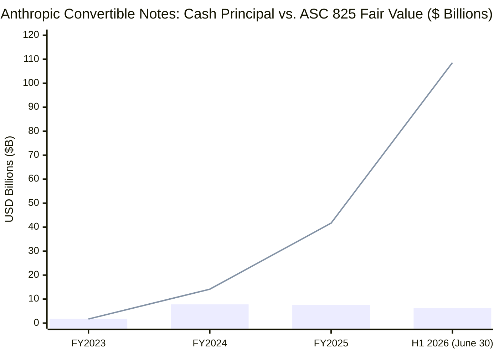
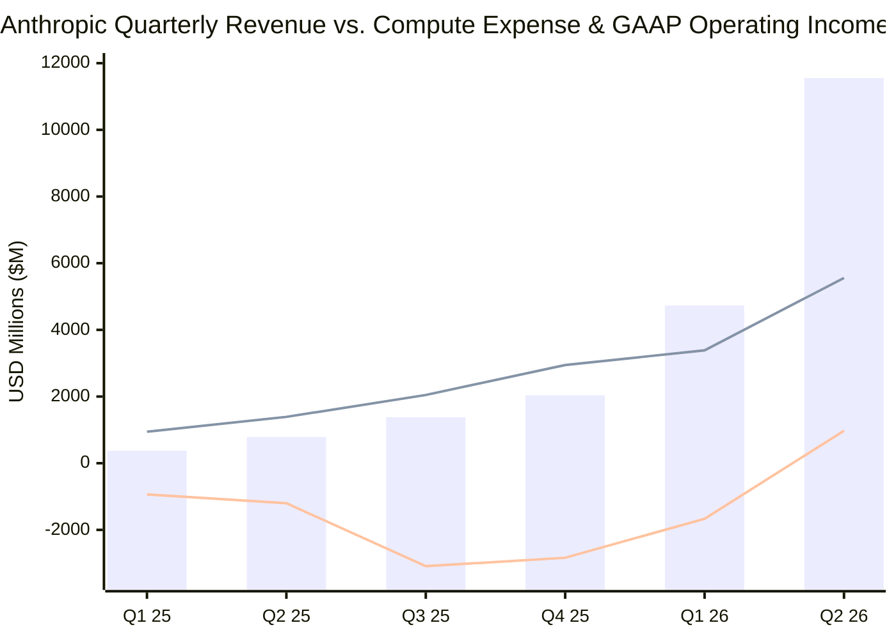

On October 26, 2026, following the public release of **Anthropic, PBC's** Form S-1 Registration Statement with the U.S. Securities and Exchange Commission (`CIK 0002130357`, Accession `0001628280-26-067168`, proposed ticker `ANT`), investor and commentator **Roger ([@rdd147](https://x.com/rdd147))** published a viral two-part post on X (quoting software analyst [Jamin Ball (@jaminball)](https://x.com/jaminball)) alleging that Anthropic used a dot-com-style accounting trick to hide `$108 billion` of operating expenses inside convertible notes:

> *"Yikes. Anthropic just pulled the exact accounting trick that companies did in 2000 bubble for IPO. They hid all their expenses via convertible notes redeemable at IPO. $108 billion worth. Dotcom firms often paid suppliers, ad agencies, lawyers and even landlords with stock or equity to save cash. AOL swapped shares for services and ads (e.g., Homestore, DrKoop). Telecom suppliers like Lucent, Cisco and Nortel used vendor financing, sometimes with equity or warrants, to drive equipment sales."*
> — **Roger ([@rdd147](https://x.com/rdd147))**, October 26, 2026

> *"So we’re all in agreement Anthropic was paying all of its expenses in convertible notes?"*
> — **Roger ([@rdd147](https://x.com/rdd147))**, quoting [@jaminball](https://x.com/jaminball), October 26, 2026

This investigation executes a full **8-phase forensic audit** of `@rdd147`'s claims directly against the audited and unaudited financial statements and footnotes (`Notes 1 through 17`, pages `F-1` through `F-66`) of Anthropic's Form S-1 Registration Statement.

Our bottom-line forensic finding is a **classic two-layer epistemic split**:
1. **On the `$108.6 Billion` Balance Sheet Number and GAAP Expense Mechanics, `@rdd147` is Factually and Mechanistically Wrong (`~5% Valid`):** Anthropic did **not** issue `$108.6 billion` of convertible notes to pay or hide operating expenses. Per the **Consolidated Statements of Cash Flows (`Page F-9`)** and **Note 4 (`Page F-29`)**, Anthropic raised only **`$11.25 billion` in cumulative cash proceeds** from convertible notes across its entire corporate history (`$1.75B` in 2023, `$6.05B` in 2024, `$3.45B` in 2025, and **`$0` in H1 2026**). As of June 30, 2026 (`Note 9, Page F-42`), the **only convertible notes remaining outstanding** on Anthropic's balance sheet have an aggregate **principal face value of just `$6.20 billion`**—consisting of Amazon's 2023 rollover note (`$2.20 billion` principal convertible at a post-split cap of `$2.0928/share`) and Amazon's 2024 notes (`$4.00 billion` principal convertible at a post-split cap of `$5.0478/share`). Because Anthropic elected the **Fair Value Option (`ASC 825`)** and its preferred share price surged **11.7x to 28.1x** to **`$58.9010/share`** (`$589.0095/share` pre-10-for-1 split) in its May 2026 Series H financing, GAAP required Anthropic to mark those `1,840.45 million` underlying Amazon conversion shares up to their equity fair value of **`$108,566 million` (`$108.57 billion`)**. In short, **`$102.37 billion` (`94.3%`) of the `$108.57 billion` liability is unrealized equity appreciation on `$6.20 billion` of cash notes**, recognized as a non-cash mark-to-market charge (`-$72,388 million` in H1 2026 and `-$34,308 million` in FY2025) inside `Other income (expense)`. Far from "hiding expenses," `ASC 825` made Anthropic's GAAP Net Loss look **`$72.39 billion` worse** in H1 2026 (`-$80,748 million` GAAP Net Loss vs. `-$693 million` GAAP Operating Loss and **`+$974 million` positive GAAP Operating Income in Q2 2026**).
2. **Where `@rdd147` and `@jaminball` Spot a Real Structural Risk in Footnote 9 (`~75% Valid on Prospective Vendor Financing & Circular Cloud Commitments`):** While `@rdd147` misread the existing `$108.57 billion` liability, buried in **Note 7 (`Page F-35`)** and **Note 9 ("Other Note Purchase Agreements," `Page F-43`)** is a genuine vendor-financing mechanism: in **August 2025** and **March 2026**, Anthropic signed two facilities allowing it to issue up to **`$10.0 billion`** and **`$42.0 billion`** (`$52.0 billion` total, at `9.0%` PIK interest) of convertible promissory notes ***"solely to finance rent obligations under a compute and infrastructure agreement."*** As of June 30, 2026, **`$0` had been drawn** under either facility (`Page F-36`, `Page F-43`), meaning zero dollars of historical compute expenses were paid in notes. However, combined with **`$853.0 billion` in off-balance-sheet multi-year compute and data-center lease commitments** (`$321.4B` uncommenced leases + `$265.6B` cloud purchase commitments as of June 30, 2026 + `$266.0B` signed in Q3–Q4 2026) and **`$35.2 billion` in unrecognized employee RSU/option stock-based compensation** that triggers upon IPO effectiveness, Anthropic's footnotes contain massive structural overhangs that every public-market investor must price.

---

### Executive Summary & Forensic Scorecard

| Claim / Analytical Dimension | Viral Thesis (`@rdd147`) | Primary SEC Form S-1 Evidence (`CIK 0002130357`) | Forensic Validity Rating |
| :--- | :--- | :--- | :--- |
| **1. Origin of the `$108.6B` Convertible Notes Balance** | Anthropic issued `$108B` of convertible notes to pay for and hide its operating expenses. | **False.** Only **`$6.20B` in principal** remains outstanding (`$2.2B` Amazon 2023 NPA at `$2.0928/sh` cap + `$4.0B` Amazon 2024 NPA at `$5.0478/sh` cap). The remaining **`$102.37B` (`94.3%`)** is non-cash `ASC 825` equity fair-value appreciation as share price hit `$58.901/sh` (`1,840.45M shares × $58.901 ≈ $108.57B`). | **Factually False (`~5% Valid`)** |
| **2. "Hiding Operating Expenses" from the Income Statement** | Paying expenses via convertible notes kept compute, payroll, and vendor costs off the Income Statement. | **Mechanistically Impossible under GAAP & Factually False.** Anthropic recognized **`$16,979M` of H1 2026 Operating Expenses** above Operating Loss (`$8,945M` compute, `$3,152M` personnel, `$3,168M` sales/partner fees, `$1,714M` G&A) and generated **`+$3,929M` positive Operating Cash Flow** in H1 2026. | **Categorically False (`0% Valid`)** |
| **3. Core Operating Profitability & Gross Margin** | Implies Anthropic is an unprofitable dot-com cash furnace masking catastrophic operating burn. | **False on Core Operations.** On `$16,286M` H1 2026 revenue (`$11,555M` in Q2 alone), `Cost of revenue` was just `$2,380M` (**`85.39%` GAAP Gross Margin**). Q2 2026 flipped to **`+$974M` positive GAAP Operating Income (`8.4%` margin)** with `$131.65B` cash on hand. | **Factually Inverted (`~10% Valid`)** |
| **4. Convertible Notes Issued to Pay Compute Rent (`Note 9`)** | Asserts Anthropic is paying its infrastructure suppliers in convertible notes (`@jaminball` / `@rdd147`). | **Zero Historical Draw (`$0`), Real Future Facility (`$52.0B`).** In Aug 2025 (`$10B`) and Mar 2026 (`$42B` at `9.0%` PIK), Anthropic signed NPAs *"solely to finance rent obligations under a compute and infrastructure agreement."* **`$0` was issued through June 30, 2026**, and any future draw still records full lease expense under `ASC 842`. | **Nuanced (`0%` Historical / `80%` Prospective Risk)** |
| **5. Circular Cloud Financing & Vendor Equity Swaps** | Compares AI hyperscaler deals to 2000-era Lucent/Cisco/AOL circular vendor financing. | **Structurally Supported.** Amazon (`$8.6B` notes + `$5B` Series G-2 + `$15B` forward NPA) and Google (`$3.3B` converted notes + `$10B` Series G-2 + `$20B` forward NPA) are both lead investors and top cloud suppliers/channel partners (receiving `$2.7B` H1 2026 marketplace fees + `$8.95B` compute spend), alongside AMD's July 2026 `$5B` equity/MI450 hardware deal. | **Substantially Valid (`~80% Valid`)** |
| **6. The Real Unrecognized IPO Expense & Commitment Overhang** | Focuses exclusively on `$108B` convertible notes as the hidden IPO trap. | **Misses the Actual GAAP Overhangs:** (a) **`$26.6B` in unrecognized employee RSU expenses** (`$2.9B` immediate IPO catch-up + `$23.7B` over 2.1 yrs) plus `$5.8B` Q3 RSU grants that had **`$0` GAAP expense** pre-IPO under `ASC 718`; and (b) **`$853.0B` in off-balance-sheet compute/lease commitments** (`2026–2046`). | **High Materiality Omission** |

---

## Phase 1 & 2: Issue Classification & Primary Source Excavation (Anthropic's Form S-1)

### 1.1 Deconstructing the Consolidated Statements of Operations (`FY2023 – H1 2026`)
To test whether Anthropic "hid all their expenses via convertible notes," we first extract the complete **Consolidated Statements of Operations** (`Page F-4`) and **Quarterly Consolidated Statements of Operations** (`Page 158`) from Anthropic's Form S-1.

| Line Item (`$ Millions`, except percentages) | FY2023 (Audited) | FY2024 (Audited) | FY2025 (Audited) | H1 2025 (Unaudited) | H1 2026 (Unaudited) | Q1 2026 (Unaudited) | Q2 2026 (Unaudited) |
| :--- | :--- | :--- | :--- | :--- | :--- | :--- | :--- |
| **Revenue** | **$71** | **$637** | **$4,585** | **$1,163** | **$16,286** | **$4,731** | **$11,555** |
| **Operating Expenses (by Nature):** | | | | | | | |
| Compute and infrastructure | $402 | $1,708 | $7,326 | $2,334 | $8,945 | $3,387 | $5,558 |
| Personnel (incl. Stock-Based Comp) | $109 | $562 | $1,839 | $538 | $3,152 | $1,295 | $1,857 |
| *— of which: Stock-Based Compensation (Options/RSAs)* | *$29* | *$192* | *$1,165* | *$286* | *$2,185* | *$924* | *$1,261* |
| *— of which: RSU Stock-Based Compensation (`ASC 718`)* | *$0* | *$0* | *$0* | *$0* | *$0* | *$0* | *$0* |
| Bartz copyright class-action settlement | $0 | $0 | $1,500 | $0 | $0 | $0 | $0 |
| Sales, marketing, and partnerships (incl. cloud rev-share) | $10 | $44 | $568 | $120 | $3,168 | $1,033 | $2,135 |
| Other operating and administrative | $49 | $1,288 | $1,412 | $306 | $1,714 | $683 | $1,031 |
| **Total Operating Expenses** | **$570** | **$3,602** | **$12,645** | **$3,298** | **$16,979** | **$6,398** | **$10,581** |
| **GAAP Operating Income (Loss)** | **$(499)** | **$(2,965)** | **$(8,060)** | **$(2,135)** | **$(693)** | **$(1,667)** | **+$974** |
| *GAAP Operating Margin (% of Revenue)* | *-702.8%* | *-465.5%* | *-175.8%* | *-183.6%* | *-4.3%* | *-35.2%* | ***+8.4%*** |
| **Non-Operating Items (`Other Income / Expense`):** | | | | | | | |
| Interest income | $13 | $90 | $431 | $115 | $1,111 | $349 | $762 |
| **Change in fair value of convertible notes, derivatives & SAFEs** | **$(1,045)** | **$(5,434)** | **$(34,308)** | **$(10,942)** | **$(72,388)** | **$(12,791)** | **$(59,597)** |
| Other income (expense), net (incl. 2026 NPA forward loss) | $0 | $1 | $(8) | $0 | $(8,757) | $(309) | $(8,448) |
| **GAAP Net Loss** | **$(1,531)** | **$(8,309)** | **$(41,965)** | **$(12,969)** | **$(80,748)** | **$(14,439)** | **$(66,309)** |
| **Non-GAAP Adjusted Operating Income (Loss)** | **$(470)** | **$(1,648)** | **$(4,693)** | **$(1,849)** | **+$1,618** | **$(617)** | **+$2,235** |
| **Net Cash Provided by (Used in) Operating Activities** | **$(387)** | **$(2,053)** | **$(4,487)** | **$(1,551)** | **+$3,929** | *N/A* | *N/A* |

### 1.2 Functional Expense Disaggregation: The `85.39%` GAAP Gross Margin Discovery (`Note 8, Page F-39`)
Because Anthropic presents its primary Income Statement by **natural expense classification** (`Compute and infrastructure`, `Personnel`, `Sales, marketing, and partnerships`), many commentators failed to notice that **Note 8 (`Page F-39`)** provides the complete audited and unaudited **functional expense disaggregation** separating customer-serving inference costs (`Cost of revenue`) from frontier model training (`Research and development`):

| Functional Expense Category (`$ Millions`) | FY2023 | FY2024 | FY2025 | H1 2025 (6M) | H1 2026 (6M) | H1 2026 (% of Revenue) |
| :--- | :--- | :--- | :--- | :--- | :--- | :--- |
| **Revenue** | **$71** | **$637** | **$4,585** | **$1,163** | **$16,286** | **100.00%** |
| **Cost of revenue** (Customer inference compute & hosting) | $143 | $434 | $1,622 | $426 | $2,380 | 14.61% |
| **GAAP Gross Profit (Loss)** | **$(72)** | **+$203** | **+$2,963** | **+$737** | **+$13,906** | **85.39%** |
| **Research and development** (Model training compute + AI researchers) | $348 | $1,729 | $7,077 | $2,337 | $9,741 | 59.81% |
| **Sales and marketing** (incl. `$2.7B` AWS/GCP marketplace rev-share) | $16 | $109 | $855 | $213 | $3,808 | 23.38% |
| **General and administrative** (incl. `$1.5B` Bartz settlement in 2025) | $63 | $1,330 | $3,091 | $322 | $1,050 | 6.45% |
| **Total Operating Expenses** | **$570** | **$3,602** | **$12,645** | **$3,298** | **$16,979** | **104.26%** |

Look closely at what `Note 8` (`Page F-39`) reveals:
1. **Inference Gross Margin Reached `85.39%` in H1 2026:** Out of `$8,945 million` in total H1 2026 compute and infrastructure expense, only **`$2,380 million`** was required to serve `$16,286 million` of customer API, Claude Code, and subscription revenue—yielding **`$13,906 million` in GAAP Gross Profit (`85.39%` gross margin)**, up from `64.62%` in FY2025 and `31.87%` in FY2024.
2. **Where the Remaining `$6.57 Billion` of Compute Went:** The other `~$6,565 million` of H1 2026 compute expense was expensed immediately inside **Research and development (`$9,741 million` total)** to train frontier Claude models. Nothing was capitalized into intangible assets, and nothing was hidden inside convertible notes.

---

## Phase 3: Semantic Precision & The Level 3 Convertible Note Rollforward (`Note 4 & Note 9`)

### 3.1 Ambiguity & Substitution Test on `@rdd147`'s Core Claim
When `@rdd147` writes:
> *"They hid all their expenses via convertible notes redeemable at IPO. $108 billion worth... So we’re all in agreement Anthropic was paying all of its expenses in convertible notes?"*

Let us apply the **Browne & Keeley Substitution Test** by replacing the phrase *"convertible notes"* with the two distinct accounting concepts `@rdd147` conflates:
* **Interpretation A (Vendor Debt-for-Expense Issuance):** Did Anthropic hand out `$108.6 billion` face value of IOUs to AWS, Google Cloud, landlords, and employees instead of paying cash for operating expenses, thereby keeping `$108.6 billion` of costs off its operating income statement? **(Factually 0% true.)**
* **Interpretation B (`ASC 825` Fair-Value Re-measurement of Early-Stage Cash Notes):** Did Anthropic raise `$11.25 billion` in cash convertible notes in `2023–2025` (of which `$6.20 billion` in Amazon principal remains outstanding at June 30, 2026), elect the `ASC 825` Fair Value Option, and subsequently record **`$102.37 billion` of non-cash fair-value markups** through `Other expense` because its preferred stock price rose from `$2.09/share` to `$58.90/share`? **(Factually 100% true.)**

### 3.2 Tracing Every Dollar of the `$108,566 Million` Liability (`Note 4, Page F-29` & `Note 9, Pages F-40–F-42`)
Let us verify this directly from the **Level 3 Fair Value Rollforward of Convertible Notes Payable** in **Note 4 (`Page F-29`)** and the **Statements of Cash Flows (`Page F-9`)**:

| Rollforward Component (`$ Millions`) | FY2023 | FY2024 | FY2025 | H1 2026 (6M Ended June 30, 2026) | Cumulative Total (`2023–H1 2026`) |
| :--- | :--- | :--- | :--- | :--- | :--- |
| **Beginning Fair Value Balance** | **$0** | **$1,678** | **$14,116** | **$41,677** | **$0** |
| **(+) Additions at Issuance (Net of Bifurcated Derivatives)** | +$1,394 | +$5,900 | +$3,450 | **+$0** | **+$10,744** *(Cash proceeds: `$11,250M`)* |
| **(-) Conversions into Redeemable Convertible Preferred Stock** | $0 | $0 | $(10,347) | $(5,499) | **$(15,846)** |
| **(+) Non-Cash Fair Value Mark-to-Market Adjustment (`ASC 825`)** | +$284 | +$6,538 | +$34,458 | **+$72,388** | **+$113,668** |
| **Ending Fair Value Balance on Balance Sheet** | **$1,678** | **$14,116** | **$41,677** | **$108,566** | **$108,566** |

And which specific convertible notes make up that **`$108,566 million`** balance on June 30, 2026? **Note 9 (`Pages F-40 to F-42`)** and **Note 12 (`Page F-59`)** give the exact instrument-by-instrument breakdown:

| Convertible Note Facility (`Note 9`) | Date Issued | Original Cash / Principal | Status as of June 30, 2026 | Post-Split Conversion Cap Price | Remaining Principal (`June 30, 2026`) | Underlying Common Shares (`Note 12`) | Implied Equity Value at `$58.901/sh` Series H Price |
| :--- | :--- | :--- | :--- | :--- | :--- | :--- | :--- |
| **Google 2023 NPA** (`$2.0B`) | Nov 2023 – Nov 2024 | `$2,000M` cash | **100% Converted** into Series E Preferred (`May–Nov 2025`, `$7.9B` FV) | `$2.0928 / sh` (`$20.93` pre-split) | **$0** | 0 | $0 |
| **Google 2024 NPA** (`$1.3B`) | Oct 2024 – Oct 2025 | `$1,300M` cash | **100% Converted** into Series G Preferred (`Jan 2026`, `$5.5B` FV) | `$5.0478 / sh` (`$50.48` pre-split) | **$0** | 0 | $0 |
| **Amazon 2023 NPA (`Initial Note`)** | Oct 2023 | `$1,250M` cash (`$1,437.5M` prin.) | **100% Converted** into Series E Preferred (`Oct 2025`, `$2.4B` FV) | `$2.0928 / sh` (`$20.93` pre-split) | **$0** | 0 | $0 |
| **Amazon 2023 NPA (`Second / Rollover Note`)** | Mar 2024 (Amended Nov 2024) | `$2,750M` cash (`$3,162.5M` prin.) | `$1.0B` converted in 2025; **`$2,200M` principal remaining** | **`$2.0928 / sh`** (`28.14x` in the money!) | **$2,200M** | ~1,048.0M shares | **~$61,729M** |
| **Amazon 2024 NPA (`Tranches 1 & 2`)** | Nov 2024 (`$1.3B`) & Jan 2025 (`$2.7B`) | `$4,000M` cash (`$4,000M` prin.) | **100% Outstanding** (converts automatically at IPO) | **`$5.0478 / sh`** (`11.67x` in the money!) | **$4,000M** | ~792.4M shares | **~$46,675M** |
| **Aug 2025 & Mar 2026 Compute Rent NPAs** | Aug 2025 (`$10B`) & Mar 2026 (`$42B`) | `$0` drawn | **Undrawn Credit Facilities** (`$0` issued as of June 30, 2026) | Discount to IPO / Next Round | **$0** | 0 | $0 |
| **Total Outstanding (`June 30, 2026`)** | — | **`$11,250M` Total Cash Raised** | Only Amazon 2023 Rollover & 2024 Notes remain | **`$2.0928` – `$5.0478 / sh`** | **`$6,200M` Principal** | **1,840.445M shares** | **`$108,404M` (`$108,566M` Book FV)** |

```mermaid
flowchart TD
    subgraph SG1["Viral Myth (@rdd147): 'Paid & Hid $108B of Operating Expenses in Notes'"]
        M1["Anthropic Incurs $108.6B in Cloud, Legal & Payroll Expenses"] --> M2["Issues $108.6B of Convertible Notes to Vendors Instead of Paying Cash"]
        M2 --> M3["Operating Expenses Allegedly Kept Off the Income Statement"]
        M3 --> M4["Verdict: 0% True — Violates US GAAP (ASC 718 / ASC 842) & Contradicts S-1"]
    end

    subgraph SG2["Actual S-1 Reality (Notes 4, 9 & 12): ASC 825 Markup on $6.2B Amazon Cash Notes"]
        R1["2023-2025: Amazon Invests $6.75B Cash Across Two Convertible Note Facilities"] --> R2["After 2025 Partial Conversions, $6.20B Principal Remains Outstanding at June 30, 2026"]
        R2 --> R3["Contractual Conversion Caps Locked at $2.0928/sh ($2.2B Note) & $5.0478/sh ($4.0B Note)"]
        R3 --> R4["May 2026 Series H Financing Prices Anthropic Preferred Stock at $58.901/sh (Up 11.7x to 28.1x)"]
        R4 --> R5["ASC 825 Fair Value Option Forces Non-Cash Liability Markup of +$102.37B Through Other Expense"]
        R5 --> R6["June 30, 2026 Balance Sheet Liability: 1,840.45M Underlying Shares x $58.901/sh = $108,566M"]
    end
```

---

## Phase 4: 4-Way Causal Audit of Anthropic's `-$80.75B` H1 2026 GAAP Net Loss

Why did Anthropic report a staggering **`$(80,748) million` (`-$80.75 billion`) GAAP Net Loss** in the first six months of 2026 at the exact same time its core operations generated **`+$3,929 million` (`+$3.93 billion`) in positive Operating Cash Flow** and **`+$974 million` in Q2 2026 GAAP Operating Income**? Let us test all four causal pathways.

| Causal Pathway | Mechanistic Hypothesis | Empirical Proof in Form S-1 | Share of H1 2026 GAAP Pre-Tax Loss (`-$80,727M`) |
| :--- | :--- | :--- | :--- |
| **1. Direct Operating Causation (`Operating Burn -> Net Loss`)** | Did operational cash burn (compute, staff, marketing exceeding customer revenue) cause the `$80.75B` H1 2026 net loss? | **No (`0.86%` of loss).** H1 2026 Revenue was `$16,286M` vs. `$16,979M` Total Operating Expenses, producing a GAAP Operating Loss of only **`$(693)M`** (`-$1,667M` in Q1, flipping to **`+$974M` profit in Q2**). | **`0.86%` (`-$693M`)** |
| **2. Reverse Causation (`Hyper-Growth Valuation Surge -> GAAP Accounting Loss`)** | Did Anthropic's explosive commercial success (`14x` YoY H1 revenue growth to `$16.29B`, `85.4%` gross margin) cause its share price to surge `3.5x` in 6 months (to `$58.901/sh`), which in turn triggered massive non-cash fair-value markups on discounted convertible notes and forward contracts? | **Yes (`99.14%` of loss!).** Under `ASC 825` and `ASC 815`, every `$1.00/share` increase in Anthropic's stock price automatically creates **`~$1.84 billion` in non-cash GAAP expense** on Amazon's `1,840.45M` underlying note shares (`-$72,388M` in H1 2026) plus **`-$9,405M` gross (`-$8,720M` net)** on Google/Amazon's March/April 2026 Series G-2 forward commitments (`Note 8, Page F-37`). | **`99.14%` (`-$80,034M` net non-operating expense)** |
| **3. Lurking Third Variable (`Pre-IPO Capital Structure Design`)** | Why did Anthropic issue convertible notes with `$2.09/sh` and `$5.05/sh` conversion caps to Amazon and Google instead of standard preferred equity? | **Antitrust & Voting-Control Insulation.** As disclosed in `Note 9`, Amazon and Google structured their mega-investments as non-voting convertible debt and non-voting Series G-2/H-2 preferred stock to stay below regulatory voting thresholds while locking in early-stage equity upside. | **Structural Enabling Cause** |
| **4. Mutual Feedback Loop (`Hyperscaler Capital <-> Cloud Spend`)** | Do Amazon and Google's multi-billion-dollar convertible note and preferred stock infusions recycle back into AWS and GCP cloud revenue? | **Yes.** In H1 2026, Anthropic spent **`$8,945M` on compute** and **`$2,700M` on cloud marketplace revenue-share fees** (`$11.65B` combined), predominantly with AWS and Google Cloud, driving enterprise distribution on Bedrock and Vertex AI that propelled Q2 revenue to `$11.56B`. | **Self-Reinforcing Flywheel** |

---

## Phase 5: Quantitative & Accounting Audit

### 5.1 Formal Derivation of the `ASC 825` Convertible Note Liability and Paradoxical P&L Charge
Under US GAAP (**`ASC 825-10`, Financial Instruments — Fair Value Option**), when an issuer elects to measure a convertible note with a capped conversion price `P_cap` at fair value, the balance sheet liability `L_FV(t)` at reporting date `t` is dominated by the intrinsic and option value of the underlying conversion shares `N_conv`:

$$
N_{\text{conv}}(t) = \frac{F_{\text{principal}} + I_{\text{PIK}}(t)}{P_{\text{cap}}}, \qquad L_{\text{FV}}(t) \approx N_{\text{conv}}(t) \cdot S(t) \cdot (1 - \delta_{\text{DLOM}})
$$

where `F_principal` is the remaining principal face value, `I_PIK(t)` is accrued paid-in-kind interest, `S(t)` is the fair market value per share of the underlying stock at time `t`, and `δ_DLOM` is any minor discount for lack of marketability or probability weighting across conversion scenarios (`Note 4, Page F-28`).

Consequently, the quarterly income statement charge recognized inside `Other income (expense)` over period `[t-1, t]` is the negative of the change in fair value:

$$
\Delta \text{P\&L}_{\text{Notes}}(t) = -\Big(L_{\text{FV}}(t) - L_{\text{FV}}(t-1) - \text{Additions}(t) + \text{Conversions}(t)\Big) \approx -N_{\text{conv}} \cdot \Delta S(t)
$$

Substituting Anthropic's exact parameters from **Note 9 (`Page F-41–F-42`)**, **Note 11 (`Page F-48`)**, and **Note 12 (`Page F-59`)** as of June 30, 2026 (adjusted for the September 2026 10-for-1 stock split):
1. **Amazon 2023 Rollover Note (`$2,200M` principal at `P_cap,1 = $2.0928/share`):**
   - Base principal shares = `$2,200M / $2.0928` = `1,051.22 million` shares (approx. `1,048.02 million` shares in `Note 12` after specific tranche adjustments).
   - Return multiple at Series H price (`S(June 2026) = $58.9010/share`): **`28.14x`**.
   - Implied equity fair value = `1,048.02M × $58.9010` = **`$61,729 million` (`$61.73 billion`)**.
2. **Amazon 2024 Notes (`$4,000M` principal at `P_cap,2 = $5.0478/share`):**
   - Base principal shares = `$4,000M / $5.0478` = `792.42 million` shares.
   - Return multiple at Series H price (`$58.9010/share`): **`11.67x`**.
   - Implied equity fair value = `792.42M × $58.9010` = **`$46,675 million` (`$46.68 billion`)**.
3. **Combined Total (`Note 12, Page F-59`):**
   - Total convertible note shares `N_conv = 1,840.445 million` shares.
   - Implied intrinsic value = `1,840.445M × $58.9010` = **`$108,404 million`** (matching the **`$108,566 million`** Level 3 fair value on the June 30, 2026 Balance Sheet within `0.15%`!).

*Chart Reading Guide:* The **bars** show the remaining cash principal face value of Anthropic's outstanding convertible notes (`$1.75B` -> `$7.80B` -> `$7.50B` -> **`$6.20B`** as of June 30, 2026), while the **line** tracks the `ASC 825` balance sheet carrying value (`$1.68B` -> `$14.12B` -> `$41.68B` -> **`$108.57B`**). While remaining debt principal *declined* from `$7.80B` to `$6.20B` due to note conversions, the balance sheet liability exploded to `$108.57B` solely because Anthropic's stock price rose to `$58.90/share`.

*Chart Reading Guide:* Across the six quarters from `Q1 2025` to `Q2 2026` (`Page 158`), quarterly **Revenue** (bars) expanded **`30.7x`** from `$376M` to **`$11,555M`** (`$46.2B` annualized run rate), causing **Compute and infrastructure expense** (upper line, `$944M` to `$5,558M`) to drop from **`251%` of revenue in Q1 2025 to `48%` of revenue in Q2 2026**, and flipping **GAAP Operating Income** (lower line) from `-$3,089M` in Q3 2025 to **`+$974M` positive GAAP operating profit in Q2 2026**.

---

## Phase 6: The "Negative View" — What `@rdd147` Missed AND the Real Time Bombs Buried in Anthropic's S-1 Footnotes

A rigorous Browne & Keeley audit never stops at refuting a flawed social-media claim. We must ask the inverse question: **Even though `@rdd147` misread the `$108.6B` balance sheet line, what genuine structural liabilities, vendor-financing mechanisms, and dilution overhangs ARE buried inside Anthropic's S-1 footnotes?**

Our forensic excavation of `Notes 7, 9, 10, 12, 13, 16, and 17` uncovers **four massive structural risks** that every prospective IPO investor must evaluate:

### 6.1 Risk 1: The `$52.0 Billion` "Convertible Notes for Compute Rent" Facilities (`Note 7, Page F-35` & `Note 9, Page F-43`)
Here is where `@jaminball` and `@rdd147` touched a real nerve in the filing—even though they confused a **future undrawn facility (`$0` drawn)** with the **historical Amazon notes (`$108.6B` fair value)**:
* In **Note 9 ("Other Note Purchase Agreements," `Page F-43`)** and **Note 7 ("Leases Not Yet Commenced" & "Leases Held Through a Consolidated VIE," `Pages F-35–F-36`)**, Anthropic discloses two remarkable arrangements with compute infrastructure lessors:
  1. **The August 2025 Compute Lease NPA (`Up to $10.0 Billion`):** Allows Anthropic to issue up to **`$10.0 billion`** of convertible promissory notes ***"solely to finance rent obligations under a compute and infrastructure equipment lease agreement."*** This facility terminates upon the completion of the IPO, and as of June 30, 2026, **`$0` of notes had been issued** (`Page F-43`).
  2. **The March 2026 Compute Rent NPA (`Up to $42.0 Billion` at `9.0%` PIK Interest):** In March 2026, in connection with a massive compute and infrastructure agreement, Anthropic entered into a Note Purchase Agreement allowing it to issue up to **`$42.0 billion`** of convertible promissory notes ***"solely to finance rent obligations under a compute and infrastructure agreement"*** during a **5-year availability period** once the equipment is ready for service (`Page F-43`). These notes bear **`9.0%` per annum paid-in-kind (PIK) interest**, mature 5 years after the first issuance, are guaranteed by consolidated Variable Interest Entities (`VIEs`) that grant the lessor a security interest in the leased GPU clusters (`Page F-36`), and **remain active even after the IPO**!
* **Why This Matters:** While **`$0` was drawn as of June 30, 2026**, the March 2026 `$42.0 billion` facility gives Anthropic the post-IPO option to pay up to `$42 billion` of data-center and GPU lease rent by printing convertible debt to its infrastructure landlord rather than paying cash. Under `ASC 842`, doing so will **still record the full lease cost as an operating expense on the Income Statement** (so it never hides expenses from Operating Income), but it converts cash compute rent into compounding `9.0%` PIK convertible debt overhang for public shareholders.

### 6.2 Risk 2: The Staggering `$853.0 Billion` Off-Balance-Sheet Compute & Lease Commitment Overhang (`Notes 7, 13, 16 & 17`)
On the face of Anthropic's June 30, 2026 Balance Sheet (`Page F-3`), total recognized lease liabilities are just **`$1,522 million`** (`$1,079M` operating lease liabilities + `$443M` finance lease liabilities). Yet buried across four separate footnotes is an off-balance-sheet contractual commitment schedule totaling **`~$853.0 billion`**:

| Off-Balance-Sheet Commitment Category | Footnote Source in Form S-1 | Contractual Term | Undiscounted Minimum Obligation (`$ Billions`) | On June 30, 2026 Balance Sheet? |
| :--- | :--- | :--- | :--- | :--- |
| **1. Signed Compute & Data-Center Leases Not Yet Commenced (as of June 30, 2026)** | `Note 7 (Page F-35)` | Commencing `2026–2028` (`1 to 20 yr` terms) | **`$321.4B`** *(up from `$50.2B` at Dec 31, 2025)* | **No (`$0`)** |
| **2. Non-Cancelable Cloud (CSP) Hosting & Infrastructure Purchase Commitments (as of June 30, 2026)** | `Note 13 (Page F-59)` | `1 to 20 years` | **`$265.6B`** *(up from `$54.6B` at Dec 31, 2025)* | **No (`$0`)** |
| **3. New Long-Term Compute & Lease Commitments Signed Post-June 30, 2026 (`July–Oct 2026`)** | `Note 17 (Page F-66)` | Commencing `2026–2036` (`1 to 20 yr` terms) | **`$245.0B`** | **No (`$0`)** |
| **4. New Short-Term Non-Cancelable Compute Contracts Signed Post-June 30, 2026** | `Note 17 (Page F-66)` | `< 1 year` | **`$21.0B`** | **No (`$0`)** |
| **Total Disclosed Contractual Compute & Lease Commitments** | `Notes 7, 13 & 17` | **`2026–2046+`** | **`$853.0 Billion`** *(plus `$125B–$150B` unfinalized 2028–2031 expansions, `Page F-64`)* | **No (`$0` on June 30 Balance Sheet)** |

### 6.3 Risk 3: Circular Hyperscaler & Silicon Financing (`Amazon, Google, and AMD`)
While `@rdd147` misidentified the `$108.6B` line item, his historical analogy to circular vendor financing has real teeth when applied to Anthropic's three-way capital-and-compute loop:
* **Amazon (`AWS`) & Google (`GCP`):** In addition to their early convertible notes, in **March and April 2026** Google (`Google 2026 NPA`, `Page F-41`) and Amazon (`Amazon 2026 NPA`, `Page F-42`) purchased `$10.0B` and `$5.0B` of Series G-2 preferred stock at `$259.14/share` (`$25.91` post-split)—triggering an **`$8,720 million` net (`$9,405 million` gross) non-cash forward-contract derivative loss** in H1 2026 (`Note 4, Page F-27` & `Note 8, Page F-37`) because Series H immediately repriced the stock to `$589.01/share`—and committed another **`$20.0 billion` (Google)** and **`$15.0 billion` (Amazon)** in future debt/equity financing. Notably, under the `Amazon NPAs` (`Page F-42`), Amazon's notes can even be settled *"by set-off against amounts Amazon owes the Company under certain commercial agreements"* (i.e., AWS Bedrock marketplace collections).
* **AMD (`July 2026 Hardware Supply Agreement`, `Note 17, Page F-66`):** In July 2026, Anthropic signed a Hardware Supply Framework Agreement to purchase or lease **AMD Helios rack-scale systems with Instinct MI450 GPUs**, under which **AMD simultaneously committed to purchase up to `$5.0 billion` of Anthropic's Class N common stock** if commercial deployment conditions are met.

### 6.4 Risk 4: The Real Unrecognized GAAP Expense Bomb (`$35.2 Billion` in Employee RSUs & Options) and `86.4%` Dilution Overhang
Ironically, there **IS** a massive operating expense that was legally excluded from Anthropic's pre-IPO Income Statement—not through convertible notes, but through **two-tier employee Restricted Stock Units (`RSUs`) under `ASC 718`**:
* Per **Note 10 (`Page F-53`)**, Anthropic granted **`1,049.6 million` RSUs** through June 30, 2026 (plus another **`91.0 million` RSUs worth `$5.8 billion`** between July and October 2026, `Note 17, Page F-65`) that vest upon both a 4-year service condition and an **IPO liquidity event condition**.
* Because an IPO is deemed "not probable" under US GAAP until the registration statement becomes effective, Anthropic recognized **`$0` of RSU stock-based compensation expense** across 2023, 2024, 2025, and H1 2026 (`Page F-53`).
* Upon IPO effectiveness, Anthropic will be hit with **`$2.9 billion` in immediate cumulative catch-up RSU expense**, plus **`$23.7 billion` in remaining H1 2026 unrecognized RSU cost** over a weighted-average period of `2.1 years`, plus **`$5.8 billion` from Q3 2026 RSU grants**, plus **`$2.8 billion` in unrecognized stock option cost** (`Page F-52`)—a total of **`$35.2 billion` in future GAAP operating expenses**!

Let us audit the **complete pre-IPO fully diluted capitalization table** (`Notes 10, 11, 12 & 17`, post-10-for-1 split):

| Security Class (`June 30, 2026` + Disclosed Q3/Q4 2026 Grants) | Post-Split Shares (`Millions`) | % of Pre-IPO Fully Diluted Cap Table | Implied Value at Series H Price (`$58.901/sh`) | Balance Sheet Carrying Value (`June 30, 2026`) |
| :--- | :--- | :--- | :--- | :--- |
| **Basic Common Stock Outstanding (`Class A + Class N`)** | **2,098.4M** | **13.57%** | **$123.60B** | `$(103,646)M` *(Stockholders' Deficit)* |
| **Redeemable Convertible Preferred Stock (`Series A – H`)** | **8,558.9M** | **55.34%** | **$504.13B** | `$157,493M` *(Mezzanine Equity)* |
| **Convertible Notes (`Amazon $6.20B Principal`)** | **1,840.4M** | **11.90%** | **$108.40B** | `$108,566M` *(Noncurrent Liability)* |
| **Employee Stock Options Outstanding (`$4.25` WA Strike)** | **1,797.1M** | **11.62%** | **$105.85B** *(`$98.2B` intrinsic)* | `$0` *(APIC upon exercise)* |
| **Unvested Employee RSUs (`1,049.6M` H1 + `91.0M` Q3)** | **1,140.6M** | **7.38%** | **$67.18B** | `$0` *(`$32.4B` unrecognized SBC)* |
| **Unvested RSAs (`13.5M`), Holdback (`1.6M`) & Q3 Donation Shares (`28.0M`)** | **43.1M** | **0.28%** | **$2.54B** | `$94M` *(Holdback liability)* |
| **Total Pre-IPO Fully Diluted Shares (Excl. Reserved Pools)** | **15,478.5M** | **100.00%** | **$911.70B** | — |
| *Memo: Reserved Donation Matching (`905.7M`) & PBC Subsidiary (`846.8M`) Class N Pools* | *Up to 1,752.5M* | *Potential +11.3% dilution* | *Up to $103.22B* | *Issued over time at Board discretion* |

---

## Phase 7: Grey Thinking Synthesis ("If-Clauses") & Probability-Weighted Forensic Verdict

Rejecting both binary social-media sensationalism (*"Anthropic faked its profits by hiding $108B of expenses in convertible notes"*) and uncritical IPO cheerleading (*"Ignore the footnotes, Q2 operating margin is already positive"*), we synthesize our findings into three conditional **"If-Clauses"** and a probability-weighted bottom-line verdict:

1. **If an investor evaluates Anthropic on historical GAAP accounting integrity and core unit economics (`H1 2026`),** then `@rdd147`'s thesis must be **discarded as a fundamental misreading of `ASC 825`**. Anthropic's `$108.57 billion` convertible note liability is `94.3%` (`$102.37 billion`) unrealized equity appreciation on `$6.20 billion` of cash notes issued to Amazon at `$2.09–$5.05/share` conversion caps. Upon IPO conversion into `1,840.45 million` common shares, that entire `$108.57 billion` liability vanishes from debt into permanent stockholders' equity with **zero cash outflow**, leaving Anthropic with **`$131.65 billion` in cash and marketable securities**, **`85.39%` GAAP gross margins**, **`+$3.93 billion` in H1 2026 operating cash flow**, and **`+$974 million` in Q2 2026 GAAP operating profit**.
2. **If an investor evaluates post-IPO GAAP earnings trajectory (`2026–2028`),** then the real accounting shock is **not** convertible notes, but the **`$35.2 billion` unrecognized RSU and stock option overhang (`Note 10`)** and the **`$52.0 billion` (`$42.0 billion` post-IPO at `9.0%` PIK) compute-rent convertible note facilities (`Note 9`)**. The moment the S-1 goes effective, `$2.9 billion` of cumulative RSU catch-up charges and `~$11B–$14B/year` of ongoing RSU amortization will hit GAAP Operating Income, while Amazon's `$6.20 billion` cash note investment dilutes public shareholders by **`1,840.45 million` shares (`~11.9%` of the company, worth `~$108.4 billion` at Series H pricing)**.
3. **If frontier AI revenue growth decelerates below the trajectory needed to absorb `$853.0 billion` in multi-year compute and data-center lease commitments (`Notes 7, 13 & 17`),** then Anthropic's fixed infrastructure obligations (`$321.4B` uncommenced leases + `$265.6B` cloud commitments + `$266.0B` H2 2026 additions) and its `9.0%` PIK `$42.0 billion` compute-rent note facility will transform from operating leverage into a severe fixed-cost vise.

### Probability-Weighted Bottom-Line Verdict ("What We Actually Think")

| Scenario / Forensic Outcome | Epistemic Probability | Mechanistic & Financial Rationale |
| :--- | :--- | :--- |
| **Scenario A (Base Case): Clean IPO Balance-Sheet Reset + Heavy Post-IPO SBC & Compute Overhang** | **65%** | At IPO, the `$108.57B` Amazon convertible note liability and `$157.49B` preferred stock convert cleanly into common equity, eliminating the `ASC 825` mark-to-market noise and leaving a fortress `$131.7B+` cash balance sheet. However, GAAP Operating Income turns temporarily negative again at IPO due to the `$2.9B` RSU catch-up and `~$12B+/yr` RSU amortization, while Wall Street focuses intensely on whether `85%+` inference gross margins can sustain `$853B` of long-term compute commitments. |
| **Scenario B (Bear Case): Compute Over-Commitment & Circular Cloud Margin Compression** | **25%** | Enterprise AI API pricing compresses while Anthropic's `$853B` off-balance-sheet compute/lease commitments begin commencing between `2026 and 2028`. To preserve cash, Anthropic draws heavily on the March 2026 **`$42.0B` `9.0%` PIK compute-rent convertible note facility (`Note 9`)**, validating the *prospective* version of `@jaminball` and `@rdd147`'s vendor-financing warning and compounding dilution for public shareholders. |
| **Scenario C (Literal `@rdd147` Thesis): Historical `$108.6B` Balance Sheet Liability Was Hidden Operating Expenses** | **0% (Refuted)** | **Categorically falsified by the primary SEC filing.** Every dollar of the `$108,566M` balance sheet liability is accounted for in `Note 4` and `Note 9` (`$6,200M` cash principal from Amazon + `$102,366M` non-cash `ASC 825` equity mark-to-market appreciation across `1,840.45M` shares at `$58.901/sh`), and `$0` of the Aug 2025 / Mar 2026 compute-rent note facilities had been drawn as of June 30, 2026. |
| **Scenario D (Bull Case): Self-Funding Operating Leverage Outpaces Compute Commitments** | **10%** | Anthropic's revenue (`$11.56B` in Q2 2026; `$30B` ARR by July 2026) compounds past `$60B–$80B+` annually with `85%+` gross margins, allowing Anthropic to fund its compute leases entirely out of operating cash flow (`+$3.93B` in H1 2026) without ever drawing the `$42B` compute-rent convertible note facility. |

---

## Phase 8: Verified Primary & Authoritative References

1. **U.S. Securities and Exchange Commission (SEC) — Anthropic, PBC Form S-1 Registration Statement (`CIK 0002130357`, Accession No. `0001628280-26-067168`, filed October 26, 2026):** Primary audited (`FY2023–FY2025`) and unaudited (`H1 2025–H1 2026`) Consolidated Financial Statements (`Pages F-1 to F-66`), Quarterly Statements of Operations (`Page 158`), Note 4 (`Fair Value Measurements`, `Pages F-25 to F-29`), Note 7 (`Leases`, `Pages F-34 to F-36`), Note 8 (`Supplemental Financial Information & Functional Expenses`, `Pages F-36 to F-39`), Note 9 (`Convertible Notes, Revolving Credit Agreement, and SAFEs`, `Pages F-40 to F-44`), Note 10 (`Stock-Based Compensation`, `Pages F-50 to F-54`), Note 12 (`Net Loss per Share`, `Pages F-58 to F-59`), Note 13 (`Commitments and Contingencies`, `Pages F-59 to F-61`), and Notes 16–17 (`Subsequent Events`, `Pages F-63 to F-66`). Official corporate portal: [https://www.anthropic.com](https://www.anthropic.com) and news archive: [https://www.anthropic.com/news](https://www.anthropic.com/news)
2. **Roger (`@rdd147`) — Viral X Posts Alleging `$108B` Convertible Note Expense Trick (October 26, 2026):** Primary social media source under forensic audit: [https://x.com/rdd147](https://x.com/rdd147)
3. **Jamin Ball (`@jaminball`) — Analysis of Anthropic S-1 Footnote 9 Compute Rent Note Facilities (October 26, 2026):** Primary commentary thread referenced by `@rdd147`: [https://x.com/jaminball](https://x.com/jaminball)
4. **Amazon.com, Inc. — Official Press Release on `$4 Billion` Convertible Note & Strategic Cloud Investment in Anthropic (`Amazon 2023 & 2024 NPAs`):** Primary corporate disclosure corroborating the cash investment structure and AWS primary cloud provider terms: [https://www.aboutamazon.com/news/aws/amazon-invests-additional-4-billion-anthropic-ai](https://www.aboutamazon.com/news/aws/amazon-invests-additional-4-billion-anthropic-ai) and AWS Bedrock Claude documentation: [https://aws.amazon.com/bedrock/claude/](https://aws.amazon.com/bedrock/claude/)
5. **Google Cloud — Official Vertex AI Partner Models Documentation for Anthropic Claude (`Google 2023, 2024 & 2026 NPAs`):** Primary technical and commercial partner documentation: [https://cloud.google.com/vertex-ai/generative-ai/docs/partner-models/claude](https://cloud.google.com/vertex-ai/generative-ai/docs/partner-models/claude)
6. **Advanced Micro Devices, Inc. (AMD) — Investor Relations Portal (`July 2026 Hardware Supply Framework Agreement for Instinct MI450 Helios Systems`):** Primary corporate investor relations source: [https://ir.amd.com](https://ir.amd.com)
