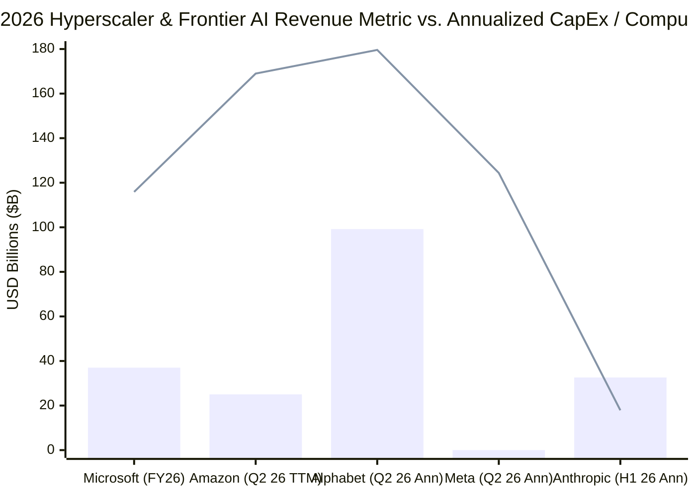
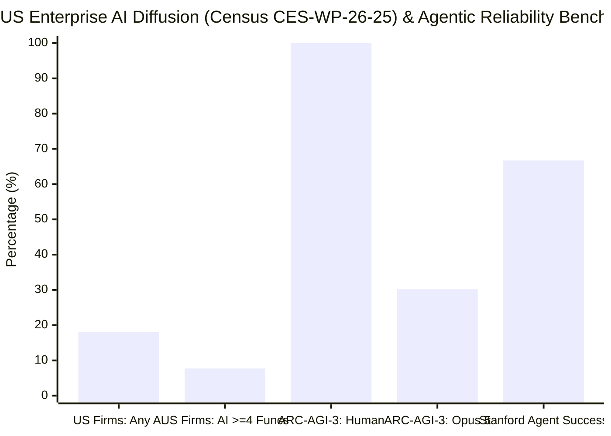

## Executive Summary: Separating the 60,000-Worker Buyout Denominator Fallacy from the Circular AI Financing Bullseye

In late October 2026, following a *Bloomberg* report on an internal memo from Microsoft Chief People Officer **Amy Coleman**, financial commentary account **The Kobeissi Letter** (`@KobeissiLetter`) and enterprise AI consultant **Brad Groux** (`@BradGroux`, CEO of **Digital Meld** and former Microsoft Premier Field Engineer) ignited a viral debate across X over whether Microsoft's sweeping **Voluntary Exit Offer (`VEO`)** proves that the economics of frontier artificial intelligence are failing:

> "BREAKING: Microsoft, $MSFT, is offering buyouts to 60,000 workers as part of the company’s efforts to cut costs amid AI adoption, per Bloomberg.
>
> Personnel on select teams in the US, Canada, India, and the UK at a level of vice president and below are eligible..."
> — **The Kobeissi Letter** (`@KobeissiLetter`, October 2026)

> "This is the canary in the coal mine, y'all. The AI math doesn't math. Microsoft is offering buyouts for nearly a quarter of it's workforce.
>
> AI adoption for businesses is a 24-month journey in a perfect scenario. They aren't seeing adoption fast enough to offset their CapEx spending... and they aren't alone. Add Anthropic's measly revenue numbers (compared to their CapEx), and hopefully you get the point.
>
> These aren't buyouts because Microsoft found efficiencies with AI, they are buyouts because they (the AI industry) spend trillions (collectively) building the best tools the world has ever seen, and no one knows how to use them.
> digitalmeld.io/blog/who-is-pa..."
> — **Brad Groux** (`@BradGroux`, Linking to Digital Meld's [*Who Is Paying for the AI Boom?*](https://digitalmeld.io/blog/who-is-paying-for-the-ai-boom), October 2026)

Does Microsoft's 60,000-worker buyout offer prove that **"the AI math doesn't math"** and that Anthropic and Microsoft are suffering from **"measly revenue"** relative to their infrastructure spend? Applying M. Neil Browne and Stuart M. Keeley's **"Panning for Gold"** critical thinking methodology across Microsoft's [FY26 Form 10-K and Q4 Earnings Release](https://www.microsoft.com/en-us/Investor/earnings/FY-2026-Q4/press-release-webcast), Anthropic's 2026 Form S-1 registration statement, the [U.S. Census Bureau's April 2026 AI Diffusion study (`CES-WP-26-25`)](https://www.census.gov/library/working-papers/2026/adrm/CES-WP-26-25.html), and Digital Meld's own primary-source research article ([*Who Is Paying for the AI Boom?*](https://digitalmeld.io/blog/who-is-paying-for-the-ai-boom)), we uncover a striking dichotomy: **Groux's viral tweet commits three major statistical and financial errors—including directly contradicting his own published whitepaper on provider AI revenue—while his underlying research on circular AI vendor financing, Microsoft's CapEx-to-depreciation squeeze, and the 24-month enterprise integration wall hits a forensic bullseye.**

| Viral Claim / Research Thesis | Forensic Verdict | Epistemic Validity | Core Empirical & Statistical Audit |
| :--- | :--- | :--- | :--- |
| **1. "Microsoft is offering buyouts for nearly a quarter of its workforce (`60,000` / `223,000` = `26.9%`)"** | **TRUE DENOMINATOR, MISLEADING INFERENCE** | **~35% Valid** *(Eligibility Pool vs. Take-Up Fallacy)* | `60,000` is the **eligible pool (`N_eligible`)** of staff (`Level ≤ 70` in select US, Canada, UK, and India units) invited to apply for a voluntary exit by early December 2026—**not** a `26.9%` layoff target. At standard corporate voluntary separation take-up rates (`3%–8%`), expected departures equal **`1,800 to 4,800` workers (`0.8%–2.15%` of Microsoft's 223,000 headcount)**. |
| **2. "They aren't seeing adoption fast enough to offset their CapEx spending... these aren't buyouts because Microsoft found efficiencies with AI"** | **PARTIALLY AGREE** | **~65% Valid** *(The CapEx-to-Depreciation Margin Squeeze)* | Microsoft's AI run rate hit **`$37 billion+` (`+123% YoY`)** in [Q3 FY26](https://www.microsoft.com/en-us/investor/earnings/fy-2026-q3/press-release-webcast) and FY26 operating income rose `20.8%` to **`$155.2 billion` (`46.8%` margin)**. However, FY26 CapEx jumped `~80%` to **`$115.9 billion`** (plus **`$329.1 billion`** in uncommenced data-center leases), causing free cash flow to dip `-6.5%` to **`$67.0 billion`**. As `$115.9B/yr` of CapEx converts into **`+$19B–$29B/yr` of GAAP depreciation (`D&A`)**, Microsoft is swapping human `OpEx` (`SG&A` / mid-level R&D) for silicon depreciation. |
| **3. "Add Anthropic's measly revenue numbers (compared to their CapEx), and hopefully you get the point"** | **FALSE ON CURRENT FLOWS, VALID ON 10-YR OBLIGATIONS** | **~30% Valid** *(Ignores `$16.29B` H1 Revenue & `$65B+` ARR)* | Per Anthropic's 2026 Form S-1, H1 2026 recognized revenue surged **`14x` YoY to `$16.29 billion`** (crossing **`$65 billion+` ARR** in July 2026 and `$16.8B` in Q3 2026 alone), exceeding H1 2026 compute spend of **`$8.95 billion`** (`1.82x` revenue/compute ratio) and generating **`$974 million` in Q2 2026 GAAP operating profit**. The real risk is not "measly" current revenue, but Anthropic's **`$518B–$780B` in 10-year fixed multi-cloud compute commitments**. |
| **4. Digital Meld Whitepaper Thesis: Frontier AI demand is inflated by a 6-node circular vendor financing loop** | **STRONGLY AGREE** | **~95% Valid** *(Forensic Bullseye)* | Documented across SEC filings and official releases: [Microsoft + NVIDIA invest up to `$15B` in Anthropic as Anthropic commits `$30B` to Azure](https://blogs.microsoft.com/blog/2025/11/18/microsoft-nvidia-and-anthropic-announce-strategic-partnerships/); [NVIDIA signs a `10 GW` / up to `$100B` LOI with OpenAI](https://nvidianews.nvidia.com/news/openai-and-nvidia-announce-strategic-partnership-to-deploy-10gw-of-nvidia-systems); [AMD grants OpenAI warrants for `160M` AMD shares (`6 GW`)](https://newsroom.amd.com/news/amd-and-openai-announce-strategic-partnership-to-d/) and [invests up to `$5B` in Anthropic (`2 GW`)](https://ir.amd.com/news-events/press-releases/detail/1292/amd-and-anthropic-announce-strategic-partnership-to-deploy-up-to-2-gigawatts-of-amd-instinct-mi450-series-gpus); NVIDIA owns `11.5%` of CoreWeave (`$21.6B` debt). |
| **5. "AI adoption for businesses is a 24-month journey in a perfect scenario... no one knows how to use them"** | **STRONGLY AGREE** | **~85% Valid** *(The "Work Around the Model" Bottleneck)* | Corroborated by the [U.S. Census Bureau (`CES-WP-26-25`, April 2026)](https://www.census.gov/library/working-papers/2026/adrm/CES-WP-26-25.html): only **`18%` of US firms** (`32%` employment-weighted) use AI in any function, and **`57%` of adopters use it in 3 or fewer functions**. While a demo takes 2 weeks, production ERP/AP/CRM integration takes `18–24+ months` due to `Entra ID` RBAC cleanup, dirty data, deterministic audit controls, and jagged agent reliability (`30.2%` on [ARC-AGI-3](https://arcprize.org/results/anthropic-claude-opus-5)). |
| **6. Digital Meld Whitepaper Thesis: Physical grid interconnection (`5-year` median wait) and fab bottlenecks cap near-term AGI deployment** | **STRONGLY AGREE** | **~90% Valid** | [U.S. DOE (`2024`)](https://www.energy.gov/articles/doe-releases-new-report-evaluating-increase-electricity-demand-data-centers) projects US data-center power rising from `176 TWh` to `325–580 TWh` by 2028 (`6.7%–12%` of US electricity), while LBNL's *Queued Up* study proves grid interconnection waits average **`5 years` (`14%` completion)** and [Plant Vogtle Units 3 & 4 (`EIA`)](https://www.eia.gov/todayinenergy/detail.php?id=61963) required `11 years` and `$30B+`. |

---

## Phase 1 & 2: Issue Classification, Primary Source Excavation, and the "Tweet vs. Whitepaper" Schism

### 1.1 Classifying the Core Questions
Following Chapter 2 of Browne and Keeley's framework, we decompose the viral claims and the underlying Digital Meld research paper into four falsifiable questions:
1. **Descriptive Question 1 (Corporate HR & Restructuring Mechanics):** *Does Microsoft's October 2026 Voluntary Exit Offer (`VEO`) to 60,000 eligible employees represent an attempt to shrink its workforce by 27%, and why are units like Copilot and CoreAI included while Data Center Operations and Sales are excluded?*
2. **Descriptive Question 2 (Hyperscaler & Frontier Lab Accounting):** *Do Microsoft's FY26 financials (`$331.8B` revenue, `$115.9B` CapEx, `$37B+` AI run rate) and Anthropic's 2026 Form S-1 (`$16.29B` H1 revenue, `$8.95B` H1 compute spend, `$518B+` long-term commitments) show a lack of current AI revenue or a long-term operating-leverage and depreciation squeeze?*
3. **Descriptive Question 3 (Ecosystem Financing Structure):** *To what extent is frontier AI revenue and remaining performance obligation (`RPO`) backlog amplified by circular vendor financing among NVIDIA, AMD, Microsoft, Amazon, OpenAI, Anthropic, Oracle, and CoreWeave?*
4. **Descriptive/Prescriptive Question 4 (Enterprise Diffusion & Physical Constraints):** *Why does durable enterprise AI transformation require 18–24+ months despite rapid benchmark gains, and how should enterprises structure AI investments today?*

### 1.2 The "Tweet vs. Whitepaper" Schism Matrix
In Phase 2 of a forensic deep dive, we always check whether an author's viral social media pitch matches the primary documentation linked inside that very post. When we compare Brad Groux's October 2026 X post against his own August 18, 2026 Digital Meld whitepaper ([*Who Is Paying for the AI Boom?*](https://digitalmeld.io/blog/who-is-paying-for-the-ai-boom)) and primary SEC filings, we find a textbook **Social Media vs. Whitepaper Schism**:

| Analytical Dimension | Brad Groux's Viral X Post (`@BradGroux`, Oct 2026) | Brad Groux's Own Linked Digital Meld Whitepaper ([*Who Is Paying for the AI Boom?*, Aug 18, 2026](https://digitalmeld.io/blog/who-is-paying-for-the-ai-boom)) & Primary SEC Filings |
| :--- | :--- | :--- |
| **Provider AI Revenue Scale** | *"The AI math doesn't math... They aren't seeing adoption fast enough to offset their CapEx spending... Add Anthropic's measly revenue numbers (compared to their CapEx), and hopefully you get the point."* | **Direct Self-Refutation in Section "AI Revenue Is Growing. The Returns Are Still Blurry":** *"It is tempting to make the argument simple: providers are spending hundreds of billions on AI and have little revenue to show for it. **The current filings do not support that statement.** NVIDIA has real revenue. Microsoft and Amazon now report large AI annualized revenue run rates... **Pretending those results do not exist would repeat the same mistake we are criticizing: choosing the story first and fitting the numbers to it.**"* |
| **Microsoft's Reported AI & Cloud Growth** | Implies Microsoft's AI tools have failed to generate material commercial revenue to offset CapEx, forcing emergency buyouts across nearly a quarter of the company. | Explicitly cites [Microsoft's Q3 FY26 release](https://www.microsoft.com/en-us/investor/earnings/fy-2026-q3/press-release-webcast) and [FY26 results](https://www.microsoft.com/en-us/Investor/earnings/FY-2026-Q4/press-release-webcast): *"Its AI business exceeded a **$37 billion annual revenue run rate** in the third quarter of fiscal 2026, up **123%**. Azure and other cloud-services revenue grew **43%** in the fourth quarter."* |
| **Anthropic's Revenue vs. Compute Spend** | Dismisses *"Anthropic's measly revenue numbers (compared to their CapEx)."* | Per Anthropic's 2026 SEC Form S-1 registration statement (`ticker: ANT`), Anthropic generated **`$16.29 billion` in recognized revenue in H1 2026 alone** (up `14x` from `$1.16B` in H1 2025) and crossed **`$65 billion+` ARR in July 2026**, against `$8.95B` in H1 2026 compute spend (plus a **`$974M` GAAP operating profit in Q2 2026**). |
| **Utility of Current AI Tools** | *"They (the AI industry) spend trillions (collectively) building the best tools the world has ever seen, and **no one knows how to use them**."* | **Direct Nuance in Abstract & Operations Section:** *"Artificial intelligence **already creates measurable value in bounded business workflows**... Useful AI is already here. The work is turning capability into a controlled workflow that people can trust, support, and improve."* |

> [!IMPORTANT]
> **Why This Schism Matters Epistemically:**
> If an analyst only reads Groux's 110-word tweet, it sounds like a standard doom-loop bear call claiming AI generates no revenue. If you read Groux's 4,500-word Digital Meld paper, it is one of the most sober, well-documented primary-source audits of circular AI financing and operational workflow friction published in 2026. Our job is to discard the tweet's rhetorical hyperbole while rescuing and extending the paper's structural insights.

### 1.3 Primary Financial Scorecard: What the 2026 SEC Filings Actually Report
To anchor our audit in Level-1 primary evidence, here is the cross-company ledger extracted from FY26/2026 SEC filings and earnings releases:

| Company & Primary Filing | Latest Reported AI / Cloud Revenue Metric | Capital Expenditures (`CapEx`) & Infrastructure Obligations | Cash Flow, Profitability & Key Disclosure |
| :--- | :--- | :--- | :--- |
| **Microsoft** ([FY26 10-K & Q4 FY26 Release](https://www.microsoft.com/en-us/Investor/earnings/FY-2026-Q4/press-release-webcast), [Q3 FY26 Release](https://www.microsoft.com/en-us/investor/earnings/fy-2026-q3/press-release-webcast)) | Total FY26 revenue: **`$331.8B`** (`+17.8% YoY`). AI business run rate: **`$37B+` ARR** (`+123% YoY` in Q3 FY26). Q4 FY26 Azure & cloud growth: **`+43% YoY`**. | FY26 Additions to Property & Equipment (`CapEx`): **`$115.9B`** (`+80% YoY`). Uncommenced data-center leases: **`$329.1B`** (as of June 30, 2026). | Operating Income: **`$155.2B`** (`46.8%` margin, `+20.8% YoY`). Operating Cash Flow: **`$182.9B`**. Free Cash Flow: **`$67.0B`** (`-6.5% YoY` from `$71.6B` in FY25). Headcount: **`223,000`** (`-2.2%` from `228,000` in FY25). |
| **Anthropic** (*2026 Form S-1 Registration Statement*, [MSFT/NVDA Nov 2025 Release](https://blogs.microsoft.com/blog/2025/11/18/microsoft-nvidia-and-anthropic-announce-strategic-partnerships/)) | FY2025 revenue: **`~$4.6B`** (`~$9B` exit ARR). H1 2026 revenue (6 mos ended June 30, 2026): **`$16.29B`** (`$4.73B` Q1 + `$11.56B` Q2, up `14x` vs. `$1.16B` in H1 2025). July 2026 ARR: **`$65B+`** (`~$16.8B` Q3 2026 revenue). | FY2025 compute spend: **`$7.3B`**. H1 2026 compute spend: **`$8.95B`** (`$1.82` revenue per `$1` compute). 10-Year multi-cloud & silicon commitments: **`$518B to $780B`** (incl. `$30B` Azure, AWS, GCP, Broadcom, 2 GW AMD). | Q2 2026 GAAP Operating Profit: **`+$974M`**. H1 2026 GAAP Net Loss: **`-$80.7B`**, of which **`$72.4B` is non-cash** fair-value adjustments on convertible notes/SAFEs. Cash & short-term investments: **`$131.7B`**. |
| **NVIDIA** ([Q1 FY27 Results, May 20, 2026](https://nvidianews.nvidia.com/news/nvidia-announces-financial-results-for-first-quarter-fiscal-2027); FY26 10-K & Q1 FY27 10-Q) | Q1 FY27 total revenue: **`$81.6B`** (`+85% YoY`). Q1 FY27 Data Center revenue: **`$75.2B`** (`+92% YoY`). | Manufacturing/supply commitments: **`$95.2B`**. Multi-year cloud commitments: **`$27.0B`**. Ecosystem investment commitments: **`$27.0B`** (as of April 26, 2026, up from `$11.4B` in Jan 2026). | Generates massive immediate hardware cash margins (`>75%` gross margin), but increasingly recycles capital into customers (`OpenAI`, `Anthropic`, `CoreWeave`). |
| **Amazon** (*Q2 2026 Results, July 30, 2026*) | AWS Q2 2026 sales: **`$42.2B`** (`+37% YoY`). AWS AI business run rate: **`$25B+` ARR** (triple-digit YoY growth). | Trailing-12-month (`TTM`) purchases of property & equipment: **`$169.0B`** (driven primarily by AI infrastructure). | TTM Free Cash Flow fell to **`-$7.6B`** due to `$169.0B` CapEx. Reported **`$53.4B` in non-operating pre-tax income** from marking up its Anthropic investment. |
| **Alphabet** (*Q2 2026 Form 10-Q, July 23, 2026*) | Q2 2026 Google Cloud revenue: **`$24.8B`** (`+82% YoY`, driven by AI infrastructure, platform services, and TPU sales). | Q2 2026 quarterly `CapEx`: **`$44.9B`** (`~$180B` annualized pace). | Does not break out standalone generative AI revenue or margins from broader Google Cloud and TPU system sales. |
| **Meta** (*Q2 2026 Form 10-Q, July 30, 2026*) | Q2 2026 total revenue: **`$60.8B`** (`+28% YoY`, almost entirely advertising). | Q2 2026 quarterly `CapEx`: **`$31.1B`** (`~$124B` annualized pace). | Credits AI with improving ad ranking and targeting, but reports zero standalone direct AI software revenue line. |
| **Oracle & CoreWeave** (*Oracle FY26 Release, June 2026; CoreWeave FY25 10-K, Feb 2026*) | Oracle FY26 Remaining Performance Obligations (`RPO`): **`$638B`**. CoreWeave: **`5 GW+`** planned NVIDIA infrastructure by 2030. | Oracle raised **`$43B` debt + `$5B` equity** in FY26, plans **`~$40B` more** in FY27, plus **`$75B`** in customer-prepaid/supplied GPUs. CoreWeave carries **`$21.6B` total debt**. | High leverage and concentrated counterparty risk if anchor model-lab tenants decelerate cloud consumption. |

---

## Phase 3: Semantic Precision & The Substitution Test

Following Chapter 4 of Browne and Keeley's methodology, we isolate three ambiguous phrases driving the viral narrative—**"Offering Buyouts to 60,000 Workers"**, **"Measly Revenue vs. CapEx"**, and **"AI Revenue"**—and subject them to the **Substitution Test**.

### 3.1 Substitution Test 1: "Offering Buyouts to 60,000 Workers"
When `@KobeissiLetter` writes *"Microsoft is offering buyouts to 60,000 workers"* and `@BradGroux` translates that into *"Microsoft is offering buyouts for nearly a quarter of its workforce,"* the phrase **"offering buyouts to 60,000 workers"** carries two completely different operational meanings:
* **Definition A — Target Headcount Reduction (`ΔL = 60,000`):** Microsoft intends to eliminate 60,000 jobs (`26.9%` of its 223,000 workforce) via buyouts.
  * *If substituted into Groux's argument:* A `27%` workforce reduction at the world's flagship enterprise software company would indeed be an unprecedented corporate emergency ("the canary in the coal mine"). **However, Definition A is factually false.**
* **Definition B — Voluntary Eligibility Pool (`N_eligible = 60,000`):** Microsoft defined an organizational boundary—employees at **internal Level 70 and below** (from individual contributors up through Partner/General Manager/VP-titled staff, excluding Corporate Vice Presidents) in participating divisions (**Windows + Devices, Xbox, Copilot, CoreAI, Finance, and HR**) across four jurisdictions (**US, Canada, UK, and India**)—who are *permitted to apply* by early December 2026 for a standard severance package (`December 31, 2026` exit).
  * *If substituted into Groux's argument:* Opening a non-coercive Voluntary Exit Offer (`VEO`) to a 60,000-person eligibility pool produces a historical corporate take-up rate (`τ_takeup`) of **`3% to 8%`**, or **`1,800 to 4,800` actual departures (`0.8% to 2.15%` of Microsoft's global workforce)**—comparable to Microsoft's net headcount reduction of `5,000` employees (`-2.2%`, from `228,000` to `223,000`) during FY26!

### 3.2 Substitution Test 2: "AI Revenue" & "CapEx" (Flow vs. Commitment Accounting)
Both AI bulls and AI bears routinely mash together five distinct accounting quantities:
1. **Recognized GAAP Revenue (`R_GAAP`):** Actual audited revenue delivered and billed in the period (e.g., Anthropic's `$16.29B` in H1 2026; NVIDIA's `$81.6B` in Q1 FY27).
2. **Annualized Revenue Run Rate (`ARR`):** A single quarter or month of AI-attributed revenue multiplied by 4 or 12 (e.g., Microsoft's `$37B+` AI run rate in Q3 FY26; AWS's `$25B+` AI run rate in Q2 2026; Anthropic's `$65B+` ARR in July 2026).
3. **Remaining Performance Obligations (`RPO`) & Multi-Year Commitments:** Multi-year contractual promises to buy or supply cloud compute over 5–10 years (e.g., Oracle's `$638B` RPO; Anthropic's `$518B–$780B` 10-year compute commitments; Microsoft's `$329.1B` uncommenced data-center leases).
4. **In-Period Cash CapEx (`CapEx_cash`):** Cash paid for property and equipment in the current year (e.g., Microsoft's `$115.9B` in FY26; Amazon's `$169.0B` TTM).
5. **Supplier-Financed / Circular Demand (`R_circular`):** Cloud or chip purchases funded directly or indirectly by equity checks, warrants, or prepayments from the very vendor recording the sale.

```mermaid
flowchart TD
    subgraph SG1["1. The 6-Node Circular AI Financing Loop (Documented in SEC & FTC Filings)"]
        NV["NVIDIA<br/>($81.6B Q1 FY27 Rev | $95.2B Supply Commitments)"] -- "Up to $100B LOI (10 GW)<br/>& Up to $10B in Anthropic" --> LABS["Frontier Model Labs<br/>(OpenAI & Anthropic: $65B+ ARR)"]
        AMD["AMD<br/>(160M Share Warrants to OpenAI / 6 GW<br/>& Up to $5B in Anthropic / 2 GW)"] -- "Equity Warrants & Direct Investment" --> LABS
        MSFT["Microsoft<br/>($331.8B FY26 Rev | $115.9B CapEx)"] -- "Up to $5B in Anthropic<br/>+ Multi-Billion OpenAI Stake" --> LABS
        LABS -- "$30B Azure Commitment (1 GW)<br/>+ $518B-$780B 10-Yr Cloud Contracts" --> CLOUDS["Hyperscaler & Neocloud Landlords<br/>(Azure, AWS, GCP, Oracle $638B RPO, CoreWeave $21.6B Debt)"]
        NV -- "$2B Equity (11.5% Class A Stake)<br/>+ $27B Cloud Commitments" --> CLOUDS
        CLOUDS -- "Purchases of NVIDIA Blackwell/Rubin<br/>& AMD Instinct MI450 GPUs" --> NV
        CLOUDS -- "GPU System Orders" --> AMD
    end

    subgraph SG2["2. Inside Microsoft's P&L: Why $115.9B CapEx Triggers the 60,000-Worker VEO Pool"]
        CAPEX["FY26 Cash CapEx: $115.9B (+80% YoY)<br/>+ $329.1B Uncommenced Leases"] --> DA["4-to-6 Year Server/DC Depreciation Wave<br/>(+$19B to +$29B/yr Incremental GAAP D&A Hit)"]
        DA --> SQUEEZE["Gross & Operating Margin Pressure<br/>(Defending 46.8% Operating Margin / $155.2B OpInc)"]
        SQUEEZE --> VEO["Oct 2026 Voluntary Exit Offer (VEO)<br/>60,000 Eligible Pool (Level <= 70 in US/CA/UK/IN)<br/>Expected 3%-8% Take-Up = 1,800-4,800 Exits (~$0.5B-$1.3B/yr OpEx Saved)"]
    end
```

---

## Phase 4: Causal Disentanglement & The 4-Way Causal Audit

Why did Microsoft roll out a Voluntary Exit Offer (`VEO`) to a 60,000-employee eligibility pool in October 2026—and why did it **include** employees in **Copilot, CoreAI, Windows + Devices, Xbox, Finance, and HR** while **excluding Data Center Operations, Security, Marketing, and Enterprise Sales**?

Following Chapter 9 of Browne and Keeley's framework, we test four rival causal hypotheses:

| Causal Hypothesis | Mechanistic Pathway | Primary Empirical Evidence & Divisional Clues | Explanatory Weight |
| :--- | :--- | :--- | :--- |
| **1. Direct AI Demand Failure** *(Brad Groux's Tweet Thesis: `X → Y`)* | Enterprise customers are refusing to adopt Microsoft's AI products fast enough, leaving Microsoft with stranded CapEx and forcing emergency headcount reductions. | **Low-to-Moderate (`~20%`).** While enterprise M365 Copilot seat conversions face a 18–24 month operational integration lag, Microsoft's AI revenue run rate grew **`+123% YoY` to `$37B+`** and Azure grew **`+43% YoY`** in Q4 FY26. Crucially, if AI demand were collapsing, Microsoft would not **exclude Data Center Operations and Enterprise Sales** from the buyout while spending `$115.9B` on CapEx! | **Minor (`20%`)** |
| **2. The CapEx-to-Depreciation Margin Swap** *(Swapping Human `OpEx` for Silicon `D&A`)* | Massive AI infrastructure outlays (`$115.9B` FY26 CapEx + `$329.1B` leases) convert into tens of billions of dollars of annual GAAP depreciation (`D&A`) in FY27–FY29. To protect its `46.8%` operating margin, Microsoft must trim non-infrastructure labor `OpEx`. | **Dominant (`~45%`).** In FY26, Microsoft's operating cash flow rose to `$182.9B`, but its `$115.9B` CapEx bill caused free cash flow to fall `-6.5%` to `$67.0B`. Under GAAP accounting, cash CapEx does not hit the income statement immediately—it hits via **Depreciation & Amortization (`D&A`)** over 4–6 years as data centers go live. Pruning mid-level salaries offsets incoming server depreciation dollar-for-dollar on the operating margin line. | **Dominant (`45%`)** |
| **3. Post-ZIRP Mid-Management Delayering & Organizational Consolidation** *(Confounder `Z`)* | Targeting `Level ≤ 70` across Windows, Xbox (post-Activision Blizzard integration), Finance, HR, and overlapping Copilot/CoreAI product teams removes bureaucratic layers and avoids WARN Act / PIP friction. | **Significant (`~20%`).** Why are **Copilot** and **CoreAI** on the eligible VEO list? Because during 2023–2025, Microsoft spun up dozens of overlapping "Copilot" wrapper teams across Windows, Office, Dynamics, and Consumer before consolidating developer infrastructure under Jay Parikh's **CoreAI** division and also integrating **Claude** ([announced Nov 2025](https://blogs.microsoft.com/blog/2025/11/18/microsoft-nvidia-and-anthropic-announce-strategic-partnerships/)) alongside OpenAI. A voluntary buyout lets redundant product managers self-select out cleanly by December 31. | **Significant (`20%`)** |
| **4. Internal AI Coding & Back-Office Efficiency Substitution** *(Reverse / Mutual Feedback)* | AI coding assistants and internal automation in software maintenance, Finance, and HR reduce the required headcount per unit of legacy software output. | **Moderate (`~15%`).** Microsoft reduced total headcount by `5,000` (`-2.2%`, to `223,000`) in FY26 while growing total revenue `+17.8%` to `$331.8B` (raising revenue per employee to **`$1.488 million`**). Offering voluntary exits in Finance, HR, Windows, and Xbox reflects lower marginal need for routine maintenance and administrative headcount. | **Moderate (`15%`)** |

---

## Phase 5: Quantitative & Statistical Integrity Audit

In Phase 5 (Chapter 10 of Browne and Keeley), we subject the quantitative claims in both the viral tweet and the Digital Meld report to formal mathematical derivations and baseline denominator checks.

### 5.1 The VEO Take-Up Rate & Headcount Reduction Equation
When a corporation with `N_total = 223,000` employees offers a non-coercive Voluntary Exit Offer (`VEO`) with standard tenure-based severance to an eligible pool of `N_eligible = 60,000` employees (`Level ≤ 70` in participating groups across the US, Canada, UK, and India), the actual headcount reduction `ΔL_VEO` and annualized gross labor savings `ΔOpEx_labor` are governed by the voluntary take-up rate `τ_takeup` and the fully loaded compensation `w_loaded` of departing staff:

$$\Delta L_{\text{VEO}} = \tau_{\text{takeup}} \cdot N_{\text{eligible}}, \qquad \Delta \text{OpEx}_{\text{labor, annual}} = \Delta L_{\text{VEO}} \cdot w_{\text{loaded}} \cdot (1 - \rho_{\text{backfill}})$$

Where `ρ_backfill ∈ [0, 0.3]` is the fraction of vacated roles eventually backfilled in lower-cost geographies or priority AI engineering roles, and `w_loaded ≈ $280,000–$350,000` is the average fully loaded compensation (base + bonus + annual stock-based compensation + benefits) across Microsoft's US/Canada/UK/India `Level ≤ 70` cohort. Across three take-up regimes:
* **Low Take-Up (`τ_takeup = 3%`):** `ΔL_VEO = 1,800` departures (`0.81%` of global workforce) → **`~$450M–$630M/year`** in gross labor savings.
* **Base-Case Take-Up (`τ_takeup = 5%–6%`):** `ΔL_VEO = 3,000 to 3,600` departures (`1.35%–1.61%` of global workforce) → **`~$840M–$1.26B/year`** in gross labor savings (after a one-time Q2 FY27 severance charge of `~$400M–$650M`).
* **High Take-Up (`τ_takeup = 10%`):** `ΔL_VEO = 6,000` departures (`2.69%` of global workforce) → **`~$1.5B–$2.1B/year`** in gross labor savings.

In every realistic scenario, the actual workforce reduction is **`1% to 2.7%`**, **not `25%` ("nearly a quarter of its workforce")**.

### 5.2 The CapEx-to-Depreciation Margin Squeeze Equation
Why does a company generating `$331.8 billion` in revenue (`+17.8% YoY`) and `$155.2 billion` in operating income (`46.8%` operating margin) care so intensely about trimming `$1B–$2B/year` in mid-level labor `OpEx`? Look at the relationship between Microsoft's cash capital expenditures `CapEx_t`, its uncommenced lease commitments `L_uncommenced = $329.1B`, and its GAAP operating margin `m_op,t = OpInc_t / R_t`:

$$\Delta \text{D\&A}_{t+1} = \frac{\alpha_{\text{server}} \cdot \text{CapEx}_t}{\tau_{\text{GPU}}} + \frac{(1 - \alpha_{\text{server}}) \cdot \text{CapEx}_t}{\tau_{\text{shell}}} + \Delta \text{Lease Amortization}_{t+1}$$

Where:
* `CapEx_FY26 = $115.9 billion` (up from `~$64.5B` in FY25, an incremental jump of `+$51.4B` in a single year).
* `α_server ≈ 0.60–0.65` is the share of CapEx spent on short-lived servers, GPUs, and networking gear depreciated over `τ_GPU ≈ 4 to 6 years`, while `(1 - α_server) ≈ 0.35–0.40` is long-lived data-center buildings/shells depreciated over `τ_shell ≈ 15 to 25 years`.

Plugging in `CapEx_FY26 = $115.9B`, a single year's CapEx vintage adds **`$14.5 billion to $20.6 billion` per year in new gross GAAP depreciation expense** once energized! To prevent GAAP operating margin `m_op` from compressing when enterprise AI revenue lags data-center energization by 12–24 months (a risk Microsoft explicitly discloses in its FY26 Form 10-K Risk Factors), Microsoft must satisfy the margin-neutrality condition:

$$\Delta R_{\text{AI}, t+1} \cdot m_{\text{gross, AI}} - \Delta \text{OpEx}_{\text{labor}, t+1} \ge \Delta \text{D\&A}_{t+1}$$

Whenever `ΔD&A_t+1` rises faster than near-term high-margin AI software recognition, **`ΔOpEx_labor,t+1` must be negative** (headcount delayering and voluntary buyouts).

### 5.3 Deconstructing Anthropic's S-1 & The Circular Revenue Multiplier
Now let us audit Brad Groux's claim about *"Anthropic's measly revenue numbers (compared to their CapEx)"* alongside Digital Meld's analysis of circular vendor financing.

First, look at Anthropic's actual numbers from its 2026 Form S-1 registration statement:
* **H1 2026 Recognized Revenue:** **`$16.29 billion`** (`$4.73B` in Q1 2026 + `$11.56B` in Q2 2026, compared to `$1.16B` in H1 2025 and `$4.6B` in full-year 2025), reaching **`$65 billion+` ARR** in July 2026.
* **H1 2026 Compute & Infrastructure Expense:** **`$8.95 billion`** (after `$7.3B` in full-year 2025).
* **Current Compute Efficiency Ratio (`H1 2026`):**

$$\eta_{\text{compute, H1 2026}} = \frac{R_{\text{Anthropic, H1 2026}}}{C_{\text{compute, H1 2026}}} = \frac{\text{USD } 16.29\text{ billion}}{\text{USD } 8.95\text{ billion}} = 1.82\times \quad (\text{Q2 2026 GAAP Operating Profit} = +\text{USD } 974\text{ million})$$

Why, then, did commentators confuse Anthropic's financials with a company that has "measly revenue compared to CapEx" or massive losses? Because of two accounting features in the S-1:
1. **The `$72.4B` Non-Cash Valuation Markup Illusion:** Anthropic reported a headline H1 2026 GAAP net loss of **`-$80.7 billion`**, but **`$72.4 billion` (`89.7%`) of that loss was a non-cash accounting charge** required under GAAP to mark convertible notes, SAFEs, and derivative liabilities to fair value as Anthropic's IPO valuation soared!
2. **The `$518B–$780B` 10-Year Take-or-Pay Commitment Overhang:** To guarantee access to frontier clusters through 2035, Anthropic signed cumulative multi-year cloud and silicon purchase commitments totaling **`$518 billion to $780 billion`** across AWS, Google Cloud, Microsoft Azure (`$30B` announced Nov 2025), Broadcom, and AMD (`2 GW` announced July 2026).

This brings us directly to Digital Meld's **Circular AI Financing Loop**. When a hardware supplier (`NVIDIA` or `AMD`) and a cloud hyperscaler (`Microsoft` or `Amazon`) invest cash `I_vendor` into a frontier model lab (`Anthropic` or `OpenAI`), which contractually recycles fraction `β_cloud ∈ [0.7, 1.0]` of that capital into cloud compute on that hyperscaler's platform, which in turn spends fraction `β_GPU ∈ [0.5, 0.7]` buying GPUs from the hardware supplier, a single dollar of vendor capital generates a **Gross Reported Ecosystem Volume Multiplier (`M_circular`)**:

$$M_{\text{circular}} = \frac{\Delta \text{Valuation/Investment} + \Delta \text{Cloud RPO/Revenue} + \Delta \text{GPU Revenue}}{I_{\text{vendor}}} = 1 + \beta_{\text{cloud}} + \beta_{\text{cloud}} \cdot \beta_{\text{GPU}} \approx 2.2\times \text{ to } 2.7\times$$

Take the [November 18, 2025 Microsoft-NVIDIA-Anthropic strategic partnership](https://blogs.microsoft.com/blog/2025/11/18/microsoft-nvidia-and-anthropic-announce-strategic-partnerships/) cited by Digital Meld: NVIDIA commits up to `$10B` and Microsoft commits up to `$5B` (`$15B` total investment) into Anthropic, while Anthropic commits to purchase **`$30 billion` of Azure compute capacity (`1 GW`)** running on NVIDIA systems. Even before a single independent non-tech enterprise buys an API token, that single triangular agreement records `$15B` in frontier lab financing, `$30B` in Microsoft Azure commercial bookings/RPO, and tens of billions in NVIDIA data-center demand!

*(Note on chart above: Bars display disclosed AI Annualized Run-Rate for Microsoft [`$37B`] and AWS [`$25B`], annualized total Google Cloud revenue [`$99.2B` = 4 × `$24.8B` since standalone AI is undisclosed], Meta standalone AI software revenue [`$0B` disclosed separately from `$60.8B/qtr` ads], and Anthropic H1 2026 annualized revenue [`$32.6B` = 2 × `$16.29B`, which subsequently passed `$65B+` ARR in July 2026]. Lines display FY26 / annualized capital expenditures or compute spend: Microsoft `$115.9B`, Amazon TTM `$169.0B`, Alphabet annualized `$179.6B` [4 × `$44.9B`], Meta annualized `$124.4B` [4 × `$31.1B`], and Anthropic annualized H1 compute spend `$17.9B` [2 × `$8.95B`].)*

---

## Phase 6: The "Negative View" & Omission Interrogation

Why does Brad Groux say that *"AI adoption for businesses is a 24-month journey in a perfect scenario"*—and who bears the hidden costs of this gap between hyper-speed CapEx deployment and slow-moving enterprise operations?

### 6.1 The 24-Month Enterprise Operational Bottleneck (Why "The Work Around the Model" Dominates)
In both his X post and his Digital Meld whitepaper, Groux—speaking from direct experience integrating Microsoft 365, Azure, Entra ID, and OpenAI systems for mid-market industrial and engineering enterprises—identifies the central bottleneck of the AI economy: **frontier labs ship models on a 3-month clock, electricity grids build power on a 60-month clock, and mainstream enterprises re-engineer business workflows on a 24-month clock.**

Look at the empirical diffusion data from the [U.S. Census Bureau's April 2026 Working Paper (*The Microstructure of AI Diffusion*, `CES-WP-26-25`)](https://www.census.gov/library/working-papers/2026/adrm/CES-WP-26-25.html):
* Across the US economy (November 2025 – January 2026 reference period), only **`18.0%` of firms** (`32.0%` employment-weighted) used AI in at least one business function.
* Among that `18.0%` of adopting firms, **`57.0%` used AI in three or fewer business functions**—meaning only **`7.7%` of all U.S. firms** (`18% × 43%`) had integrated AI across four or more business functions!

Why does moving from a 2-week chatbot pilot to a production enterprise workflow take **24 months**?
1. **Identity, Permissions, and Data Hygiene (`Months 1–9`):** Deploying an agent across SharePoint, ERP, or CRM immediately exposes "over-permissioned" internal files. Before turning on agentic retrieval, IT must audit role-based access controls (`Entra ID`), normalize dirty vendor/invoice schemas, and strip conflicting legacy records.
2. **Deterministic Guardrails vs. Jagged Model Reliability (`Months 6–15`):** As Digital Meld documents, frontier models remain jagged and probabilistic: on **[ARC-AGI-3](https://arcprize.org/blog/arc-agi-3-launch)** (interactive agentic reasoning), humans score **`100%`** while the top frontier model as of July 24, 2026 (**[Claude Opus 5](https://arcprize.org/results/anthropic-claude-opus-5)**) scored **`30.2%`**; in the **[2026 Stanford AI Index](https://hai.stanford.edu/ai-index/2026-ai-index-report/technical-performance)**, AI agents failed **`~33%` (`1 in 3`)** of structured tasks and read analog clocks correctly only `~50%` of the time; and **[NIST's Generative AI Profile](https://www.nist.gov/publications/artificial-intelligence-risk-management-framework-generative-artificial-intelligence)** classifies confabulation as an inherent mathematical byproduct of generative sampling. Therefore, an accounts-payable or project-management system cannot rely on a model for arithmetic totals, payment limits, or segregation of duties—engineers must write deterministic code wrappers around every probabilistic step.
3. **Legal, Compliance, Change Management & Audit Ownership (`Months 12–24`):** Enterprises must establish escalation paths, exception thresholds, human sign-off rules, and vendor-portability exit paths.

### 6.2 Distributional Impact: Who Loses in the CapEx-for-OpEx Swap?
1. **Mid-Level Corporate & Product Staff (`Level ≤ 70`) at Hyperscalers:**
   Every `$10B` increase in annual GPU/data-center depreciation requires hyperscalers to compress non-AI human operating expenses. Mid-level program managers, HR/Finance staff, and non-frontier product units (`Windows`, `Xbox`, horizontal `Copilot` wrappers) serve as the financial shock absorber to keep GAAP operating margins at `46.8%`.
2. **Highly Leveraged Neoclouds & Debt-Financed Cloud Builders (`CoreWeave`, `Oracle`):**
   While Microsoft (`$182.9B` operating cash flow) and Alphabet can self-fund CapEx and absorb a 24-month enterprise adoption lag, leveraged intermediaries cannot. CoreWeave carries **`$21.6 billion` in debt** (per its FY25 10-K) and Oracle raised **`$48 billion`** in debt/equity in FY26 with **`$40 billion` more** planned in FY27 to build out its `$638B` RPO backlog. In a circular financing loop, a single downward revision in model-lab token demand or a 12-month grid interconnection delay cascades through leveraged balance sheets first.
3. **Residential & Industrial Electricity Ratepayers:**
   With US data-center power projected by the [U.S. DOE (`2024`)](https://www.energy.gov/articles/doe-releases-new-report-evaluating-increase-electricity-demand-data-centers) to climb from `176 TWh` to **`325–580 TWh` (`6.7%–12%` of total US power)** by 2028 and global data-center electricity projected by the IEA to hit **`945 TWh` by 2030**, local grid upgrades and transformer bottlenecks risk shifting fixed transmission costs onto non-AI businesses and households if data-center utilization ever falls short of 20-year utility capacity plans.

---

## Phase 7: Grey Thinking ("If-Clauses") & The Forensic Verdict

Rejecting both the binary doom narrative (*"AI has no revenue and Microsoft is collapsing"*) and uncritical AGI hype (*"Autonomous agents will replace entire corporate departments next quarter"*), we synthesize our findings into conditional **If-Clauses** and a probability-weighted verdict.

### 7.1 Conditional Strategic Synthesis ("If-Clauses")
1. **If you are evaluating Microsoft (`$MSFT`) and Hyperscaler Equities:**
   * **If** you interpret the `60,000-worker` Voluntary Exit Offer as a `27%` workforce collapse caused by zero AI revenue, **then** you are misreading both HR buyout math (`3%–8%` take-up = `1,800–4,800` exits) and Microsoft's FY26 10-K (`$331.8B` revenue, `$155.2B` operating income, `$37B+` AI run rate).
   * **If** you evaluate the VEO as an early warning of the **FY27–FY29 Depreciation Wall**—where `$115.9B/yr` of cash CapEx and `$329.1B` of uncommenced leases force relentless `SG&A`/headcount compression until mainstream enterprise workflows finish their 24-month integration cycle—**then** you have identified the exact margin bottleneck governing Big Tech multiples over the next 36 months.
2. **If you are an Enterprise CIO, COO, or Operations Leader:**
   * **If** you buy AI based on vendor AGI timelines or deploy probabilistic models directly onto uncleaned permissions and deterministic accounting/compliance steps, **then** your deployment will stall in the `82%` non-adoption / pilot-purgatory bucket.
   * **If** you follow Digital Meld's operational rulebook—use AI today for bounded context assembly, classification, and drafting (`Claude Code`, document triage, exception routing) while enforcing deterministic code controls for permissions, totals, and human sign-off, and maintaining model portability—**then** you will capture durable operating returns inside a realistic 12-to-24-month timeline.
3. **If you are Auditing Frontier Lab Valuations (`Anthropic`, `OpenAI`):**
   * **If** you look only at current top-line growth (`Anthropic` scaling `14x` YoY to `$16.29B` in H1 2026 and `$65B+` ARR in July 2026 with `$974M` Q2 GAAP operating profit), **then** you will miss the massive fixed operating leverage embedded in `$518B–$780B` of 10-year take-or-pay cloud commitments.
   * **If** you track the ratio of **independent non-VC / non-circular enterprise revenue** to **annualized minimum compute purchase obligations**, **then** you have the true leading indicator of frontier lab solvency.

### 7.2 The Forensic Verdict: What We Actually Think

| 2026–2029 AI CapEx & Enterprise Adoption Scenario | Epistemic Probability | Mechanistic Drivers & Financial Outcome | Structural Winners & Losers |
| :--- | :--- | :--- | :--- |
| **Scenario A: The OpEx-for-CapEx Grind & 24-Month Enterprise Digestion** *(Base Case)* | **~55%** | Microsoft's VEO yields `~3,000–4,500` voluntary exits (`~1.5%–2.0%` of staff), helping offset rising FY27–FY28 GPU depreciation. Enterprise AI adoption grinds steadily upward from `18%` (`Census BTOS`) toward `35%–45%` over 24–36 months as consultancies and internal IT teams wire deterministic guardrails around bounded workflows. CapEx growth moderates from `+80% YoY` to `+10%–15% YoY` in 2027–2028 without a systemic crash. | **Winners:** Cash-rich Hyperscalers (`MSFT`, `GOOGL`), High-ROI Coding/Workflow Models (`Anthropic`), Practical Systems Integrators (`Digital Meld`). **Losers:** Mid-level tech bureaucracy (`Level ≤ 70` generalist PMs), Un-routed horizontal seatware. |
| **Scenario B: The Circular Commitment Unwind & CapEx Air-Pocket** *(Bear Case)* | **~30%** | The 24-month enterprise integration lag collides with `$518B–$780B` in frontier lab compute commitments and `$638B` in cloud RPO. When VC token subsidies slow and mainstream S&P 493 adoption takes 36–48 months instead of 18, model labs renegotiate or defer multi-gigawatt cloud commitments, triggering a sharp `25%–40%` air-pocket in GPU orders and severe distress for leveraged Neoclouds. | **Winners:** Balance-sheet-fortress value buyers, Short-sellers of leveraged AI debt (`CoreWeave`, high-yield DC credit). **Losers:** Equity/warrant-linked chip multiples (`NVDA`, `AMD`), Debt-heavy cloud builders (`ORCL`, `CRWV`). |
| **Scenario C: Agentic Workflow Breakout & Rapid ROI Compression** *(Bull Case)* | **~15%** | Advances in verifiable tool use, automated schema/permission remediation, and neuro-symbolic guardrails compress the enterprise integration journey from 24 months down to 6–9 months by late 2027. Independent enterprise cash flow surges fast enough to fully absorb the `$500B+/yr` hyperscaler CapEx wave with expanding operating margins. | **Winners:** Frontier labs (`Anthropic`, `OpenAI`), Hyperscaler cloud divisions, GPU suppliers. **Losers:** Legacy BPO/IT outsourcing vendors, Slow-adopting industrial competitors. |

**Bottom-Line Verdict:**
Brad Groux's viral X post and his linked Digital Meld whitepaper illustrate why rigorous critical thinking requires **separating social-media packaging from primary-source substance**:
1. **Reject the Tweet's Three Exaggerations:** Microsoft is **not** laying off a quarter of its workforce (`60,000` is the eligible pool for a voluntary buyout that will likely trim `1.5%–2%` of headcount); Anthropic's current revenue is **not** "measly" (`$16.29B` recognized in H1 2026 and `$65B+` ARR in July 2026, with `+$974M` Q2 GAAP operating profit); and enterprise AI is **not** useless (*"no one knows how to use them"*).
2. **Embrace the Whitepaper's Three Core Insights:** First, Microsoft's Voluntary Exit Offer is the direct accounting consequence of the **CapEx-to-Depreciation Squeeze**—spending `$115.9B/year` on AI infrastructure and `$329.1B` on future leases forces Big Tech to continuously swap human `OpEx` for silicon depreciation. Second, the **6-Node Circular AI Financing Loop** (`NVIDIA ↔ OpenAI/Anthropic ↔ Microsoft/Amazon/Oracle/CoreWeave ↔ AMD`) recycles investment capital into reported cloud backlog (`RPO`) and hardware revenue, creating correlated downside risk if end-market growth slows. Third, **businesses move at the speed of operations (`24 months`), not the speed of model weights (`3 months`)**: until permissions, data hygiene, deterministic code checks, and human accountability are wired around probabilistic models, hyperscaler depreciation will arrive on the income statement faster than enterprise transformation arrives on the customer's P&L.

---

## Primary Sources & Verification References

1. **Digital Meld — Brad Groux (`Aug 18, 2026`):** *"Who Is Paying for the AI Boom? Circular deals, physical limits, and why AI regulation needs independent authors"* — [Digital Meld Official Research Publication](https://digitalmeld.io/blog/who-is-paying-for-the-ai-boom)
2. **Microsoft Corporation (`July 29, 2026` & `April 29, 2026`):** *FY26 Fourth Quarter & Full-Year Financial Results (`$331.8B` Revenue, `$155.2B` Operating Income, `$115.9B` CapEx, `223,000` Headcount)* & *FY26 Third Quarter Results (`$37B+` AI Annualized Revenue Run Rate)* — [Microsoft FY26 Q4 Earnings Release](https://www.microsoft.com/en-us/Investor/earnings/FY-2026-Q4/press-release-webcast) | [Microsoft FY26 Q3 Earnings Release](https://www.microsoft.com/en-us/investor/earnings/fy-2026-q3/press-release-webcast)
3. **Microsoft, NVIDIA & Anthropic (`Nov 18, 2025`):** *"Microsoft, NVIDIA and Anthropic Announce Strategic Partnerships (`$30B` Azure Compute Commitment / Up to `$15B` Combined Investment)"* — [Microsoft Official Blog Announcement](https://blogs.microsoft.com/blog/2025/11/18/microsoft-nvidia-and-anthropic-announce-strategic-partnerships/)
4. **NVIDIA Corporation (`May 20, 2026` & `Sept 22, 2025`):** *First Quarter Fiscal 2027 Financial Results (`$81.6B` Total Revenue, `$75.2B` Data Center Revenue)* & *OpenAI Strategic Partnership (`10 GW` / Up to `$100B` LOI)* — [NVIDIA Q1 FY27 Financial Results](https://nvidianews.nvidia.com/news/nvidia-announces-financial-results-for-first-quarter-fiscal-2027) | [NVIDIA-OpenAI 10 GW Partnership Release](https://nvidianews.nvidia.com/news/openai-and-nvidia-announce-strategic-partnership-to-deploy-10gw-of-nvidia-systems)
5. **Advanced Micro Devices (`AMD` — `July 22, 2026` & `Oct 6, 2025`):** *AMD and Anthropic Strategic Partnership (`Up to 2 GW` Instinct MI450 GPUs / Up to `$5B` Investment)* & *AMD and OpenAI Strategic Partnership (`6 GW` / `160M` Share Warrants)* — [AMD-Anthropic Official Release](https://ir.amd.com/news-events/press-releases/detail/1292/amd-and-anthropic-announce-strategic-partnership-to-deploy-up-to-2-gigawatts-of-amd-instinct-mi450-series-gpus) | [AMD-OpenAI Official Release](https://newsroom.amd.com/news/amd-and-openai-announce-strategic-partnership-to-d/)
6. **U.S. Census Bureau (`April 2026`):** *Bonney K, Breaux CL, Dinlersoz E, Foster LS, Haltiwanger JC, Pande AA — "The Microstructure of AI Diffusion: Evidence from Firms, Business Functions, and Worker Tasks" (`CES-WP-26-25`)* — [U.S. Census Bureau Working Paper `CES-WP-26-25`](https://www.census.gov/library/working-papers/2026/adrm/CES-WP-26-25.html) | [U.S. Census BTOS Portal](https://www.census.gov/hfp/btos/)
7. **U.S. Department of Energy (`Dec 20, 2024`) & U.S. Energy Information Administration (`May 1, 2024`):** *2024 Report on U.S. Data Center Energy Use (`176 TWh` to `325–580 TWh`)* & *Plant Vogtle Unit 4 Commercial Operation* — [DOE Data Center Energy Release](https://www.energy.gov/articles/doe-releases-new-report-evaluating-increase-electricity-demand-data-centers) | [EIA Plant Vogtle Analysis](https://www.eia.gov/todayinenergy/detail.php?id=61963)
8. **ARC Prize (`July 24, 2026`), METR (`May 8, 2026`), Stanford HAI (`2026`), & NIST (`2024/2026`):** *ARC-AGI-3 Benchmark & Claude Opus 5 Evaluation (`30.2%`)*, *METR Task-Completion Time Horizons*, *2026 AI Index Technical Performance*, & *NIST Generative AI Risk Management Profile* — [ARC-AGI-3 Launch](https://arcprize.org/blog/arc-agi-3-launch) | [Claude Opus 5 ARC-AGI Results](https://arcprize.org/results/anthropic-claude-opus-5) | [METR Time Horizons](https://metr.org/time-horizons/) | [Stanford 2026 AI Index](https://hai.stanford.edu/ai-index/2026-ai-index-report/technical-performance) | [NIST Generative AI Profile](https://www.nist.gov/publications/artificial-intelligence-risk-management-framework-generative-artificial-intelligence)
9. **NBER Foundational Productivity & AI Macroeconomics (`Brynjolfsson, Rock & Syverson 2021`; `Acemoglu 2024`):** *The Productivity J-Curve (`w25892`)* & *The Simple Macroeconomics of AI (`w32487`)* — [NBER Working Paper `w25892`](https://www.nber.org/papers/w25892) | [NBER Working Paper `w32487`](https://www.nber.org/papers/w32487)
