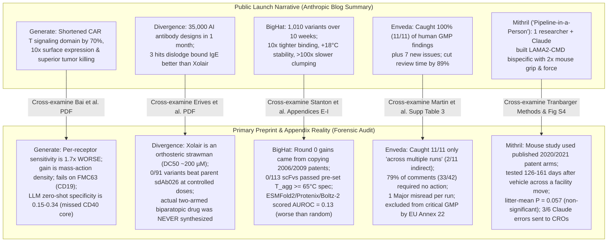
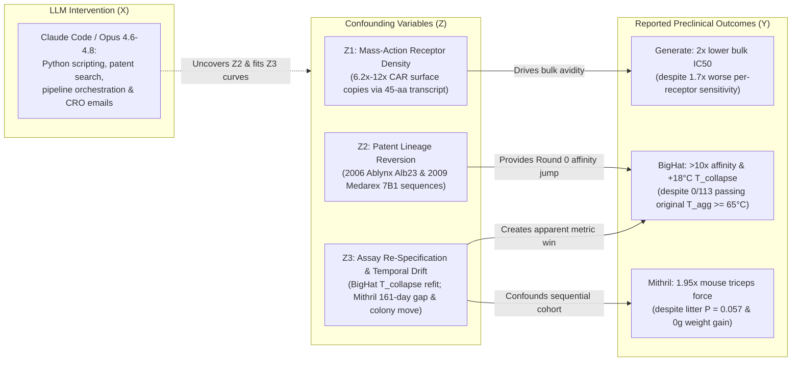

## Executive Verdict & High-Level Synthesis

On October 27, 2026, Anthropic published a landmark research announcement, [Early progress on accelerating drug development with Claude](https://www.anthropic.com/research/early-progress-drug-development), accompanied by five primary technical preprints and methodology reports spanning [Generate Biomedicines](https://generatebiomedicines.com/publications/refactored-intracellular-domains-enhance-car-expression-and-function/), [Divergence Labs](https://divergencelabs.com/publications/ige-preprint.pdf), [BigHat Biosciences](https://www.bighatbio.com/bighat-anthropic-collaboration-report-10-27-2026), [Enveda](https://enveda.com/CMC-Document-Processor/), [The Column Group (Pleiades)](https://www.anthropic.com/research/early-progress-drug-development), [Bristol Myers Squibb](https://www.anthropic.com/research/early-progress-drug-development), and Anthropic's newly disclosed July 2026 acquisition of the one-person rare-disease biotech [Mithril Medicine](https://www-cdn.anthropic.com/52e1f5d50c47ca3818f56704c27cf19e59b62e77.pdf).

Unlike typical industry press releases that withhold primary data behind proprietary walls, Anthropic and its partners deserve substantial credit for releasing 140+ pages of underlying preprints, negative results, and raw methodological appendices. However, when we apply Browne & Keeley's **"Panning for Gold"** critical thinking framework—cross-examining the top-level launch narrative against the buried appendices, methods sections, and supplementary tables of those very same technical reports—a stark epistemic schism emerges between **what frontier LLMs actually accelerated (scientific software plumbing, literature/patent archaeology, and wet-lab orchestration)** and **what the headline summaries imply (autonomous *de novo* molecular invention and statistically robust preclinical breakthroughs)**.

### Five Core Forensic Findings

1. **Generate Biomedicines ([Bai et al., Oct 2026](https://generatebiomedicines.com/publications/refactored-intracellular-domains-enhance-car-expression-and-function/)):** The lead 45-amino-acid refactored CAR intracellular domain (`krgr–ζ1–40`, 70.8% shorter than the 154-aa clinical `4-1BB–CD3ζ` [`BBζ`] domain) is a genuine, clever synthetic biology finding. Yet the preprint explicitly demonstrates that **`krgr–ζ1–40` is 1.7-fold *less* sensitive per receptor Molecule than `BBζ`** (requiring 1.7-fold more BCMA molecules per target cell for half-maximal IFN-γ due to carrying 1 ITAM instead of 3). Its bulk potency gain (`2.0-fold` lower E:T `IC50` on H929 cells; `4.6-fold` lower mRNA dose in CD3-targeted LNPs) is driven by **mass-action surface density** (`6.2x to 12x` more CAR copies on the membrane). Crucially, when its parent hit `brs–ζ1–40` (`13x` expression on anti-BCMA `bb2121`) was swapped onto the canonical anti-CD19 `FMC63` scFv binder, **the expression and IFN-γ advantage vanished completely**, revealing severe binder–signaling domain epistasis. Moreover, the paper's own benchmark of five frontier LLMs (including Claude Opus 4.6) shows that **LLMs failed as sequence-to-function predictors**: zero-shot specificity was `0.15 to 0.34`, all five models falsely predicted the same `21 of 43` dead Round 3 designs to be active, and every model completely missed the `CD40` signaling core that drove the `2.4-fold` cytokine gain.
2. **Divergence Labs ([Erives et al., Oct 2026](https://divergencelabs.com/publications/ige-preprint.pdf)):** The headline claim that three Claude-designed antibodies "dislodged bound IgE more effectively than Xolair (omalizumab)" relies on a mechanistic strawman. Omalizumab is an *orthosteric free-IgE trap* (`K_D ≈ 0.2 nM`) that barely displaces receptor-bound IgE (`DC50 ≈ 200 µM`, or `200,000 nM`). Divergence did not invent the allosteric disruptor arm from scratch; they initialized inverse folding from **`sdAb026`**, a published 2018 llama nanobody ([PDB 5NQW](https://www.rcsb.org/structure/5NQW); [Jabs et al., 2018](https://pubmed.ncbi.nlm.nih.gov/29396420/)) that already strips bound IgE in minutes. In purified 5-point dose titrations (`25 to 400 nM`), the preprint candidly admits (pages 11 and 13): *"However, the variants did not appear to improve upon the parent sdAb026... While we did not measure any variants with improved functional activity over sdAb026 at controlled doses..."* Even more critically, **the proposed two-armed biparatopic drug (linking the anchor VHH and disruptor VHH) was never synthesized or tested**, and zero basophil or mast-cell degranulation assays were run to test for receptor crosslinking anaphylactogenicity.
3. **BigHat Biosciences ([Stanton et al., Oct 2026](https://cdn.prod.website-files.com/64ff35ef45fc1e4545e5ffa1/6ae0ea8e28d4a390cbe66b52_bighat_pilot_retro_final_v2.pdf)):** Over 10 weeks and `1,010` unique cell-free variants across an anti-albumin VHH (`Alb8`) and an anti-mesothelin `scFv`, **the largest single-step affinity jumps came not from AI protein folding, but from Day 1 patent archaeology**: Claude searched Google Patents, discovered both starting molecules were degraded relatives of a 2006 Ablynx patent (`Alb23`/`Alb1`) and a 2009 Medarex patent (`clone 7B1`), and simply reverted the degraded residues (`G230Y` in `scFv` CDR-H3; `E1A`, `N16G`, `T77N`, `L45P` in `VHH`). Meanwhile, **specialized biological AI models failed catastrophically in prospective scoring (Appendix F, Table F1)**: structure co-folding models (`ESMFold2`, `Protenix`, `Boltz-2`) achieved `AUROC = 0.13` on `scFv` (worse than random coin-flipping; the 4 tightest binders had the lowest `ipTM`), `ProteinMPNN` went `0/3` on grafts, `IgBert` naturalness was anti-correlated with binding (`AUROC = 0.28`), and `BOtied` multi-objective Bayesian optimization had **zero ranking signal (`Spearman ρ = -0.04`)**. Under BigHat's original pre-set stability goalposts (`scFv T_agg >= 65°C`), **0 of 113 final-round `scFv` designs passed** (`lead P_dose_010A` had `reported T_agg = 57.7°C`); the program succeeded only after refitting raw nanoDSF curves to define new metrics (`T_collapse = 74.2°C` and `p k_agg = +2.00`, the latter resting on **`n = 1` single un-replicated well**).
4. **Enveda ([Martin et al., Oct 2026](https://enveda.com/CMC-Document-Processor/) & [Supplementary Information](https://raw.githubusercontent.com/enveda/open-doc-review/main/docs/Supplementary_Enveda-Anthropic_CDP_methods_paper.pdf)):** On `1,061` pages across four executed GMP batch records, the CMC Document Processor (`CDP`) cut human review time from `25.9 hours` (`1,553 min`) to `2.8 hours` (`166 min`, `-89%`) at an API cost of `$36.97`. However, the claim that CDP "caught all 11 issues the human team had found" comes with a vital qualifier in the text: CDP raised all 11 *"in at least one of its runs on these records."* In the evaluated pass, `2 of the 11` matches were indirect/partial, **`79%` of CDP's comments (`33 of 42`) required no action**, CDP committed **`1 Major` misread per run** (misreading a struck-through handwritten in-process control entry), and **`21 of 45` comment bodies quoted wrong window-relative page numbers**. Because LLM sampling is non-deterministic with no random seed, Enveda's `Supplementary Table 3` notes that *"few findings appeared in every one of three identical runs, and repeat findings were often re-graded,"* and draft [EU GMP Annex 22](https://health.ec.europa.eu/medicinal-products/eudralex/eudralex-volume-4_en) bars nondeterministic LLMs from critical GMP decisions, restricting CDP to an unvalidated advisory aid operating without a zero-data-retention (ZDR) agreement.
5. **Mithril Medicine ([Tranbarger, Oct 2026](https://www-cdn.anthropic.com/52e1f5d50c47ca3818f56704c27cf19e59b62e77.pdf)):** Acquired by Anthropic in July 2026 as the flagship example of a "Pipeline-in-a-Person" (`1` scientist + Claude coordinating `11` CROs), Mithril's preclinical report on a bispecific bridging antibody for `LAMA2`-related congenital muscular dystrophy (`LAMA2-CMD`) is a masterclass in candid scientific disclosure—which simultaneously exposes fatal flaws in the mouse pilot study. First, the molecules tested in `dyW` mice (`1+1 CrossMab` and `2+2 IgG-scFv`) were **not AI-discovered leads, but "tool molecules" gene-synthesized directly from published 2020 and 2021 patents** (`AS30` from `US 10,626,169 B2` and `15F7` from `US 10,889,636 B2`). Second, the `1+1 CrossMab` group (`27` pups started, `18` halted early when antibody ran out, `5` tested) **failed completely (`1.08x` vehicle force)**. Third, the `2+2 IgG-scFv` group (`n = 7` mice from `4` litters) was enrolled **unblinded, non-randomized, and sequentially—tested `126 and 161 days` after the vehicle control group (`n = 4` mice from `3` litters), after the mouse colony moved to a new CRO facility and underwent quarantine**. Dosing of `2+2` began at birth (`day 0`), whereas vehicle injections began at `day 7`. Between two sessions `61 days` apart, even wild-type mice showed a **`2.65-fold` drift in forelimb grip strength**, every `2+2` mouse had a longer measured leg lever arm than all 18 other `dyW` mice, `2+2` mice showed **zero body mass rescue (`10.6 g` vs `9.9 g` vehicle and `20.0 g` wild-type)**, rotarod and plethysmography data were missing (`n.d.`), histopathology was not performed, and when analyzed properly at the unit of treatment allocation (**litter means**, `4` vs `3` litters), the primary force endpoint was **statistically non-significant (`P = 0.057`; one-way raw ANOVA `P = 0.43`)**. Finally, in Mithril's 1-week audit of Claude coordinating `113` constructs across `5` CROs, **Claude made 6 errors, 3 of which slipped past human review and were sent to CROs**.

```mermaid
xychart-beta
    title "Headline Marketing Multipliers vs. Controlled Primary-Source Multipliers"
    x-axis ["Generate CAR Sensitivity", "Divergence vs Parent sdAb026", "BigHat Final scFv Spec Pass", "Enveda Actionable Precision", "Mithril 1+1 CrossMab Force"]
    y-axis "Relative Performance / Rate (%)" 0 --> 120
    bar [100, 100, 100, 100, 100]
    bar [59, 98, 0, 21, 108]
```

---

## Phase 1 & 2: Primary Source Excavation & The Claim Schism Matrix

To prevent secondary press amplification from obscuring the primary record, we extracted the complete full-text PDFs, supplementary notes, and open-source repositories across all disclosed workstreams:

1. **Anthropic Launch Post:** [Early progress on accelerating drug development with Claude](https://www.anthropic.com/research/early-progress-drug-development) (published October 27, 2026).
2. **Generate Biomedicines Preprint (29 pages):** Z. Bai, J. C.boyd, G. G.irard, et al., [Refactored intracellular domains enhance CAR expression and function](https://generatebiomedicines.com/publications/refactored-intracellular-domains-enhance-car-expression-and-function/) (October 2026).
3. **Divergence Labs Preprint (24 pages):** A. Erives, K. Lee, et al., [Towards a best-in-class IgE disruptor for food allergy](https://divergencelabs.com/publications/ige-preprint.pdf) (October 2026).
4. **BigHat Biosciences Technical Report (45 pages):** S. Stanton, M. A.itee, et al., [Reasoning in the loop: an empirical study of AI-driven antibody optimization](https://cdn.prod.website-files.com/64ff35ef45fc1e4545e5ffa1/6ae0ea8e28d4a390cbe66b52_bighat_pilot_retro_final_v2.pdf) ([Web Summary](https://www.bighatbio.com/bighat-anthropic-collaboration-report-10-27-2026), October 27, 2026).
5. **Enveda Methods Paper, Supplementary Information (56 pages) & Codebase:**J. Martin, et al., [CDP: a language-model system for quality review of executed pharmaceutical batch records](https://enveda.com/CMC-Document-Processor/), [Supplementary PDF](https://raw.githubusercontent.com/enveda/open-doc-review/main/docs/Supplementary_Enveda-Anthropic_CDP_methods_paper.pdf), and [github.com/enveda/open-doc-review](https://github.com/enveda/open-doc-review) (October 2026).
6. **Mithril Medicine / Anthropic Preclinical Technical Report (38 pages):** C. Tranbarger, [Preclinical Characterization of a Bispecific Bridging Antibody for LAMA2-CMD](https://www-cdn.anthropic.com/52e1f5d50c47ca3818f56704c27cf19e59b62e77.pdf) (Anthropic Technical Report, October 2026).

### The 2-Column Forensic Claim Schism Matrix

| Workstream / Partner | Public Launch Claim (Anthropic Blog Summary) | Primary Preprint & Appendix Admission (Direct Evidence) |
| :--- | :--- | :--- |
| **Generate Biomedicines** (CAR T Signaling Domains) | Six scientists used Claude Code over 8 weeks to shorten the CAR T-cell signaling domain by ~70%, yielding ~10x more surface receptors, killing tumor cells more efficiently, and staying active longer in repeated challenges. | Lead `krgr–ζ1–40` (`45 aa` vs `154 aa` `BBζ`) has **1.7-fold worse intrinsic per-receptor antigen sensitivity** (`1 ITAM` vs `3 ITAMs`), compensating via `6.2x to 12x` higher surface copy number. Parent hit `brs–ζ1–40` **lost its expression and cytokine advantage when paired with anti-CD19 `FMC63` scFv**. Five tested LLMs had `0.15–0.34` zero-shot specificity, called the same `21/43` inactive Round 3 designs active, and missed the `CD40` core. Zero *in vivo* animal experiments were run. |
| **Divergence Labs** (Allosteric Anti-IgE VHH) | Claude generated ~35,000 antibody designs in ~1 month (`2,750 H100 hours`); 3 of 20 disruptor hits dislodged bound IgE more effectively than the approved standard-of-care drug Xolair (omalizumab). | Xolair is an orthosteric free-IgE inhibitor (`DC50 ≈ 200 µM`), not a rapid allosteric disruptor. Divergence redesigned a known 2018 llama disruptor, **`sdAb026`** ([PDB 5NQW](https://www.rcsb.org/structure/5NQW)). At controlled purified doses (`25–400 nM`), **zero variants outperformed parent `sdAb026`** (`76.6%` IgE remaining for `sdAb026` vs `77.0%` for `V1`, `75.9%` for `V4`, `74.4%` for `V8`). The two-armed biparatopic molecule was **never synthesized or tested on cells**. |
| **BigHat Biosciences** (Cell-Free VHH & scFv Optimization) | Over 10 weeks (`~1,010` variants), Claude and 1 researcher achieved `>10x` tighter binding, `18°C` higher solution stability on a cancer `scFv`, and `>100x` slower clumping on an anti-albumin `VHH`. | Day 1 Google Patents search showed both parents were degraded versions of a 2006 Ablynx patent (`Alb23`) and 2009 Medarex patent (`7B1`); copying patent residues gave the main Round 0 jumps. Under pre-set specs (`scFv T_agg >= 65°C`), **0 of 113 final-round `scFv` variants passed** (`lead = 57.7°C`). Success required defining new curve-fit metrics (`T_collapse = 74.2°C`; VHH `p k_agg = +2.00` based on **`n = 1` well**). Prospective `ESMFold2`/`Protenix`/`Boltz-2` scoring had `AUROC = 0.13` (worse than random). |
| **Enveda** (CMC Batch Record & IND Review) | On `1,061` pages across 4 batch records, Claude caught all `11` human-found issues, flagged `7` new ones, and reduced review time by `89%` (`25.9 h` to `2.8 h`). | CDP caught all 11 issues only *"in at least one of its runs"*; in the evaluated pass, `2/11` matches were indirect, **`33 of 42` comments (`79%`) required no action**, CDP made **`1 Major` misread per run**, and **`21 of 45` comments cited wrong window-relative pages**. No ZDR agreement exists; draft EU GMP Annex 22 bars LLMs from critical GMP steps; `open-doc-review` is not the evaluated code. |
| **The Column Group / Pleiades & BMS** (Target Discovery & Trial Simulation) | Pleiades used Claude to find an undisclosed receptor and generate picomolar binders; BMS compressed clinical trial simulation pipelines from 12 weeks to days. | Zero sequences, targets, assay curves, or validation metrics are disclosed for Pleiades or BMS (`TRL 1–2` narrative claims). BMS's speedup is purely software engineering (`SAS`/`R` orchestration and protocol text drafting), not biological or clinical de-risking. |
| **Mithril Medicine** (LAMA2-CMD Bispecific Antibody) | Acquired by Anthropic in July 2026; 1 person + Claude coordinated 11 CROs from idea to mouse efficacy (`~2x` grip strength & triceps force; `1/8` vs `4/8` deaths) in `<18 months`, targeting human trials by late 2028. | Tested mouse constructs were **not AI-designed**, but tool molecules synthesized from 2020/2021 patents (`AS30` and `15F7`). The `1+1 CrossMab` failed (`1.08x` force). The `2+2 IgG-scFv` (`n = 7`) was tested **unblinded, non-randomized, `126–161 days` after vehicle (`n = 4`) across a colony facility move**, with drug started at `day 0` vs vehicle at `day 7`, zero body mass gain (`10.6 g` vs `9.9 g`), longer leg lever arms in all `2+2` mice, and **litter-mean `P = 0.057` (non-significant)**. Claude made `6` CRO coordination errors in 1 week, `3` of which were sent to CROs. |

---

## Phase 3: Semantic Deconstruction, Substitution Test & Maturity Scorecard

### The Ambiguity Substitution Test

In pharmaceutical R&D, terms like *"AI-designed,"* *"outperforms standard of care,"* *"stability improvement,"* and *"Pipeline-in-a-Person"* carry vastly different meanings to a machine learning engineer versus an FDA CDER/CBER reviewer. When we substitute these ambiguous headlines with their exact operational definitions from the primary methods sections, the claims transform:

- **Substituting "Claude shortened a CAR T signaling domain by 70%, yielding 10x expression and superior tumor killing":**
  *Operational Reality:* "Scientists used Claude Code to write bioinformatics scripts and propose domain splices from known immune receptors (`4-1BB`, `CD3ζ`, `CD40`, `FCER1G`). Although the 5 tested LLMs had poor zero-shot specificity (`0.15–0.34`) and failed to predict the `CD40` core's activity, iterative wet-lab screening of `365` constructs in Jurkat and primary T cells identified a `45-aa` construct (`krgr–ζ1–40`) whose `6.2x–12x` higher membrane copy number compensates for a `1.7-fold` loss in per-receptor signaling sensitivity on the `bb2121` anti-BCMA binder—an advantage that disappears on the `FMC63` anti-CD19 binder."
- **Substituting "Three Claude-designed antibodies dislodged bound IgE more effectively than Xolair":**
  *Operational Reality:* "Using an agentic harness running `RFdiffusion`, `BoltzGen`, and `AbMPNN` for `2,750 H100 GPU hours`, researchers generated `11,273` sequence variants around a published 2018 llama allosteric disruptor nanobody (`sdAb026`). In cell-free biolayer interferometry at `25–400 nM`, `3` variants (`V1`, `V4`, `V8`) displaced ~`23–25%` of immobilized IgE in 10 minutes—more than omalizumab (`~19%`), which is an orthosteric trap not designed to strip bound IgE, but **no better than the starting 2018 parent nanobody `sdAb026` (`23.4%`)**."
- **Substituting "Pipeline-in-a-Person took a LAMA2-CMD bispecific from idea to 2x mouse muscle force in under 18 months":**
  *Operational Reality:* "A solo founder advised by 8 experienced biotech consultants (`Charlie Albright`, `Carl Morris`, `Oxana Beskrovnaya`, et al., acknowledged on page 30) used Claude to draft CRO emails, parse spreadsheets, and write Python scripts while paying CROs to synthesize bispecific formats from two published patent antibodies (`US 10,626,169` and `US 10,889,636`). In an unblinded, non-randomized exploratory mouse pilot where the `2+2` group (`n = 7`) was dosed from birth and tested `4 to 5 months` after the vehicle control (`n = 4`, dosed from day 7) following a vivarium relocation, forelimb force was higher at the mouse level (`P = 0.0001`) but missed statistical significance at the litter level (`P = 0.057`), with zero improvement in body weight."

### Preclinical & Operational Maturity Scorecard

| Program / Partner | Modality & Target | Primary Role of Claude | True Biological / Assay Maturity | Key Unresolved Bottleneck |
| :--- | :--- | :--- | :--- | :--- |
| **Generate Biomedicines** | Anti-BCMA (`bb2121`) CAR T (`krgr–ζ1–40` ICD) | Literature mining, sequence splicing proposals, Python analysis scripts | *In vitro* primary human T cells (`1–5` donors) & `CD3-tLNP` B-cell killing | **Binder epistasis** (failed on `FMC63` CD19); `1.7x` lower per-receptor sensitivity; **zero *in vivo* xenograft data**. |
| **Divergence Labs** | Anti-IgE VHH (`sdAb026` variants + *de novo* anchor) | Autonomous GPU workflow orchestration (`RFdiffusion`, `BoltzGen`, `PyRosetta`) | Cell-free recombinant BLI (`Octet RED96e`) on monomeric/dimeric arms | **Zero improvement over parent `sdAb026`** in controlled doses; **biparatopic molecule never built**; avidity artifacts; **anaphylaxis risk untested**. |
| **BigHat Biosciences** | Anti-albumin VHH (`Alb8`) & anti-MSLN `scFv` (`7B1`) | Google Patents search, custom Lumry-Eyring nanoDSF curve fitting, Boolean lattice regression | Cell-free `E. coli` synthesis (`CFPS`), ELISA, BLI, and UNcle thermal ramps | **0/113 final `scFv`s met pre-set `T_agg >= 65°C`**; VHH `p k_agg` rests on `n = 1` well; VHH gained `+5` positive charges (**polyreactivity untested**). |
| **Enveda** | CMC Batch Record Reviewer (`CDP`) & IND/IB Drafting | Multi-window PDF reading (`Claude Opus 4.7`), JSON schema extraction, cross-window reconciliation | Internal production advisory tool (`4` evaluated batch records, `1,061` pages) | **`79%` false-positive / no-action rate**; `1 Major` misread per run; non-deterministic across runs; **barred from critical GMP decisions by EU Annex 22**. |
| **Mithril Medicine** | Anti-β-DG × Anti-LAMA4 (`2+2 IgG-scFv`) for `LAMA2-CMD` | Literature synthesis, CRO email drafting, data extraction, manuscript drafting | Exploratory non-GLP `dyW` mouse pilot (`n = 7` `2+2` vs `n = 4` historical vehicle) | **Sequential non-randomized testing (`126–161 d` gap + colony move)**; litter `P = 0.057`; **zero body mass rescue**; `33 h` mouse PK half-life; `3/6` Claude errors sent to CROs. |

---

## Phase 4: 4-Way Causal & Architectural Disentanglement

Whenever an AI-biotech partnership reports improved potency, stability, or development velocity, we must test four rival causal hypotheses before attributing the outcome to frontier LLM biological reasoning:
1. **Direct Causation (`X → Y`):** Did Claude's internal biological world model directly generate superior sequences or scientific insights?
2. **Reverse Causation / Selection Bias (`Y → X`):** Were pre-existing high-affinity patent sequences, cherry-picked post-hoc assay metrics, or sequential testing artifacts retroactively framed as AI optimization wins?
3. **Confounding Third Variable (`Z`):** Did a lurking biophysical or experimental confounder (`Z1`: mass-action receptor overexpression; `Z2`: patent lineage reversion; `Z3`: vivarium relocation and neonatal dosing timing) drive both the apparent treatment metric and the narrative success?
4. **Mutual Feedback Loop (`X ↔ Y`):** How does human-in-the-loop domain steering interact with LLM code generation in iterative wet-lab cycles?

### The 4-Way Causal Audit Matrix Across Workstreams

| Workstream | Direct Causation (`X → Y`: True LLM Contribution) | Reverse / Selection Bias (`Y → X`) | Lurking Confounder (`Z`: The Real Mechanistic Driver) | Feedback Loop (`X ↔ Y`: Human + Agent Iteration) |
| :--- | :--- | :--- | :--- | :--- |
| **Generate Biomedicines** (CAR T ICD) | Claude proposed truncating `CD3ζ` to `ζ1` and splicing `CD40` (`QEPQE`) and `4-1BB` (`KRGR`) motifs; wrote Python scripts for 4PL curve fits. | All 5 LLMs failed zero-shot and in-context activity classification (`specificity 0.15–0.51`) and assigned near-zero bonus to `CD40` (`< 0.07`). | **`Z1` (Mass-Action Expression):** Shortening the ICD from `154 aa` to `45 aa` boosts surface CAR density `6.2x–12x` on `bb2121`, masking a **`1.7x` worse per-receptor sensitivity** (`1 ITAM` vs `3 ITAMs`). | Wet-lab Round 1 (`186` designs) revealed the `CD40` hit experimentally; human scientists and Opus 4.7/4.8 then restricted Rounds 2–3 (`179` designs) to exploit that wet-lab discovery. |
| **Divergence Labs** (Anti-IgE VHH) | Claude orchestrated `22` phases of `RFdiffusion`, `BoltzGen`, and `AbMPNN` across `2,750 H100 hours`, fixing a parallel-tempering code bug. | Comparing `sdAb026` variants against orthosteric `Xolair` (`DC50 ≈ 200 µM`) creates an illusory "beats standard-of-care" win when parent `sdAb026` already beats `Xolair` in 10-min stripping. | **`Z2` (Parental Scaffold `sdAb026` & Dimeric IgE Avidity):** All disruptor activity comes from the 2018 `sdAb026` backbone; anchor `K_D` (`3.4 nM`) is confounded by dimeric IgE cross-linking immobilized VHHs on the BLI tip. | Claude diagnosed why Round 1 anchor designs failed (charged interface matching & cyclic peptide topology hallucinations) and re-parameterized Round 2 hydrophobic contacts, raising hit rate from `0%` to `5.3%` (`3/57`). |
| **BigHat Biosciences** (VHH & scFv) | Claude searched Google Patents, derived a custom Lumry-Eyring thermal unfolding model, and replaced broken GP/BO with Walsh-Hadamard regression. | Under pre-set criteria (`scFv T_agg >= 65°C`), `0/113` final variants passed. Switching to `T_collapse` (`+17.9°C`) and `p k_agg` (`+2.00` on `n = 1` well) after seeing the curves is post-hoc metric selection. | **`Z3` (Patent Reversion & Day-to-Day Ramp Confounding):** Reversion of `G230Y` (to 2009 Medarex `7B1` patent) and `Alb23` mutations drove Round 0 affinity; heating-rate validation (`1.0` vs `0.3°C/min`) was confounded 1-to-1 with run day (`+5 to +7°C` drift). | Human researcher Samuel Stanton prompted Claude to inspect raw nanoDSF traces when commercial `UNcle` software mis-scored multi-domain transitions, enabling disciplined epistatic mapping in `DR1–DR3`. |
| **Mithril Medicine** (LAMA2-CMD) | Claude synthesized `176` literature references, extracted CRO spreadsheets, audited plate reader discrepancies (`463` mismatched wells), and drafted the 38-page paper. | Selecting `2+2 IgG-scFv` (`n = 7`) tested on `day 161` against `Vehicle` (`n = 4`) tested on `days 0 and 35` ignores strong positive calendar drift (`ρ = 0.62, P = 0.04`). | **`Z4` (Sequential Enrollment, Vivarium Move, Neonatal Regimen & Lever Length):** `2+2` mice were dosed from `day 0` (vs `day 7` for vehicle), tested after a facility move, and had longer leg lever arms than all 18 other `dyW` mice. | Multi-instance verification (one Claude instance checking another's tables) caught historical spreadsheet errors, yet `3 of 6` newly drafted CRO errors still bypassed human review during a single audited week. |

---

## Phase 5: Quantitative & Biostatistical Deconstruction

Let us now audit the exact mathematical models, statistical tests, and biophysical curves across all five technical reports.

### 1. Generate Biomedicines: Mass-Action Receptor Density vs. Per-Receptor ITAM Sensitivity

In [Bai et al. (2026)](https://generatebiomedicines.com/publications/refactored-intracellular-domains-enhance-car-expression-and-function/), the authors fit four-parameter logistic (4PL) dose-response curves to relate target antigen density or effector-to-target (`E:T`) ratio `x` to functional response `y` (cytokine release or specific lysis):

$$
y(x) = y_{\min} + \frac{y_{\max} - y_{\min}}{1 + \left(\frac{x}{\text{EC}_{50}}\right)^{-h}}
$$

Why does the 45-residue `krgr–ζ1–40` CAR achieve a `2.0-fold` lower `IC50` `E:T` ratio on H929 myeloma cells and a `4.6-fold` lower mRNA `EC50` in CD3-targeted lipid nanoparticles (`CD3-tLNPs`) if its signaling tail only contains a single immunoreceptor tyrosine-based activation motif (`ζ1`, `1 ITAM`) compared to three ITAMs (`ζ1–ζ2–ζ3`) in clinical `4-1BB–CD3ζ` (`BBζ`)?

The authors answer this directly on pages 6–8 by decoupling **surface CAR density** (`[R]`) from **intrinsic per-receptor signaling efficiency** (`η_intrinsic`). In a first-order mass-action engagement model where target cells present antigen surface density `[A]` and T cells express surface CAR density `[R]`, the total number of productive signaling complexes `C_signal` per T cell scales with:

$$
C_{\text{signal}} \propto \eta_{\text{intrinsic}}(N_{\text{ITAM}}) \cdot \frac{[R] \cdot [A]}{K_D + [A]}
$$

When Bai et al. titrated CAR mRNA from `0.08 to 10 µg` per million primary T cells across `BCMA-KO` Ramos target lines engineered to express graded levels of BCMA (`260 to 27,000 BCMA molecules per cell`), they found:
- **At matched mRNA dose:** `krgr–ζ1–40` expresses **`6.2-fold to 12-fold` more CAR molecules on the cell surface** than `BBζ` (and `13-fold` for `brs–ζ1–40` in Round 1), shifting bulk potency leftwards.
- **At matched surface CAR expression (`[R]_krgr = [R]_BBζ`):** **`krgr–ζ1–40` required `1.7-fold` *more* BCMA molecules per target cell than `BBζ` to reach half-maximal IFN-γ secretion** (`η_intrinsic` is `41%` lower per receptor because deleting `ζ2` and `ζ3` sacrifices two of the three ITAM phosphorylation cascades).

#### Complete Audit of Generate's Three Design Rounds & LLM Predictor Failure

| Metric / Experimental Condition | Clinical Control (`BBζ`: `4-1BB–CD3ζ`) | Round 1 Parent Hit (`brs–ζ1–40`) | Final Refactored Lead (`krgr–ζ1–40`) | Forensic & Mechanistic Interpretation |
| :--- | :--- | :--- | :--- | :--- |
| **Intracellular Domain (ICD) Length** | `154 aa` (`42 aa` 4-1BB + `112 aa` CD3ζ) | `54 aa` (`13 aa` BRS + `28 aa` ζ1 + `13 aa` CD40) | `45 aa` (`4 aa` KRGR + `28 aa` ζ1 + `13 aa` CD40) | `70.8%` length reduction; retains only `KRGR` anchor, `ζ1` ITAM, and `CD40` `QEPQE` TRAF6 motif. |
| **Surface CAR Expression (`bb2121` anti-BCMA)** | `1.0x` baseline | `13.0x` (`Round 1`, `n = 2` donors) | `6.2x to 12.0x` (`Rounds 2–3`, `n = 4` donors) | Driven by compact ICD and juxtamembrane basic `KRGR` stop-transfer anchor. |
| **Intrinsic Per-Receptor BCMA Sensitivity** | **`1.0x` baseline (Superior)** | Not titrated on graded Ramos | **`1.7x` worse** (needs `1.7x` more BCMA/cell at matched CAR MFI) | Single ITAM (`ζ1`) signals more weakly per bound receptor than 3-ITAM `CD3ζ`. |
| **Bulk Cytolytic Potency (`IC50` E:T on H929)** | `1.0x` baseline | `~1.5x` lower `IC50` | **`2.0x` lower `IC50`** (`1.8x` on MM.1S; `1.4x` on RPMI-8226) | Mass-action surface density (`6.2x–12x`) overcomes lower per-receptor sensitivity. |
| **Serial Challenge Proliferation (4 rounds, 11 d)** | Declines after Round 2 (`E:T 1:8`) | Intermediate | **`2.1x` peak T-cell expansion**; `2.1x` lower `IC50` at Round 4 | `CD40` `QEPQE` motif recruits `TRAF6` (`NF-κB` survival signaling without tonic exhaustion). |
| **Cross-Binder Generalization (`FMC63` anti-CD19)** | `1.0x` baseline (`CAR MFI` & `IFN-γ`) | **Failed (`< 1.0x` BBζ CAR expression & `< 1.0x` IFN-γ)** | Not tested on `FMC63` in manuscript | `FMC63` already expresses well with `BBζ`, proving the refactored ICD gain is **highly binder-dependent**. |
| **Frontier LLM Activity Prediction (5 Models)** | — | Zero-shot `P(better)`: `0.40` (hits) vs `0.34` (non-hits) | Zero-shot specificity: **`0.15 to 0.34`**; In-context specificity: **`0.18 to 0.51`** | All 5 LLMs called the same `21/43` inactive designs active and missed the `CD40` core (`predicted < +0.07` vs actual `2.4x`). |

---

### 2. Divergence Labs: Biased Inverse Folding & The Omalizumab Strawman

In [Erives et al. (2026)](https://divergencelabs.com/publications/ige-preprint.pdf), the authors sought to build a rapid-onset food allergy therapeutic capable of stripping pre-bound IgE from high-affinity mast-cell and basophil `FcεRI` receptors (`K_D ≈ 0.1 to 1 nM`, half-life on cells `≈ 2 to 3 weeks`). While FDA-approved omalizumab (`Xolair`, [Wood et al., NEJM 2024 OUtMATCH trial](https://pubmed.ncbi.nlm.nih.gov/38407051/)) neutralizes free serum IgE, it requires `16 to 20 weeks` of dosing to desensitize patients because it only accelerates intrinsic `IgE:FcεRI` dissociation at massive, supra-physiological concentrations (`DC50 ≈ 200 µM = 200,000 nM`).

By contrast, in 2018, [Jabs et al. (Nature Communications 2018)](https://pubmed.ncbi.nlm.nih.gov/29396420/) solved the crystal structure of a llama single-domain VHH nanobody, **`sdAb026`** ([PDB 5NQW](https://www.rcsb.org/structure/5NQW)), which binds an allosteric site at the `Cε3–Cε4` junction of IgE, forcing `Cε3` into a closed conformation incompatible with `FcεRI` and stripping receptor-bound IgE within minutes.

To affinity-mature `sdAb026` without losing its allosteric mechanism, Divergence used Claude to orchestrate `AbMPNN` inverse folding on the `5NQW` crystal backbone with a position-specific wild-type log-odds bias `b`:

$$
\log P(s_i = a \mid \mathbf{X}_{\text{5NQW}}) = \frac{\ell_{i,a}(\mathbf{X}_{\text{5NQW}}) + b_{i,a}}{T}, \quad b_{i,a} = \begin{cases} \ln(2.5) \approx +0.916 & \text{if } a = s_i^{\text{sdAb026}} \text{ and } i \in \text{epitope contact} \\ 0 & \text{otherwise} \end{cases}
$$

Across `22` autonomous computational phases consuming `2,750 H100 GPU hours` (`11,273` disruptor designs yielding `91` wet-lab nominations, plus `23,600` *de novo* anchor designs yielding `57` wet-lab nominations), what did the wet-lab biolayer interferometry (`BLI`, `Octet RED96e`) actually show?

#### Quantitative Comparison of Divergence Labs' Disruptor & Anchor Candidates

| Construct / Arm | Design Origin | Apparent Affinity `K_D` to Free IgE | Single-Point Screen (`400 nM`, `300 s` BLI % IgE Bound) | Controlled 5-Point Dose Titration (`400 nM`, `600 s` % IgE Bound) | Controlled Titration Verdict vs. Parent `sdAb026` |
| :--- | :--- | :--- | :--- | :--- | :--- |
| **PBS Buffer (Negative Control)** | — | — | `96.2%` remaining | `~90%` remaining | Baseline instrumental dissociation drift. |
| **Omalizumab (`Xolair`)** | Approved Orthosteric IgG1 | `~0.2 nM` (free IgE) | `84.8%` remaining (`15.2%` stripped) | `81.1%` remaining (`18.9%` stripped) | **Strawman comparator:** Orthosteric trap (`DC50 ≈ 200 µM`), not an allosteric stripper. |
| **Parent `sdAb026` (2018 Baseline)** | Llama VHH ([PDB 5NQW](https://www.rcsb.org/structure/5NQW)) | `~10–25 nM` | `85.2%` remaining (single-point anomaly) | **`76.6%` remaining (`23.4%` stripped)** | **True baseline:** Outperformed all 91 variants at `25–200 nM` and tied at `400 nM`. |
| **Variant `V1` (Lead Disruptor)** | `5NQW` + `AbMPNN` (`5` mutations) | `1.15 nM` (`9/91` tighter than `10 nM`) | `79.6%` remaining | **`77.0%` remaining (`23.0%` stripped)** | **Worse/tied with `sdAb026`** at `400 nM` (`77.0%` vs `76.6%`) and inferior at lower doses. |
| **Variant `V4` (Disruptor Hit 2)** | `5NQW` + `AbMPNN` (`14` mutations) | `< 10 nM` | `78.4%` remaining | **`75.9%` remaining (`24.1%` stripped)** | Within `0.7%` assay noise of parent `sdAb026` (`75.9%` vs `76.6%`). |
| **Variant `V8` (Disruptor Hit 3)** | `5NQW` + `AbMPNN` (`19` mutations) | `< 10 nM` | `80.6%` remaining | **`74.4%` remaining (`25.6%` stripped)** | Within `2.2%` of parent `sdAb026`; author admission: *"variants did not appear to improve upon parent sdAb026."* |
| ***De Novo* Anchor Hits (`A1–A3`)** | `RFdiffusion` + `BoltzGen` (`3/57` hits, `5.3%`) | `3.4 nM`, `32.5 nM`, `235 nM` (apparent) | Non-competing (`Cε2`–`Cε4` epitopes) | Not tested in disruption | **Confounded by avidity** (dimeric IgE cross-linking VHHs on BLI tip); **biparatopic never synthesized**. |

---

### 3. BigHat Biosciences: Lumry-Eyring Curve Refitting, Walsh-Hadamard Regression & The Prospective Failure of Bio-AI Models

[Stanton et al. (2026)](https://cdn.prod.website-files.com/64ff35ef45fc1e4545e5ffa1/6ae0ea8e28d4a390cbe66b52_bighat_pilot_retro_final_v2.pdf) is arguably the most scientifically transparent document in the entire Anthropic release. It provides a rigorous post-mortem of `1,010` unique cell-free protein synthesis (`CFPS`) variants tested across two scaffolds: an anti-albumin VHH (`Alb8`, `115 aa`, `4` design rounds `DR0–DR3`, `559` variants) and an anti-mesothelin `scFv` (`259 aa`, `3` design rounds `DR0–DR2`, `451` variants).

#### A. Why Specialized Biological AI Models Failed Prospectively (Appendix F, Table F1)

Before wet-lab rounds began, standard belief in computational biology held that structure co-folding models (`ESMFold2`, `Protenix`, `Boltz-2`), inverse folding models (`ProteinMPNN`), antibody language models (`IgBert`), and nanobody melting predictors (`NanoMelt`) would effectively filter and rank variants. When BigHat and Anthropic audited their prospective predictions against actual wet-lab BLI and thermal stability measurements in `Appendix F (Table F1)`, every specialized bio-AI tool failed:

| Specialized Bio-AI Model / Method | Intended Task | Prospective Wet-Lab Result (`Table F1`) | Root Mechanistic Cause of Failure |
| :--- | :--- | :--- | :--- |
| **`ESMFold2`, `Protenix`, `Boltz-2` (`ipTM`)** | Co-folding `scFv` + Mesothelin to rank binding affinity | **`AUROC = 0.13`** vs random decoys (worse than coin flip; **the 4 tightest `scFv` binders had the lowest `ipTM` scores**) | Co-folding models hallucinated steric penalties for the true aromatic `Y230` CDR-H3 contact while rewarding unbound decoy conformations. |
| **`ProteinMPNN`** | Inverse-folding `scFv` CDR grafts (`3` designs) & scoring `G230` | **`0/3` grafts bound**; assigned **`P = 1.00` (100% confidence) to the deleterious parental `G230` glycine** | Conditioning on an unrelaxed crystal/model backbone locked in the degraded `G230` local minimum; reverting `G230Y` gave a `6x` affinity jump (`4.95 nM` to `0.80 nM`). |
| **`IgBert` (Antibody Language Model)** | Sequence "naturalness" filtering (`Δlog p`) | **`AUROC = 0.28`** on `scFv` binding (anti-correlated with affinity) | Evolutionary germline frequency penalizes somatic hypermutations required for high-affinity tumor antigen binding. |
| **`NanoMelt`** | Predicting VHH apparent melting temperature (`T_m`) | **Failed (`Spearman ρ ≈ 0`)** | Trained on purified monomeric nanobodies; blind to irreversible cell-free aggregation kinetics controlling `T_m^app`. |
| **`BOtied` (Gaussian Process + Multi-Objective BO)** | Ranking combinations on the `DR2` `scFv` Boolean lattice (`120` wells) | **`Spearman ρ = -0.04` for `-log10(K_D)`** and **`ρ = -0.08` for `T_m1`** (zero ranking signal) | GP surrogate kernel collapsed on discrete higher-order epistatic interactions (`G230Y × S94A`) in small-sample noisy CFPS data. |

Instead of deep learning bio-models, what actually worked was:
1. **Day 1 Google Patents Archaeology:** Claude searched patent databases and found that the starting `scFv` (`K_D = 4.95 nM`) differed at just 3 CDR-H3 positions (`A224`, `V229`, `G230`) from `clone 7B1` in a 2009 Medarex patent (`K_D = 1.9 nM`), and that `Alb8` differed at a handful of positions from Ablynx's 2006 `Alb23`/`Alb1` patents. Simply reverting `G230Y` (`scFv`) and copying `Alb23` mutations (`E1A`, `N16G`, `T77N`, `L45P`) provided the foundational Round 0 affinity jumps (`scFv`: `4.95 nM → 0.80 nM`; `VHH`: `23.6 nM → 2.41 nM`).
2. **Complete Boolean Lattice Designs & Walsh-Hadamard Regression:** Rather than trusting black-box Bayesian optimization, Claude designed a complete `2⁵ = 32` Boolean combinatorics lattice on `VHH` (`DR1`), fitting a penalized linear model over the Walsh-Hadamard basis for binary mutation vectors `x ∈ {0, 1}ᵏ`:

$$
y(\mathbf{x}) = \beta_0 + \sum_{i=1}^k \beta_i x_i + \sum_{i < j} \beta_{ij} x_i x_j + \sum_{i < j < \ell} \beta_{ij\ell} x_i x_j x_\ell + \varepsilon
$$

This simple explicit design achieved out-of-sample `R² = 0.77` for `-log10(K_D)` (`RMSE = 0.24 log10 units`) and `R² = 0.61` for `p k_agg`, isolating antagonistic epistasis between `E1A`/`N16G` and `L45P`/`Y101D` that black-box GP models missed.

#### B. Changing the Stability Goalposts: Lumry-Eyring Refitting & The `n = 1` Well Problem (Appendices E, G, H, I)

Before the 10-week sprint, BigHat established explicit quantitative target product specifications (`Table 1`):
- **Anti-Albumin VHH:** `K_D <= 2.5 nM`, `T_m >= 75°C`, `T_agg >= 70°C`, expression `>= 0.2 mg/mL`.
- **Anti-Mesothelin scFv:** `K_D <= 0.5 nM`, `T_m >= 72°C`, **`T_agg >= 65°C`**, purity `>= 75%`.

In the final design rounds (`DR3` for `VHH`, `DR2` for `scFv`), **how many variants actually passed the pre-specified `T_agg >= 65°C` threshold on the `scFv`?**
- **Zero (`0 of 113` final-round `scFv` designs).** The lead `scFv` variant (`P_dose_010A`, `7` mutations) had a commercial UNcle instrument **`reported T_agg = 57.7°C`** (virtually unchanged from the parent's `58.9°C`, and `7.3°C` below the `65.0°C` specification) and **`reported T_m1 = 62.6°C`** (vs `64.5°C` parent, `9.4°C` below the `72.0°C` specification).

To argue that the molecules were nevertheless improved, Stanton and Claude extracted the raw `UNcle` nanoDSF barycentric mean fluorescence (`BCM`, `λ_BCM(T)`) and static light scattering (`SLS` at `266 nm`, `S_266(T)`) traces and derived a custom two-state **Lumry-Eyring irreversible aggregation model** (`Appendix E`):

$$
N \underset{k_u(T)}{\overset{k_f(T)}{\rightleftharpoons}} U \overset{k_{\text{agg}}(T)}{\longrightarrow} A_{\text{aggregated}}
$$

where the equilibrium unfolded fraction prior to aggregation is governed by the Gibbs-Helmholtz / van 't Hoff relation:

$$
\phi_U(T) = \frac{K_{\text{eq}}(T)}{1 + K_{\text{eq}}(T)}, \quad K_{\text{eq}}(T) = \exp\left[\frac{\Delta H_m}{R}\left(\frac{1}{T_m} - \frac{1}{T}\right)\right]
$$

and the rate of static light scattering growth with temperature at scan ramp rate `v = dT/dt` (`°C/min`) is modeled as:

$$
\frac{dS_{266}}{dT} = \frac{A_{\text{scale}}}{v} \cdot k_{\text{agg}}(T_{\text{ref}}) \exp\left[\frac{E_a}{R}\left(\frac{1}{T_{\text{ref}}} - \frac{1}{T}\right)\right] \cdot \left[\phi_U(T)\right]^n
$$

Using this curve refit, the authors replaced `reported T_agg` and `reported T_m` with two newly coined post-hoc metrics:
1. **`scFv` Cooperative Unfolding Collapse Temperature (`T_collapse`):** Redefining the three overlapping `V_L`, interface, and `V_H` transitions of `P_dose_010A` as a single merged cooperative transition yielded **`T_collapse = 74.2°C` vs `56.3°C` parent (`+17.9°C`)**. Yet the authors' own pre-registered validation experiment (`Appendix H`, varying heating rate `v` from `1.0°C/min` to `0.3°C/min` to prove kinetic control) **failed three pre-registered predictions (`H.2`–`H.4`)** and suffered from a fatal experimental confounder: **`1.0°C/min` and `0.3°C/min` plates were run on different days, confounding ramp rate one-to-one with a `+5 to +7°C` day-to-day instrument drift**!
2. **VHH Native-State Aggregation Rate (`p k_agg = -log10(k_agg)` at `55°C`):** On `VHH`, the claimed "`>100x` slower clumping" (`~245x`, from parent `p k_agg = -0.39 ± 0.24` to lead `P08795187` `p k_agg = +2.00`) **rests on a sample size of `n = 1` single un-replicated well**! Why? Because in the 6-replicate confirmation plate (`DR3`), **`5 of the 6` replicate wells of `P08795187` were pushed so close to the `95°C` ceiling (`T_onset > 77°C`) that the parametric solver hit a post-fit filter and returned `Unidentified` (`NaN`)**, leaving only a single well (`n = 1`) with a numerical value (`Table 3` & `Section 3.1.4`)! Furthermore, achieving that colloidal repulsion required introducing **`+5` net positive charges** (`D72K`, `N99K`, `Y101K`, `S32H`, plus `E1A`), shifting the VHH from anionic (`-2`) to strongly cationic (`+3`)—a classic trigger for non-specific tissue stickiness, cell-membrane binding, and accelerated *in vivo* clearance that **was never tested in a polyreactivity (`PSR`/`BVP`) assay** (`Appendix I.1`).

---

### 4. Enveda: Multi-Run Recall vs. Single-Run Precision & Page-Window Math

In [Martin et al. (2026)](https://enveda.com/CMC-Document-Processor/), Enveda evaluated its CMC Document Processor (`CDP`, powered by `Claude Opus 4.7` with `32,000` output tokens per window and `high` adaptive thinking) across `4` executed commercial-style GMP batch records totaling `1,061` pages (`Batch Records 1–4`: `164`, `208`, `317`, and `372` pages). Documents are sliced into non-overlapping windows `W_k` of at most `40` pages and `8 MB` raw bytes:

$$
N_{\text{windows}} = \sum_{k=1}^{K} \mathbb{I}\left(\text{pages}(W_k) \le 40 \;\wedge\; \text{bytes}_{\text{wire}}(W_k) \le 8\text{ MB}\right)
$$

Let us audit the exact confusion matrix and operational statistics from the main paper and `Supplementary Table 3`:

| Metric / Audit Dimension | Prior Manual Quality Review (Baseline) | CDP Single Evaluated Pass (`Claude Opus 4.7`) | Forensic Audit & Regulatory Implication |
| :--- | :--- | :--- | :--- |
| **Total Pages Reviewed (4 Batch Records)** | `1,061` pages | `1,061` pages (`28` windows of `<= 40` pages) | Every page sent in 1 window with cached Master Batch Record (`MBR`) and Spec. |
| **Total Raw Comments Raised** | `96` comments | `45` comments (`42` distinct after `3` duplicates) | CDP lacks deterministic code de-duplication across windows (`Supp Table 3, #12`). |
| **Actionable Findings (Confirmed True Positives)** | `11` confirmed issues (`17` raw comments) | **`9` direct matches + `2` indirect "intended" matches + `7` additional (`18` total)** | The headline "caught all 11" applies **"in at least one of its runs"**; in the scored run, `2/11` were partial matches adjudicated by an unblinded internal reviewer. |
| **Non-Actionable / False-Positive Comments** | `79 / 96` (`82.3%` no action) | **`33 / 42` distinct (`78.6%` no action)** | **`79%` noise rate:** `27 of the 33` false positives were triggered by CDP's own prompt rules on rounded totals and handwritten ranges (`Supp Table 3, #13`). |
| **Factual Hallucinations / Misreads** | Not scored | **`1 Major` misread per run (`1/42 = 2.4%`)** | CDP misread a struck-through handwritten IPC entry as an active out-of-limit value (`3` misreads across `140` comments in 3 runs). |
| **Window-Relative Page Citation Errors** | `0%` | **`21 of 45` comment bodies (`46.7%`)** | Nearly half of CDP's comment bodies quoted the page number *inside the 40-page slice* rather than the true PDF page (`Supp Table 3, #14`). |
| **Review Time & Direct API Cost** | `1,553 min` (`25.9 h`) cold manual read | **`166 min` (`2.8 h`, `-89.3%`)**; **`$36.97` API cost** (`$0.035/page`) | Excludes upstream CMO Quality review and mandatory downstream Sponsor Quality Unit disposition review (`Supp Note 1.4`). |
| **Run-to-Run Determinism & GMP Status** | Deterministic human record | **Non-deterministic (no seed / sampling control)** | *"Few findings appeared in every one of three identical runs, and repeat findings were often re-graded"* (`Supp Table 3, #10`). Excluded from critical GMP by draft **EU Annex 22**; **no ZDR agreement** with Anthropic. |

---

### 5. Mithril Medicine: Pseudoreplication (`n = 7` Mice) vs. True Cluster Unit (`4` Litters)

In [Tranbarger (2026)](https://www-cdn.anthropic.com/52e1f5d50c47ca3818f56704c27cf19e59b62e77.pdf), Mithril evaluated whether a bispecific antibody bridging **β-dystroglycan (`β-DG`)** on the muscle sarcolemma to **laminin-α4 (`LAMA4` `LG4-5` domain, part of compensatory laminin-411)** could restore membrane anchorage in `dyW` (`B6.129S1(Cg)-Lama2tm1Eeng/J`) mice lacking laminin-α2.

#### A. Why the Mouse Study Is Statistically Non-Significant at the True Unit of Allocation

In developmental neonate mouse studies (`dyW` pups dosed starting on postnatal day 0–1), whole litters are assigned to a single treatment group (`Methods, page 28`: *"Each litter received one treatment, only wild-type and vehicle-treated dyW mice shared litters, and no vehicle-treated litters were enrolled with the 2+2 group"*). As established in preclinical biostatistics ([Lazic & Essioux, 2013, Ref. 150 in Mithril's own report](https://pubmed.ncbi.nlm.nih.gov/23388095/)), when treatment is allocated by **litter (`L`)** rather than by **individual mouse (`m`)**, individual pups within a litter share maternal care, milk competition, cage microenvironment, and testing session date. Treating individual pups as independent observations commits **pseudoreplication**, artificially inflating degrees of freedom from `N_litters - 2` to `N_mice - 2`:

$$
\text{Var}(\bar{Y}_{\text{group}}) = \frac{\sigma^2_{\text{total}}}{N_{\text{mice}}} \cdot \left[1 + (\bar{m}_{\text{litter}} - 1)\rho_{\text{ICC}}\right]
$$

where `ρ_ICC` is the intra-litter correlation coefficient. Because `4` litters received `2+2 IgG-scFv` (`7` surviving mice) and `3` litters received `Vehicle` (`4` surviving mice), the exact minimum possible two-sided Wilcoxon rank-sum `p`-value when all `4` treated litter means exceed all `3` control litter means is:

$$
P_{\min} = \frac{2}{\binom{4 + 3}{4}} = \frac{2}{\frac{7!}{4!\,3!}} = \frac{2}{35} = 0.0571 > 0.05
$$

Indeed, Tranbarger explicitly acknowledges this in `Limitations (page 21)` and `Figure 11 caption (page 18)`:
> *"Statistical support therefore depends on whether mice or litters are the unit of analysis (Fig. 11, Methods), and litter means gave P = 0.057, the smallest value possible with seven litters... Because six treated groups (Supplementary Table S6) and at least 11 endpoints were examined, a chance finding is possible."*

#### B. Complete Audit of Mithril's `dyW` Mouse Pilot Groups (`Supplementary Tables S6 & S7`)

Look at the complete, unedited dataset across all groups in `Supplementary Tables S6 and S7` and `Supplementary Figure S4`:

| Experimental Group (`dyW` Mice Unless Noted) | Dosing Regimen & Start Age | Started → Tested Mice (`n` Litters; M/F) | Calendar Test Day (vs. First Vehicle Session = Day 0) | Nerve-Evoked Triceps Peak Force (`mN`, Mean ± SD) | Week 6 Forelimb Grip (`g`, Mean ± SD) | Week 6 Body Mass (`g`, Mean ± SD) | Rotarod (`min`) & Plethysmography (`mL/min`) |
| :--- | :--- | :--- | :--- | :--- | :--- | :--- | :--- |
| **Wild-Type (`C57BL/6J` Littermates)** | Vehicle IP weekly **from Day 7** | `12 → 12` (`7` litters; `6M / 6F`) | `Days 0, 35, 42, 61` (Before colony move) | `82.6 ± 31.8 mN` | `36.18 ± 15.84 g` (`2.65x` drift Day 0 to 61!) | `20.0 ± 2.0 g` | `5.72 ± 2.46 min`; `82.5 ± 18.7 mL/min` |
| **Vehicle Control (`dyW` Negative Control)** | Vehicle IP weekly **from Day 7** | `8 → 4` (`3` litters; `1M / 3F`; `3` died, `1` early PK) | **`Days 0 (2), 35 (2)`** (`126–161 d` before `2+2`!) | `24.3 ± 4.1 mN` (`1.00x` baseline) | `6.69 ± 0.94 g` (`1.00x` baseline) | `9.9 ± 2.4 g` | `0.14 ± 0.13 min`; `45.1 ± 18.0 mL/min` |
| **`1+1 CrossMab` (`50 mg/kg` weekly, birth)** | Murine tool Ab weekly **from Birth (Day 0)** | `11 → 5` (`4` litters; `1M / 4F`) | `Days -16 (2), 28 (2), 61` | `21.6 ± 4.3 mN` (`0.89x` vehicle — **Failed**) | `6.21 ± 2.17 g` (`0.93x` vehicle) | `7.8 ± 1.8 g` (Worse than vehicle) | `0.07 ± 0.03 min`; `39.0 ± 12.9 mL/min` |
| **`1+1 CrossMab` (`50 mg/kg` weekly, Day 7)** | Murine tool Ab weekly **from Day 7** | `10 → 6` (`6` litters; `2M / 4F`) | `Days -8, 0, 35 (2), 75, 84` | `27.4 ± 8.3 mN` (`1.13x` vehicle — **Failed**) | `5.49 ± 2.78 g` (`0.82x` vehicle) | `9.5 ± 1.8 g` | `0.09 ± 0.05 min`; `56.3 ± 22.1 mL/min` |
| **`1+1 CrossMab` (`25 mg/kg` weekly, birth)** | Murine tool Ab weekly **from Birth** | `5 → 1` (`1` litter; `1M / 0F`; `4/5` died) | `Day 6` | `25.6 mN` (`n = 1` survivor) | `6.30 g` | `9.9 g` | `0.05 min`; `48.3 mL/min` |
| **`1+1 CrossMab` (`72 mg/kg` twice weekly)** | Murine tool Ab 2x/wk **from Birth** | **`27 → 5`** (`3` litters; `1M / 4F`; **`18` halted: drug ran out!**) | `Day 53 (5)` (Before colony move) | `26.3 ± 10.3 mN` (`1.08x` vehicle — **Failed**) | `11.82 ± 2.67 g` (`1.77x` vehicle) | `10.2 ± 2.8 g` | `0.10 ± 0.05 min`; `46.4 ± 24.7 mL/min` |
| **`AAV9 Mini-Agrin` (Positive Control)** | `1.5 × 10¹⁴ vg/kg` IP once **at Birth** | `5 → 4` (`2` litters; `0M / 4F`) | `Day 119 (4)` (During colony move window) | `31.9 ± 4.5 mN` (`1.31x` vehicle) | `21.83 ± 9.73 g` (`3.26x` vehicle) | `10.5 ± 1.0 g` | `0.18 ± 0.15 min`; `n.d.` |
| **`2+2 IgG-scFv` (`100 mg/kg` twice weekly)** | Humanized tool Ab (no YTE) 2x/wk **from Birth** | `9 → 7` (`4` litters; `4M / 3F`; `1` dead, `1` missing) | **`Day 161 (7)`** (Tested last, **after facility move!**) | **`47.3 ± 7.8 mN`** (`1.95x`; **Litter `P = 0.057`**, raw ANOVA `P = 0.43`) | `14.26 ± 3.55 g` (`2.13x` vehicle; **Litter `P = 0.057`**) | **`10.6 ± 0.7 g`** (**Zero weight rescue** vs `9.9 g` vehicle) | **`n.d.` (Not done)**; **`n.d.` (Not done)** |

Look closely at the five structural confounders exposed by `Supplementary Tables S6–S7` and `Supplementary Figure S4`:
1. **161-Day Sequential Gap & Vivarium Relocation (`Supplementary Fig. S4A`):** Not a single vehicle-treated control mouse was run concurrently with the `2+2` group. The `4` vehicle mice were tested on `Day 0` (`n = 2`) and `Day 35` (`n = 2`). Between `Day 61` and `Day 153`, the in vivo CRO relocated its vivarium to a new facility and quarantined the colony. The `7` `2+2` mice were tested on **`Day 161`**—nearly five months after the vehicle mice!
2. **Massive Temporal Drift in Control Assays (`Supplementary Fig. S4C–D`):** Between two sessions of wild-type mice just `61 days` apart (`Day 0` vs `Day 61`) at identical body mass, **wild-type forelimb grip strength jumped `2.65-fold` (`95% CI: 2.07 to 3.39`)**! Across the `11` test sessions of `dyW` mice *outside* the `2+2` group, evoked peak force drifted upward with calendar day (`Spearman ρ = 0.62, P = 0.04`).
3. **Mechanical Lever-Arm Confounder (`Supplementary Fig. S4E`):** Triceps force was measured in `mN` at an external lever bar without converting to joint torque (`τ = F × L_lever`) and without recording elbow angle or lever length (`Methods, page 28`). Yet **every single one of the 7 `2+2`-treated mice had a longer recorded leg length than all 18 other `dyW` mice measured** (even exceeding wild-type mice of twice their body mass)!
4. **Full-Length Laminin-411 Failure In Vitro (`Supplementary Table S3`, page 36):** While `2+2` bridged `DAG1`-overexpressing HEK293 cells to a densely coated `43.9 kDa` recombinant `LAMA4 LG4-5` fragment (`228 nM`), when tested on plates coated with **full-length laminin-411 heterotrimer** (`30 µg/mL`, `46–52 nM`), **cell adhesion was completely flat (`3.8%` of poly-L-lysine vs `2.2%` without antibody)**!
5. **Fast Elimination & Target-Mediated Clearance (`Supplementary Table S4`, page 36):** In wild-type mice, the `2+2` bispecific cleared **`3.87-fold` faster than the parental anti-β-DG IgG** at `25 mg/kg` and **`5.92-fold` faster** at `50 mg/kg`, with an **effective plasma half-life of just `28.0 to 33.3 hours`** (vs `202 hours` for anti-β-DG IgG), and doubling the dose from `25 to 50 mg/kg` increased `AUCinf` only `1.31-fold`. Worse, **antibody levels in muscle were never measured for the `2+2` group**, nor were anti-drug antibodies (`ADAs`) measured for a humanized protein injected repeatedly into immunocompetent mice!

---

## Phase 6: The "Negative View" & Omission Interrogation

Following Chapter 11 of Browne & Keeley, what happens when we examine the omitted clinical hazards, biophysical liabilities, and human-in-the-loop failure modes across these five programs?

### 1. Clinical Safety Hazard: FcεRI Crosslinking & Anaphylactogenicity (Divergence Labs)

Why have pharmaceutical companies struggled for two decades to bring an IgE-stripping or biparatopic anti-IgE antibody to market? Because **any molecule that binds receptor-occupied IgE or bridges two epitopes on IgE risks cross-linking adjacent `FcεRI` receptors on mast cells and basophils, triggering catastrophic systemic anaphylaxis**!
- This is not a theoretical concern: Genentech's high-affinity anti-IgE antibody `HAE1` caused severe hypersensitivity/anaphylaxis reactions in Phase 2 clinical trials, and even engineered disruptive DARPin/knob-in-hole constructs (`KIH_E07_79`) exhibited partial basophil activation unless geometry was strictly constrained.
- Divergence Labs proposes linking their `sdAb026` disruptor VHH to a *de novo* anchor VHH (`A1`, `A2`, or `A3`) via a flexible linker to create a **biparatopic anti-IgE antibody**. Yet:
  1. **They never synthesized or tested the linked biparatopic protein.**
  2. **Their own BLI data (`page 11`) admits that free IgE is a homodimer that cross-linked immobilized anchor VHHs on the biosensor tip** (*"confounded by avidity"*). If a two-armed biparatopic VHH bridges two IgE molecules bound to adjacent `FcεRI` receptors on a human mast cell (*trans*-crosslinking) before allosteric stripping occurs, it will trigger massive histamine degranulation.
  3. **Zero primary human basophil activation tests (`BAT`) or mast-cell degranulation assays were performed.**

### 2. Developability & Immunogenicity Liabilities (BigHat & Generate)

- **BigHat's `+5` Cationic Charge Shift on VHH (`Appendix I.1`):** To suppress thermal self-association at `55–95°C` in diluted `E. coli` cell-free extract (`~0.1 mg/mL`), BigHat's lead VHH (`P08795187`) introduced five positively charged surface mutations (`D72K`, `N99K`, `Y101K`, `S32H`, plus `E1A`), shifting net charge by `+5` (`-2` to `+3`). In therapeutic antibody engineering, over-cationization of nanobodies is well known to induce non-specific electrostatic binding to negatively charged mammalian cell membranes and extracellular matrix heparan sulfate proteoglycans, causing rapid pinocytic clearance and off-target tissue accumulation. BigHat candidly notes in `Appendix I.1` that polyreactivity (`PSR`/`BVP` ELISA), high-concentration viscosity (`150 mg/mL`), and mammalian CHO expression were never tested.
- **Generate's Spliced Junction Immunogenicity & Tonic Signaling Risk:** While `krgr–ζ1–40` is built from human protein segments (`4-1BB`, `CD3ζ`, `CD40`), fusing non-contiguous intracellular peptides creates two novel chimeric neo-junctions (`KRGR–RVKFSRS` and `QGQNQLYNELNLGRREEYDVLDKRRGRDPEMGGKPRRKNPQEGLYNELQKDKMAEAYSEIGMKGERRRGKGHDGLYQGLSTATKDTYDALHMQALPPR` truncated into `CD40` `KKVAKKPTNKAPHPKQEPQEINFPDDLPGSNTAAPVQETLHGCQPVTQEDGKESRISVQERQ`). If MHC Class I molecules present 9-mer peptides spanning the synthetic `ζ1–CD40` fusion junction, host CD8+ T cells can reject the CAR T cells—especially in the *in vivo* `CD3-tLNP` setting where repeated mRNA dosing in immunocompetent patients is envisioned.

### 3. The "Pipeline-in-a-Person" Oversight Trap: 3 of 6 Claude Errors Sent to CROs (Mithril Medicine)

The most sobering operational finding in the entire 5-report package appears on **page 20 (`Section: Working with Claude`) of Mithril Medicine's report**. To evaluate how well a single human scientist (`Cody Tranbarger`) could oversee multiple Claude instances coordinating `113` antibody constructs across `5` CROs during a 7-day sprint (`4,938` words drafted by Claude across `16` CRO email drafts; `3,409` words sent across `10` emails), Mithril audited every message and calculation.

What happened?
- **Claude committed 6 documented errors during that single audited week.**
- **Human review caught only 3 of the 6 errors (`50%` escape rate):**
  1. *Caught by human before sending:* On Day 1, Claude's initial assay handover plan had **5 errors** requiring correction; between two answers on the data package, Claude's list of constructs needing SEC polishing shrank from `41` to `7`; and in one draft email, Claude misstated the number of plates.
  2. *Slipped past human editing and sent to CROs (`3` errors):*
     - **Insufficient Tube Volume Ordered:** Claude calculated and ordered an insufficient tube volume in an email actually sent to an assay CRO.
     - **Two Unnoticed Factual Errors in Production Data Review:** Claude made two factual errors in its review of production CRO data that **went completely unnoticed by both the human founder and reviewing Claude instances for more than 4 days**!

This empirically refutes the techno-optimist fantasy that a single operator can effortlessly supervise a fleet of autonomous AI agents across 11 external wet-lab vendors without quality degradation. When AI drafts complex technical instructions at high velocity (`4,938 words/week`), **human reviewer fatigue and automation complacency allow 50% of operational errors (`3/6`) to propagate directly into physical CRO execution**.

---

## Phase 7: Grey Thinking ("If-Clauses") & The Forensic Verdict

Rejecting both uncritical AI-drug-discovery hype and dismissive cynicism, we synthesize our findings into conditional **If-Clauses** and an explicit, probability-weighted verdict.

### Contextual Conditional Synthesis ("If-Clauses")

- **If your bottleneck is scientific software engineering, legacy codebase glue, data table auditing, or patent/literature archaeology,** then frontier LLMs (`Claude Opus 4.6–4.8` / `Claude Code`) deliver **immediate `3x to 10x` productivity gains**. BigHat's Day 1 Google Patents discovery, Generate's sequence-splicing harness, Mithril's detection of `463` mismatched plate-reader wells across 5 CRO plates, and Enveda's `$36.97` first-pass batch-record triage prove that LLMs are extraordinary **scientific force multipliers for code and text**.
- **If your bottleneck is zero-shot sequence-to-function prediction, multi-parameter developability (`T_agg`, polyreactivity), or *de novo* allosteric mechanism invention,** then **current frontier LLMs and open biomolecular co-folding models (`ESMFold2`, `Protenix`, `Boltz-2`, `ProteinMPNN`) fail routinely (`AUROC 0.13–0.51`)** and cannot substitute for disciplined factorial wet-lab experimentation (such as BigHat's `2⁵ = 32` Walsh-Hadamard lattice).
- **If you deploy LLMs in GxP / CMC regulatory quality review,** then **non-determinism (lack of seed/sampling reproducibility), a `79%` non-actionable comment rate, a `47%` window-page citation error rate, and EU GMP Annex 22 restrictions** mean LLMs must be strictly confined to **pre-review advisory checklists**, never replacing independent Quality Unit verification.
- **If you attempt the "Pipeline-in-a-Person" model for *in vivo* preclinical drug development,** then **outsourcing experiments across 11 CROs without randomized, blinded, concurrent vehicle controls and dedicated biostatistical/QA staff risks severe experimental confounding** (such as Mithril's `161-day` vehicle-to-treatment gap across a vivarium move and a `50%` escape rate of Claude-drafted CRO errors).

### Probability-Weighted Scenarios (2026–2029 Horizon)

| Scenario | Epistemic Probability | Mechanistic & Structural Drivers | Key Falsifiable Milestone (2027–2029) |
| :--- | :--- | :--- | :--- |
| **Scenario A: Base Case — "High-Velocity Wet-Lab Copilots, Unchanged Clinical Attrition"** | **`65%`** | Claude Code becomes standard infrastructure across biotech for bioinformatics scripting, CRO/CMC document triage, and combinatorial library design, cutting preclinical *cycle time* by `25–40%`. However, translational clinical success rates (`Phase 1 → Approval`) remain governed by *in vivo* toxicology, immunogenicity, biodistribution, and disease biology that LLMs cannot predict. | By late 2028, `>80%` of biotechs use LLM coding/CMC agents, but Mithril's LAMA2-CMD program requires a complete, randomized concurrent mouse repeat and new lead optimization before clearing an FDA IND. |
| **Scenario B: Bear Case — "Assay Goalpost Inflation & Automation Complacency Backlash"** | **`25%`** | Over-reliance on agentic orchestration without proportional human QA leads to expensive CRO execution errors (`3/6` escape rate), non-reproducible *in vivo* pilots (unblinded sequential cohorts), and regulatory pushback from FDA/EMA over unvalidated LLM summaries and non-ZDR cloud processing of GMP records. | One or more headline "AI-accelerated" preclinical candidates fail in GLP tox or concurrent replication due to unmeasured polyreactivity (`+5` VHH charge), anaphylactogenicity (IgE crosslinking), or binder epistasis. |
| **Scenario C: Bull Case — "Closed-Loop Factorial Wet-Lab + LLM Reasoning Breakthrough"** | **`10%`** | Pairing frontier LLM reasoning with automated, high-replicate, factorial cell-free/cell-based wet labs (the best elements of BigHat's Walsh-Hadamard lattice and Generate's multi-round CAR screen) systematically maps epistatic landscapes that humans never explore, yielding validated clinical candidates in half the historical time. | Generate's `krgr–ζ1–40` CAR demonstrates durable *in vivo* tumor clearance in humanized mice across multiple scFv binders, and Mithril's humanized `2+2` candidate replicates `~2x` force recovery in a blinded, randomized, concurrent litter-matched `dyW` study (`P < 0.01`). |

### The Bottom-Line Verdict: What We Actually Think

Anthropic's October 2026 drug development report is a milestone in **radical scientific transparency**: by publishing the full preprints and appendices alongside the marketing summary, the authors gave the scientific community the exact tools needed to audit their claims.

Our forensic audit yields a clear, unambiguous verdict: **Claude is a world-class scientific software engineer, literature archivist, and biostatistical data wrangler, but it is not an oracle of molecular biology.** Across all five technical reports, whenever Claude was asked to predict protein activity zero-shot (Generate: `specificity 0.15–0.34`), rank variants via black-box bio-AI models (BigHat: `ESMFold2/Protenix/Boltz-2 AUROC = 0.13`), beat a true parent molecule in controlled titrations (Divergence: `0/91` variants beat `sdAb026`), review GMP batch records deterministically (Enveda: `79%` no-action noise and `1 Major` misread per run), or substitute for randomized concurrent animal study design (Mithril: `161-day` sequential gap across a facility move, litter `P = 0.057`), the biological reality humbled the headline narrative. The true gold in this release is not autonomous AI drug invention—it is the demonstration that **combining an LLM's relentless coding and literature synthesis speed with disciplined, factorial wet-lab experimentation (`Walsh-Hadamard` lattices, biophysical curve modeling, and multi-round empirical screening)** can help human scientists spot broken assumptions faster than ever before.

---

## Primary Sources & Verifiable References

1. **Anthropic Research:** [Early progress on accelerating drug development with Claude](https://www.anthropic.com/research/early-progress-drug-development) (October 27, 2026).
2. **Generate Biomedicines Preprint:** Z. Bai et al., [Refactored intracellular domains enhance CAR expression and function](https://generatebiomedicines.com/publications/refactored-intracellular-domains-enhance-car-expression-and-function/) (October 2026).
3. **Divergence Labs Preprint:** A. Erives et al., [Towards a best-in-class IgE disruptor for food allergy](https://divergencelabs.com/publications/ige-preprint.pdf) (October 2026).
4. **BigHat Biosciences & Anthropic Report:** S. Stanton et al., [Reasoning in the loop: an empirical study of AI-driven antibody optimization](https://cdn.prod.website-files.com/64ff35ef45fc1e4545e5ffa1/6ae0ea8e28d4a390cbe66b52_bighat_pilot_retro_final_v2.pdf) & [Collaboration Overview](https://www.bighatbio.com/bighat-anthropic-collaboration-report-10-27-2026) (October 27, 2026).
5. **Enveda & Anthropic CMC Report:** J. Martin et al., [CDP: a language-model system for quality review of executed pharmaceutical batch records](https://enveda.com/CMC-Document-Processor/), [Supplementary Information PDF](https://raw.githubusercontent.com/enveda/open-doc-review/main/docs/Supplementary_Enveda-Anthropic_CDP_methods_paper.pdf), and [Open-Doc-Review GitHub Repository](https://github.com/enveda/open-doc-review) (October 2026).
6. **Mithril Medicine & Anthropic Preclinical Report:** C. Tranbarger, [Preclinical Characterization of a Bispecific Bridging Antibody for LAMA2-CMD](https://www-cdn.anthropic.com/52e1f5d50c47ca3818f56704c27cf19e59b62e77.pdf) (October 2026).
7. **Allosteric Anti-IgE Parent Nanobody (`sdAb026`):** F. Jabs et al., [Trapping IgE in a closed conformation by mimicking CD23 binding prevents and disrupts FcεRI interaction](https://pubmed.ncbi.nlm.nih.gov/29396420/), *Nature Communications* (2018); RCSB Protein Data Bank [PDB 5NQW](https://www.rcsb.org/structure/5NQW).
8. **Omalizumab (`Xolair`) Food Allergy Clinical Benchmark (OUtMATCH):** R. A. Wood et al., [Omalizumab for the Treatment of Multiple Food Allergies](https://pubmed.ncbi.nlm.nih.gov/38407051/), *New England Journal of Medicine* (2024).
9. **LAMA2-CMD Linker Protein & Mini-Agrin Benchmarks:** J. R. Reinhard et al., [Linker proteins restore basement membrane and correct LAMA2-related muscular dystrophy in mice](https://pubmed.ncbi.nlm.nih.gov/28659438/), *Science Translational Medicine* (2017); J. Moll et al., [An agrin minigene rescues dystrophic symptoms in a mouse model for congenital muscular dystrophy](https://pubmed.ncbi.nlm.nih.gov/11565003/), *Nature* (2001).
10. **Litter-to-Litter Variation & Pseudoreplication in Animal Studies:** S. E. Lazic & L. Essioux, [Improving basic and translational science by accounting for litter-to-litter variation in animal models](https://pubmed.ncbi.nlm.nih.gov/23388095/), *BMC Neuroscience* (2013).
11. **Regulatory Guidance on AI in GMP & Drug Manufacturing:** European Commission [EudraLex Volume 4 — Good Manufacturing Practice (GMP) guidelines (Annex 11 & Draft Annex 22 on Artificial Intelligence)](https://health.ec.europa.eu/medicinal-products/eudralex/eudralex-volume-4_en) and U.S. FDA [Considerations for the Use of Artificial Intelligence to Support Regulatory Decision-Making for Drug and Biological Products](https://www.fda.gov/media/184829/download) (2025).
