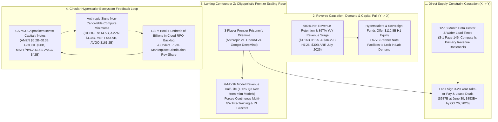
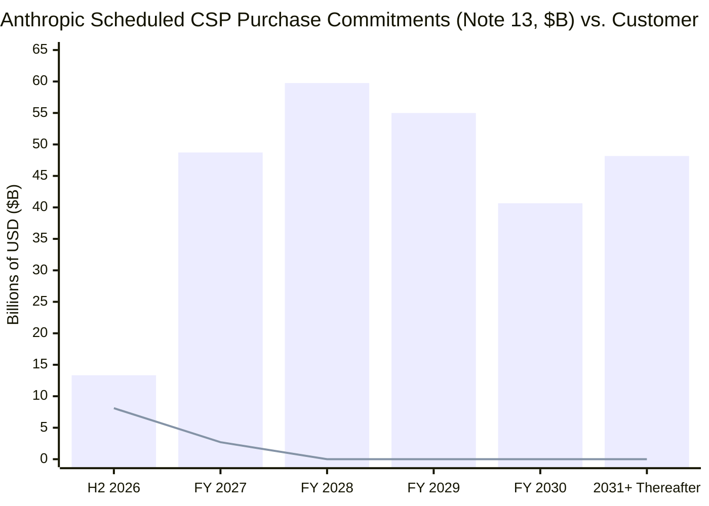

On October 27, 2026—less than twenty-four hours after **Anthropic, PBC** filed its landmark initial public offering registration statement (**SEC Form S-1**, `CIK 0002130357`)—**Sridhar Ramaswamy** (`@RamaswmySridhar`), Chief Executive Officer of **Snowflake**, Venture Partner at **Greylock**, and former Senior Vice President of Ads at Google, published a 16-part analysis on X that crystallized the central balance-sheet anxiety of the frontier artificial intelligence era:

> **Sridhar Ramaswamy (`@RamaswmySridhar`), October 27, 2026 (`1/16` & `16/16`):**
> *"1/16 the ai industry is making an unusual bet: buy compute for years, sell intelligence by the token. banks, commodity geographies/merchants, airlines, utilities and cloud providers each explain a different part of the risk... 14/16 anthropic's s-1 made this concrete. as of june 30, 2026, it disclosed $265.6b of future fixed or minimum purchase commitments, mainly cloud/compute, plus $321.4b of signed leases not yet commenced. those are separate buckets, long-dated, and some are conditional... 16/16 takeaway: the ai stack has inverted duration transformation, take-or-pay operating leverage, perishable gpu hours, fast hardware/model decay, project-finance concentration, and circular cloud demand. a capacity bust is more likely than a bank run."*
> — Primary post source: [Sridhar Ramaswamy on X (October 27, 2026)](https://x.com/RamaswmySridhar/status/2115159261533929911)

Ramaswamy's thread immediately sparked a fierce, high-signal debate across technology investors, credit analysts, and infrastructure engineers (`@aadi29494`, `@GravityRsch`, `@Dabeer_builds`, `@xtbot`, `@BitWhitman`, and `@eequityresearch`). Critics of frontier labs argued that Ramaswamy actually *understated* the fragility because AI labs continuously slash their own per-token prices (`~40%` cost-per-task reductions per generation) and must spend tens of billions of dollars every six months on frontier training runs merely to stand still—turning Research and Development (`R&D`) into recurring **maintenance capital expenditure (`Maintenance CapEx`)**. Conversely, defenders of the frontier labs argued that comparing AI compute to empty airline seats or WeWork office leases ignores **Jevons Paradox** (elastic agentic token explosions), `900%` enterprise net revenue retention (`NRR`), multi-chip hardware orchestration, and architectural separation between 20-year data center shell leases and 3-to-5-year silicon cycles.

Applying Browne and Keeley's **"Panning for Gold"** critical thinking methodology, we cross-examine every claim in Ramaswamy's 16-part thread and its major counter-theses directly against **Anthropic, PBC's primary October 26, 2026 SEC Form S-1 (`Pages 1–172` and `Notes 1–17`, `Pages F-1 to F-66`)**, **CoreWeave, Inc.'s FY2025 SEC filings (`CIK 0001769628`)**, and hyperscaler disclosures from **Amazon (`AMZN`)**, **Alphabet (`GOOGL`)**, **Microsoft (`MSFT`)**, **NVIDIA (`NVDA`)**, and **AMD (`AMD`)**.

---

## Executive Summary & Forensic Scorecard

Our primary-source audit reveals that **Sridhar Ramaswamy's structural diagnosis is directionally right on the asset-liability duration mismatch, but omits four critical quantitative disclosures buried in Anthropic's S-1 (`Note 2`, `Note 9`, `Note 17`, and `MD&A Pages 143 & 170–172`)** that make both the near-term risk *and* Anthropic's contractual escape valves far sharper than social media commentary realizes:

1. **The Exact Supply-vs-Demand Duration Mismatch Ratio (`54.4x` to `79.0x` Aggregate; `>200x` Long-Dated):**
   While Ramaswamy cited Anthropic's June 30, 2026 supply obligations (**`$265.6B`** in non-cancelable cloud purchase commitments in `Note 13` + **`$321.4B`** in signed uncommenced data center/equipment leases in `Note 7` = **`$587.0B`**, plus `$2.1B` in commenced lease payments), he did not cross-reference **`Note 2 (Revenue Recognition — Remaining Performance Obligations, Page F-27)`** or **`Note 17 (Subsequent Events, Page F-66)`**.
   - On the **Demand Side (`Note 2`)**, **`80.22%` (`$13,064M`)** of Anthropic's `$16,286M` H1 2026 revenue is **pay-per-token consumption**, and only **`19.78%` (`$3,222M`)** is subscription (`≤12-month` terms). Anthropic's total contracted, non-cancelable customer revenue backlog (**Remaining Performance Obligations, `RPO`**) as of June 30, 2026 was just **`$10.8 billion`**—of which **`75%` (`$8.1B`)** is recognized within `12 months` and **only `25%` (`$2.7B`) extends beyond one year**!
   - On the **Supply Side (`Note 17`)**, between July 1, 2026 and October 26, 2026, Anthropic signed an **additional `$245.0 billion`** in long-term (`1–20 year`) minimum compute/lease commitments and **`$21.0 billion`** in short-term (`<1 year`) commitments—bringing total contracted supply obligations to **`$855.1 billion`** (excluding `$125.0B–$150.0B` in conditional 2028–2031 Google TPU expansion commitments in `Note 16` and `$20.0B+` in AMD Helios systems).
   - **Forensic Ratio:** Anthropic's contracted multi-year supply commitments exceed its contracted customer revenue backlog (`$10.8B` total RPO) by **`54.4x` as of June 30, 2026 (`$587.0B / $10.8B`)** and **`79.0x` as of October 26, 2026 (`$853.0B / $10.8B`)**. For obligations beyond 12 months, contracted supply (`~$800B+`) exceeds contracted customer demand (`$2.7B`) by **`nearly 300x`**.
2. **Empirical Proof of Token Spot Volatility & The 6-Month Model Revenue Half-Life (`MD&A Page 143`):**
   Two disclosures on `Page 143` of Anthropic's S-1 empirically validate both Ramaswamy's short-term demand thesis and `@aadi29494` / `@eequityresearch`'s obsolescence thesis:
   - **Holiday Code-Freeze Revenue Drop (`-20%` in Two Weeks):** During the two weeks ended January 2, 2026, Anthropic's total customer spend **dropped by `~20%`** compared to the prior two weeks ended December 19, 2025 due to enterprise year-end code freezes—while its committed compute capacity (`procured 12 to 18 months in advance`, `Page 146`) remained `100%` fixed.
   - **The `<6-Month` Commercial Model Half-Life:** Anthropic explicitly discloses on `Page 143`: *"Model versions released in the six months ended September 30, 2026 accounted for **over 80% of our revenue** for the three months ended September 30, 2026."* Because frontier model weights lose commercial pricing power within two quarters—and because Anthropic's **`85.39%` GAAP Gross Margin (`$2,380M` Cost of Revenue on `$16,286M` H1 sales, `Page 151`)** excludes **`~$6,565M` of training compute expensed inside `$9,741M` of H1 R&D (`Note 8, Page F-39`)**—frontier training compute behaves economically as **recurring maintenance CapEx** rather than discretionary software R&D.
3. **The Itemized Counterparty Ledger & Hidden Contractual Opt-Outs (`Pages 170–172`):**
   Neither Ramaswamy nor the "WeWork for AI" bears (`@xtbot`) examined the itemized contract ledger on `Pages 170–172` of the S-1, which reveals that Anthropic's `$853B+` commitment stack is split across four very different risk tiers:
   - **Hard Take-or-Pay Hyperscaler Minimums (`$269.4B`):** **Google (`$114.5B`, Apr 2026–Jul 2033)**, **Amazon (`$110.0B`, May 2026–Apr 2036)**, and **Microsoft (`$44.9B`, Nov 2026–May 2033)**—all mandatory *"regardless of actual usage"* with cash **true-up payments** if spend falls short.
   - **Hardware Finance Leases Backed by PIK Debt (`$161.2B`):** Five-year master equipment finance leases with **Broadcom** for TPU hardware (`$161.2B` excluding interest, `Page 171`), backed by parent guarantees, cross-default acceleration, and a **`$42.0B` Broadcom Convertible Note Facility (`Note 9`, `9.00%` PIK stepping up to `13.00%` PIK and an `85%` discounted conversion price if Anthropic misses trailing revenue targets)**.
   - **The `$120.5B` SpaceX.AI (`xAI`) 90-Day Walk-Away Valve (`Page 171`):** Between May and October 2026, Anthropic contracted up to **`$120.5 billion`** (`~$3.1 billion/month` starting December 2026 through 2029) with **SpaceX.AI LLC (formerly X.AI LLC)** for NVIDIA GPU capacity. Crucially, `Page 171` discloses that **after January–March 2027, either party can cancel the entire `$3.1B/month` arrangement upon just `90 days' advance written notice`**!
   - **Financing-Conditioned Neo-Cloud Contracts (`$85.9B`):** GPU service deals with **Nscale (`$44.6B` through 2033)** and **Lambda (`$41.3B` through 2034)** only accrue fees *after* capacity is delivered and accepted, and allow termination if the neo-cloud fails to secure project financing or facility leases on time.

| Analytical Dimension / Thesis | Source / Proponent | Primary SEC Filing Evidence (`Anthropic S-1` / `CoreWeave 10-K`) | Forensic Verdict & Epistemic Rating |
| :--- | :--- | :--- | :--- |
| **1. Inverted Duration Transformation (Banks Analogy)** | Sridhar Ramaswamy (`Tweets 2–4`) | `Note 2 (Page F-27)`: `80.22%` H1 revenue is pay-per-token; customer `RPO` is only `$10.8B` (`$8.1B <1yr`, `$2.7B >1yr`) vs. `$587.0B` (`June 30`) / `$853.0B` (`Oct 26`) in multi-year supply commitments (`54.4x–79.0x` mismatch). | **Substantiated (`9.5/10`)** — Accurately distinguishes absence of deposit runs from fixed-obligation funding contagion. |
| **2. LNG Take-or-Pay Operating Leverage (`3.0x DOL`)** | Sridhar Ramaswamy (`Tweets 5–6`) | `Pages 170–171`: Google (`$114.5B`), Amazon (`$110.0B`), and Microsoft (`$44.9B`) require minimum spend *"regardless of actual usage"* with mandatory cash true-ups. H1 compute (`$8.95B`) + rev-share (`~$3.09B`) = `74%` of revenue. | **Substantiated (`9.0/10`)** — Exact contractual match to LNG take-or-pay true-ups, buffered in H1 2026 by `$131.65B` cash and `$77.0B` undrawn partner NPAs. |
| **3. Airline Seat Perishability & Fast Asset Decay** | Sridhar Ramaswamy (`Tweets 7–8`) | `Page 143`: Customer spend dropped `~20%` during the Dec 2025–Jan 2026 holiday code freeze while committed compute (`procured 12–18m ahead`) stayed fixed. Unused GPU-hours vanish, though training can absorb slack inference hours. | **Substantiated with Technical Nuance (`8.0/10`)** — Unlike airlines, labs can reallocate idle inference clusters to background pre-training/RL runs. |
| **4. Self-Inflicted Price Deflation & 6-Month Model Half-Life** | `@aadi29494` & `@eequityresearch` (Replies) | `Page 10`: `Claude Opus 5.5` cut customer cost per task by `~40%` vs `Opus 5`. `Page 143`: Models `<6 months` old generate `>80%` of Q3 2026 revenue. `Note 8`: `$6.57B` of H1 compute is in R&D vs `$2.38B` in Cost of Revenue. | **High-Value Extension (`9.5/10`)** — Crucial dynamic omitted by Ramaswamy: `85.39%` GAAP gross margin hides `40.3%` of revenue spent on recurring training compute. |
| **5. Neo-Cloud Project Finance & Credit Concentration** | Sridhar Ramaswamy (`Tweets 9–10`) & `@Dabeer_builds` | CoreWeave FY25 filings: `>98%` committed revenue, `~62%` Microsoft concentration, `$21.6B` asset-backed debt. `Anthropic S-1 Page 171`: Nscale (`$44.6B`) and Lambda (`$41.3B`) contracts are contingent on project financing and delivery. | **Substantiated (`9.0/10`)** — Neo-clouds sit in the leveraged credit sandwich between NVIDIA CapEx and lab/CSP off-take. |
| **6. Hyperscaler Pooling vs. Circular Cloud Demand** | Sridhar Ramaswamy (`Tweets 11–13`) & `@GravityRsch` | Amazon (`$6.2B` notes + `$15B` NPA vs `$110B` AWS commitment + `19%` rev-share), Google (`$20B` NPA vs `$114.5B` + `$125B–$150B` TPU commitments), Microsoft/NVIDIA (`$15B` Series G vs `$44.9B` Azure commitment). | **Substantiated (`9.5/10`)** — Capital, compute, distribution (`Bedrock`/`Vertex`/`Foundry`), and CSP RPO backlog form a self-reinforcing loop. |
| **7. "WeWork for AI" 20-Year Lease Collapse Thesis** | `@xtbot` (Reply) | `Pages 137, 141 & 171`: Under `Anthropic Direct`, 10–20 year uncommenced leases (`$321.4B`) are predominantly for **powered data center shells** (`15–25%` of TCO), decoupled from 3–5 year silicon (`Broadcom 5-yr TPU leases`, `90-day cancelable $120.5B SpaceX.AI GPUs`). | **Refuted as Over-Simplified (`3.5/10`)** — Misses shell-vs-silicon decoupling, multi-chip orchestration, and the `$120.5B` SpaceX.AI 90-day cancellation clause. |

---

## Phase 1 & Phase 2: Issue Framing, Primary Source Excavation & Conflict-of-Interest Audit

### 1.1 Reconstructing Sridhar Ramaswamy's 16-Part Framework & The Counter-Arguments

To ensure zero straw-man distortion, we preserve the complete structure of Sridhar Ramaswamy's October 27, 2026 thread (`1/16` to `16/16`) alongside the six substantive domain responses captured in the thread:

* **Tweets `1/16–4/16` (The Banking Analogy — Inverted Duration Transformation):**
  > *"2/16 start with banks. a bank borrows short (deposits that can leave) and lends long (mortgages, multi-year loans). 3/16 ai labs do the reverse: they lock in multi-year compute commitments and sell short-term token usage that customers can cut or reroute tomorrow. 4/16 unlike a bank, customers can't demand past spend back. so there's no classic 'bank run.' the real risk is that fixed obligations amplify shocks, and a funding pullback can cascade."*
* **Tweets `5/16–6/16` (The Commodity Merchant Analogy — LNG Take-or-Pay Operating Leverage):**
  > *"5/16 the cleaner operating analogy is a commodity merchant: sign a 10-year take-or-pay lng contract, then sell cargoes into a spot market. 6/16 that creates brutal operating leverage. if you commit $100 of fixed capacity expecting $150 of revenue, you have $50 of contribution before other costs. a 30% revenue miss cuts revenue to $105 and shrinks contribution by 90%, to $5."*
* **Tweets `7/16–8/16` (The Airline Analogy — Perishable Inventory & Rapid Obsolescence):**
  > *"7/16 now add airlines. an empty seat at takeoff is gone forever. so is yesterday's unused gpu-hour. 8/16 like airlines, ai runs on load factor x yield. unlike airlines, a plane flies for 25–30 years; gpu generations and model architectures age in 12–36 months."*
* **Tweets `9/16–10/16` (The Utility Analogy — GPU Neo-Clouds as the Project-Finance Layer):**
  > *"9/16 utilities explain why long contracts exist at all: you don't finance a power plant on spot demand; you finance it on long-term power purchase agreements. 10/16 gpu neo-clouds are the project-finance layer of ai. coreweave says >98% of 2025 revenue came from committed contracts, using contracted cash flows to finance gpus. that reduces spot risk, but concentrates credit and rollover risk."*
* **Tweets `11/16–13/16` (The Cloud Provider Analogy — Multi-Tenant Pooling vs. Circularity):**
  > *"11/16 cloud providers (aws, azure, gcp) also build years ahead and monetize usage. why didn't that blow up? 12/16 because classic cloud had diversified pooling across millions of workloads, 1–3 year enterprise commits, slower obsolescence, repurposable infra, and huge cash cows behind it. 13/16 in ai, circularity blurs the picture: a cloud provider can invest in a lab, sell it compute, distribute its models, and book multi-year backlog from the same ecosystem."*
* **Tweets `14/16–16/16` (The Anthropic S-1 Proof Point & Synthesis):**
  > *"14/16 anthropic's s-1 made this concrete. as of june 30, 2026, it disclosed $265.6b of future fixed or minimum purchase commitments, mainly cloud/compute, plus $321.4b of signed leases not yet commenced. those are separate buckets, long-dated, and some are conditional. 15/16 this only works if revenue scales faster than fixed commitments. anthropic's h1 2026 revenue reached $16.3b, and compute expense fell to 55% of sales vs 201% in h1 2025. 16/16 takeaway: the ai stack has inverted duration transformation, take-or-pay operating leverage, perishable gpu hours, fast hardware/model decay, project-finance concentration, and circular cloud demand. a capacity bust is more likely than a bank run."*

In the immediate reply chain, six distinct analytical extensions emerged:
1. **`@aadi29494` (Self-Inflicted Token Deflation):** *"the commodity merchant analogy is the sharpest piece here. the part that makes it worse than lng is that the labs are also the ones cutting their own prices. airlines do not ship a new plane every six months that makes last year's seats worth less. every new model release reprices the old capacity down while the compute lease stays flat."*
2. **`@eequityresearch` (Training as Maintenance CapEx):** *"The part that scares me is that training costs are not R&D, they are maintenance capex when you're the leader."*
3. **`@GravityRsch` (Circularity & Price Elasticity Paradox):** *"13/16 is the crux. When capital, compute, and distribution sit inside the same loop, reported demand starts looking firmer than actual end-market demand. And unlike LNG or airlines, AI labs are simultaneously driving down per-token prices while locking in multi-year fixed capacity."*
4. **`@Dabeer_builds` (Neo-Cloud Refinancing Window):** *"the commodity merchant analogy is the cleanest one in this thread. the $100 fixed / $150 expected -> 30% miss wipes 90% of contribution math is brutal and underappreciated. the part i keep coming back to is 8/16 + 10/16 together: neo-clouds are financing assets that depreciate in 24-36 months using project-finance structures invented for 25-year power plants. what happens at the first refinancing window when the collateral is N-1 generation hardware?"*
5. **`@xtbot` (The "WeWork for AI" Bear Case):** *"14/16 is the number nobody wants to look at directly: $587B in combined obligations against $32B annualized revenue, on assets that depreciate in 24 months, selling a product with zero switching cost. WeWork had the same structure: 15-year lease obligations, monthly memberships. The difference is office buildings don't become obsolete every 18 months."*
6. **`@BitWhitman` (The Jevons Paradox / Utilization Bull Counter):** *"The LNG and airline comparisons hold only if demand is exogenous and price-elastic in the wrong direction. Every time token prices drop 10x, new categories of agentic workloads become viable that consume 100x more tokens per task. The labs aren't betting on static query volume—they're betting on Jevons paradox filling the clusters faster than hardware depreciates."*

### 1.2 Speaker Expertise & Conflict-of-Interest Scrutiny

Under `.agents/rules/deep-research.md`, we must evaluate the domain credentials and commercial incentives of the primary author:
* **Domain Authority (`High`):** Sridhar Ramaswamy ran Google's flagship advertising and commerce engineering organization for over a decade (`$100B+` run-rate auction infrastructure), co-founded AI search engine **Neeva** (acquired by Snowflake in May 2023), and has served as **CEO of Snowflake (`NYSE: SNOW`)** since February 2024. He negotiates multi-billion-dollar cloud commitments with AWS, Azure, and GCP directly while purchasing frontier model tokens at enterprise scale.
* **Commercial Conflict of Interest (`Material — Must Be Disclosed`):** As CEO of **Snowflake**, Ramaswamy leads an enterprise data-cloud platform (**Snowflake Cortex AI**) whose core value proposition to Fortune 500 CIOs is **model-agnostic abstraction and multi-model routing**—enabling enterprises to swap seamlessly between Anthropic Claude, OpenAI GPT, Meta Llama, Mistral, and Snowflake Arctic models without vendor lock-in.
  * *Why this matters:* In Tweet `3/16`, Ramaswamy states that AI labs *"sell short-term token usage that customers can cut or reroute tomorrow."* Snowflake has a direct commercial incentive to promote the narrative that **model layer tokens are interchangeable commodities with zero switching costs**, while positioning the governed enterprise data layer (Snowflake) as the durable system of record. Our audit must therefore test empirically whether Anthropic's enterprise customers actually exhibit "zero switching cost" churn or high multi-year stickiness (`NRR`).

---

## Phase 3: Semantic Precision & The 5-Industry Structural Risk Matrix

### 3.1 Ambiguity & Substitution Tests on Three Loaded Terms

1. **"Duration Mismatch" (`Bank Maturity Transformation` vs. `Operating Commitment Duration Gap`):**
   * *Substitution Test:* When a commercial bank fails (`Silicon Valley Bank, March 2023`), short-term liability holders (**depositors**) legally demand immediate `100%` principal redemption in cash, forcing fire-sales of long-duration assets (`HTM Treasuries/MBS`). Does an AI lab owe cash back to API customers who stop buying tokens? **No.**
   * *Precise Definition:* What AI labs face is **not** a liability-side liquidity run (`Asset-Liability Maturity Transformation`), but an **Off-Balance-Sheet Operating Commitment Duration Gap**: contracting `3-to-20-year` fixed input obligations (`Compute Purchase Commitments + Data Center Leases`) against `1-to-90-day` uncontracted spot output revenue (`Pay-Per-Token API Consumption`).
2. **"Committed Compute & Signed Leases (`$587.0B` / `$853.0B`)" (`Unconditional Debt-Like Minimums` vs. `Milestone-Contingent & Cancelable Tranches`):**
   * *Substitution Test:* Can every dollar of Anthropic's `$587.0B` (`June 30`) or `$853.0B` (`October 26`) obligations be equated to WeWork's unconditional 15-year office leases? **No.**
   * *Precise Disaggregation (`Anthropic S-1 Notes 7, 13, 17 & Pages 170–172`):* As proven in Section 5.2 below, `$269.4B` consists of unconditional hyperscaler take-or-pay minimums (`Google`, `Amazon`, `Microsoft`) and `$161.2B` consists of non-cancelable 5-year Broadcom TPU finance leases, whereas **`$120.5B` (`SpaceX.AI LLC` NVIDIA GPUs) is cancelable by either party on `90 days' written notice` after Q1 2027**, and **`$85.9B` (`Nscale` and `Lambda`) is conditioned on neo-cloud project financing and facility delivery milestones**.
3. **"Gross Margin (`85.39%`)" (`Inference Serving Margin` vs. `Full-Cycle Compute Margin Including Maintenance Training`):**
   * *Substitution Test:* If a SaaS company reports an `85.39%` gross margin (`Adobe` or `Workday`), its historical R&D code continues generating revenue for `5–10+ years`. If Anthropic stops R&D training runs tomorrow, how long does its current model generation retain `>80%` of revenue? **Less than 6 months (`MD&A Page 143`).**
   * *Precise Definition:* In frontier AI, **GAAP Gross Margin (`85.39%` in H1 2026)** measures only **customer-serving inference margin** (`Revenue - Cost of Revenue`), whereas **Full-Cycle Compute Contribution Margin (`26.1%` in H1 2026)** must deduct both `Cost of Revenue` (`$2,380M` inference compute + `$3,094M` third-party cloud partner revenue-share inside `S&M`) and `R&D Training Compute` (`~$6,565M`).

### 3.2 The 7-Sector Structural Risk Comparison Matrix

To test Ramaswamy's 5-industry synthesis rigorously, we map **Banks**, **LNG Commodity Merchants**, **Airlines**, **Electric Utilities**, **Hyperscale CSPs**, **GPU Neo-Clouds (`CoreWeave`)**, and **Frontier AI Labs (`Anthropic`)** across seven structural balance-sheet parameters:

| Structural Parameter | Commercial Banks | LNG Commodity Merchants | Passenger Airlines | Electric Utilities | Hyperscale CSPs (`AWS` / `Azure` / `GCP`) | GPU Neo-Clouds (`CoreWeave`) | Frontier AI Labs (`Anthropic S-1`) |
| :--- | :--- | :--- | :--- | :--- | :--- | :--- | :--- |
| **Input / Liability Duration** | **Ultra-Short** (`Runnable overnight deposits`) | **Long** (`10–20 yr take-or-pay liquefaction SPAs`) | **Long** (`10–15 yr aircraft leases / debt`) | **Ultra-Long** (`20–40 yr project debt & plant life`) | **Long** (`15–30 yr shells`, `4–6 yr server lifecycle`) | **Medium** (`3–6 yr GPU DDTLs & 5–15 yr DC leases`) | **Long** (`3–10 yr CSP take-or-pay`, `5 yr TPU leases`, `10–20 yr shell leases`) |
| **Output / Revenue Duration** | **Long** (`5–30 yr fixed/floating loans & mortgages`) | **Short** (`Spot / short-term JKM & TTF cargoes`) | **Short** (`Spot & 1–90 day advance ticket sales`) | **Long** (`10–25 yr regulated tariffs & PPAs`) | **Medium-Mixed** (`1–3 yr enterprise CUDs / `$600B+` RPO + consumption`) | **Medium** (`3–5 yr take-or-pay contracts; >98% committed`) | **Short** (`80.2% pay-per-token spot; only $10.8B RPO, 75% <12m`) |
| **Inventory Perishability** | Low (Cash/credit carries over at interest rate) | Moderate (Boil-off gas & costly floating storage) | **100% Perishable** (`Empty seat at takeoff vanishes`) | **100% Perishable** (`Unstored MWh vanishes instantly`) | High (Idle CPU/GPU cycle vanishes, pooled across millions) | High (Pass-through to off-taker under take-or-pay) | **High but Semi-Fungible** (`Idle inference GPU-hour can run RL/pre-training`) |
| **Underlying Asset Useful Life** | Financial claims (`5–30 years`) | Liquefaction trains & tankers (`25–40 years`) | Commercial airframes (`25–30 years`) | Generation turbines & grid (`30–50 years`) | General servers (`5–6 yrs`), DC shells (`20–30 yrs`) | AI GPUs (`3–5 yrs physical`, `18–36m frontier peak`) | **Data center shells (`15–20 yrs`), Silicon (`3–5 yrs`), Model weights (`<6m half-life`)** |
| **Self-Cannibalizing Price Deflation** | None (Rates follow central bank cycle) | None (Spot LNG follows global macro weather/supply) | None (New Boeing/Airbus jets do not cut ticket fares `40%/yr`) | None (Regulated rate-base inflation escalators) | Moderate (`~10–15%/yr` Moore's Law price/perf cuts) | High at contract renewal (`N-1` GPU rental rates drop `40–60%`) | **Extreme (`~40%+` cost-per-task cut every 6–12 months per new model)** |
| **Switching Cost & Workload Stickiness** | Moderate-Low (Digital wire runs in hours) | **Zero** (Molecules of CH₄ are 100% fungible) | Low (Consumers book cheapest route; loyalty miles buffer) | **Infinite** (Captive regional grid monopoly) | **High** (Data gravity, IAM, VPC, deep enterprise integration) | Moderate-High during contract (`3–5 yr lock`), Low at renewal | **Bifurcated** (`Low` for simple API wrappers; `High / 900% NRR` for agentic enterprise codebases) |
| **Primary Failure Mode** | **Classic Liquidity Run** (Depositors pull cash faster than assets liquidate) | **Spread Crush** (Spot price falls below fixed liquefaction tolling fee) | **Load-Factor × Yield Recession Bust** (Fixed fleet costs crush margins) | **Stranded Asset / Off-Taker Default** (Regulatory disallowance) | **CapEx Overbuild / ROIC Compression** (Buffered by legacy cash cows) | **Refinancing / Residual Collateral Cliff** (`N-1` GPUs at lease roll) | **Take-or-Pay Margin Vise** (Revenue growth slows below fixed CSP true-up & R&D training curve) |

---

## Phase 4: The 4-Way Causal Audit (Why Are Labs Locking In `$853B+` Against Spot Tokens?)

Why has Anthropic locked in **`$855.1 billion`** in total compute and lease commitments (`Notes 7, 13 & 17`) when its contracted customer RPO is only **`$10.8 billion`** (`Note 2`)? Rather than attributing this solely to management hubris or irrational bubble behavior, we execute a **4-Way Causal Audit**:

| Causal Pathway | Mechanistic Direction | Primary Filing Evidence (`Anthropic Form S-1`) | Analytical Weight |
| :--- | :--- | :--- | :--- |
| **1. Direct Causation (`Physical Bottleneck -> Long Commits`)** | `Supply Lead Time (12–18m) -> Multi-Year Take-or-Pay Contracts` | `MD&A Page 146`: *"Demand for our offerings currently exceeds our available compute capacity... we must make capacity commitments 12 to 18 months in advance of expected customer usage."* `Page 140`: Anthropic estimates each **1 GW** of data center capacity costs **`$20B–$25B`** to build (`75–85%` silicon/servers over `3–5 yrs`; `15–25%` shell over `10–20 yrs`). Neither utilities nor CSPs will build `$25B` gigawatt clusters without multi-year take-or-pay off-take. | **35% (Primary Operational Driver)** |
| **2. Reverse Causation (`Hyper-Growth & Capital Abundance -> Aggressive Locking`)** | `900% Cohort Expansion & $131.7B Cash Pile -> Willingness to Underwrite Multi-Year Risk` | `Page 142`: Customer cohorts with `≥$100K` ARR achieved **over `900%` Net Revenue Retention (`NRR`)** in Q2 2026 (`300%+` in every quarter since Q1 2024). H1 2026 financing cash inflows hit **`$110.8 billion`** (`Page 168`), leaving **`$131.65 billion`** in cash/marketable securities (`Page 161`). Extraordinary historical expansion and capital abundance induced management to treat `12–18 month` extrapolations as baseline certainty. | **20% (Behavioral & Balance-Sheet Driver)** |
| **3. Lurking Confounder `Z` (`The 6-Month Frontier Obsolescence Treadmill`)** | `Oligopolistic Scaling Race (Z) -> Simultaneous Price Cuts & Multi-GW Cluster Commitments` | `Page 143`: **Over `80%` of Q3 2026 revenue** came from models released in the **prior 6 months**. If Anthropic fails to secure next-generation multi-gigawatt clusters (`Trainium3`, `TPU v7/v8`, `Blackwell/Rubin`, `MI450`) 18 months ahead, a rival lab captures the frontier coding/agentic market and Anthropic's existing token revenue decays within two quarters. | **25% (Structural Game-Theory Driver)** |
| **4. Circular Ecosystem Feedback Loop (`CSP Capital <-> Lab Compute RPO`)** | `Strategic Equity/Note Funding <-> Non-Cancelable Cloud Backlog & 19% Rev-Share` | `Pages 164–172`: Amazon (`$6.2B` notes + `$15B` 2026 NPA), Google (`$20B` 2026 NPA + `$10B` IPO placement option), Microsoft/NVIDIA (`$15B` Series G), and Broadcom (`$42B` 2026 NPA) simultaneously finance Anthropic, sell it **`$430.6B`** of committed cloud/equipment (`$114.5B` Google + `$110.0B` Amazon + `$44.9B` Microsoft + `$161.2B` Broadcom), and collect **`~19%` of Anthropic's total revenue (`$3,094M` in H1 2026, `Page 151`)** in cloud marketplace revenue-sharing fees! | **20% (Financial Engineering Amplifier)** |

---

## Phase 5: Quantitative & Financial Engineering Audit

Let us subject every mathematical claim in Ramaswamy's thread and Anthropic's Form S-1 to formal derivation and statistical stress testing.

### 5.1 Auditing Tweet `6/16`: Degree of Operating Leverage (`DOL`) & Take-or-Pay Spread Compression

In Tweet `6/16`, Sridhar Ramaswamy presents a stylized commodity-merchant math problem:
* Fixed take-or-pay capacity commitment `F = $100`
* Expected spot revenue `R₀ = $150`
* Expected contribution before other costs `Π₀ = R₀ - F = $150 - $100 = $50`
* Under a `30%` revenue miss (`ΔR / R₀ = -0.30`), actual revenue drops to `R₁ = $150 × (1 - 0.30) = $105`, and contribution collapses to `Π₁ = $105 - $100 = $5`, representing a **`90%` collapse in contribution** (`ΔΠ / Π₀ = -$45 / $50 = -90%`).

Formally, the **Degree of Operating Leverage (`DOL`)** with respect to revenue for a take-or-pay structure with fixed capacity cost `F` and variable non-compute partner revenue-share fraction `v` (such that contribution is `Π(R) = R(1 - v) - F`) is:

$$
\text{DOL}(R_0) = \frac{\partial \Pi / \Pi_0}{\partial R / R_0} = \frac{R_0 (1 - v)}{R_0 (1 - v) - F} = \frac{1}{1 - \frac{F}{R_0 (1 - v)}}
$$

In Ramaswamy's simplified example (`v = 0`, `F = $100`, `R₀ = $150`), `DOL = 150 / (150 - 100) = 3.0x`, so a `-30%` revenue shock causes a `3.0 × (-30%) = -90%` contribution collapse.

Now let us plug **Anthropic's actual H1 2026 numbers from `MD&A Pages 149–152` and `Note 8 (Page F-39)`** into this exact equation!
* **H1 2026 Revenue (`R₀`):** **`$16,286 million`** (`$4,731M` in Q1 2026 + `$11,555M` in Q2 2026, `Page 158`).
* **H1 2026 Variable Cloud Partner Revenue-Share (`v`):** On `Page 151`, Anthropic discloses that inside Sales and Marketing (`$4,102M` total), **Revenue sharing payments to cloud and distribution partners (`AWS Bedrock`, `Google Vertex AI`, `Microsoft Azure Foundry`) were `19%` of revenue**, or **`~$3,094 million`** (`v = 0.19`).
* **H1 2026 Total Compute Expense (`F`):** On `Page 152` (confirming Ramaswamy's Tweet `15/16`), Anthropic's total compute expense across the income statement was **`$8,945 million`** (**`54.92%` of revenue**, down from **`200.69%` of revenue** or `$2,334M` on `$1,163M` sales in H1 2025):
  * Customer-serving inference compute (`Cost of revenue`, `Page 151` & `Note 8 Page F-39`): **`$2,380 million`** (**`14.61%` of revenue**, producing an apparent **`85.39%` GAAP Gross Margin**).
  * Research & Development training/research compute (`R&D`, `Note 8 Page F-39`): **`~$6,565 million`** (**`40.31%` of revenue**, embedded inside `$9,741M` of total R&D expense).

Substituting Anthropic's actual H1 2026 parameters (`R₀ = $16,286M`, `v = 0.19`, and committed compute `F = $8,945M`) into our operating leverage formula yields:

$$
\Pi_{\text{H1 2026}} = R_0 (1 - v) - F = 16,286 \times (1 - 0.19) - 8,945 = 13,191.66 - 8,945 = \$4,246.66\text{ million (26.08\% of Revenue)}
$$

$$
\text{DOL}_{\text{Anthropic H1 2026}} = \frac{13,191.66}{4,246.66} = 3.106\times
$$

**Forensic Discovery:** Sridhar Ramaswamy's stylized commodity-merchant example (`DOL = 3.0x`, where a `30%` revenue miss wipes out `90%` of contribution) is not merely a metaphor—**Anthropic's actual H1 2026 post-rev-share compute Degree of Operating Leverage is `3.11x`!** If Anthropic's revenue fell `30%` below planned levels while its committed H1 compute (`$8,945M`, procured 12–18 months in advance) remained fixed, its post-compute, post-rev-share contribution margin would fall by `3.106 × (-30%) =` **`-93.2%`**, shrinking from `$4,247M` to just **`$289M`** before paying a single dollar of its `$3,176M` R&D payroll or `$1,277M` G&A expenses!

| Metric (`$ in millions`, except percentages & ratios) | FY 2023 | FY 2024 | FY 2025 | H1 2025 (`6M Ended Jun 30`) | H1 2026 (`6M Ended Jun 30`) | Primary Filing Source (`Anthropic S-1`) |
| :--- | :--- | :--- | :--- | :--- | :--- | :--- |
| **Total Revenue (`R`)** | **$70** | **$607** | **$4,435** | **$1,163** | **$16,286** | `Consolidated Statements of Operations (Page F-4)` |
| **Consumption (Pay-Per-Token) Revenue** | — | — | — | — | **$13,064 (`80.22%`)** | `Note 2 — Disaggregated Revenue (Page F-26)` |
| **Subscription Revenue (`≤12-Month Terms`)** | — | — | — | — | **$3,222 (`19.78%`)** | `Note 2 — Disaggregated Revenue (Page F-26)` |
| **GAAP Cost of Revenue (Inference Compute)** | **$244** | **$1,020** | **$2,223** | **$795** | **$2,380 (`14.61%`)** | `Page F-4` & `Note 8 (Page F-39)` |
| **GAAP Gross Profit / (Loss)** | **$(174)** | **$(413)** | **$2,212** | **$368** | **$13,906** | `MD&A Page 151` |
| **GAAP Gross Margin (`% of Revenue`)** | **-248.6%** | **-68.0%** | **49.88%** | **31.64%** | **85.39%** | `MD&A Page 151` (`+53.75 pts YoY in H1`) |
| **R&D Compute Expense (Training & Research)** | **$266** | **$1,558** | **$4,102** | **$1,539** | **$6,565 (`40.31%`)** | Derived: `Total Compute (Page 152) - Cost of Rev (Note 8)` |
| **Total Compute Expense (`Inference + R&D`)** | **$510 (`729%`)** | **$2,578 (`425%`)** | **$6,325 (`143%`)** | **$2,334 (`201%`)** | **$8,945 (`54.92%`)** | `MD&A Page 152` (Matches Ramaswamy Tweet `15/16`) |
| **Cloud Partner Revenue Share (`in S&M`)** | **$9 (`13%`)** | **$134 (`22%`)** | **$976 (`22%`)** | **$267 (`23%`)** | **$3,094 (`19.00%`)** | `MD&A Page 151` (`22%` FY24–25; `19%` H1 2026) |
| **Full-Cycle Post-Compute & Rev-Share Contribution** | **$(449)** | **$(2,105)** | **$(2,866)** | **$(1,438)** | **+$4,247 (`26.08%`)** | `Revenue - Total Compute - Partner Rev-Share` |
| **Total Research & Development (`R&D`) Expense** | **$472** | **$2,265** | **$5,764** | **$2,315** | **$9,741 (`59.81%`)** | `Page F-4` & `Note 8 (Page F-39)` |
| **GAAP Operating Income / (Loss)** | **$(860)** | **$(3,195)** | **$(5,882)** | **$(2,553)** | **$(1,274)** *(`+$974M in Q2`)* | `Page F-4` & `Quarterly Table (Page 158)` |

### 5.2 Deconstructing the `$855.1 Billion` Supply Commitment Stack vs. `$10.8 Billion` Customer RPO

Let us now audit the exact maturity schedule and contractual enforceability of Anthropic's supply obligations (`Notes 7, 13, 16, 17` and `Pages 170–172`) against its contracted customer revenue (`Note 2, Page F-27`).

$$
\text{Aggregate Duration Mismatch Ratio} = \frac{\text{Contracted Multi-Year Supply Commitments}}{\text{Contracted Customer RPO}} = \begin{cases} \frac{\$587.02\text{B}}{\$10.80\text{B}} = \mathbf{54.35\times} & \text{(As of June 30, 2026)} \\[8pt] \frac{\$853.02\text{B}}{\$10.80\text{B}} = \mathbf{78.98\times} & \text{(Including Q3/Q4 Note 17 Additions)} \end{cases}
$$

And for **long-dated commitments exceeding 12 months**, where customer RPO is only **`$2.70 billion`** (`25%` of `$10.8B`, `Note 2 Page F-27`):

$$
\text{Long-Dated (>1 Year) Mismatch Ratio} = \frac{\text{Supply Commitments Due } >1\text{ Year}}{\text{Customer RPO Due } >1\text{ Year}} = \frac{\$538.49\text{B (Jun 30)} \text{ to } \$783.49\text{B (Oct 26)}}{\$2.70\text{B}} = \mathbf{199.4\times \text{ to } 290.2\times}
$$

Here is the complete forensic reconciliation of **every single bucket** in Anthropic's compute and infrastructure obligation stack from the primary S-1 filing:

| Commitment Bucket / Counterparty | Disclosed Amount (`$B`) | Contractual Window / Maturity | Enforceability & Walk-Away Mechanics (`Anthropic S-1 Pages 170–172 & Notes 7, 13, 16, 17`) | Included in Jun 30 `$587B`? |
| :--- | :--- | :--- | :--- | :--- |
| **1. Non-Cancelable Purchase Commitments (`Note 13`)** | **$265.62B** | `H2 2026: $13.34B; 2027: $48.72B; 2028: $59.75B; 2029: $54.99B; 2030: $40.66B; 2031+: $48.16B` | Non-cancelable fixed or minimum CSP hosting commitments (`>1 yr` term as of Jun 30, 2026). Excludes `$26.7B` of `<1 yr` cancelable/short-term commitments (`Note 13 Page F-61`). | **Yes (`$265.6B`)** |
| **2. Signed Leases Not Yet Commenced (`Note 7`)** | **$321.40B** | Commencing `2026–2029`; lease terms `<2 yrs to 20 yrs` | Undiscounted future lease payments for data centers (`10–20 yr` shells) and compute hardware (`5 yr` Broadcom TPUs). Often conditioned on landlord/lessor delivery milestones (`Note 7 Page F-36`). | **Yes (`$321.4B`)** |
| **3. Commenced Operating & Finance Leases (`Note 7`)** | **$2.12B** | `2026–2031+` (`WA term 8.7 yrs OP / 3.0 yrs FIN`) | `$1,601M` undiscounted operating lease payments (`$1,231M` PV) + `$523M` undiscounted finance lease payments (`$465M` PV) already on the June 30, 2026 balance sheet (`Page F-36`). | Excluded from `$587B` (`On-B/S`) |
| **4. Q3/Q4 Subsequent Long-Term Commits (`Note 17`)** | **$245.00B** | `Jul 1 – Oct 26, 2026` (`Terms 1 to 20 years`) | Subsequent non-cancelable purchase commitments and leases for compute/infrastructure signed after June 30, 2026 (`Note 17 Page F-66`). | **No (`Omitted by Sridhar`)** |
| **5. Q3/Q4 Subsequent Short-Term Commits (`Note 17`)** | **$21.00B** | `Jul 1 – Oct 26, 2026` (`Remaining term ≤1 year`) | Short-term minimum compute payments entered into after June 30, 2026 (`Note 17 Page F-66`). | **No (`Omitted by Sridhar`)** |
| **Total Fixed / Determinable Supply Stack (`1–5`)** | **$855.14B** | `2026 – 2046` | **`$587.02B` cited by Ramaswamy (`Jun 30`) + `$2.12B` commenced leases + `$266.00B` Q3/Q4 additions (`Note 17`).** | — |
| *Memo A: Conditional Google TPU Expansion (`Note 16`)* | *+$125B–$150B* | `Delivery 2028 – 2031` | Additional TPU compute from Google/providers (`Pages 170 & F-63`); excluded from fixed table because price/volume depend on deployment conditions. | Excluded (`Variable`) |
| *Memo B: Conditional AMD Helios MI450 Supply (`Note 16`)* | *+$20B–$40B+* | `Initial tranche CY 2027` | `>$20.0B` initial tranche of AMD Helios rack-scale systems (`Page 171 & F-63`), plus option for an additional `~$20.0B` tranche. | Excluded (`Variable`) |

Now examine how the **named counterparty contracts disclosed on `Pages 170–172`** map across those accounting buckets:

| Named Counterparty (`S-1 Pages 170–172`) | Contract Value (`$B`) | Contract Window | Hardware / Cloud Stack | Specific Legal & Financial Terms (`Pages 170–172`) |
| :--- | :--- | :--- | :--- | :--- |
| **Broadcom Inc. (`Equipment Finance Leases`)** | **$161.2B** *(excl. interest)* | `5-Year Leases` (`Commencing 2026–2027`) | Custom **TPU-based** compute hardware in dedicated third-party data centers | Accounted for as **finance leases** (`Note 7`). Non-cancelable except on default; guaranteed by Anthropic, PBC; secured by equipment & restricted cash; cross-default acceleration. Can pay up to **`$42.0B` of quarterly rent via `9.0%–13.0%` PIK Convertible Notes (`Note 9`)**. |
| **SpaceX.AI LLC (`formerly X.AI LLC`)** | **Up to $120.5B** | `May 2026 – 2029` (`~$3.1B/month` from Dec 2026) | **NVIDIA GPUs** | **Crucial Escape Valve (`Page 171`):** Following initial non-cancelable periods ending **January 2027 and March 2027**, **each agreement may be cancelled by either party upon `90 days' advance written notice`!** |
| **Google (`Alphabet Inc.`)** | **$114.5B** *(+$125B–$150B conditional)* | `Apr 2026 – Jul 2033` (`7.25 years`) | **Google Cloud & TPUs** | Non-cancelable minimum spend *"regardless of actual usage."* Mandatory **cash true-up payment** for any shortfall. Backstopped by `$20.0B` **Google 2026 NPA** (`Page 167`). |
| **Amazon (`AWS`)** | **$110.0B** | `May 2026 – Apr 2036` (`10.0 years`) | **AWS Cloud & Trainium2 / Trainium3** | Non-cancelable minimum spend *"regardless of actual usage."* Mandatory **cash true-up payment** for any shortfall. Backstopped by `$6.2B` issued notes + `$15.0B` **Amazon 2026 NPA** (`Page 166`). |
| **Microsoft Corp. (`Azure`)** | **$44.9B** | `Nov 2026 – May 2033` (`6.5 years`) | **Microsoft Azure & NVIDIA GPUs** | Non-cancelable minimum spend *"regardless of actual usage,"* except for Microsoft uncured breach or per-tranche undelivered capacity. |
| **Nscale Global Holdings Ltd. (`Neo-Cloud`)** | **Up to $44.6B** | `Aug 2026 – 2033` | **NVIDIA GPUs** | Fees accrue **only as capacity is delivered and accepted**. Conditioned on Nscale using best efforts to obtain **qualifying project financing** within a specified window. |
| **Lambda, Inc. (`Neo-Cloud`)** | **$41.3B** | `May/Aug 2026 – 2034` | **NVIDIA GPUs** | Fees accrue **only as capacity is delivered and accepted**. For the `$34.9B` Aug 2026 deal, **either party may terminate if Lambda does not timely secure the facility lease**. |
| **Advanced Micro Devices (`AMD`)** | **>$20.0B** *(+~$20B option)* | `CY 2027 Delivery` | **AMD Instinct MI450 Helios Racks** | Non-cancelable once deployment proposals are met; terminates 12 months after all ordered AMD GPU capacity is delivered. |

*Chart Reading Note:* The bar series shows Anthropic's scheduled non-cancelable purchase commitments as of June 30, 2026 (`Note 13, Page F-61`, totaling **`$265.62B`**, *before* adding `$321.40B` in uncommenced leases and `$266.00B` in Q3/Q4 `Note 17` additions), while the line series shows Anthropic's total contracted customer revenue backlog (`RPO` of **`$10.80B`**, `Note 2, Page F-27`: **`$8.10B`** in the next 12 months and **`$2.70B`** across all years thereafter combined).

### 5.3 Auditing `@aadi29494`, `@eequityresearch` & `@BitWhitman`: Self-Cannibalizing Token Deflation & The Jevons Elasticity Condition

Why did `@aadi29494` and `@eequityresearch` argue that frontier AI is structurally *harsher* than LNG shipping or airlines? Let us formalize the revenue dynamics of a frontier AI lab at time `t`:
Let `P(t)` denote the quality-adjusted price per unit of agentic task completion (or per million tokens), and let `Q(t)` denote total token volume demanded at price `P(t)`. Total revenue is `R(t) = P(t) · Q(t)`. Taking the time derivative yields:

$$
\frac{\dot{R}(t)}{R(t)} = \frac{\dot{P}(t)}{P(t)} + \frac{\dot{Q}(t)}{Q(t)} = \frac{\dot{P}(t)}{P(t)} \left( 1 - \varepsilon_d \right) + g_{\text{exo}}(t)
$$

where `ε_d = -(∂ ln Q / ∂ ln P) > 0` is the price elasticity of token demand, `(dP/dt)/P < 0` is the rate of self-inflicted price/cost-per-task deflation, and `g_exo(t)` is exogenous enterprise adoption growth.

Let us check the empirical parameters disclosed in **Anthropic's Form S-1**:
1. **Self-Inflicted Task Price Deflation (`(dP/dt)/P ≈ -40%` per model cycle):** On `Page 10` of the S-1, Anthropic highlights that **`Claude Opus 5.5` reduced customer cost per task by approximately `40%` compared to `Claude Opus 5`** through higher token efficiency and architectural improvements.
2. **The 6-Month Commercial Revenue Half-Life (`MD&A Page 143`):** Anthropic discloses that **models released in the six months ended September 30, 2026 generated `>80%` of Q3 2026 revenue**. If `80%` of revenue decays out of legacy models within `T = 0.5 years`, the exponential decay rate `λ` of a fixed model weight's commercial revenue share is:

$$
e^{-\lambda (0.5)} \le 0.20 \implies \lambda \ge \frac{\ln(5)}{0.5} \approx 3.22\text{ yr}^{-1} \implies t_{1/2} = \frac{\ln(2)}{\lambda} \le 0.215\text{ years (\textbf{2.6 months!})}
$$

3. **Why `@eequityresearch` Is Right That Training Compute Is Maintenance CapEx:**
   Because any given frontier model's revenue share has an effective half-life of **2.6 to 4.0 months**, Anthropic cannot stop training new frontier models and "harvest" its `85.39%` inference gross margin like an airline flying a 25-year Boeing 787 or Oracle collecting maintenance fees on a 20-year database. To prevent revenue from collapsing within two quarters, Anthropic **must** continuously spend `$6.57B` per half-year (`$13B+/year` and rising) on R&D training compute (`Note 8, Page F-39`).
4. **Why `@BitWhitman` Is *Also* Right About Jevons Paradox—So Far (`ε_d >> 1` in 2024–2026):**
   Despite cutting per-task token costs by `~40%` per cycle, Anthropic's quarterly revenue surged from **`$219M` (`Q3 2024`) -> `$311M` (`Q4 2024`) -> `$494M` (`Q1 2025`) -> `$669M` (`Q2 2025`) -> `$1,422M` (`Q3 2025`) -> `$2,519M` (`Q4 2025`) -> `$4,731M` (`Q1 2026`) -> `$11,555M` (`Q2 2026`)** (`Page 158`), reaching **`$30.0 billion` in Annualized Run-Rate Revenue (`ARR`) in July 2026** (`Page 139`). That **`52.8x` quarterly revenue expansion in 7 quarters** proves that in `2024–2026`, `ε_d >> 1` (Jevons Paradox held: cheaper, smarter tokens unlocked autonomous coding via **Claude Code** and multi-step enterprise agents that consume `10x–100x` more tokens per workflow).
   * **The Conditional Catch:** For Anthropic to service `$50B–$85B/year` in steady-state compute commitments between `2027 and 2033`, Jevons elasticity (`ε_d > 1`) must continue to overpower both self-inflicted price deflation *and* open-weight commoditization (`DeepSeek`, `Llama`, `Qwen`) even after enterprise coding adoption saturates!

### 5.4 Auditing Tweets `9/16–10/16` & `@Dabeer_builds`: GPU Neo-Cloud Project Finance (`CoreWeave`, `Nscale`, `Lambda`)

Ramaswamy (`Tweets 9–10`) and `@Dabeer_builds` zeroed in on **GPU Neo-Clouds** as the leveraged project-finance layer of the AI stack:
* **CoreWeave (`CIK 0001769628`) Verification:** Consistent with Ramaswamy's Tweet `10/16`, CoreWeave disclosed that **`>98%` of its FY2025 revenue** derived from long-term committed take-or-pay contracts (`3–5 year` weighted duration), with **Microsoft (`MSFT`) accounting for `~62%` of total revenue**, financed via **`~$21.6 billion`** in high-cost (`9%–14%` effective yield) delayed-draw term loans (`DDTLs`) collateralized directly by NVIDIA GPUs and contracted customer receivables.
* **How Anthropic Transfers Refinancing & Delivery Risk onto Neo-Clouds (`S-1 Page 171`):**
  Look closely at how Anthropic structured its **`$85.9 billion`** of GPU Neo-Cloud commitments with **Nscale (`$44.6B`)** and **Lambda (`$41.3B`)** on `Page 171`:
  1. **No Pre-Delivery Liability:** Under both the Nscale (`$44.6B` through 2033) and Lambda (`$41.3B` through 2034) agreements, **fees accrue only as GPU capacity is physically delivered to and accepted by Anthropic**.
  2. **Financing & Lease Contingencies:** Nscale is contractually required to obtain qualifying project financing within a strict window, and under Lambda's `$34.9B` August 2026 contract, **either party may walk away if Lambda fails to timely secure the underlying facility lease**.
  3. **The Neo-Cloud Credit Squeeze (`@Dabeer_builds`'s Refinancing Window):** While `>98%` committed take-or-pay contracts protect a neo-cloud during the *initial* `3–4 year` contract term (assuming the off-taker remains solvent), the neo-cloud bears **100% of the N-1 hardware residual value risk at contract maturity** (`Year 4–5`), when `Hopper` or `Blackwell` clusters face `60%–80%` rental price compression against `Rubin` or `Feynman` systems, while the neo-cloud still owes `10–15 year` data center shell lease payments!

---

## Phase 6: The "Negative View" & Omitted Information (What Both Sides Missed)

A rigorous strong-sense forensic investigation must expose what **both** Sridhar Ramaswamy and the social media bears/bulls omitted from their analysis:

### 6.1 Three Hidden Risks Sridhar Ramaswamy Understated or Omitted

1. **`Note 17` Subsequent Events (`+$266.0B` in 118 Days):** Ramaswamy cited only the June 30, 2026 snapshot (`$265.6B` purchase commitments + `$321.4B` uncommenced leases = `$587.0B`). He missed `Note 17 (Page F-66)`, which reveals that between July 1 and October 26, 2026, Anthropic signed an **additional `$245.0B` in long-term (`1–20 yr`) and `$21.0B` in short-term (`<1 yr`) commitments**—a **`+45.3%` surge in total obligations to `$853.0B` (`$855.1B` including commenced leases)** in less than four months!
2. **The Broadcom `$42.0B` `9% -> 13%` PIK Convertible Rent Trap (`Pages 164–166 & 171–172`):** If Anthropic experiences the `30%` revenue miss modeled in Ramaswamy's Tweet `6/16`, how does it pay the quarterly rent on its **`$161.2 billion` 5-year Broadcom TPU finance leases (`Page 171`)**? Under the **Broadcom `Infrastructure Partner 2026 NPA` (`Pages 164–166`)**, Anthropic can issue up to **`$42.0 billion` (`$52.0B` pre-IPO)** in convertible promissory notes to pay quarterly equipment rent. However, if Anthropic fails to meet specified trailing 12-month (`TTM`) revenue growth conditions, the interest rate on those notes **jumps from `9.00%` PIK to a punitive `13.00%` PIK (compounded quarterly)**, the conversion price drops to **`85%` of Anthropic's 30-day VWAP** (diluting public shareholders at a `15%` discount during a downturn), and a change of control triggers a **`150%` principal liquidation payment**!
3. **Policy-Violating Revenue Concentration (`5% to 7%` of 9M 2026 Revenue, `MD&A Page 145`):** On `Page 145`, Anthropic discloses a remarkable risk factor: during the nine months ended September 30, 2026, **customers whose accounts were terminated for violating Anthropic's Usage Policy or Commercial Terms (such as unauthorized model distillation, scraping, or prohibited regional routing) accounted for `5% to 7%` of total revenue (`~$1.5B–$2.1B` annualized)** prior to termination! Furthermore, on `Page 143`, Anthropic notes that **a subset of very large customers accounted for over `50%` of sequential quarterly revenue growth** in Q1 and Q2 2026.

### 6.2 Four Structural Defenses the "WeWork for AI" Bears (`@xtbot`) Ignored

1. **`Anthropic Direct` Decouples 20-Year Powered Shells from 3–5 Year Silicon (`Pages 137 & 141`):**
   `@xtbot`'s claim that Anthropic signed "$587B in 15–20 year obligations on assets that depreciate in 24 months" misreads how data center infrastructure is financed. On `Pages 137, 140 & 141`, Anthropic explains its **`Anthropic Direct`** strategy:
   - **Data Center Powered Shells (`10–20 Year Uncommenced Leases`):** Represent only **`15% to 25%` of total gigawatt build cost (`$3B–$6B` per GW)** and consist of land, grid interconnect, substations, chillers, and concrete shells that retain physical and economic value across **4 to 5 successive generations of AI silicon**.
   - **AI Accelerators & Server Racks (`3–5 Year Commitments`):** Represent **`75% to 85%` of build cost** and are contracted on **3-to-5-year cycles** (such as Broadcom's **5-year** TPU leases or SpaceX.AI's **90-day cancelable** GPU leases) so that Anthropic can swap in `Trainium3`, `TPU v8`, `Vera Rubin`, or `Instinct MI450` racks inside the same 20-year powered shell!
2. **The `$120.5B` SpaceX.AI (`xAI`) 90-Day Cancellation Valve (`Page 171`):**
   Unlike WeWork—whose long-term office leases could not be cancelled without bankruptcy—Anthropic's **`$120.5 billion` (`$3.1B/month`) NVIDIA GPU arrangement with SpaceX.AI LLC** can be **cancelled by either party on `90 days' written notice` after Q1 2027** (`Page 171`). That single clause allows Anthropic to shed up to **`$37.2 billion per year`** of peak GPU rental cost within one quarter if demand slows!
3. **Multi-Chip Software Portability Across Four Silicon Families (`Pages 136–138`):**
   Unlike single-chip neo-clouds locked into NVIDIA CUDA, Anthropic runs its training and inference workloads across **four distinct accelerator architectures**: **AWS Trainium (`Trainium2/3`)**, **Google TPUs**, **NVIDIA GPUs (`Hopper/Blackwell/Rubin`)**, and **AMD GPUs (`Instinct MI450`)**. This software abstraction prevents single-vendor pricing hold-up and allows Anthropic to route low-latency inference to its lowest-cost internal TPU/Trainium clusters while bursting peak demand to external GPU clouds.
4. **A `$223.7 Billion` Total Liquidity Fortress (`Pages 161–168`):**
   WeWork ran out of cash with less than `$2B` in liquidity against `$47B` in lease obligations. As of June 30, 2026 (`Pages 161–168`), Anthropic holds:
   - **`$131.65 billion`** in unrestricted cash, cash equivalents, and marketable securities (`$68.08B` cash + `$63.57B` short-term U.S. Treasuries/securities, raised via `$110.77B` in H1 2026 preferred equity financing);
   - **`+$3.93 billion`** in positive H1 2026 operating cash flow (`+$974M` Q2 2026 GAAP operating income);
   - **`$15.0 billion`** in an undrawn Senior Revolving Credit Facility (`Note 9`, subject to a `$5.0B` minimum liquidity covenant); and
   - **`$77.0 billion`** in undrawn post-IPO strategic partner convertible note facilities (`$42.0B` Broadcom + `$20.0B` Google + `$15.0B` Amazon, `Page 165`).
   Even if revenue growth stalled completely tomorrow, Anthropic's **`$223.65 billion` liquidity and partner financing buffer** covers **over 3.6 years** of its entire scheduled 2026–2027 purchase commitment stack (`$62.06B` across H2 2026 and FY2027 in `Note 13`)!

---

## Phase 7: Grey Thinking Synthesis ("If-Clauses") & Probability-Weighted Forensic Verdict

Rejecting both catastrophic "WeWork 2.0 / immediate insolvency" alarmism and uncritical "Jevons Paradox solves everything forever" boosterism, we synthesize our empirical findings into four conditional **"If-Clauses"** and a probability-weighted institutional verdict:

1. **If enterprise AI adoption sustains a price elasticity of demand `ε_d > 1.7` (`Jevons Regime`, where each `40%` reduction in cost-per-task expands total token volume by `>2.0x`),** then Anthropic's `$853B+` multi-year compute and shell commitments will act as an **insurmountable physical moat**. Because hyperscalers and utilities require `12–18 month` lead times (`Page 146`) and `$20B–$25B` per gigawatt (`Page 140`), locking up multi-gigawatt capacity across AWS, Google, Microsoft, Broadcom, and SpaceX.AI starves sub-scale competitors of power and silicon while Anthropic's `85.39%` inference gross margin compounds into massive free cash flow.
2. **If enterprise token revenue growth decelerates by `25%–35%` below internal capacity forecasts during `2027–2029` (`The Commodity Merchant Spread Crush`),** then Sridhar Ramaswamy's **Tweet `6/16` operating leverage math (`DOL = 3.11x`) will trigger immediately**. First, Anthropic will exercise its **90-day cancellation right on the `$120.5B` (`$3.1B/month`) SpaceX.AI NVIDIA GPU contract (`Page 171`)**—transmitting an immediate utilization shock upstream to third-party GPU providers. Second, because its **`$269.4B` of Google (`$114.5B`), Amazon (`$110.0B`), and Microsoft (`$44.9B`) commitments are non-cancelable with mandatory cash true-ups**, and its **`$161.2B` Broadcom TPU leases are non-cancelable for 5 years**, Anthropic's full-cycle operating margin will compress sharply, forcing it to draw on its `$131.65B` cash buffer or trigger the punitive **`9.0% -> 13.0%` PIK Broadcom/Google/Amazon convertible note facilities (`Pages 164–168`)**, heavily diluting public equity holders.
3. **If open-weight or rival frontier models compress the commercial half-life of frontier model weights below `3 months` while `R&D` training clusters scale past `$25B+/year`,** then `@eequityresearch`'s **Maintenance CapEx thesis** dominates: investors will cease valuing frontier AI labs on software-like `85%` inference gross margins (`EV / Gross Profit`) and re-rate them on **Full-Cycle Free Cash Flow after Training R&D and Lease Amortization (`EV / FCF`)**, compressing valuation multiples toward capital-intensive industrial/cloud infrastructure norms (`15x–25x FCF`).
4. **If a credit tightening hits the AI infrastructure stack in `2027–2028`,** the **first casualties will not be Anthropic (`$131.65B` cash) or the Hyperscalers (`AWS`/`Azure`/`GCP`), but the leveraged GPU Neo-Clouds (`Tweet 10/16` & `@Dabeer_builds`)**. Because Anthropic's `$85.9B` of contracts with Nscale (`$44.6B`) and Lambda (`$41.3B`) only accrue fees upon accepted delivery and terminate if project financing or facility leases slip (`Page 171`), and because `N-1` GPU collateral loses `50%–70%` of its economic rental yield every `24–36 months`, neo-clouds face the sharpest refinancing and residual-value cliff in the entire ecosystem.

### Probability-Weighted Bottom-Line Verdict ("What We Actually Think")

| Scenario (`2026–2030 Horizon`) | Epistemic Probability | Mechanistic Pathway & Balance-Sheet Impact |
| :--- | :--- | :--- |
| **Scenario 1 (Base Case): Cyclical Capacity Digestion, SpaceX.AI / Neo-Cloud Opt-Out Exercise & Multiple Compression (Ramaswamy's "Capacity Bust, Not a Bank Run")** | **55%** | By late `2027–2028`, enterprise AI spend grows strongly (`$50B–$70B+` industry-wide for Anthropic) but lags the peak exponential curve implied by `$853B` of gross commitments. Anthropic exercises its **90-day walk-away clause on portions of the `$120.5B` SpaceX.AI contract** and prunes delayed Nscale/Lambda tranches, avoiding any solvency crisis thanks to its **`$131.65B` cash fortress**. However, mandatory CSP true-ups (`Google`/`Amazon`/`Microsoft`) and `$15B–$20B/yr` in recurring R&D training compute compress full-cycle operating margins to `10%–18%`, causing Wall Street to re-rate AI labs from SaaS multiples to hybrid cloud-utility multiples, while leveraged GPU neo-clouds suffer severe refinancing distress. |
| **Scenario 2 (Bull Case): Jevons Agentic Explosion Absorbs Multi-Gigawatt Supply (`@BitWhitman` Thesis)** | **25%** | Autonomous software engineering (`Claude Code`) and enterprise multi-agent workflows sustain `>150%` annual token volume growth (`900%` NRR holds across the Fortune 500). Anthropic's `$161.2B` Broadcom TPU leases and `$269.4B` CSP minimums run at `>80%` utilization, driving revenue past `$80B–$120B/yr` by `2028–2029` and generating `25%–30%+` full-cycle operating margins without drawing a single dollar of the `9%–13%` PIK Broadcom rent notes. |
| **Scenario 3 (Bear Case): Severe Take-or-Pay Margin Vise & Dilutive PIK Note Drawdowns (`Tweet 6/16` + `@aadi29494` / `@eequityresearch` Thesis)** | **20%** | Open-weight parity and enterprise ROI fatigue trigger a `30%+` revenue shortfall relative to committed capacity while per-task token prices fall `50%/yr`. Fixed CSP true-ups (`$269.4B`), non-cancelable 5-year Broadcom TPU lease payments (`$161.2B`), and mandatory 6-month frontier training runs (`$15B+/yr`) consume Anthropic's operating cash flow and force multi-billion-dollar draws on the **`$42.0B` Broadcom (`9% -> 13%` PIK at `85%` VWAP)** and **`$35.0B` Google/Amazon convertible note facilities**, inflicting `15%–25%+` equity dilution on post-IPO shareholders. |
| **Scenario 4 (Extreme Tail): Classic SVB-Style Immediate Liquidity Run or WeWork Chapter 11 in `2026–2027` (`@xtbot` Literal Thesis)** | **<1% (Refuted)** | **Categorically ruled out over the `2026–2028` window by primary filing math.** Customers cannot demand past token spend back (`Tweet 4/16`), `$131.65B` in cash/Treasuries + `$92B` in credit/partner note facilities covers over 3.5 years of gross contractual obligations, `10–20 year` leases are for reusable data center shells (`15–25%` of cost), and `$120.5B` of peak GPU spend (`SpaceX.AI`) carries a 90-day cancellation clause after Q1 2027. |

---

## Phase 8: Verified Primary & Authoritative References

1. **Sridhar Ramaswamy (`@RamaswmySridhar`, CEO of Snowflake) — Viral 16-Part X Thread on AI Compute Commitments vs. Token Sales (October 27, 2026):** Primary social media analytical thread under forensic audit (`Tweets 1/16–16/16` and replies from `@aadi29494`, `@GravityRsch`, `@Dabeer_builds`, `@xtbot`, `@BitWhitman`, and `@eequityresearch`): [https://x.com/RamaswmySridhar/status/2115159261533929911](https://x.com/RamaswmySridhar/status/2115159261533929911)
2. **U.S. Securities and Exchange Commission (SEC) — Anthropic, PBC Form S-1 Registration Statement (`CIK 0002130357`, Accession No. `0001628280-26-067168`, filed October 26, 2026):** Primary audited (`FY2023–FY2025`) and unaudited (`H1 2025–H1 2026`) Consolidated Financial Statements (`Pages F-1 to F-66`), Business & `Anthropic Direct` Infrastructure Strategy (`Pages 136–141`), Key Business Metrics, Cohort NRR, Holiday Seasonality & 6-Month Model Revenue Concentration (`Pages 142–146`), Components of Results of Operations (`Pages 149–157`), Quarterly Statements of Operations (`Page 158`), Liquidity, Convertible Notes (`Amazon`, `Broadcom Infrastructure Partner`, `Google 2026 NPAs`), and Contractual Obligations / Infrastructure Service Arrangements (`Pages 161–172`), Note 2 (`Remaining Performance Obligations`, `Pages F-26 to F-27`), Note 7 (`Leases`, `Pages F-34 to F-36`), Note 8 (`Functional Expenses`, `Page F-39`), Note 9 (`Convertible Notes & Credit Facility`, `Pages F-40 to F-44`), Note 13 (`Commitments and Contingencies`, `Pages F-59 to F-61`), and Notes 16–17 (`Subsequent Events`, `Pages F-63 to F-66`). Official corporate portals: [https://www.anthropic.com](https://www.anthropic.com) and [https://www.anthropic.com/news](https://www.anthropic.com/news)
3. **Amazon.com, Inc. (`AWS`) — Primary Disclosures on Strategic Investment, Convertible Notes & AWS Trainium Cloud Commitments with Anthropic:** Official corporate release and AWS Bedrock partner documentation: [https://www.aboutamazon.com/news/aws/amazon-invests-additional-4-billion-anthropic-ai](https://www.aboutamazon.com/news/aws/amazon-invests-additional-4-billion-anthropic-ai) and [https://aws.amazon.com/bedrock/claude/](https://aws.amazon.com/bedrock/claude/)
4. **Google Cloud (`Alphabet Inc.`) — Official Vertex AI Partner Models & TPU Infrastructure Documentation for Anthropic Claude:** Primary technical and commercial distribution documentation: [https://cloud.google.com/vertex-ai/generative-ai/docs/partner-models/claude](https://cloud.google.com/vertex-ai/generative-ai/docs/partner-models/claude)
5. **Microsoft Corporation & NVIDIA Corporation — Official Joint Announcement of Strategic Partnership, Capital Investment & Azure Compute Commitments with Anthropic (November 18, 2025):** Primary corporate disclosure corroborating the circular investment and compute commitment structure: [https://blogs.microsoft.com/blog/2025/11/18/microsoft-nvidia-and-anthropic-announce-strategic-partnerships/](https://blogs.microsoft.com/blog/2025/11/18/microsoft-nvidia-and-anthropic-announce-strategic-partnerships/)
6. **Advanced Micro Devices, Inc. (`AMD`) — Official Press Release on Multi-Year Strategic Partnership to Deploy Up to 2 Gigawatts of AMD Instinct MI450 Series GPUs (`Helios` Rack-Scale Systems) with Anthropic:** Primary semiconductor supplier disclosure: [https://ir.amd.com/news-events/press-releases/detail/1292/amd-and-anthropic-announce-strategic-partnership-to-deploy-up-to-2-gigawatts-of-amd-instinct-mi450-series-gpus](https://ir.amd.com/news-events/press-releases/detail/1292/amd-and-anthropic-announce-strategic-partnership-to-deploy-up-to-2-gigawatts-of-amd-instinct-mi450-series-gpus)
7. **CoreWeave, Inc. (`CIK 0001769628`) — Official Corporate & AI Cloud Infrastructure Portal:** Primary source context for GPU neo-cloud committed take-or-pay revenue structure (`>98%` committed contracts) and asset-backed GPU project financing: [https://www.coreweave.com](https://www.coreweave.com)
8. **Snowflake Inc. (`NYSE: SNOW`) — Official Snowflake Cortex AI Multi-Model Enterprise Platform Documentation:** Primary disclosure context for Sridhar Ramaswamy's commercial positioning as CEO of a model-agnostic enterprise AI routing platform: [https://www.snowflake.com/en/data-cloud/cortex/](https://www.snowflake.com/en/data-cloud/cortex/)
