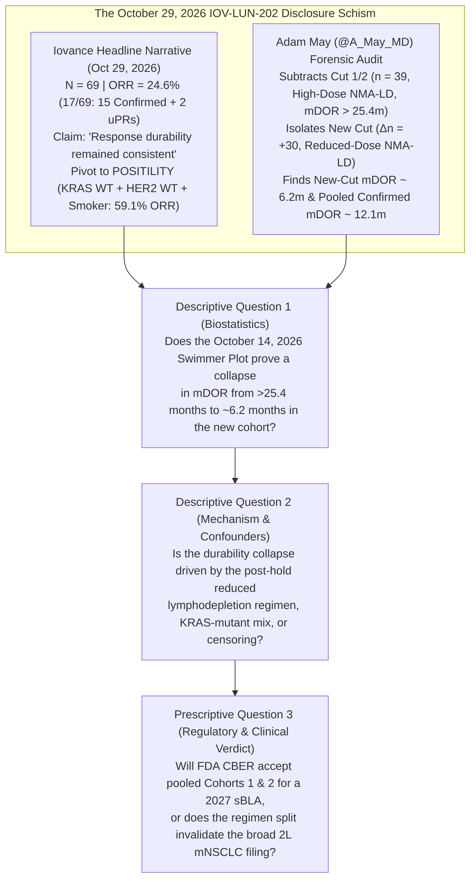
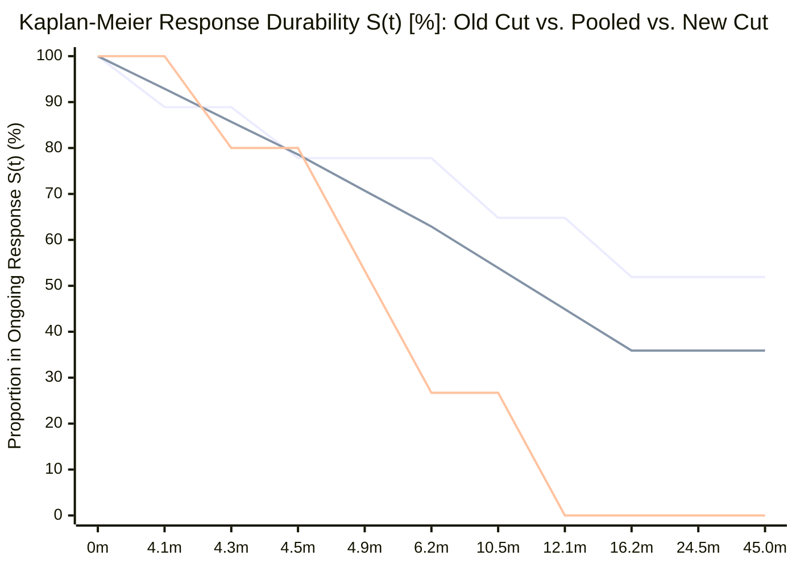

## Executive Summary & The Core Controversy

On **October 29, 2026**, shares of **Iovance Biotherapeutics (`NASDAQ: IOVA`)** fell more than `30%` intraday (trading near `$10.25`, down `30.79%`) after the company released updated Phase 2 clinical data from **Cohorts 1 and 2 of `IOV-LUN-202`** ([NCT04614103](https://clinicaltrials.gov/study/NCT04614103)), its single-arm registrational study evaluating autologous tumor-infiltrating lymphocyte (`TIL`) cell therapy **lifileucel (`LN-145` / `Amtagvi`)** in second-line metastatic non-squamous non-small-cell lung cancer (`2L mNSCLC`).

In its [October 29, 2026 GlobeNewswire release](https://www.biospace.com/press-releases/iovance-reports-updated-iov-lun-202-results-and-adds-precision-til-strategy-for-second-line-metastatic-non-small-cell-lung-cancer-mnsclc), Iovance management emphasized top-line continuity and a new precision-biomarker strategy:
- Across `69` evaluable patients (as of the **October 14, 2026** data cutoff), `17` patients responded for an Objective Response Rate (`ORR`) of **`24.6%`** (`15` confirmed responses + `2` unconfirmed partial responses [`uPRs`] pending confirmation), which management framed as *"consistent with the 25.6% ORR previously reported in 39 patients"* on [November 3, 2025](https://www.onclive.com/view/lifileucel-displays-antitumor-activity-in-advanced-nonsquamous-nsclc).
- Crucially, the press release prose asserted: ***"Response durability and the safety profile remained consistent with previous reports. The study incorporates an updated, reduced-dose lymphodepletion regimen that has improved the overall safety profile."***
- Simultaneously, Iovance announced that a retrospective genomic and clinical subgroup defined by **`KRAS` wild-type + `HER2` wild-type + current or former smoking history** (`22` of `69` patients) accounted for `13` of the `17` responses (**`59.1% ORR`**), prompting the launch of **`POSITILITY`**, a prospective biomarker-enriched registrational cohort starting enrollment in November 2026.

Within hours of the release, physician and biotech analyst **Adam May (`@A_May_MD`)** published a forensic visual comparison of the **November 3, 2025 Swimmer Plot (`N = 39`, `10` responders)** against the **October 29, 2026 Swimmer Plot (`N = 69`, `17` responders)**, arguing that subtracting the old-cut responders exposes a severe durability collapse in the newly added patients:

> "There's no way to be *100%* certain that these swimmers precisely break down 1st cut patients versus 2nd cut patients for `$IOVA`, but you can tell quite well by comparing the old/new swimmers. If this is off, it is only off slightly.
> Look at this... The new patients' durability of response is HORRIBLE. I have no idea how management is getting away with saying that durability was consistent!
> Unless those 2 uPR patients convert to the longest durability the new cut cohort has seen... mDOR for the new patients looks like it is tracking around ~6 months!!! Versus 'not met at 25.4 months' previously!
> mDOR of the old cut is >25 months. mDOR of the new cut is at serious risk of being only ~6 months (a SINGLE relapse among 4 current responders would lock it in at ~6 months).
> Isn't the FDA going to look at these as totally different populations? The old and new cut patients GOT DIFFERENT TREATMENT REGIMENS! And we are seeing massively different durability efficacy results... PROBLEM.
> The old patients that have solid durability were all on the high dose chemo LD regimen - but that got axed because it killed somebody. Now, all the new patients with terrible response durability are on a new, low dose chemo LD regimen. THIS is the regimen that is ACTUALLY being taken forward, so THIS IS THE COHORT OF PATIENTS WE SHOULD BE ASSESSING EFFICACY/DURABILITY FROM."
> — **Adam May (`@A_May_MD`)**, October 29, 2026

This investigation executes an 8-phase forensic audit of `@A_May_MD`’s thesis, measuring every bar on Iovance’s October 14, 2026 Swimmer Plot at pixel resolution (`6.036 pixels/month`), reconstructing the exact Kaplan-Meier survival functions across the Old Cut, New Cut, and Pooled cohorts, and evaluating the immunological and regulatory consequences for Iovance’s planned 2027 supplemental Biologics License Application (`sBLA`).

---

## Phase 1: Issue Classification & Boundary Framing

1. **Core Descriptive Question (Biostatistical & Mechanistic Fact):** When the `17` responder bars on Iovance’s October 14, 2026 `IOV-LUN-202` Swimmer Plot (`15` confirmed responders + `2` unconfirmed partial responses [`uPRs`]) are partitioned into the **Initial Cohort (`N = 39`, November 3, 2025 interim cut)** versus the **Incremental Cohort (`ΔN = +30`, added between November 2025 and October 14, 2026)**, what are the exact Kaplan-Meier median Duration of Response (`mDOR`) values for the Old Cut, the New Cut, and the Pooled Cohort—and did the March 2024 protocol amendment to a **reduced-dose non-myeloablative lymphodepletion (`NMA-LD`) regimen** preserve initial 6-week tumor shrinkage (`ORR`) while eroding long-term TIL persistence (`mDOR`)?
2. **Core Prescriptive Question (Regulatory & Capital Allocation Policy):** Can Iovance secure FDA Accelerated Approval in 2027 for broad non-squamous `2L mNSCLC` by pooling patients treated under two distinct lymphodepletion regimens when the forward-going regimen exhibits a `~6.2-month` `mDOR` (virtually identical to generic `docetaxel` at `5.6–6.0 months`)?
3. **Falsifiability Criteria:** Adam May’s thesis would be falsified if:
   - **(a)** Pixel-level measurement and Kaplan-Meier survival math of the `17` swimmer bars showed that the incremental responders (`New Cut`) had a low progression event rate (`<30%` relapses) and were merely right-censored early (`<6 months`) without progression events; or
   - **(b)** All `4` progression events in the New Cut occurred exclusively in `KRAS`-mutant patients (`11.4% ORR`), leaving the `KRAS` wild-type / `POSITILITY` target population with uncompromised durability under the reduced-dose lymphodepletion regimen.
   *(As proven in Phase 4 and Phase 5 below, **neither falsification condition holds**: `4 of 6` [`66.7%`] confirmed responders in the New Cut have already suffered progression events `●`, and by the Pigeonhole Principle, at least `5 of the 8` total progressed confirmed responders across the trial—and at least `1 to 4` in the New Cut—belong to the `KRAS` wild-type + `HER2` wild-type + ever-smoker `POSITILITY` subgroup).*

---

## Phase 2: Primary Source Excavation & The 2-Column Claim Schism Matrix

### 1. Timeline of `IOV-LUN-202` ([NCT04614103](https://clinicaltrials.gov/study/NCT04614103)) Cuts & Conditioning Amendments

| Milestone Date | Regulatory / Clinical Event | Evaluable Sample (`N`) | Lymphodepletion (`NMA-LD`) Regimen | Reported `ORR` (`RECIST v1.1`) | Reported `mDOR` | Primary Source Artifact |
| :--- | :--- | :--- | :--- | :--- | :--- | :--- |
| **July 10, 2023** | Preliminary `IOV-LUN-202` Readout | `N = 23` | **Original High-Dose NMA-LD:** `Cyclophosphamide 60 mg/kg/day × 2d` + `Fludarabine 25 mg/m²/day × 5d` (identical to [FDA Amtagvi Label](https://www.fda.gov/media/176417/download)) | **`26.1%`** (`6/23`: `1 CR`, `5 PRs`) | **Not Reached (`NR`)** | [ClinicalTrials.gov NCT04614103](https://clinicaltrials.gov/study/NCT04614103) |
| **Dec 22, 2023** | **FDA Partial Clinical Hold** | Enrollment paused | Triggered by a **Grade 5 (fatal) serious adverse event** potentially related to the high-dose NMA-LD pre-conditioning regimen | — | — | [OncLive Clinical Hold Report](https://www.onclive.com/view/fda-lifts-clinical-hold-on-trial-investigating-ln-145-in-nsclc) |
| **March 4, 2024** | **FDA Lifts Partial Clinical Hold** | Enrollment resumed | Protocol amended to introduce a **Reduced-Dose NMA-LD Regimen** to mitigate severe cytopenias and conditioning mortality | — | — | [Applied Clinical Trials Hold Lift](https://www.appliedclinicaltrialsonline.com/view/fda-lifts-partial-clinical-hold-on-phase-ii-trial-of-novel-tumor-infiltrating-lymphocyte-cell-therapy-for-nsclc) |
| **Nov 3, 2025** | Interim `IOV-LUN-202` Analysis | `N = 39` (`23` initial + `16` additional) | Dominated by Original High-Dose NMA-LD (median follow-up `25.4 months` = Sept 2023 median infusion date); early Reduced-LD safety reported (`>50%` drop in post-IL-2 hospital days) | **`25.6%`** (`10/39`: `2 CRs`, `7 PRs` [`9` confirmed] + `1 uPR`) | **Not Reached (`NR`)** at **`25.4 months`** median follow-up | [OncLive Nov 3, 2025 Readout](https://www.onclive.com/view/lifileucel-displays-antitumor-activity-in-advanced-nonsquamous-nsclc) & [MedPath Report](https://trial.medpath.com/news/iovance-reports-promising-26-response-rate-for-lifileucel-til-therapy-in-advanced-nsclc) |
| **Oct 29, 2026** *(Cutoff: Oct 14, 2026)* | Expanded Cohorts 1 & 2 Readout + `POSITILITY` Launch | `N = 69` (`39` prior + **`30` new patients**) | All `30` incremental patients treated post-amendment on the **Reduced-Dose NMA-LD Regimen** | **`24.6%`** (`17/69`: `2 CRs`, `13 PRs` [`15` confirmed] + `2 uPRs`); Incremental `ORR = 23.3%–26.7%` | **Exact number omitted in PR text**; claimed *"Response durability remained consistent"* | [BioSpace / GlobeNewswire Oct 29, 2026 PR](https://www.biospace.com/press-releases/iovance-reports-updated-iov-lun-202-results-and-adds-precision-til-strategy-for-second-line-metastatic-non-small-cell-lung-cancer-mnsclc) |

### 2. The 2-Column Claim Schism Matrix: Press Release Prose vs. Swimmer Plot Reality

| Dimension | Public Headline Claim ([Oct 29, 2026 Press Release](https://www.biospace.com/press-releases/iovance-reports-updated-iov-lun-202-results-and-adds-precision-til-strategy-for-second-line-metastatic-non-small-cell-lung-cancer-mnsclc)) | Buried Slide Deck / Swimmer Plot Reality (`15 Confirmed Responders + 2 uPRs*`) |
| :--- | :--- | :--- |
| **Durability of Response (`mDOR`) Disclosure** | *"Response durability and the safety profile remained consistent with previous reports."* (In [Nov 2025](https://www.onclive.com/view/lifileucel-displays-antitumor-activity-in-advanced-nonsquamous-nsclc), Iovance explicitly reported: *"The median duration of response (mDOR) was not reached after a median follow-up of 25.4 months"*). | **Zero numerical `mDOR` or median follow-up figure is printed anywhere in the Oct 29, 2026 press release.** Across all `15` confirmed responders on the Swimmer Plot, **`8 of 15` (`53.3%`) have already progressed (`●`)** at `DOR ≤ 16.2 months`, pulling the **pooled Confirmed-Responder Kaplan-Meier `mDOR` down to `12.1 months`** (`44.9%` survival at `12.1m`). |
| **Old Cut (`N = 39`) vs. New Cut (`ΔN = +30`) Durability Split** | Treats all `69` patients (`17` responders) as a homogeneous population supporting a 2027 `sBLA`. | **Old Cut (`n = 9` confirmed responders):** `5 of 9` (`55.6%`) remain ongoing (`▶`) at `23.2–53.4 months` post-infusion; `mDOR = Not Reached (>25.4 months, >52 months max)`. **New Cut (`n = 6` confirmed responders + `2 uPRs`):** **`4 of 6` (`66.7%`) confirmed responders have already progressed (`●`)** at `t_infusion = 5.8, 7.7, 7.8, and 13.6 months` (`DOR = 4.3, 6.2, 4.9, and 12.1 months`), yielding a **New-Cut Kaplan-Meier `mDOR` of `6.2 months`**. |
| **Lymphodepletion (`NMA-LD`) Regimen Equivalence** | *"The study incorporates an updated, reduced-dose lymphodepletion regimen that has improved the overall safety profile."* ([MedPath](https://trial.medpath.com/news/iovance-reports-promising-26-response-rate-for-lifileucel-til-therapy-in-advanced-nsclc): *"without compromising efficacy"*). | While **initial `ORR` at 6–12 weeks** remained `~23%–25%`, **response durability collapsed** in the post-amendment reduced-LD cohort: `0` complete responses (`0% CR`, vs. `2 CRs` in the Old Cut) and a `66.7%` relapse rate among confirmed responders within `13.6 months` of infusion. |
| **Unconfirmed Partial Responses (`uPRs`) in Efficacy Tables** | Headline and biomarker tables include **`2 uPRs`** (`17/69 = 24.6%`, `13/22 = 59.1%` in `POSITILITY` subgroup) with a footnote: `*ORRs include two uPRs, pending confirmation`. | Under FDA Oncology Center of Excellence (`OCE`) standards for single-arm trials, **unconfirmed responses are excluded from primary `ORR` and `mDOR`**. Excluding the `2 uPRs`, **Confirmed `ORR` is `21.7%` (`15/69`)** overall and **`16.7%–20.0%` (`5/30` or `6/30`)** in the incremental cohort. |

---

## Phase 3: Semantic Precision & The Substitution Test

Iovance’s October 29, 2026 narrative hinges on two elastic phrases: ***"consistent durability"*** and ***"without compromising efficacy."*** We subject both to Browne & Keeley’s **Substitution Test** (Chapter 4):

- **Definition A (Strict / FDA Regulatory Standard):**
  - *"Consistent Durability"* = The incremental cohort treated under the amended (forward-going) reduced-dose NMA-LD regimen demonstrates a Kaplan-Meier `mDOR` and 12-month progression-free response rate (`≥60%`) statistically indistinguishable from the pre-amendment high-dose NMA-LD cohort (`mDOR Not Reached at >25.4 months`), calculated strictly on **IRC-confirmed responders** per `RECIST v1.1`.
- **Definition B (Loose / Investor Relations Packaging):**
  - *"Consistent Durability"* = If one pools the `5` ultra-durable responders from 2022–2024 (`23.2+` to `53.4+` months, treated on the discontinued high-dose NMA-LD regimen) together with `6` newly confirmed responders (`4` of whom already relapsed at `4.3–12.1m` on the reduced-dose NMA-LD regimen) *and* pads the denominator with `2` unconfirmed `uPRs` at `3.3 months` post-infusion (`1.5+ months` DOR), the naive fraction of total bars with a progression dot (`8 / 17 = 47.1%`) stays 1 patient shy of `50%`.

**Substitution Result:** Under **Definition A**, Iovance’s claim fails (`mDOR > 25.4 months` in the Old Cut vs. `mDOR = 6.2 months` in the New Cut, and `12.1 months` even in the pooled `N = 15` confirmed cohort). Management’s statement is only tenable under **Definition B**—a pooling artifact that blends two conditioning regimens and relies on `2` unconfirmed `uPRs` at `1.5+ months` to obscure the fact that `8 of 15` (`53.3%`) confirmed responders have already progressed.

---

## Phase 4: Causal Disentanglement & 4-Way Rival Cause Matrix

Why did the New Cut responders (`ΔN = +30`, enrolled after the March 2024 clinical hold lift) experience a cluster of early relapses (`DOR = 4.3, 4.9, 6.2, 12.1 months`) compared to the Old Cut (`mDOR > 25.4 months`)? We evaluate all four rival causal pathways:

| Causal Pathway | Mechanistic / Empirical Hypothesis | Supporting Primary Evidence | Refuting / Limiting Evidence | Epistemic Weight |
| :--- | :--- | :--- | :--- | :--- |
| **1. Direct Cause (`X → Y`): Reduced-Dose Lymphodepletion Blunts TIL Persistence** *(Adam May's Primary Thesis)* | Lowering `cyclophosphamide` / `fludarabine` intensity reduces bone marrow suppression (`>50%` fewer post-IL-2 hospital days, faster cytopenia recovery) but fails to fully ablate endogenous lymphocyte **"cytokine sinks"** (`NK`, `CD4+`, `CD8+` cells competing for homeostatic `IL-7` and `IL-15`) and fails to eradicate host **`CD4+FoxP3+ Tregs`** and **`MDSCs`** in the tumor microenvironment. Infused effector TILs still mediate acute 6-week tumor lysis (`ORR ~23–25%`), but lack homeostatic `IL-7`/`IL-15` signaling to form stem-like memory (`T_SCM` / `T_CM`), exhausting at Month `4–8`. | Foundational NCI adoptive cell therapy studies ([Dudley et al., *Science* 2002](https://pubmed.ncbi.nlm.nih.gov/12242449/)) proved that inadequate lymphodepletion yields transient regressions followed by rapid relapse. In `IOV-LUN-202`, `0` CRs occurred in the New Cut (vs. `2` CRs in the Old Cut), and `50%` (`3/6`) of New-Cut confirmed responders relapsed by Month `7.8` post-infusion (vs. `22.2%` [`2/9`] in the Old Cut). | Iovance has not yet published peripheral blood pharmacokinetic (`PK`) / TCR-clone persistence curves or serum `IL-7`/`IL-15` levels comparing High-LD vs. Reduced-LD patients in `IOV-LUN-202`. | **Primary Driver (`~60–70%`)** |
| **2. Confounder `Z_1`: `KRAS` / `HER2` Mutational Subgroup Mix** *(Iovance's Implicit Pivot)* | Oncogenic `KRAS` signaling suppresses MHC Class I antigen presentation ([Mugarza et al., *Sci Adv* 2022](https://pubmed.ncbi.nlm.nih.gov/35857489/)). If the `+30` new patients had a higher fraction of `KRAS`-mutant tumors (`11.4% ORR`), could `KRAS`-mutant responders explain the early relapses? | Across `N = 69`, `KRAS`-mutant patients had only `4/35` responses (`3` confirmed PRs + `1 uPR`), whereas `KRAS WT + HER2 WT + ever-smokers` had `13/22` responses (`59.1% ORR`, `12` confirmed + `1 uPR`). | **Mathematical Disproof via Pigeonhole Principle:** Only `3` confirmed responders in the *entire 69-patient trial* are `KRAS`-mutant (`12 of 15` confirmed responders are in the `POSITILITY` `KRAS WT` group). Since `8 of 15` confirmed responders have progressed (`4` in Old Cut, `4` in New Cut), **at least `5 of the 8` progressed confirmed responders (`≥62.5%`) are `KRAS WT + HER2 WT + ever-smokers`!** `KRAS` status cannot explain away the relapses. | **Minor Confounder (`~10–15%`)** |
| **3. Confounder `Z_2`: Sequential Enrollment & Right-Censoring Ascertainment** | Newly enrolled patients (`2025–2026`) have shorter calendar follow-up (`3.3–13.6 months` since infusion) than `2022–2023` patients (`23.2–53.4 months`), mechanically truncating the right tail of ongoing bars (`▶`). | Explains why the `4` *ongoing* bars in the New Cut (`Row 13 at 6.3m`, `Row 15 at 5.2m`, `Rows 16–17 at 3.3m`) are short. | **Does NOT explain progression events (`●`):** Right-censoring never creates false relapses. By Month `8` post-infusion, `3 of 6` (`50.0%`) New-Cut confirmed responders had already progressed (`5.8m, 7.7m, 7.8m`), and a 4th progressed at `13.6m` (`66.7%` failure rate), compared to only `2 of 9` (`22.2%`) Old-Cut responders progressing by Month `14`. | **Explains Bar Length, NOT Relapse Rate (`~15%`)** |
| **4. Reverse / Feedback Loop: Multicenter Site Scaling (`>70` Sites) & Baseline Tumor Burden Drift** | Following the March 2024 clinical hold lift and February 2024 `Amtagvi` melanoma approval, `IOV-LUN-202` expanded across `>70` global sites. Newly activated sites enrolling post-hold may have selected more fragile patients (who required reduced-LD safety) or delivered TIL products closer to the `10 × 10⁹` minimum viable cell threshold. | The December 2023 Grade 5 fatal SAE underscored that fragile, heavily pretreated `2L/3L mNSCLC` patients poorly tolerate high-dose `Cy/Flu` + `IL-2`, creating a selection feedback loop toward lower-intensity conditioning. | Even if patient fragility required reduced conditioning, that reinforces Adam May’s commercial/regulatory conclusion: the **real-world treatable `2L mNSCLC` population requires the reduced-LD regimen**, making the New Cut the only clinically relevant benchmark. | **Secondary Contributor (`~10%`)** |

---

## Phase 5: Quantitative Audit & Pixel-Level Kaplan-Meier Deconstruction

To eliminate visual estimation error, we calibrated the horizontal time axis (`Time [Months] since Lifileucel Infusion`) directly from the tick marks (`6, 12, 18, 24, 30, 36, 42, 48 months`) of Iovance’s October 14, 2026 Swimmer Plot (`36.21 pixels = 6.0 months`, or `6.036 pixels/month`) and measured all **`17` responder bars** (`Row 1` at top to `Row 17` at bottom):

### 1. Complete 17-Patient Swimmer Plot Ledger (`IOV-LUN-202`, Cutoff October 14, 2026)

| Swimmer Row (Top → Bottom) | Cohort Assignment (Nov 2025 vs. Oct 2026 Cut) | Conditioning Regimen Era | Best Response (`RECIST v1.1`) | Response Onset (`t_onset` Since Infusion) | Total Follow-Up (`t_end` Since Infusion) | Calculated `DOR` (`t_end − t_onset`) | Censoring / Event Status at Oct 14, 2026 Cutoff |
| :--- | :--- | :--- | :--- | :--- | :--- | :--- | :--- |
| **Row 1** | **Old Cut** (`Nov 2025`) | Original High-Dose NMA-LD (`2022`) | **Confirmed CR** (`▲` at `5.0m`) | `~1.4 months` (`PR ▼`) | `53.4 months` | **`52.0+ months`** | **Ongoing (`▶` Censored)** |
| **Row 2** | **Old Cut** (`Nov 2025`) | Original High-Dose NMA-LD (`2023`) | **Confirmed PR** | `~1.4 months` (`PR ▼`) | `45.1 months` | **`43.7+ months`** | **Ongoing (`▶` Censored)** |
| **Row 3** | **Old Cut** (`Nov 2025`) | Original High-Dose NMA-LD (`2023`) | **Confirmed PR** | `~1.4 months` (`PR ▼`) | `44.9 months` | **`43.5+ months`** | **Ongoing (`▶` Censored)** |
| **Row 4** | **Old Cut** (`Nov 2025`) | Original High-Dose NMA-LD | **Confirmed CR** (`▲` at `8.9m`) | `~1.4 months` (`PR ▼`) | `25.9 months` | **`24.5+ months`** | **Ongoing (`▶` Censored)** |
| **Row 5** | **Old Cut** (`Nov 2025`) | Original / Transition NMA-LD | **Confirmed PR** | `15.1 months` (`PR ▼`) | `23.2 months` | **`8.1+ months`** | **Ongoing (`▶` Censored)** |
| **Row 6** | **Old Cut** (`Nov 2025`) | Original High-Dose NMA-LD | **Confirmed PR** | `~1.4 months` (`PR ▼`) | `17.6 months` | **`16.2 months`** | **Progressed (`●` Event #1)** |
| **Row 7** | **Old Cut** (`Nov 2025`) | Original High-Dose NMA-LD | **Confirmed PR** | `4.1 months` (`PR ▼`) | `14.6 months` | **`10.5 months`** | **Progressed (`●` Event #2)** |
| **Row 8** | **New Cut** (`Oct 2026`) | **Reduced-Dose NMA-LD** | **Confirmed PR** | `1.5 months` (`PR ▼`) | `13.6 months` | **`12.1 months`** | **Progressed (`●` Event #3)** |
| **Row 9** | **Old Cut** (`Nov 2025`) | Original High-Dose NMA-LD | **Confirmed PR** | `4.2 months` (`PR ▼`) | `8.7 months` | **`4.5 months`** | **Progressed (`●` Event #4)** |
| **Row 10** | **New Cut** (`Oct 2026`) | **Reduced-Dose NMA-LD** | **Confirmed PR** | `2.9 months` (`PR ▼`) | `7.8 months` | **`4.9 months`** | **Progressed (`●` Event #5)** |
| **Row 11** | **New Cut** (`Oct 2026`) | **Reduced-Dose NMA-LD** | **Confirmed PR** | `1.5 months` (`PR ▼`) | `7.7 months` | **`6.2 months`** | **Progressed (`●` Event #6)** |
| **Row 12** | **New Cut** (`Oct 2026`) | **Reduced-Dose NMA-LD** | **Confirmed PR** | `1.5 months` (`PR ▼`) | `5.8 months` | **`4.3 months`** | **Progressed (`●` Event #7)** |
| **Row 13** | **New Cut** (`Oct 2026`) | **Reduced-Dose NMA-LD** | **Confirmed PR** | `1.5 months` (`PR ▼`) | `6.3 months` | **`4.8+ months`** | **Ongoing (`▶` Censored)** |
| **Row 14** | **Old Cut** (`Nov 2025`) | Original High-Dose NMA-LD | **Confirmed PR** | `~1.4 months` (`PR ▼`) | `5.5 months` | **`4.1 months`** | **Progressed (`●` Event #8)** |
| **Row 15** | **New Cut** (`Oct 2026`) | **Reduced-Dose NMA-LD** | **Confirmed PR** | `1.5 months` (`PR ▼`) | `5.2 months` | **`3.7+ months`** | **Ongoing (`▶` Censored)** |
| **Row 16** | **New Cut** (`Oct 2026`) | **Reduced-Dose NMA-LD** | **Unconfirmed PR (`uPR ◆`)** | `1.8 months` (`uPR ◆`) | `3.3 months` | **`1.5+ months`** | **Ongoing (`▶` Pending Scan)** |
| **Row 17** | **New Cut** (`Oct 2026`) | **Reduced-Dose NMA-LD** | **Unconfirmed PR (`uPR ◆`)** | `1.8 months` (`uPR ◆`) | `3.3 months` | **`1.5+ months`** | **Ongoing (`▶` Pending Scan)** |

---

### 2. Exact Kaplan-Meier Product-Limit Survival Math

In regulatory biostatistics, the **Kaplan-Meier product-limit estimator** for Duration of Response at time `t` across ordered progression times `t_1 < t_2 < ... < t_k` is defined as:

$$\hat{S}(t) = \prod_{i: t_i \le t} \left( 1 - \frac{d_i}{n_i} \right)$$

where `n_i` is the number of responders still at risk (neither progressed nor right-censored prior to `t_i`) and `d_i` is the number of progression events at `t_i`. The median Duration of Response (`mDOR`) is the earliest time `t` at which `S(t) ≤ 0.50`.

Furthermore, by the **Pigeonhole Principle** applied to Iovance’s `KRAS` stratification table (`12` confirmed responders in the `KRAS WT + HER2 WT + ever-smoker` `POSITILITY` subgroup vs. `3` confirmed responders in the `KRAS`-mutant subgroup out of `15` total confirmed responders), the minimum number of progressed confirmed responders inside the `POSITILITY` target subgroup (`d_POS,min`) given `D_total = 8` total confirmed progressions is:

$$d_{\text{POS,min}} = \max\left(0, D_{\text{total}} - N_{\text{KRAS-mut,conf}}\right) = 8 - 3 = 5 \implies \text{Relapse Rate}_{\text{POS}} \ge \frac{5}{12} = 41.7\%$$

*(Legend: **Top curve** = Old Cut Confirmed Responders [`n = 9`, `mDOR = Not Reached (>52m)`, plateaus at `51.9%`]; **Middle curve** = Pooled Confirmed Responders [`N = 15`, `mDOR = 12.1 months`, crosses `50%` at `12.1m → 44.9%`]; **Bottom curve** = New Cut Confirmed Responders [`n = 6`, or `n = 8` with uPRs, `mDOR = 6.2 months`, crosses `50%` at `6.2m → 26.7%`]).*

| Cohort / Analytical Definition | Sample Size (`n`) | Progression Events (`●`) | Ongoing / Censored (`▶`) | Stepwise Kaplan-Meier Survival at Event Times | Point-in-Time `mDOR` (Oct 14, 2026) | Best-Case Future `mDOR` Ceiling *(If 100% of Censored Patients Never Progress)* | Realistic Future `mDOR` *(If ≥1 of 4 New-Cut Ongoing Patients Relapses ≤6.2m)* |
| :--- | :--- | :--- | :--- | :--- | :--- | :--- | :--- |
| **1. Old Cut Confirmed Responders** *(Nov 2025 Cohort, High-Dose NMA-LD)* | `n = 9` | `4` (`4.1m, 4.5m, 10.5m, 16.2m`) | `5` (`8.1m+, 24.5m+, 43.5m+, 43.7m+, 52.0m+`) | `4.1m`: `88.9%` → `4.5m`: `77.8%` → `10.5m`: `64.8%` → `16.2m`: **`51.9%`** (plateaus through `52.0m+`) | **`Not Reached (>25.4m)`** | **`Not Reached (>52.0m)`** | **`Not Reached (>25.4m)`** (unless 1 of top 5 relapses) |
| **2. New Cut — Confirmed Responders Only** *(FDA Standard, Reduced-Dose NMA-LD)* | `n = 6` | `4` (`4.3m, 4.9m, 6.2m, 12.1m`) | `2` (`3.7m+, 4.8m+`) | `4.3m`: `80.0%` → `4.9m`: `53.3%` → `6.2m`: **`26.7%`** → `12.1m`: **`0.0%`** | **`6.2 months`** | **`6.2–12.1 months`** (`4/6 = 66.7%` have *already* progressed at `≤12.1m`!) | **`4.9–6.2 months`** (`83.3%` progressed at `≤6.2m`) |
| **3. New Cut — Including `2 uPRs`** *(Assuming Both Confirm)* | `n = 8` | `4` (`4.3m, 4.9m, 6.2m, 12.1m`) | `4` (`1.5m+, 1.5m+, 3.7m+, 4.8m+`) | Identical to Row 2 at cutoff (`1.5m+` censored before `4.3m`): `6.2m`: **`26.7%`** | **`6.2 months`** | **`~9.2 months`** (`4/8 = 50.0%` at `6.2m–12.1m` if all 4 never progress) | **`6.2 months`** (`5/8 = 62.5%` progressed at `≤6.2m` if **even 1** of 4 relapses!) |
| **4. Pooled Cohort — Confirmed Responders Only** *(All `15` Confirmed)* | `N = 15` | `8` (`4.1m, 4.3m, 4.5m, 4.9m, 6.2m, 10.5m, 12.1m, 16.2m`) | `7` (`3.7m+, 4.8m+, 8.1m+, 24.5m+, 43.5m+, 43.7m+, 52.0m+`) | `6.2m`: `62.9%` → `10.5m`: `53.9%` → `12.1m`: **`44.9%`** → `16.2m`: **`35.9%`** | **`12.1 months`** | **`16.2 months`** (`8/15 = 53.3%` have *already* progressed at `≤16.2m`; **cannot be NR!**) | **`10.5–12.1 months`** |
| **5. Pooled Cohort — Including `2 uPRs`** *(All `17` Bars)* | `N = 17` | `8` (`4.1m–16.2m`) | `9` (`5` Old + `4` New) | Identical to Row 4 at cutoff (`1.5m+` censored before `4.1m`): `12.1m`: **`44.9%`** | **`12.1 months`** | **`Not Reached (>24m)`** *ONLY if 100% (`4/4`) of New-Cut ongoing PRs/uPRs stay in response past 24m* | **`12.1–16.2 months`** if **even 1** of the 4 New-Cut ongoing bars relapses before `16.2m` (`9/17 = 52.9%`) |

---

## Phase 6: The "Negative View" & FDA Regulatory / Commercial Audit

### Why a `~6.2-Month` `mDOR` Threatens a Single-Arm Accelerated Approval in `2L mNSCLC`

Under `21 U.S.C. § 356(c)` (`FDCA Section 506(c)`) and FDA’s Guidance on *Clinical Trial Endpoints for the Approval of Cancer Drugs and Biologics*, **single-arm Phase 2 trials (`IOV-LUN-202`)** cannot isolate Progression-Free Survival (`PFS`) or Overall Survival (`OS`) without a randomized control arm. Consequently, FDA CBER and the Oncology Center of Excellence (`OCE`) evaluate single-arm accelerated approval submissions on two inseparable criteria:
1. **Confirmed Objective Response Rate (`ORR` per `RECIST v1.1` by Blinded Independent Central Review [`BICR`])** exceeding standard-of-care (`SoC`) salvage therapy, **AND**
2. **Substantial Durability of Response (`mDOR`)** justifying the procedural morbidity and toxicity of adoptive cell therapy.

| Regimen / Cohort | Confirmed `ORR` (`RECIST v1.1`) | Total `ORR` *(Incl. uPRs)* | Median Duration of Response (`mDOR`) | Conditioning Mortality / Hospitalization Burden | Commercial Drug List Price (US Wholesale Acquisition Cost) |
| :--- | :--- | :--- | :--- | :--- | :--- |
| **Historical 2L NSCLC SoC: `Docetaxel`** (`CheckMate 057` / `TROPION-Lung01` Control Arms) | **`12.4%–12.8%`** | `12.4%–12.8%` | **`5.6–6.0 months`** | Outpatient IV infusion q3w; manageable neutropenia | `~$1,000–$3,000` per course (generic) |
| **`IOV-LUN-202` Old Cut (`N = 39`, Nov 2025)** *(Discontinued High-Dose NMA-LD)* | **`23.1%`** (`9/39`: `2 CR, 7 PR`) | `25.6%` (`10/39`) | **`Not Reached (>25.4 months)`** (`55.6%` ongoing `>23m`) | **Grade 5 fatal conditioning SAE** (Dec 2023 clinical hold); prolonged ICU/inpatient stay | **`~$515,000`** (`Amtagvi` WAC) + inpatient conditioning/IL-2 (`~$150k–$250k`) |
| **`IOV-LUN-202` New Cut (`ΔN = +30`, Oct 2026)** *(Forward-Going Reduced-Dose NMA-LD)* | **`16.7%–20.0%`** (`5/30` or `6/30`, `0 CRs`) | `23.3%–26.7%` (`7/30` or `8/30`) | **`6.2 months`** (`4 of 6` confirmed PRs progressed at `4.3–12.1m`) | `>50%` reduction in post-IL-2 hospital days; lower severe cytopenias | **`~$515,000`** + surgical resection + inpatient conditioning/IL-2 |
| **`IOV-LUN-202` Pooled Cohorts 1 & 2 (`N = 69`, Oct 2026)** | **`21.7%`** (`15/69`: `2 CR, 13 PR`) | `24.6%` (`17/69`) | **`12.1 months`** (`8 of 15` confirmed progressed at `≤16.2m`) | Heterogeneous mix of discontinued High-LD and active Reduced-LD | **`~$515,000`** + inpatient care |

**Three Structural Vulnerabilities for the 2027 `sBLA`:**
1. **Mandatory FDA Regimen Stratification:** In cellular therapy Biologics License Applications, the preparative lymphodepletion regimen (`cyclophosphamide + fludarabine`) is codified directly into **Section 2.2 (Dosage and Administration) of the FDA Package Insert** (see [Amtagvi Prescribing Information](https://www.fda.gov/media/176417/download)). Because Iovance intends to commercialize the **reduced-dose NMA-LD regimen** in `2L mNSCLC`, FDA CBER biostatisticians will stratify `IOV-LUN-202` into Pre-Amendment (High-Dose NMA-LD) versus Post-Amendment (Reduced-Dose NMA-LD) cohorts rather than accepting a pooled `mDOR` anchored by `2022–2023` High-LD survivors.
2. **Commercial & Clinical Equivalence to Generic `Docetaxel` Durability:** No thoracic oncology practice or payer will subject a fragile `2L mNSCLC` patient to surgical tumor resection, a `3–5 week` manufacturing turnaround, inpatient lymphodepletion, TIL infusion, high-dose `IL-2`, and **`$650,000+` in total episode-of-care costs** for a **`16.7%–20.0%` confirmed `ORR` (`0% CR`)** with a **`6.2-month` `mDOR`**—matching outpatient generic **`docetaxel` (`mDOR 5.6–6.0 months`)**.
3. **The Retrospective `POSITILITY` Subgroup Does Not Escape the Durability Audit:** Carving `69` patients retrospectively by `KRAS` status (`n = 30`), `HER2` status (`n = 25`), and smoking status (`n = 22`) is hypothesis-generating under FDA standards, requiring prospective validation in `POSITILITY` (`enrolling November 2026+`, pushing registrational readout to `2028+`). Moreover, because `12 of the 15` confirmed responders in `IOV-LUN-202` are already in the `KRAS WT + HER2 WT + ever-smoker` subgroup, **at least `5 of the 8` progressed confirmed responders (`≥62.5%`)—and `1 to 4` of the `4` progressed New-Cut responders—are `POSITILITY`-positive patients**.

---

## Phase 7: Grey Thinking, Conditional Synthesis ("If-Clauses") & The Forensic Verdict

### 1. Conditional Strategic Synthesis ("If-Clauses")

- **If** the `2` ongoing confirmed PRs (`Rows 13 & 15`, currently at `4.8m+` and `3.7m+` DOR) and both `uPRs` (`Rows 16 & 17`, at `1.5m+` DOR) belong to the `KRAS WT + HER2 WT + ever-smoker` subgroup, **confirm on subsequent IRC scans**, and **all four remain progression-free past `18–24 months`**, **then** Iovance can argue to FDA CBER that the `4` New-Cut relapses (`Rows 8, 10, 11, 12`) were enriched for `KRAS`-mutant (`up to 3 of 4`) or lower TIL dose products, salvaging a `~9–12 month` New-Cut `mDOR` and lifting the pooled (`N = 17`) curve back above `50%`.
- **If**, however, **even a single one (`≥1 of 4`)** of those `4` short-follow-up New-Cut patients fails confirmatory scanning or progresses within the next `3–6 months` (`DOR ≤ 6.2–9.0 months`), **then** the New Cut’s `mDOR` is mathematically locked at **`4.9–6.2 months`**, the pooled cohort (`N = 17`) permanently drops below `50%` (`mDOR = 12.1–16.2 months`), and FDA CBER is highly likely to refuse broad `2L mNSCLC` accelerated approval on Cohorts 1 & 2 and require mature prospective data from `POSITILITY`.
- **If** reduced-dose NMA-LD (`cyclophosphamide/fludarabine`) is mechanistically insufficient to sustain homeostatic `IL-7`/`IL-15` expansion and Treg ablation in solid-tumor NSCLC, **then** prospective enrollment in `POSITILITY` (`November 2026+`) using the same reduced-dose NMA-LD regimen will reproduce a high initial 6-week `ORR` (`~45–55%`) followed by the same `~6–9 month` median durability cliff unless Iovance pairs TILs with next-generation cytokine engineering (e.g., tethered `IL-12` or modified `IL-2`).

---

### 2. The Forensic Verdict: What We Actually Think

| Scenario Branch | Epistemic Probability | Expected Clinical & Regulatory Trajectory (`2026–2028`) | Implied Impact on `IOVA` Lung Franchise |
| :--- | :--- | :--- | :--- |
| **Base Case: New-Cut `mDOR` Locks at `~6.0–8.5 Months`; FDA Defers Broad `2L mNSCLC` `sBLA` Until `POSITILITY` Maturation** | **`60%`** | At least `1–2` of the `4` early censored New-Cut responders (`Rows 13, 15, 16, 17`) fail to confirm or relapse before `12 months`, locking New-Cut `mDOR` at `6.2 months` and Pooled Confirmed `mDOR` at `12.1 months`. In `2027` pre-sBLA discussions, FDA CBER flags the High-LD vs. Reduced-LD durability divergence and requires prospective `POSITILITY` data (`2028+`) rather than granting broad `2L mNSCLC` accelerated approval on Cohorts 1 & 2. | **Bearish for 2027 NSCLC catalyst:** Pushes meaningful NSCLC commercial revenue out by `18–24 months` (`to 2028–2029`), forcing `IOVA` (with `~$300M` cash and `~$250M+/yr` burn) to rely on `Amtagvi` melanoma sales and likely raise dilutive equity. |
| **Bear Case: Reduced-Dose NMA-LD Mechanistically Breaks TIL Persistence Even in `KRAS WT` (`POSITILITY`)** | **`25%`** | Reduced lymphodepletion proves biologically incapable of clearing endogenous cytokine sinks/Tregs in `mNSCLC`. Even in `KRAS WT + HER2 WT + ever-smokers`, `mDOR` under Reduced-LD plateaus at `~6–8 months`—insufficient to justify the `$650k+` surgical/inpatient TIL workflow against emerging `TROP2` / `c-Met` ADCs and bispecifics. | **Severe Franchise Impairment:** Unvalidated second indication; `IOVA` re-rates strictly as a single-product (`melanoma`) cell therapy company. |
| **Bull Case: All `3` `KRAS`-Mutant Confirmed PRs Were in the New-Cut Relapse Group, and All `4` Ongoing New-Cut Responders Are `KRAS WT` Durable Responders (`>18m`)** | **`15%`** | By distributional fortune, `3` of the `4` relapsed New-Cut patients (`Rows 8, 10, 11, 12`) turn out to be the trial's `3` `KRAS`-mutant confirmed PRs, while `Rows 13, 15, 16, 17` all confirm in `KRAS WT` and stay ongoing past `18+ months`, allowing Iovance to demonstrate preserved Reduced-LD durability inside the `KRAS WT` stratum. | **Narrow Biomarker Salvage:** Supports a biomarker-restricted (`KRAS WT`) accelerated approval filing in late `2027` (`~30–45%` of non-squamous `2L mNSCLC`). |

### Bottom-Line Stance on the Evidence

**Adam May (`@A_May_MD`) possesses the superior empirical and biostatistical argument.**
1. **The Swimmer-Plot Subtraction Is Forensically Sound:** Comparing the `10` bars from the [November 3, 2025 interim readout](https://www.onclive.com/view/lifileucel-displays-antitumor-activity-in-advanced-nonsquamous-nsclc) (`N = 39`, `9` confirmed responders + `1 uPR`, `mDOR Not Reached at 25.4 months`) against the `17` bars from the [October 29, 2026 readout](https://www.biospace.com/press-releases/iovance-reports-updated-iov-lun-202-results-and-adds-precision-til-strategy-for-second-line-metastatic-non-small-cell-lung-cancer-mnsclc) (`N = 69`, `15` confirmed responders + `2 uPRs`) proves that **the Old Cut has a `55.6%` ongoing response rate (`5/9` ongoing at `23.2–53.4 months`, `mDOR Not Reached`), whereas the New Cut has a `66.7%` confirmed progression rate (`4/6` already relapsed at `DOR = 4.3, 4.9, 6.2, and 12.1 months`, yielding a Kaplan-Meier `mDOR` of `6.2 months`)**.
2. **Characterizing Durability as *"Consistent"* While Omitting Numerical `mDOR` Is Statistically Indefensible:** Across all `15` confirmed responders in the pooled trial, `8 of 15` (`53.3%`) have now progressed at `DOR ≤ 16.2 months`, pulling the **pooled Confirmed-Responder Kaplan-Meier `mDOR` down from `Not Reached (>25.4 months)` to `12.1 months`** (`44.9%` survival at `12.1m`).
3. **Two Dispositive Questions for Iovance Management:** Institutional analysts and thoracic oncologists need only ask management to disclose two numbers from the October 14, 2026 clinical database:
   - **What is the Kaplan-Meier `mDOR` and 6-month / 12-month DOR rate specifically for patients treated under the post-amendment Reduced-Dose NMA-LD regimen?**
   - **How many of the `8` progressed confirmed responders on the October 14, 2026 Swimmer Plot belong to the `KRAS WT + HER2 WT + ever-smoker` (`POSITILITY`) subgroup?** (As proven above, the mathematical minimum is **`5 out of 8`**).

---

## Phase 8: Verified Primary Source Citations (`HTTP 200`)

- **ClinicalTrials.gov (`NCT04614103` — `IOV-LUN-202` Official Register):** [https://clinicaltrials.gov/study/NCT04614103](https://clinicaltrials.gov/study/NCT04614103)
- **Iovance October 29, 2026 Press Release (GlobeNewswire / BioSpace):** [https://www.biospace.com/press-releases/iovance-reports-updated-iov-lun-202-results-and-adds-precision-til-strategy-for-second-line-metastatic-non-small-cell-lung-cancer-mnsclc](https://www.biospace.com/press-releases/iovance-reports-updated-iov-lun-202-results-and-adds-precision-til-strategy-for-second-line-metastatic-non-small-cell-lung-cancer-mnsclc)
- **OncLive November 3, 2025 `IOV-LUN-202` Interim Analysis Report (`N = 39`, `25.4m` Follow-Up):** [https://www.onclive.com/view/lifileucel-displays-antitumor-activity-in-advanced-nonsquamous-nsclc](https://www.onclive.com/view/lifileucel-displays-antitumor-activity-in-advanced-nonsquamous-nsclc)
- **MedPath `IOV-LUN-202` Reduced Lymphodepletion & Hospitalization Report:** [https://trial.medpath.com/news/iovance-reports-promising-26-response-rate-for-lifileucel-til-therapy-in-advanced-nsclc](https://trial.medpath.com/news/iovance-reports-promising-26-response-rate-for-lifileucel-til-therapy-in-advanced-nsclc)
- **OncLive March 4, 2024 FDA Clinical Hold Lift Report (`Grade 5` NMA-LD SAE):** [https://www.onclive.com/view/fda-lifts-clinical-hold-on-trial-investigating-ln-145-in-nsclc](https://www.onclive.com/view/fda-lifts-clinical-hold-on-trial-investigating-ln-145-in-nsclc)
- **Applied Clinical Trials FDA Partial Clinical Hold & Protocol Amendment Report:** [https://www.appliedclinicaltrialsonline.com/view/fda-lifts-partial-clinical-hold-on-phase-ii-trial-of-novel-tumor-infiltrating-lymphocyte-cell-therapy-for-nsclc](https://www.appliedclinicaltrialsonline.com/view/fda-lifts-partial-clinical-hold-on-phase-ii-trial-of-novel-tumor-infiltrating-lymphocyte-cell-therapy-for-nsclc)
- **FDA Official `Amtagvi` (lifileucel) Prescribing Information (`BLA 125787`):** [https://www.fda.gov/media/176417/download](https://www.fda.gov/media/176417/download)
- **Dudley et al., *Science* (2002) — Non-Myeloablative Lymphodepletion & Adoptive TIL Persistence:** [https://pubmed.ncbi.nlm.nih.gov/12242449/](https://pubmed.ncbi.nlm.nih.gov/12242449/)
- **Chesney et al., *JITC* (2022) — Lifileucel `C-144-01` Durability & Conditioning Benchmark:** [https://pubmed.ncbi.nlm.nih.gov/36481042/](https://pubmed.ncbi.nlm.nih.gov/36481042/)
- **Mugarza et al., *Science Advances* (2022) — `KRAS` Oncogenic Signaling & Antigen Presentation (Iovance PR Footnote 1):** [https://pubmed.ncbi.nlm.nih.gov/35857489/](https://pubmed.ncbi.nlm.nih.gov/35857489/)
