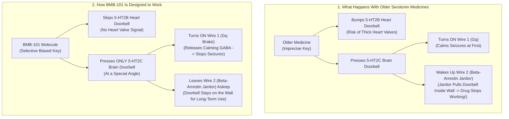
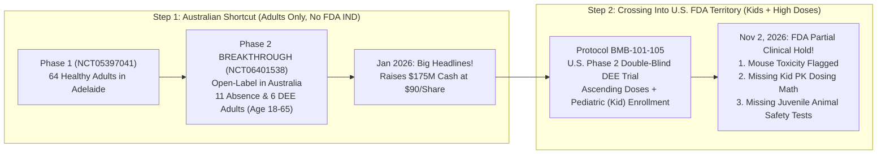
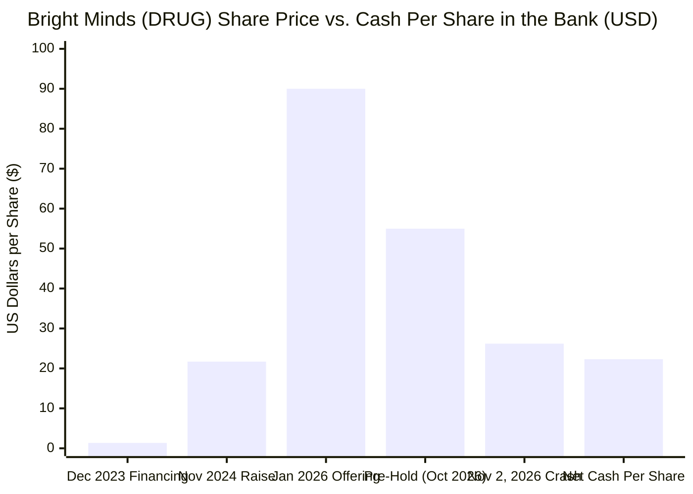

## 1. The Hook: Wait—How Can Sick Lab Mice Erase $284 Million in a Single Day?

Imagine you and your friends pooled your allowance to build a company worth **$542 million**—enough money to buy about **1,800 brand-new school buses**. Your company is inventing a liquid medicine called **BMB-101** designed to stop terrifying brain seizures in children and adults when no other medicine works.

Then, on the morning of **November 2, 2026**, an email arrives from the U.S. government's medicine safety referees. The email says: *"Stop! Before you give this medicine to kids in America, we saw a safety problem in lab mice, and you haven't shown us enough proof that young, growing bodies can handle it safely."*

Within hours, biotech reporter Adam Feuerstein summed up the shockwave on social media in nine words:

> "$DRUG FDA partial clinical hold due to mouse toxicity."

On the stock market (where the company trades under the fitting four-letter nickname **DRUG**), panic broke out. The price of a single share of **Bright Minds Biosciences** crashed **52.35%** in one day—falling from **$54.98** down to **$26.20** and wiping out roughly **$284 million** in value before the closing bell ([SEC Form 6-K, Nov 2, 2026](https://www.sec.gov/Archives/edgar/data/1827401/000206075526000063/ex991-20261102drug.htm)).

Wait a second. If **90 human beings** in Australia have already swallowed this exact medicine without a single dangerous side effect, why did the U.S. referees freeze the new American trial over **lab mice**? Why is the company arguing that the mouse sickness wasn't even caused by the medicine? And how can an entire company be valued at **$258 million** on the stock market when it still has **$222 million in cash** (`CA$307.83 million`) sitting safely in its bank account ([SEC Q3 2026 Financial Statements](https://www.sec.gov/Archives/edgar/data/1827401/000106299326004442/exhibit99-1.htm))?

Grab your magnifying glass. We are going to build the whole story from the ground floor up—starting inside a human brain during a seizure, opening the secret government filings that most investors never read, and solving the mystery of `Protocol BMB-101-105`.

---

## 2. Starting from Zero: Brain Thunderstorms, Three Doorbells, and an Overprotective Janitor

Before we can judge whether the government referees or the drug company is right, we need to understand what problem **BMB-101** is trying to solve.

### What Is a Seizure? (The Brain's Gas Pedal vs. Brake Pedal)

Inside your skull sits a three-pound supercomputer made of about **86 billion nerve cells** (scientists call them **neurons**). Every time you read a word, catch a baseball, or daydream, those cells pass tiny electrical sparks and chemical notes to one another.

To keep those sparks under control, your brain uses two kinds of pedals, just like a bicycle riding down a steep hill:
1. **"Go!" Pedals (Excitatory Signals):** Tell brain cells to fire faster.
2. **"Brake!" Pedals (Inhibitory Signals):** Release a calming chemical (called **GABA**) that tells brain cells to slow down and stay quiet.

An **epileptic seizure** happens when the "Brake!" pedals fail and millions of brain cells fire all at once, like a sudden electrical thunderstorm inside the brain.

Bright Minds Biosciences is trying to treat two especially tough kinds of brain storms:
* **Absence Seizures (The "Pause Button" Storm):** Instead of falling down and shaking, a person's brain gets stuck in a rhythmic electrical loop between its central relay station and outer shell. For **3 to 20 seconds**—about as long as it takes to count *"one-Mississippi, two-Mississippi, three-Mississippi"*—the person freezes and stares blankly into space, sometimes **20 to 50 times a day**, without even realizing they missed part of the teacher's sentence.
* **Developmental and Epileptic Encephalopathies, or DEEs (The "Childhood Hurricane" Storm):** That giant mouthful ofgrown-up words (**DEEs**, which include rare genetic conditions like **Dravet syndrome** and **Lennox-Gastaut syndrome**) simply means severe seizure disorders that start when a child is a baby or toddler. Kids with DEEs can suffer dozens of violent "drop attacks" (major motor seizures) every week, and the non-stop electrical storms actually slow down or hurt their growing brains. Even though doctors have more than **20 different seizure medicines**, about **3 out of every 10** epilepsy patients—and almost all kids with DEEs—have **drug-resistant epilepsy**. Even when they swallow **3 to 5 different seizure pills every day**, the thunderstorms keep breaking through ([SEC Q3 2026 MD&A, p. 2–5](https://www.sec.gov/Archives/edgar/data/1827401/000106299326004442/exhibit99-2.htm)).

### The Three Serotonin Doorbells (`5-HT2A`, `5-HT2B`, and `5-HT2C`)

How do you fix a broken brake pedal in the brain? Scientists discovered that the brain's "Brake-pedal" cells have a special doorbell on their surface that responds to a natural brain chemical called **serotonin** (whose chemical nickname is **5-HT**). When you press that specific doorbell, the brake cells pour out calming GABA and stop the seizure thunderstorm!

Here is the catch: your body has **14 different kinds of serotonin doorbells** (scientists call these doorbells **receptors**, and a medicine designed to press a doorbell is called an **agonist**). Three of those doorbells—named **5-HT2A**, **5-HT2B**, and **5-HT2C**—are almost identical twins in shape, like three locks on the same hallway door. Pushing the right one helps stop seizures, but accidentally pushing the wrong twins causes big trouble:

1. **Doorbell `5-HT2C` (The Good Brake & "I'm Full" Switch):** Lives on the brain's brake-pedal cells and appetite center. Press this doorbell, and it calms down seizures *and* turns off runaway hunger (which is why Bright Minds is also testing BMB-101 for **Prader-Willi Syndrome**, a rare genetic condition affecting **1 in 15,000** babies where children feel starving 24 hours a day).
2. **Doorbell `5-HT2A` (The Hallucination Switch):** Lives in the visual and thinking parts of the brain. Press this doorbell too hard, and a person sees waking dreams and hallucinations (this is the exact doorbell that psychedelic substances turn on).
3. **Doorbell `5-HT2B` (The Heart-Valve Danger Switch):** Lives on the tiny flaps (**valves**) inside your heart that keep blood flowing the right way. If a medicine accidentally presses the `5-HT2B` doorbell every day for months, the heart-valve cells grow thick, stiff scar tissue until the heart leaks—a dangerous condition called **cardiac valvulopathy** ([SEC Q3 2026 MD&A, p. 3–5](https://www.sec.gov/Archives/edgar/data/1827401/000106299326004442/exhibit99-2.htm)).

In fact, an older medicine called **fenfluramine** (sold today for childhood epilepsy as **Fintepla**) presses the good `5-HT2C` doorbell *and* accidentally bumps the `5-HT2B` heart doorbell. Because of that heart risk, the U.S. government forces every child taking Fintepla to get a heart ultrasound (**echocardiogram**) before starting, every **6 months** during treatment, and once more after stopping!

### Why BMB-101 Was Engineered to Duck the "Overprotective Janitor"

Bright Minds designed **BMB-101** to solve two problems at once. First, they shaped the molecule so it presses **only** the `5-HT2C` seizure-brake doorbell (requiring just `16.2 nanomolar`—like a single pinch of sugar in an Olympic swimming pool) while ignoring the `5-HT2A` hallucination doorbell (`>100 times` weaker) and completely avoiding the `5-HT2B` heart-valve doorbell.

Second, they solved the **"Overprotective Janitor" problem**:
* Normally, when a medicine presses the `5-HT2C` doorbell, two wires light up inside the brain cell.
* **Wire #1 (`Gq protein`)** does the actual job: it tells the cell to hit the seizure brakes.
* **Wire #2 (`Beta-arrestin`)** acts like a grumpy school janitor. When the janitor notices someone ringing the doorbell all day, he says, *"That's too much noise!"* and **unscrews the doorbell and pulls it inside the wall** so the medicine can't reach it anymore. That is why many epilepsy medicines work great for the first two months and then suddenly stop working (adults call this **drug tolerance** or **receptor desensitization**).
* **BMB-101** pushes the doorbell at a special angle that turns on Wire #1 (`Gq`) without waking up Wire #2 (`Beta-arrestin`). Scientists call this clever trick **Gq-protein biased agonism** ([SEC Form 6-K, Jan 6, 2026](https://www.sec.gov/Archives/edgar/data/1827401/000206075526000005/ex991-drugnr.htm)).

---

## 3. The Secret Decoder Ring: Grown-Up Biotech Words Translated

When you read the news release from November 2, 2026, it looks like a bowl of alphabet soup. Here is your **Secret Decoder Ring** so not a single grown-up word can trick you:

| The Grown-Up Word or Acronym | What It Actually Means in Plain English | Everyday 5th-Grade Analogy |
| :--- | :--- | :--- |
| **DEEs (Developmental and Epileptic Encephalopathies)** | Rare, severe epilepsy conditions starting in babies and young kids where frequent seizures also slow down brain growth (like Dravet or Lennox-Gastaut syndrome). | A computer whose power surges are so strong and frequent that they keep interrupting the software installation while it is still being built. |
| **5-HT2C Gq-Biased Agonist** | A medicine that presses only the `5-HT2C` brain brake-pedal switch (`agonist`) using the helpful `Gq` wire while skipping the `beta-arrestin` janitor wire. | Pressing a doorbell in a special way that rings the chime inside the house without waking up the grumpy janitor who unplugs the bell. |
| **IND (Investigational New Drug Application)** | The giant stack of safety binders a drug company must hand to the U.S. Food and Drug Administration (FDA) to ask permission before testing an unapproved medicine in people in the United States. | A permission slip packet with safety test scores that you must get signed by the school principal before your science club can launch a model rocket. |
| **Partial Clinical Hold** | An official order from the FDA freezing *one specific planned study* (or part of a study, like giving higher doses or enrolling children) while allowing other studies to keep going until safety questions are answered. | The principal saying, *"Your 8th-grade rocket club in Australia can keep flying, but nobody in the 5th-grade U.S. group can launch until you prove the parachute works."* |
| **Pharmacokinetics (PK)** | The math of how fast a body absorbs a medicine into the blood, carries it to the brain, and washes it out through the liver and kidneys. | Tracking how fast a spoonful of chocolate syrup gets stirred into a glass of milk and how long it takes to drink the glass empty. |
| **Juvenile Toxicity Data** | Preclinical safety tests done specifically in *young, still-growing animals* (like baby mice or young rats/dogs) before giving a medicine to human children. | Testing a new skateboard helmet on a smaller kid-sized crash dummy before letting 6-year-olds ride down a ramp with it. |
| **Open-Label vs. Double-Blind Placebo-Controlled Trial** | In an *open-label* test, everyone knows they are getting the real medicine. In a *double-blind placebo-controlled* test, half get fake look-alike liquid (`placebo`) and neither the patients nor the doctors know who got which until the end. | *Open-label* is tasting a soda with the Coca-Cola label showing; *double-blind* is a blindfolded taste test with unmarked cups so your brain can't play favorites. |

---

## 4. The Big Claim vs. The Detective Check: What the Receipts Actually Show

To understand why Wall Street panicked on November 2, 2026, we have to trace how Bright Minds got so famous in the first place—and then check the primary-source government receipts.

### Act I: The $2.6 Billion Neighbor and the January 2026 Party

Back in late 2023, Bright Minds Biosciences was a tiny company whose stock sold for just **$1.36 per share** ([SEC Q3 2026 MD&A, p. 8](https://www.sec.gov/Archives/edgar/data/1827401/000106299326004442/exhibit99-2.htm)). Then, in **October 2024**, a big European drug company named **Lundbeck** paid **$2.6 billion** to buy another company called **Longboard Pharmaceuticals**, whose lead medicine (**bexicaserin**) pressed the exact same `5-HT2C` brain doorbell for DEE seizures! Overnight, traders realized Bright Minds owned a cousin medicine (**BMB-101**) and sent `DRUG` stock rocketing more than **2,000%**.

Then, on **January 6, 2026**, Bright Minds announced headline results from its Phase 2 **BREAKTHROUGH** clinical trial (`NCT06401538`):
* Absence seizures lasting 3 seconds or longer dropped by a median of **73.1%** (`p = 0.012`), and patients got **90% more REM dreaming sleep** (jumping from `56.2 minutes` to `106.7 minutes` a night without sleeping longer overall)!
* Major motor seizures in DEE patients dropped by a median of **63.3%**!
* **The Giant Cash Raise:** The very next day (**January 7, 2026**), while investors were cheering, Bright Minds sold **1,945,000 new shares at $90.00 per share**, collecting **$175,050,000** (`~CA$243.25 million`) in cash for its bank account ([SEC Form 6-K, Jan 8, 2026](https://www.sec.gov/Archives/edgar/data/1827401/000206075526000009/ex991-final.htm)).

### Act II: What Our Detective Magnifying Glass Found in the Fine Print

When we pull the official clinical trial registry records ([NCT05397041](https://clinicaltrials.gov/study/NCT05397041), [NCT06401538](https://clinicaltrials.gov/study/NCT06401538), [NCT07266324](https://clinicaltrials.gov/study/NCT07266324)) and read the buried pages of Bright Minds' SEC filings, four huge plot twists jump off the page:

1. **Plot Twist #1 — Every Single Human Trial So Far Was Run in Australia, Not Under the U.S. FDA!**
   If you check the official U.S. government registry (`ClinicalTrials.gov`) for all three of Bright Minds' human studies—Phase 1 (`NCT05397041` in Adelaide), Phase 2 BREAKTHROUGH (`NCT06401538` in Melbourne, Sydney, and Brisbane), and Phase 2 NOVA for Prader-Willi Syndrome (`NCT07266324` in Sydney and Melbourne)—every single one lists `isFdaRegulatedDrug: False`. Australia allows companies to start early human studies through local hospital ethics committees faster than the U.S. FDA.
2. **Plot Twist #2 — The "63.3% DEE Seizure Drop" Was Based on Just 6 Adults With No Placebo Group!**
   In the January 2026 BREAKTHROUGH study (`NCT06401538`), **24 adults** (`mean age: 30 years`, ages `18 to 65`) enrolled, and **6 dropped out** (`25%` dropout rate). In the DEE group, only **9 adults** started and only **6 adults** (`4` Lennox-Gastaut, `1` Dravet, `1` Rett syndrome) finished enough treatment to be counted ([SEC Form 6-K, Jan 6, 2026](https://www.sec.gov/Archives/edgar/data/1827401/000206075526000005/ex991-drugnr.htm)). Six people is the size of **one single elementary school lunch table**! Worse, it was an **open-label** study where everyone knew they were taking the real medicine and wrote down seizures in a diary—and **zero children** (`under 18`) were tested.
3. **Plot Twist #3 — Buried on Page 19 of the SEC Filing: This Is Actually Bright Minds' SECOND Run-In With an FDA Partial Clinical Hold!**
   Most news stories on November 2, 2026 treated this hold as a bolt from the blue. But buried on **page 19** of Bright Minds' Q3 2026 Management's Discussion & Analysis ([SEC Form 6-K, Aug 17, 2026, Exhibit 99.2](https://www.sec.gov/Archives/edgar/data/1827401/000106299326004442/exhibit99-2.htm)) and in its Annual Report ([SEC Form 20-F](https://www.sec.gov/Archives/edgar/data/1827401/000106299324021301/form20f.htm)) is this quiet confession:
   > *"Bright Minds Biosciences had previously submitted an investigational new drug application to the Food and Drug Administration but later withdrew it prior to full review. In the withdrawal letter, the Food and Drug Administration mentioned partial clinical hold deficiencies related to the proposed dosing regime."*
4. **Plot Twist #4 — What Triggered the November 2, 2026 Hold (`Protocol BMB-101-105`)?**
   To win approval to sell a DEE epilepsy medicine in the United States, you *must* test it in a gold-standard **randomized, double-blind, placebo-controlled trial** that includes **children** (since DEEs are childhood diseases). When Bright Minds submitted its U.S. IND and `Protocol BMB-101-105` to test ascending doses of BMB-101 up to a maximum tolerated dose in DEE patients—including kids—the FDA flagged **three distinct roadblocks**:
   * **Roadblock A:** Identified **toxicity in mice** (in the company's Form 20-F preclinical table, `28-day` and `90-day` mouse and dog studies were completed earlier, while longer **6-month chronic mouse toxicity studies** were underway).
   * **Roadblock B:** **Inadequate pharmacokinetic (PK) data** to support the proposed pediatric (child) enrollment.
   * **Roadblock C:** **Inadequate juvenile toxicity data** to support the proposed pediatric enrollment ([SEC Form 6-K, Nov 2, 2026](https://www.sec.gov/Archives/edgar/data/1827401/000206075526000063/ex991-20261102drug.htm)).

Here is the side-by-side comparison of the company's reassuring statements versus what the regulatory rules actually say:

| What Bright Minds Emphasized in the Press Release | What the Primary-Source Receipts & FDA Rules Reveal |
| :--- | :--- |
| **"The adverse mouse findings were incidental and not drug-related, and not seen in any other species."** | Right below that sentence, the company's lawyers added: *"These are the Company's beliefs and should not be understood as the FDA findings or as resolving the FDA's stated concerns."* Under U.S. law (`21 CFR 312.42`), only the FDA's toxicology reviewers—not outside consultants hired by the company—can clear a clinical hold. |
| **"Approximately 90 human subjects have received BMB-101 with no drug-related serious adverse events."** | All `~90` subjects (`64` in Phase 1 + `24` in Phase 2 BREAKTHROUGH) were **adults (`18–65 years old`)** treated for short windows (`up to 3 months` in Phase 2 main study). Adult human tolerability over 12 weeks does not replace long-term rodent organ pathology or juvenile animal growth safety for children. |
| **"The partial clinical hold does not affect the Company's other ongoing clinical trials."** | That is because the company's ongoing trials (`NCT06401538` open-label extension and `NCT07266324` NOVA in Prader-Willi Syndrome) are running in **Australia** in adults! However, **no pivotal U.S. DEE trial can enroll patients** until the U.S. IND hold is lifted. |
| **Focus on the mouse toxicity dispute in headlines.** | Even if Bright Minds convinces the FDA that the mouse toxicity was a false alarm, the FDA **also** cited *inadequate pharmacokinetic (PK) and juvenile toxicity data* for pediatric enrollment ([ICH S11 FDA Guidance](https://www.fda.gov/regulatory-information/search-fda-guidance-documents/s11-nonclinical-safety-testing-support-development-pediatric-pharmaceuticals)). Running a brand-new GLP juvenile animal toxicity study can take **6 to 12 months**. |

---

## 5. The Four Suspects: Why Did the FDA Really Pull the Emergency Brake?

Whenever a dramatic event happens in science or business, a true detective never stops at the first explanation. Let's line up all **four possible suspects** (rival causes) for why this partial clinical hold happened:

| Suspect (Causal Hypothesis) | How This Story Goes | The Evidence For & Against It | Detective Verdict |
| :--- | :--- | :--- | :--- |
| **Suspect 1: Direct Drug Toxicity in Mice (`Direct Cause: BMB-101 -> Mouse Harm`)** | High or long-term doses of BMB-101 (or a mouse-specific breakdown byproduct) genuinely damaged mouse organs or nerves during chronic testing. | **For:** `Protocol BMB-101-105` proposed testing *ascending doses up to a maximum tolerated dose*, requiring high safety margins in the 6-month chronic mouse study. Earlier `5-HT2C` drugs like lorcaserin also had rodent toxicity issues at high exposures. **Against:** Dogs and short-term human adult studies (`~90` adults) showed clean safety so far. | **Plausible & High Stakes:** Until the formal 30-day FDA letter reveals *which* organ or effect was seen in mice and at what dose multiple, this cannot be dismissed. |
| **Suspect 2: Background Noise in Lab Mice (`Reverse / Spurious Noise -> False Alarm`)** | Lab mice kept in cages for 6 months naturally get random infections, tumors, or age-related illnesses that had nothing to do with BMB-101, and the FDA was simply being extra cautious. | **For:** Bright Minds states that its toxicity reports, peer reviewers, and multiple independent toxicology experts concluded the mouse findings were incidental and absent in dogs/other species. **Against:** FDA reviewers see thousands of rodent studies and have historical control databases; they rarely issue a clinical hold unless a finding appears more often in higher-dose groups than in untreated control mice. | **Possible for the Mouse Item Alone—But Incomplete:** Even if true, it does *not* explain the missing pediatric PK and juvenile animal toxicity data! |
| **Suspect 3: The "Australia-to-FDA Pediatric Jump" (`Lurking Confounder Z`)** | Moving from small Australian adult studies (`n = 24`) straight into a U.S. FDA trial enrolling **children** with ascending doses triggered strict FDA pediatric safety rules (`ICH S11`). | **For:** DEE children have developing brains and take `3–5` other seizure medications (`median 5` in BREAKTHROUGH). The FDA explicitly cited *inadequate pharmacokinetic and juvenile toxicity data to support pediatric enrollment*—and Bright Minds had previously withdrawn an earlier U.S. IND over dosing regime deficiencies ([SEC Q3 2026 MD&A, p. 19](https://www.sec.gov/Archives/edgar/data/1827401/000106299326004442/exhibit99-2.htm)). | **Primary Structural Driver:** The jump from Australian adult studies to U.S. pediatric high-dose enrollment without a complete FDA-grade juvenile tox/PK package is the core bottleneck. |
| **Suspect 4: The Dose-Escalation Trap (`Mutual Feedback Loop`)** | Trying to push BMB-101 *"up to a maximum tolerated dose"* in children shrunk the safety cushion between the human kid dose and the dose where mice got sick, making both problems worse at the same time! | **For:** The FDA calculates a "safety margin" by dividing the highest safe animal dose (`NOAEL`) by the highest planned human dose. If a mouse gets sick at a medium dose *and* your protocol asks to push children up to the maximum tolerated dose, the safety cushion collapses from both ends! | **Confirmed Amplifier:** Lowering the maximum dose or restricting initial U.S. enrollment to adults (`18+`) while juvenile studies run is the classic way companies escape this loop. |

---

## 6. The Catch: Who Pays the Price, and Why Is the Stock Trading Near Its Cash Pile?

Every medical delay and stock crash has real-world consequences. Let's look at who gets hurt—and look closely at the bizarre math happening on Wall Street right now.

### 1. Who Loses When `Protocol BMB-101-105` Is Frozen?
* **Families and Children With DEEs:** Families of children with Dravet syndrome and Lennox-Gastaut syndrome endure dozens of terrifying seizures every week. For patients who failed Fintepla (`fenfluramine`) or don't want the burden of heart-valve echocardiograms every 6 months, a delay of **6 to 12+ months** means waiting another year for a U.S. clinical trial option.
* **January 2026 Investors Who Paid $90.00 a Share:** Imagine buying a $90 ticket in January 2026 after the glowing Australian Phase 2 news, only to find out in November that the U.S. FDA froze the next trial and your $90 share is now worth **$26.20**—a **70.9% loss** (`-$63.80` per share)!
* **Bright Minds' Competitive Lead:** While Bright Minds untangles its FDA hold, Danish drugmaker **Lundbeck** (which paid `$2.6 billion` for Longboard's `bexicaserin`) is already marching through global Phase 3 trials in DEEs. Every month BMB-101 spends on the sidelines gives `bexicaserin` a bigger head start.

### 2. The $222 Million Piggy Bank Paradox (Why Wall Street Priced the Science at Almost Zero)

Now let's do some 5th-grade piggy-bank arithmetic using Bright Minds' official balance sheet ([SEC Form 6-K, Q3 2026 Financial Statements](https://www.sec.gov/Archives/edgar/data/1827401/000106299326004442/exhibit99-1.htm)):
* **Total Shares of Stock (`Common Shares`):** **9,864,061 shares** ([SEC Q3 2026 MD&A, p. 10](https://www.sec.gov/Archives/edgar/data/1827401/000106299326004442/exhibit99-2.htm)).
* **Company Value (`Market Cap`) at $26.20 per share:** `9,864,061 × $26.20` = **$258.4 million USD**.
* **Cash Sitting in the Bank (`as of June 30, 2026`):** **CA$307,828,515** (including **US$215,556,586** kept directly in U.S. dollars, worth roughly **$222 million USD** in total cash), with only **CA$2.54 million** (`~$1.8 million USD`) in total bills (`liabilities`).
* **Net Cash Per Share:** Divide `$220 million` in net cash by `9.86 million` shares, and every single `$26.20` share of `DRUG` has roughly **$22.30 of actual cash** standing behind it!

When you subtract a company's net cash (`~$220 million`) from its stock-market price tag (`~$258 million`), the leftover number (`~$38 million`) is what Wall Street calls **Enterprise Value (EV)**—the price tag traders are putting on the company's actual inventions and medicines.

Think about that chart like a lemonade stand:
* Yesterday, buyers paid **$54.98** for a share that held **$22.30** in the cash register, meaning they valued the secret lemonade recipe (`BMB-101` and the pipeline) at **$32.68 per share** (`~$322 million`).
* Today, at **$26.20**, buyers are paying only **$3.90 per share** (`~$38 million` total) for the entire medicine cabinet—treating `BMB-101` almost as if it is broken forever, even though the company has enough cash in the bank to pay for **years** of extra lab tests without running out of money!

---

## 7. The Final Report Card: What We Actually Think Will Happen Next

Instead of guessing with "all-or-nothing" predictions, let's use **detective "If ... Then ..." rules** to map out what happens over the next 30 days (when the formal FDA Partial Clinical Hold Letter arrives) and beyond:

1. **If the FDA allows Bright Minds to split `Protocol BMB-101-105`—starting the U.S. Phase 2 DEE trial in adults (`18+`) at moderate doses right away while running the extra juvenile animal and PK studies for kids (`<18`) in parallel—then** the hold is a temporary speed bump (`3 to 6 months` delay for adults, `9 to 12 months` for kids), and valuing the entire drug pipeline at just `~$38 million` above cash is an overreaction.
2. **If the FDA's formal letter says the mouse toxicity occurred at low drug exposures (`near human therapeutic doses`) and blocks *all* U.S. human dosing (both adults and children) until new 6-month chronic toxicology studies prove the mechanism is mouse-specific—then** U.S. DEE development will be delayed by **12 to 18+ months**, though Australian trials in Absence Epilepsy and Prader-Willi Syndrome (`NOVA`) may continue generating data outside the U.S.
3. **If the mouse toxicity turns out to be a class-wide or scaffold-specific organ injury that also shows up in long-term non-rodent (`9-month dog`) or juvenile studies—then** `BMB-101` could fail as a chronic daily epilepsy medicine, forcing Bright Minds to pivot its `$220M+` cash pile toward its backup `5-HT2C` compound (**BMB-105**) or its depression/pain programs (**BMB-201** and **BMB-202**).

### Probability-Weighted Detective Verdict

| Scenario Name | Probability | What Happens Next Mechanistically | Timeline Impact on U.S. DEE Trial | What It Means for Patients & the Company |
| :--- | :--- | :--- | :--- | :--- |
| **Scenario A: The "Adults First, Kids After Juvenile Tox" Compromise (Base Case)** | **55%** | Within 30 days, the FDA's formal letter requires a dedicated GLP juvenile animal toxicity study (`ICH S11`), pediatric PK modeling, and a tighter dose cap before enrolling children, **but** allows `Protocol BMB-101-105` to amend and begin in adult (`18+`) or older adolescent patients while juvenile tox runs. | **4 to 9 months** for adult U.S. start; **9 to 14 months** for pediatric expansion. | Bright Minds uses a small slice (`~$10M–$15M`) of its `$222M` cash pile to run the juvenile studies and keeps absence epilepsy and Prader-Willi (`NOVA`) on track. |
| **Scenario B: The "Full Preclinical Re-Run" Delay (Bear Case)** | **30%** | The FDA rejects Bright Minds' argument that the mouse toxicity was incidental and refuses to clear *any* U.S. dosing in `Protocol BMB-101-105` until both mechanistic mouse toxicology and juvenile animal studies are completed and reviewed. | **12 to 20 months** delay for U.S. DEE trial. | BMB-101 falls nearly two years behind Lundbeck's `bexicaserin` in U.S. DEEs, shifting Bright Minds' main value driver to adult **Absence Seizures** and **Prader-Willi Syndrome**. |
| **Scenario C: Rapid Paperwork Clearance (Bull Surprise)** | **15%** | Independent pathology review and existing cross-species PK/toxicology datasets convince the FDA that the mouse lesions were background rodent noise, and a simple protocol dose-cap amendment lifts the partial hold without new animal experiments. | **2 to 4 months** delay. | Fastest recovery path, restoring U.S. Phase 2 momentum in early-to-mid 2027. |

### Bottom-Line Takeaway for a 5th-Grade Detective

When a company says, *"Our medicine cut seizures by 63% to 73%!"*, always check **who** was tested (`24` adults in Australia, only `6` with DEEs, and zero kids) and **where** the test happened (outside the U.S. FDA). And when a headline screams, *"FDA hold due to mouse toxicity!"*, always read the **whole sentence**: the FDA didn't just point at sick mice—it asked for the missing **kid-sized dosing math (`PK`)** and **young-animal safety tests (`juvenile toxicity`)** that every developer must pass before giving a powerful brain medicine to growing children.

---

## Primary Sources & Verification Receipts

1. **Bright Minds Biosciences — SEC Form 6-K & Exhibit 99.1 (Nov 2, 2026):** [Bright Minds Biosciences Provides Update About Planned Study With BMB-101 in Developmental and Epileptic Encephalopathies](https://www.sec.gov/Archives/edgar/data/1827401/000206075526000063/ex991-20261102drug.htm)
2. **Bright Minds Biosciences — SEC Form 6-K, Q3 2026 Financial Statements (Ended June 30, 2026):** [Condensed Interim Consolidated Financial Statements (Exhibit 99.1)](https://www.sec.gov/Archives/edgar/data/1827401/000106299326004442/exhibit99-1.htm)
3. **Bright Minds Biosciences — SEC Form 6-K, Q3 2026 MD&A (Filed Aug 17, 2026):** [Management's Discussion and Analysis for the Third Quarter Ended June 30, 2026 (Exhibit 99.2, p. 2–20)](https://www.sec.gov/Archives/edgar/data/1827401/000106299326004442/exhibit99-2.htm)
4. **Bright Minds Biosciences — SEC Form 6-K, Phase 2 BREAKTHROUGH Topline Results (Jan 6, 2026):** [Positive Topline Results from Phase 2 Clinical Trial of BMB-101 (Exhibit 99.1)](https://www.sec.gov/Archives/edgar/data/1827401/000206075526000005/ex991-drugnr.htm)
5. **Bright Minds Biosciences — SEC Form 6-K, US$175 Million Public Offering Pricing (Jan 8, 2026):** [Pricing of Upsized US$175 Million Public Offering at $90.00/Share (Exhibit 99.1)](https://www.sec.gov/Archives/edgar/data/1827401/000206075526000009/ex991-final.htm)
6. **Bright Minds Biosciences — SEC Form 20-F Annual Report:** [Preclinical ADMEPK & 28-Day / 90-Day / 6-Month Chronic Mouse & Dog Toxicity Program Table (p. 23–27)](https://www.sec.gov/Archives/edgar/data/1827401/000106299324021301/form20f.htm)
7. **ClinicalTrials.gov Registry Records:** [NCT05397041 (Phase 1 Australia)](https://clinicaltrials.gov/study/NCT05397041), [NCT06401538 (Phase 2 BREAKTHROUGH Australia)](https://clinicaltrials.gov/study/NCT06401538), and [NCT07266324 (Phase 2 NOVA Prader-Willi Syndrome Australia)](https://clinicaltrials.gov/study/NCT07266324)
8. **U.S. FDA / ICH Guidance for Industry:** [S11 Nonclinical Safety Testing in Support of Development of Pediatric Pharmaceuticals](https://www.fda.gov/regulatory-information/search-fda-guidance-documents/s11-nonclinical-safety-testing-support-development-pediatric-pharmaceuticals)
