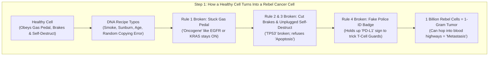
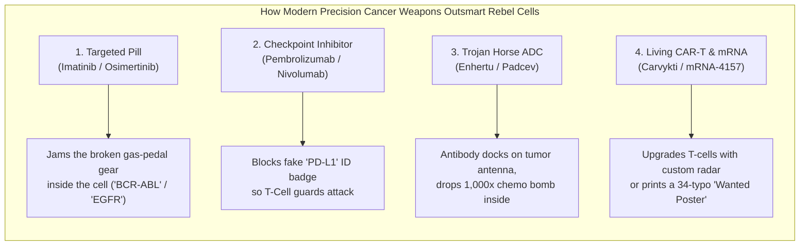

## 1. The Hook: Wait—Why Can't Doctors Just Give You One Pill to Cure Cancer?

If you get strep throat or an ear infection, you go to the doctor, swallow pink bubble-gum medicine for ten days, and boom—you are completely cured. Why does that work so easily? Because the bacteria causing your sore throat are **foreign invaders**. They look totally different from your own body's cells, so an antibiotic pill can hunt down bacterial walls and pop them like water balloons without hurting a single hair on your head.

So why can't scientists invent a single pill that does the exact same thing to **cancer**?

Here is the mind-bending twist that makes cancer the hardest puzzle in all of medicine: **cancer is not an outside invader.** A cancer cell is one of *your own body's cells* that broke its rulebook and started copying itself non-stop. Because it wears almost the exact same uniform as your healthy heart, lung, and brain cells, anything strong enough to poison a cancer cell usually risks poisoning the healthy you, too. And even crazier: "cancer" isn't just one disease—it is more than **200 different diseases** wearing different disguises!

Over the last ten years, however, scientists have invented biological weapons that sound like pure science fiction: microscopic Trojan Horses stuffed with poison, immune-system truth serums, living ninja cells trained in a laboratory, and custom-printed mRNA "Wanted Posters." Some of these treatments take cancers that used to kill people in six months and wipe them out for **10+ years**. Others cost **$200,000 a year** and add only **84 days** of life. Today, we are going to open the hood, learn how every single gear works from scratch, and check the real medical receipts like a team of detectives.

---

## 2. Starting from Zero: The 30-Trillion-Cell City and the Four Broken Rules

Before we look at a single medicine, we need to understand the playground where cancer happens.

Your body is not one solid piece of clay. It is a bustling mega-city built out of roughly **30 trillion microscopic living bricks** called **cells** (if each of your cells were a 1-centimeter LEGO brick, you could stack them around the Earth's equator **7,500 times**). Each cell is tiny—about **10 to 20 micrometers** across, which is roughly **one-fifth the width of a single strand of your hair**.

Every day, millions of your cells wear out (like when you scrape your knee on the sidewalk or shed old skin) and need to be replaced. To replace a worn-out cell, a healthy cell reads its master instruction book—a 3-billion-letter chemical recipe book coiled inside it called **DNA**—makes a photocopy of that book, and splits into two identical cells.

To keep your 30-trillion-cell city from turning into chaos, every healthy cell obeys **Four Strict City Laws**:

1. **The Gas Pedal Law:** Only divide when the neighborhood sends a signal saying, *"Hey, we have a scraped knee over here, make new skin cells!"* (Scientists call these growth-signal genes **Proto-Oncogenes**—pronounced *pro-toe-ON-koh-jeenz*).
2. **The Brake Pedal Law:** Stop dividing the second the gap is filled. (Scientists call these brake-pedal genes **Tumor Suppressor Genes**).
3. **The Self-Destruct Button Law:** When a cell photocopies a 3-billion-letter book, it sometimes makes spelling mistakes (typos). If a cell spots too many typos in its own recipe book and can't fix them, it politely presses its own self-destruct button so it doesn't cause trouble. (Scientists call this polite cell suicide **Apoptosis**—pronounced *ay-pop-TOE-sis*).
4. **The Security Badge Check:** Your bloodstream is patrolled 24 hours a day by microscopic police officers that inspect every cell's ID badge. If a cell looks weird, infected, or broken, the police officers destroy it on the spot. (Scientists call these elite police cells **T-Cells**).

### How a Rebel Cell Starts a Gang

Cancer begins when **one single cell** gets hit by enough spelling mistakes in its DNA recipe book—from things like cigarette smoke, sunburns (ultraviolet light), unlucky random copying errors, or an inherited family typo—that it breaks **all four laws at once**:

* A typo jams its **Gas Pedal** all the way to the floor so it thinks it needs to divide every minute of every day (the broken gas pedal is now called an **Oncogene**, like `KRAS` or `EGFR`).
* Another typo cuts its **Brake Cables** (most famously a master brake gene called `TP53`, which is broken in over half of all human cancers) and unplugs its **Self-Destruct Button**.
* Soon, one rebel cell becomes two, four, eight, a million, and then a billion cells piled into a greedy lump called a **Tumor** (1 gram of tumor—about the weight of a paperclip—already holds **1 billion cancer cells**).
* Worst of all, some rebel cells learn how to chew through the walls of their home organ, slip into the bloodstream highway, and build brand-new rebel camps in the lungs, liver, bones, or brain. Scientists call this highway-hopping **Metastasis** (pronounced *muh-TASS-tuh-sis*), and it is the real boss villain: **up to 90% of all cancer deaths happen because the cancer traveled to new organs**, not because of the original lump.

---

## 3. The Secret Decoder Ring: Scary Doctor Words Translated into Kid Language

When grown-ups talk about cancer on the news, they use giant Greek and Latin words that sound like spells from *Harry Potter*. Before we go any further, clip on this **Secret Decoder Ring** so you can translate every single expert word instantly:

| The Grown-Up Word / Acronym | What It Actually Means in Plain English | Everyday 5th-Grade Analogy |
| :--- | :--- | :--- |
| **Metastasis** (*Metastatic Cancer*) | Cancer cells that escaped their first home, rode the blood or lymph pipes, and started new lumps in distant organs. | Dandelion seeds blowing off one lawn in the wind and sprouting weeds three blocks away. |
| **Chemotherapy** (*"Chemo"*) | Medicine that travels through your whole bloodstream and poisons *any* cell caught in the act of copying its DNA and splitting fast. | Spraying weed-killer across the entire backyard to stop fast-growing weeds—which also turns the fastest-growing grass brown. |
| **Targeted Therapy** (*Kinase Inhibitor*) | A tiny pill shaped to fit into one specific broken "gas pedal" gear inside a cancer cell and jam it shut. | Putting a custom boot-lock on a runaway car's stuck gas pedal without touching any other car on the street. |
| **Immune Checkpoint Inhibitor** (*Anti-PD-1 / Anti-PD-L1*) | An IV medicine that rips off the "Fake ID Badge" cancer cells hold up to trick your immune system's T-cell police officers. | Taking off the invisibility cloak a bank robber is wearing so the security guards already in the room can finally see him. |
| **Antibody-Drug Conjugate** (**ADC**) | A bloodhound molecule connected by a microscopic chain to a super-toxic chemo bomb that only explodes *after* it unlocks a cancer cell's front door. | A Trojan Horse or heat-seeking delivery drone that carries a water balloon inside the villain's clubhouse before popping it. |
| **CAR-T Cell Therapy** | Taking a patient's own T-cell police officers out of their blood, installing a brand-new cancer-hunting radar dish on them in a lab, and putting millions of them back in. | Sending your neighborhood security guards to Ninja Boot Camp, giving them night-vision goggles, and parachuting them back in. |
| **Personalized mRNA Neoantigen Vaccine** | Reading the exact DNA typos of *your* removed tumor and printing an mRNA "Wanted Poster" so your T-cells hunt down any leftover hiding cells. | Handing every police officer in town a photo of a suspect's unique purple scar so he can never sneak back into the city. |
| **PFS vs. OS** (*Progression-Free Survival* vs. *Overall Survival*) | **PFS** = how many months the tumor sits still on a scan without growing; **OS** = how long the patient actually stays alive. | **PFS** is pausing a losing video game for 3 minutes; **OS** is actually winning the game and playing all afternoon. |

---

## 4. The Six Weapons Doctors Use Today (And How the New Super-Weapons Work)

Today, when a person walks into a cancer hospital, doctors have **Six Main Weapons** in their toolbox. The first three are the **Classic Heavy Tools** (invented over the last 100 years), and the next three are the **Modern Precision Super-Weapons** (which have exploded in power over the last 10 to 15 years).

### The Classic Trio: Cut, Zap, and Carpet-Bomb

1. **Weapon 1: Surgery (Cut Out the Rebel Camp)**
   * **How it works:** If all the rebel cells are still sitting together in one solid lump (like an early breast, colon, or skin tumor) and haven't hopped into the blood highway yet, a surgeon can physically cut the lump out.
   * **Why it's great:** Surgery cures more people of solid-organ cancer than all drugs in history combined!
   * **Why it's not enough:** A surgeon's eyes and even the sharpest MRI scanner cannot see a microscopic gang of 1,000 cancer cells hiding in the liver. If the dandelion seeds have already blown away, cutting the first flower won't stop the new weeds.

2. **Weapon 2: Radiation Therapy (The Invisible Laser Zap)**
   * **How it works:** Doctors aim invisible, super-high-energy beams (X-rays or heavy particles called **protons**) from outside the body straight at the tumor. The beam shatters the DNA recipe book inside the cancer cells so badly that when they try to divide, they crumble.
   * **The Cool Upgrade (Proton Beams):** Regular X-rays shoot all the way through your body like a flashlight beam through thin paper, scorching healthy tissue in front of *and* behind the tumor. Newer **Proton Therapy** acts like a depth-charge firework: protons fly into the body and dump almost 100% of their explosive energy at an exact millimeter depth (a physics trick called the **Bragg Peak**) and then **stop dead**, protecting a child's growing brain or heart right behind the tumor.

3. **Weapon 3: Chemotherapy (The Fast-Cell Lawn Mower)**
   * **How it works:** Beginning in the 1940s, doctors discovered chemical poisons (some originally found in mustard gas and tree bark!) that jam the machinery cells use to copy DNA or pull themselves into two halves. Because cancer cells divide much more often than most adult cells, chemo kills way more cancer cells than normal cells.
   * **Wait—Why Does Chemo Make Your Hair Fall Out?** Have you ever wondered why cancer patients on TV lose their hair, feel sick to their stomachs, and get infections easily? Now you can figure it out yourself! Chemo doesn't know what a "cancer cell" is—it only attacks **fast-dividing cells**. And which healthy cells in your body divide every single day?
     1. **Hair root cells** (making your hair grow!) → hair falls out.
     2. **Stomach and mouth lining cells** (replacing themselves every 3 to 5 days!) → nausea and mouth sores.
     3. **Bone marrow factories** (pumping out millions of fresh blood cells every second!) → low white blood cells and tiredness.
   * Despite those rough side effects, multi-drug chemo combinations still **completely cure** over **85% to 90% of children with acute lymphoblastic leukemia (ALL)** and over **90% of patients with testicular cancer or Hodgkin lymphoma**.

---

### The Modern Precision Revolution: Four Smart Super-Weapons

Because old-school chemo is like blowing up a whole city block to catch one bank robber, scientists spent the last 25 years building weapons that tell the difference between a rebel cell and a healthy citizen.

#### Weapon 4: Targeted Pills ("Jamming the Stuck Gas Pedal")
* **Concept First:** Scientists read the cancer cell's DNA, find the exact broken protein gear that is stuck in the "ON" position, and design a tiny chemical key that slides into that broken gear's battery pocket and freezes it.
* **Everyday Analogy:** Imagine a runaway toy train whose power switch is glued down. Instead of smashing the train with a sledgehammer, you slide a tiny plastic wedge right into the battery slot of *only* that broken switch.
* **The Grown-Up Word:** **Small-Molecule Targeted Therapy** (or **Tyrosine Kinase Inhibitors / TKIs**).
* **The Real-World Receipt:** The first superstar targeted pill was **Imatinib (Gleevec)** for a blood cancer called **Chronic Myeloid Leukemia (CML)**. Before 2001, fewer than 30 out of 100 CML patients survived 5 years. In the landmark 11-year follow-up of the [IRIS clinical trial in the *New England Journal of Medicine* (PMID 28273028)](https://pubmed.ncbi.nlm.nih.gov/28273028/), **83.3% of patients taking daily Imatinib pills were still alive at 10 years**—turning a deadly leukemia into a manageable condition like high blood pressure! Similarly, in lung cancers driven by an `EGFR` gas-pedal typo, the third-generation pill **Osimertinib (Tagrisso)** pushed median survival to **38.6 months** in the [FLAURA trial (PMID 31751012)](https://pubmed.ncbi.nlm.nih.gov/31751012/).

#### Weapon 5: Immune Checkpoint Inhibitors ("Ripping Off the Fake ID Badge")
* **Concept First:** Remember your T-cell police officers? To stop T-cells from accidentally attacking your own healthy organs, every T-cell carries an "Off Switch" scanner called **PD-1**. Healthy cells carry a matching safety badge called **PD-L1** that says, *"I'm on your team, don't shoot!"* Sneaky cancer cells figure out how to print thousands of fake **PD-L1** badges and wave them in the T-cells' faces, putting the police officers right to sleep!
* **Everyday Analogy:** Imagine a bank robber wearing a fake security guard badge. The real police walk right past him in the hallway. Doctors inject an antibody shield that covers up the fake badge (or covers the officer's badge-scanner) so the police officers suddenly shout, *"Hey! You don't belong here!"* and tackle the robber.
* **The Grown-Up Word:** **Immune Checkpoint Inhibitors** (like **Pembrolizumab / Keytruda** and **Nivolumab / Opdivo** + **Ipilimumab / Yervoy**).
* **The Real-World Receipt:** Back in 2010, if deadly skin cancer (**melanoma**) spread to your lungs or brain, the middle patient lived only **6 to 9 months**, and almost nobody survived 5 years. Then came the [CheckMate 067 Phase 3 trial, whose final 10-year results were published in the *New England Journal of Medicine* (PMID 39282897)](https://pubmed.ncbi.nlm.nih.gov/39282897/). Patients given two checkpoint inhibitors together (Nivolumab + Ipilimumab) reached a median survival of **71.9 months (nearly 6 full years!)**, and **43% were still alive 10 years later** (with over half never dying of melanoma at all!).

#### Weapon 6A: Antibody-Drug Conjugates & Radioligands ("The Trojan Horse & The Radioactive Sniper")
* **Concept First:** What if a tumor is too tough for a targeted pill and hides from T-cells? Scientists took a biological bloodhound (**an antibody**) that only locks onto a specific antenna sticking out of cancer cells (like `HER2` on breast cancer or `Nectin-4` on bladder cancer). Then, using a microscopic chemical leash, they tied **4 to 8 payloads of super-deadly chemotherapy** (poison **100 to 1,000 times stronger** than regular hospital chemo) to the back of the bloodhound. While floating in the blood, the poison stays locked up inside the horse. The moment the bloodhound docks onto the cancer cell's antenna, the cancer cell swallows it, digesting the leash and setting off the bomb *inside* its own living room! Even better, the freed poison leaks through the wall and wipes out neighboring cancer cells that didn't even have the antenna (scientists call this the **Bystander Effect**).
* **The Grown-Up Word:** **Antibody-Drug Conjugates (ADCs)**—and their cousin, **Radioligand Therapy (RLT)**, which swaps the chemo bomb for a single radioactive atom (`Lutetium-177`) whose radiation spark travels only **1 to 2 millimeters** (the thickness of one dime in your pocket!).
* **The Real-World Receipts:**
  * In breast cancers with even a tiny trace of the `HER2` antenna ("HER2-low"), the ADC **Trastuzumab deruxtecan (Enhertu)** nearly doubled the time before tumors grew (**9.9 months vs. 5.1 months**) and boosted overall survival from **16.8 months to 23.4 months** in the [DESTINY-Breast04 trial (PMID 35665782)](https://pubmed.ncbi.nlm.nih.gov/35665782/).
  * In advanced bladder cancer, combining an ADC (**Enfortumab vedotin / Padcev**) with a checkpoint inhibitor (**Pembrolizumab**) in the [EV-302 Phase 3 trial (PMID 38446675)](https://pubmed.ncbi.nlm.nih.gov/38446675/) **nearly doubled human survival from 16.1 months to 31.5 months**—the first treatment in 40 years to crush standard platinum chemotherapy!
  * In advanced prostate cancer, the radioactive sniper drug **Pluvicto (`177Lu-PSMA-617`)** extended survival from **11.3 months to 15.3 months** and more than doubled progression-free time (**8.7 vs. 3.4 months**) in the [VISION trial (PMID 34161051)](https://pubmed.ncbi.nlm.nih.gov/34161051/).

#### Weapon 6B: Living Cell Therapies & Personalized mRNA Vaccines ("Ninja Boot Camp & Wanted Posters")
* **CAR-T Cell Therapy (Ninja Boot Camp):** For blood cancers like leukemia, lymphoma, and multiple myeloma, doctors connect a patient to a blood-filtering machine, collect millions of their tired T-cells, and ship them frozen to a special lab. There, scientists use a disarmed virus to insert a brand-new gene into the T-cells, making them grow a custom robotic claw on their surface called a **Chimeric Antigen Receptor (CAR)** that locks onto blood cancer markers (`CD19` or `BCMA`). Scientists grow **hundreds of millions** of these living ninja cells in warm nutrient soup and infuse them back into the patient's veins.
  * *The Receipt:* In children and young adults with relapsed B-cell leukemia who had run out of every other option, a single infusion of **Tisagenlecleucel (Kymriah)** put **81% of kids into complete remission within 3 months** in the [ELIANA trial (PMID 29385370)](https://pubmed.ncbi.nlm.nih.gov/29385370/). And in multiple myeloma, the CAR-T therapy **Cilta-cel (Carvykti)** slashed the risk of cancer progression or death by **74% (Hazard Ratio 0.26)** compared to standard care in the [CARTITUDE-4 trial (PMID 37272512)](https://pubmed.ncbi.nlm.nih.gov/37272512/).
* **Personalized mRNA Cancer Vaccines (The 34-Typo Wanted Poster):** Unlike flu or COVID vaccines that stop you from catching a virus in the first place, cancer vaccines are given *after* a surgeon cuts out a high-risk tumor so it never comes back. Doctors sequence the DNA of the patient's removed tumor, pick up to **34 unique protein typos (called Neoantigens)** that exist *only* in that person's cancer cells, and print a custom batch of **mRNA** (`mRNA-4157 / V940`) in about 6 weeks. When injected into the patient's arm alongside Keytruda, the mRNA teaches T-cells all 34 faces on the "Wanted Poster."
  * *The Receipt:* In the [KEYNOTE-942 Phase 2b trial in *The Lancet* (PMID 38246194)](https://pubmed.ncbi.nlm.nih.gov/38246194/), adding the personalized mRNA vaccine to pembrolizumab reduced the rate of melanoma coming back or death from **40% (20 of 50 patients) down to 22% (24 of 107 patients)** at roughly 2 years, and cut distant metastasis or death by **65% (Hazard Ratio 0.347)**!

| Treatment Pillar | How It Finds the Cancer | Famous Example Drug | Landmark Clinical Trial Receipt | The Main Weak Spot ("The Catch") |
| :--- | :--- | :--- | :--- | :--- |
| **1. Classic Chemotherapy** | Attacks *any* cell dividing fast in the body | Cisplatin, Doxorubicin, Paclitaxel | Cures >85% of childhood ALL & >90% of testicular cancer | Hits hair roots, stomach lining & bone marrow |
| **2. Targeted Kinase Pills** | Locks into one specific broken gas-pedal protein | Imatinib (Gleevec), Osimertinib (Tagrisso) | 83.3% 10-year survival in CML ([PMID 28273028](https://pubmed.ncbi.nlm.nih.gov/28273028/)) | Solid tumors mutate around the lock in 9–18 months |
| **3. Checkpoint Inhibitors** | Blocks fake `PD-L1` ID badges so T-cells attack | Pembrolizumab (Keytruda), Nivolumab + Ipilimumab | 71.9-month median OS in melanoma ([PMID 39282897](https://pubmed.ncbi.nlm.nih.gov/39282897/)) | Only ~12.5% to 20% of all cancer patients respond ([PMID 31050774](https://pubmed.ncbi.nlm.nih.gov/31050774/)) |
| **4. Antibody-Drug Conjugates (ADCs)** | Antibody docks on tumor antenna & drops chemo bomb | Enhertu (T-DXd), Padcev + Keytruda | Bladder cancer OS doubled: 31.5 vs 16.1 mo ([PMID 38446675](https://pubmed.ncbi.nlm.nih.gov/38446675/)) | ~98% of payload misses tumor; lung scarring risk (12.1% in DB-04) |
| **5. CAR-T Living Cells** | Patient's T-cells engineered in a lab with a radar claw | Kymriah, Carvykti (Cilta-cel) | 81% remission in pediatric ALL ([PMID 29385370](https://pubmed.ncbi.nlm.nih.gov/29385370/)); 74% risk drop in myeloma | Struggles to enter solid tumors; $450,000+ price; cytokine fever storms |
| **6. Personalized mRNA & Radioligands** | Custom 34-typo Wanted Poster (`mRNA-4157`) or 2-mm radiation sniper (`Pluvicto`) | V940 (mRNA-4157), Pluvicto (`177Lu-PSMA-617`) | 18-mo distant metastasis-free survival 92% vs 77% ([PMID 38246194](https://pubmed.ncbi.nlm.nih.gov/38246194/)) | Custom mRNA takes ~6 weeks to print; Pluvicto adds 4.0 months median OS |

---

## 5. The Big Claim vs. The Detective Check: What Happens to 100 Patients in a School Gym?

If you watch TV commercials or read hospital billboards, it sounds like every brand-new cancer drug is a home-run miracle. Let's put on our detective magnifying glass and audit three massive statistical mysteries using primary-source medical studies.

### Mystery #1: The "100 Patients in a School Gym" Test for Immunotherapy
* **The Hype Story:** *"Immunotherapy melts away tumors using your own immune system!"*
* **The Detective Check:** How many cancer patients actually get that miracle? Doctors Vinay Prasad and Alyson Haslam audited every FDA-approved checkpoint inhibitor across all US cancer patients in [*JAMA Network Open* (PMID 31050774)](https://pubmed.ncbi.nlm.nih.gov/31050774/).
* **Count It on Your Fingers:** Imagine **100 random patients** with advanced cancer walk into a school gymnasium:
  * **56 out of the 100 patients** have tumor types where checkpoint inhibitors don't even have an FDA ticket to be tried—they have to sit down on the bleachers right away.
  * **44 out of the 100 patients** (`43.63%`) are eligible to receive the drug.
  * Out of those 44 patients who get the IV drip, the tumors actually shrink in only **12 to 13 patients out of the original 100** (`12.46%`)!
  * Why didn't it work for the other 87 people? Because many of the deadliest tumors—like **pancreatic cancer, brain glioblastoma, ovarian cancer, and most colon and prostate cancers**—are what scientists call **"Cold Tumors."** They wrap themselves in a thick, scar-like concrete wall (called **stroma**) and spray chemical fog that physically locks T-cell police officers outside the building. Ripping off a fake ID badge doesn't help if there are zero police officers inside the room!

### Mystery #2: The "2.8-Month Summer Vacation" Average vs. The Long Tail
* **The Hype Story:** *"The FDA approved 170 new cancer drugs across 455 indications—each one is a major breakthrough!"*
* **The Detective Check:** When researchers audited **170 FDA-approved cancer drugs across 455 indications from 2000 to 2021** in [*The Journal of the National Cancer Institute / Partial Orphan Cancer Drugs* (PMID 38244983)](https://pubmed.ncbi.nlm.nih.gov/38244983/) and **42 breast cancer approvals** in [*Breast Cancer Research and Treatment* (PMID 39320645)](https://pubmed.ncbi.nlm.nih.gov/39320645/)— echoing Tito Fojo's famous audit of 71 solid-tumor drugs ([PMID 25068501](https://pubmed.ncbi.nlm.nih.gov/25068501/))—how much longer did the **median** (middle) patient actually live when taking a brand-new cancer drug compared to the old treatment?
* **The Shocking Number:** Across hundreds of clinical trials, the median **Overall Survival (OS)** gain was just **2.8 months**—about **84 days**, or the length of one school summer vacation! Meanwhile, the median price tag of those drugs in breast cancer was **$16,013 per month** (over **$192,000 per year**—enough to buy four brand-new family SUVs every year!), and the researchers found **zero mathematical connection between how much a drug costs and how many months of life it gives you**.
* **Even worse—The "Paused Video Game" Trick (Surrogate Endpoints):** To get drugs on the market faster, the FDA grants **Accelerated Approval** based on whether a tumor temporarily stops growing on a CT scan (**Progression-Free Survival / PFS**), assuming that will later help people live longer. When Harvard researchers audited a decade of FDA accelerated cancer approvals in [*JAMA* (PMID 38583175)](https://pubmed.ncbi.nlm.nih.gov/38583175/), they discovered that after 5+ years of follow-up, **57% (26 out of 46 indications) failed to prove in follow-up trials that patients actually lived a single day longer or felt any better** (only **43%**, or 20 of 46, proved an Overall Survival or Quality-of-Life benefit)!

### Wait—Why Do Doctors Still Love Immunotherapy If the "Middle" Gain Can Look Small?
Here is a super-important math secret that every 5th-grade detective needs to know: **The Difference Between the Middle Person (Median) and the "Super-Responder Tail."**
* Suppose 100 patients take a new immunotherapy drug. If the drug doesn't work for 65 of them, the **50th person in line (the Median)** only gets a few extra months.
* **BUT** for the **20 to 35 people at the top of the line**, their immune system learns the cancer's face permanently. Ten years later, they are still going to soccer games, graduations, and family dinners completely cancer-free!
* In other words, many modern cancer therapies aren't a tiny boost for everyone—they are a **lottery ticket with a real 15% to 40% jackpot of multi-year survival**. Scientists' #1 job right now is figuring out how to turn the other 60% of patients into jackpot winners too.

---

## 6. The Four Suspects: Why Did Cancer Deaths Drop by 4.8 Million People Since 1991?

Here is the best piece of good news in all of medicine: according to the American Cancer Society's landmark [**Cancer Statistics, 2026** report in *CA: A Cancer Journal for Clinicians* (PMID 41528114)](https://pubmed.ncbi.nlm.nih.gov/41528114/), the age-adjusted rate of Americans dying from cancer has dropped by **more than one-third (34%)** since its peak in 1991. That steady drop has saved **4.8 million human lives**—that is like saving every single man, woman, and child living in Los Angeles and San Francisco combined! Even better, for the first time in history, the overall **5-year relative survival rate across all cancers combined hit 70%**.

Look at how much 5-year survival jumped in some of the toughest cancers between the mid-1990s and today ([PMID 41528114](https://pubmed.ncbi.nlm.nih.gov/41528114/)):

```mermaid
xychart-beta
    title "5-Year Cancer Survival Rates (%): Mid-1990s vs. Today (ACS 2026 Data)"
    x-axis ["All Cancers", "Multiple Myeloma", "Regional Lung", "Metastatic Melanoma", "Liver Cancer", "Metastatic Lung"]
    y-axis "Patients Alive at 5 Years (%)" 0 --> 80
    bar [63, 32, 20, 16, 7, 2]
    bar [70, 62, 37, 35, 22, 10]
```

*(In each pair of bars above, the first bar is the mid-1990s survival percentage and the second bar is the modern 2015–2021 survival percentage reported in ACS 2026.)*

When drug companies see that 4.8-million-lives-saved number, they love to take 100% of the credit. But a good detective never stops at the first suspect! Let's line up all **Four Causal Suspects** to see what *really* drove that historic drop:

| Suspect in the Lineup | How This Suspect Works | Where the Evidence Proves It's True | Where This Suspect Gets Over-Credited | Verdict Share of the 4.8M Lives Saved |
| :--- | :--- | :--- | :--- | :--- |
| **Suspect 1: Direct Cause (New Precision Drugs & Better Surgery)** | Targeted pills, checkpoint inhibitors, ADCs, and CAR-T directly kill rebel cells that used to be untreatable. | **Huge in blood, skin & lung cancers:** CML 10-yr survival jumped from <30% to 83.3%; metastatic melanoma 5-yr survival more than doubled from 16% to 35%; myeloma jumped from 32% to 62% ([PMID 41528114](https://pubmed.ncbi.nlm.nih.gov/41528114/)). | In pancreatic, brain glioblastoma, and many non-biomarker solid tumors, $200,000 drugs still move median survival by only a few months. | **~25% to 30% of the total drop** (and growing fast since 2014). |
| **Suspect 2: Reverse / Clock Trick ("Lead-Time Bias" & Overdiagnosis)** | Finding a tiny spot 5 years earlier with a fancy scanner starts the "survival stopwatch" 5 years earlier—even if the person dies on the exact same day! | **5-Year Survival Percentages** can be tricked by finding harmless "turtle" spots in thyroid or prostate glands that would never have hurt anyone. | Cannot fake the **4.8 million drop in actual Death Certificates (Mortality Rate)**! Death certificates don't care when the stopwatch started. | **Explains part of the 5-year % jump, but 0% of the death-rate drop.** |
| **Suspect 3: The Giant Hidden Hero (Quitting Smoking & Prevention)** | If rebel cells never get hit by cigarette smoke or cancer-causing viruses (`HPV`, Hepatitis B/C), or if doctors snip out colon polyps *before* they turn bad, the cancer never starts! | Adult US cigarette smoking plunged from **42% in 1965 to ~11% today**. Fewer smokers + colonoscopies + Pap smears + HPV vaccines prevented millions of fatal cancers before a single drug was needed. | Prevention doesn't make flashy TV commercials because nobody celebrates a cancer they *didn't* get! | **~55% to 60% of the total 4.8M lives saved since 1991.** |
| **Suspect 4: Mutual Feedback Loop (Earlier Scans + Smart Adjuvant Drugs)** | Better CT scans and genetic tests catch tumors when they are still small (`1 cm`), which makes surgery + mRNA/checkpoint follow-up drugs work 3× better! | Regional lung cancer 5-year survival nearly doubled from **20% to 37%** because low-dose CT scans + targeted/immuno follow-up work together as a team. | Only works if patients have health insurance and hospitals near home to get screened early. | **~10% to 15% of the total drop (and the #1 engine for the next decade).** |

---

## 7. The Catch & The Final Report Card: Why Isn't Everything Solved Yet—And What We Actually Think

If scientists have built guided missiles, ninja T-cells, and mRNA Wanted Posters, why are **626,140 Americans** still projected to die of cancer in 2026 ([PMID 41528114](https://pubmed.ncbi.nlm.nih.gov/41528114/))? Every honest detective investigation must look at **The Four Giant Bottlenecks** standing in the way—and who pays the price when things go wrong.

### 1. Cancer Plays Darwin's Game of Evolution at Warp Speed
Remember that a single 1-gram tumor holds **1 billion cancer cells**. Even if a targeted pill like Osimertinib wipes out **99.999%** of those cells in two months, simple grade-school math (`1,000,000,000 × 0.00001`) means **10,000 rebel cells are still alive**! Because cancer cells make sloppy DNA photocopies, those 10,000 survivors happen to carry a brand-new typo that changes the shape of the lock so the pill no longer fits. With all their neighbors gone, those resistant cells multiply until the tumor roars right back `9 to 18 months` later. Scientists call this **Acquired Resistance**, and beating it requires hitting the cancer with **2 or 3 different weapons at the exact same time** (just like doctors did in the 1990s to finally defeat HIV).

### 2. The "Cold Tumor" Fortress Wall
Blood cancers (leukemia, lymphoma, myeloma) float around in your blood pipes where CAR-T cells and antibodies can easily bump into them. That's why CAR-T cures kids with leukemia. But **nearly 90% of human cancers are solid lumps** (lung, breast, colon, pancreas, prostate, brain). Solid tumors build high-pressure physical walls, suck up all the sugar and oxygen in the neighborhood so T-cells starve, and pump out acid and sleep-signals. Engineering CAR-T cells or bispecific antibodies that can bulldoze through a pancreatic or brain tumor's concrete wall is the single hardest engineering challenge in biology today.

### 3. Friendly Fire Inside the Body
Every new super-weapon comes with a real safety trade-off:
* **Checkpoint Inhibitors** take the brakes off your T-cell police. In **20% to 50% of patients**, those excited police officers start writing tickets—and throwing punches—at healthy organs, causing severe inflammation in the colon, thyroid, liver, or lungs (**Immune-Related Adverse Events**).
* **Antibody-Drug Conjugates (ADCs)** look like perfect laser missiles on a drawing board, but in real human bodies, **roughly 98% of the injected ADC molecules never reach the tumor**—their leashes eventually break down in normal blood and tissue. In the DESTINY-Breast04 trial of Enhertu ([PMID 35665782](https://pubmed.ncbi.nlm.nih.gov/35665782/)), **12.1% of patients developed drug-related lung scarring (Interstitial Lung Disease / pneumonitis)**, and **0.8% died from it**, requiring doctors to watch patients' lungs like hawks.
* **CAR-T Cell Therapy** can trigger a massive immune thunderstorm called **Cytokine Release Syndrome (CRS)**—causing 104°F fevers, crashing blood pressure, and temporary brain confusion that requires ICU medicines like tocilizumab to calm down.

### 4. Financial Toxicity and the "Me-Too" Pricing Trap
Who loses in today's cancer economy? **Families and taxpayers.**
* A custom CAR-T infusion lists for **$450,000 to $500,000+** before hospital ICU charges.
* Checkpoint inhibitors cost **$7,783 to $14,872 every 28 days** (`$100,000 to $190,000+ per year`). Why haven't prices dropped now that 11 different checkpoint inhibitors exist? A 2025/2026 health-policy audit by Benjamin Rome and colleagues ([PMID 41202200](https://pubmed.ncbi.nlm.nih.gov/41202200/)) proved that instead of competing head-to-head to lower prices, drug companies carved up **55 separate FDA cancer indications** so that **44% had only a single approved drug**, keeping all major prices locked within **7% of each other** while soaking up nearly **20% of all Medicare Part B drug spending**!

---

### The Final Detective Report Card: What We Actually Think

If a 5th grader asks, *"So, are we winning or losing the war on cancer?"*, a smart detective refuses to give a lazy "Yes" or "No." Instead, we use **"If ... Then ..." Rules** because the answer depends entirely on *which* room of the castle you are standing in:

* **IF a cancer is caught early (Stage I or II) before it hops into the blood highway—AND we combine surgery with modern mRNA Wanted Posters (`mRNA-4157`) or checkpoint/targeted follow-up therapy:** **THEN** we are entering a golden age where **80% to 95%+ of patients will be cured for life**, because wiping out 1,000 leftover microscopic cells is ten thousand times easier than wiping out a 100-billion-cell metastatic fortress.
* **IF a patient has an advanced blood cancer (leukemia, lymphoma, multiple myeloma) or an "immune-hot" / single-gear solid tumor (melanoma, HER2-positive/low breast cancer, bladder cancer, EGFR/ALK lung cancer):** **THEN** modern CAR-T, bispecific antibodies, ADCs, and checkpoint combos have transformed near-certain death sentences into **3-to-10+ year survival** for 35% to 80% of patients.
* **IF a patient has a late-stage, "immune-cold" solid tumor with messy multi-gear mutations (like metastatic pancreatic cancer, glioblastoma, or microsatellite-stable colorectal cancer) and is given a single $16,000-a-month drug approved only on tumor-shrinkage scans:** **THEN** the current playbook mostly buys **2 to 4 months of borrowed time** before Darwinian evolution routes around the roadblock.

Here is our probability-weighted forecast for how the next decade (2026–2036) of cancer treatment will play out:

| Scenario Name | Probability | What Happens in This World (2026–2036) | Key Evidence & Triggers to Watch |
| :--- | :--- | :--- | :--- |
| **1. Base Case: The "Cocktail & Early-Catch" Grind** | **60%** | We do not find one magic bullet. Instead, overall 5-year cancer survival climbs from **70% to ~78–80%** by moving ADCs (`Enhertu`, `Padcev`), checkpoint inhibitors, and personalized mRNA vaccines into **Stage I–III early treatment** right after surgery, while blood tests (`ctDNA` minimal residual disease) spot relapses months before CT scans can see a lump. | Phase 3 readouts of `mRNA-4157` (INTerpath-001/002), early-stage ADC trials, and Medicare price negotiations forcing combo affordability. |
| **2. Bull Case: Cracking the "Cold Solid Tumor" Fortress** | **25%** | Next-generation **pan-RAS / KRAS inhibitors**, **in-vivo CAR-T** (an off-the-shelf shot that reprograms your T-cells *inside* your body for $10,000 instead of $500,000 in a factory), and **T-cell-engaging bispecifics** break open pancreatic, colon, and brain tumors—cutting annual US cancer deaths in half by 2036. | Durable >24-month Overall Survival gains in Phase 3 trials for metastatic pancreatic (`KRAS G12D`/pan-RAS) and microsatellite-stable colon cancer. |
| **3. Bear Case: Evolutionary Gridlock & Financial Rationing** | **15%** | Combining ADCs + immunotherapy proves too toxic for older patients' lungs and livers, solid tumors evolve cross-resistance to ADC chemo payloads, and $300,000+ combo price tags bankrupt hospital budgets—stalling mortality declines below 1% per year. | High Grade 3–5 toxicity drop-out rates in multi-drug ADC combos and federal cuts to NCI/NIH basic research ([PMID 41528114](https://pubmed.ncbi.nlm.nih.gov/41528114/)). |

### Bottom-Line Takeaway to Share at the Dinner Table Tonight
Cancer isn't an alien monster invading your body—it's your own cells with a jammed gas pedal, cut brakes, a broken self-destruct button, and a fake police badge. For 70 years, our best drug tool was a chemical lawn mower (`chemotherapy`) that mowed down every fast-growing cell in sight. Today, scientists can jam the exact broken gas pedal (`Targeted Pills`), rip off the fake police badge (`Checkpoint Inhibitors`), sneak poison inside a Trojan Horse (`ADCs`), train your T-cells at Ninja Boot Camp (`CAR-T`), and print custom `mRNA Wanted Posters`. Those inventions—teamed up with quitting smoking and catching tumors early—have already saved **4.8 million lives** since 1991. And whenever someone tells you about a "miracle cancer drug" in the news, you now know the two secret detective questions to ask:
1. **"Did it just pause the tumor on a scan (PFS), or did people actually live longer and feel better (OS)?"**
2. **"Out of 100 patients in a school gym, how many can take it, and how many get the 10-year cure?"**

---

## Primary Sources & Verified Clinical Receipts

1. **American Cancer Society — Cancer Statistics, 2026 (Siegel et al., *CA: A Cancer Journal for Clinicians*, 2026):** [https://pubmed.ncbi.nlm.nih.gov/41528114/](https://pubmed.ncbi.nlm.nih.gov/41528114/)
2. **CheckMate 067 Final 10-Year Melanoma Outcomes (Wolchok et al., *New England Journal of Medicine*, 2024/2025):** [https://pubmed.ncbi.nlm.nih.gov/39282897/](https://pubmed.ncbi.nlm.nih.gov/39282897/)
3. **FDA Accelerated Approval Clinical Benefit Audit (Liu, Kesselheim & Cliff, *JAMA*, 2024):** [https://pubmed.ncbi.nlm.nih.gov/38583175/](https://pubmed.ncbi.nlm.nih.gov/38583175/)
4. **KEYNOTE-942 Personalized Neoantigen Vaccine mRNA-4157 + Pembrolizumab (Weber et al., *The Lancet*, 2024):** [https://pubmed.ncbi.nlm.nih.gov/38246194/](https://pubmed.ncbi.nlm.nih.gov/38246194/)
5. **DESTINY-Breast04 Trastuzumab Deruxtecan in HER2-Low Breast Cancer (Modi et al., *NEJM*, 2022):** [https://pubmed.ncbi.nlm.nih.gov/35665782/](https://pubmed.ncbi.nlm.nih.gov/35665782/)
6. **EV-302 Enfortumab Vedotin + Pembrolizumab in Advanced Urothelial Cancer (Powles et al., *NEJM*, 2024):** [https://pubmed.ncbi.nlm.nih.gov/38446675/](https://pubmed.ncbi.nlm.nih.gov/38446675/)
7. **CARTITUDE-4 Cilta-cel CAR-T in Lenalidomide-Refractory Multiple Myeloma (San-Miguel et al., *NEJM*, 2023):** [https://pubmed.ncbi.nlm.nih.gov/37272512/](https://pubmed.ncbi.nlm.nih.gov/37272512/)
8. **VISION Trial Lutetium-177-PSMA-617 Radioligand Therapy in Prostate Cancer (Sartor et al., *NEJM*, 2021):** [https://pubmed.ncbi.nlm.nih.gov/34161051/](https://pubmed.ncbi.nlm.nih.gov/34161051/)
9. **US Patient Eligibility & Response to Checkpoint Inhibitors (Haslam & Prasad, *JAMA Network Open*, 2019):** [https://pubmed.ncbi.nlm.nih.gov/31050774/](https://pubmed.ncbi.nlm.nih.gov/31050774/)
10. **IRIS Trial 11-Year Follow-Up of Imatinib in Chronic Myeloid Leukemia (Hochhaus et al., *NEJM*, 2017):** [https://pubmed.ncbi.nlm.nih.gov/28273028/](https://pubmed.ncbi.nlm.nih.gov/28273028/)
11. **FLAURA Overall Survival with Osimertinib in EGFR-Mutated NSCLC (Ramalingam et al., *NEJM*, 2020):** [https://pubmed.ncbi.nlm.nih.gov/31751012/](https://pubmed.ncbi.nlm.nih.gov/31751012/)
12. **ELIANA Trial Tisagenlecleucel CAR-T in Pediatric B-Cell ALL (Maude et al., *NEJM*, 2018):** [https://pubmed.ncbi.nlm.nih.gov/29385370/](https://pubmed.ncbi.nlm.nih.gov/29385370/)
13. **FDA Approval, Clinical Benefits, OS/PFS & Pricing Across 170 Cancer Drugs (Michaeli et al., *JNCI* / *BCRT*, 2024):** [https://pubmed.ncbi.nlm.nih.gov/38244983/](https://pubmed.ncbi.nlm.nih.gov/38244983/) and [https://pubmed.ncbi.nlm.nih.gov/39320645/](https://pubmed.ncbi.nlm.nih.gov/39320645/)
14. **Pricing Trends & Non-Overlapping Indications of Checkpoint Inhibitors (Rome et al., 2025):** [https://pubmed.ncbi.nlm.nih.gov/41202200/](https://pubmed.ncbi.nlm.nih.gov/41202200/)
15. **Unintended Consequences of Expensive Cancer Therapeutics (Fojo, Mailankody & Lo, *JAMA Otolaryngol Head Neck Surg*, 2014):** [https://pubmed.ncbi.nlm.nih.gov/25068501/](https://pubmed.ncbi.nlm.nih.gov/25068501/)
