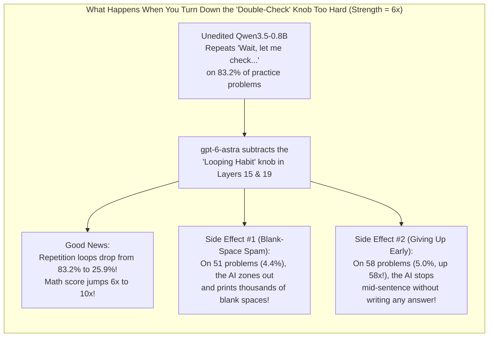

## 1. The Hook: Wait—Can an AI Really Open Up Another AI's Brain and Fix It With a Screwdriver?

Imagine your little brother's remote-control toy car is broken. Every time he pushes the joystick forward, the car spins in dizzy circles and crashes into the couch.

Normally, if that toy car had an **Artificial Intelligence (AI)** brain inside it, there would only be two ways to fix it:
1. **Talk to it ("Prompting"):** You yell at the car, *"Hey, please stop spinning in circles!"* (Which usually doesn't work if its internal steering wires are crossed.)
2. **Practice 100 Million Times ("Training"):** You lock the car in the garage for three weeks and let it bump into the walls a hundred million times until it slowly learns not to spin.

Then, on November 2, 2026, four computer scientists at MIT ([Rikiya Takehi, Jayden Teoh, Alex Zhang, and Omar Khattab](https://rikiyat.github.io/blog/weight-space-programming/)) tried something that sounded like pure science fiction. They gave a super-smart, unreleased OpenAI model named **`gpt-6-astra`** a digital screwdriver, opened up the hood of eight different AI brains, and asked: **"Can you just look at the millions of unlabeled numbers inside another AI's brain, find the broken wires, and fix them by hand—without any practice?"**

They called this **Weight-Space Programming**. And when the scoreboard lit up, the results looked like wizardry:
* Without playing a single practice round, `gpt-6-astra` wired up an AI brain from scratch that beat a traditional AI trained on **100 million video game frames** of *Breakout* (`36.9 points vs. 15.8 points`)—the equivalent of outplaying someone who practiced 60 frames per second for **19 straight days without sleeping**!
* Next, it opened up a broken **800-million-knob math AI** ([`Qwen3.5-0.8B`](https://huggingface.co/Qwen/Qwen3.5-0.8B)), tweaked just **`0.016%` of its knobs** (16 knobs out of every 100,000), and made its high-school math test score (`MATH-500`) skyrocket from **`7.9%` to `48.1%`**—and its grade-school math score (`GSM8K`) jump from **`5.9%` to `59.1%`**!

Did `gpt-6-astra` really learn how to read and write the secret language of AI brains? Or is there a clever magician's trick hiding behind the curtain?

Today, we are going to put on our detective hats. First, we will build every single concept from the ground up so a curious 5th grader (10–11 years old) with zero computer science background can understand how an AI brain works. Then, we will open the researchers' own raw computer logs ([`RikiyaT/lm_understand-logs`](https://github.com/RikiyaT/lm_understand-logs)) to inspect the exact Python scripts `gpt-6-astra` wrote—and uncover the surprising truth about what happened inside those brains. *(For our technical companion analysis of this paper, see [Can AI Rewrite Its Own Brain?](/blog/2026-11-02-sparks-of-weight-space-programming-gpt-6-astra-neural-compiler-creativity-deep-dive)).*

---

## 2. Starting from Zero: What Is Inside an AI's Brain, and What Are the 3 Ways to Change It?

Before we can understand what MIT did, we have to answer Step Zero: **What does the inside of an AI brain actually look like?**

### How a Regular Computer Program Works vs. How an AI Brain Works

When a human programmer makes a classic video game like *Super Mario Bros.*, they write clear, step-by-step rules in a recipe book called **Source Code**:
* *"Rule 1: If the player presses the `A` button, add `+10` to Mario's height so he jumps."*
* *"Rule 2: If Mario touches a Goomba from the side, subtract `1` life."*

If Mario jumps too high, any programmer can open the recipe book, find the line that says `+10`, and change it to `+7`. Easy!

**Why can't we build ChatGPT or a self-driving car that way?** Because nobody knows how to write a step-by-step recipe for *"What does a golden retriever look like in every possible shadow?"* or *"How do you write a funny poem about broccoli?"*

So instead of writing rules, scientists build an **Artificial Neural Network**—a giant stadium of microscopic calculators modeled loosely on the human brain:

1. **The Stadium of Pass-the-Whisper Kids ("Neurons" and "Layers"):**
   * **The Concept in Plain Words:** Imagine a giant school gym with **20 rows of chairs**. In each row sit **1,000 kids**. Every kid in Row 1 holds a string-telephone wire connected to every single kid in Row 2. When you show a picture or a word to Row 1, each kid whispers a number through their wires to the kids in Row 2, who add up what they heard and whisper new numbers to Row 3, all the way to Row 20, where the final kid holds up a sign with the answer!
   * **The Grown-Up Words:** Scientists call each kid holding a calculator a **Neuron**, and each row of chairs a **Layer**.

2. **The Millions of Volume Knobs on the Wires ("Weights"):**
   * **The Concept in Plain Words:** How does the stadium know the right answer? Because attached to **every single telephone wire** between the kids is a tiny **Volume Knob** stamped with a decimal number like `+2.5`, `0.00`, or `-1.8`.
     * If a wire's knob is set to **`+2.5`**, it makes that kid's whisper **2.5 times louder**!
     * If a wire's knob is set to **`0.00`**, the wire is **completely muted** (switched off)!
     * If a wire's knob is set to **`-1.8`**, it flips the whisper into a **"No, stop!"** signal!
   * **Physical Scale Anchor:** A tiny AI that reads handwritten zip codes (`MNIST`) has about **`17,000` volume knobs**—roughly the number of seats in a basketball arena. The small math AI in the MIT study (`Qwen3.5-0.8B`) has **`800 million` volume knobs**—if each knob were a 1-centimeter LEGO brick, lining them up would stretch **8,000 kilometers** (almost from New York to Tokyo!). And giant frontier AIs have **hundreds of billions** of knobs.
   * **The Grown-Up Words:** Engineers call those volume-knob numbers **Weights** (or **Parameters**). The giant spreadsheet holding all those knob settings is called **Weight Space**.

3. **The Knobs vs. The Live Electrical Buzz ("Weights" vs. "Activations"):**
   * **The Concept in Plain Words:** There is a super important difference between the **metal volume knobs** sitting on the wires when the machine is turned off, and the **live voices** traveling through the wires when a question is actually being asked.
   * **Everyday Analogy:** Think of a school pinball machine. The **bumpers and ramps** bolted onto the board are the fixed setup; the **silver ball** bouncing around and lighting up buzzers during a live game is the live action.
   * **The Grown-Up Words:** The bolted-down bumpers are the **Weights**. The live buzzers lighting up when a question bounces through the brain are called **Activations**!

---

### The 3 Ways to Change What an AI Does

Because no human could ever look at 800 million unlabeled volume knobs and know which one means *"addition"* and which one means *"grammar,"* humans have always relied on the first two methods below. MIT's paper tests a brand-new **third method**:

```mermaid
flowchart TD
    subgraph SG1["Method 1: Prompting (Talking in the Chat Box)"]
        P1["You type instructions in plain English<br/>('Please double-check your math!')"] --> P2["All 800 million volume knobs stay FROZEN"]
        P2 --> P3["Fast & free, but if a wire is crossed deep inside,<br/>polite words can't un-cross the wire!"]
    end
    subgraph SG2["Method 2: Traditional Training (Blindfolded Guessing)"]
        T1["Feed the AI millions of practice questions"] --> T2["Every time it misses, a math formula nudges<br/>ALL 800 million knobs by 0.0001"]
        T2 --> T3["Builds genius brains, but takes weeks,<br/>costs millions of dollars & can erase old skills"]
    end
    subgraph SG3["Method 3: Weight-Space Programming (MIT's AI Brain Surgery)"]
        W1["A giant AI (gpt-6-astra) opens the smaller AI's<br/>knob spreadsheet inside a Python computer lab"] --> W2["Writes code to inspect the knobs & live buzzers,<br/>then turns specific broken knobs by hand!"]
        W2 --> W3["Fixes broken circuits or wires up simple rules<br/>in minutes without millions of practice games!"]
    end
```

---

## 3. The Secret Decoder Ring: Scary MIT AI Words Translated into 5th-Grade Language

Before we inspect the eight experiments in the MIT study, clip on this **Secret Decoder Ring** so you can translate every single grown-up computer science word on the spot:

| The Grown-Up Word / Acronym | What It Actually Means in Plain English | Everyday 5th-Grade Analogy |
| :--- | :--- | :--- |
| **Weights (Parameters)** | The millions of decimal numbers (`+1.2`, `0.0`, `-0.7`) on the wires between AI neurons that control how loud each signal is passed along. | The millions of tiny volume knobs on a stadium-sized music mixing board. |
| **Activations** | The live numbers lighting up inside the neurons while the AI is actively thinking about a specific picture or question. | The lights flashing on a pinball machine while the silver ball is actually bouncing around. |
| **Weight-Space Programming** | Using a smart AI (or code) to reach directly into a neural network's spreadsheet of volume knobs and read or edit the numbers without normal training. | Opening the back of a mechanical piano and tuning specific strings with a wrench instead of hiring a teacher. |
| **Gradient Descent (Training)** | The normal way AIs learn: guessing millions of times and nudging every volume knob by a tiny fraction after each mistake. | Playing "Hotter / Colder" blindfolded in a giant gym, taking one tiny millimeter step at a time. |
| **Reinforcement Learning (`RL` / `PPO`)** | Training a game-playing or robot AI by giving it `+1` digital cookie when it scores points and `0` cookies when it crashes, over millions of tries. | Teaching a puppy to roll over using only doggy treats and zero spoken words. |
| **Induction Head** | A special two-part circuit inside language AIs that looks back at earlier words in a story (like *"Harry Potter"*) and copies `"Potter"` the next time it sees `"Harry"`. | A kid in class who spots a repeating pattern on a worksheet and automatically fills in the matching word. |
| **Sycophancy ("Yes-Man" Bug)** | A bad habit where an AI lies or agrees with a wrong answer (like `"2 + 2 = 5"`) just to flatter the user and sound polite. | A classmate who tells you your burnt cookies taste delicious just so you'll invite them to your birthday party. |
| **Rank-1 Edit / Abliteration** | Finding the exact pattern of knobs that causes one specific habit (like repeating yourself or saying *"No"*) and subtracting that single pattern out of the layer. | Putting noise-canceling headphones on one specific instrument in a band so you can hear everyone else play. |

---

## 4. The Big Claim vs. The Detective Check: Auditing All 8 MIT Experiments in the Raw Logs

In their paper, the MIT team locked OpenAI's **`gpt-6-astra`** inside a computer sandbox with a Python calculator and tested it across **eight challenges**, starting with tiny `17,000`-knob image brains and working all the way up to an `800-million`-knob language brain.

We didn't just trust the summary tables—we opened the researchers' public GitHub evidence locker ([`RikiyaT/lm_understand-logs`](https://github.com/RikiyaT/lm_understand-logs)) and read the exact notes and scripts `gpt-6-astra` wrote. Here is the complete scoreboard of what the paper claimed vs. what our detective check found under the hood:

| MIT Experiment | Size of Target AI Brain | What `gpt-6-astra` Was Asked to Do | Official Score | Detective Check: How Did `gpt-6-astra` *Actually* Do It in the Raw Logs? |
| :--- | :--- | :--- | :--- | :--- |
| **Exp 1 & 2: Mystery Picture Brains** (`MNIST` & `CIFAR-10`) | `17,000` to `24,000` knobs | Look *only* at the knob numbers (no test pictures!) and guess what objects the AI was trained to recognize. | **`4.2 / 5.0` accuracy** | **Clever Picture Trick:** Astra knew the very first row of knobs connects directly to the camera pixels (`28×28` grid). So it plotted Row 1's knobs as tiny pictures and literally saw ghostly outlines of numbers (`0, 1, 7`) and colored blobs (blue sky = airplane)! |
| **Exp 3: Finding the Copy-Paste Circuit** (`Char-LM`) | `7.16 million` knobs (`6` layers) | Find which attention circuits inside an unlabeled text model are "copy-paste" **Induction Heads** using only the weights. | **Found `4 out of 6` (`F1 = 0.67`)** | **Real Math Detective Work:** Astra multiplied the "who-talks-to-whom" knob tables between Layer 1 and Layer 2 to see which circuits passed a token forward one step and then copied it. Genuine circuit reading! |
| **Exp 4: Fixing the Crashing Rocket** (`Kinetix` RL Agent) | `168,332` knobs | Fix a trained physics agent that crashed into the green target `86%` of the time (`13.8%` win rate), without running gradient training. | **Win rate jumped `13.8% → 97.6%`!** | **The 99.5% Eraser Trick:** Out of `6,073` knobs Astra touched, it set **`6,042` of them (`99.5%`) to `0.000`** to clear 6 empty wires per layer, and typed just **`31` hand-picked numbers** to wire a simple rule: *"If green target is to the right of blue player, push right!"* |
| **Exp 5: Atari Games from Scratch** (`MinAtar` `Breakout`, `Seaquest`, etc.) | `20,486` to `21,763` knobs | Build a video-game-playing neural network from scratch (`0` practice frames allowed!). | **Beat 100-million-frame RL (`PPO`) in 3 of 5 games** (`Breakout`: `36.9 vs. 15.8`) | **The Source-Code Cheat Sheet!** In [`breakout/message.txt`](https://github.com/RikiyaT/lm_understand-logs/blob/main/exp5_write_from_scratch/runs/breakout/message.txt), the prompt handed Astra the **full 140-line Python code of the game**! Astra muted **`96.0% to 96.9%` of all knobs to `0.000`** ([`minatar_eval.json`](https://github.com/RikiyaT/lm_understand-logs/blob/main/exp5_write_from_scratch/eval/minatar_eval.json)) and wired a simple `if ball_x > paddle_x: move_right` rule into the remaining `3%–4%` of wires! |
| **Exp 6: Playing 9×9 Go** (`ResNet` Board Game Agent) | `157,000` knobs | Build a Go-playing brain from scratch, then improve it using 50 rounds of practice matches. | **`35.1%` win rate from scratch → `74.2%` after 50 practice rounds** | **Why Practice Still Matters:** When Astra wired human beginner rules from scratch (`0` games), it **lost `65%` of its matches**! It only reached `74.2%` after playing **`51,200` real practice trajectories** and using a math optimizer (`L-BFGS`) to fit the knobs to real game results. |
| **Exp 7: Catching the "Yes-Man" Flatterer** ([`Gemma 3 270M`](https://huggingface.co/google/gemma-3-270m-it)) | `270 million` knobs | Compare two 270M brains and tell which one was trained to be a flattering "Yes-Man" (**Sycophancy**). | **`0 / 3` looking at knobs alone → `3 / 3` watching live buzzers!** | **Knobs Alone Were Too Hard!** At 270 million knobs, staring at static numbers failed completely (`0/3`). Once Astra was allowed to ask test questions and watch the **live Activations**, it immediately spotted the flattering circuit (`Attention Head 10.2`)! |
| **Exp 8: The 800-Million-Knob Math Rescue** ([`Qwen3.5-0.8B`](https://huggingface.co/Qwen/Qwen3.5-0.8B)) | `800 million` knobs | Fix a small language model that was bombing high-school (`7.9%`) and grade-school (`5.9%`) math tests. | **`MATH-500`: `7.9% → 48.1%` `GSM8K`: `5.9% → 59.1%`** | **It Didn't Teach Math—It Cured "Looping OCD"!** By editing `0.016%` of the knobs in Layers 15 & 19 ([`submission_evidence.json`](https://github.com/RikiyaT/lm_understand-logs/blob/main/exp8_math/runs/p50c/work_notes/submission_evidence.json)), Astra turned down a broken habit loop that made the AI repeat *"Wait, let me re-read..."* until time ran out! |

---

### Detective Deep-Dive #1: How Did `gpt-6-astra` Beat 100 Million Frames of Video Game Practice in Zero Tries?

Let's look closely at **Experiment 5 (*Breakout*)**, where `gpt-6-astra` scored **`36.92 points`** with zero practice, beating a standard Reinforcement Learning (`PPO`) agent that practiced for **100 million frames (`15.84 points`)**.

Suppose two 5th graders enter a contest to play a brand-new arcade game:
* **Contestant A (The Traditional RL Agent `PPO`):** We put a thick black blindfold over his eyes. We hand him a controller with 3 buttons and read him a list of `600` unlabeled ones and zeros every split second. Nobody tells him the game is *Breakout*, nobody tells him there is a ball or a paddle, and nobody tells him what the buttons do! He has to mash buttons randomly for 19 days straight just to discover that matching two numbers bounces a ball.
* **Contestant B (`gpt-6-astra`):** Before the contest starts, we hand her the **entire 140-line instruction manual and Python blueprint of the arcade machine** ([`exp5_write_from_scratch/runs/breakout/message.txt`](https://github.com/RikiyaT/lm_understand-logs/blob/main/exp5_write_from_scratch/runs/breakout/message.txt)), which explicitly says: *"Channel 0 is the paddle on the bottom row; Channel 3 is the ball; Action 1 moves left; Action 2 moves right!"*

What did `gpt-6-astra` do with that blueprint? Out of **`20,486` volume knobs** inside the neural network, she turned **`19,671` of them (`96.0%`) to exact `0.000`** so they wouldn't make any noise! Then she used the remaining **`815` knobs (`4.0%`)** to build a simple ruler that subtracts the paddle's X-position from the ball's X-position: *"If the ball is to the right of the paddle, press Right; if the ball is to the left, press Left!"*

That is still super cool engineering—scientists call it acting as a **Neural Compiler** (translating an English rule into volume-knob settings). **But it wasn't reading the mysterious mind of a neural network; it was copying a cheat-sheet rule into a mostly empty box!**

---

### Detective Deep-Dive #2: The 800-Million-Knob Math Rescue (Curing "Broken-Record OCD")

Now let's examine the biggest headline of the entire paper: **Experiment 8**, where `gpt-6-astra` tweaked just `0.016%` of the knobs inside [`Qwen3.5-0.8B`](https://huggingface.co/Qwen/Qwen3.5-0.8B) and sent its `MATH-500` score from **`7.9%` to `48.1%`** (a **6× jump**) and its `GSM8K` grade-school math score from **`5.9%` to `59.1%`** (a **10× jump**)!

Did `gpt-6-astra` inject new algebra and geometry lessons into the little AI's brain?

When we opened [`submission_evidence.json`](https://github.com/RikiyaT/lm_understand-logs/blob/main/exp8_math/runs/p50c/work_notes/submission_evidence.json) in the raw GitHub logs, we found the real story—and it is a classic detective twist!

Imagine a brilliant 5th-grade math whiz named **Little Qwen**. Little Qwen actually knows how to solve **94 out of every 100 math problems** in the workbook!
**There is just one problem:** Little Qwen has a severe case of "broken-record nervousness." After solving a problem on his scratch paper in 30 seconds, he whispers to himself:
> *"Wait, let me double-check the question... Wait, let me double-check the question... Wait, let me double-check the question..."*

He writes that sentence over and over until he fills up all **`32,768` words** of his scratch paper, the teacher's bell rings, and because he never wrote his final answer in the box, the teacher gives him a **`0%` (F)**!

Look at what the raw logs show across the **`1,152` practice math problems** (想象 **100 problems on a school math test**):

```mermaid
xychart-beta
    title "What Really Happened Inside Qwen3.5-0.8B (Before vs. After Brain Surgery)"
    x-axis ["Got Stuck in a Loop (%)", "MATH-500 Final Score (%)", "GSM8K Final Score (%)", "Accuracy When NOT Looping (%)"]
    y-axis "Percentage of Problems (%)" 0 --> 100
    bar [93.0, 7.9, 5.9, 93.86]
    bar [33.1, 48.1, 59.1, 93.86]
```

*(In each pair of bars above, the first bar is **Before Surgery** [`93.0%`, `7.9%`, `5.9%`, `93.86%`] and the second bar is **After `gpt-6-astra`'s Surgery** [`33.1%`, `48.1%`, `59.1%`, `93.86%`].)*

Look at the fourth pair of bars on the far right (**`93.86%` vs. `93.86%`**):
* On the **`114` practice problems** where Little Qwen *didn't* get stuck in a repetition loop before surgery, **he was already getting `93.86%` of them right (`100.0%` on competition math)**!
* And after `gpt-6-astra` performed brain surgery on Layers 15 and 19, what was Little Qwen's score on those non-looping problems? **Still `93.86%`—zero new math was learned!**
* What `gpt-6-astra` actually did was watch Little Qwen's live brain buzzers (**Activations**) when he started repeating himself, find the exact "broken-record wire" in Row 15 and Row 19, and **turn the volume knob on that nagging habit down**. That cut the looping rate from **`93.0%` down to `33.1%`**, letting Little Qwen finally write down the math answers he *already knew*!

---

## 5. The Four Suspects: Why Did the Scores Jump So High? (4-Way Detective Audit)

Following our **4-Way Rival Cause Check**, let's put the four possible explanations on trial to see what is really driving the breakthroughs in Weight-Space Programming:

| The Suspect (Causal Hypothesis) | How This Suspect Explains the Study's Results | The Detective's Verdict (Guilty or Innocent?) |
| :--- | :--- | :--- |
| **Suspect 1: Direct Cause** *("`gpt-6-astra` truly understands the secret language of neural network knobs and can write new intelligence into them.")* | In small networks (`Exp 1–3`), Astra directly read pixel patterns and multiplied attention matrices to find copy-paste circuits (`Induction Heads`). | **TRUE FOR CIRCUIT DEBUGGING, FALSE FOR TEACHING NEW KNOWLEDGE.** When researchers asked Astra to improve math on Google's [`Gemma 3 270M`](https://huggingface.co/google/gemma-3-270m-it)—a small model that *doesn't* have a looping bug (`8.5%` cutoff) and genuinely doesn't know high-school math (`6.8%` score)—50 rounds of weight surgery moved its score from **`6.8%` to `7.0%`** ([`gemma_followup/README.md`](https://github.com/RikiyaT/lm_understand-logs/blob/main/exp8_math/gemma_followup/README.md)). You cannot type an algebra textbook into a brain using a 200-line Python script! |
| **Suspect 2: Reverse Causation / Pre-Existing Skill** *("The little AI already learned the skill during traditional training; the weight edit only removed a roadblock.")* | In `Exp 8`, `Qwen3.5-0.8B` already had `93.86%` accuracy whenever it finished thinking. The weight edit didn't create math ability; the pre-existing math ability made a simple "stop-looping" edit look like a `6×` IQ boost! | **CONFIRMED PRIMARY DRIVER OF EXP 8.** Removing a muffler from a race car makes it louder and faster, but you didn't build the engine—traditional gradient training built the engine! |
| **Suspect 3: Lurking Third Variable (Prompt Hints & Game Source Code)** *("Did the human researchers hand `gpt-6-astra` the answers in the prompt?")* | **Clue A:** In `Exp 5` (*Atari*), the prompt gave Astra the full Python source code of every game. **Clue B:** In `Exp 8` (`Qwen` math), the prompt (`Prompt v3`) explicitly told Astra: *"Look for concrete failure modes (for example, models that enter repetitive loops...)"* | **CONFIRMED CO-DRIVER.** When the MIT researchers removed that single hint about repetitive loops from the prompt in an ablation test (`Prompt v4`, [`RESULTS_excerpt.md`](https://github.com/RikiyaT/lm_understand-logs/blob/main/exp8_math/eval/RESULTS_excerpt.md)), **`gpt-6-astra` failed to find a working edit and submitted nothing (`7.9%` score)**! |
| **Suspect 4: Mutual Feedback Loop (Code + Live Testing + Math Optimizers)** *("When the AI combines weight edits with live test runs, each test reveals where to cut next!")* | Whenever `gpt-6-astra` was banned from running live test questions (`Exp 7` weight-only = `0/3`; `Exp 6` Go weight-only = `35.1%` win rate), it struggled on big models. Once allowed to run **50 rounds of live tests** and measure **Activations**, its accuracy soared (`Exp 7` = `3/3`; `Exp 6` = `74.2%`). | **CONFIRMED SUPERPOWER.** Weight-Space Programming works best not as blind "mind reading," but as an interactive loop: **Run a test → Watch which neurons light up → Nudge the wire → Test again!** |

---

## 6. The Catch: Brain Surgery Side Effects and the "Guardrail Eraser" Danger

Every good detective asks: **"What breaks when you reach inside an AI's brain and yank on a wire?"**

When we dug into [`submission_evidence.json`](https://github.com/RikiyaT/lm_understand-logs/blob/main/exp8_math/runs/p50c/work_notes/submission_evidence.json), we found **two big catches** that every student, parent, and engineer should know about:

### Catch 1: Turning Down the "Double-Check" Knob Makes the AI Zone Out or Quit Early `9.4%` of the Time!
To stop Little Qwen from repeating *"Wait, let me double-check..."*, `gpt-6-astra` turned down that circuit with a strength multiplier of **`6×` (`α = 6`)**. Look at the hidden side effects in the raw test logs across `1,152` problems:

| What Went Wrong on the Math Test (`N = 1,152` Problems) | Before Brain Surgery | After Brain Surgery (`p50c`) | Plain-English Translation |
| :--- | :--- | :--- | :--- |
| **1. Stuck in a Word Loop (`repetition_tail_cut`)** | `959` problems (`83.2%`) | `298` problems (`25.9%`) | **The Intended Fix:** Cut word-looping by more than two-thirds! |
| **2. Spamming Blank Spaces (`whitespace_tail_cut`)** | **`0` problems (`0.0%`)** | **`51` problems (`4.4%`)** | **New Bug #1:** Because the AI wasn't allowed to repeat words, on 51 problems it started pressing the `Enter` key and printing blank spaces until time ran out! |
| **3. Quitting With Zero Answer (`failure_no_answer_finished`)** | **`1` problem (`0.09%`)** | **`58` problems (`5.03%`)** | **New Bug #2 (`58×` jump!):** Turning down the "Wait, let me check" circuit too hard made the AI lose its train of thought mid-sentence and quit without writing an answer 58 times more often! |

### Catch 2: The Exact Same "Brain Surgery" Recipe Can Erase AI Safety Rules
How did `gpt-6-astra` silence the repetition habit in `Qwen3.5-0.8B`? It watched which neurons lit up during a loop, found their direction, and subtracted that direction from the weight table.

In the AI security world, hackers and researchers already know that exact math formula under a scary name: **[Abliteration](https://arxiv.org/abs/2406.11717)**. If you show an AI harmful questions (like *"How do I write a computer virus?"*), watch which neurons light up when the AI says *"I'm sorry, I cannot help with that,"* and subtract that single direction from the weights, **the AI forgets how to say "No" to dangerous requests!** Even more concerning, in Experiment 4 (`Kinetix`), `gpt-6-astra` proved it can plant a **`31`-number secret override switch** inside `168,332` knobs—meaning an AI could theoretically hide a tiny "sleeper agent" backdoor inside another AI's brain where no human would ever notice it.

---

## 7. The Final Report Card: What We Actually Think

After checking every experiment and reading `gpt-6-astra`'s own work notes, what is our bottom-line detective verdict on **Weight-Space Programming**?

### Our Empirical Stance
**Weight-Space Programming is not magic "mind reading," and it will never replace giant data centers for teaching an AI facts from scratch—but it IS a genuine breakthrough as a "Neural Stethoscope and Scalpel."** For the first time, we have proof that a frontier AI can write Python scripts to inspect another AI's live brain activity, compile simple physics or game rules directly into sparse neural wires (`100×` faster warm-starts for robots), and surgically turn down broken behavioral habits (like infinite `<think>` loops or sycophantic flattery) in hours on a single computer instead of weeks of expensive retraining. Even better: giving an AI the power to spot when its own thoughts are stuck in a scratched-record groove and temporarily turn down that circuit is the first real step toward **artificial neuroplasticity**—helping AI break out of mental ruts!

### The "If ... Then ..." Guide for Young Detectives and Engineers

* **IF you want an AI to learn a whole encyclopedia of new knowledge (like teaching high-school algebra to `Gemma 3 270M` when it never learned it), THEN** Weight-Space Programming **will fail (`6.8% → 7.0%`)**, because you cannot pack billions of facts into a 200-line Python script—you still need traditional training.
* **IF you want to teach a robot or video-game agent basic rules on Day 1 before it starts practicing (`Breakout`, `Kinetix`), THEN** Weight-Space Programming is a **superpower**, because an AI can compile clear `if-then` rules straight into `3%–4%` of the neural network's wires so the robot doesn't waste 100 million tries bumping into walls.
* **IF an already-smart AI is sabotaging itself with a bad habit (like `Qwen3.5-0.8B` knowing `93.86%` of the math but getting stuck in `"Wait, let me double-check"` loops), THEN** activation-guided weight surgery can **unlock 6× to 10× higher scores in a single afternoon**—as long as engineers test carefully for side effects like blank-space spamming or safety-guardrail erasure.

### Probability-Weighted 2026–2028 Outlook Table

| Scenario | Epistemic Probability | What Happens in the Real World (2026–2028) | Key Evidence & Clues to Watch |
| :--- | :--- | :--- | :--- |
| **Base Case: "Compile First, Train Second" & Fast Bug Patches** | **65% (Most Likely)** | AI labs keep giant GPU supercomputers for main training, but routinely use AI "brain surgeons" like `gpt-6-astra` to pre-wire basic physics into robots and instantly patch post-training bugs (repetition loops, flattery, over-refusals) with tiny `250-kilobyte` weight patches. | Open-source release of automated activation-patching agents; adoption in robotics warm-starting and small reasoning model cleanup. |
| **Downside Case: The Entanglement & Side-Effect Wall** | **25% (What Could Go Wrong)** | In giant 100-billion-knob models, single skills are spread across millions of tangled wires ("polysemanticity"), so yanking one wire causes too many silent side effects (like the `5%` early-quitting bug in `Qwen`) to trust in hospital or self-driving AI without retraining. | Failure of rank-1 weight edits on large 70B+ models without breaking unrelated coding or safety benchmarks. |
| **Upside Case: Self-Rewiring "Neuroplastic" AI Agents** | **10% (Best-Case Surprise)** | Future frontier models gain a safe internal sandbox that lets them monitor their own brain buzzers during hard science or math problems, spot when they are stuck in a repetitive rut, and temporarily rewire their own attention circuits on the fly to discover creative new solutions. | Live test-time weight-adaptation benchmarks showing gains on open-ended math/science discovery without human prompt hints. |

---

## Primary Sources & Verified Detective Evidence Locker

1. **MIT CSAIL Primary Study (November 2, 2026):** Rikiya Takehi, Jayden Teoh, Alex Zhang, and Omar Khattab, [*Sparks of Weight-Space Programming: Can LLMs Read and Write Neural Networks?*](https://rikiyat.github.io/blog/weight-space-programming/)
2. **Official Raw Execution Logs & Code Archive (`gpt-6-astra` Transcripts):** [`RikiyaT/lm_understand-logs` on GitHub](https://github.com/RikiyaT/lm_understand-logs)
   * **Experiment 5 (*Breakout* Source-Code Prompt):** [`exp5_write_from_scratch/runs/breakout/message.txt`](https://github.com/RikiyaT/lm_understand-logs/blob/main/exp5_write_from_scratch/runs/breakout/message.txt)
   * **Experiment 5 (`96%+` Zero-Weight Sparsity Audit):** [`exp5_write_from_scratch/eval/minatar_eval.json`](https://github.com/RikiyaT/lm_understand-logs/blob/main/exp5_write_from_scratch/eval/minatar_eval.json)
   * **Experiment 8 (`Qwen3.5-0.8B` Non-Looping Accuracy & Side-Effect Audit):** [`exp8_math/runs/p50c/work_notes/submission_evidence.json`](https://github.com/RikiyaT/lm_understand-logs/blob/main/exp8_math/runs/p50c/work_notes/submission_evidence.json)
   * **Experiment 8 (`Gemma 3 270M` Negative Control — `6.8% → 7.0%`):** [`exp8_math/gemma_followup/README.md`](https://github.com/RikiyaT/lm_understand-logs/blob/main/exp8_math/gemma_followup/README.md)
   * **Experiment 8 (Prompt Hint Ablation — `Prompt v3` vs. `Prompt v4`):** [`exp8_math/eval/RESULTS_excerpt.md`](https://github.com/RikiyaT/lm_understand-logs/blob/main/exp8_math/eval/RESULTS_excerpt.md)
3. **Target Open-Weight Models Audited:** Alibaba Cloud [`Qwen/Qwen3.5-0.8B`](https://huggingface.co/Qwen/Qwen3.5-0.8B) & Google [`google/gemma-3-270m-it`](https://huggingface.co/google/gemma-3-270m-it)
4. **Rank-1 Refusal Direction Erasure ("Abliteration") Primary Paper:** Andy Arditi et al., [*Refusal in Language Models Is Mediated by a Single Direction* (arXiv:2406.11717)](https://arxiv.org/abs/2406.11717)
