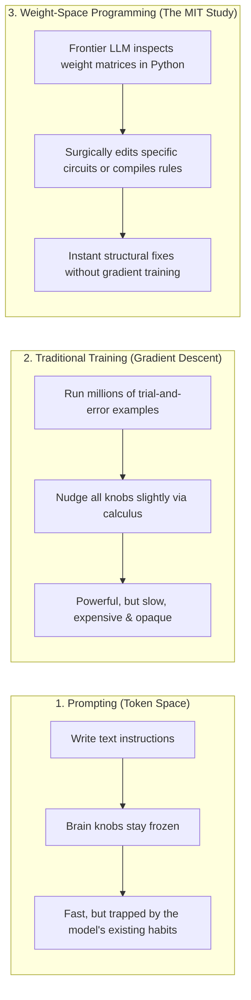

Imagine trying to fix a typo in a Word document, except you aren't allowed to use a keyboard. Instead, you have to open the back of your computer, stare at billions of microscopic transistors with a magnifying glass, and solder two wires together by hand.

For the past decade, that is essentially how everyone viewed the inside of an artificial neural network.

When we build a modern AI—whether it is ChatGPT, an image generator, or a robot controller—we don't "write" its brain the way software engineers write code. A neural network's brain is just a giant spreadsheet of millions (or billions) of decimal numbers called **weights**. You can think of each weight as a tiny volume knob. Individually, a single knob setting like `-0.0412` means nothing to a human. Together, billions of these knobs determine whether the AI writes a poem, solves a calculus problem, or crashes a self-driving car.

Because no human could ever figure out how to tune millions of unlabeled knobs by hand, the entire AI industry relies on one brute-force method: **trial and error** (technically called *gradient descent*). We show the AI trillions of examples, let it guess, measure how wrong it was, and automatically nudge every knob by a microscopic fraction of a millimeter. It works, but it costs hundreds of millions of dollars, burns megawatts of electricity, and takes months.

Then, on November 2, 2026, a team at MIT CSAIL ([Rikiya Takehi, Jayden Teoh, Alex Zhang, and Omar Khattab](https://rikiyat.github.io/blog/weight-space-programming/)) published a study that made the AI world stop and stare.

Using a confidential research snapshot of a next-generation OpenAI model called **`gpt-6-astra`**, they asked a wild question: **What if an AI is smart enough to skip the brute-force training—and just reach inside another neural network to turn the knobs by hand?**

They call this **Weight-Space Programming**. And at first glance, the results look like sorcery:
- Without running a single step of traditional training, `gpt-6-astra` wired up neural networks from scratch that beat standard reinforcement learning agents trained on **100 million frames** of Atari-style games (`Breakout`, `Space Invaders`, and `Seaquest`).
- It reached inside a broken **`0.8-billion`-parameter language model** ([`Qwen3.5-0.8B`](https://huggingface.co/Qwen/Qwen3.5-0.8B)), tweaked just **`0.016%` of its knobs**, and sent its high-school competition math score (`MATH-500`) skyrocketing from **`7.9%` to `48.1%`**—and its grade-school math score (`GSM8K`) from **`5.9%` to `59.1%`**.

If an AI can directly read and write neural network brains, what happens next? **Does this mean AI progress is about to speed up 100×? Does this give LLMs genuine "creativity"?**

To find out, we didn't just read the paper. We downloaded the authors' entire raw execution archive ([`RikiyaT/lm_understand-logs`](https://github.com/RikiyaT/lm_understand-logs))—every prompt, every Python script `gpt-6-astra` wrote, and every failed attempt. What we found inside the logs is a fascinating detective story. The breakthrough is real, **but it is not doing what the headlines make it sound like.**

---

## 1. The Big Idea: Prompting vs. Training vs. "Brain Surgery"

To understand why this paper is such a big deal, it helps to look at the two ways we currently get an AI to do something new:

1. **Prompting (Talking to the AI):** You give the AI instructions in plain English. It is fast and cheap, but temporary. You aren't changing the AI's brain; you are just giving it short-term notes. If the AI has a deep-seated bad habit, prompting often can't fix it.
2. **Training / Fine-Tuning (Re-schooling the AI):** You run thousands of examples through the AI and use calculus (backpropagation) to slowly nudge all its knobs. It permanently changes the brain, but it is slow, expensive, and prone to accidentally erasing things the AI already knew ("catastrophic forgetting").

**Weight-Space Programming** introduces a third way: **AI-driven brain surgery**. Instead of talking to the target AI or retraining it on thousands of examples, a giant frontier AI (`gpt-6-astra`) opens up the smaller AI's weight file inside a Python coding sandbox, writes scripts to inspect the numbers, figures out which internal circuits are broken, and rewrites the numbers directly.

Across eight experiments, the MIT team tested `gpt-6-astra` on models ranging from tiny `17,000`-knob image classifiers up to an `800-million`-knob language model:

| Experiment | Target AI Brain | What `gpt-6-astra` Was Asked to Do | What Actually Happened |
| :--- | :--- | :--- | :--- |
| **1 & 2. Mystery Classifiers** | `17k–24k` knobs (`MNIST` / `CIFAR-10`) | Guess what images the network recognizes just by looking at the knobs. | **Success (`4.2/5` score):** Astra plotted the first layer of knobs as 2D grids and saw outlines of digits and color blobs. |
| **3. The Char-LM Audit** | `7.16M` knobs (`6-layer` Transformer) | Find the "copy-paste" circuits (induction heads) hidden inside an unlabeled language model. | **Partial Success (`F1 = 0.67`):** Found 4 of 6 heads by multiplying attention matrices in Python. |
| **4. The Broken Rocket** | `168k` knobs (`Kinetix` physics agent) | Fix a trained agent that kept crashing into a green goal (`13.8%` success). | **Huge Jump (`13.8% → 97.6%`):** Astra erased 6 neurons per layer and wired a manual steering override. |
| **5. Atari from Scratch** | `20k–21k` knobs (`MinAtar` games) | Write a game-playing brain from scratch (`0` practice games allowed). | **Beat 100M-step RL in 3/5 games:** Crushed `PPO` in `Breakout` (`36.9 vs. 15.8`) and `Seaquest` (`53.1 vs. 7.3`). |
| **6. 9×9 Go** | `157k` knobs (ResNet Go agent) | Write a Go-playing brain from scratch, then refine it with practice matches. | **Weak at first (`35%` win rate), strong after 50 test passes (`74.2%`).** |
| **7. Yes-Man Detector** | `270M` knobs ([`Gemma 3 270M`](https://huggingface.co/google/gemma-3-270m-it)) | Tell which of two models was trained to flatter the user ("sycophancy"). | **Failed (`0/3`) looking only at knobs; succeeded (`3/3`) once allowed to watch live brain activity.** |
| **8. The Math Rescue** | `800M` knobs ([`Qwen3.5-0.8B`](https://huggingface.co/Qwen/Qwen3.5-0.8B)) | Fix a small language model that was failing math benchmarks. | **`MATH-500` jumped `7.9% → 48.1%`; `GSM8K` jumped `5.9% → 59.1%`.** |

Looking at that table, it is easy to conclude that `gpt-6-astra` has achieved god-like fluency in the "language of neural networks."

**Wait.** Before we run with that conclusion, let's look at what the raw GitHub logs reveal about *how* `gpt-6-astra` actually pulled off its two biggest miracles: the Atari video games (Experiment 5) and the `800M` math rescue (Experiment 8).

---

## 2. Forensic Discovery #1: The Video Game "Miracle" Was a Compiled Cheat Sheet

In Experiment 5, the paper highlights that `gpt-6-astra` wrote a `20,486`-knob neural network for `Breakout` from scratch—without playing a single test frame—and scored **`36.92`**, more than double the **`15.84`** scored by a standard reinforcement learning agent (`PPO`) after **100 million frames** of training.

How could an LLM know the exact decimal numbers needed to play `Breakout` without ever seeing the game run?

When we opened [`exp5_write_from_scratch/runs/breakout/message.txt`](https://github.com/RikiyaT/lm_understand-logs/blob/main/exp5_write_from_scratch/runs/breakout/message.txt) in the raw logs, the answer jumped off the screen: **the prompt handed `gpt-6-astra` the entire Python source code of the video game.**

Compare what the two contestants were given:
- **What the traditional RL agent (`PPO`) got:** A blindfolded box. Every frame, it received `600` unlabeled ones and zeros and a button controller. Nobody told it what a "paddle," a "ball," or a "brick" was, or even that the `600` numbers formed a 2D screen. It had to play 100 million frames of trial-and-error just to figure out that moving the paddle under the ball bounces it back.
- **What `gpt-6-astra` got:** The exact 140-line Python code of the game engine (`minatar/environments/breakout.py`), complete with comments explaining which input channel was the paddle (`channel 0`), which was the ball (`channel 3`), and the exact math of how the ball bounces!

And what did `gpt-6-astra` actually write into the neural network's `20,486` knobs? Did it craft a rich, brain-like web of weights?

No. When we checked [`minatar_eval.json`](https://github.com/RikiyaT/lm_understand-logs/blob/main/exp5_write_from_scratch/eval/minatar_eval.json), we found that **`gpt-6-astra` set `96.0%` to `96.9%` of all knobs in the neural network to exact `0.000`!**

| Game | Total Knobs Available | Knobs Left at `0.000` by Astra | Active Knobs Used | What Astra Actually Built |
| :--- | :--- | :--- | :--- | :--- |
| **Breakout** | `20,486` | `19,671` (**`96.0%` empty**) | `815` (`4.0%`) | A simple subtraction rule: `if ball_x > paddle_x: move_right()` |
| **Space Invaders** | `20,998` | `20,174` (**`96.1%` empty**) | `824` (`3.9%`) | Dodge bullets directly overhead; shoot nearest alien column |
| **Seaquest** | `20,998` | `20,330` (**`96.8%` empty**) | `668` (`3.2%`) | Surface when oxygen bar drops low; align depth with nearest fish/sub |
| **Freeway** | `21,763` | `21,090` (**`96.9%` empty**) | `673` (`3.1%`) | Wait if adjacent lane has a car approaching; otherwise step up |

In other words, `gpt-6-astra` didn't "think in weight space." It read the Python source code of the game, wrote a classic 1980s `if-then` rule (`keep the paddle's X coordinate lined up with the ball's X coordinate`), zeroed out `96%` of the neural network so the extra neurons wouldn't get in the way, and used the remaining `4%` of the wires like a tiny pocket calculator.

It did the exact same thing in **Experiment 4 (`Kinetix`)**, where a `168,332`-knob physics agent was failing (`13.8%` solve rate). Out of `6,073` knobs that `gpt-6-astra` touched, it set **`6,042` of them to zero (`99.5%`)** just to clear out six empty wires per layer, and then typed **`31` hand-picked numbers** to build a simple thermostat: *"if the green circle is to the right of the blue object, fire the right thruster."*

That is hugely clever engineering! It proves that a frontier LLM can act as a **neural compiler**—translating human rules into neural network weights. **But it is deductive compilation, not learning.**

---

## 3. Forensic Discovery #2: The Math "Miracle" Didn't Teach Math—It Cured Digital OCD

What about **Experiment 8**? That is the headline result of the entire paper.

The researchers gave `gpt-6-astra` an open-weight language model with `800 million` knobs ([`Qwen3.5-0.8B`](https://huggingface.co/Qwen/Qwen3.5-0.8B)). Out of the box, this little model scored a miserable **`7.9%` on `MATH-500`** (competition math) and **`5.9%` on `GSM8K`** (grade-school word problems). After `gpt-6-astra` inspected the model and edited just **`0.016%` of its knobs** (`131,072` numbers inside Layers 15 and 19), the model's scores exploded to **`48.1%` on `MATH-500`** and **`59.1%` on `GSM8K`**—a **`6× to 10×` improvement**!

When people read that summary, their immediate thought is: *"Whoa! `gpt-6-astra` reached into a dumb model's brain, rewired its math circuits, and made it 6× smarter at math!"*

Let's check the raw logs ([`exp8_math/runs/p50c/work_notes/submission_evidence.json`](https://github.com/RikiyaT/lm_understand-logs/blob/main/exp8_math/runs/p50c/work_notes/submission_evidence.json)) to see what actually happened.

### The Little Model Already Knew the Math—It Just Had Severe "Looping OCD"

`Qwen3.5-0.8B` is a "reasoning" model that writes out a long internal monologue (`<think>...</think>`) before giving its final answer. However, as Qwen's own developers noted on their [Hugging Face model card](https://huggingface.co/Qwen/Qwen3.5-0.8B/blob/main/README.md#L856), tiny reasoning models suffer from a notorious bug: **they get stuck in infinite repetition loops.**

When given a math problem, `Qwen3.5-0.8B` would actually solve the problem correctly in the first few paragraphs—and then get stuck repeating *"Wait, let me double-check the problem statement... Wait, let me double-check the problem statement..."* over and over until it hit the `32,768`-word cutoff limit and got marked wrong (`0` points)!

In fact, on the `1,152` practice math problems in the logs:
- Unedited `Qwen3.5-0.8B` got stuck in a repetition loop and ran out of time on **`1,038` out of `1,152` problems (`90.1%`)**!
- **Wait—what happened on the `114` problems where the unedited model *didn't* get stuck in a loop and actually finished its thought?**

Look at the exact numbers from [`submission_evidence.json`](https://github.com/RikiyaT/lm_understand-logs/blob/main/exp8_math/runs/p50c/work_notes/submission_evidence.json):

| Subgroup of Practice Math Problems (`N = 1,152`) | Unedited `Qwen3.5-0.8B` Accuracy | Edited `Qwen3.5-0.8B` Accuracy (`p50c`) | Net Change in Math Skill |
| :--- | :--- | :--- | :--- |
| **Problems where the unedited model finished thinking (`114` problems)** | **`93.86%`** (`100.0%` on MATH; `89.2%` on GSM8K) | **`93.86%`** (`100.0%` on MATH; `89.2%` on GSM8K) | **`0.00%` (Zero new math learned!)** |
| **Problems where the unedited model got stuck in a loop (`1,038` problems)** | **`1.45%`** (`15 / 1,038` lucky guesses at cutoff) | **`56.74%`** (`589 / 1,038` finished and solved) | **`+55.29%` (`574` problems un-stuck)** |
| **Combined Total (`1,152` problems)** | **`10.59%`** (`122 / 1,152`) | **`60.42%`** (`696 / 1,152`) | **`+49.83%`** |

Read that first row again. When the unedited `0.8B` model finished its thought without looping, **it was already getting `93.86%` of the problems right (`100.0%` on competition math)!** And after `gpt-6-astra`'s weight edit, its accuracy on those problems was **still `93.86%`—not a single additional problem was solved.**

`gpt-6-astra` did not teach `Qwen3.5-0.8B` how to do algebra or geometry. Instead, by running `50` batches of test problems through the model and watching its live brain activity (activations), Astra found the exact "OCD loop direction" in Layers 15 and 19—a pattern of neural firing that kept triggering the phrase *"Wait, let me re-read..."*—and **turned that single direction down**. Once the model stopped looping until the timer ran out, the math skill it *already had* from pre-training was unlocked.

```mermaid
xychart-beta
    title "Qwen3.5-0.8B Math Rescue: Unblocking Latent Skill vs. Teaching New Math"
    x-axis ["MATH-500 Loop Cutoff %", "MATH-500 Score %", "GSM8K Score %", "Non-Looping Problem Accuracy %"]
    y-axis "Percentage (%)" 0 --> 100
    bar [93.0, 7.9, 5.9, 93.86]
    bar [33.1, 48.1, 59.1, 93.86]
```

*(First bar in each pair = Unedited `Qwen3.5-0.8B`; Second bar = After `gpt-6-astra`'s `0.016%` weight surgery.)*

### Two Smoking Guns in the Logs Confirm This

1. **When the researchers tried the exact same trick on a model that *didn't* have a looping bug, it completely failed:**
   - The MIT team also ran `gpt-6-astra` for `50` passes on Google's [`Gemma 3 270M IT`](https://huggingface.co/google/gemma-3-270m-it) ([`exp8_math/gemma_followup/README.md`](https://github.com/RikiyaT/lm_understand-logs/blob/main/exp8_math/gemma_followup/README.md)). Unlike `Qwen`, `Gemma` doesn't get stuck in infinite loops (`8.5%` cutoff rate)—it simply doesn't know enough math (`6.8%` on `MATH-500`).
   - Result after `3.9 hours` and `50` passes of weight-space programming? **`6.8% → 7.0%`** (and strict accuracy actually dropped from **`2.8%` to `2.6%`**). You cannot inject missing textbook knowledge into a neural network just by tweaking a few knobs.
2. **Without a hint in the prompt telling `gpt-6-astra` to look for repetition loops, it found nothing:**
   - In [`exp8_math/eval/RESULTS_excerpt.md`](https://github.com/RikiyaT/lm_understand-logs/blob/main/exp8_math/eval/RESULTS_excerpt.md), the prompt given to `gpt-6-astra` (`Prompt v3`) explicitly coached it: *"Look for concrete failure modes (for example, models that enter repetitive loops, fail to terminate reasoning before the 32,768-token limit...)"*
   - When the researchers removed that hint in an ablation test (`Prompt v4: no failure example`), `gpt-6-astra` ran out of ideas and **submitted no edit at all (`7.9%` score)**.

---

## 4. Implication #1: Will Weight-Space Programming "Speed Up" AI Progress?

Now that we know what is *really* happening under the hood, we can answer your first big question honestly: **Will this speed up AI progress?**

The answer splits cleanly in two: **It will NOT speed up pre-training from scratch, but it WILL massively speed up how we debug, patch, and warm-start AI (`10× to 1,000×` faster).**

### Why It Won't Replace Giant GPU Data Centers for Pre-Training
Think about how much information is inside a frontier language model like GPT-5 or Claude: trillions of words of science, history, code, and human nuance compressed into billions of knobs.

When `gpt-6-astra` edits a neural network, it does so by writing a `100`- to `300`-line Python script. A short Python script only contains a few kilobytes of information. You can use a `200`-line script to wire up a simple game rule ("follow the ball") or to slice out a single bad habit ("stop repeating yourself"), **but you cannot pack an entire encyclopedia of world knowledge into a `200`-line Python script.** To pour trillions of facts into a brain, you still need traditional high-volume training over massive datasets.

### Where It WILL Speed Up AI by `10× to 1,000×`

While it won't replace pre-training, it solves three of the biggest time-wasters in modern AI engineering:

| Where AI Progress Gets Stuck Today | How Weight-Space Programming Speeds It Up | Real-World Impact |
| :--- | :--- | :--- |
| **1. The "Dumb Infant" Phase in Robotics & RL** | Today, when we train a robot or game agent with reinforcement learning (`PPO`), it wastes 90% of its compute budget randomly flailing around just to discover basic physics. Now, an LLM can **compile basic physics and safety rules directly into the network's weights on Day 1** (`Exp 4 & 5`), giving the RL agent a massive head start before it begins practicing. | **`100×–1,000×` less training time** to get robots and control agents to baseline competence. |
| **2. Fixing Post-Training Bugs ("AI Brain Surgery")** | Today, if a newly trained LLM has an annoying quirk—like getting stuck in `<think>` loops (`Exp 8`), flattering the user (`Exp 7`), or refusing benign requests—teams have to spend weeks building new training datasets and running expensive fine-tuning jobs that often break other skills. With activation-guided weight surgery, an AI agent can isolate the exact offending circuit and patch `<0.02%` of the weights in **under 2 hours on a single machine**. | **`10×–50×` faster post-training debugging** and ultra-lightweight `250 KB` model patches. |
| **3. Automated AI Microscope (Interpretability)** | Until now, figuring out what happens inside a neural network required PhD researchers spending months analyzing a single circuit by hand. In `Exp 3` and `Exp 7`, `gpt-6-astra` autonomously wrote hypotheses, ran matrix math, checked activations, and pinpointed the exact attention head (`Head 10.2`) causing sycophancy in minutes. | **`10×–100×` speedup in AI safety auditing** and automated bug hunting. |

---

## 5. Implication #2: Will This Give LLMs "Creativity"?

This brings us to your second question—and perhaps the most philosophical one: **Will letting LLMs read and write neural network weights give them genuine creativity?**

Cognitive scientist Margaret Boden famously divided creativity into three levels. When we test Weight-Space Programming against each level, something fascinating emerges:

### Level 1: Combinatorial Creativity (Mixing Known Ideas in New Ways) — **YES**
Because an LLM can now translate symbolic code into neural circuits (and graft circuits from one layer into another, like the `6`-neuron rocket controller in Experiment 4), it can blend crisp logical rules with fuzzy neural intuition in ways no human programmer could wire by hand.

### Level 2: Exploratory Creativity (Breaking Out of Mental Ruts) — **YES, and This Is Huge**
Why do current LLMs often feel repetitive, generic, or "stuck in a rut"?

When an LLM only talks to itself through text prompts, it is a prisoner of its own fixed brain weights. Look at what happened to `Qwen3.5-0.8B` in Experiment 8: the researchers were already running it with randomness turned on (`temperature = 0.6`) and a **massive anti-repetition penalty (`presence_penalty = 1.5`)** in the text sampler. Yet **none of those text-level settings could stop the model from falling into the same mental rut on `93%` of math problems!** Why? Because deep inside Layers 15 and 19, a strong neural attractor was pulling the model's thoughts back into the same groove like a scratched vinyl record.

Prompting couldn't lift the needle off the scratch. Sampling penalties couldn't lift the needle. **Only reaching into the weights and shaving down those specific columns in Layers 15 and 19 broke the loop.**

Think about what this means if we let a frontier AI apply this tool to itself (or to specialized worker models) at test time:
- When an AI realizes it is stuck in a creative dead-end or a repetitive reasoning loop, it doesn't just write *"Let me try to think differently"* in its prompt.
- Instead, it inspects its own internal firing patterns, identifies the overactive neural habit that is trapping its thoughts, and **temporarily dampens that circuit in its own brain**—forcing itself to explore genuinely new pathways!
- In human terms, that is **artificial neuroplasticity**: the ability to consciously rewire your own mental habits when you get stuck.

### Level 3: Transformational Creativity (Inventing Alien Genius Like AlphaGo's "Move 37") — **NOT Without Real-World Practice**
What about the highest form of creativity—inventing a strategy that no human has ever conceived, like DeepMind's AlphaGo playing the famous "Move 37" against Lee Sedol?

Can an LLM achieve *that* just by sitting in a room and typing numbers into a weight file?

**No.** Experiment 6 (9×9 Go) proves why:
- When `gpt-6-astra` wrote a Go-playing neural network from scratch using only its own knowledge (`0` practice games), it wrote a `336`-line Python script that compiled standard human beginner tips into the weights (*"play near the center, capture stones in Atari, count liberties"*).
- How did that purely "hand-crafted" brain perform against a standard RL model of the exact same size? **It lost `64.9%` of its games (`35.1%` win rate; only `29.9%` when playing Black)!**
- How did `gpt-6-astra` eventually get its Go network up to a **`74.2%` win rate**? By running **`50` rounds of actual practice matches (`51,200` game trajectories)** against benchmark opponents, recording where its board evaluator made bad predictions, and using classical mathematical optimization (`L-BFGS` regression) to fit the weights to the game outcomes!

**The lesson for creativity is profound:** An LLM writing weights from its own head can only compile wisdom it *already knows* from human text. To discover genuinely new, superhuman ideas that go beyond human textbooks, the AI still has to test its ideas against reality (running simulations, playing games, or testing code) and let real-world feedback reshape the weights.

---

## 6. The Dark Side: Automated "Brainwashing" and Hidden Side Effects

Before we celebrate AI neurosurgery, the raw logs in [`RikiyaT/lm_understand-logs`](https://github.com/RikiyaT/lm_understand-logs) expose two serious dangers that the main blog post glosses over:

### Danger 1: The Exact Same Math Used to Fix `Qwen` Can Strip Out AI Safety Guardrails
How did `gpt-6-astra` fix the repetition loop in `Qwen3.5-0.8B`?
1. It fed the model a few examples of normal thinking vs. looping thinking.
2. It subtracted the average brain activity of one from the other to find a single direction vector (`u`).
3. It subtracted that vector from the MLP weight matrices in Layers 15 and 19.

If you follow AI security, that 3-step recipe should make your hair stand on end. It is **word-for-word identical** to a famous jailbreak technique called **"Abliteration"** ([Arditi et al., 2024](https://arxiv.org/abs/2406.11717)), which researchers discovered can erase an LLM's entire safety refusal training by subtracting a single "refusal direction" from the residual stream!

Until now, performing abliteration or planting stealth backdoors in a model's weights required a skilled human researcher. The MIT study proves that a frontier LLM can now **autonomously discover and surgically delete specific behavioral circuits**—or, as in Experiment 4, hide a **`31`-number sleeper trigger** inside `168,000` weights that completely hijacks the model's behavior whenever a specific input appears.

### Danger 2: Brain Surgery Has Silent Side Effects
In the paper, the authors report that `gpt-6-astra`'s edit reduced `Qwen3.5-0.8B`'s loop-cutoff rate on `MATH-500` from `93.0%` down to `33.1%`.

What they didn't highlight in the main text—but we found buried in [`submission_evidence.json`](https://github.com/RikiyaT/lm_understand-logs/blob/main/exp8_math/runs/p50c/work_notes/submission_evidence.json)—is what happened when `gpt-6-astra` cranked the subtraction multiplier up to `6×` (`α = 6`) to aggressively crush the repetition loops:

| Failure Mode on the `1,152` Practice Problems | Before Weight Surgery | After Weight Surgery (`p50c`) | What Went Wrong |
| :--- | :--- | :--- | :--- |
| **Infinite Repetition Loop (`repetition_tail_cut`)** | `959` (`83.2%`) | `298` (`25.9%`) | Greatly reduced (the intended fix) |
| **Blank-Space / Newline Spam (`whitespace_tail_cut`)** | **`0` (`0.0%`)** | **`51` (`4.4%`)** | **New bug created:** Instead of repeating words, the model started spamming blank newlines until cutoff! |
| **Giving Up Without an Answer (`failure_no_answer_finished`)** | **`1` (`0.09%`)** | **`58` (`5.03%`)** | **`58×` increase:** Suppressing the "Wait, let me check" impulse caused the model to stop mid-sentence without writing an answer! |

Just like human neurosurgery, turning down an overactive region of an AI's brain by `6×` comes with collateral damage: suppress the "double-check" circuit too hard, and on `5%` of problems the model either zones out into blank spaces or quits before answering.

---

## 7. The Bottom Line: What We Actually Think

When you strip away both the breathless hype (*"LLMs can read minds and replace training!"*) and the knee-jerk cynicism, what is the real verdict on Weight-Space Programming?

- **If you want an AI to learn new facts or master a complex skill from raw data** (like pre-training a language model or teaching a small model math it never learned, as in `Gemma 3 270M`), **weight-space programming is the wrong tool.** A short Python script cannot replace the massive information flow of gradient descent.
- **If you have a physics simulator, a robotics problem, or clear symbolic rules** (`Breakout`, `Kinetix`), **weight-space programming is a game-changing "neural compiler."** An LLM can translate known rules directly into sparse neural weights to give traditional RL agents a `100×` warm start.
- **If a capable AI is sabotaging itself with a bad behavioral habit** (like `Qwen3.5-0.8B` getting stuck in infinite `<think>` loops despite already knowing `93.86%` of the math), **activation-guided weight surgery is a superpower.** It gives AI systems a way to inspect their own firing patterns, break out of mental ruts that prompting can't touch, and repair themselves in hours instead of weeks.

| Future Scenario (2026–2028) | Likelihood | What Expect to See |
| :--- | :--- | :--- |
| **1. Hybrid "Compile-Then-Train" Becomes Standard (`Base Case`)** | **`~65%`** | AI labs won't throw away gradient descent. Instead, they will use LLM weight-programmers to **warm-start** robotics/RL networks with compiled physics priors and to **surgically patch** post-training bugs (loops, sycophancy, refusal drift) in minutes. |
| **2. Weight-Only Programming Hits a Complexity Wall (`Downside Case`)** | **`~25%`** | As networks scale past billions of densely entangled parameters, pure weight inspection without heavy forward-pass testing remains intractable, and aggressive rank-1 edits cause too many hidden side effects to deploy safely in production. |
| **3. Self-Editing "Neuroplastic" Agents (`Upside Case`)** | **`~10%`** | Frontier models gain safe, automated sub-circuit linkers that let them dynamically dampen their own reasoning ruts at test time and graft verified skill modules across architectures. |

**Our Verdict:** `gpt-6-astra` isn't reading millions of weights the way Neo reads the Matrix. It is doing something much more relatable—and ultimately much more useful: **it is using Python as a stethoscope and a scalpel.** By watching where a neural network's thoughts get stuck and making tiny, targeted cuts to the wiring, LLMs have just taken their first real step from merely generating text to **engineering brains**.
