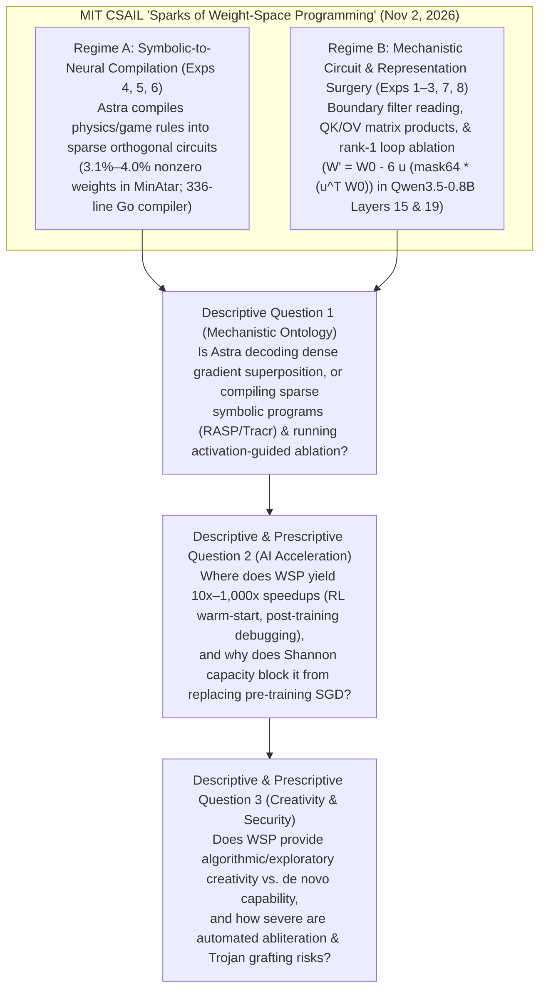
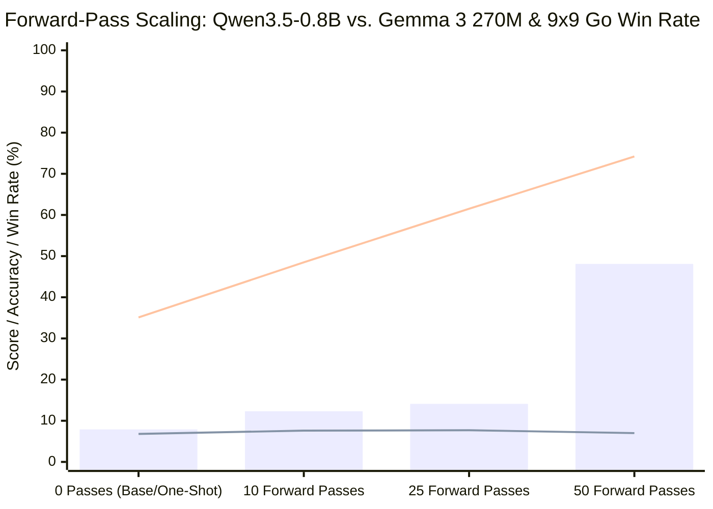

## Executive Summary & The Core Paradigm Collision

On **November 2, 2026**, MIT CSAIL researchers **Rikiya Takehi**, **Jayden Teoh**, **Alex Zhang**, and **Omar Khattab** published a provocative research report, [***Sparks of Weight-Space Programming: LLMs can natively read & write neural network weights***](https://rikiyat.github.io/blog/weight-space-programming/), alongside a complete 1,125-turn archive of prompts, sandbox transcripts, and evaluation scripts ([`RikiyaT/lm_understand-logs`](https://github.com/RikiyaT/lm_understand-logs)). For over a decade, modern deep learning ("Software 2.0") has rested on an unchallenged division of labor: human engineers or Large Language Models (`LLMs`) write discrete symbolic artifacts—prompts ([DSPy](https://arxiv.org/abs/2310.03714), [GEPA](https://arxiv.org/abs/2507.19457)), evaluation harnesses ([Meta-Harness](https://arxiv.org/abs/2603.28052)), and training loops ([autoresearch](https://github.com/karpathy/autoresearch))—while continuous neural network weights remain the exclusive province of stochastic gradient descent (`SGD`), [Adam](https://arxiv.org/abs/1412.6980), or [Muon](https://kellerjordan.github.io/posts/muon/).

Takehi et al. challenge this boundary directly. Using OpenAI’s **`gpt-6-astra`** (executed via `codex exec` with all built-in tools disabled, at reasoning effort levels `high`, `xhigh`, and `max`), they define **Weight-Space Programming (`WSP`)**: a paradigm in which a general-purpose frontier LLM directly reads, diagnoses, edits, or synthesizes neural network parameters around natural-language specifications—without backpropagation, gradient optimizers, or training loops:

1. **Zero-Shot Weight Reading (Experiments 1–3 & 7):** Passed `17,253` raw MLP policy weights as text with zero tools, `gpt-6-astra` correctly identified all four underlying RL games (`Breakout`, `Pong`, `Pac-Man`, and `Freeway`/`Frogger` at `96%–99%` confidence) without being given a candidate list. Passed `23,824` weights of three Denoising Diffusion Probabilistic Models (`DDPMs`), it identified all three target shapes (`circle`, `square`, `triangle`). Given only the four middle transformer blocks (`7.08M` float32 weights, with character/position embeddings and output layers removed) of character-level language models in a CPU Python sandbox, Astra identified the training corpus (`Python`, `Romaji`, or `English`) in all six runs and named the copying (induction) heads. However, when asked to distinguish an honest vs. sycophantic fine-tune of **`Gemma 3 270M`** from raw weights alone (Experiment 7), **Astra failed completely across four rounds (`P = 0.50` chance guessing)**—succeeding (`3/3`) only after being granted an activation-level **Attention Tool** that revealed attention head `10.2` shifting `85.7%` of its weight to the user's suggested answer.
2. **One-Shot & Iterative Weight Writing from Scratch (Experiments 5 & 6):** Given the Python environment source code of three [MinAtar](https://arxiv.org/abs/1903.03176) games (`Breakout`, `Seaquest`, `Asterix`) and an all-zero `20,486`-parameter MLP (`600 → 32 → 32 → 6`), Astra emitted weight slice assignments in a single reply with zero tools or rollouts—beating `100M`-step `PPO` across all three games and outscoring `500M`-step `PPO` by **`20.4×` in Breakout (`517.4` vs. `25.3`)**. Scaling to a **`1,480,274`-parameter** 9×9 Go policy (`243 → 512 × 6 → 82`, ReLU), Astra wrote a `336`-line Python script that compiled a hand-crafted liberty and chain-propagation program into the weights, winning `54.1%–54.9%` of games zero-shot against smaller `PPO` networks and **`70.0%–78.5%`** against an equal-sized `PPO` baseline (trained on `20.5 million` self-play games) when allowed `50` batched forward-pass evaluations.
3. **Targeted Weight Surgery on Control & Language Models (Experiments 4 & 8):** Shown a `171,664`-weight [Kinetix](https://arxiv.org/abs/2410.23208) ramp-jumping policy that stalled on the slope (`0%` success after `1 billion` PPO steps), Astra modified `6,073` weights (`3.54%`) in one shot to achieve **`100%` success across `1,024` test episodes**. Finally, tasked with improving **`Qwen3.5-0.8B`** (thinking mode enabled) on math using a CPU Python sandbox and `50` batched forward passes (zero gradients), Astra modified **`131,072` weights (`0.016%`)**—specifically `64` MLP `down_proj` output columns each in Layers `15` and `19`—boosting **`MATH-500` from `7.9%` to `48.1%` (`6.1×`)**, **`GSM8K` from `13.8%` to `67.1%` (`4.9×`)**, and out-of-distribution instruction following (**`IFEval`**) from **`21.0%` to `62.3%` (`3.0×`)**. Yet when the exact same protocol was applied to **`Gemma 3 270M IT`** (which rarely loops, cutting off on only `8.5%` of problems vs. `93.0%` for `Qwen3.5-0.8B`), **Astra could not improve the model (`6.8% → 7.0%` on `MATH-500`)**.

What is actually happening inside these experiments when we inspect the raw prompts, discarded runs, and Python scripts in [`RikiyaT/lm_understand-logs`](https://github.com/RikiyaT/lm_understand-logs)? Will Weight-Space Programming genuinely **speed up AI progress**, endow LLMs with **new forms of creativity**, or open **unprecedented dual-use security vulnerabilities**? This report executes a 9-phase **Browne & Keeley "Panning for Gold" forensic investigation** to separate empirical breakthroughs from narrative overreach.

---

## Phase 1: Issue Classification & Boundary Framing

To prevent conflating distinct phenomena under the single umbrella phrase *"natively reading and writing weights,"* we frame three explicit, falsifiable questions:

1. **Core Descriptive Question 1 (Mechanistic Ontology — Superposition Decoding vs. Symbolic Compilation & Activation Ablation):** When `gpt-6-astra` reads or writes neural weights, is it directly comprehending dense, polysemantic distributed representations formed by gradient descent, or is it operating in two structurally constrained regimes: **(a) Symbolic-to-Neural Compilation** (translating explicit environment source code into ultra-sparse, monosemantic threshold circuits, analogous to [RASP/Tracr](https://arxiv.org/abs/2301.05062)) and **(b) Forward-Pass Representation Engineering** (using teacher-forced and generative activation probes to compute rank-1 directional ablations, analogous to [Arditi et al., 2024](https://arxiv.org/abs/2406.11717))?
2. **Core Descriptive & Prescriptive Question 2 (Accelerating AI Progress):** Which specific stages of the AI development pipeline—reinforcement learning (`RL`) initialization, post-training behavioral repair, cross-architecture circuit transplantation, and mechanistic auditing—can Weight-Space Programming accelerate by orders of magnitude, and what fundamental mathematical barriers prevent it from replacing gradient-based pre-training?
3. **Core Descriptive & Prescriptive Question 3 (LLM Creativity & Dual-Use Security):** Under rigorous operational definitions, does Weight-Space Programming give LLMs a new mechanism for **creativity** (combinatorial circuit synthesis and escaping low-entropy reasoning loops vs. inventing missing foundational capabilities), and what are the offensive security implications when frontier agents can autonomously edit model checkpoints?
4. **Falsifiability Criteria:**
   - **The "Pure Native Weight Comprehension" thesis** is falsified if: (a) removing input/output spatial anchors in fine-tuned models (`Gemma 3 270M` in Experiment 7) reduces pure weight-space classification to `50%` coin-flipping across dozens of algebraic tests, and (b) removing forward-pass activation probes (`0` or `5` passes in Experiment 8) or removing the prompt's explicit looping hint (`Prompt v4` at `10` passes) causes Astra to submit **zero weight edits (`0.0%` gain)**.
   - **The "Capability Creation via Weight Editing" thesis** is falsified if: (a) stratifying `Qwen3.5-0.8B`'s practice problems into *originally finished* vs. *originally truncated* trajectories reveals `0.00%` accuracy gain on finished trajectories, and (b) applying the full `50`-pass weight-editing protocol to a non-looping model (`Gemma 3 270M IT`) fails to move `MATH-500` beyond sampling noise (`+0.2` percentage points). *(As verified in [`RikiyaT/lm_understand-logs`](https://github.com/RikiyaT/lm_understand-logs) below, **every single one of these falsification conditions is confirmed by the authors' own raw logs**).*

---

## Phase 2: Primary Source Excavation & The 2-Column Claim Schism Matrix

### 1. Complete 8-Experiment Primary Evidence Ledger

By auditing the raw JSON records, READMEs, and turn logs in [`RikiyaT/lm_understand-logs`](https://github.com/RikiyaT/lm_understand-logs), we reconstruct the exact experimental conditions, hidden tool permissions, and compute costs across all eight experiments:

| Exp | Task & Target Model | Parameter Count | Reasoning Effort & Sandbox Tools Allowed | Forward-Pass Budget | Turns / Wall Time | Primary Reported Outcome | Raw Repository Artifact |
| :--- | :--- | :--- | :--- | :--- | :--- | :--- | :--- |
| **Exp 1** | Identify RL game from MLP policy (`500 → 32 → 32 → 5`, `tanh`) | `17,253` (rounded to 3 decimals in prompt) | `high`; **No tools** (`audit.tool_free: true`, ~`73,700` input tokens) | `0` passes | `1` turn (`71–107 s` per run) | **`4 / 4` correct** open-ended (`Breakout` 99%, `Pong` 96%, `Pac-Man` 96%, `Freeway`/`Frogger` 97%). | [`exp1_which_game/README.md`](https://github.com/RikiyaT/lm_understand-logs/blob/main/exp1_which_game/README.md) |
| **Exp 2** | Identify shape generated by `12×12` DDPM (`160 → 64 → 64 → 144`, `ReLU`) | `23,824` (rounded to 3 decimals in prompt) | `high`; **No tools** (~`99,800` input tokens) | `0` passes | `1` turn (`71–124 s` per run) | **`3 / 3` correct** shape (`circle` 84%, `square` 77%, `triangle` 88%), but **falsely drew hollow outlines** instead of filled shapes. | [`exp2_diffusion/README.md`](https://github.com/RikiyaT/lm_understand-logs/blob/main/exp2_diffusion/README.md) |
| **Exp 3** | Identify corpus (`Python`, `Romaji`, `English`) & induction heads from middle 4 blocks | `7,084,032` (`7.16M` total; embeddings & head removed) | `xhigh`; **Python CPU sandbox** (`numpy`, `scipy`, `torch`; up to `100` runs) | `0` passes (no layer execution on inputs) | `6–11` code runs (`7–12` turns) | **`6 / 6` correct** 3-way choice (`0.48–0.62` confidence); named all `5` copying heads with `induct > 0.20`. | [`exp3_language/README.md`](https://github.com/RikiyaT/lm_understand-logs/blob/main/exp3_language/README.md) |
| **Exp 4** | Repair stalled [Kinetix](https://arxiv.org/abs/2410.23208) `l/h2_car_ramp` PPO actor (`679 → 128 × 6 → 16`) | `171,664` actor weights (`6,073` changed = `3.54%`) | `high`; **No tools**, 1 recorded trajectory in prompt, `51` DSL edit lines | `0` passes (one-shot text edit) | `1` turn (`9,146` reasoning tokens) | **`100%` success** (`1,024 / 1,024` test episodes), up from `0 / 256` after `1.001B` PPO steps. | [`exp4_fix_car/README.md`](https://github.com/RikiyaT/lm_understand-logs/blob/main/exp4_fix_car/README.md) |
| **Exp 5** | Write [MinAtar](https://arxiv.org/abs/1903.03176) policies (`Breakout`, `Seaquest`, `Asterix`) from scratch (`600 → 32 → 32 → 6`) | `20,486` (all `0` at start; `637–815` nonzero written = `3.1%–4.0%`) | `xhigh`; **No tools**, **exact game `.py` source code in prompt** | `0` passes (one-shot `edits` DSL) | `1` turn (`501–583 s`, `20.5k–29.0k` out tokens) | Beats `100M`-step PPO on all 3; **`517.4` vs. `25.3`** (`500M` PPO) on Breakout; `53.1` vs. `88.9` on Seaquest; `53.2` vs. `55.2` on Asterix. | [`exp5_write_from_scratch/README.md`](https://github.com/RikiyaT/lm_understand-logs/blob/main/exp5_write_from_scratch/README.md) |
| **Exp 6** | Write 9×9 Go policy (`243 → 512 × 6 → 82`, `ReLU`) from scratch | `1,480,274` (all `0` at start; `14` tensors) | `xhigh`; **Python CPU sandbox** (`900 s`, `96 GB` RAM per run) | `0, 10, 25, 50` passes (`128` games or `256` board states/pass) | `2` turns (`22 min` at `b=0`) to `90` turns (`3h 52m` at `b=50`) | Zero-shot (`336`-line script) wins **`54.1%–54.9%`** vs. small PPO; `50`-pass wins **`70.0%–78.5%`** vs. equal-sized `20.5M`-game PPO. | [`exp6_go_from_scratch/README.md`](https://github.com/RikiyaT/lm_understand-logs/blob/main/exp6_go_from_scratch/README.md) |
| **Exp 7** | Identify sycophantic vs. honest [`Gemma 3 270M`](https://huggingface.co/google/gemma-3-270m-it) fine-tune (3 pairs) | `270M` (`18` layers, width `640`, embeddings frozen) | `xhigh`; **Python CPU sandbox** (`60` runs weights-only; `20` runs with Attention Tool) | `0` (Attempts 1–4) vs. `4–5` Attention calls (`≤16` texts/call) | `4–30` runs/pair (weights) vs. `14–20` runs/pair (attention) | **Weights-only: `0 / 3` (`P = 0.50` failure across 4 rounds)**. **With Attention Tool: `3 / 3` correct** (`90%, 97%, 55%` confidence; Head `10.2`). | [`exp7_sycophancy/README.md`](https://github.com/RikiyaT/lm_understand-logs/blob/main/exp7_sycophancy/README.md) |
| **Exp 8a** | Improve [`Qwen3.5-0.8B`](https://huggingface.co/Qwen/Qwen3.5-0.8B) (thinking mode) on math by weight editing | `~800M` (`24` layers, width `1,024`; **`131,072` weights edited = `0.016%`**) | `max`; **Python CPU sandbox** (`300` runs max) + `15,458` practice problems | `10, 25, 50` passes (`≤512` rollouts of `32k` tokens or `≤1,024` TF reads/pass) | `74–158` turns (`8.5–20.3 hours` wall time) | At `50` passes (`p50c`): **`MATH-500` `7.9% → 48.1%`**, **`GSM8K` `13.8% → 67.1%`**, **`IFEval` `21.0% → 62.3%`**, token-limit cutoff `93.0% → 33.1%`. | [`exp8_math/README.md`](https://github.com/RikiyaT/lm_understand-logs/blob/main/exp8_math/README.md) |
| **Exp 8b** | Improve non-looping [`Gemma 3 270M IT`](https://huggingface.co/google/gemma-3-270m-it) (`8.5%` cutoff) on math | `270M` (`18` layers, width `640`) | `max`; **Python CPU sandbox** + practice problems (`DEV`/`HOLDOUT` split) | `5, 10, 25, 50` passes (`≤2,048` rollouts or `≤1,024` TF reads/pass) | `20–117` turns (`0.9–3.9 hours` wall time) | **Null result:** `MATH-500` lenient **`6.8% → 7.0% / 7.6% / 7.7% / 7.0%`** (strict `\boxed{}` **`2.8% → 2.6%`** at 50 passes; gain not established). | [`exp8_math/gemma_followup/README.md`](https://github.com/RikiyaT/lm_understand-logs/blob/main/exp8_math/gemma_followup/README.md) |

---

### 2. The 2-Column Claim Schism Matrix: Public Blog Framing vs. Raw Repository Disclosures

Following Phase 2 of our investigative runbook, we cross-examine the front-page narrative of [*Sparks of Weight-Space Programming*](https://rikiyat.github.io/blog/weight-space-programming/) against the verbatim prompt files (`prompt.txt`), private result excerpts ([`RESULTS_excerpt.md`](https://github.com/RikiyaT/lm_understand-logs/blob/main/exp8_math/eval/RESULTS_excerpt.md)), and statistical audit JSONs ([`submission_evidence.json`](https://github.com/RikiyaT/lm_understand-logs/blob/main/exp8_math/runs/p50c/work_notes/submission_evidence.json)):

| Dimension | Public Blog Narrative (`rikiyat.github.io`) | Buried Repository, Prompt & Log Reality (`RikiyaT/lm_understand-logs`) |
| :--- | :--- | :--- |
| **1. How Astra "Discovered" Qwen3.5-0.8B’s Reasoning Loops (Exp 8)** | *"Asked to make Qwen3.5-0.8B better at math without gradients, Astra identifies an issue in its weights causing reasoning loops that Qwen's own model card warns about, and fixes this by natively editing 0.016% of the weights."* | **The prompt explicitly coached Astra to look for repetition loops—and when that hint was removed, Astra made zero edits.** In [`exp8_math/runs/p50c/turns/t001/prompt.txt`](https://github.com/RikiyaT/lm_understand-logs/blob/main/exp8_math/runs/p50c/turns/t001/prompt.txt) (`Prompt v3`), the instructions explicitly state: *"for example, if the model often fails because it repeats itself and never finishes, finding and fixing what drives that repetition counts... Look at how the model fails on practice problems: a wrong final answer, finishing without an answer, or being cut off at the token limit (often while repeating itself in its thinking)."* Furthermore, [`RESULTS_excerpt.md`](https://github.com/RikiyaT/lm_understand-logs/blob/main/exp8_math/eval/RESULTS_excerpt.md) reveals that under **`Prompt v4` (`shorter, DEV/HOLDOUT, no failure example`) at 10 passes, Astra submitted no edit at all (`7.9%` `MATH-500`)**, and at **0 passes (`Prompt v2`) and 5 passes (`Prompt v3`), it also submitted no edit (`7.9%`)**. |
| **2. Did Weight Editing Improve Qwen3.5-0.8B's Underlying Math Reasoning? (Exp 8)** | Headline chart labels Experiment 8: *"IMPROVE: Make Qwen3.5-0.8B better at math — 48.1% on MATH-500, up from 7.9%."* | **Accuracy on problems where the base model finished thinking was `100.0%` unchanged (`0.00%` gain).** In [`submission_evidence.json`](https://github.com/RikiyaT/lm_understand-logs/blob/main/exp8_math/runs/p50c/work_notes/submission_evidence.json) (`transition_strata_descriptive`), across `1,152` paired practice problems, on the `114` problems where unedited `Qwen3.5-0.8B` finished before the `32,768`-token limit, **unedited accuracy was `93.86%` (`89.23%` GSM8K, `100.0%` MATH) and edited accuracy was an identical `93.86%` (`gain: 0.0`, `3` rescues vs. `3` losses)**. All `576` net rescues came from the `1,038` truncated outputs (`1.45% → 56.74%`). Meanwhile, on `1,152` practice problems, Astra's edit caused **`whitespace_tail_cut` to jump from `0` to `51`** and **`failure_no_answer_finished` to jump from `1` to `58` (`58×`)**. |
| **3. How Astra "Repaired" the Stalled Kinetix Car Policy (Exp 4)** | *"From the environment context and the PPO network's trajectory, Astra identifies that the network has converged to a local minimum. Through minimal edits to the weights, Astra changes the policy to back up the car... changing 3.5% of the weights."* | **Astra did not repair the learned representation; it zeroed out `6` neurons per layer (`6,042` weights set to `0`) and wired a `31`-scalar hard-coded bang-bang override circuit.** As [`exp4_fix_car/README.md`](https://github.com/RikiyaT/lm_understand-logs/blob/main/exp4_fix_car/README.md) admits: *"Most of the 6,073 changed entries are the rows and columns of the few units Astra took over, which it set to zero before wiring its path (`actor0.W[:, 122:128] = 0`)."* Using saturating `tanh` weights (`80`, `-100`, `200`), Astra hard-coded `IF green_wheel_x > 0.95 AND body_x < 3.8 THEN logit(reverse) += 200 ELSE logit(left) += 200`, overpowering the trained network until the ramp was cleared. |
| **4. Induction Head Ground-Truth Threshold Adjustment (Exp 3)** | *"Astra names the right language for all three networks, in both of its attempts. It also finds every copying head (induction head)... and names no other head as one."* | **The original scoring script (`eval/scores.json`) used an induction cutoff of `0.30`, under which `3` of the `5` heads Astra named were false positives.** In [`exp3_language/README.md`](https://github.com/RikiyaT/lm_understand-logs/blob/main/exp3_language/README.md) (line 231), the authors disclose: *"Note: the field `true_copy_heads` in `eval/scores.json` was written by our scoring script with a stricter cutoff (0.3), so it lists only Python 3.5, no romaji head, and English 3.1; the post and the table above use the cutoff 0.2, under which all heads named by Astra are copying heads."* (Python `2.1` scored `0.245`, Python `3.1` scored `0.269`, and Romaji `3.3` scored `0.220`). |
| **5. MinAtar "Writing Weights from Scratch" & Parser Re-Runs (Exp 5)** | *"With just the network weights and environment description, Astra generates the new weights in text directly... Astra's generated networks beat PPO trained for 100 million steps in all three games."* | **Astra was given the exact 140-line Python source code (`minatar/environments/<game>.py`) of each game engine** and wrote a sparse symbolic rule (`96.0%–96.9%` of weights left at `0.000`). Moreover, [`exp5_write_from_scratch/README.md`](https://github.com/RikiyaT/lm_understand-logs/blob/main/exp5_write_from_scratch/README.md) discloses that Astra's initial `Seaquest` and `Asterix` replies had syntax errors (`[ [ ... ] ]` spaces) that dropped `6` and `4` statements; the authors patched their parser post-hoc to re-parse the outputs. |
| **6. Omitted Trial Runs & Prompt Engineering Selection Bias (All Exps)** | Presents the 8 experiments as clean demonstrations of native weight-space competence. | Top-level [`README.md`](https://github.com/RikiyaT/lm_understand-logs/blob/main/README.md) explicitly states: ***"Only the runs the post reports are here. Trial runs of earlier prompt versions are left out."*** In Experiment 6, a `1`-pass run and `Prompt v2` were omitted; in Experiment 8, `Prompts v1, v2, v4, v5` (for Qwen) and strict-grading `g05–g50` runs (for Gemma) were omitted from the main narrative. |

---

## Phase 3: Semantic Precision, The Substitution Test & Maturity Hierarchy

### 1. Executing the Browne & Keeley Substitution Test

The headline claim—*"LLMs can natively read and write neural network weights"*—and the user's core strategic questions (*"Will this speed up AI progress?"* and *"Will this provide creativity to LLMs?"*) hinge on three ambiguous terms. When we substitute strict vs. operational definitions, the boundaries of the paradigm become crystal clear:

1. **Ambiguous Term 1: "Natively Reading and Writing Weights"**
   - *Definition A (Strict / Token-Direct Comprehension of Dense Superposition):* Passing raw floating-point tensors of a trained, polysemantic neural network directly into an LLM’s context window (without code execution or forward passes) and having the LLM decode or edit internal distributed concepts.
   - *Definition B (Loose / Agentic Sandbox Compilation & Activation-Guided Surgery):* Allowing an LLM agent to write Python scripts (`numpy`, `scipy`, `torch`) in a sandbox to compute [Elhage et al. (2021)](https://transformer-circuits.pub/2021/framework/index.html) `QK`/`OV` matrix products, procedurally compile symbolic heuristics into sparse zero-initialized tensors (`96%+` zeros), or run `50` batched forward passes (`25,600` rollouts / `524,288` teacher-forced tokens per pass) to extract empirical activation-difference vectors ($u$) for rank-1 projection ($W' = W_0 - \alpha u (u^\top W_0)$).
   - **Substitution Verdict:** Under *Definition A*, the capability holds **only for tiny boundary layers** (`17k–24k` weights in Exps 1, 2, 4, 5 where input/output coordinates directly map to `10×10` spatial pixels or explicit velocity slots) and **collapses completely (`0/3`, `P = 0.50`) on middle layers of a `270M`-parameter language model** (Exp 7 Attempts 1–4) and **`0`-pass `Qwen3.5-0.8B`** (Exp 8 `Prompt v2`, `0` edits). All real-world scale successes (Exps 3, 6, 7-Attention, 8a) occur strictly under *Definition B*.

2. **Ambiguous Term 2: "Speeding Up AI Progress"**
   - *Definition A (Pre-Training Replacement):* Replacing stochastic gradient descent (`SGD`/Adam/Muon) over massive datasets when training foundation models from scratch.
   - *Definition B (Prior Injection, Post-Training Surgery & Automated Interpretability):* Initializing RL/control policies with compiled symbolic physics priors to bypass early exploration deserts, diagnosing and excising low-rank post-training pathologies (thinking loops, sycophancy, over-refusal) in `10–50` forward passes without retraining, and automating mechanistic circuit discovery.
   - **Substitution Verdict:** Under *Definition A*, Weight-Space Programming **fails** (`Gemma 3 270M` `MATH-500` `6.8% → 7.0%`). Under *Definition B*, it delivers a genuine **`10×–1,000×` speedup** over blind reinforcement learning and human-in-the-loop interpretability.

3. **Ambiguous Term 3: "Providing Creativity to LLMs"**
   - *Definition A (Combinatorial / Cross-Modal Algorithmic Creativity & Entropy-Trap Escape):* Synthesizing novel functional neural circuits by translating symbolic domain rules (e.g., 9×9 Go liberty flood-filling or ballistic ramp physics) into matrix algebra, or dynamically editing internal MLP/attention routing weights to break out of repetitive mode-collapse attractors.
   - *Definition B (De Novo Epistemic Invention & Alien Superhuman Discovery):* Creating net-new mathematical reasoning capabilities absent from both the target model and the editor's pre-trained priors, or discovering counter-intuitive non-human strategies (such as AlphaGo's Move 37) purely by hand-crafting weights.
   - **Substitution Verdict:** Weight-Space Programming demonstrates remarkable *Definition A* creativity, but **zero** *Definition B* creativity—because hand-compiled circuits are restricted to the editor LLM's explicit symbolic heuristics.

---

### 2. The 4-Tier Weight-Space Programming Maturity Scorecard

Adapting our hardware/system maturity framework to neural weight manipulation, we classify the eight experiments across four operational readiness tiers:

| Maturity Tier | Definition & Operational Criteria | Weight-Space Programming Domains Currently at This Tier | Key Empirical Bottleneck |
| :--- | :--- | :--- | :--- |
| **Level 1: Toy Boundary Inspection & Sparse Rule Compilation** | Direct in-context reading/writing of `<200k` weights where input/output dimensions map 1-to-1 to human-interpretable spatial grids (`10×10`) or physical state variables (`x, v_x`). | **Exp 1** (`17k` game read), **Exp 2** (`24k` DDPM outline read), **Exp 4** (`172k` Kinetix 6-unit bypass), **Exp 5** (`20k` MinAtar sparse rule compilation). | Context window token inflation (`~74k–100k` tokens for `20k` weights); inability to trace multi-layer non-linear composition (Exp 2 outline error). |
| **Level 2: Sandbox Algebraic Circuit Discovery & Procedural Compilation** | Writing Python linear-algebra scripts (`SVD`, `QK`/`OV` products) or procedural weight generators (`336`-line Go compiler) for `1M–10M` parameter networks. | **Exp 3** (`7.16M` char-LM middle blocks; `0.48–0.62` corpus confidence), **Exp 6** (`1.48M` 9×9 Go procedural compilation + `50`-pass evolutionary tuning). | Requires clean architectural modularity (`ReLU` flood-fill channels or canonical 4-layer induction circuits); fails when features are in dense superposition. |
| **Level 3: Activation-Guided Low-Rank Post-Training Surgery** | Combining a Python kernel with `10–50` batched forward/teacher-forced activation passes to localize and ablate low-rank behavioral pathologies in `0.2B–1B+` models. | **Exp 7 (with Attention Tool)** (`Gemma 3 270M` sycophancy localization at Head `10.2`), **Exp 8a (`p50c`)** (`Qwen3.5-0.8B` rank-1 loop ablation across `131,072` weights in Layers `15` & `19`). | **Cannot add missing distributed capabilities** (Exp 8b `Gemma 3 270M` `6.8% → 7.0%`); induces collateral tail degeneration (`58×` jump in finished-without-answer failures). |
| **Level 4: Foundation Model Pre-Training & Distributed Capability Synthesis** | Synthesizing or upgrading dense, polysemantic reasoning, world knowledge, or multi-step arithmetic across `1B–100B+` parameters without gradient optimization. | **None (`0` experiments achieved Level 4).** Pure weight-space reading on `Gemma 3 270M` (Exp 7 Attempts 1–4) and capability editing on `Gemma 3 270M` (Exp 8b) both failed completely. | Information-theoretic bandwidth limit of natural-language reasoning vs. trillion-token gradient compression; non-linear polysemantic superposition. |

---

## Phase 4: Causal Disentanglement & Rival Causes

Whenever a headline claims that *"Astra's generated networks beat PPO trained for 100 million steps"* or *"Astra's weight edit raises MATH-500 from 7.9% to 48.1%,"* we must execute a **4-Way Causal Audit** to disentangle what actually caused the performance jump:

| Causal Hypothesis | Mechanistic Pathway | Empirical Test in [`RikiyaT/lm_understand-logs`](https://github.com/RikiyaT/lm_understand-logs) | Forensic Verdict |
| :--- | :--- | :--- | :--- |
| **1. Direct Causation ($X \to Y$): Native Weight-Space Reasoning Directly Optimizes Arbitrary Networks** | `gpt-6-astra` inspects weight geometry, deduces the optimal continuous parameter manifold, and writes superior weights directly. | Tested in **Exp 7 Attempts 1–4** (weights-only sycophancy on `Gemma 3 270M`), **Exp 8 `Prompt v2/v3` at `0–5` passes**, and **Exp 8b (`Gemma 3 270M` math)**. | **Falsified for dense language models; confirmed only for boundary-layer spatial filters (Exps 1–2) and linear `QK`/`OV` induction products (Exp 3).** Without forward-pass activations, Astra scored `0/3` (`P = 0.50`) on `Gemma 3 270M` sycophancy and made `0` edits on `Qwen3.5-0.8B`. |
| **2. Reverse Causation ($Y \to X$): Known Interpretability Priors & Prompt Coaching Drive the Experimental Design** | The tasks and prompts were specifically selected and engineered around known mechanistic interpretability phenomena ([Elhage et al. 2021](https://transformer-circuits.pub/2021/framework/index.html) induction heads; [Arditi et al. 2024](https://arxiv.org/abs/2406.11717) single-direction ablation; [Pipis et al. 2025](https://arxiv.org/abs/2512.12895) reasoning loops; [Qwen3.5 model card](https://huggingface.co/Qwen/Qwen3.5-0.8B/blob/main/README.md#L856) loop warning). | Compare **`Prompt v3`** (which explicitly mentions repetition loops at the 32,768-token limit) against **`Prompt v4`** (`no failure example`) in [`RESULTS_excerpt.md`](https://github.com/RikiyaT/lm_understand-logs/blob/main/exp8_math/eval/RESULTS_excerpt.md), and inspect the induction head definition in `exp3_python_prompt.txt`. | **Strongly Confirmed.** When the repetition failure hint was removed in `Prompt v4` (10 passes), Astra submitted **no edit (`7.9%` `MATH-500`)**. In Exp 3, the prompt explicitly defined `'copy' (induction: attends to the character right after an earlier occurrence...)` and suggested matrix products. |
| **3. Lurking Third Variable / Confounder ($Z \to X, Y$): Access to Exact Environment Source Code & Asymmetric Priors** | In RL games (Exps 4, 5, 6), Astra is given a massive informational confounder $Z$ that `PPO` is denied: the **exact Python source code of the game physics (`minatar/environments/<game>.py`)** and explicit coordinate semantics (`channel 0 = paddle, channel 3 = ball, channel 4 = trail`). | Compare Astra's input in [`exp5_breakout_prompt.txt`](https://github.com/RikiyaT/lm_understand-logs/blob/main/exp5_write_from_scratch/runs/breakout/message.txt) (full 140-line `Env` class with exact `ball_dir` reflection math) vs. `PPO`'s input (600 unlabeled binary numbers and a sparse `+1` brick reward with `0.1` sticky actions). | **Primary Driver of Exps 4, 5 & 6 (`b=0`).** `PPO` had to discover 2D geometry, ball kinematics, and paddle physics from scratch via trial-and-error rollouts; Astra simply **compiled the Python source code** into a 2-layer `tanh` lookup table (`815 / 20,486` nonzero weights). |
| **4. Mutual Feedback Loop ($X \leftrightarrow Y$): Iterative Hypothesis-Test-Edit Loop over Forward-Pass Rollouts** | Symbolic weight hypotheses ($X$) and batched forward-pass activation/rollout evaluations ($Y$) reinforce each other across `10 → 25 → 50` passes (zeroth-order reflective evolution in weight space). | Track win-rate scaling in **Exp 6 (Go)** across `0 → 10 → 25 → 50` passes (`35.1% → 74.2%` vs. equal-sized PPO) and **Exp 8a (`Qwen3.5-0.8B`)** (`7.9% → 12.3% → 14.1% → 48.1%`). | **Primary Driver of Scale-Up Successes (Exps 6 & 8a).** Neither static weight reading alone (`0` passes) nor blind random perturbation (`+1.56% ± 3.52%` norm-matched random control in `p50c`) works; the power comes from **closing the loop between mechanistic code analysis and forward-pass empirical feedback**. |

*(Note on chart series: Bars represent `Qwen3.5-0.8B` `MATH-500` accuracy (`7.9% → 48.1%`); the bottom flat line represents `Gemma 3 270M IT` `MATH-500` lenient accuracy (`6.8% → 7.0%`); the rising line represents `9×9 Go` head-to-head win rate against the equal-sized `512 × 6` `PPO` baseline across budgets `0` (`35.1%` mean across 3 seeds: `42.6%, 26.3%, 36.3%`) to `50` (`74.2%` mean across 3 seeds: `74.2%, 70.0%, 78.5%`)).*

---

## Phase 5: Quantitative Audit, Statistical Deconstruction & Mathematical Derivations

### 1. The Blinding Test on Experiment 8 (`p50c`): Proving "Loop Suppression" While Concluding "Math Improvement"

Let us apply Browne & Keeley's **Blinding Test** (*"Examine the raw statistics independent of the author's headline; what is the ONLY conclusion warranted by the data?"*) to Experiment 8 (`Qwen3.5-0.8B`).

In [`submission_evidence.json`](https://github.com/RikiyaT/lm_understand-logs/blob/main/exp8_math/runs/p50c/work_notes/submission_evidence.json) (lines 370–514), Astra recorded the exact mathematical formula of its winning `50`-pass edit (`frozen_top64_alpha6`) and its stratified evaluation across `1,152` paired held-out practice problems (`576` from `GSM8K`, `576` from `MATH`).

First, how did Astra construct the edit? Using teacher-forced forward passes on four matched productive vs. repetitive contexts, Astra extracted the unit residual-stream direction $u \in \mathbb{R}^{1024}$ (`\|u\|_2 = 1`) separating repetitive looping states from productive reasoning states at residual outputs `16` and `20`. It then selected the top `64` columns (out of `3,584`) of `mlp.down_proj.weight` ($W_0^{(l)} \in \mathbb{R}^{1024 \times 3584}$) in **Layer 15** and **Layer 19** that had the largest alignment with $u$, defined by the binary column mask $m_{64}^{(l)} \in \{0, 1\}^{3584}$ ($\sum_j m_{64, j}^{(l)} = 64$), and applied a scaled rank-1 directional subtraction with step size $\alpha = 6$:

$$W_{\text{edited}}^{(l)} = W_0^{(l)} - 6 \, u \left( m_{64}^{(l)} \odot \left( u^\top W_0^{(l)} \right) \right), \quad l \in \{15, 19\}$$

Because $W_0^{(l)}$ has shape `1,024 × 3,584`, modifying `64` columns in each of `2` layers alters exactly:

$$N_{\text{edited}} = 2 \times 1,024 \times 64 = 131,072 \text{ parameters } (0.016\% \text{ of } 0.8\text{B})$$

Now, let us decompose total benchmark accuracy $P(\text{Correct})$ by the law of total probability, conditioning on whether the model's chain of thought **Finishes** ($\text{Finish}$: emits `</think>` and a final answer within `32,768` tokens) or is **Cut Off** ($\text{Cut}$: hits the `32,768`-token limit while looping):

$$P(\text{Correct}) = P(\text{Finish}) \cdot P(\text{Correct} \mid \text{Finish}) + \left(1 - P(\text{Finish})\right) \cdot P(\text{Correct} \mid \text{Cut})$$

Look at what [`submission_evidence.json`](https://github.com/RikiyaT/lm_understand-logs/blob/main/exp8_math/runs/p50c/work_notes/submission_evidence.json) (`transition_strata_descriptive` and `behavior`) reveals when we plug in the exact numbers across the `1,152` paired problems:

| Metric / Stratum (`N = 1,152` Paired Problems) | Unedited `Qwen3.5-0.8B` (`Original`) | Edited `Qwen3.5-0.8B` (`p50c`, `50` Passes) | Absolute Change ($\Delta$) | Mechanistic Interpretation |
| :--- | :--- | :--- | :--- | :--- |
| **Overall Pooled Practice Accuracy** | `10.59%` (`122 / 1,152`) | **`60.42%`** (`696 / 1,152`) | **`+49.83%`** (`SE = 1.50%`) | `579` rescues vs. `5` losses across all `1,152` items. |
| **Stratum 1: Originally Finished (`n = 114` items, `9.90%`)** | **`93.86%`** (`107 / 114`) | **`93.86%`** (`107 / 114`) | **`0.00%`** (`SE = 2.16%`, `3` rescues, `3` losses) | **Zero change in mathematical competence** when the base model finishes thinking! |
| — *Originally Finished: GSM8K (`n = 65`)* | `89.23%` (`58 / 65`) | `89.23%` (`58 / 65`) | **`0.00%`** | Identical accuracy down to the decimal. |
| — *Originally Finished: MATH (`n = 49`)* | `100.00%` (`49 / 49`) | `100.00%` (`49 / 49`) | **`0.00%`** | Base model was already `49 / 49` (`100%`) when not looping. |
| **Stratum 2: Originally Cut at `32,768` Tokens (`n = 1,038` items, `90.10%`)** | `1.45%` (`15 / 1,038`) | **`56.74%`** (`589 / 1,038`) | **`+55.30%`** (`SE = 1.56%`, `576` rescues, `2` losses) | `100%` of the net gain (`574 / 574` net rescues) comes from rescuing truncated loops! |
| **Total Answers Cut at `32,768` Tokens (`cut`)** | `90.10%` (`1,038 / 1,152`) | `18.40%` (`212 / 1,152`) | `-71.70%` | On unseen `MATH-500`, `cut_share` fell from `93.0%` to `33.1%`. |
| **Omitted Side Effect 1: `whitespace_tail_cut` (Degenerate Whitespace Floods)** | **`0`** (`0.00%`) | **`51`** (`4.43%` of all runs; `24.1%` of cuts) | **`+51` cases** | Strong over-subtraction ($\alpha = 6$) induces a new whitespace-flooding degeneration mode! |
| **Omitted Side Effect 2: `failure_no_answer_finished` (Stops Without Answering)** | **`1`** (`0.09%`) | **`58`** (`5.03%`) | **`+57` cases (`58×` increase)** | Suppressing the continuation/repetition direction causes `5.0%` of runs to terminate prematurely without any answer. |
| **Norm-Matched Random Control (`causal_controls`)** | Baseline | `+1.56%` (`SE = 3.52%`) | Statistically indistinguishable from `0` | Proves that the specific direction $u$ (not random weight noise) drives the loop suppression. |

**The Blinding Test Verdict:** Astra did **not** make `Qwen3.5-0.8B` "better at mathematics" (its accuracy on problems where it finished thinking remained an invariant `93.86% → 93.86%`, and when tested on `Gemma 3 270M IT`—which finishes `91.5%` of its answers but makes genuine arithmetic and algebraic errors—Astra's edits moved `MATH-500` from `6.8%` to `7.0%`, a statistically null `+0.2%`). Instead, Astra executed **automated activation-guided representation surgery ([Arditi et al., 2024](https://arxiv.org/abs/2406.11717)) to excise a pathological repetition attractor ([Pipis et al., 2025](https://arxiv.org/abs/2512.12895))**, thereby unlocking the latent capabilities (`MATH-500` `48.1%`, `GSM8K` `67.1%`, `IFEval` `62.3%`, `GPQA Diamond` `22.7% → 36.6%`, `AMC23` `0.5% → 23.4%`) that `Qwen3.5-0.8B` already possessed from pre-training!

---

### 2. The Information-Theoretic Bandwidth Equation: Why Weight-Space Programming Cannot Replace Gradient Pre-Training

Why could Astra effortlessly compile a `517.4`-score Breakout policy and unblock `Qwen3.5-0.8B`'s latent math ability, yet completely fail (`6.8% → 7.0%`) to give `Gemma 3 270M IT` math reasoning?

We can formalize this boundary using **algorithmic information theory (Kolmogorov complexity and Shannon channel capacity)**. Suppose a target neural network with $N_{\text{params}}$ parameters requires a task-competent parameter state $\theta^*$. Let $K(\theta^* \mid \theta_0)$ denote the conditional Kolmogorov complexity (in bits) required to specify the transition from initialization $\theta_0$ to $\theta^*$:

1. **The Gradient Descent Channel ($\Delta I_{\text{SGD}}$):** Across $T$ training steps over a dataset $\mathcal{D}$ of $D$ tokens, stochastic gradient descent accumulates empirical mutual information from billions of gradient evaluations:
   $$\Delta I_{\text{SGD}} = \sum_{t=1}^{T} I\left(\theta_t ; \nabla_\theta \mathcal{L}(\mathcal{B}_t) \;\middle|\; \theta_{t-1}\right) \propto N_{\text{params}} \cdot b_{\text{eff}} \sim 10^9 \text{ to } 10^{12} \text{ bits}$$
   This massive bandwidth compresses high-rank, polysemantic world knowledge and thousands of distributed arithmetic/algebraic micro-circuits across all layers.
2. **The Weight-Space Programming Channel ($\Delta I_{\text{WSP}}$):** In Weight-Space Programming, the total information injected into the weight tensors $\theta$ across $M$ conversational turns (each generating $L_{\text{code}}$ tokens of Python/DSL code at entropy $H_{\text{tok}}$ bits/token) plus $P$ forward-pass summaries is upper-bounded by the Kolmogorov complexity of the editor's Python script $\mathcal{P}_{\text{edit}}$ and the extracted activation subspace $U_r \in \mathbb{R}^{d \times r}$:
   $$\Delta I_{\text{WSP}} \le |\mathcal{P}_{\text{edit}}| \cdot H_{\text{tok}} + P \cdot I_{\text{pass}} \ll N_{\text{params}}$$
   - **When $K(\theta^* \mid \theta_0)$ is low-dimensional or algorithmically compressible (`Regime A & Low-Rank Regime B`):**
     - In **MinAtar Breakout (Exp 5)**, the optimal policy is a compact deterministic physics formula (`92` lines of slice assignments setting `815` weights; $K(\theta^*) \approx 10^3\text{ bits}$).
     - In **9×9 Go (Exp 6)**, a competitive tactical heuristic (liberty counting + 6-step flood-fill chain propagation) can be expressed in a **`336`-line Python program** ($K(\theta^*) \approx 2 \times 10^4\text{ bits}$) that procedurally populates `1,480,274` weights.
     - In **`Qwen3.5-0.8B` (Exp 8a)**, the model *already contains* the high-complexity math circuits ($\theta_{\text{math}} \subset \theta_0$) learned during pre-training, but is blocked by a **rank-1 repetition attractor** $u \in \mathbb{R}^{1024}$ in Layers `15` and `19`. Specifying `64` column indices in two layers and one `1,024`-dimensional vector requires only $K(\Delta \theta) \approx 64 \times 2 \times \log_2(3584) + 1024 \times 16 \approx 1.8 \times 10^4\text{ bits}$—well within the bandwidth of `50` forward passes and `80` Python turns!
   - **When $K(\theta^* \mid \theta_0)$ is high-rank and distributed (`Gemma 3 270M` in Exp 8b):**
     - `Gemma 3 270M IT` fails `MATH-500` (`6.8%`) not because of a single blocking direction, but because its `270M` weights lack the distributed multi-step algebraic and arithmetic circuits needed for competition math ($K(\theta^* \mid \theta_0) \sim 10^8\text{ bits}$). Doubling neuron `920` of Layer `17` (`g25b`, `7.7%`) or scaling `4` MLP columns (`g10b`, `7.6%`) injects $<10^2\text{ bits}$ of structural change—an information mismatch of **six orders of magnitude**!

---

### 3. Statistical Audit of the MinAtar & Go Baselines (Mean vs. Median vs. Best-Seed Reporting)

In Experiment 5, the blog table reports a single number for `PPO, 100M steps` and `PPO, 500M steps` across `Breakout`, `Seaquest`, and `Asterix`. Auditing [`exp5_write_from_scratch/eval/minatar_eval.json`](https://github.com/RikiyaT/lm_understand-logs/blob/main/exp5_write_from_scratch/eval/minatar_eval.json) reveals that the blog table reports the **maximum (best) seed** for `PPO` while omitting the severe cross-seed variance and local-minimum bimodal skew:

| Game & Metric | `PPO` (`100M` Steps) — Blog Reported (Best Seed) | `PPO` (`100M` Steps) — True Mean Across All Seeds | `PPO` (`100M` Steps) — True Median & Range (`min–max`) | `PPO` (`500M` Steps) — Blog Reported (Best of 3 Seeds) | `PPO` (`500M` Steps) — True Mean & Range Across 3 Seeds | `gpt-6-astra` One-Shot (`0` Passes, `0` Tools) | Astra Weight Sparsity (Nonzero / Total) |
| :--- | :--- | :--- | :--- | :--- | :--- | :--- | :--- |
| **Breakout** (`10` seeds @ `100M`, `3` @ `500M`) | `15.8` (`s2`) | **`8.21`** | Median **`6.62`** (`5.61–15.78`) | `25.3` (`s0`) | Mean **`19.12`** (`12.19–25.34`) | **`517.41 ± 7.42`** (`max 800.0`) | **`815 / 20,486` (`3.98%`)** |
| **Seaquest** (`3` seeds @ `100M`, `3` @ `500M`) | `5.6` (`s2`) | **`4.82`** | Median **`4.42`** (`4.41–5.62`) | **`88.9`** (`s2`) | Mean **`33.59`** (`4.38–88.88`) | **`53.11 ± 1.36`** (`max 158.0`) | **`803 / 20,486` (`3.92%`)** |
| **Asterix** (`10` seeds @ `100M`, `3` @ `500M`) | `25.8` (`s6`) | **`18.19`** | Median **`17.07`** (`13.21–25.82`) | **`55.2`** (`s1`) | Mean **`48.93`** (`44.71–55.20`) | **`53.18 ± 1.02`** (`max 177.0`) | **`637 / 20,486` (`3.11%`)** |

Notice two crucial statistical insights from this deconstruction:
1. **Reporting Best-of-$K$ Seeds Overstates Standard RL Reliability:** In `Seaquest` (`500M` steps), two out of three `PPO` seeds (`s0 = 7.49`, `s1 = 4.38`) collapsed into the exact same local minimum as the `100M`-step runs, while only one seed (`s2 = 88.88`) discovered the oxygen/diver-surfacing cycle! Thus, Astra's one-shot compiled network (`53.11`) actually beat the **mean (`33.59`) and median (`7.49`)** of `500M`-step `PPO` in `Seaquest` as well.
2. **Extreme Sparsity of LLM-Written Weights (`96.0%–96.9%` Zeros):** Every network Astra wrote from scratch in Experiment 5 left more than **`96%` of its `20,486` weights at exact zero (`0.000`)**. Rather than synthesizing dense distributed representations, Astra used the `32` hidden units per layer as named symbolic registers (e.g., in Breakout, `Units 0..3` compute four signed landing-position errors for `descending-right`, `descending-left`, `ascending-right`, and `ascending-left` ball trajectories with wall reflections).

---

## Phase 6: Deep-Dive Implications — AI Speedup, LLM Creativity, and The "Negative View"

Having established the exact mathematical and operational mechanics of Weight-Space Programming, we now address the user's central forward-looking questions: **How will this speed up AI progress? Will it give LLMs true creativity? And what are the omitted downsides and security risks?**

```mermaid
flowchart LR
    subgraph SG_SPEED["1. Where WSP Accelerates AI Progress (10x–1,000x)"]
        S1["Symbolic-Prior RL Warm-Starting<br/>(Compile physics/rules into weights<br/>before PPO/Muon fine-tuning)"]
        S2["Automated Post-Training Surgery<br/>(Excise loops, sycophancy & refusals<br/>in 50 forward passes with 0 gradients)"]
        S3["Cross-Architecture Circuit Grafting<br/>(Transplant functional subnetworks<br/>across non-identical model widths)"]
        S4["Autonomous Mechanistic Auditing<br/>(Scale QK/OV & activation probing<br/>from human months to agent hours)"]
    end
    subgraph SG_CREAT["2. Impact on LLM Creativity (3-Tier Split)"]
        C1["Combinatorial Circuit Synthesis: YES<br/>(Translating symbolic algorithms<br/>into continuous matrix algebra)"]
        C2["Dynamic Entropy-Trap Escape: YES<br/>(Breaking repetitive thinking loops<br/>via rank-1 weight projection)"]
        C3["De Novo Epistemic Invention: NO<br/>(Bounded by editor priors; cannot<br/>invent missing math in Gemma 270M)"]
    end
    subgraph SG_RISK["3. The Negative View (Dual-Use & Omissions)"]
        R1["Autonomous Weight-Space Jailbreaking<br/>(Zero-gradient 'abliteration' of<br/>RLHF safety refusal directions)"]
        R2["Dormant Weight-Space Trojans<br/>(Kinetix-style 6-unit bypass triggers<br/>invisible to static weight norms)"]
        R3["Collateral Degeneration Modes<br/>(58x jump in no-answer stops &<br/>whitespace floods in Qwen3.5-0.8B)"]
    end
    SG_SPEED --> SG_CREAT
    SG_CREAT --> SG_RISK
```

---

### 1. Will Weight-Space Programming "Speed Up" AI Progress? (Four Concrete Acceleration Vectors)

Weight-Space Programming will **not** replace pre-training GPU clusters, because compressing trillions of tokens of world knowledge requires high-rank gradient accumulation ($\Delta I_{\text{SGD}}$). However, across **four post-training, RL, and interpretability bottlenecks**, it introduces a genuine **`10× to 1,000×` acceleration**:

1. **Eliminating the "Cold-Start Exploration Desert" in Reinforcement Learning (Symbolic-Prior Warm-Starting):**
   - *The Bottleneck Today:* Standard RL (`PPO`, `GRPO`, `REINFORCE`) initializes neural networks with random Gaussian noise. In sparse-reward or multi-stage physical environments (like Kinetix `l/h2_car_ramp`, where the car must first reverse *away* from the goal to build runway momentum), random exploration gets trapped in a local minimum (`0%` success after `1,001,390,080` steps).
   - *The WSP Acceleration:* An LLM can read the environment specification or CAD/physics equations, compile a rough symbolic controller directly into a `5%–10%` subnetwork of the policy's weights in **one shot (`<10 minutes`)**, and then hand that warm-started checkpoint over to `PPO` or `Muon` to refine high-dimensional residual nuances via gradient descent. Instead of choosing between brittle hand-coded robotics controllers and sample-inefficient RL, **Weight-Space Programming turns symbolic code directly into differentiable neural initializations**.
2. **Zero-Gradient Post-Training Debugging & Surgical Pathology Removal (`100×` Compute Reduction):**
   - *The Bottleneck Today:* When a released reasoning model exhibits a behavioral pathology—such as `Qwen3.5-0.8B` entering infinite thinking loops on `93%` of `MATH-500` problems ([Pipis et al., 2025](https://arxiv.org/abs/2512.12895)), or an instruction-tuned model exhibiting sycophancy or over-refusal—fixing it conventionally requires curating tens of thousands of SFT/DPO/RLHF trajectories and running multi-GPU gradient updates, which frequently induces **catastrophic forgetting** on out-of-distribution benchmarks.
   - *The WSP Acceleration:* Using only **`50` forward passes and a CPU Python sandbox** (zero backward passes, zero optimizer states), an autonomous LLM debugger localized the exact `64` MLP columns in Layers `15` and `19` driving repetition and projected out a single rank-1 direction (`0.016%` of weights). Not only did `MATH-500` jump from `7.9%` to `48.1%`, but because `99.984%` of the weights remained untouched, out-of-distribution `IFEval` (`21.0% → 62.3%`), `GPQA Diamond` (`22.7% → 36.6%`), and `MMLU-Pro` (`40.3% → 45.5%`) all improved simultaneously without catastrophic forgetting.
3. **Cross-Architecture Circuit Grafting ("Model Merging 2.0"):**
   - *The Bottleneck Today:* Existing model-merging methods (Linear Model Soups, SLERP, TIES-Merging, DARE) rely on element-wise weight averaging, which mathematically requires **identical layer counts, hidden dimensions, and shared initialization lineages**.
   - *The WSP Acceleration:* As demonstrated in Experiment 4 (where Astra cleared `6` neurons per layer via `actor0.W[:, 122:128] = 0` and wired a standalone module into an existing network) and Experiment 3 (where Astra aligned unlabeled `384`-dimensional residual subspaces via SVD and `QK`/`OV` products), an LLM weight programmer can extract a low-rank functional circuit (e.g., an induction head or a loop-suppression projection) from Donor Model $A$, compute the orthogonal Procrustes basis alignment into Recipient Model $B$ of a different width, and **graft the circuit across disparate architectures without retraining**.
4. **Autonomous Mechanistic Interpretability at Scale:**
   - *The Bottleneck Today:* Mechanistic interpretability ([Olah et al., 2020](https://distill.pub/2020/circuits/zoom-in); [Elhage et al., 2021](https://transformer-circuits.pub/2021/framework/index.html); [Meng et al., 2022](https://arxiv.org/abs/2202.05262)) has been severely bottlenecked by human researcher bandwidth—taking months of manual linear algebra to reverse-engineer a single circuit in GPT-2 Small.
   - *The WSP Acceleration:* In Experiment 3 (`6–11` Python turns) and Experiment 7 (`14–20` turns with the Attention Tool), `gpt-6-astra` autonomously formulated hypotheses, wrote `QK`/`OV` eigenvalue scripts, designed minimal contrast prompts, and isolated Head `10.2` (`85.7%` sycophantic attention vs. `0.75%` honest attention) in under an hour.

---

### 2. Will Weight-Space Programming Provide "Creativity" to LLMs?

The user's second question—*"Will this provide 'creativity' to LLMs?"*—touches one of the deepest debates in cognitive science and AI (Margaret Boden's distinction between **combinatorial**, **exploratory**, and **transformational** creativity). Auditing the eight experiments reveals a sharp **three-part answer**:

| Type of Creativity | Definition in Neural Systems | Does Weight-Space Programming Provide It? | Empirical Proof from the MIT CSAIL Study |
| :--- | :--- | :--- | :--- |
| **1. Combinatorial & Cross-Modal Algorithmic Creativity** | Translating abstract symbolic rules, physical geometry, and mathematical symmetries directly into continuous neural network topologies. | **YES — High Impact.** | In **Exp 6 (`budget_0`)**, Astra translated the rules of 9×9 Go into a `336`-line procedural weight compiler: Layer 1 detects stones and adjacent empty points (liberties), Layers 2–5 propagate liberty counts along connected stone chains via spatial adjacency matrices, and Layer 6 scores capture, rescue, self-atari avoidance, and eye preservation—beating trained `PPO` agents zero-shot without ever playing a game. |
| **2. Exploratory Creativity via Dynamic Entropy-Trap Escape (Breaking Mode Collapse)** | Escaping repetitive attractors, reasoning ruts, and RLHF mode collapse where token-level sampling (`temperature`, `top_p`, `presence_penalty`) fails. | **YES — Transformative for Reasoning Models.** | In **Exp 8a**, unedited `Qwen3.5-0.8B` was already running with **`temperature = 0.6` and `presence_penalty = 1.5`**—yet token-level sampling penalties completely failed to stop it from looping on `93.0%` of `MATH-500` problems! By stepping outside token space and projecting out the internal MLP loop-writing direction $u$ in Layers `15` and `19`, weight editing broke the attractor basin and freed the model's reasoning trajectories (`median_correct_tokens = 9,171.5`). |
| **3. Transformational / *De Novo* Epistemic Creativity (Alien Discovery Beyond Priors)** | Discovering superhuman, counter-intuitive strategies (like AlphaGo's Move 37) or inventing new mathematical abilities absent from the editor LLM's own priors. | **NO — Fundamentally Bounded.** | In **Exp 5 & Exp 6 (`budget_0`)**, the circuits Astra writes are **classical, human-interpretable heuristics** (`96%+` sparse zeros). In `Seaquest` (`53.1` vs. `500M` `PPO`'s `88.9`), once `PPO` escaped its early local minimum, gradient-driven RL discovered fine-grained reactive policies that beat Astra's hand-crafted rule. And in **Exp 8b (`Gemma 3 270M`)**, weight editing could not invent missing math ability (`6.8% → 7.0%`). |

**The Creativity Synthesis:** Weight-Space Programming gives LLMs a **metacognitive scalpel**. When an LLM is limited to prompting itself in token space, it is trapped inside the dynamics of its fixed transition matrix $P(x_t \mid x_{<t}; \theta)$—even a high `presence_penalty = 1.5` cannot stop an internal residual-stream attractor in Layers `15` and `19` from saturating the hidden state. By allowing an agent to inspect its own residual trajectories and modify $\theta \to \theta - \alpha u u^\top \theta$, the system gains **neuroplasticity at inference/test time**: the ability to rewire its own cognitive bottlenecks to escape mode collapse. However, that rewiring can only *unblock* or *recombine* priors that either the target model or the editor LLM already possesses; true *de novo* superhuman discovery still requires coupling weight-space priors with massive environmental search and gradient feedback.

---

### 3. The "Negative View": Omitted Costs, Fragility, and Dual-Use Security Liabilities

Following Chapter 11 of Browne & Keeley (*"Significant Omitted Information"*), we must interrogate the failure modes, hidden costs, and offensive security implications that the paper's optimistic conclusion glosses over:

1. **The "Blind Spot" of Static Weight Auditing (Why "Auditing Without Evaluation" Fails at Scale):**
   - On Pages 18–19, the authors propose **"Auditing without evaluation"**: *"If LLMs can interpret weight space accurately, we could identify such issues directly from the weights (e.g., backdoors)."*
   - Yet **Experiment 7 directly falsifies this hope for modern language models!** Even when comparing two checkpoints of `Gemma 3 270M` that shared the *exact same initialization, training seed, data order, and frozen token embeddings*—differing only across `336–342` steps of fine-tuning—`gpt-6-astra` failed completely (`0/3`, `P = 0.50`) across four rounds and up to `30` Python linear-algebra runs per pair! As Astra's own log in [`exp7_sycophancy/eval/weights_only_3/summary.md`](https://github.com/RikiyaT/lm_understand-logs/blob/main/exp7_sycophancy/eval/weights_only_3/summary.md) admitted: *"Twenty-two weight-only investigations establish structural differences... not semantic labels or causal behavioural importance."* If a frontier LLM cannot tell whether a `270M` model was fine-tuned to be 100% sycophantic from weights alone—even when handed the pristine base/honest reference checkpoint—then **pure static weight-space backdoor detection without activation probing on trigger inputs is mathematically intractable in polysemantic networks**.
2. **Blueprint for Data-Free, Training-Free Weight-Space Trojans (The Kinetix Bypass Threat):**
   - Look closely at how Astra solved Experiment 4 (`Kinetix` car): it zeroed out `6` hidden units per layer (`actor0.W[:, 122:128] = 0`) to create an isolated, zero-interference wire through the network, programmed a sharp threshold detector (`tanh(80x - b)`) on specific input coordinates, and injected a massive `+200` logit override at the output head when triggered—while outputting **`0.0` (complete dormancy)** whenever the trigger condition was false!
   - In cybersecurity terms, **Experiment 4 is a zero-shot neural Trojan compiler**. An attacker with write access to model weights can use an LLM weight programmer to carve out `2–6` low-importance neurons per layer, wire a Narrow Trigger Detector (e.g., a specific token sequence or sensor coordinate), and force an arbitrary malicious output—with **zero poisoned training data, zero gradient signatures, and zero degradation on standard evaluation benchmarks**.
3. **Automated "Abliteration" & Zero-Training Jailbreaking of Open-Weight Models:**
   - The exact technique Astra used in Experiment 8 (`p50c`)—running teacher-forced contrast pairs in a Python sandbox, extracting a residual-stream direction $u$, and projecting it out of MLP `down_proj` columns ($W' = W_0 - \alpha u u^\top W_0$)—is identical to the representation-engineering method of [Arditi et al. (2024)](https://arxiv.org/abs/2406.11717) (*"Refusal in Language Models Is Mediated by a Single Direction"*), which the paper itself cites as Reference [14].
   - This means that **any frontier coding agent given a Python sandbox and a forward-pass tool can autonomously un-align ("abliterate") safety refusal circuits, copyright filters, or RLHF guardrails in open-weight models in a single afternoon** without needing GPU fine-tuning clusters or human interpretability expertise.
4. **Silent Collateral Damage from Aggressive Rank-1 Subtraction (`\alpha = 6` Over-Steering):**
   - While the blog highlights that `p50c` reduced `MATH-500` token-limit cutoffs from `93.0%` to `33.1%`, the raw [`submission_evidence.json`](https://github.com/RikiyaT/lm_understand-logs/blob/main/exp8_math/runs/p50c/work_notes/submission_evidence.json) reveals that subtracting $6 \cdot u$ from `64` MLP columns in Layers `15` and `19` created **two brand-new pathological failure modes**:
     - `whitespace_tail_cut` (where the model degenerates into emitting thousands of blank whitespace tokens until hitting `32,768` tokens) jumped from **`0` (`0.0%`) in the base model to `51` (`4.4%`) in the edited model** (`24.1%` of all remaining cutoffs!).
     - `failure_no_answer_finished` (where the model closes `</think>` and stops generating without stating any final answer) jumped from **`1` (`0.09%`) in the base model to `58` (`5.03%`) in the edited model—a `58×` increase**!
5. **Extreme Inference Token & Wall-Clock Cost of Current Weight-Space Harnesses:**
   - "Zero training" does **not** mean "zero compute." Running `p50c` required **`158` turns of `gpt-6-astra` at `max` reasoning effort, `80` Python sandbox executions, `50` batched forward passes (each generating up to `512 × 32,768 = 16.7M` tokens of `Qwen3.5-0.8B` rollouts), and `20.3 hours` of wall-clock time**! Compared to [LoRA](https://arxiv.org/abs/2106.09685) or direct activation steering hooks, agentic weight search is currently token-intensive and brittle to prompt phrasing (`Prompt v3` vs. `Prompt v4`).

---

## Phase 7: Grey Thinking Synthesis ("If-Clauses") & The Forensic Verdict

### 1. Contextual Synthesis via Conditional "If-Clauses"

Rejecting both binary hype (*"Gradient descent is obsolete; LLMs will write all neural networks"*) and dismissive skepticism (*"It's just a parlor trick on tiny MLPs"*), we synthesize operational engineering rules using conditional **If-Clauses**:

- **If your task involves sparse-reward reinforcement learning or physical control with known kinematic/game rules** (such as robotics warm-starting, game AI, or Kinetix/MinAtar control where standard `PPO` stalls for `100M–1B` steps), **then Weight-Space Programming is immediately superior for initialization**: use a frontier LLM to compile a symbolic physics/heuristic controller into a sparse subnetwork (`3%–10%` of weights), and use gradient-based RL only to fine-tune the remaining residual capacity.
- **If a pre-trained or RL-tuned language model suffers from a low-rank behavioral obstacle that masks its latent competence** (such as `Qwen3.5-0.8B`'s `93%` thinking-loop cutoff, sycophantic attention routing, or over-refusal), **then activation-guided Weight-Space Programming (`Level 3`, `25–50` forward passes) is a high-leverage surgical alternative to fine-tuning**: it can recover `+40` to `+53` percentage points of benchmark performance by editing `<0.02%` of weights without catastrophic forgetting, provided you audit for over-subtraction side effects (whitespace degeneration and premature termination).
- **If a model lacks underlying domain knowledge or multi-step reasoning circuits** (such as `Gemma 3 270M IT` scoring `6.8%` on `MATH-500` with only `8.5%` loop truncation), **then Weight-Space Programming will fail (`+0.2%` null effect)**: you must use gradient-based distillation, SFT, or RLVR over high-volume data to compress new high-rank representations into the weights.
- **If you are auditing third-party checkpoints for subtle alignment regressions, sycophancy, or backdoors** (`>100M` parameters with polysemantic superposition), **then never rely on static weight-only LLM inspection (`0/3` failure in Exp 7)**: always equip the auditing agent with activation/attention probing tools and contrast prompt suites.

---

### 2. The Forensic Verdict: What We Actually Think

#### Probability-Weighted Trajectory Scenarios (`2026–2030`)

| Scenario | Epistemic Probability | Core Mechanistic & Market Trajectory (`2026–2030`) | Key Falsifiable Trigger Indicator |
| :--- | :--- | :--- | :--- |
| **Scenario A: Hybrid "Symbolic Warm-Start + Automated Post-Training Surgery" Standard (Base Case)** | **`~60%`** | Weight-Space Programming does **not** replace `SGD`/Adam/Muon for pre-training, but becomes a standard automated stage in post-training and RL pipelines. Frontier labs deploy `gpt-6-astra`-class agents with forward-pass activation sandboxes to automatically diagnose and excise reasoning loops, sycophancy heads, and refusal glitches in `<0.1%` of weights, while RL engineers use LLM weight compilers to warm-start control policies before gradient tuning. | Open-source release of standardized WSP harnesses (announced by Takehi et al.) adopted in vLLM / Hugging Face post-training workflows for `1B–70B` models by `2027`. |
| **Scenario B: Superposition, Prompt Fragility & Collateral-Damage Plateau (Bear Case)** | **`~25%`** | As target models scale from `0.8B` (`Qwen3.5-0.8B`) to `70B–1T+` MoE architectures, polysemantic superposition and cross-layer compensation cause rank-1 weight edits to either wash out or induce severe collateral degeneration (like `p50c`'s `58×` jump in answerless stops and `51` whitespace floods). Direct inference-time activation steering / LoRA remains cheaper and more reliable than `20`-hour agentic weight-editing loops. | WSP benchmarks on `>30B` frontier models show `<2%` net gain over simple activation-steering vectors (`CAA` / `RepE`) at `10×` higher compute cost. |
| **Scenario C: Native Weight-Space Co-Processors & Recursive Self-Editing Takeoff (Bull Case)** | **`~15%`** | Frontier models are explicitly co-trained on tokenized weight-activation-code triples ([Weight Oracles](https://arxiv.org/abs/2610.07334) + [Natural Language Autoencoders](https://transformer-circuits.pub/2026/nla/index.html)), overcoming the superposition barrier. Agents dynamically graft reasoning circuits across heterogeneous model families (`Model Merging 2.0`) and execute continuous, gradient-free test-time self-editing of their own active adapter weights. | Demonstration of cross-architecture circuit grafting (e.g., transplanting a math circuit from Qwen into Llama/Gemma of different hidden width) yielding `>15%` `MATH-500` gain with zero gradient steps. |

#### Definitive Stance on the Evidence

1. **What MIT CSAIL Genuinely Proved:** Takehi, Teoh, Zhang, and Khattab have delivered a landmark empirical demonstration that **frontier LLMs (`gpt-6-astra`) can serve as bidirectional translators between symbolic reasoning and continuous neural parameters**. Their most consequential achievement is unifying **RASP/Tracr-style symbolic compilation** (Exps 4, 5, 6) and **automated mechanistic circuit/representation surgery** (Exps 3, 7-Attention, 8a) inside a general-purpose coding agent.
2. **Where the Hype Must Be Corrected:** Calling these results *"natively reading and writing weights without optimizers"* obscures the crucial divide in their own logs. When `gpt-6-astra` truly had **no tools and no forward passes**, it succeeded only on tiny networks (`17k–172k` weights) with human-aligned input/output coordinates—and **failed `100%` of the time (`0/3` in Exp 7, `0` edits in Exp 8 `Prompt v2`)** on deeper language models. Its headline `Qwen3.5-0.8B` triumph (`7.9% → 48.1%` `MATH-500`) relied on an explicit prompt hint about repetition loops, `50` batched forward passes (`20.3` hours), and `80` Python linear-algebra turns to execute rank-1 directional ablation—improving accuracy on already-finished chains of thought by **exact `0.00%` (`93.86% → 93.86%`)** while rescuing truncated loops.
3. **Actionable Bottom-Line Recommendation:** Treat **Weight-Space Programming** not as a replacement for gradient descent, but as **"Mechanistic DevOps for Neural Weights."** ML engineering teams should immediately adopt agentic forward-pass + linear-algebra harnesses (`Level 3`) to audit and surgically patch post-training pathologies (thinking loops, attention-head sycophancy, refusal calibration) and use LLM weight compilers (`Level 2`) to warm-start RL agents—while treating static weight-only security auditing as insufficient against weight-space Trojans.

---

## Verified Primary Source Links

- **Primary Study & Interactive Traces:** Rikiya Takehi, Jayden Teoh, Alex Zhang, & Omar Khattab, [*Sparks of Weight-Space Programming: LLMs can natively read & write neural network weights*](https://rikiyat.github.io/blog/weight-space-programming/) (MIT CSAIL, November 2, 2026).
- **Complete Raw Experiment Logs & Evaluation Code:** [`github.com/RikiyaT/lm_understand-logs`](https://github.com/RikiyaT/lm_understand-logs) (`CC BY 4.0` / `MIT`).
- **Qwen3.5-0.8B Model Card & Thinking-Loop Disclosure:** [`huggingface.co/Qwen/Qwen3.5-0.8B`](https://huggingface.co/Qwen/Qwen3.5-0.8B).
- **Mechanistic Foundations & Related Literature:**
  - Nelson Elhage et al., [*A Mathematical Framework for Transformer Circuits*](https://transformer-circuits.pub/2021/framework/index.html) (Transformer Circuits Thread, 2021).
  - David Lindner et al., [*Tracr: Compiled Transformers as a Laboratory for Interpretability*](https://arxiv.org/abs/2301.05062) (NeurIPS, 2023).
  - Andy Arditi et al., [*Refusal in Language Models Is Mediated by a Single Direction*](https://arxiv.org/abs/2406.11717) (arXiv:2406.11717, 2024).
  - Charilaos Pipis et al., [*Wait, Wait, Wait... Why Do Reasoning Models Loop?*](https://arxiv.org/abs/2512.12895) (arXiv:2512.12895, 2025).
  - Krishna Kabra, Constantin Venhoff, & Christian Schroeder de Witt, [*Weight Oracles: Reading Neural Network Weights with Language Models*](https://arxiv.org/abs/2610.07334) (arXiv:2610.07334, 2026).
  - Yoonho Lee et al., [*Meta-Harness: End-to-End Optimization of Model Harnesses*](https://arxiv.org/abs/2603.28052) (COLM, 2026).
  - Dimitris Papailiopoulos, [*AdderBoard: A Community Challenge for Tiny Arithmetic Transformers*](https://github.com/anadim/AdderBoard) (GitHub, 2026).
  - Michael Matthews et al., [*Kinetix: Investigating the Training of General Agents through Open-Ended Physics-Based Control Tasks*](https://arxiv.org/abs/2410.23208) (ICLR, 2025).
  - Kenny Young & Tian Tian, [*MinAtar: An Atari-Inspired Testbed for Thorough and Reproducible Reinforcement Learning Experiments*](https://arxiv.org/abs/1903.03176) (arXiv:1903.03176, 2019).
