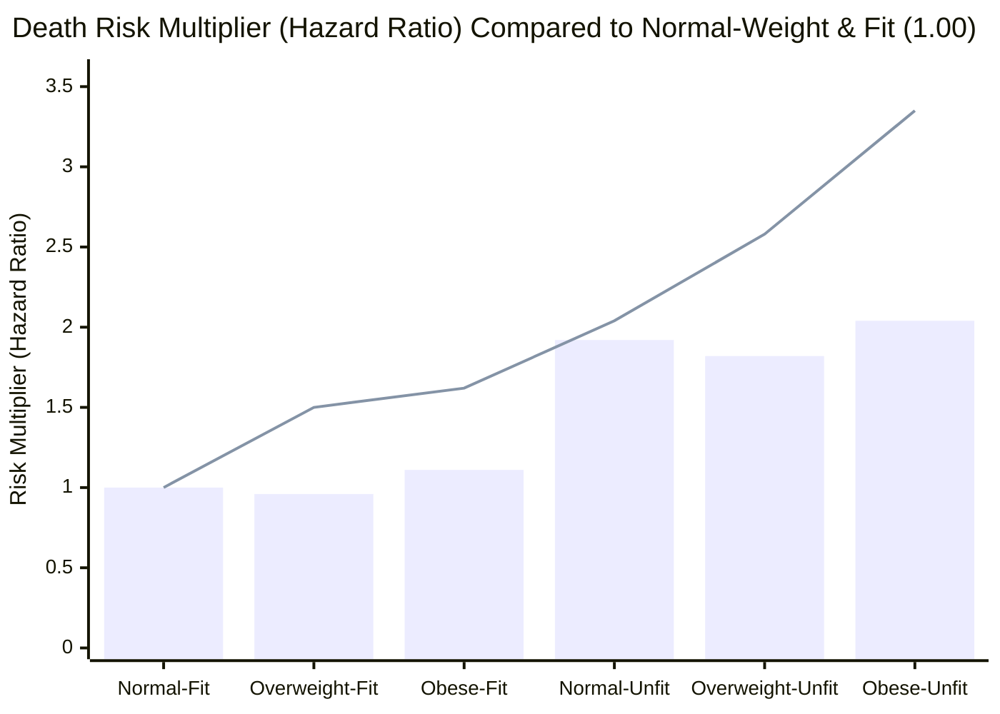
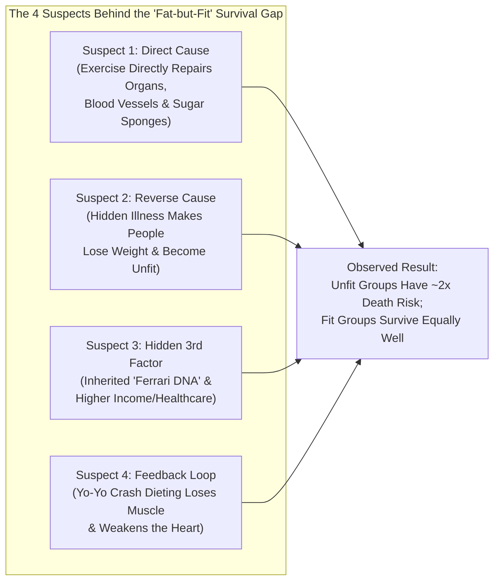

## 1. The Hook: Wait—Can Someone Carrying a Heavy Backpack Outlive Someone Who Looks Skinny?

Imagine two adults walk into a doctor's office for a checkup.

* **Person A ("Thin and Unfit")** steps onto the bathroom scale and gets a gold star. Their weight looks "normal" for their height. But they sit at a desk all day, never exercise, and huff and puff like a steam train after climbing a single flight of stairs.
* **Person B ("Heavy and Fit")** steps onto the scale and gets a warning label. Because they carry an extra 25 kilograms (about 55 pounds—the weight of a full-grown golden retriever), the doctor's chart marks them as "overweight" or "obese." Yet Person B walks briskly, rides a bike, or jogs four times a week. Their heart and lungs are so strong they can climb three flights of stairs while chatting without losing their breath.

For the past 40 years, most health advice focused almost entirely on the bathroom scale: *"Lose weight first!"*

Then, exercise physiologist **Brady Holmer (`@Brady_H`)** shared a viral summary of a massive study led by **Nathan R. Weeldreyer** and **Siddhartha S. Angadi** at the University of Virginia, published in the *British Journal of Sports Medicine* ([Weeldreyer et al., 2024/2025, PMC11874340](https://pmc.ncbi.nlm.nih.gov/articles/PMC11874340/)):

> "Thin and unfit, or heavy and fit? Which is healthier?
> A 2025 meta-analysis pooled 20 cohorts and nearly 400,000 observations. Every study measured fitness with a maximal exercise test and BMI directly, then followed people for deaths from any cause and from heart disease.
> Compared with fit, normal-weight people...
> - Unfit people had roughly double the risk of dying at every body weight (+82% to +104%).
> - Fit people with overweight or obesity weren't statistically different (-4% and +11%) from normal-weight fit.
> But for heart deaths, the fit groups with overweight or obesity did have elevated risk vs. reference, so more fitness may be needed to fully offset heart risk.
> ('Fit' in many of these studies meant getting out of roughly the bottom 20% for your age)."

Hold on. Read those numbers again:
1. People who were **thin and unfit** had nearly **double the risk of dying (+92%)** compared to people who were thin and fit.
2. People who were **heavy and fit** had almost the **exact same overall risk of dying (-4% for overweight-fit, +11% for obese-fit)** as people who were thin and fit!

Wait a second. How can carrying 50 extra pounds matter less for staying alive than whether you can climb a hill without gasping for air? And when we pull out our detective magnifying glass and open the raw data files behind those **398,716 people**, four giant mysteries jump off the page:

* **Mystery #1:** Both the study's abstract and the viral post state that *every* study measured fitness with an all-out **"maximal exercise test"** (running or pedaling until you physically cannot go another second). Did they really? When we open the two biggest studies in the pile—making up **216,284 out of 398,716 people (54.2%)**—neither one used a maximal test!
* **Mystery #2:** The 20 studies originally tested **458,784 people**, but only **398,716 people** made it into the final math. Where did the missing **60,068 people** go?
* **Mystery #3:** For dying specifically from **heart disease**, the "heavy and fit" groups had hazard multipliers of **1.50× (+50%)** and **1.62× (+62%)**. So why did the paper's summary box claim they had *"no statistically significant increase"* in heart death risk?
* **Mystery #4:** Why did an "obese and fit" person in the UK Biobank have to pedal a stationary bike at **288.9 Watts**—more than **three times harder** than a thin, unfit person (**87.0 Watts**)—just to get into the "fit" club ([Tarp et al., 2021, PMC8174221](https://pmc.ncbi.nlm.nih.gov/articles/PMC8174221/))?

Grab your notebook. We are going to build this entire puzzle from zero—starting inside your heart and muscles during recess, checking the primary scientific receipts, and finding out what really keeps a human body alive.

---

## 2. Starting from Zero: Your Body's Oxygen Delivery Trucks vs. Your Backpack Weight

Before we audit the scientists' math, we need to understand the two measurements going head-to-head in this study: **how big your engine is** versus **how heavy your frame is**.

### Measurement #1: How Fast Are Your Oxygen Delivery Trucks? (`CRF`, `VO2peak`, and `METs`)

Right now, while you sit still reading this sentence, trillions of microscopic power plants inside your muscles, brain, and organs are burning fuel to keep you warm and alive. Those tiny power plants cannot burn fuel without **oxygen**.

When you start sprinting across a soccer field, your muscles scream for 10 times more oxygen right away. To save the day, three parts of your body team up like an emergency delivery fleet:
1. **The Loading Dock (Your Lungs):** Pulls fresh oxygen out of the air you breathe.
2. **The Fire Engine Pump (Your Heart):** Beats faster and squeezes harder to shoot oxygen-rich blood through your arteries.
3. **The Unloading Crew (Your Muscles):** Uses tiny blood pipes (**capillaries**) and cellular furnaces (**mitochondria**) to grab that oxygen and turn it into motion.

How well your lungs, heart, and muscles work together to deliver oxygen during hard exercise is what scientists call **Cardiorespiratory Fitness**, or **CRF**. When doctors measure the absolute top speed of your oxygen delivery trucks during a treadmill or bike test, they call that number your **VO2peak** (or **VO2max**).

Because milliliters of oxygen per minute sounds complicated, doctors invented an everyday ruler called the **Sitting Unit**:
* **1 Sitting Unit** is the exact amount of oxygen your body uses while sitting quietly in a chair (`3.5 milliliters` of oxygen per kilogram of body weight every minute).
* If you go for a brisk walk down the street, your body burns about **3 to 4 Sitting Units**.
* If you jog a 10-minute mile, your body burns about **10 Sitting Units**.
* Doctors call these Sitting Units **Metabolic Equivalents**, or **METs** ([Mandsager et al., 2018, PMC6324439](https://pmc.ncbi.nlm.nih.gov/articles/PMC6324439/)).

### Measurement #2: Weighing the Backpack Without Unzipping It (`BMI`)

Now, how do doctors measure whether someone is "thin," "overweight," or "obese"?

In a perfect world, doctors would use a special scanner to see exactly how much of your body is healthy muscle and bone versus how much is fat—and *where* that fat is hiding. Instead, most clinics use a 200-year-old math shortcut: they take your body weight in kilograms and divide it by your height in meters squared (`kg/m²`).

Think of this like weighing a student's school backpack on a luggage scale **without unzipping it**. You know how heavy the bag is for its size, but you cannot see whether it is stuffed with heavy math textbooks (muscle and bone) or greasy fast-food wrappers (harmful fat). Doctors call this height-and-weight shortcut **Body Mass Index**, or **BMI**:
* **Normal Weight:** BMI between `18.5 and 24.9 kg/m²`
* **Overweight:** BMI between `25.0 and 29.9 kg/m²`
* **Obese:** BMI of `30.0 kg/m²` or higher

### Why Upgrading Your Engine Fixes Your Body Even When the Scale Doesn't Budge

Wait—why would building a bigger oxygen engine (`CRF`) protect someone's life even if they don't lose a single pound on the bathroom scale?

Because when you exercise regularly, four invisible repairs happen inside your body ([Gaesser & Angadi, 2021, PMC8560549](https://pmc.ncbi.nlm.nih.gov/articles/PMC8560549/); [Fabbrini et al., 2009, PMC2741268](https://pmc.ncbi.nlm.nih.gov/articles/PMC2741268/)):
1. **Melting "Wrong-Place Grease" (`Visceral and Ectopic Fat`):** Not all body fat acts the same. Fat stored right underneath your skin (on your hips, thighs, or arms) is like storing extra blankets in a closet—heavy to carry, but mostly quiet. The truly dangerous fat is the slimy grease that wraps around your internal organs or leaks *inside* your liver, pancreas, and heart (scientists call this **visceral** and **ectopic fat**). Regular exercise melts away this toxic organ grease even when your total weight on the scale stays flat!
2. **Turning Muscles into Sugar Sponges (`Insulin Sensitivity`):** After you eat lunch, sugar enters your blood. Unfit muscles ignore that sugar, leaving it floating in the bloodstream where it damages blood vessels. Fit muscles act like giant dry sponges that soak up blood sugar right away.
3. **Keeping Blood Pipes Stretchy (`Endothelial Function`):** Every time your heart pumps hard during exercise, the inner lining of your blood vessels releases a natural gas (nitric oxide) that keeps your arteries soft and stretchy like a brand-new garden hose, instead of stiff and clogged like an old iron pipe.
4. **Putting Out Tiny Fires (`Lowering Chronic Inflammation`):** Unfit bodies with high organ fat have low-level chemical fires burning inside their blood vessels 24 hours a day. Working muscles release helpful messenger molecules that act like tiny fire extinguishers.

```mermaid
flowchart TD
    subgraph SG1["Path A: Thin on the Scale, Weak Engine (Normal-Weight & Unfit)"]
        A1["Looks 'Normal' on Bathroom Scale<br/>(BMI under 25 kg/m²)"] --> A2["Weak Heart-Lung Engine<br/>(Bottom 20% Fitness / Under 5–7 METs)"]
        A2 --> A3["Muscles Ignore Blood Sugar +<br/>Hidden Grease Around Liver & Heart"]
        A3 --> A4["Stiff Blood Vessels & Internal Swelling<br/>(All-Cause Death Risk: 1.92x / Heart Death: 2.04x)"]
    end

    subgraph SG2["Path B: Heavy on the Scale, Strong Engine (Overweight/Obese & Fit)"]
        B1["Heavy on Bathroom Scale<br/>(BMI 25 to 35+ kg/m²)"] --> B2["Strong Heart-Lung Engine<br/>(Active Muscles & High Oxygen Delivery)"]
        B2 --> B3["Exercise Melts Toxic Organ Grease +<br/>Muscles Soak Up Blood Sugar Like Sponges"]
        B3 --> B4["Stretchy Arteries & Lower Inflammation<br/>(All-Cause Death Risk: 0.96x to 1.11x)"]
    end
```

---

## 3. The Secret Decoder Ring: Grown-Up Words Translated

Whenever doctors and statisticians argue about "fitness versus fatness," they throw around seven scary-sounding phrases. Here is your secret decoder ring to translate all of them into plain English:

| The Grown-Up Word / Acronym | What It Actually Means in Plain English | Everyday 5th-Grade Analogy |
| :--- | :--- | :--- |
| **Cardiorespiratory Fitness (`CRF`) / `VO2peak`** | The maximum amount of oxygen your lungs, heart, and blood vessels can deliver to your working muscles every minute. | The horsepower of your body's engine—like comparing a scooter motor to a fire truck engine. |
| **Metabolic Equivalent (`MET`)** | A simple score comparing how much oxygen you burn during exercise to how much you burn sitting quietly in a chair (`1 MET = 3.5 mL/kg/min`). | Counting how many "Sitting-Still Units" of energy your body is burning right now (`8 METs` = working 8 times harder than sitting). |
| **Body Mass Index (`BMI`)** | Your body weight in kilograms divided by your height in meters squared (`kg/m²`). | Weighing a backpack on a luggage scale without unzipping it to see if it holds heavy textbooks (muscle) or crumpled wrappers (fat). |
| **Fat-Free Mass (`FFM`)** | Everything inside your body that is *not* fat: your muscles, bones, heart, liver, brain, and water. | The actual engine, frame, and wheels of a bicycle, ignoring the cargo strapped to the back rack. |
| **Hazard Ratio (`HR`)** | A multiplier showing how much more (or less) likely one group is to die over time compared to a baseline reference group (`HR = 1.00`). | A video-game damage multiplier: `1.00` is normal damage, `1.92` means taking almost double damage (+92%), and `0.96` means 4% less damage. |
| **95% Confidence Interval (`95% CI`)** | The "fuzziness range" around a number showing where the true answer almost certainly lives (`95 times out of 100`). If the range crosses `1.00`, scientists call it "not statistically significant." | Throwing darts in a windy room: if your score range goes from `0.82 to 2.76`, the wind is so strong you can't be 95% sure you beat `1.00`. |
| **Reverse Causation** | Getting the cause and effect backward—when a hidden illness makes someone lose weight *and* become unfit before they die. | Seeing wet umbrellas outside and blaming the umbrellas for causing the rainstorm. |

---

## 4. The Big Claim vs. The Detective Check: Opening the Receipts on 398,716 People

First, let's look at the official scoreboard from **Weeldreyer et al. (2024/2025)** ([PMC11874340](https://pmc.ncbi.nlm.nih.gov/articles/PMC11874340/)). The researchers combined **20 long-term studies** that tracked adults for an average of **7.7 to 26.0 years** and compared five groups against the gold-standard reference group: **Normal-Weight & Fit (`HR = 1.00`)**.

To make these Hazard Ratios crystal clear, let's also imagine **100 people in a school gym** where **10 people** in the healthy `Normal-Weight & Fit` group pass away over a decade of follow-up, and count how many pass away in each of the other groups:

| Group Name (Weight + Engine Status) | BMI Range (`kg/m²`) | All-Cause Death Multiplier (`HR` & `95% CI`) | School Gym Picture (If 10 out of 100 Die in Reference Group) | Heart Disease (`CVD`) Death Multiplier (`HR` & `95% CI`) | Did the Study Call It "Statistically Different"? |
| :--- | :--- | :--- | :--- | :--- | :--- |
| **1. Normal-Weight & Fit (Reference)** | `18.5–24.9` | **1.00** (Baseline) | **10 out of 100** people | **1.00** (Baseline) | Baseline Reference Group |
| **2. Overweight & Fit** | `25.0–29.9` | **0.96** (`0.61–1.50`) | **~10 out of 100** people (`-4%`) | **1.50** (`0.82–2.76`) | **No** (`p = 0.80` all-cause; `p = 0.104` heart) |
| **3. Obese & Fit** | `30.0+` | **1.11** (`0.88–1.40`) | **~11 out of 100** people (`+11%`) | **1.62** (`0.87–3.01`) | **No** (`p = 0.25` all-cause; `p = 0.078` heart) |
| **4. Normal-Weight & Unfit** | `18.5–24.9` | **1.92** (`1.43–2.57`) | **~19 out of 100** people (`+92%`) | **2.04** (`1.32–3.14`) | **Yes — Nearly Double Risk!** (`p = 0.003`) |
| **5. Overweight & Unfit** | `25.0–29.9` | **1.82** (`1.47–2.24`) | **~18 out of 100** people (`+82%`) | **2.58** (`1.48–4.52`) | **Yes — 1.8x to 2.6x Risk!** (`p = 0.007`) |
| **6. Obese & Unfit** | `30.0+` | **2.04** (`1.54–2.71`) | **~20 out of 100** people (`+104%`) | **3.35** (`1.17–9.61`) | **Yes — 2x to 3.35x Risk!** (`p = 0.003`) |

Look at the chart below comparing those exact multipliers side by side:

*(In the chart above, the **bars** show the risk of dying from **any cause**, and the **line** shows the risk of dying specifically from **heart disease and stroke**.)*

Now let's put on our detective hats. When we dig beneath the headline summary and inspect the original cohort papers and supplementary tables, we uncover **four massive surprises** that almost nobody on social media noticed.

### Detective Clue #1: Did Every Study Really Use a "Maximal Exercise Test"? No—Over Half the Sample (`54.2%`) Used a Gentle 6-Minute Bike Estimate!

Both the Weeldreyer et al. abstract (*"Eligibility criteria: ... (3) CRF assessed using a maximal or VO2peak exercise test"*) and the viral tweet claimed that **every single study** tested people with a **maximal exercise test**—where a doctor makes you run on a steeper and faster treadmill until your legs give out.

When we open Table 1 of [Weeldreyer et al. (PMC11874340)](https://pmc.ncbi.nlm.nih.gov/articles/PMC11874340/) and pull the original papers for the **two largest modern studies** in the entire dataset, look at what we find:
1. **Hemmingsson et al. (2022)** tracked **169,989 Swedish workers**—which is **42.6% of all 398,716 people** in the entire meta-analysis ([Europe PMC `34669922`](https://www.ebi.ac.uk/europepmc/webservices/rest/search?query=EXT_ID:34669922&format=json)). How did they measure fitness? Not with a maximal treadmill test! They used the **Åstrand 6-minute submaximal stationary bicycle test**, where workers pedaled at a comfortable pace for 6 minutes while a nurse checked their heart rate.
2. **Tarp et al. (2021)** tracked **46,295 British adults** in the three-group comparison (from `77,169` total tested in the UK Biobank)—another **11.6% of the entire meta-analysis** ([PMC8174221](https://pmc.ncbi.nlm.nih.gov/articles/PMC8174221/)). How did they measure fitness? With a **6-minute submaximal stationary bicycle test capped at only 30% to 50% of the person's predicted maximum effort**! Then a computer drew a straight line from their heart rate up to `208 - (0.7 × age)` to *guess* how hard they could have pedaled at full speed!

Together, those two submaximal bike studies make up **216,284 out of 398,716 observations (`54.2%`)**!

Why does guessing fitness from a gentle 6-minute bike ride cause trouble? Look inside Table 1 of **Tarp et al. (2021)** ([PMC8174221](https://pmc.ncbi.nlm.nih.gov/articles/PMC8174221/)):
* In the "Low Fitness" group, **4.9%** of people were taking **beta-blocker heart medicines**.
* In the "High Fitness" group, **7.2%** of people were taking **beta-blocker heart medicines** (`p < 0.001`)!
* Why would more heart-pill patients end up in the "High Fitness" group? Because beta-blocker pills are designed to **slow down your heart rate**! When a patient on beta-blockers pedals a stationary bike at a gentle pace, their heart rate stays artificially low—tricking the computer formula into thinking they have the super-fit heart of a marathon runner!

### Detective Clue #2: Where Did the Missing `60,068` People Go—and What Did "Fit" Really Mean?

If you add up the participants in Table 1 of Weeldreyer et al., you get **458,784 people**, yet the meta-analysis only analyzed **398,716 people**. Where did the other **60,068 people** go?

When we open `Supplementary Table 4` of [Weeldreyer et al. (PMC11874340)](https://pmc.ncbi.nlm.nih.gov/articles/PMC11874340/), we find the rule the authors used:
* Every study split people into different fitness brackets (some used 2 brackets, some used 3 brackets, and some used 4 brackets).
* To force every study into a simple **"Fit vs. Unfit"** showdown, the authors kept only the **lowest bracket ("Unfit")** and the **highest bracket ("Fit")**, and **deleted everyone in the middle brackets**!

That means "Fit" meant two very different things depending on which study you were in:
* **In older U.S. clinic studies (like the Cooper Institute `ACLS/CCLS` studies):** Researchers split people into just 2 groups at the **20th percentile mark**. Here, **Unfit = Bottom 20%**, and **Fit = Top 80%** (meaning you only had to beat the bottom 20% for your age and sex—roughly equivalent to walking briskly for 20 to 30 minutes a day).
* **In the massive newer European studies:** Researchers split people into 3 or 4 groups! In **Tarp et al. (2021)** (`UK Biobank`), `30,874` "medium-fit" people (`20th to 60th percentile`) were deleted, so **Fit = Top 40%**! In **Hemmingsson et al. (2022)** (`Sweden`), **Unfit = Bottom 25%** and **Fit = Top 25%**! And in **McAuley et al. (2010)** (`U.S. Veterans`), `8,429` middle-fitness veterans were deleted so that **Unfit = under 5 METs** and **Fit = over 10 METs**!

So while simply getting out of the **bottom 20%** gives you the biggest health boost in the Cooper Clinic studies, getting into the "Fit" column of the UK and Swedish studies required being in the **top 40% or top 25%** for your age!

### Detective Clue #3: The Heart-Death Blind Spot (`1.50×` and `1.62×` Is Not "Zero Extra Risk"!)

Look closely at the two different outcomes in the scoreboard table above:
* For **dying from any cause (`All-Cause Mortality`)**, the multipliers for `Overweight-Fit` (`0.96`) and `Obese-Fit` (`1.11`) really are right on top of `Normal-Weight Fit` (`1.00`).
* But for **dying specifically from heart disease (`CVD Mortality`)**, `Overweight-Fit` had a **1.50× (`+50%`)** multiplier (`95% CI: 0.82–2.76`, `p = 0.104`) and `Obese-Fit` had a **1.62× (`+62%`)** multiplier (`95% CI: 0.87–3.01`, `p = 0.078`).

Wait—if the heart-death numbers were **+50% and +62% higher** (even bigger than an earlier 2018 meta-analysis by [Barry et al., Europe PMC `29981352`](https://www.ebi.ac.uk/europepmc/webservices/rest/search?query=EXT_ID:29981352&format=json), which found `+25%` and `+42%`), why did the Weeldreyer et al. summary box say there was *"no statistically significant increase in CVD or all-cause mortality risk"*?

Because of a statistical trap! Many of the 20 studies came from the exact same Texas clinic database (`ACLS/CCLS`). Properly accounting for that overlap using a **three-level statistical model** shrunk the number of independent database clusters down to just `3 to 5 clusters`. With so few clusters, the "fuzziness error bars" (`95% CI`) stretched out super wide (`0.87 to 3.01`). Because the bottom tip of that wide bar (`0.87`) barely touched below `1.00`, the computer declared `p = 0.078` ("not statistically significant").

In fact, when we inspect `Figure 3B` (`Obese-Fit` heart deaths) and `Supplementary Table 2` of [Weeldreyer et al. (PMC11874340)](https://pmc.ncbi.nlm.nih.gov/articles/PMC11874340/):
* **8 out of the 10 studies** showed higher heart-death risk in the `Obese-Fit` group, including the two largest cohorts: **Farrell 2013** (`44,674` men, **HR = 4.47**, `95% CI: 2.11–9.48`) and **Hemmingsson 2022** (`169,989` adults, **HR = 3.90**, `95% CI: 1.46–10.39`).
* Even more revealing: when the authors ran a test removing just one cluster (`Stevens 2004` or `Farrell 2013`) from the **Obese-Unfit** heart-death model, the error bars grew so wide (`0.72 to 22.20`, `p = 0.062`) that even a **3.99× (+299%) risk of heart death** became "statistically non-significant"!

That is why good detectives never confuse *"wide error bars"* with *"zero extra risk."* The authors themselves admit in the Discussion section that fitness **heavily reduces** heart-death risk in obesity (dropping it from `3.35×` down to `1.62×`), **but does not erase it completely**.

### Detective Clue #4: The Heavy Backpack Math Trick (`288.9 Watts` vs. `206.0 Watts`)

Here is the coolest mechanical clue in the entire investigation. Why did the people who qualified as **Obese & Fit** do so amazingly well in overall survival?

Remember how treadmill and stationary bike scores are calculated: your power output (`Watts` or oxygen) is **divided by your total body weight in kilograms (`W/kg`)**.

Now imagine two cyclists trying to earn the exact same score of **`3.0 Watts per kilogram`**:
* **Cyclist 1 (`Normal-Weight & Fit`):** Weighs `65.3 kg` (`144 pounds`). To score `3.1 W/kg`, they have to pedal the bike at **206.0 Watts** (enough power to light up two old-fashioned 100-watt lightbulbs).
* **Cyclist 2 (`Obese & Fit`):** Weighs `94.5 kg` (`208 pounds`—carrying an extra `29.2 kg` or `64 pounds`). To get the exact same score per kilogram (`3.0 W/kg`), how hard do their legs and heart have to pedal?

We don't have to guess—Table 2 of **Tarp et al. (2021)** ([PMC8174221](https://pmc.ncbi.nlm.nih.gov/articles/PMC8174221/)) measured the exact bike power across `77,169` adults:

| UK Biobank Group (`Tarp et al., 2021`) | Average Weight (`kg`) & `BMI` | Body Fat Percentage (`BF%`) | Score Divided by Total Weight (`W/kg`) | Actual Bike Power Generated (`Watts`) | Engine Power Per kg of Lean Muscle (`W/kg FFM`) |
| :--- | :--- | :--- | :--- | :--- | :--- |
| **Normal-Weight & Unfit** | `64.2 kg` (`BMI 22.8`) | `27.4%` | `1.3 W/kg` | **87.0 Watts** | `1.8 W/kg FFM` |
| **Normal-Weight & Fit** | `65.3 kg` (`BMI 22.8`) | `26.3%` | `3.1 W/kg` | **206.0 Watts** | `4.2 W/kg FFM` |
| **Overweight & Fit** | `79.5 kg` (`BMI 27.1`) | `30.1%` | `3.2 W/kg` | **256.8 Watts** | `4.5 W/kg FFM` |
| **Obese & Unfit** | `97.1 kg` (`BMI 34.4`) | `38.7%` | `1.4 W/kg` | **136.8 Watts** | `2.2 W/kg FFM` |
| **Obese & Fit** | `94.5 kg` (`BMI 32.7`) | `36.6%` | `3.0 W/kg` | **288.9 Watts** | **4.7 W/kg FFM** |

Look at that bottom row! To be classified as **Obese & Fit**, those participants had to pedal at **288.9 Watts**—generating **40% more raw power** than the `Normal-Weight & Fit` group (`206.0 W`) and **3.3 times more raw power** than the `Normal-Weight & Unfit` group (`87.0 W`)! When measured per kilogram of actual lean muscle (`Fat-Free Mass`), the `Obese-Fit` group had the strongest muscle engines in the entire study (**4.7 W/kg FFM**)!

---

## 5. The Four Suspects: What Is Really Causing This? (Rival Cause Audit)

When scientists see that **Fit** people outlive **Unfit** people by 2-to-1 regardless of bathroom-scale weight, a sharp detective always asks: *"Did exercise alone cause that difference, or are sneaky outside suspects helping?"* Let's line up all four suspects:

| Suspect Name (Causal Direction) | How This Suspect Works | What the Primary Evidence Proves | How Much of the Story Does It Explain? |
| :--- | :--- | :--- | :--- |
| **Suspect #1: Direct Cause (`Fitness → Longer Life`)** | Moving your body upgrades your heart pump, clears toxic liver/heart fat, lowers blood pressure, and makes muscles soak up blood sugar even when weight stays the same. | Controlled human exercise trials prove regular aerobic and strength training cut visceral fat, insulin resistance, and arterial stiffness with **zero weight loss** ([Gaesser & Angadi, 2021, PMC8560549](https://pmc.ncbi.nlm.nih.gov/articles/PMC8560549/)). | **Primary Driver (~50%–60% of the effect):** A real, biological powerhouse effect. |
| **Suspect #2: Reverse Cause (`Hidden Sickness → Thin & Unfit → Death`)** | People with undiagnosed cancer, early heart failure, or smoking damage often lose weight (becoming "thin") and feel too weak to exercise (becoming "unfit") a few years before dying. | In [Tarp et al. (2021, PMC8174221)](https://pmc.ncbi.nlm.nih.gov/articles/PMC8174221/), removing sick people at baseline, dropping the first 2 years of deaths, and measuring true body fat (`Model 4`) kept the finding strong in **men** (`Obese-Fit` had **45% lower death risk** than `Normal-Unfit`, `HR = 0.55`), but **flipped the result in women** (where `73%` of deaths were cancer and `Normal-Unfit` dropped to `HR = 0.63`). | **Moderate Bias (~15%–25%, especially in middle-aged women):** Inflates how dangerous "thin and unfit" looks in raw data. |
| **Suspect #3: Hidden Third Factor (`Genes & Wealth → Both Fitness and Longevity`)** | Some people are born with DNA that builds a giant heart-lung engine *and* resists heart attacks. Also, 12 of the 20 studies came from the Dallas Cooper Clinic (`ACLS/CCLS`), where mostly wealthy white executives paid for checkups. | When [Ballin, Nordström & Nordström (2020, PMC7666408)](https://pmc.ncbi.nlm.nih.gov/articles/PMC7666408/) tracked **4,260 male twin pairs** in Sweden (comparing identical twins with the exact same DNA where one twin was fitter than his brother), the survival gap shrank—showing shared genes explain a real chunk of baseline fitness. | **Moderate Confounder (~20%–25%):** Born genetics and wealth help, though increasing fitness over time still cuts death risk ([Blair et al., 1995](https://pmc.ncbi.nlm.nih.gov/articles/PMC11874340/)). |
| **Suspect #4: The Yo-Yo Feedback Loop (`Crash Dieting ↔ Muscle Loss`)** | People told *"just lose weight"* often starve themselves without exercising. They lose muscle along with fat, and nearly 100% regain the weight within 10 years—ending up heavier *and* weaker. | In electronic health records of **176,495 obese adults**, fewer than **1 in 120 men** and **1 in 100 women** ever reached normal BMI via standard dieting ([Fildes et al., 2015, PMC4539812](https://pmc.ncbi.nlm.nih.gov/articles/PMC4539812/)). Meanwhile, in the **Diabetes Prevention Program**, **74%** hit their exercise goal vs. only **50%** hitting their weight-loss goal ([Knowler et al., 2002, PMC1370926](https://pmc.ncbi.nlm.nih.gov/articles/PMC1370926/)). | **Major Real-World Amplifier:** Explains why chasing scale weight alone fails so often in public health. |

---

## 6. The Catch: Why Isn't "Heavy and Fit" a Free Pass for Everything?

Before anyone throws their bathroom scale out the window and decides extra body fat never matters at all, a honest scientist has to look at **the Negative View**—what breaks, who still carries risk, and what the study leaves out:

1. **Your Heart Still Works Overtime Over Decades (`CVD HR = 1.50` to `1.62`):**
   Even if you are fit, carrying an extra 30 to 40 kilograms of body tissue means your heart has to pump blood through miles of extra blood vessels 24 hours a day, 365 days a year. Over 15 to 25 years, that extra workload raises blood pressure and increases the risk of heart failure and irregular heartbeats (atrial fibrillation). Remember: in the two largest cohorts ([Farrell 2013](https://pmc.ncbi.nlm.nih.gov/articles/PMC11874340/) and [Hemmingsson 2022](https://www.ebi.ac.uk/europepmc/webservices/rest/search?query=EXT_ID:34669922&format=json)), `Obese-Fit` adults still had **3.90× to 4.47× higher heart-disease mortality** than `Normal-Weight Fit` adults, even though that was far safer than `Obese-Unfit` (`6.11× to 6.67×`).
2. **Gravity Never Takes a Day Off (Knees, Ankles, and Sleep Apnea):**
   This study only counted **death certificates**. It did not count sore knees, hip replacements, or poor sleep! Every single pound of extra weight on your frame puts **3 to 4 pounds of crushing force** across your knee cartilage every time your foot hits the ground. Extra weight around the neck and tongue can also squeeze your airway shut while you sleep (a condition called **obstructive sleep apnea**), leaving you exhausted the next morning even if your legs are strong.
3. **Mild Obesity (`BMI 32`) Is Not the Same as Severe Obesity (`BMI 42+`):**
   Because the study lumped everyone with a `BMI` of `30.0 or higher` into one giant "Obese" bucket, look at who was actually inside the `Obese-Fit` bucket in [Tarp et al. (2021, PMC8174221)](https://pmc.ncbi.nlm.nih.gov/articles/PMC8174221/): their average `BMI` was **32.7 kg/m²** (just above the `30.0` cutoff) with a huge amount of lean muscle (`63.4%` fat-free mass). Very few people with severe obesity (`BMI 40 to 50+`) can pedal a bike at `289 Watts` without severe joint strain.
4. **Why Modern Weight-Loss Medicines (`GLP-1s`) Need Exercise More Than Ever:**
   Today, millions of adults take new appetite-lowering medicines (like semaglutide or tirzepatide) to lose weight. Here is the catch: if you lose 40 pounds on a medicine while sitting on the couch, **25% to 40% of the weight you lose can be your own muscle and bone**, shrinking your heart-lung engine and pushing you toward the dangerous **"Thin and Unfit"** category! Combining fitness training with healthy nutrition (or medical treatment when needed) protects both your engine *and* your joints.

---

## 7. The Final Report Card: What We Actually Think

Let's bring our detective investigation home with clear **"If ... Then ..."** rules you can use for the rest of your life, followed by our final probability-weighted report card.

### The "If ... Then ..." Playbook for Real Life

* **If you are "thin" (`BMI < 25`) but never exercise and get winded easily, THEN do not let the bathroom scale fool you:** Being in the **bottom 20% of fitness** for your age nearly **doubles your risk of dying (`1.92×`)** and **doubles your risk of heart death (`2.04×`)**. Moving from the bottom 20% to even moderate fitness (like walking briskly for 25–30 minutes a day, or `7,000 to 8,000 steps` a day; [Paluch et al., 2022, PMC9289978](https://pmc.ncbi.nlm.nih.gov/articles/PMC9289978/)) is the single highest-return upgrade you can make for your body.
* **If you carry extra weight (`BMI 25–35`) and feel discouraged because the bathroom scale moves slowly, THEN focus on upgrading your engine first:** Building your cardiorespiratory fitness (`CRF`) and muscle strength cuts your overall mortality risk in half compared to staying unfit (`1.11×` vs. `2.04×`), melts dangerous fat around your liver and heart, and gives you benefits right away—even if the scale doesn't drop a single pound.
* **If you are already "heavy and fit" and want maximum protection specifically against heart disease and joint pain, THEN pair your strong engine with gradual waist-size reduction:** Because heart-death risk (`1.50× to 1.62×`) and knee/sleep-apnea strain are not completely erased by fitness alone, combining high fitness with nutritious food that trims waist circumference gives you the best of both worlds.

### Final Probability-Weighted Verdict Table

| Scenario Name | Epistemic Probability | What Happens Under the Hood | Bottom-Line Takeaway |
| :--- | :--- | :--- | :--- |
| **Scenario 1: The "Engine Over Scale" Base Case** | **~65% (Most Likely)** | Moving out of the bottom 20%–25% of cardiorespiratory fitness cuts all-cause mortality risk by `~40%–50%` across every BMI category by clearing organ fat, improving insulin sensitivity, and keeping arteries flexible, even with zero weight loss. | Doctors should check your **fitness (`CRF` / walking speed / stairs)** as a vital sign at every checkup, instead of just weighing you on a scale. |
| **Scenario 2: The "Heart & Joint Residual Risk" Case** | **~25% (Important Catch)** | While fitness neutralizes almost all excess *overall* early death risk in mild-to-moderate obesity (`HR 1.11`), carrying heavy body fat for decades still leaves a **`+30% to +62%` residual risk for heart-specific mortality** (`CVD HR 1.50–1.62`) plus knee arthritis and sleep apnea. | Fitness is a powerful shield, not magic armor. For long-term heart and joint health, both engine size (`CRF`) and waist/visceral fat matter. |
| **Scenario 3: The "Hidden Illness & Twin DNA" Case** | **~10% (Methodological Discount)** | About a quarter of the gap between "Thin-Unfit" and "Heavy-Fit" in observational charts comes from undiagnosed illness making sick people thin/weak (`Reverse Causation`), beta-blocker heart-rate tricks on submaximal bike tests, and inherited genetic fitness ([Tarp 2021](https://pmc.ncbi.nlm.nih.gov/articles/PMC8174221/); [Ballin 2020](https://pmc.ncbi.nlm.nih.gov/articles/PMC7666408/)). | The real-world benefit of exercise is huge, even if raw observational charts slightly exaggerate the gap by `~20%–30%`. |

---

## Primary Sources & Verifiable Receipts

1. **Weeldreyer NR, De Guzman JC, Paterson C, Allen JD, Gaesser GA, Angadi SS (2024/2025).** *Cardiorespiratory fitness, body mass index and mortality: a systematic review and meta-analysis.* British Journal of Sports Medicine, 59(5), 339–346. [Full Text & Supplementary Tables at PMC11874340](https://pmc.ncbi.nlm.nih.gov/articles/PMC11874340/)
2. **Tarp J, Grøntved A, Sanchez-Lastra MA, Dalene KE, Ding D, Ekelund U (2021).** *Fitness, Fatness, and Mortality in Men and Women From the UK Biobank: Prospective Cohort Study.* Journal of the American Heart Association, 10(6), e019605. [Full Text at PMC8174221](https://pmc.ncbi.nlm.nih.gov/articles/PMC8174221/)
3. **Hemmingsson E, Väisänen D, Andersson G, Wallin P, Ekblom-Bak E (2022).** *Combinations of BMI and cardiorespiratory fitness categories: trends between 1995 and 2020 and associations with CVD incidence and mortality and all-cause mortality in 471,216 adults.* European Journal of Preventive Cardiology, 29(6), 959–967. [Metadata & Abstract via Europe PMC REST API (`PMID: 34669922`)](https://www.ebi.ac.uk/europepmc/webservices/rest/search?query=EXT_ID:34669922&format=json)
4. **Barry VW, Caputo JL, Kang M (2018).** *The Joint Association of Fitness and Fatness on Cardiovascular Disease Mortality: A Meta-Analysis.* Progress in Cardiovascular Diseases, 61(2), 136–141. [Metadata & Abstract via Europe PMC REST API (`PMID: 29981352`)](https://www.ebi.ac.uk/europepmc/webservices/rest/search?query=EXT_ID:29981352&format=json)
5. **Gaesser GA, Angadi SS (2021).** *Obesity treatment: Weight loss versus increasing fitness and physical activity for reducing health risks.* iScience, 24(10), 102995. [Full Text at PMC8560549](https://pmc.ncbi.nlm.nih.gov/articles/PMC8560549/)
6. **Ballin M, Nordström A, Nordström P (2020).** *Cardiovascular Disease and All-Cause Mortality in Male Twins With Discordant Cardiorespiratory Fitness: A Nationwide Cohort Study.* American Journal of Epidemiology, 189(10), 1114–1123. [Full Text at PMC7666408](https://pmc.ncbi.nlm.nih.gov/articles/PMC7666408/)
7. **Mandsager K, Harb S, Cremer P, Phelan D, Nissen SE, Jaber W (2018).** *Association of Cardiorespiratory Fitness With Long-term Mortality Among Adults Undergoing Exercise Treadmill Testing.* JAMA Network Open, 1(6), e183605. [Full Text at PMC6324439](https://pmc.ncbi.nlm.nih.gov/articles/PMC6324439/)
8. **Fildes A, Charlton J, Rudisill C, Littlejohns P, Prevost AT, Gulliford MC (2015).** *Probability of an Obese Person Attaining Normal Body Weight: Cohort Study Using Electronic Health Records.* American Journal of Public Health, 105(9), e54–e59. [Full Text at PMC4539812](https://pmc.ncbi.nlm.nih.gov/articles/PMC4539812/)
9. **Knowler WC, Barrett-Connor E, Fowler SE, et al. (2002).** *Reduction in the Incidence of Type 2 Diabetes with Lifestyle Intervention or Metformin (Diabetes Prevention Program).* New England Journal of Medicine, 346(6), 393–403. [Full Text at PMC1370926](https://pmc.ncbi.nlm.nih.gov/articles/PMC1370926/)
10. **Paluch AE, Bajpai S, Bassett DR, et al. (2022).** *Daily steps and all-cause mortality: a meta-analysis of 15 international cohorts.* The Lancet Public Health, 7(3), e219–e228. [Full Text at PMC9289978](https://pmc.ncbi.nlm.nih.gov/articles/PMC9289978/)
11. **Fabbrini E, Magkos F, Mohammed BS, et al. (2009).** *Intrahepatic fat, not visceral fat, is linked with metabolic complications of obesity.* Proceedings of the National Academy of Sciences (PNAS), 106(36), 15430–15435. [Full Text at PMC2741268](https://pmc.ncbi.nlm.nih.gov/articles/PMC2741268/)
12. **Gaesser GA (2022).** *Type 2 Diabetes Incidence and Mortality: Associations with Physical Activity, Fitness, Weight Loss, and Weight Cycling.* Reviews in Cardiovascular Medicine, 23(11), 364. [Full Text at PMC11269068](https://pmc.ncbi.nlm.nih.gov/articles/PMC11269068/)
