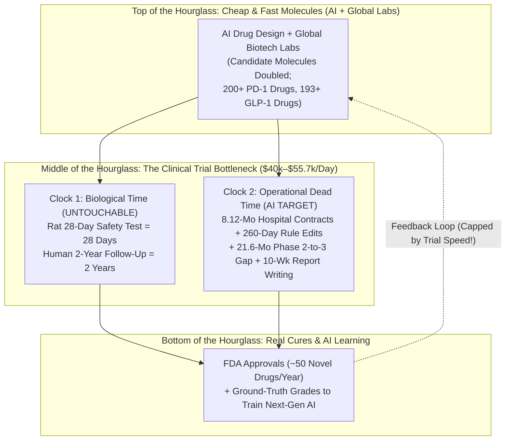
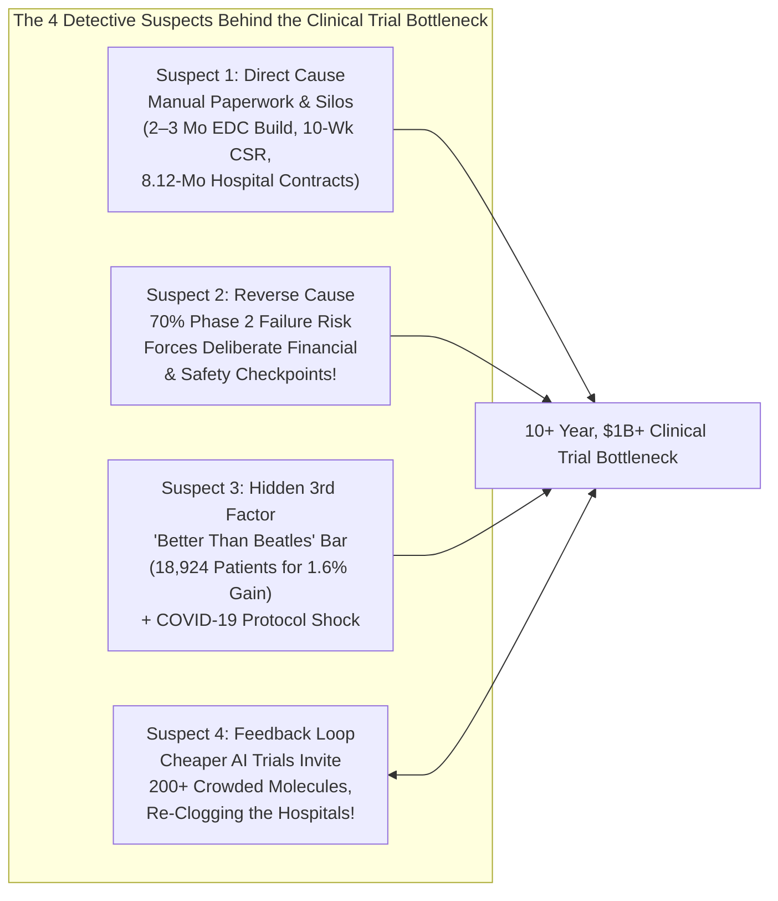
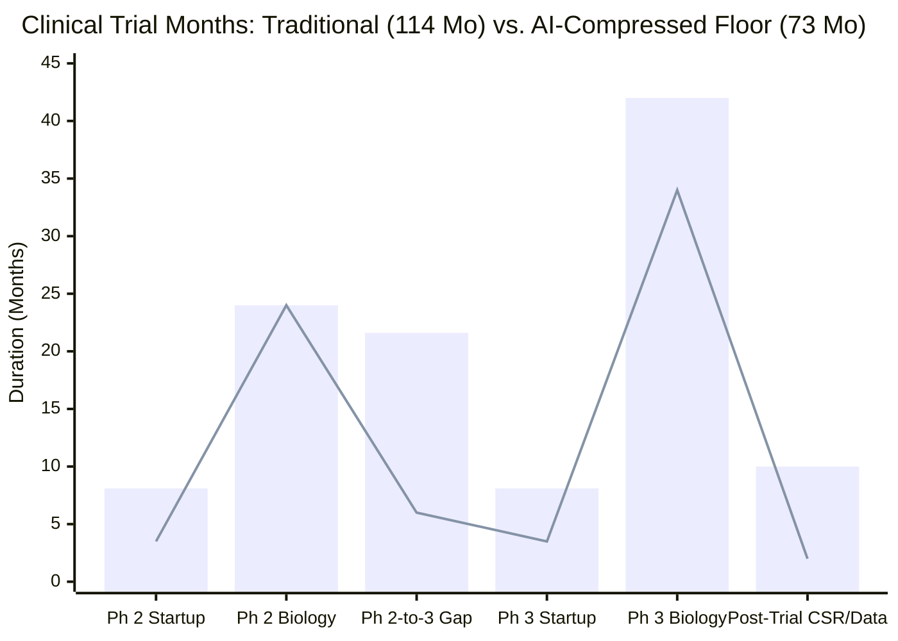

## 1. The Hook: Wait—If AI Can Print New Medicine Recipes Like a Laser Printer, Why Could That Actually Slow Down Real Cures?

Imagine a bicycle factory with two rooms.

In **Room #1 (The Drawing Room)**, engineers sit at desks drawing blueprints for cool new mountain bikes.
In **Room #2 (The Safety Testing Track)**, there is a narrow, single-lane obstacle course with only **10 human test riders**. By law, before any new bike can be sold in stores, those test riders must ride it up and down steep rocky hills for a full year to make sure the brakes don't snap.

Now imagine someone brings a magical Artificial Intelligence (`AI`) supercomputer into Room #1. Overnight, instead of drawing 5 bike blueprints a year, the factory prints **500 brand-new bike blueprints every week**!

Wait—does the factory deliver more safe bikes to kids at the store? **No!** In fact, something terrible happens outside Room #2:
* **500 untested bikes** pile up in a giant hallway traffic jam in front of the narrow track door.
* Instead of 10 test riders focusing on the 2 best bikes, the riders get split up—1 rider here, 1 rider there—trying to test 50 almost-identical bikes at once.
* Because no bike gets enough riders to finish the safety test on time, **every single bike takes longer and costs more money to finish than before AI arrived!**

On November 3, 2026, biotech researcher and investor **Soleil Wizman** ([soleilwizman.com](https://www.soleilwizman.com/), who trains genomic AI models at the Arc Institute and Yale after working at Thrive Capital, age1, and OpenAI-acquired Orchestra Bio) published a landmark investigation on X titled ***"Clinical Development in an Age of Cheap Molecules."*** Building on an essay titled [*Uneven Frontiers*](https://www.a16z.news/p/uneven-frontiers) by **Ben Liu** (co-founder and CEO of **Formation Bio**, which raised a **$600 million** fund to buy and test drugs—enough money to buy **2,000 new school buses**!) and a warning from veteran biotech investor **Bruce Booth** (Atlas Venture), Wizman examined a shocking paradox at the heart of modern medicine.

When we open the primary scientific papers, government registries, and hospital benchmarks behind Wizman's essay, **four giant detective mysteries** jump off the page:

* **Mystery #1 (The Pipeline Doubled, Approvals Stood Still):** Over the past decade—thanks to better lab tools, AI design programs, and a massive wave of biotech labs in China—the number of newly discovered candidate medicines (`molecules`) has roughly **doubled**. Today, more than **180 companies** are testing **200+ different drugs** aimed at the exact same cancer switch (`PD-1/PD-L1`), and **193 different drugs** are chasing the same weight-loss switch (`GLP-1`) ([Ben Liu, 2026, *Uneven Frontiers*](https://www.a16z.news/p/uneven-frontiers))! Yet how many brand-new medicines does the U.S. Food and Drug Administration (`FDA`) approve each year? Still roughly **50 per year** (`50` novel drugs in 2024)—almost completely flat! Why did doubling the blueprints at the top of the funnel fail to move the needle at the bottom?
* **Mystery #2 (The $55,716-Per-Day Meter & The 21.6-Month Empty Gap):** According to empirical benchmarks from the **Tufts Center for the Study of Drug Development (`Tufts CSDD`)**, running a human drug trial costs an average of **$40,000 every single day**—and rises to **$55,716 per day** in final-stage (`Phase 3`) studies (almost enough to pay a **full year's salary for a public school teacher every single day the clock ticks**!). Worse, every wasted day burns down the drug's finite **20-year patent monopoly clock**, costing roughly **$500,000 per day** in lost future pharmacy sales. Yet Tufts researchers found that for non-fast-tracked drugs approved between 2008 and 2018, **82% sat completely still in an empty "white space" gap averaging `17 months`** between finishing mid-stage human tests (`Phase 2`) and starting final human tests (`Phase 3`)—and that dead gap grew from **`12 months`** (2008–2013) to **`21.6 months`** (2014–2018), or nearly **two full school years** where zero patients were being treated!
* **Mystery #3 (10 Weeks Crushed Into 10 Minutes—Yet 80% of Trials Still Miss Their Deadlines):** After the very last patient finishes their very last doctor visit in a clinical trial, it normally takes **several months** just to clean the spreadsheet, check the math, and write the giant government report (`Clinical Study Report`), which alone takes **more than 10 weeks**. Recently, a team of just **11 people** (several of whom weren't even software engineers!) at drug giant **Novo Nordisk** (maker of `Ozempic`) used Anthropic's **Claude** AI to build an internal system called **`NovoScribe`** ([Anthropic Case Study](https://claude.com/customers/novo-nordisk)) that generates a reviewable first draft of that 10-week report in **10 minutes**—cutting writing time by **90%**! Wait: if AI agents can turn 10 weeks of paperwork into 10 minutes, why do **~80% of clinical trials** still miss their initial patient sign-up deadlines, why do **11% of hired hospitals fail to sign up even a single patient (`0 patients`)**, and why did the world's fastest AI-powered clinical trial service company (**Lindus Health**) suddenly **sell off its trial-running business** in August 2026 to become a drug-owning company (**Lindus Therapeutics**)?
* **Mystery #4 (Why Hospital Paperwork Caps How Smart Discovery AI Can Get):** You might think AI computer scientists only care about chemistry in a lab and don't care about slow hospital paperwork. Wrong! A human clinical trial is the **only real-world grading key (`ground truth evaluation`)** that tells an AI discovery model whether its chemical prediction actually worked inside a living human body. If the hospital testing pipe stays clogged, discovery AI models starve for grades—capping how fast AI itself can learn and improve!

Grab your detective notebook. We are going to explain how human drug testing actually works from step zero, separate unbreakable **Biological Time** from fixable **Paperwork Dead Time**, check the math on every startup claim, and see how a new government moonshot called **`SURPASS`** plans to rebuild the entire track.

---

## 2. Starting from Zero: How Does a Chemical Guess Turn Into a Pharmacy Pill, and What Are the Two Clocks Ticking Inside Every Trial?

Suppose a computer program designs a brand-new microscopic chemical key that it *thinks* will stop asthma, shrink a tumor, or lower cholesterol. Scientists call that candidate chemical key a **Molecule**.

Can a drug company immediately sell that molecule at the neighborhood pharmacy? **Never.** Because computer screens and mouse cages are not human beings! Out of every 100 drugs that look safe and effective in lab dishes and animal tests, roughly **90 fail when tested in real humans** ([Wong, Siah, & Lo, 2019, PMC6409418](https://pmc.ncbi.nlm.nih.gov/articles/PMC6409418/); [ARPA-H SURPASS, 2026](https://arpa-h.gov/explore-funding/programs/surpass)).

To protect patients, government referees like the **U.S. Food and Drug Administration (`FDA`)** require every candidate molecule to pass a three-stage human obstacle course called **Clinical Development** (or **Clinical Trials**):

1. **Stage 1 (`Phase 1` — The Safety Check):** Doctors give the medicine to a small group of **`20 to 80` volunteers** to check whether it is safe in human blood and find the right dose.
2. **Stage 2 (`Phase 2` — The "Does It Actually Work?" Proof):** Doctors give the medicine to **`50 to 300` sick patients** who actually have the disease. This is the hardest cliff in medicine: only about **30% (`3 out of 10`)** of drugs pass Phase 2! Because Phase 2 proves whether the biology actually works in humans, Ben Liu notes in [*Uneven Frontiers*](https://www.a16z.news/p/uneven-frontiers) that a drug's financial value jumps **4×** (`400%`) the day it passes Phase 2!
3. **Stage 3 (`Phase 3` — The Giant Head-to-Head Championship):** Doctors test the new medicine against today's standard treatment (or a dummy pill called a **`Placebo`**) in **`500 to 19,000+` patients** across dozens or hundreds of hospitals around the world.

### The Big Secret: Every Clinical Trial Has Two Different Clocks!

Why does running Phase 1, Phase 2, and Phase 3 take **10+ years** and cost **$1 billion to $2 billion** ([ARPA-H SURPASS, 2026](https://arpa-h.gov/explore-funding/programs/surpass))?

Soleil Wizman points out a brilliant way to look at a clinical trial calendar. If you open the stopwatch on any trial, the time splits into **two completely different kinds of time**:

* **Clock #1: The Biology Clock ("Irreducible Biological Time"):**
  Suppose a pre-trial safety rule requires a **28-day animal toxicology study** where rats take a pill every day for 28 days to see if their livers stay healthy. How long does a 28-day rat study take? **28 days!** No AI algorithm on Earth can make a rat's liver digest chemicals 10 times faster! Or suppose a Phase 3 cancer trial measures whether patients live safely without their tumor growing back for **24 months**. Once a patient swallows the pill, you *have* to wait 24 months of real Earth calendar time to observe their body. **AI cannot touch Clock #1.**
* **Clock #2: The Waiting & Paperwork Clock ("Operational Dead Time"):**
  What about all the months where *no patient is swallowing a pill and no biology is being measured*?
  * Waiting **8.12 months** for a university hospital's lawyers and committees to sign a starting contract.
  * Waiting **2 to 3 months** for database programmers to manually type up computer screens before the study can open.
  * Waiting **260 days** (over `8.5 months`) every time the trial rulebook needs an edit ([Getz et al., 2024, PMID 38438658](https://eutils.ncbi.nlm.nih.gov/entrez/eutils/esummary.fcgi?db=pubmed&id=38438658&retmode=json)).
  * Waiting **17 to 21.6 months** in the empty gap between Phase 2 and Phase 3 while executives argue in meetings, ask regulators questions, and wait for factories to bottle new pills.
  * Waiting **3 to 6 months** *after* the last patient goes home just to clean data errors, write SAS computer code, and type a 10-week report!

Most of those non-biological steps require only **hours or days of actual work**, buried inside **months of waiting in line** for information, budgets, and handoffs. **And that Waiting & Paperwork Clock is exactly what software "AI Agents" can attack!**

---

## 3. The Secret Decoder Ring: 10 Grown-Up Clinical Trial Words Translated

Before we follow the money and test the evidence, use this **Secret Decoder Ring** so the industry's scariest acronyms feel as simple as a school playground:

| The Grown-Up Word / Acronym | What It Actually Means in Plain English | Everyday 5th-Grade Analogy |
| :--- | :--- | :--- |
| **`Protocol` & `Protocol Amendment`** | The official step-by-step rulebook for a clinical trial (who can join, what dose they get, which blood tests to run)—and an official mid-game rule change (`Amendment`) when something in the rulebook isn't working. | The **instruction manual for a giant LEGO set**—and having to stop building for `260 days` while the teacher mails a corrected page to 50 classrooms. |
| **`Primary Endpoint`** | The #1 main scoreboard measurement declared *before* the trial starts that decides whether the medicine officially won or lost (like "Did patients breathe out more air after 12 weeks?"). | Deciding before a basketball game starts that **points scored on the scoreboard**—not dribbles or cool shoes—decides who wins. |
| **`EDC (Electronic Data Capture)`** | The super-strict, locked computer database where hospital staff type every patient's weight, blood pressure, and blood-test results, tracking every single keystroke for FDA inspectors. | A **permanent-ink digital report card book** that five different principals check, where you can never erase a number without writing a signed note explaining why. |
| **`CRO (Contract Research Organization)`** | A huge outside service company that drugmakers hire to rent thousands of temporary workers to manage hospitals, paperwork, and data during a trial. | Hiring an **outside party-planning company** that charges you by the hour for every worker they send to set up tables and clipboards. |
| **`IRB (Institutional Review Board)`** | An independent committee of doctors, scientists, and community members who must read and approve every trial rulebook to make sure human volunteers are protected from unfair harm. | The **school safety patrol and parent safety board** that must inspect a new playground slide before any kid is allowed to climb it. |
| **`Coverage Analysis`** | Going through a trial's hospital bill line by line using government (`Medicare`) rules to decide which blood tests the **patient's normal health insurance** pays for versus which tests the **drug company** pays for. | Splitting a **group pizza restaurant bill** item by item to figure out which slices the school field-trip budget pays for and which extra toppings the club sponsor pays for. |
| **`CRF (Case Report Form)` & `CDISC / CDASH`** | The standardized blank check-in sheets (`CRFs`) nurses fill out at each doctor visit, formatted in a universal computer language (`CDISC`) so FDA computers can read them automatically. | Using a **standard Scantron bubble sheet** so the grading machine can read tests from 100 different schools without a human retyping them. |
| **`Database Lock` & `CSR (Clinical Study Report)`** | Freezing the trial spreadsheet after all errors are fixed (`Database Lock`) and writing the massive, 1,000+-page final book (`CSR`) explaining every table and safety result for the FDA. | Locking the **final exam gradebook** at the end of the school year and writing the **giant yearbook summary** for the school board. |
| **`PTRS (Probability of Technical & Regulatory Success)` & `rNPV`** | Calculating the percentage chance a drug will pass all tests (`PTRS`) and multiplying that chance by its future earnings (`risk-adjusted Net Present Value / rNPV`) to see if the trial is worth its cost. | Checking if a **`$10` raffle ticket** that gives you a `30%` chance to win a **`$100` bike** (expected value = `$30`, minus `$10` cost = `+$20` value) is a smart bet. |
| **`Platform Trial` (`ARPA-H SURPASS`)** | A continuous, multi-company trial running under one shared master rulebook where 5 or 10 different drugs are tested at the same time against **one shared control group** of patients. | Holding **one big track meet** with one official timer where 10 runners race against the same pace car, instead of building 10 separate stadiums for 10 solo races. |

---

## 4. The Big Claim vs. The Detective Check: Why Is Clinical Capacity So Scarce, and Where Does Agentic AI Actually Work?

Let's put on our magnifying glass and inspect the two halves of Soleil Wizman's investigation:
1. **Why the hospital testing pipe is getting squeezed harder than ever.**
2. **Where the 4 new squads of AI software agents are trying to widen the pipe—and what our primary-source check reveals about their real limits.**

### Part A: What Consumes a Trial—and the 3 Scarcity Traps That Make It Worse

AI and automated wet labs may make chemical molecules abundant, but every clinical trial burns through **four things that stay stubbornly scarce**:

| Scarce Trial Ingredient | Phase 1 (Safety) | Phase 2 (Proof of Concept) | Phase 3 (Pivotal Approval) | Why AI Cannot Just "Print More" |
| :--- | :--- | :--- | :--- | :--- |
| **1. Human Patients** | `20–80` volunteers | `50–300` sick patients | `500–19,000+` sick patients | Only so many human beings have a given disease, live near a trial hospital, and meet strict entry rules. |
| **2. Hospital Sites & Coordinators** | `1–5` specialized units | `10–50` clinics/hospitals | `50–1,300+` hospitals globally | Human study nurses and doctors have finite hours in a day; **11% of chosen sites enroll 0 patients**. |
| **3. Calendar Time** | Median `1.6 years` | Median `2.9 years` (+ `17–21.6 mo` gap) | Median `3.8 years` | Biology takes real calendar months to play out inside human organs. |
| **4. Direct Cash & Patent Clock** | Millions (`~$15k–$25k/day`) | Tens of millions (`~$23.7k–$40k/day`) | `$50M–$1B` (`$55,716/day` direct cost) | Every day burns cash *and* eats 1 day of the 20-year patent monopoly (`~$500,000/day` in lost peak sales). |

And as Wizman highlights, **three economic traps** make that table much worse than it looks at first glance:

#### Trap #1: Jack Scannell's "Better Than the Beatles" Dilemma (And the $1 Billion `ODYSSEY` Math Check)
In a famous 2012 paper in *Nature Reviews Drug Discovery* ([Scannell et al., 2012, PMID 22378269](https://eutils.ncbi.nlm.nih.gov/entrez/eutils/esummary.fcgi?db=pubmed&id=22378269&retmode=json)), biologist and investor **Jack Scannell** asked why making new drugs keeps getting more expensive every decade. He called one big reason the **"Better than the Beatles" problem**.

Imagine if no new music band was allowed to sell songs unless they proved they were better than **The Beatles**—and every time a great new album came out, the next band had to beat The Beatles *plus* every hit album ever recorded since! That is literally how medicine works: once a great medicine is approved and becomes a cheap everyday pill (like **`statins`** for high cholesterol), a new drug isn't allowed to just beat a sugar pill. It has to prove it saves extra lives **on top of** the cheap statin pill!

Look at the real-world receipt Wizman cites: the [**`ODYSSEY OUTCOMES` trial**](https://clinicaltrials.gov/study/NCT01663402) of a cholesterol-lowering antibody shot called **`alirocumab` (`Praluent`)**, published in the *New England Journal of Medicine* ([Schwartz et al., 2018, PMID 30403574](https://eutils.ncbi.nlm.nih.gov/entrez/eutils/esummary.fcgi?db=pubmed&id=30403574&retmode=json)).
* **What it took:** Drugmakers Sanofi and Regeneron had to enroll **18,924 heart-attack survivors** (enough people to fill **every seat in Madison Square Garden**!) across **1,315 hospitals in 57 countries**, follow them for nearly **5 years** (median `2.8 years` of injections every 2 weeks), and spend roughly **$1 billion**.
* **Wait—do the Detective Math Check (Relative % vs. Absolute Baseline!):** Headlines reported that `alirocumab` achieved a **"15% relative risk reduction"** in major heart events (`Hazard Ratio 0.85`). That sounds pretty big! Why did it need `18,924` patients to spot a `15%` change?
* Open the raw numbers inside `PMID 30403574`: because every single patient in the trial was *already* taking maximum-strength `statin` pills, **`1,052 out of 9,462` patients (`11.1%`)** in the dummy-shot group had a heart attack, stroke, or heart death—while **`903 out of 9,462` patients (`9.5%`)** in the `alirocumab` group had one.
* Subtract `9.5%` from `11.1%`: in **absolute human numbers**, out of every **100 patients** injected every two weeks for nearly three years, `alirocumab` prevented **1.6 heart events (`1.6 percentage points` of absolute risk reduction, or `15%` of `11.1%`)**! That means doctors had to treat **63 patients (`NNT = 63`)** for almost 3 years just to prevent **1** heart event!
* Because spotting a tiny `1.6-out-of-100` difference without being fooled by random luck requires a massive crowd, any new AI-designed heart drug trying to enter a statin-crowded lane must find its own Madison Square Garden of `19,000` patients and `$1 billion`!

#### Trap #2: The 95% Underpowered Noise Problem (Dr. Janet Woodcock's FDA Audit)
Even before generative AI arrived, hospitals were drowning in poorly coordinated trials. In 2021, then-Acting FDA Commissioner **Dr. Janet Woodcock** and **Kevin Bugin** audited **2,024 registered COVID-19 clinical trials** (`2,895 trial arms`) around the world ([Bugin & Woodcock, 2021, PMC7903288](https://pmc.ncbi.nlm.nih.gov/articles/PMC7903288/)).
* Their shocking finding: **only `5.0%` (`1 in 20`) of all COVID-19 trial arms worldwide were both randomized (using a fair coin-flip control group) and large enough (`adequately powered`) to give doctors a real, trustworthy answer!**
* The other **95% of trial arms** consumed scarce doctors, nurses, and sick patients while being too small or poorly designed to prove anything! And today, the exact same crowding happens in cancer (`200+ PD-1/PD-L1` drugs across `180+` companies) and obesity (`193+ GLP-1` drugs).

#### Trap #3: The Lopsided Jackpot Curve (Mean `$4.6B` vs. Median `$1.5B`)
Many tech investors say: *"Drug discovery is just a numbers game—if AI gives us 10 times more shots on goal, we'll make 10 times more money!"*
Wait—check the **Average vs. Median Detective Test**!
* Drug launch earnings are wildly skewed: the **top 10% (`top decile`)** of newly launched drugs capture **more than 50% of all industry profits**, pulling the **Mean (mathematical average)** lifetime revenue of a new drug up to roughly **$4.6 billion**.
* But if you line up 100 approved drugs from smallest to biggest and look at Drug #50 right in the middle, the **Median** lifetime revenue is only **$1.5 billion**—less than one-third of the average!
* Why? Because the first breakthrough drug in a class (`first-in-class` or clear `best-in-class`) wins the lion's share of patients, while copycat drugs #8, #9, and #10 fight over tiny crumbs at the bottom of the curve. If AI floods hospitals with dozens of "okay, me-too" molecules, they clog up the testing track for the few true blockbusters!

---

### Part B: Why the 3 Software Giants (`Cytel`, `Medidata`, `Veeva`) Are So Sticky—and How the 4 AI Rescue Squads Stack Up

Why hasn't Silicon Valley already replaced old clinical trial software the way AI coding tools swept through software engineering?

Because in **drug discovery**, a chemist can test a brand-new AI molecule generator on their laptop on a Tuesday afternoon without asking anyone's permission.
In **clinical development**, every single number typed into the computer is a legal record audited by the FDA and shared across **five different organizations at once**: the **Drug Sponsor**, the **CRO**, **dozens of independent hospitals**, the **IRB ethics board**, and the **FDA regulator**. That is why three incumbent software giants have dominated for decades:
1. **Cytel** (founded in `1987`): The 40-year leader in trial simulation; its `East®` and `East Horizon™` math software is used directly by the **FDA**, Japan's **PMDA**, and the **top 30+ pharma companies**.
2. **Medidata** (owned by Dassault Systèmes): The giant of `EDC` trial databases, holding records from **38,000+ clinical trials** and **12 million+ patients across 140+ countries**.
3. **Veeva Systems**: The powerhouse of regulatory filing software (`Veeva Vault`), managing trial startup binders, clinical documents, and FDA submissions.

Instead of ripping out those sticky vaults, a new wave of **Agentic AI startups and pharma teams** is attacking **4 specific clusters** of clinical dead time. Here is our primary-source detective scorecard on what they claim vs. what the receipts actually show:

| Trial Cluster & Bottleneck | Primary-Source Cost & Time Pain | Key AI Systems & Startups Cited | What Our Detective Check Reveals (The Real Limits) |
| :--- | :--- | :--- | :--- |
| **1. Trial Design & Rulebook Edits (`Amendments`)** | `76%` of trials need edits (`3.3` avg); each takes **`260 days`** ([Getz et al., 2024, PMID 38438658](https://eutils.ncbi.nlm.nih.gov/entrez/eutils/esummary.fcgi?db=pubmed&id=38438658&retmode=json)) and costs **`$141k` (Ph 2)** to **`$535k` (Ph 3)** ([Getz et al., 2016, PMID 30227022](https://eutils.ncbi.nlm.nih.gov/entrez/eutils/esummary.fcgi?db=pubmed&id=30227022&retmode=json)). | **PhaseV** (`$50M` Series A; Bayesian simulations + `AI Conductor`), **UIUC/Medidata `AMEND++`** ([arXiv:2601.06300](https://arxiv.org/abs/2601.06300)), **Biorce** (trained on `200+` FDA rejection letters). | **Crucial Catch:** In `Getz et al. (2024)`, **77% of amendments were rated "unavoidable"** upfront (caused by mid-trial FDA requests or strategy changes)! And `AMEND++` (`161,970` trials) only scores **`0.70–0.71 AUROC` (`~64.4%` accuracy)** on *whether* rules change, not *how* or *why*. |
| **2. Study Startup & Phase Gaps (`Execution`)** | **`17 to 21.6 months`** dead gap between Phase 2 & 3 (`82%` of drugs); hospital startup takes **`8.12 months`** at universities vs. **`4.37 months`** at independent clinics; **`~70%`** delayed by Medicare **Coverage Analysis**. | **Formation Bio `Forge`** (pre-plans Phase 3 during Phase 2), **Medable** (`CDISC USDM 4.0` machine-readable protocols), **UpSite Clinical** & **Advarra** (AI coverage analysis). | **Crucial Catch:** AI agents can instantly draft budgets and translate protocols, **but they cannot force a university hospital lawyer or a monthly IRB committee to sign faster** unless both sides let AI negotiate by playbook. |
| **3. Patient Recruitment & Site Operations** | **`~80%` of trials** miss enrollment deadlines; **`11%` of sites enroll `0` patients**; recruiting 1 patient costs **`$6,533`** on average. | **Formation Bio `Muse`** (with Sanofi & OpenAI), **Alleviate Health** (`$4.3M` a16z seed; `500,000+` patient calls/texts across `190+` sites), **Intera** (voice/SMS cross-trial routing), **Tilda (`Tilda Sense`)** (`10×` coordinator copilot). | **Crucial Catch:** Startups that tried running clinics themselves (**Lindus Health**, **Topography Health**) **sold off their service/site businesses in 2026** because service fees capture tiny value compared to owning the drugs! |
| **4. Data Cleaning & Post-Trial FDA Reports (`Data`)** | `2–3 months` to build `EDC` forms; weeks of manual error pop-ups (`queries`); **`10+ weeks`** after last patient visit to write the **`Clinical Study Report (CSR)`** and double-program `SAS`/`R` tables. | **Saama** (modular data agents), **Octozi** (`$3M` seed; estimates **`$5M+` savings** on Ph 3 cancer trial), **GSK** (agentic SAS/R code generator), **Novo Nordisk `NovoScribe`** (Claude-powered `CSR` writer). | **The #1 Proven Winner Today:** **Novo Nordisk's `NovoScribe`** ([Anthropic Case Study](https://claude.com/customers/novo-nordisk)), built by an **11-person team**, cut `CSR` drafting from **`10+ weeks` to `10 minutes` (`90%` time cut)**! However, for patient data errors, `Good Clinical Practice (GCP)` law still requires a human doctor at the hospital to sign off on every fix. |

### Wait—Let's Check the "San Francisco Parlor Game" of Predicting Trial Winners!

In Section 1 of her essay, Wizman exposes a favorite game among San Francisco biotech investors: claiming their secret AI model can **predict whether a Phase 2 clinical trial will succeed or fail before the results come out**.

How can a 5th-grade detective test whether an AI trial-prediction company is actually a genius—or just got lucky on a few coin flips?

Let's use **Ben Liu's Gym-Class Coin-Flip Math** from [*Uneven Frontiers*](https://www.a16z.news/p/uneven-frontiers):
* Suppose the regular industry success rate for Phase 2 trials is **30% (`3 out of 10` succeed by normal human picking)**.
* Imagine a kid claims they have magic glasses that pick Phase 2 winners. They pick **5 trials**, and **3 of them win (`60%`)**! Are their magic glasses real? **Not yet!** With a `30%` base chance, getting 3 out of 5 happens **`16.3%` of the time (`about 1 in 6 tries`)** by pure dumb luck!
* Even if they pick **10 trials** and win **5 out of 10 (`50%`)**, random luck still does that **`15%` of the time**!
* To prove with real scientific confidence (`p = 0.048`, meaning less than a `5%` chance of a fluke) that an AI model truly beats the `30%` baseline, the company must lock its predictions in an envelope **before the trials finish (`prospective readouts`)** and hit at least **6 out of 10** (`60%`) or **10 out of 20** (`50%`)!
* Since a single Phase 2 trial takes **2 to 4 years** to finish, proving an AI model can truly predict human clinical efficacy takes **10 to 20 real-world trials over many years**. Until a company passes that prospective test, every shiny chart they show you is just a **backtest** (guessing yesterday's lottery numbers after reading the newspaper)!

---

## 5. The Four Suspects: What Is Really Causing the Clinical Trial Traffic Jam?

Whenever someone says, *"Clinical trials are slow and expensive because hospitals use clunky old software—so AI agents will fix it!"*, a real detective never stops at Suspect #1. We must line up **all four causal suspects** (Direct Cause, Reverse Cause, Hidden Third Factor, and Feedback Loop) and test the evidence:

| The Suspect | How the Story Goes | What the Primary Receipts Show | Detective Verdict |
| :--- | :--- | :--- | :--- |
| **Suspect #1: Direct Cause (`Clunky Manual Workflows → Slow Trials`)** | Trial delays happen because nurses scroll through PDFs by hand, programmers spend `2–3 months` building `EDC` forms, and writers spend `10+ weeks` typing `CSR` reports. | **Real and massive at the bookends!** Novo Nordisk's `NovoScribe` (`10+ weeks → 10 minutes`), GSK's agentic statistical coding, and automated `CDISC USDM 4.0` protocol translation prove that rule-based paperwork *was* needless friction. | **Guilty of ~25%–35% of the non-biological delay** (especially study startup packets, data queries, and post-trial FDA reports). |
| **Suspect #2: Reverse Cause (`High Biological Failure Risk → Deliberate Pause Gates`)** | Wait—do slow pauses between Phase 2 and Phase 3 (`17 to 21.6 months`) happen by accident, or does the **70% Phase 2 biological failure rate** *force* companies to wait before spending `$50M–$100M+` on Phase 3 manufacturing and contracts? | **Huge hidden factor!** If a company pre-builds Phase 3 pill factories and signs 100 hospital contracts *during* Phase 2, **7 out of 10 times (`70%`) that money is burned to ashes when Phase 2 fails!** Likewise, `77%` of protocol amendments in `Getz et al. (2024)` ([PMID 38438658](https://eutils.ncbi.nlm.nih.gov/entrez/eutils/esummary.fcgi?db=pubmed&id=38438658&retmode=json)) were **unavoidable** mid-flight safety/regulatory adjustments, not initial typos. | **Guilty!** Much of what looks like "slow bureaucracy" is actually staged financial risk control and human safety armor (`IRB` + `GCP`). |
| **Suspect #3: Hidden Third Factor (`The Rising Clinical Bar & Pandemic Confounder`)** | External forces simultaneously made trials slower, larger, and more amendment-heavy regardless of software tools. | **Proven by two primary datasets:** (1) Because existing cheap drugs (`statins`) work so well, `ODYSSEY OUTCOMES` ([PMID 30403574](https://eutils.ncbi.nlm.nih.gov/entrez/eutils/esummary.fcgi?db=pubmed&id=30403574&retmode=json)) needed **18,924 patients** to prove a **1.6% absolute benefit**. (2) In `Getz et al. (2024)`, the jump to `3.3 amendments` and `260 days` was heavily confounded by the **COVID-19 pandemic** disrupting hospital visits worldwide! | **Guilty!** You cannot fix a `1.6%` biological effect size with a faster PDF chatbot. |
| **Suspect #4: The Vicious Feedback Loop (`Cheaper AI Trials → Molecule Crowding → Worse Congestion`)** | When AI lowers the cost of designing a molecule *and* lowers the cost of running a trial, more marginal programs clear the `rNPV > Cost` bar and rush into the clinic at the same time. | **Already happening right now!** With **180+ companies** testing **200+ `PD-1/PD-L1` drugs** and **193+ `GLP-1` drugs**, 12 sponsors fishing in the same hospital pond force nurses to screen way more patients per sign-up and drive up hospital budget demands—**eating up the AI cost savings!** | **Guilty!** Without ruthless triage or shared platform trials, cheaper trials invite a highway pileup (**Jevons Paradox in medicine**). |

---

## 6. The Catch: Why Did the Fastest AI Trial Company Sell Its Own Business—and Who Loses When Molecule Crowding Hits?

Whenever a new technology wave looks unstoppable, Browne & Keeley's **"Negative View"** rule asks: *What is the catch? Who loses? And why did the smart insiders suddenly change direction?*

Three giant warnings stand out in Wizman's report:

### Catch #1: The `Lindus Health` Plot Twist ("Why Selling Speed Is Worth Pennies Compared to Owning the Drug")
Consider **Lindus Health**, founded in 2021 as the famous **"anti-CRO."** Instead of hiring five separate companies to run a trial, Lindus built a single AI-powered platform connected to **over 40 million Electronic Health Records (`EHRs`)**. By January 2025, Lindus had run **42 end-to-end clinical trials** across **36,000+ patients** in North America and Europe—enrolling patients up to **3 times faster** than traditional CROs!

Wait: if Lindus Health cracked the code to running clinical trials 3× faster, they must be becoming the biggest trial-service company on Earth, right?
**Wrong!** In August 2026, Lindus **sold its entire CRO trial-running business** to **Curavit Clinical Research** and relaunched itself as **Lindus Therapeutics**—a biotech company that licenses and owns its *own* drugs! (And in May 2026, **Topography Health**, which raised `$27.5 million` from a16z and Bain Capital Ventures to train community doctors to run trials, similarly **sold its clinic business** to **FOMAT Medical Research**!)

Why would the company best at speeding up trials stop selling "speed as a service"?
* Do the simple grade-school math: if a service vendor (`CRO`) signs a fixed-price contract to run a drug company's trial 12 months faster, the vendor only gets paid **once** for that service contract (say, `$10 million`).
* Meanwhile, the **drug company (`Sponsor`)** that owns the pill gets an extra year of patent monopoly sales and a **4× jump in asset value** after Phase 2—worth **hundreds of millions or billions of dollars**!
* **The Sobering Lesson:** The teams that actually build working AI engines to run faster clinical trials (like **Formation Bio** and **Lindus Therapeutics**) have a massive economic incentive to **keep that speed for their own drug pipelines** rather than rent it out cheaply to everyone else!

### Catch #2: The "Tragedy of the Commons" in Hospital Beds (Who Pays the Price?)
Imagine a village with one grassy pasture shared by 12 farmers. Each farmer thinks: *"Adding one more cow helps my family's wallet (`rNPV > 0`), and the eaten grass is shared by everyone else!"* Soon, all 12 farmers add cows until the pasture turns to mud and every cow starves. Economists call this the **Tragedy of the Commons**.

In clinical trials, **patients and hospital coordinators are the shared pasture**:
* When **Company #12** decides to run the 12th nearly identical `PD-1` cancer drug or `GLP-1` weight-loss drug, its spreadsheet only counts *its own* trial budget. It ignores the hidden damage it inflicts on **Programs #1 through #11**!
* **Who loses?**
  1. **Patients with rare or neglected diseases** whose truly original (`first-in-class`) medicines cannot get a hospital study nurse's attention because 15 big-money copycat trials bought up all the clinic slots.
  2. **Hospital study coordinators**—already the scarcest human workers in medicine—who get buried under 20 different sponsor portals, automated AI phone-call bots (`Alleviate`, `Intera`), and competing rules.
  3. **Patients who donate their bodies to science** inside the **95% of underpowered trials** ([Bugin & Woodcock, 2021, PMC7903288](https://pmc.ncbi.nlm.nih.gov/articles/PMC7903288/)) or copycat arms that never produce a meaningful medical step forward.

### Catch #3: The `49% vs. 16%` Pilot Trap—and Why `ARPA-H SURPASS` Faces a Tough Fight
Can't we just fix molecule crowding by putting all 12 competing drugs into **one giant shared trial**?

In late 2026, the U.S. government's health moonshot agency (**`ARPA-H`**) launched a bold program called [**`SURPASS`** (*Simulation-augmented, Real-time Platform Adaptive Seamless Trials*, Solicitation `ARPA-H-SOL-26-164`)](https://arpa-h.gov/explore-funding/programs/surpass) to try to cut clinical development from **10+ years down to less than 4 years**:
* Instead of 10 companies running 10 separate Phase 1, Phase 2, and Phase 3 trials with **10 separate dummy-pill (`placebo`) groups**, `SURPASS` puts many drugs under **one continuous master protocol** sharing **one common control group**.
* Suppose testing 10 drugs the old way required `100` treated patients + `100` placebo patients per drug = **`2,000` patients total** (`1,000` of whom get a dummy pill!). With a shared control group of `100` placebo patients serving all 10 drugs, you only need `1,000` treated + `100` shared placebo = **`1,100` patients total**—saving **900 human patients** from taking dummy pills and dropping losing drugs early!

Wait—if `SURPASS` is so smart, why doesn't every drug company join a platform trial tomorrow?
* **The Commercial Catch:** Drug companies are fierce rivals! If Company A's `$500 million` drug is tested side-by-side in the exact same master trial as Company B's drug, and Company B scores `2%` better, Company A's stock price crashes overnight. Furthermore, inside traditional pharma companies, **Bain & Company's April 2026 survey** found that while **49% of sponsors and CROs are piloting AI tools**, only **16% are actively redesigning roles and workflows around AI**. Buying a fast AI race car doesn't shorten your commute if company rules still force you to stop at 15 manual tollbooths!

---

## 7. The Final Report Card: What We Actually Think (If-Then Rules & Our 2026–2030 Forecast)

Look at the chart below comparing a traditional clinical development timeline (`~114 months` / `9.5 years` across Phase 2, the transition gap, Phase 3, and post-trial reporting) against how much **Agentic AI can realistically compress (`Operational Dead Time`)** versus the **unbreakable floor of `Biological Time`**:

Reading that chart tells the whole story in one glance:
* **Where the line drops way below the bar (`Ph 2 Startup`, `Ph 2-to-3 Gap`, `Ph 3 Startup`, `Post-Trial CSR/Data`):** AI agents can slash **~41 months (nearly 3.5 years!) of pure paperwork, contract redlining, data cleaning, and report writing** out of a drug's journey!
* **Where the line stays high (`Ph 2 Biology = 24 months`, `Ph 3 Biology = 34–42 months`):** The **~58 to 66 months (5 to 5.5 years) of real human biology** cannot be fast-forwarded by a chatbot, though smarter Bayesian trial design (`PhaseV`) and shared control arms (`ARPA-H SURPASS`) can trim sample sizes by `15%–20%`.

### The Smart Detective's "If ... Then ..." Guide

1. **If an AI company builds tools for the "Post-Trial Paperwork & Data Cleaning" phase (like `NovoScribe`, `GSK`'s statistical code agents, `Saama`, or `Octozi`), then** expect **immediate, massive wins (`50% to 90%` time savings)**—because converting raw database rows into `CDISC` tables and `Clinical Study Reports` after the last patient visit is pure rule-based information work with zero biological waiting.
2. **If an AI company builds tools for "Hospital Startup & Patient Recruitment" (like `Tilda`, `Medable`, `Alleviate Health`, or `UpSite Clinical`), then** expect **steady 2×–3× productivity gains for overburdened human coordinators**—*provided* the software slides quietly underneath existing `Medidata`/`Veeva` systems and helps automate `Medicare Coverage Analysis` rather than demanding hospitals learn a brand-new database.
3. **If an AI vendor claims it can "Predict Phase 2 Clinical Trial Winners" or "Eliminate Protocol Amendments Before Day 1," then** hold onto your wallet and demand **10 to 20 prospective (pre-registered) trial readouts** (`hitting ≥6/10 or ≥10/20`)—remembering that `77%` of protocol amendments in `Getz et al. (2024)` were unavoidable mid-trial regulatory or strategy changes, and historical backtests cannot beat `30%` biological base-rate variance.
4. **If AI continues making early drug molecules cheap without shared triage (like `ARPA-H SURPASS`), then**Bruce Booth's warning will come true: **molecule crowding** (`200+` drugs chasing the same target) will inflate per-patient recruitment costs above `$6,533` and swallow a large chunk of AI's operational savings across crowded diseases like oncology and obesity.

### Our 2026–2030 Probability Report Card

| Scenario | Probability | What Happens Between 2026 and 2030 | Who Wins & Who Loses |
| :--- | :--- | :--- | :--- |
| **Base Case: "Bookend Compression Meets Mid-Clinic Crowding"** | **55% (Most Likely)** | AI agents slash post-trial reporting (`10+ weeks → days`), `EDC` database setup (`2–3 months → 2 weeks`), and Phase 2-to-3 gaps (`21.6 months → ~6–9 months`), saving **2 to 3 years of dead time** for top adopters. However, a flood of cheap AI and China-sourced molecules crowds popular targets (`PD-1`, `GLP-1`, immunology), driving up per-patient site fees and keeping industry-wide Phase 2 success rates near `30%–35%`. | **Winners:** AI-native asset owners (**Formation Bio**, **Lindus Therapeutics**), workflow copilots embedded in sites/EDCs (**Tilda**, **Saama**, **Octozi**, **PhaseV**), and hospital networks. **Losers:** Undifferentiated #15 "me-too" biotechs and legacy headcount-billing CROs. |
| **Downside / Bear Case: "The Hospital Gridlock & Pilot Purgatory"** | **30%** | Molecule supply grows 3× faster than coordinator headcount; academic hospital bureaucracy (`8.12-month` startup, manual IRB/GCP sign-offs) refuses to accept autonomous agent redlining; most pharmas stay stuck in Bain's `84%` non-redesigned workflow bucket. Aggregate R&D return per dollar drops over the next 3–5 years just as Bruce Booth predicted. | **Winners:** Incumbent systems of record (**Medidata**, **Veeva**, **Cytel**) and elite hospital site networks with pricing power. **Losers:** Pure-play AI clinical SaaS startups selling point solutions into frozen pharma silos. |
| **Upside / Bull Case: "The Seamless Platform & AI Triage Breakthrough"** | **15%** | FDA and `ARPA-H SURPASS` master protocols gain mainstream adoption in oncology and rare diseases, letting 5–10 drugs share a single control arm; `CDISC USDM 4.0` automates end-to-end protocol-to-EDC builds; and AI patient-matching cuts the `80%` enrollment delay rate in half, lifting annual FDA novel drug approvals from `~50` toward `75–90/year` by 2030. | **Winners:** Patients waiting for rare and fatal disease cures, discovery AI models (receiving 2× faster human ground-truth feedback!), and tiny "pipeline-in-a-person" biotechs. |

### The Bottom-Line Verdict

Soleil Wizman's diagnosis hits the bullseye: **in an age where AI makes inventing candidate molecules cheap, the scarce treasure in medicine is no longer the chemical blueprint—it is human clinical proof.**

No software agent can make a human tumor shrink in 10 minutes or skip a 3-year heart safety watch. Anyone promising that AI will erase **Biological Time** is selling fairy dust. Keep your eye on the **Waiting & Paperwork Clock** instead: when an 11-person team at Novo Nordisk can compress **10+ weeks** of post-trial regulatory writing into **10 minutes**, and when AI agents can help trim **21.6 months** of inter-phase dead air and **8.12 months** of hospital contract gridlock, cutting even **2 to 3 years of pure administrative waiting** means life-saving medicines reach sick kids and grandparents years sooner—and gives AI science the real-world human grades it needs to learn what actually cures disease.

---

## Primary Sources & Verification Receipts

1. **Soleil Wizman (Nov 3, 2026):** *Clinical Development in an Age of Cheap Molecules* (Author portal & publications: [soleilwizman.com](https://www.soleilwizman.com/)).
2. **Benjamine Liu, CEO of Formation Bio (Jun 17, 2026):** *Uneven Frontiers: How AI Will Transform Biopharma—and Why the Sequence of Change Matters*, a16z News ([a16z.news/p/uneven-frontiers](https://www.a16z.news/p/uneven-frontiers)).
3. **Tufts CSDD Protocol Amendment Benchmarks (Getz et al., 2024):** *New Benchmarks on Protocol Amendment Practices, Trends and their Impact on Clinical Trial Performance*, *Therapeutic Innovation & Regulatory Science* 58(3):539–548 ([PubMed PMID 38438658](https://eutils.ncbi.nlm.nih.gov/entrez/eutils/esummary.fcgi?db=pubmed&id=38438658&retmode=json)).
4. **Tufts CSDD Protocol Amendment Cost Study (Getz et al., 2016):** *The Impact of Protocol Amendments on Clinical Trial Performance and Cost*, *Therapeutic Innovation & Regulatory Science* 50(4):436–441 ([PubMed PMID 30227022](https://eutils.ncbi.nlm.nih.gov/entrez/eutils/esummary.fcgi?db=pubmed&id=30227022&retmode=json)).
5. **UIUC & Medidata `AMEND++` Benchmark (Das, Beigi, Aptekar, & Sun, 2026):** *AMEND++: Benchmarking Eligibility Criteria Amendments in Clinical Trials*, arXiv:2601.06300v2 ([arxiv.org/abs/2601.06300](https://arxiv.org/abs/2601.06300)).
6. **Jack Scannell et al. ("Better Than the Beatles" / Eroom's Law, 2012):** *Diagnosing the Decline in Pharmaceutical R&D Efficiency*, *Nature Reviews Drug Discovery* 11(3):191–200 ([PubMed PMID 22378269](https://eutils.ncbi.nlm.nih.gov/entrez/eutils/esummary.fcgi?db=pubmed&id=22378269&retmode=json)).
7. **ODYSSEY OUTCOMES Alirocumab Phase 3 Trial (Schwartz et al., 2018):** *Alirocumab and Cardiovascular Outcomes after Acute Coronary Syndrome*, *New England Journal of Medicine* 379(22):2097–2107 ([PubMed PMID 30403574](https://eutils.ncbi.nlm.nih.gov/entrez/eutils/esummary.fcgi?db=pubmed&id=30403574&retmode=json); [ClinicalTrials.gov NCT01663402](https://clinicaltrials.gov/study/NCT01663402)).
8. **FDA Global Clinical Trial Registry Evaluation (Bugin & Woodcock, 2021):** *Trends in COVID-19 Therapeutic Clinical Trials*, *Nature Reviews Drug Discovery* 20(4):254–255 ([PMC7903288](https://pmc.ncbi.nlm.nih.gov/articles/PMC7903288/)).
9. **MIT Clinical Trial Duration & Success Rate Audit (Wong, Siah, & Lo, 2019):** *Estimation of Clinical Trial Success Rates and Related Parameters*, *Biostatistics* 20(2):273–286 ([PMC6409418](https://pmc.ncbi.nlm.nih.gov/articles/PMC6409418/)).
10. **Novo Nordisk & Anthropic `NovoScribe` Deployment:** *Novo Nordisk Accelerates Clinical Documentation and Drug Development with Claude* ([claude.com/customers/novo-nordisk](https://claude.com/customers/novo-nordisk)).
11. **ARPA-H `SURPASS` Platform Trial Initiative (2026):** *Simulation-augmented, Real-time Platform Adaptive Seamless Trials (`ARPA-H-SOL-26-164`)* ([arpa-h.gov/explore-funding/programs/surpass](https://arpa-h.gov/explore-funding/programs/surpass)).
