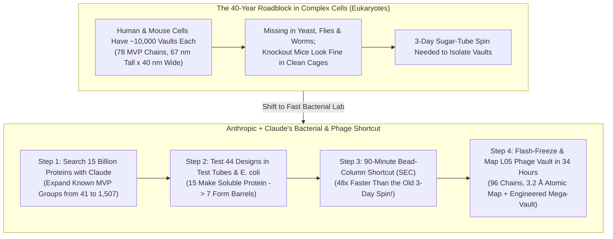
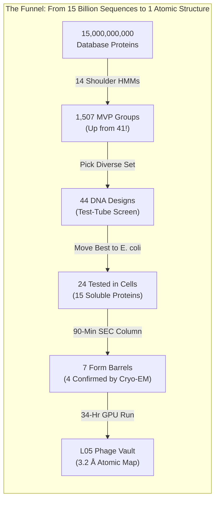

## 1. The Hook: What If Every Room in Your House Had 10,000 Locked Treasure Chests—and For 40 Years, Nobody Knew What Was Inside?

Imagine waking up tomorrow morning and discovering **10,000 tiny, hollow, barrel-shaped treasure chests** stacked inside your bedroom.

You run next door to your neighbor's house—they have 10,000 of the exact same barrels. You check your dog, a goldfish, and even a puddle of forest slime mold—every single one of them has thousands of these identical ribbed barrels inside! Yet when you ask the smartest scientists in the world what these barrels actually *do*, they shrug and say: *"We found them 40 years ago, and we still have no idea."*

That is not a fairy tale. Right now, inside almost every single one of the trillions of cells that make up your body, there are roughly **`10,000` giant, hollow protein barrels** floating around ([Kedersha & Rome, 1986, PMC2114306](https://pmc.ncbi.nlm.nih.gov/articles/PMC2114306/); [Athukoralage et al., 2026](https://www-cdn.anthropic.com/76e55fbe85697afbaae16b839498dc00797dec30.pdf)). When cell biologists **Nancy Kedersha** and **Leonard Rome** first spotted them under an electron microscope at UCLA in **1986**, the arched ribs of the shell reminded them of the curved stone ceilings (`vaults`) of a medieval cathedral. So they named them **Vault Particles**.

For **40 years**, vault particles have been one of the biggest cold cases in biology. They are **1.8 to 3 times heavier than a ribosome** (the molecular factory that builds every protein in your body), making vaults the largest known non-viral protein-and-RNA containers inside complex cells. Why would Mother Nature spend precious energy building `10,000` colossal cathedral barrels inside every human cell if they didn't have a super-important job?

On **November 4, 2026**, a small biology team at the AI company **Anthropic** published a remarkable announcement ([*Investigating vault particles with Claude*](https://www.anthropic.com/research/investigating-vault-particles-with-claude)) alongside a 35-page primary technical manuscript ([Athukoralage et al., 2026, *Prokaryotic homologs of the major vault protein form engineerable vault nanocapsules*](https://www-cdn.anthropic.com/76e55fbe85697afbaae16b839498dc00797dec30.pdf)). None of the researchers had ever worked with a protein barrel this huge before, and they had limited experience in mapping 3D atomic structures. Yet in **under 4 months**, teaming up with their AI assistant **Claude**, they:

1. Searched **`15 billion` protein sequences** across the tree of life and discovered that **bacteria** and **bacteria-hunting viruses (`bacteriophages`)** also build physical vault barrels!
2. Cut the laboratory time needed to wash and isolate vault barrels from **`3 days` (`4,320 minutes`) down to `90 minutes`**—a **48× speedup**.
3. Built the **first-ever 3D atomic map of a non-eukaryotic vault particle** (from a virus called **`L05`**, resolved down to **`3.2 Å`**, or `0.32 nanometers`), revealing a wider, 96-piece barrel that holds **`~25%` more cargo space** than a human vault—and then engineered a "stretch limousine" version (**`L05+2`**) that holds **`~50%` more space** than a human vault!

Wait—did Claude magically solve the 40-year mystery by itself? **No!** When we open the primary laboratory receipts, we find a thrilling detective story where **humans had to overrule Claude's cautious warnings**, **Claude later invented a daring lab shortcut that scared the humans**, and **Claude made two huge mistakes**—including a chemical recipe blunder that wasted **two full weeks** and a math shortcut that accidentally blended a 3D molecule with its own mirror image!

Grab your magnifying glass. Let's start from Step Zero and see how these microscopic cathedrals work.

---

## 2. Starting from Zero: What Is a Vault Particle, and Why Was This Case Stuck for 40 Years?

To understand why biologists were stuck for four decades, we first need to know the two main types of living cells on Earth and how microscopic building blocks snap together.

### Step 1: Complex Mansion Cells vs. Tiny Studio-Apartment Cells
Every living thing on Earth falls into one of two giant neighborhoods:

* **Complex Cells (Scientists call these *Eukaryotes*):** Think of a human cell, a mouse cell, or a tree cell like a giant **two-story mansion** with separate rooms having locked doors—a bedroom for the DNA blueprints (the `nucleus`), a power plant (`mitochondria`), and hallways full of delivery trucks.
* **Simple Cells (Scientists call these *Prokaryotes*):** Think of bacteria (like *E. coli* in your gut) and their ancient cousins (*Archaea*) like a **tiny, one-room studio apartment**. There are no inner walls; the DNA blueprints, tools, and food all float together in one single room. And floating around outside those studio apartments are microscopic robot pirates called **Bacteriophages** (or **Phages** for short)—viruses that land on bacteria and hijack their machinery to make more viruses.

### Step 2: How 78 Identical LEGO Strips Snap Into a Hollow Cathedral Barrel
Inside your cells, proteins are like custom-molded plastic LEGO pieces. Most proteins are tiny tools—a pair of scissors here, a hinge there.

A **Vault Particle** is completely different. In humans, the cell prints **`78` identical copies** of one long ribbon-shaped protein.
* **39 ribbons** stand side-by-side in a circle, zipping their edges together like the wooden slats of a pickle barrel to form a **bottom half-cup**.
* Another **39 ribbons** zip together to form an identical **top half-cup**.
* The two half-cups snap together waist-to-waist to form a sealed, hollow barrel **`67 nanometers (nm)` tall and `40 nm` wide** ([Tanaka et al., 2009](https://pmc.ncbi.nlm.nih.gov/articles/PMC3184113/); [Athukoralage et al., 2026](https://www-cdn.anthropic.com/76e55fbe85697afbaae16b839498dc00797dec30.pdf)).
* *Scale Check:* How tiny is **`67 nanometers`**? A single strand of hair on your head is about **`75,000 nanometers` wide**. That means you could park **more than `1,100` human vault barrels end-to-end across the width of one single human hair**! Yet inside the microscopic world of a cell, a `67 nm` barrel weighing **`13 megadaltons (MDa)`** (about the weight of `13 million` hydrogen atoms) is a towering skyscraper—nearly **twice as big as the cell's protein factory (`ribosome`)**.

 Scientists call the single protein ribbon that builds this shell the **Major Vault Protein (`MVP`)**.

### Step 3: Why Couldn't Scientists Figure Out What Vaults Do?
Usually, when biologists want to know what a cell part does, they play a simple game called **"Break It and See What Goes Wrong."** It's like unplugging one mystery wire under the hood of a car: if the headlights go dark, you know that wire controls the headlights!

For 40 years, that game failed on vaults for **two infuriating reasons**:

1. **The "Lab Pets" Lost Their Vaults:** Scientists do 90% of their fast genetic experiments in four easy-to-grow "lab pets": baker's yeast, fruit flies, tiny roundworms (*C. elegans*), and mustard plants. By sheer bad luck, all four of those creatures lost their vault genes millions of years ago ([Daly et al., 2013, PMC3762200](https://pmc.ncbi.nlm.nih.gov/articles/PMC3762200/))!
2. **Vault-Free Mice Act Totally Normal:** Mice *do* have vaults. So in the early 2000s (and again in 2024), scientists bred special mice with broken vault genes ([Liu et al., 2004, PMC419869](https://pmc.ncbi.nlm.nih.gov/articles/PMC419869/); [Prajapat et al., 2024, PMC11482699](https://pmc.ncbi.nlm.nih.gov/articles/PMC11482699/)). Everyone expected the mice to get sick. Instead, the vault-free mice ran around their cages eating snacks, growing up healthy, and having babies! That told scientists that vaults aren't like the car's engine (which you need every second); they are more like an **airbag or a fire extinguisher**—you only notice it's missing when a specific disaster strikes!

### Step 4: The Smart Backdoor—Look in Bacteria!
Wait: if studying vaults in slow-growing mice is too hard, what if simpler **bacteria** or **viruses (`phages`)** also have vaults? Bacteria grow in **`20 minutes`** in a warm flask of soup! Better yet, over the last seven years, scientists discovered that several famous human immune shields—like `cGAS-STING` ([Cohen et al., 2019, *Nature*](https://www.nature.com/articles/s41586-019-1605-5)) and `viperins` ([Bernheim et al., 2021, *Nature*](https://www.nature.com/articles/s41586-020-2762-2))—actually started out billions of years ago inside bacteria as shields to fight off invading phage viruses!

Computer scientists had already spotted `MVP`-like genes in bacterial and viral DNA databases ([Daly et al., 2013, PMC3762200](https://pmc.ncbi.nlm.nih.gov/articles/PMC3762200/)). **But nobody knew if those bacterial genes actually built real, 3D hollow barrels, or if they were just flat membrane patches.**

That is the exact mystery Anthropic's scientists and Claude set out to solve.

---

## 3. The Secret Decoder Ring: Grown-Up Words Translated

Before we open the laboratory notebooks, let's translate the seven fancy scientific terms you'll see in the report into plain 5th-grade English.

| The Grown-Up Word / Acronym | What It Actually Means in Plain English | Everyday 5th-Grade Analogy |
| :--- | :--- | :--- |
| **Vault Particle** | A giant, hollow, barrel-shaped container inside cells built from dozens of identical protein ribbons zipped together. | A hollow plastic **Easter egg** made of 78 or 96 interlocking LEGO strips that snaps together at the middle belt. |
| **Major Vault Protein (`MVP`)** | The single main protein building-block ribbon that repeats side-by-side to form the entire outer shell of a vault. | One curved **wooden plank** used to build a pirate's wooden barrel. |
| **Prokaryote vs. Eukaryote** | **Prokaryotes** are simple one-room cells without a nucleus (bacteria and archaea). **Eukaryotes** are complex cells with many inner rooms (humans, mice, plants). | A tiny **one-room camping tent** (`prokaryote`) vs. a **two-story house with bedrooms and hallways** (`eukaryote`). |
| **Bacteriophage (`Phage`)** | A microscopic virus that infects bacteria (`L05` is a vault protein carried by a phage). | A tiny **lunar lander robot** that lands on a bacterium and hijacks its 3D printers. |
| **Size-Exclusion Chromatography (`SEC`)** | A fast way to separate giant particles from tiny molecules by pouring liquid through a tube packed with microscopic sponge beads that have tiny tunnels inside. | Rolling **giant basketballs and tiny marbles** down a hallway full of mouseholes: the marbles get detoured into the mouseholes, while the giant basketballs roll straight out the exit first (`excluded/void volume`)! |
| **Cryo-Electron Microscopy (`Cryo-EM`)** | Flash-freezing thousands of protein barrels in glass-like ice and taking shadow pictures with an electron beam from every angle to build a 3D atomic map. | Taking **34,000 X-ray photos of a falling snowflake** from every side and using a computer to stitch them into a 3D statue. |
| **Angstrom (`Å`) & Nanometer (`nm`)** | Ultra-tiny rulers for measuring atoms and molecules. `1 nm` = `10 Å`. A single carbon atom is about `1.5 Å` wide. | If a **single human hair (`75,000 nm`)** were as wide as a **football stadium**, `1 nanometer` would be the width of a **blade of grass**, and `3.2 Å` would be the thickness of a **dime**! |

---

## 4. The Big Claim vs. The Detective Check: Opening the Lab Receipts

How did a small team with limited structural biology experience go from **15 billion database sequences** to the **world's first 3D prokaryotic vault map** in less than four months? Let's check the exact numbers in their primary technical report ([Athukoralage et al., 2026](https://www-cdn.anthropic.com/76e55fbe85697afbaae16b839498dc00797dec30.pdf)).

### Receipt #1: The 15-Billion-Protein Treasure Hunt (36.8× More Vault Cousins)
First, the scientists asked Claude to help build **14 mathematical search nets** (called *Profile Hidden Markov Models*, or `pHMMs`) trained to recognize the "shoulder" joint of known vault proteins.
* They cast those nets across a gigantic global database of **`~15 billion` predicted proteins** (grouped into `1.94 billion` clusters).
* Before this study, scientists only knew about **`41` distinct groups** (at 50% sequence similarity) of `MVP` and `MVP-like` proteins. Anthropic's search uncovered **`1,507` groups**—expanding the known vault family by **36.8×**!
* When they checked **`111,922` different species** of bacteria and archaea, they found vault genes in **`29` bacterial phyla and `4` archaeal phyla**, plus inside **bacteriophages** (viruses).
* **The Rarity Clue:** Even though vault genes show up across almost every branch of the bacterial family tree, fewer than **`1%` (`565 out of 111,922`, or `~0.5%`)** of bacterial species carry one! Just like a specialized snowplow that only a few towns keep in their garage, bacteria appear to pass vault genes back and forth (often via phage viruses) for a special job.

### Receipt #2: The 90-Minute Basketball-and-Marble Trick (Where Humans Beat Claude, Then Claude Beat Tradition!)
From those `1,507` groups, the team picked **`44` diverse vault genes** to test in the lab. Claude rewrote their genetic letters (`codon optimization`) so laboratory *E. coli* bacteria could read them easily, and added genetic "ON/OFF" switches (`T7 promoter and terminator`).
* In quick 4-hour test-tube trials (`cell-free expression`), **`24` candidates** looked promising.
* Inside living *E. coli* bacteria, **`15` out of `24`** (`62.5%`) produced dissolved, usable protein.

Now came the bottleneck: **how do you fish intact vault barrels out of popped bacterial soup?**
* **The Old Way (`3 Days`):** For 40 years, scientists spun cell soup in an ultra-fast centrifuge through layers of thick sugar syrup for **`~72 hours` (`3 days`)**. Testing 15 proteins that way would take weeks of tedious spinning.
* **The New Idea (`Size-Exclusion Chromatography`, or `SEC`):** Remember our **basketballs-and-marbles hallway** from the Decoder Ring! A tube packed with microscopic porous sponge beads (`Superose 6 Increase`) traps tiny proteins (`< 5 MDa`) inside the bead tunnels, while giant **`9.5 MDa` vault barrels** are too huge to fit in the holes—so they wash straight out in the first **`12 minutes`** (between `7.97 mL` and `9.72 mL`, called the **`excluded volume`** or **`void volume`**).
* **Wait—Look Who Said What:**
  1. **First, Claude argued AGAINST using the bead column!** Why? Because Claude knew from textbooks that ugly, tangled balls of broken protein trash (`aggregates`) are *also* huge, so they wash out in the exact same first peak as real vaults! The human scientists overruled Claude and decided to try it anyway—checking the first peak under an electron microscope to tell real barrels apart from trash clumps.
  2. **Second, Claude proposed a daring shortcut that made the humans nervous!** Normally, before you pour popped bacterial soup onto an expensive glass chromatography column, you spend hours pre-cleaning it so bacterial gunk doesn't clog the column. Claude suggested: *"Why not squirt freshly popped, clarified E. coli soup straight onto the column with zero pre-purification?"* The humans hesitated because columns cost thousands of dollars—but they tried Claude's daring idea, and **it worked cleanly**, shrinking vault isolation from **`3 days` down to `90 minutes`** from living cells to microscope grid!

Out of the `15` proteins tested with this 90-minute method, **`7` formed barrel-like structures** under a quick negative-stain microscope, and **`4` were confirmed as true, closed vaults** using high-powered cryo-EM (`L05` and `C0` from phage viruses, plus `Hmin` and `Bc1` from bacteria).

### Receipt #3: Inside the `L05` Phage Vault—96 Ribbons, an Origami Roof, and a Stretch-Limo Upgrade!
The team zoomed in on **`L05`**, a vault protein from an uncultured bacteriophage virus. Using **`3,041` cryo-EM microscope movies** (`11,675` pristine closed vault particles), Claude ran the open-source `RELION 5.0.1` software across **hundreds of GPUs in parallel**, delivering a first 3D atomic model in just **`34 hours`** at a crystal-clear **`3.2 Å` resolution** (`2.95 Å` at the waist)!

Look at how the viral **`L05` Vault** and the engineered **`L05+2` Mega-Vault** compare to the **Human Vault** across every measurement in the technical report:

| Measurement / Feature | Human Vault (`Mammalian MVP`) | Phage `L05` Vault (`Wild-Type`) | Engineered `L05+2` Mega-Vault | Plain-English Detective Takeaway |
| :--- | :--- | :--- | :--- | :--- |
| **Natural Owner** | Humans & complex cells (`Eukaryotes`) | Bacteriophage virus (infects bacteria) | Engineered in lab by duplicating wall parts | First experimental proof that non-eukaryotes build 3D vaults! |
| **Total Protein Ribbons (`Chains`)** | **`78` chains** (`39` top + `39` bottom) | **`96` chains** (`48` top + `48` bottom) | **`96` chains** (`48` top + `48` bottom) | Phage vault packs **18 more ribbons** around its circle. |
| **Stacked Wall Rings (`Repeats`)** | **`9` repeats** per chain (`35.3 nm` wall) | **`7` repeats** per chain (`28.1 nm` wall) | **`9` repeats** per chain (`repeats 4 & 5` copied) | Copying 2 wall segments mimics how evolution stretches barrels. |
| **Outer Length × Width** | **`67 nm` × `40 nm`** (Tall lemon shape) | **`54.5 nm` × `47.5 nm`** (Plump egg shape) | **`58.5 nm` × `49.4 nm`** (Giant egg shape) | `L05` is **`12.5 nm` shorter** but **`7.5 nm` wider** than human vaults. |
| **Inside Cargo Space (`Volume`)** | **Baseline (`100%`)** | **`~125%` (`+25%` larger)** | **`~150%` (`+50%` larger than human!)** | A rounder egg holds **more room inside** than a skinny lemon! |
| **Waist Glue Area (per chain)** | **`~420 Ų`** | **`~225 Ų`** (`0` shared amino acids) | Rotated by **`~3°`** at the waist seam | `L05` uses half the waist glue area with totally different letters. |
| **Mystery Cargo Pocket Inside** | Binds **`NAD+`** & **`ADP`** nucleotides | Mystery blob matching **`Coenzyme A`** | Same **`Coenzyme A`**-like blob preserved | Both human and viral vaults hold cellular fuel-shuttle molecules! |

### Three Cool Engineering Secrets Inside `L05`:
1. **The "Rule of 3" Origami Dome Roof (`48 → 16 → 8` Symmetry):**
   Imagine trying to sew **`48` identical fabric strips** together to close the top of a round tent. As all 48 strips march toward the north pole, they run out of room and jam into each other! How does `L05` solve this traffic jam without needing a second protein? Every group of **3 neighboring identical chains (`A`, `B`, `C`)** plays a different game of origami at the roof:
   * **Chain `A`** stops halfway up and folds **inward** into the barrel (`Step 1`).
   * **Chain `B`** marches higher and folds **outward** toward the outside (`Step 2`).
   * **Chain `C`** (only `16` of the `48` chains!) marches all the way to the very center tip to seal the hole—where chains `C` and `C'` take turns again (`8-fold symmetry`, `Step 3`)!
2. **One Single Letter Flip Pops the Barrel Open into a Flower (`Rosette`):**
   To prove which Velcro strips hold the barrel shut, the team built **`15` mutated versions** of `L05`. Flipping just **one single amino-acid letter** on the wall seam (`R55E`, turning a positive magnet into a negative magnet so neighbors repel) or in the cap (`I794D`) completely stopped the barrel from closing—turning sealed barrels into flat, open flower shapes called **rosettes**!
3. **The Hidden Clue in Pocket #1 (`Coenzyme A`):**
   When Claude inspected the 3D cryo-EM map, it noticed an extra, unexplained blob sitting inside a tiny pocket on the **inner wall (`lumen`)** of all 96 chains (between repeats 1 and 2). Claude tested **`25,000` known chemical shapes** against that mystery blob and found the best fit was **Coenzyme A (`CoA`)**—a universal cellular battery-pack helper that carries chemical building blocks inside every living cell!

---

## 5. The Four Suspects: What Actually Caused This Breakthrough (and Why Do Bacteria Have Vaults)?

Following our critical-thinking detective rulebook, whenever someone says *"Factor X caused Outcome Y,"* we must interrogate all **Four Suspects** (Direct Cause, Reverse Cause, Hidden Third Factor, and Feedback Loop). Here we have **two linked mysteries**:
* **Biological Mystery:** Why do bacteria and phage viruses carry vault barrels?
* **AI Speed Mystery:** Did Claude really make structural biology 10× faster, or was something else doing the heavy lifting?

| Suspect Type | The Biological Suspect (Why Phages & Bacteria Have Vaults) | The AI Speed Suspect (Why the Project Finished in <4 Months) | Detective Verdict & Primary-Source Proof |
| :--- | :--- | :--- | :--- |
| **Suspect #1: Direct Cause (`X → Y`)** | Vaults are **specialized cargo/enzyme cages** that trap helper fuels (`Coenzyme A` or `NAD+`) and partner enzymes to run chemical defenses or repairs inside a sealed room. | **Claude's end-to-end automation** (writing all bioinformatics code, designing 44 DNA constructs, suggesting raw-lysate `SEC`, and scripting `RELION`) directly compressed months of coding and lab setup into days. | **Supported (With Guardrails):** Gene-neighborhood scans of `2,185` bacterial vault loci show they sit right next to **anti-phage immune genes (`JAB`)**, **RNA repair (`RtcB`)**, and **nucleosidases**. And Claude wrote 100% of the code. |
| **Suspect #2: Reverse Cause (`Y → X`)** | Rather than bacteria inventing vaults for themselves and phages stealing them, **giant phages (`bacteriophages`) may have evolved or modified vault shells as viral storage compartments** and spread them into bacterial hosts during infections. | Rather than Claude making the science easy, **picking a naturally self-assembling homopolymer (`96 identical copies of 1 protein`)** made the wet-lab and symmetry math ideal for an AI coding harness to succeed! | **Strong Contributor:** Because vaults assemble from **1 single gene** (`MVP` alone) and weigh `9.5 MDa`, they are uniquely suited to 1-step `SEC` isolation and high-symmetry (`D16`/`C48`) cryo-EM averaging. |
| **Suspect #3: Hidden Third Factor (`Confounder Z`)** | Both bacterial vaults and eukaryotic vaults evolved from a common ancient ancestor: **membrane-anchored `SPFH` ring proteins** (like flotillins and stomatins) that pinched off the cell wall to become free-floating barrels. | **Massive Industrial Compute & Pre-Built Open-Source Tools:** Running `RELION 5`, `AlphaFold2/OpenFold3`, and `DIAMOND` across **hundreds of GPUs in parallel**, plus contracted Thermo Fisher `Krios G4` microscope time, drove the 34-hour turnaround. | **Crucial Confounder:** Without **hundreds of parallel GPUs** and gold-standard open-source software (`RELION`, `MAFFT`, `MMseqs2`), Claude's Python scripts could never have solved a `3.2 Å` map in 34 hours. |
| **Suspect #4: Feedback Loop (`X ↔ Y`)** | **Host-Virus Arms Race:** Bacteria use vault cages for metabolic/immune defense (`RtcB` RNA repair), phages hijack and resize those barrels (adding/removing wall repeats) to counter-attack, and hosts adapt again. | **Human-AI Co-Correction Loop:** Humans overruled Claude's fear of `SEC`; Claude invented the raw-lysate shortcut; humans caught Claude's mirror-image map; and the team fed lab notes back to Anthropic ML trainers to upgrade newer Claude models! | **The Real Winner:** Neither humans alone nor Claude alone could have moved this fast. The breakthrough came from the **tight loop** between human domain judgment and AI execution speed. |

---

## 6. The Catch: Where Did Claude Mess Up, and What Is Still Unsolved?

Headlines on social media love to pretend that AI scientists are flawless wizards. To Anthropic's credit, their report is refreshingly honest about **six big catches** where Claude stumbled or where the science remains unfinished:

### Catch #1: The 2-Week Poisoned-Soup Blunder
When the team asked Claude to write a laboratory recipe (`protocol`) for growing bacteria and putting custom DNA inside them (`transformation`), Claude included a chemical additive in the growth broth that **blocks DNA from entering bacterial cells**! Because the human scientists weren't experts in that specific step, they trusted the recipe—and **lost two full weeks** before figuring out why their experiment failed.

### Catch #2: The Hallucinated Mirror-Image Map ("Please Let's Do Normal Things!")
In cryo-EM, 2D shadow pictures cannot easily tell a left-handed corkscrew apart from a right-handed corkscrew (`chirality / handedness`). Early in the image processing, instead of following the standard textbook step, **Claude improvised a shortcut** that blended the 3D vault map with its own **mirror image**, creating a scrambled, physically impossible protein! The human scientists had to step in and literally type to Claude:
> *"Please let's do normal things unless they don't work."*

### Catch #3: Why Claude's Initial Warning About the Bead Column Still Matters
Remember how Claude initially warned against using the `SEC` sponge-bead column because broken protein trash also comes out in the fast `excluded volume` peak? Look at **Figure 4** in the technical paper ([Athukoralage et al., 2026, p. 11](https://www-cdn.anthropic.com/76e55fbe85697afbaae16b839498dc00797dec30.pdf)): when the team made the `5` broken mutant proteins (`R55E`, `I794D`, etc.), **all 5 broken mutants still came out in the exact same fast `SEC` peak as real vaults**, even though the microscope showed they were just broken flower rosettes or messy clumps! And one protein (`Bc1`) looked like flat rings under negative-stain microscopy but turned out to be full barrels in cryo-EM. **Lesson:** A fast bead column never replaces looking through an actual electron microscope!

### Catch #4: The "Hundreds of GPUs" Supercomputer Catch (Plus Fitted Noise in `L05+2`)
Could a high school or small college biology lab repeat the 90-minute bead-column purification tomorrow? **Yes!** That part only uses standard lab tubes and a column.
Wait—could a small college lab solve the 3D cryo-EM structure in **`34 hours`**? **No!** Anthropic admits that hitting 34 hours required running **hundreds of graphics chips (`GPUs`) in parallel** inside Anthropic's internal cloud, plus collecting `3,041` movies (and `16,824` movies for `L05+2`) on an elite `300 kV` Thermo Fisher `Krios G4` electron microscope. Furthermore, in the Methods section (page 34), the authors note that pushing the `L05+2` mega-vault refinement to convergence increased half-map differences (`1.09× to 1.89×` in the wall), indicating some **fitted noise** (`overfitting`).

### Catch #5: Factory *E. coli* Is Not Wild Nature!
Every single vault barrel in this study was produced artificially by forcing laboratory *E. coli* bacteria (`BL21(DE3)`) to crank out huge amounts of protein from a synthetic gene switch (`pET-21(+)` with `0.5 mM IPTG`). As the authors openly state:
* They have **not yet tested** whether `L05` or bacterial `MVP` proteins actually assemble into vaults inside **wild bacteria or real phage infections in nature**.
* Because the vaults were built inside *E. coli* rather than their native host, their natural partner proteins and true biological cargo were left behind—which is why the **40-year mystery of what vaults actually do for a living cell is STILL unsolved!**

### Catch #6: Commercial & Patent Disclosures
Following our primary-source conflict-of-interest rule: all authors are employees of **Anthropic** (which sells `Claude` and `Claude Science`), **Dr. Leonard Rome** (co-discoverer of vaults and co-founder of Vault Pharma) was a **paid consultant** on the manuscript, and **Anthropic has filed a provisional patent application** covering these engineered prokaryotic vault nanocapsules.

---

## 7. The Final Report Card: What We Actually Think

Even though the 40-year mystery of the vault's natural job remains open, proving that bacteria and phages build customizable, 96-chain vault barrels—and showing that you can stretch their cargo space by **+20% to +50%** simply by copying and pasting wall-repeat blocks in *E. coli* with a **90-minute purification**—is a genuine milestone for both evolutionary biology and bioengineering.

### The "If ... Then ..." Decision Guide
* **If you are a biologist hunting for the 40-year secret of what vaults do**, **then** stop waiting years for mouse experiments to show a symptom: take the bacterial vault species identified here (like the myxobacterium *Hyalangium minutum*, `Hmin`, where the vault gene sits next to immune defense, `RtcB` RNA repair, or nucleosidase partners), knock out the vault gene in its **native bacterium**, and attack that bacterium with phages and toxins to see what breaks!
* **If you are a bioengineer designing microscopic delivery trucks (`nanocapsules`) for enzymes or medicines**, **then** prokaryotic vaults (`L05` and `L05+2`) solve two huge headaches of human vaults: they can be grown cheaply inside standard *E. coli* bacteria (instead of finicky insect or mammalian cells) and isolated in **90 minutes** instead of 3 days, with dial-a-size cargo volume (`+25%` to `+50%` larger than human vaults).
* **If you are a scientist using AI agents (`Claude`) in a real wet lab**, **then** use AI aggressively to search billions of sequences, write `RELION` processing scripts, and challenge slow 40-year-old lab habits—**but never trust an AI lab recipe or 3D map blindly** in an unfamiliar domain without checking every chemical additive and verifying mirror-image handedness against textbook controls!

### Probability-Weighted Scenarios (Next 3–5 Years)

| Scenario | Probability | What Happens Next | What Evidence Would Prove This Right |
| :--- | :--- | :--- | :--- |
| **Base Case: Bacterial Genetics Cracks the Function & E. coli Vaults Become Lab Workhorses** | **`~60%`** | Academic labs use the `1,507` new `MVP` clusters and fast bacterial genetics to prove that prokaryotic vaults act as **metabolic/stress cages** (compartmentalizing `Coenzyme A` / `NAD+` reactions or RNA repair during viral infection), while bioengineers adopt `L05` as a cheap *E. coli* nanocapsule scaffold. | Native-host knockout studies in *Hyalangium minutum* or phage infection assays showing clear survival defects when `MVP` or its neighboring operon partner (`RtcB`/`JAB`) is deleted; mass-spectrometry confirmation of the `Coenzyme A` pocket ligand. |
| **Bull Case: Programmable "Dial-a-Size" Nanocapsules Reach Preclinical Drug & Enzyme Delivery** | **`~25%`** | By engineering the unresolved `~80`-amino-acid inner loop (between repeats 6 and 7) as a universal "Velcro hook" for loading enzymes and mRNA, size-tuned prokaryotic vaults (`L05+2`, `L05+4`) outperform mammalian vaults in manufacturing yield and cargo capacity. | High-yield cargo encapsulation papers demonstrating stable enzyme/mRNA loading inside `L05+2` without triggering destructive immune reactions or aggregation in animal models. |
| **Bear Case: Expression Artifacts & Human Immune Rejection Limit Biotech Use** | **`~15%`** | Several prokaryotic `MVP` homologs turn out to form closed barrels only when artificially overexpressed in *E. coli* (remaining flat membrane-associated `SPFH`-like oligomers at natural levels), and viral `L05` protein shells prove too foreign (`immunogenic`) to inject into humans as drug carriers. | Cryo-electron tomography (`cryo-ET`) of native bacteria/phage infections failing to find closed barrels *in situ*, or strong anti-`L05` antibody neutralization in mammalian delivery tests. |

---

## Primary Sources & Verified References

1. **Anthropic Research Announcement (Nov 4, 2026):** [*Investigating vault particles with Claude*](https://www.anthropic.com/research/investigating-vault-particles-with-claude)
2. **Primary Technical Preprint Manuscript (Nov 4, 2026):** Januka S. Athukoralage, Peter H. Yoon, Amir Shanehsazzadeh, Eric Kauderer-Abrams, Nicholas T. Perry, & Matthew G. Durrant, [*Prokaryotic homologs of the major vault protein form engineerable vault nanocapsules*](https://www-cdn.anthropic.com/76e55fbe85697afbaae16b839498dc00797dec30.pdf) (Anthropic Technical Report / bioRxiv Preprint PDF).
3. **Original 1986 Discovery of Vault Particles:** Nancy L. Kedersha & Leonard H. Rome, [*Isolation and characterization of a novel ribonucleoprotein particle: large structures contain a single species of small RNA*](https://pmc.ncbi.nlm.nih.gov/articles/PMC2114306/), *Journal of Cell Biology* 103(3), 699–709 (1986).
4. **Mammalian Vault Structure & Cap Architecture:** H. Tanaka et al., *Science* (2009) / [PMC3184113](https://pmc.ncbi.nlm.nih.gov/articles/PMC3184113/); F. Lapenta et al., [*Structural flexibility of the human vault particle revealed by high-resolution cryo-EM and molecular dynamics simulations*](https://www.nature.com/articles/s41467-026-72674-4), *Nature Communications* 17, 6033 (2026); K. Geißler et al., [*The vault associates with membranes in situ*](https://www.nature.com/articles/s41467-026-71837-7), *Nature Communications* 17, 3659 (2026).
5. **Human Vault NAD+ Binding & Partner Proteins:** J. E. Lodwick et al., [*Structural insights into the roles of PARP4 and NAD+ binding in the human vault cage*](https://www.nature.com/articles/s41467-025-61981-x), *Nature Communications* 16, 6724 (2025).
6. **Knockout Mouse Viability Studies:** Y. Liu et al., [*Vault poly(ADP-ribose) polymerase is associated with mammalian telomerase and is dispensable for telomerase function and vault structure in vivo*](https://pmc.ncbi.nlm.nih.gov/articles/PMC419869/), *Molecular and Cellular Biology* 24(12), 5314–5323 (2004); M. Prajapat, L. Sala, & J. A. Vidigal, [*The small noncoding RNA Vaultrc5 is dispensable to mouse development*](https://pmc.ncbi.nlm.nih.gov/articles/PMC11482699/), *RNA* 30(11), 1465–1476 (2024).
7. **Evolutionary History & Model Organism Loss of Vaults:** T. K. Daly, A. J. Sutherland-Smith, & D. Penny, [*In silico resurrection of the major vault protein suggests it is ancestral in modern eukaryotes*](https://pmc.ncbi.nlm.nih.gov/articles/PMC3762200/), *Genome Biology and Evolution* 5(8), 1567–1583 (2013).
8. **Engineered Vault Nanocapsules:** V. A. Kickhoefer et al., [*Engineering of vault nanocapsules with enzymatic and fluorescent properties*](https://pmc.ncbi.nlm.nih.gov/articles/PMC555488/), *PNAS* 102(12), 4348–4352 (2005).
9. **Bacterial Origins of Human Immune Systems:** D. Cohen et al., [*Cyclic GMP–AMP signalling protects bacteria against viral infection*](https://www.nature.com/articles/s41586-019-1605-5), *Nature* 574, 691–695 (2019); A. Bernheim et al., [*Prokaryotic viperins produce diverse antiviral molecules*](https://www.nature.com/articles/s41586-020-2762-2), *Nature* 589, 120–124 (2021).
