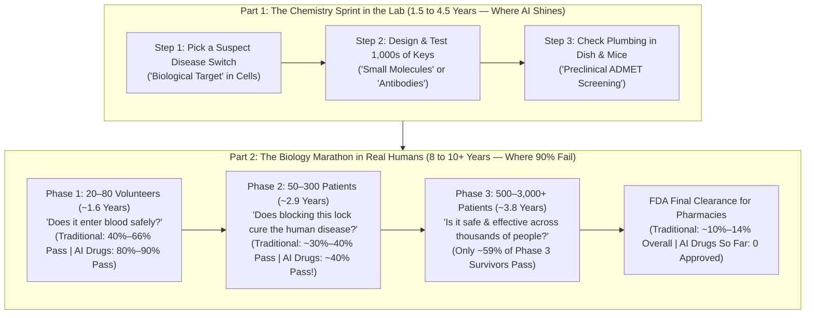

## 1. The Hook: Wait—If AI Can Beat World Champions at Chess and Write Computer Code in Seconds, Why Hasn't It Cured a Single Disease Yet?

Imagine two groups of some of the smartest, richest adults on Earth standing across from each other in a giant school gym, arguing about how fast computers will save your life.

In **Corner #1 (Silicon Valley Tech Bosses)** stand the people building giant artificial intelligence (`AI`) supercomputers:
* **Dario Amodei**, the chief executive of AI company **Anthropic**, wrote in his famous essay [*Machines of Loving Grace*](https://darioamodei.com/machines-of-loving-grace) and posted on X that AI could squeeze 50 to 100 years of medical science into just a few years—making it *"possible to cure most human disease in ~5–10 years, as crazy as it may sound."*
* Another tech leader recently told a drug-company boss that AI would wipe out **90% of human disease in the next 7 years**.
* As reporter **Xavier Martinez** revealed in a November 3, 2026 *Wall Street Journal* investigation (*"Silicon Valley Promises AI Will Cure Disease. Drugmaker CEOs Aren't Buying It"*), one tech executive even joked that AI researchers have started smoking cigarettes because they are so sure AI will cure lung cancer before they get sick!

In **Corner #2 (The Scientists Who Actually Make Medicines)** stand the bosses of the world's biggest medicine companies—veterans who have spent 30 to 40 years trying to keep human beings alive:
* **Jeff Leiden**, a doctor, scientist, and Executive Chairman of **Vertex Pharmaceuticals** (the company that invented breakthrough treatments for cystic fibrosis and sickle-cell disease), listened to the tech leader's promise that AI would cure 90% of diseases in 7 years and gave a blunt three-word reply: ***"That's complete BS."***
* Why was Leiden so sure? Because Vertex actually tested the claim! Vertex hired roughly **50 different AI companies** to search through its private treasure chest of **10,000 chemical compounds**. How many working medicines did those 50 AI companies generate by themselves? **Zero.** *"It just doesn't work by itself,"* Leiden told the *Wall Street Journal*, *"and any company that says they can do that—at least in our experience, we've looked at most of them—it's not true."*
* **Pascal Soriot**, Chief Executive of **AstraZeneca**, agreed: *"If we are in the industry long enough, we quickly learn to be humble. Disease is complicated, biology is complicated. To say AI is going to cure cancer is maybe a little bit of a jump."*
* **George Yancopoulos**, Chief Scientific Officer of **Regeneron** and inventor on more than 1,000 patents, added: *"AI is not going to just miraculously come in and tell us how to do things and cut things from 15 years to five years."*

Hold on. Put on your detective hat and look at the scoreboard right now. When we open the primary scientific papers and government clinical trial logs behind the *Wall Street Journal* story, **four giant mysteries** jump off the page:

* **Mystery #1 (The $8.4 Billion Zero-Approval Scoreboard):** Venture capital and private-equity investors poured **$8.4 billion** into AI drug-discovery companies in 2025 alone—more than double the **$4 billion** invested two years earlier (and enough money to buy a `$1,000` laptop for **8.4 million 5th graders**—more than twice every 5th grader in the United States!). Yet as of November 2026, how many medicines designed by AI have won final approval from the U.S. Food and Drug Administration (`FDA`) to be sold in a pharmacy? **Not a single one (`0`).**
* **Mystery #2 (The Step-1 Trophy vs. The Step-2 Brick Wall):** When researchers at Boston Consulting Group (`BCG`) audited every AI-discovered medicine in human testing ([Jayatunga et al., 2024, PMID 38692505](https://eutils.ncbi.nlm.nih.gov/entrez/eutils/esummary.fcgi?db=pubmed&id=38692505&retmode=json)), AI drugs passed **Step 1 of human testing (`Phase 1` safety checks)** **80% to 90% of the time** (`21 out of 24` drugs)—crushing the regular drug industry average of `40% to 65%`! Wait: if AI drugs are *that* good in Step 1, why did their score immediately crash down to **40% (`4 out of 10` drugs)** in **Step 2 (`Phase 2` sickness checks)**—the exact same failing grade that regular human-made drugs get?
* **Mystery #3 (The Hidden Clue Inside the World's #1 AI Drug Trial):** A company called **Insilico Medicine** used AI both to find a brand-new disease switch and to draw a brand-new pill called **`rentosertib` (`ISM001-055`)** for a deadly lung-scarring illness, finishing the early lab design in just **18 months** ([Ren et al., 2024, PMC11738990](https://pmc.ncbi.nlm.nih.gov/articles/PMC11738990/)). In its 12-week human trial of **71 patients** published in *Nature Medicine* ([Xu et al., 2025, PMC12353801](https://pmc.ncbi.nlm.nih.gov/articles/PMC12353801/)), the highest dose helped patients blow out **`+98.4 milliliters`** more air (about two-fifths of a small school milk carton). That made global headlines! But when we open `Table 2` inside that exact medical paper, why did **16 out of 71 patients (`22.5%`) quit the study** before finishing just 12 weeks—including **7 patients whose livers started showing injury signs**?
* **Mystery #4 (If AI Can't Cure Disease Alone, Why Are Drug Companies Still Paying Billions for It?):** If drug bosses say AI can't cure disease by itself, why did **Eli Lilly and Nvidia** announce a **$1 billion, 5-year lab** in January 2026? Why did **AstraZeneca** just pay AI biotech **Insitro $40 million up front**? And why did **Anthropic** (buying **Mithril Medicine** and **Coefficient Bio**) and **OpenAI** (buying **Orchestra Bio**) start buying biotech startups of their own?

Grab your magnifying glass. We are going to build this entire mystery from zero—starting inside the 37 trillion rooms of your body, checking the real hospital data, and finding out why biology is the hardest puzzle in the universe.

---

## 2. Starting from Zero: How Do Scientists Actually Invent a Medicine, and Why Do 9 Out of 10 Fail?

Before we can judge who is right—Silicon Valley or the drugmakers—we need to understand what a medicine actually does inside your body.

### Your Body Is a 37-Trillion-Room City Powered by Tiny Folded Machines

Right now, your body is made of roughly **37 trillion living cells**—that is more than **10 times all the trees on planet Earth**.

Inside every single cell are millions of microscopic machines made of long strings of building blocks that fold up into exact 3D shapes, like crumpled origami cranes. These folded machines do almost every job in your body: they digest your lunch, carry oxygen in your blood, and tell your cells when to grow or rest. Scientists call these folded cellular machines **Proteins**.

### Step 1: Finding the Broken Lock (`Target`)

When someone gets a serious disease—like cancer, heart failure, or lung scarring—something in that city's wiring goes wrong. Often, one specific protein machine gets jammed in the **"ON"** position:
* In cancer, a broken switch keeps yelling at cells: *"Copy yourselves forever!"*
* In a lung disease called **fibrosis**, a broken switch keeps yelling at lung cells: *"Pour thick scar glue everywhere until the lungs turn as stiff as a dry kitchen sponge!"*

To stop the disease, scientists first have to figure out **which exact protein switch is causing the trouble**. Think of that broken switch as a **Broken Lock** on a factory door. If you can jam that one lock shut, the bad orders stop! Scientists call that specific disease-causing protein lock the **Biological Target** (or simply the **Target**).

### Step 2: Carving the Microscopic Key (`Compound` or `Antibody`)

Once scientists think they know which lock (`Target`) is broken, they have to build a microscopic **Key** that can travel through your body, find that exact lock, slip into its keyhole, and jam it shut.

Scientists usually build one of two kinds of keys:
1. **The Tiny Lego Key (`Small-Molecule Compound`):** A tiny chemical cluster made of just a few dozen atoms (carbon, hydrogen, nitrogen, oxygen). Because it is microscopic—thousands of times smaller than a single cell—you can pack millions of them into a pill, swallow it with water, and let it soak through your stomach into your blood. Scientists call a candidate chemical key a **Compound** (or **Small Molecule**).
2. **The Guided Grappling Hook (`Monoclonal Antibody`):** Sometimes a broken lock is too flat or slippery for a tiny pill key. So scientists engineer a much larger Y-shaped protein (matching the natural defender molecules your immune system makes) that grabs the target tightly. Because stomach acid would digest a big protein just like a hamburger, patients get these as a shot under the skin or into a vein. Scientists call this engineered Y-shaped key a **Monoclonal Antibody**.

### Step 3: Why a Living Human Body Breaks Almost Every Key

Wait—if inventing a medicine is just **"find a lock, carve a key,"** why can't a supercomputer use tools like **AlphaFold** (Google DeepMind's Nobel Prize-winning AI that predicts the 3D shapes of 200 million proteins; [Jumper et al., 2021, PMC8371605](https://pmc.ncbi.nlm.nih.gov/articles/PMC8371605/); [Abramson et al., 2024, PMC11168924](https://pmc.ncbi.nlm.nih.gov/articles/PMC11168924/)) to print a perfect key in 10 minutes and cure everything?

Because a computer screen is a **clean glass dish with one lock**, while a human being is a **wild, shifting jungle with 20,000 different types of locks, acid baths, security guards, and secret backup doors!**

When you swallow a pill, four brutal real-world traps try to ruin it ([Sun et al., 2022, PMC9293739](https://pmc.ncbi.nlm.nih.gov/articles/PMC9293739/)):
1. **Trap #1: The Plumbing & Security Guard Course (`ADMET / Pharmacokinetics`):** The pill has to survive your stomach acid, pass through your gut wall, ride your bloodstream to the exact sick organ (like the lungs or brain), and dodge your **Liver Security Guards**. Your liver's main job is to spot strange chemicals in your blood, chop them into pieces with chemical scissors (`liver enzymes`), and flush them into the toilet! If your liver chops up the key in 10 minutes, the medicine never reaches the sick organ.
2. **Trap #2: The Look-Alike Keyhole Booby Trap (`Off-Target Toxicity`):** Nature reuses the same keyhole shapes all over your body! A protein switch causing scar tissue in your lungs might have a keyhole that looks **95% identical** to a healthy protein switch keeping your heart beating steadily or your liver clean. If your new key accidentally turns five healthy locks in your liver, heart, or gut while trying to fix your lungs, the patient gets dangerous side effects. Scientists call this **Off-Target Toxicity** (or **Off-Target Issues**).
3. **Trap #3: The Dose-Toxicity Trap (`Tissue Selectivity`):** What if your key fits the lung lock nicely in a glass dish, but when a patient swallows the pill, only **1%** of the keys go to the lungs and **99%** pile up in the liver? To get enough medicine into the lungs to help, doctors have to give a giant dose—which overwhelms and poisons the liver ([Sun et al., 2022, PMC9293739](https://pmc.ncbi.nlm.nih.gov/articles/PMC9293739/))!
4. **Trap #4: The Secret Backup Door (`Wrong Target / Pathway Redundancy`):** Worst of all, what if the key goes to the lungs and jams Lock #1 completely shut—**and the patient still stays sick?** That happens all the time! Why? Because human diseases are rarely controlled by a single light switch. When you block Door #1, the disease often reroutes its signal through Window #2 or Basement Hatch #3!

### Step 4: The 3-Level Human Testing Obstacle Course (`Phase 1, Phase 2, and Phase 3`)

Because test tubes and mice cannot tell you whether Traps #1 through #4 will happen in real people, the U.S. government referee—the **Food and Drug Administration (`FDA`)**—requires every new drug to pass three strict levels of human testing called **Clinical Trials**.

In the largest audit of clinical trial records ever conducted—tracking **406,038 trial records** across **21,143 compounds** ([Wong, Siah, & Lo, 2019, PMC6409418](https://pmc.ncbi.nlm.nih.gov/articles/PMC6409418/))—researchers at MIT measured how long each level takes and how many drugs survive:
* **Level 1 (`Phase 1` — "Is It Safe to Swallow?"):** Doctors give the medicine to a small group of **`20 to 80` volunteers** (often healthy adults) to check how it moves through the blood and whether it causes immediate side effects. **Median time: `1.6 years`.**
* **Level 2 (`Phase 2` — "Does It Actually Fix the Sickness?"):** Doctors give the medicine to **`50 to 300` sick patients** who actually have the disease to test whether jamming that lock really makes them healthier! **Median time: `2.9 years`.**
* **Level 3 (`Phase 3` — "Does It Beat Today's Best Treatment in Thousands of People?"):** Doctors test the medicine against a dummy pill (`placebo`) or the current standard medicine in **`500 to 3,000+` patients** across dozens of hospitals to prove it works safely across a huge population. **Median time: `3.8 years`.**

Add up just the median human testing time (`1.6 + 2.9 + 3.8 = 8.3 years`), plus the paperwork gaps between trials and the `1 to 2 years` of FDA safety review, plus the `3 to 5 years` of early lab work before humans ever touch the pill, and you get the famous **12-to-15-year marathon** to make a single medicine!

---

## 3. The Secret Decoder Ring: Grown-Up Words Translated

Whenever tech billionaires and drug executives debate AI in medicine, they throw around scary-sounding words. Here is your **Secret Decoder Ring** so you can translate every single term instantly:

| The Grown-Up Word / Acronym | What It Actually Means in Plain English | Everyday 5th-Grade Analogy |
| :--- | :--- | :--- |
| **`Biological Target` (`Target`)** | The specific protein switch or gene inside your body that is malfunctioning and causing a disease. | The **broken door lock** in a school building that you need to jam shut to stop a flood. |
| **`Compound` / `Small Molecule`** | A tiny, synthetic chemical cluster designed to fit inside a protein lock and turn it off; usually taken as a pill. | A **custom-cut metal key** small enough to slip inside your pocket (or a swallowable capsule). |
| **`Monoclonal Antibody`** | A large, lab-engineered Y-shaped protein that attaches tightly to one specific disease target; given as a shot. | A **heat-seeking Velcro grappling hook** that latches onto one exact bad guy in the hallway. |
| **`Off-Target Toxicity`** | Harmful side effects that happen when a drug accidentally attaches to healthy proteins in other organs (like the liver or heart) that look similar to the disease target. | A key that locks the broken janitor closet, but **accidentally sets off the fire sprinklers** in the cafeteria because the keyholes match. |
| **`ADMET` / `Pharmacokinetics`** | How a medicine is **A**bsorbed (soaked in), **D**istributed (carried around), **M**etabolized (chopped up by the liver), **E**xcreted (flushed out), and tested for **T**oxicity. | The **plumbing and hallway security check** a delivery package must survive before reaching the right classroom. |
| **`Phase 1, 2, & 3 Clinical Trials`** | The three mandatory stages of testing an experimental drug in humans: Phase 1 tests safety/dosing in a few dozen people; Phase 2 tests if it helps the disease in a few hundred; Phase 3 confirms safety and benefit in thousands. | **Tryouts (`Phase 1`)**, a **Scrimmage Game (`Phase 2`)**, and a **Full Championship Season (`Phase 3`)** before winning the trophy (`FDA Approval`). |
| **`Forced Vital Capacity` (`FVC`)** | The total amount of air (measured in milliliters) a patient can blow out of their lungs after taking the deepest breath possible. | Blowing up a **party balloon** with one giant breath to measure how stretchy and healthy your lungs are. |
| **`Biomarker`** | A measurable clue in a patient's blood, genes, or scan that proves *which* exact broken lock is causing their sickness. | Checking the **serial number stamped on a lock** before ordering a replacement key. |

---

## 4. The Big Claim vs. The Detective Check: Opening the 4 Primary-Source Receipts

Now let's put our detective magnifying glass right on top of the clash between Silicon Valley ("AI will cure 90% of diseases in 5 to 10 years!") and the pharmaceutical CEOs ("Biology is too complicated; AI hasn't won a single FDA approval yet!").

When we open the raw scientific papers and clinical trial databases, what do the numbers actually prove?

### Receipt #1: The "100 Keys in the Hallway" Audit—Why AI Aces Step 1 (`80%–90%`) and Crashes into Step 2 (`40%`)

Imagine 100 brand-new chemical keys graduate from test tubes and mice and walk into the hospital for **Phase 1 human testing**.
* In the historical drug industry, out of **100 keys** entering Phase 1, roughly **86 to 90 get thrown in the trash** before reaching the pharmacy ([Sun et al., 2022, PMC9293739](https://pmc.ncbi.nlm.nih.gov/articles/PMC9293739/); [Wong, Siah, & Lo, 2019, PMC6409418](https://pmc.ncbi.nlm.nih.gov/articles/PMC6409418/)). In cancer (`oncology`), it is even tougher: across `17,368` clinical trial paths tracked by MIT, **96.6% failed**—meaning only **3.4 out of 100 cancer drugs** made it all the way to patients!

Why do those 90 out of 100 clinical drugs fail? In a landmark audit of clinical trial failures ([Sun et al., 2022, PMC9293739](https://pmc.ncbi.nlm.nih.gov/articles/PMC9293739/)), pharmacologists broke the **90 failed keys** into four buckets:
1. **Bucket #1: Bad Plumbing (`10% to 15%` of failures — `Poor Drug-Like / ADME Properties`):** The pill doesn't dissolve well into the blood or gets cleared out at the wrong speed. *(Important historical clue: Back in the 1990s, bad plumbing caused **30% to 40%** of all clinical failures! Over the past 25 years, better chemistry rules and computer models shrank this failure bucket down to 10%–15%.)*
2. **Bucket #2: Hidden Organ Booby Traps (`30%` of failures — `Unmanageable Toxicity`):** Just as McKinsey senior partner **Alex Devereson** told the *Wall Street Journal*, roughly a quarter to a third of failures happen because the drug triggers **off-target issues** or fails the **tissue-selectivity test**—damaging the liver, heart, blood, or gut at the dose needed to treat the disease.
3. **Bucket #3: Picking the Wrong Lock (`40% to 50%` of failures — `Lack of Clinical Efficacy`):** This is the #1 killer of experimental medicines! The key enters the blood cleanly and hits its target lock—**and the patient's disease doesn't get better** because human disease biology is way more complicated than the mouse or cell dish predicted.
4. **Bucket #4: Business & Strategy Changes (`10%` of failures):** Another company's medicine wins the race first, or funding runs out.

Now compare those four buckets against the first-ever audit of **AI-discovered drugs in human clinical trials** by Boston Consulting Group (`BCG`) ([Jayatunga et al., 2024, PMID 38692505](https://eutils.ncbi.nlm.nih.gov/entrez/eutils/esummary.fcgi?db=pubmed&id=38692505&retmode=json)):
* **In Phase 1 (where Bucket #1—basic chemical plumbing and early safety—is tested):** AI-discovered molecules succeeded **87.5% of the time (`21 out of 24` completed Phase 1 trials, reported as `80%–90%`)**, beating the historical industry Phase 1 average of `40% to 66%`! Why? Because AI is fantastic at **chemistry math**—learning from millions of known molecules which atomic shapes dissolve well and avoid obvious chemical red flags.
* **In Phase 2 (where Bucket #2 and Bucket #3—real human disease biology and multi-organ safety—are tested):** AI-discovered molecules succeeded only **40% of the time (`4 out of 10` completed Phase 2 trials)**—dropping right back down to the historical industry average of `30% to 40%`!

Look at recent real-world examples from leading AI-native drug companies that hit this exact Phase 2 wall:
* **BenevolentAI (`BEN-2293` for eczema):** Designed using AI, passed safety checks, entered a Phase 2a trial in patients with itchy skin (`atopic dermatitis`)—and **failed to beat a dummy lotion (`placebo`)** at stopping the rash or itch!
* **Exscientia (`EXS-21546` for solid tumors):** Designed by AI to block a cancer switch (`A2A receptor`), entered a Phase 1b/2a human trial—and had to be **shut down** because doctors concluded it could not reach a safe and effective dosing window in real patients!

```mermaid
xychart-beta
    title "Clinical Trial Pass Rates: Traditional Human Design vs. AI-Discovered Drugs (%)"
    x-axis ["Phase 1 (Plumbing & Basic Safety)", "Phase 2 (Does It Cure the Human Disease?)"]
    y-axis "Success Rate (%)" 0 --> 100
    bar [55, 38]
    bar [88, 40]
```

> [!IMPORTANT]
> **What the Chart Shows:** In **Phase 1** (left bars), AI-discovered drugs (`88%`, or `21/24` in [Jayatunga et al., 2024](https://eutils.ncbi.nlm.nih.gov/entrez/eutils/esummary.fcgi?db=pubmed&id=38692505&retmode=json)) beat traditional drugs (`~55%` historical average) because AI excels at engineering clean chemical plumbing (`ADME`). But in **Phase 2** (right bars), where the drug must actually defeat human biology inside sick patients, AI drugs (`40%`, or `4/10`) crash right down to the traditional human average (`~38%`)!

---

### Receipt #2: Inside Insilico Medicine's `Rentosertib` (`ISM001-055`)—What the *Nature Medicine* Tables Actually Show

Wait—what about the few AI-native biotechs that *did* pass Phase 2a? The *Wall Street Journal* specifically names **Insilico Medicine** and **Generate Biomedicines** as rare pioneers pushing drugs toward late-stage testing.

Let's examine Insilico Medicine's flagship pill, **`rentosertib` (formerly `ISM001-055` or `INS018_055`)**, which is the most famous medicine on Earth where generative AI picked **both** the novel disease lock (`TNIK`) and the novel chemical key ([Ren et al., 2024, PMC11738990](https://pmc.ncbi.nlm.nih.gov/articles/PMC11738990/)).

First, let's give Insilico's scientists and AI platform (`PandaOmics` + `Chemistry42`) credit for a genuine achievement:
* Normally, picking a target lock and designing thousands of chemical keys to find one worth testing in humans takes **4.5 years** and tens of millions of dollars. Insilico did that early lab sprint in just **18 months** ([Ren et al., 2024, PMC11738990](https://pmc.ncbi.nlm.nih.gov/articles/PMC11738990/)).
* Then, in a 12-week Phase 2a trial across 22 hospitals in China involving **71 patients** with **Idiopathic Pulmonary Fibrosis (`IPF`)** ([NCT05938920](https://clinicaltrials.gov/study/NCT05938920); [Xu et al., 2025, PMC12353801](https://pmc.ncbi.nlm.nih.gov/articles/PMC12353801/)), the **18 patients** assigned to the highest dose (**`60 mg` once a day**) gained an average of **`+98.4 milliliters`** of lung blowing capacity (`Forced Vital Capacity / FVC`), while the **17 patients** taking dummy pills (`placebo`) lost **`-20.3 milliliters`**.
* To picture `98.4 milliliters` in your hand: a small school lunch milk carton holds `236 milliliters` (`8 ounces`). So `+98.4 mL` is equal to about **two-fifths of a school milk carton of extra air** inside stiff, scarred lungs!

**Now, let's pull out our detective magnifying glass and read `Table 1`, `Table 2`, and the `Discussion` inside that exact *Nature Medicine* paper ([Xu et al., 2025, PMC12353801](https://pmc.ncbi.nlm.nih.gov/articles/PMC12353801/)):**

| Dose Group in Phase 2a Trial (`NCT05938920`, 12 Weeks) | Patients Started (`n`) | Average Lung Air Change (`FVC` in mL) | Treatment-Related Side Effects (`%`) | Grade 3+ Serious Adverse Events (`%`) | Quit Trial Early Due to Side Effects (`%`) | Quit Specifically Due to Liver Injury (`n / %`) |
| :--- | :--- | :--- | :--- | :--- | :--- | :--- |
| **Placebo (Dummy Pill)** | `17` | `-20.3 mL` (`95% CI: -116.1 to +75.6`) | `29.4%` (`5/17`) | `17.6%` (`3/17`) | `11.8%` (`2/17`) | `0 / 17` (`0%`) |
| **Rentosertib `30 mg` Once Daily (`QD`)** | `18` | `-27.0 mL` (`95% CI: -88.8 to +34.8`) | `50.0%` (`9/18`) | `11.1%` (`2/18`) | `5.6%` (`1/18`) | `0 / 18` (`0%`) |
| **Rentosertib `30 mg` Twice Daily (`BID` = `60 mg/day`)** | `18` | `+19.7 mL` (`95% CI: -60.5 to +99.9`) | `61.1%` (`11/18`) | `22.2%` (`4/18`) | `27.8%` (`5/18`) | `4 / 18` (`22.2%`) |
| **Rentosertib `60 mg` Once Daily (`QD` = `60 mg/day`)** | `18` | **`+98.4 mL`** (`95% CI: +10.9 to +185.9`) | **`77.8%` (`14/18`)** | **`38.9%` (`7/18`)** | **`22.2%` (`4/18`)** | **`3 / 18` (`16.7%`)** |

Look closely at the four clues hiding in that table:
1. **Clue #1 (Tiny Sample Size & High Dropouts):** The entire trial had only **71 patients** (`18` per active dose group), and **16 out of 71 patients (`22.5%`) dropped out** before finishing just 12 weeks! By Week 12, only **10 patients** in the `60 mg QD` group had full blood pharmacokinetic and protein measurements (`Extended Data Fig. 5 & 8` in [PMC12353801](https://pmc.ncbi.nlm.nih.gov/articles/PMC12353801/)).
2. **Clue #2 (The Liver Toxicity Signal):** Look at the far-right column. In the two groups receiving `60 mg` per day (`30 mg BID` and `60 mg QD`), **7 out of 36 patients (`19.4%`) had to stop taking the drug because of liver injury or liver dysfunction** (spiking liver alarm enzymes `ALT` and `AST`), and `27.8%` (`5/18`) in the `60 mg QD` group suffered diarrhea! Remember McKinsey partner Alex Devereson's warning in the *Wall Street Journal* that AI models still struggle to predict off-target toxicity inside human organs? Right here in the world's flagship AI drug trial, **liver toxicity was the #1 reason patients had to quit the medicine!**
3. **Clue #3 (The Split-Dose Puzzle):** Notice that `30 mg twice a day` (`30 mg BID`) gives the patient the **exact same `60 mg` total daily dose** as `60 mg once a day` (`60 mg QD`), yet `30 mg BID` only improved lung volume by `+19.7 mL` (with a confidence interval from `-60.5 mL` to `+99.9 mL`, meaning it could easily be zero), and neither the **6-minute walking distance (`6MWD`)** nor oxygen diffusion (`DLCO`) improved significantly in any group.
4. **Clue #4 (The Immune Trade-Off):** Three patients in the `60 mg QD` group suffered sudden dangerous lung flare-ups (`acute exacerbations of IPF`) compared to one in the placebo group. As the study's own authors candidly wrote in the *Discussion* ([PMC12353801](https://pmc.ncbi.nlm.nih.gov/articles/PMC12353801/)): *"An unintended consequence of rentosertib's potential immunomodulatory mechanism of action may be a dampened site-specific immune response, potentially leading to increased susceptibility to infection."*

In plain English: `rentosertib` is a genuinely exciting scientific clue, **not** an instant miracle cure. To prove whether the `+98.4 mL` breathing gain holds up without hurting patients' livers or immune systems over a full year (`52 weeks`), doctors still have to run a much larger, multi-year Phase 2b/3 human trial!

---

### Receipt #3: Inside Generate Biomedicines' `GB-0895`—Why Even an AI "Super-Antibody" Takes Until 2029

What about the second pioneer named in the *Wall Street Journal*—**Generate Biomedicines**, which just launched global **Phase 3** human trials (`SOLAIRIA-1` and `SOLAIRIA-2`) for its AI-engineered severe asthma drug **`GB-0895`**?

When we pull the official government clinical trial files ([NCT07276724](https://clinicaltrials.gov/study/NCT07276724) and [NCT07359846](https://clinicaltrials.gov/study/NCT07359846)), we discover two eye-opening facts that explain the entire AI-in-medicine debate:
1. **Fact #1: AI Did Not Discover the Asthma Lock—Human Scientists Already Proved It!**
   * `GB-0895` is a monoclonal antibody that blocks an airway inflammation switch called **`TSLP`** (`thymic stromal lymphopoietin`).
   * Did an AI supercomputer discover that blocking `TSLP` stops asthma attacks? **No!** Human biologists discovered `TSLP` decades ago, and **AstraZeneca and Amgen already won FDA approval in December 2021** for a `TSLP`-blocking antibody called **Tezspire (`tezepelumab`)**!
   * So what did Generate Biomedicines' AI actually do? It performed **key upgrading (`protein optimization`)**: using machine learning to tweak the antibody's grip and recycling tag so a patient only needs **one shot every 6 months** instead of one shot every 4 weeks! That is super helpful engineering—like upgrading a bicycle so the tires stay inflated for 6 months instead of 1 month—but it is **not** AI discovering how to cure an unsolved disease from scratch.
2. **Fact #2: Look at the Calendar Clock (`December 2025 to January 2029`):**
   * According to the official ClinicalTrials.gov registry, `SOLAIRIA-1` ([NCT07276724](https://clinicaltrials.gov/study/NCT07276724)) started recruiting `786 patients` on **December 3, 2025**, with an estimated primary completion date of **December 2028**. `SOLAIRIA-2` ([NCT07359846](https://clinicaltrials.gov/study/NCT07359846)) started recruiting another `786 patients` on **January 20, 2026**, with an estimated primary completion date of **January 2029**.
   * Why does testing `GB-0895` take **more than 3 full years** (`2025-12` to `2029-01`) even after the AI finished designing the molecule? Because to prove that a 6-month asthma shot reduces asthma attacks over a full year (`52 weeks`), doctors have to find **1,572 human beings** around the world and **watch them live through four real seasons** of winter colds, spring pollen, and summer heat! No computer chip on Earth can fast-forward the Earth's orbit around the sun.

---

### Receipt #4: Where AI *Does* Multiply Success by Up to 6.7×—The "Co-Pilot" Secret (`Biomarkers`)

Now we can solve **Mystery #4**: If AI cannot magically invent cures by itself, why are Vertex, AstraZeneca, Eli Lilly, Bayer, OpenAI, and Anthropic still investing billions of dollars into biomedical AI?

Because when you stop asking AI to be a **"magic crystal ball that invents cures alone"** and instead use it as a **"scientist's co-pilot"** for three specific jobs, the numbers jump off the chart:

1. **Co-Pilot Job #1: Matching the Right Key to the Right Patient (`Biomarker Selection`)**
   * Look back at the MIT audit of `406,038` clinical trial entries ([Wong, Siah, & Lo, 2019, Table 3, PMC6409418](https://pmc.ncbi.nlm.nih.gov/articles/PMC6409418/)).
   * When cancer trials tested a drug on general cancer patients **without a biomarker** (without checking which patients actually had that exact genetic lock), only **1.6% (`1.6 out of 100`)** succeeded from Phase 1 to FDA approval.
   * When cancer trials **used a biomarker** to pick the exact right patients, the overall approval rate jumped to **10.7%**—a **`6.7×` improvement (`nearly 7 times higher`)**! Across all diseases combined, using biomarkers nearly doubled overall clinical trial success from **5.5% to 10.3%**.
   * That is why **Bayer's gene-therapy division** used AI to scan **100 million patient records in just a few days**, hunting for genetic markers and patient histories to pick the **5 best diseases** for their gene-editing tools! As Bayer COO **Sebastian Guth** told the *Wall Street Journal*: *"Is that AI as such curing a disease? It isn't. The magic happens when you marry the brilliance of human scientists with AI."*
2. **Co-Pilot Job #2: Running the Paperwork, Contracts, and Hospital Logistics**
   * Look at the startups that **Anthropic** and **OpenAI** actually bought in 2025–2026:
     * **OpenAI bought Orchestra Bio (October 2026):** Not a magic cure-all machine, but an AI agent platform that tracks clinical trial timelines, monitors hospital sites, and spots supply delays before they stall a study!
     * **Anthropic bought Mithril Medicine and Coefficient Bio (2025–2026):** At **Mithril Medicine**, a single scientist (**Cody Tranbarger**) used Anthropic's *Claude* AI to coordinate **11 external wet laboratories**, draft contracts, and manage logistics to move a rare muscular dystrophy treatment from concept to mouse testing in under 18 months—while **Coefficient Bio** built software to plan regulatory and clinical trial strategies!
3. **Co-Pilot Job #3: Robot-Lab Experiment Loops (`Physical AI`)**
   * Why did **Eli Lilly and Nvidia** team up in January 2026 to invest up to **$1 billion over 5 years**? Because AI cannot learn biology from empty air—it needs **brand-new lab experiments**! Lilly and Nvidia are pairing Nvidia's `BioNeMo` AI models with **robotic wet labs** that physically mix cells and chemicals 24 hours a day so human scientists and AI can test hypotheses faster.

---

## 5. The Four Suspects: Why Is There Such a Huge Gap Between Tech Billionaires and Drug CEOs?

Whenever two smart groups look at the exact same world and say completely opposite things, a good detective checks **all four possible causes** (our **4-Way Rival Cause Audit**):

```mermaid
flowchart TD
    subgraph SG1["Suspect 1: Direct Cause (Missing Biology Map)"]
        D1["Chess & Coding Have 100% Known Rules"] --> D2["Human Biology Has 37 Trillion Cells & Missing Data"]
        D2 --> D3["AI Aces Chemistry (Phase 1: 88%)<br/>But Hits the Biology Wall (Phase 2: 40%)"]
    end

    subgraph SG2["Suspect 2: Reverse Cause ('Easy Problems Pull the Money')"]
        R1["Investors Want Fast 18-Month Demos"] --> R2["AI Startups Flock to Easy Chemistry Tweaks<br/>Instead of Hard Unsolved Biology"]
        R2 --> R3["$8.4B Floods Preclinical Design<br/>While Late-Stage Bottlenecks Stay Unsolved"]
    end

    subgraph SG3["Suspect 3: Hidden Third Factor (Opposite Money Incentives)"]
        C1["Wall Street Capital & Valuation Game"] --> C2["Tech CEOs Need 'Cure All Disease' Hype<br/>to Justify $100B+ Data Center Spending"]
        C1 --> C3["Pharma CEOs Talk Down AI Hype<br/>to Buy AI Biotech Tools Cheaply ($40M Upfront)"]
    end

    subgraph SG4["Suspect 4: Feedback Loop (Human + Robot + AI Flywheel)"]
        F1["AI Suggests Better Biomarkers & Molecules"] --> F2["Automated Wet Labs & Human Trials Test Them"]
        F2 --> F3["Real Biological Failure Data Feeds Back into AI"]
        F3 --> F1
    end
```

| The Suspect (Causal Hypothesis) | How the Mechanism Actually Works | What the Primary Receipts Prove | Detective Verdict |
| :--- | :--- | :--- | :--- |
| **1. Direct Cause: The "Closed Game vs. Open Jungle" Biology Gap** | Software engineers assume biology works like Chess, Go, or Python code, where all the rules live inside the computer. In reality, `AlphaFold` predicts static 3D shapes of isolated proteins ([PMC8371605](https://pmc.ncbi.nlm.nih.gov/articles/PMC8371605/)), not how a chemical key behaves across 37 trillion living cells, liver enzymes, and immune defenses over 52 weeks. | Proven by the drop from **87.5% (`21/24`) in Phase 1** down to **40% (`4/10`) in Phase 2** ([Jayatunga et al., 2024](https://eutils.ncbi.nlm.nih.gov/entrez/eutils/esummary.fcgi?db=pubmed&id=38692505&retmode=json)) and the **19.4% (`7/36`) liver-injury dropout rate** in high-dose `rentosertib` ([PMC12353801](https://pmc.ncbi.nlm.nih.gov/articles/PMC12353801/)). | **Primary Culprit (60% of the gap)** |
| **2. Reverse Cause: "Easy Problems Pull the Money"** | Instead of AI solving the hardest medical bottlenecks, **easy chemistry problems attract AI startups** because generating a molecule in 18 months looks impressive to venture capitalists—even if the target lock is unvalidated or already crowded. | As McKinsey partner Alex Devereson told the WSJ: *"Investment is flowing to the problems that are easiest to solve, not the problems that are most important."* | **Strong Contributor (20% of the gap)** |
| **3. Hidden Third Factor (`Confounder`): Opposite Financial Incentives** | Why do Tech CEOs exaggerate upside while Pharma CEOs sound grumpy—even while signing deals together? **Money incentives!** AI labs need grand medical promises to justify `$100B+` data centers and win public support. Pharma CEOs want to keep biotech buyout prices low (like AstraZeneca paying Insitro just **$40 million up front**) and stop shareholders from expecting 5-year miracles. | Explains why AstraZeneca, Vertex, Lilly, Bayer, Regeneron, BMS, Novo Nordisk, and Sanofi **all use AI daily** while publicly scolding Silicon Valley's timelines. | **Key Hidden Driver (15% of the gap)** |
| **4. Feedback Loop: The Wet-Lab + AI Co-Pilot Flywheel** | AI alone (`dry lab`) hits a wall without new biological data, and human labs alone (`wet lab`) move too slowly through 100 million records. When paired in a closed loop, each side makes the other smarter over time. | Validated by Bayer's `100M-record` gene-therapy screen, Lilly + Nvidia's `$1B` robotic lab, and MIT's `6.7×` oncology biomarker multiplier ([PMC6409418](https://pmc.ncbi.nlm.nih.gov/articles/PMC6409418/)). | **The Real Long-Term Engine (5% today, growing fast)** |

---

## 6. The Catch: Who Gets Hurt When Hype Outruns Biology?

Before we wrap up our investigation, a rigorous detective always asks the **"Negative View"** question: *What breaks, and who pays the price, when Silicon Valley promises that AI will cure 90% of diseases in 5 to 10 years?*

1. **The "Flooded Funnel" Risk for Human Trial Volunteers:**
   * If AI makes it 3 times faster and cheaper to crank out chemical keys (`Phase 1` candidates), but does **not** fix the `60%` Phase 2 failure rate or off-target liver toxicity, what happens?
   * Hospitals and clinical trials get flooded with *more* experimental pills that still fail in Phase 2! Remember: every patient in a Phase 2 or Phase 3 trial is a real human being with a serious illness who is giving their blood, their time, and their body—and risking real side effects like the liver injury and diarrhea seen in `rentosertib`'s trial ([PMC12353801](https://pmc.ncbi.nlm.nih.gov/articles/PMC12353801/)). "Failing faster in humans" is not a victory if we just run more failed human experiments.
2. **Starving Basic Wet-Lab Biology to Feed Flashy Software:**
   * In 2025, investors poured **$8.4 billion** into AI drug-discovery software startups. When money chases fast computer demos (rearranging chemical rings on a screen), less money goes to the slow, painstaking microscope and hospital tissue work needed to map *why* diseases like Alzheimer's, ALS, or pancreatic cancer actually happen in the first place.
3. **Cruel Timeline Promises for Patients and Families:**
   * When a famous tech CEO tells the public that AI will cure most human diseases in **5 to 10 years**, families fighting a rare genetic disease or terminal cancer take that timeline to heart. Yet as we saw in the official government registry for Generate Biomedicines' `GB-0895` ([NCT07276724](https://clinicaltrials.gov/study/NCT07276724)), just running a **single Phase 3 asthma trial** takes from **December 2025 to January 2029**—and that is for a drug that *already* finished preclinical work and Phase 1! Promising 5-year universal cures ignores the physical laws of human safety testing.

---

## 7. The Final Report Card: What We Actually Think

So who wins the debate between Silicon Valley and the drugmaker CEOs?

Instead of picking a simplistic "AI is magic" or "AI is useless" answer, let's write our detective verdict using **Three "If ... Then ..." Rules** and a **Probability Report Card** for the next decade (`2026–2035`):

### The Three "If ... Then ..." Rules of AI in Medicine

* **Rule #1 (The Chemistry & Engineering Rule):** **If** scientists use AI for **closed-rule engineering jobs**—such as upgrading an antibody against an *already proven* human target lock (like Generate Biomedicines' twice-yearly `GB-0895` asthma shot targeting `TSLP`), or filtering out bad pill plumbing (`ADME`) before Phase 1—**then** AI is already a superstar that boosts Phase 1 pass rates to **80%–90%** ([Jayatunga et al., 2024](https://eutils.ncbi.nlm.nih.gov/entrez/eutils/esummary.fcgi?db=pubmed&id=38692505&retmode=json)) and shaves **1.5 to 3 years** off early lab design ([Ren et al., 2024, PMC11738990](https://pmc.ncbi.nlm.nih.gov/articles/PMC11738990/)).
* **Rule #2 (The Patient-Matching Co-Pilot Rule):** **If** drugmakers use AI to comb through **100 million patient records** (`Bayer`), find genetic **biomarkers** that match the right patients to the right trials (which boosts oncology trial success by **6.7×**, from `1.6% to 10.7%` in [Wong, Siah, & Lo, 2019, PMC6409418](https://pmc.ncbi.nlm.nih.gov/articles/PMC6409418/)), and automate hospital trial paperwork (`OpenAI + Orchestra Bio`, `Anthropic + Mithril/Coefficient`), **then** AI acts as a high-powered co-pilot that makes human scientists dramatically more effective.
* **Rule #3 (The "Cure 90% of Disease in 7 Years" Reality Check):** **If** anyone claims that AI will sit by itself and **cure 90% of human diseases within 5 to 10 years**, **then** Vertex Chairman **Jeff Leiden** is 100% right to call it *"complete BS."* Why? Because **40% to 50%** of clinical drugs fail from picking the wrong biological lock, **30%** fail from off-target organ toxicity ([Sun et al., 2022, PMC9293739](https://pmc.ncbi.nlm.nih.gov/articles/PMC9293739/)), and human Phase 1–3 trials still require **8+ years of real-world biological time** that no computer clock can skip.

### Probability Report Card: What Will Actually Happen by 2035?

| Scenario | Probability | What Happens in the Real World (2026–2035) | Key Evidence to Watch |
| :--- | :--- | :--- | :--- |
| **Base Case: The "Smart Co-Pilot & Biomarker Evolution"** | **~65%** | Between **2028 and 2032**, the first **3 to 10 AI-designed or AI-engineered medicines** (led by drugs on validated targets like `GB-0895` in 2029, or `rentosertib` if Phase 3 clears liver safety) win FDA approval. Overall clinical trial success improves modestly from **~10% to ~15%–18%**, and total development time shrinks from **12–15 years to 9–11 years**. AI becomes a mandatory tool in every lab—like computers or microscopes—without "curing 90% of diseases." | Phase 3 readouts of `SOLAIRIA-1/2` ([NCT07276724](https://clinicaltrials.gov/study/NCT07276724)) in 2028–2029 and Phase 2b/3 liver safety & `FVC` data for `rentosertib`. |
| **Bear Case: The "Faster Preclinical Failures" Bottleneck** | **~25%** | AI-generated molecules targeting brand-new, AI-guessed disease locks repeatedly stall in Phase 2 and Phase 3 due to off-target organ toxicity (like liver enzyme spikes) or backup disease pathways (just like `BEN-2293` and `EXS-21546`). End-to-end approval rates stay stuck near **~10%**, proving AI only sped up the easy chemistry sprint while hitting the exact same biological brick wall. | If Phase 2 pass rates for AI-discovered novel targets stay stuck at or below **~35%–40%** through 2030. |
| **Bull Case: The "Closed-Loop Robotic Virtual Cell" Breakthrough** | **~10%** | Massive robotic wet-lab factories (like Eli Lilly and Nvidia's **$1 billion** co-innovation lab) run millions of automated tests on living human mini-organs (`organoids`), building a true map of human cell wiring and liver/heart toxicity. By **2031–2035**, AI finally begins predicting Phase 2 human efficacy and off-target safety *before* human trials start, lifting clinical success above **25%–30%**. | Whether robotic wet-lab data (`Physical AI`) measurably cuts Phase 2 efficacy and toxicity failures after 2030. |

### The 1-Sentence Takeaway for Your Back Pocket

**AI has already learned how to draw better chemical keys in 18 months (`chemistry`), but until human scientists and robotic wet labs map all 37 trillion rooms of the living human body (`biology`), AI will be a brilliant co-pilot in the lab—not a magic button that cures disease overnight.**

---

## Primary Sources & Verification Receipts

1. **BCG Audit of AI-Discovered Drugs in Clinical Trials (Phase 1 `80%–90%` vs. Phase 2 `~40%`):** Jayatunga, M. K. P., Ayers, M., Bruens, L., Jayanth, D., & Meier, C. (2024). *How successful are AI-discovered drugs in clinical trials? A first analysis and emerging lessons.* Drug Discovery Today, 29(6), 104009. [NCBI PubMed Summary (PMID 38692505)](https://eutils.ncbi.nlm.nih.gov/entrez/eutils/esummary.fcgi?db=pubmed&id=38692505&retmode=json) | [OpenAlex Work Record](https://api.openalex.org/works/pmid:38692505)
2. **Why 90% of Clinical Drug Development Fails (40%–50% Efficacy, 30% Toxicity, 10%–15% ADME, 10% Strategic):** Sun, D., Gao, W., Hu, H., & Zhou, S. (2022). *Why 90% of clinical drug development fails and how to improve it?* Acta Pharmaceutica Sinica B, 12(7), 3049–3062. [PMC9293739](https://pmc.ncbi.nlm.nih.gov/articles/PMC9293739/)
3. **MIT Audit of 406,038 Clinical Trial Entries, Durations (`1.6 + 2.9 + 3.8 Years`), and Biomarker Multipliers (`1.6% vs. 10.7%` in Oncology):** Wong, C. H., Siah, K. W., & Lo, A. W. (2019). *Estimation of clinical trial success rates and related parameters.* Biostatistics, 20(2), 273–286. [PMC6409418](https://pmc.ncbi.nlm.nih.gov/articles/PMC6409418/)
4. **Insilico Medicine `Rentosertib` (`ISM001-055`) 18-Month AI Discovery & Preclinical/Phase 1 Validation:** Ren, F., Aliper, A., Chen, J., et al. (2024/2025). *A small-molecule TNIK inhibitor targets fibrosis in preclinical and clinical models.* Nature Biotechnology, 43, 63–75. [PMC11738990](https://pmc.ncbi.nlm.nih.gov/articles/PMC11738990/) | [ClinicalTrials.gov NCT05154240](https://clinicaltrials.gov/study/NCT05154240)
5. **Insilico Medicine `Rentosertib` (`ISM001-055`) Phase 2a Randomized Trial in 71 IPF Patients (`+98.4 mL` FVC at 60 mg QD & `Table 2` Liver Toxicity Dropouts):** Xu, Z., Ren, F., Wang, P., et al. (2025). *A generative AI-discovered TNIK inhibitor for idiopathic pulmonary fibrosis: a randomized phase 2a trial.* Nature Medicine, 31, 2602–2610. [PMC12353801](https://pmc.ncbi.nlm.nih.gov/articles/PMC12353801/) | [ClinicalTrials.gov NCT05938920](https://clinicaltrials.gov/study/NCT05938920)
6. **Generate Biomedicines `GB-0895` Global Phase 3 Severe Asthma Trials (`SOLAIRIA-1` & `SOLAIRIA-2`, `2025–2029`):** U.S. National Library of Medicine ClinicalTrials.gov Registry. [NCT07276724 (SOLAIRIA-1)](https://clinicaltrials.gov/study/NCT07276724) | [NCT07359846 (SOLAIRIA-2)](https://clinicaltrials.gov/study/NCT07359846)
7. **AlphaFold 2 & AlphaFold 3 Biomolecular Structure Prediction:** Jumper, J., Evans, R., Pritzel, A., et al. (2021). *Highly accurate protein structure prediction with AlphaFold.* Nature, 596, 583–589 ([PMC8371605](https://pmc.ncbi.nlm.nih.gov/articles/PMC8371605/)); Abramson, J., Adler, J., Dunger, J., et al. (2024). *Accurate structure prediction of biomolecular interactions with AlphaFold 3.* Nature, 630, 493–500 ([PMC11168924](https://pmc.ncbi.nlm.nih.gov/articles/PMC11168924/)).
8. **Silicon Valley "Compressed 21st Century" Biological Thesis (5–10 Year Timeline):** Amodei, D. (2024). *Machines of Loving Grace: How AI Could Transform the World for the Better (Section 1: Biology and Physical Health).* [darioamodei.com/machines-of-loving-grace](https://darioamodei.com/machines-of-loving-grace)
