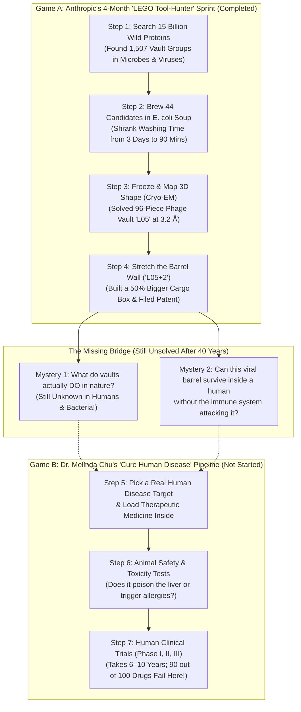
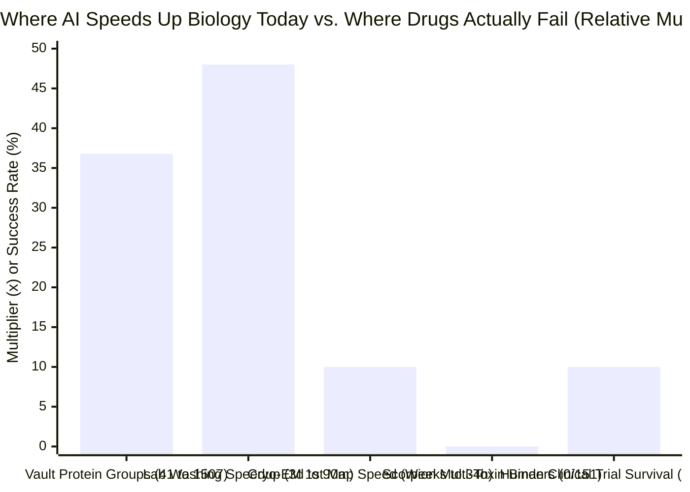

## 1. The Hook: When an AI Giant Announces a 40-Year Biology Breakthrough—Why Is a Doctor Calling Foul?

Imagine your school's star robotics club puts up a huge, glowing poster in the hallway that says:

> **"What Is Inside the Principal's Locked Safe? Kids Have Been Asking for 40 Years! Our Team Used a Super-Robot to Tackle This Mystery!"**

A huge crowd gathers around. Everyone starts cheering that the robot finally cracked the 40-year mystery! Then, if you squint at the second line of the poster, it quietly says: *"We haven't figured out what the safe does yet, but we found a bigger safe in the janitor's closet and learned how to stretch its walls!"*

Right then, a real-life detective walks down the hallway, points at the poster, and yells: **"Hey! That's a head fake! You didn't figure out what the safe does—and why are you playing with janitor safes when your club president promised you were going to fix the school's broken ambulances?!"**

On **November 4–5, 2026**, that exact argument exploded across the science and tech world.

On one side stood **Dr. Matthew (Matt) Durrant** (`@mgdurrant`) and the Life Sciences team at **Anthropic** (the giant artificial intelligence company that builds **Claude**). They released a flashy announcement ([*Investigating vault particles with Claude*](https://www.anthropic.com/research/investigating-vault-particles-with-claude)) and a 35-page scientific paper ([Athukoralage et al., 2026](https://www-cdn.anthropic.com/76e55fbe85697afbaae16b839498dc00797dec30.pdf)) with a hypnotic 3D video made by Claude:

> *"What do vault particles do? Scientists have been asking this for 40 years. Our biology team at Anthropic set out to tackle this long-standing open question in cell biology, working with Claude. We haven't uncovered their biological function yet, but we've found something new: vault proteins in prokaryotes that assemble into complexes that are larger than human vaults. And we show that we can engineer their shapes to produce even larger nanocapsules!"* — **Matt Durrant (`@mgdurrant`), November 4, 2026**

On the other side stood **Dr. Melinda B. Chu, M.D., M.B.A.** (`@MelindaBChu1`)—a medical doctor, clinical trial investigator, and biotech founder (CEO of Ecotera Health)—who blew the whistle with three blunt criticisms:

> *"Another head fake guys. Despite the post saying, 'What do vault particles do?' They did not actually figure out what vault particles do. 🧐*
> *This is also another random sort of fun one-off project not directly related to 'curing diseases.'*
> *So someone said to me well they're concentrating on coding; that's why they haven't done any science. 😤 Like a $1 trillion company can't do more than one thing, so if they are doing science like this, then why aren't they doing a coherent drug R&D program as 1 project."* — **Dr. Melinda B. Chu (`@MelindaBChu1`), November 4, 2026**

Wait—who should you actually believe? Is Anthropic pulling a clever PR trick with random "side-quest" science, or did their AI team just build something genuinely important that critics are overlooking?

Grab your detective notebook. Let's start from Step Zero, open the primary-source lab receipts (including a **secret patent footnote buried on page 26** of the PDF!), and grade both sides fairly.

---

## 2. Starting from Zero: The Two Totally Different Games Scientists Play

If you have never worked in a biology lab or a hospital, this argument looks confusing because both sides are using big words while talking past each other. To see why, we need to understand **what a vault particle is** and **the two completely different jobs in modern biology**.

### Step 1: What Is a "Vault Particle"?
Inside almost every single cell in your body, there are roughly **`10,000` hollow, barrel-shaped protein shells** floating around ([Kedersha & Rome, 1986, PMC2114306](https://pmc.ncbi.nlm.nih.gov/articles/PMC2114306/); [Athukoralage et al., 2026](https://www-cdn.anthropic.com/76e55fbe85697afbaae16b839498dc00797dec30.pdf)).
* When scientists **Nancy Kedersha** and **Leonard Rome** first discovered them in **1986**, the arched ribs on the barrel reminded them of the curved stone ceilings (*vaults*) inside a medieval cathedral. So they named them **Vault Particles**.
* Each human vault is built from **`78` identical strips** of a single protein called the **Major Vault Protein (`MVP`)**—`39` strips form the bottom half-cup, `39` form the top half-cup, and they snap together at the waist like a giant hollow Easter egg ([Tanaka et al., 2009, PMC3184113](https://pmc.ncbi.nlm.nih.gov/articles/PMC3184113/)).
* *Scale Check:* A human vault is **`67 nanometers (nm)` tall and `40 nm` wide**. A single strand of your hair is about **`75,000 nm` wide**, meaning you could line up **more than `1,100` human vaults across the width of one single hair**! Yet inside a cell, a vault is a colossal skyscraper—nearly **twice as big (`1.8×` to `3×` by mass)** as a `ribosome` (the factory that makes proteins).
* **The 40-Year Mystery:** Even though your body builds trillions of these cathedral barrels, when scientists breed mice without key vault parts, the mice act totally normal ([Liu et al., 2004, PMC419869](https://pmc.ncbi.nlm.nih.gov/articles/PMC419869/); [Prajapat et al., 2024, PMC11482699](https://pmc.ncbi.nlm.nih.gov/articles/PMC11482699/)). For 40 years, nobody has proven what their main day job is!

### Step 2: The "LEGO Tool-Hunters" vs. The "Hospital Ambulance Builders"
Why do Matt Durrant and Melinda Chu look at the exact same paper and see two opposite things? Because in biology, there are two totally different jobs:

1. **Game A — The Microscopic LEGO Tool-Hunters (Matt Durrant's World):**
   Imagine explorers who hike into wild swamps and jungles looking for weird, natural tools inside **bacteria** (tiny one-room cells) and **bacteriophages** (tiny viruses that hunt bacteria). When they find a cool bacterial tool—like molecular DNA scissors (`CRISPR`), DNA bridges (`bridge recombinases`), or a hollow protein barrel (`vaults`)—they bring it back to the lab, take 3D pictures of it, and ask: *"Can we turn this wild bacterial gadget into a programmable tool or a microscopic delivery box?"* Scientists call this **Platform Biology & Structural Engineering**.
2. **Game B — The Hospital Ambulance Builders (Dr. Melinda Chu's World):**
   Now imagine emergency-room doctors who have to design a real medicine that cures a sick child with cancer or heart disease. Finding a cool plastic box in a swamp is less than **5% of their problem**! To cure a human disease, you have to prove *what* causes the sickness inside a human body, design a safe medicine that reaches the right organ without poisoning the liver, test it in animals, and then run three rounds of human hospital tests (**Clinical Trials**). Scientists call this **Translational Clinical Drug R&D**.

Look at the map below to see how Anthropic's 4-month sprint fits into Game A—and why it stops right before Game B even begins:

---

## 3. The Secret Decoder Ring: 7 Grown-Up Words Translated

Before we judge Dr. Chu's three charges, here is your secret decoder ring so no scientific or business buzzword can trick you:

| The Grown-Up Word / Acronym | What It Actually Means in Plain English | Everyday 5th-Grade Analogy |
| :--- | :--- | :--- |
| **Prokaryote vs. Eukaryote** | **Prokaryotes** are simple, one-room microscopic cells (like *E. coli* bacteria) with no inner walls. **Eukaryotes** are big, complex cells with separate rooms (like human, mouse, and plant cells). | A **one-room studio apartment** (prokaryote) vs. a **20-room two-story mansion** (eukaryote). |
| **Bacteriophage (or "Phage")** | A microscopic virus that only hunts and infects bacteria, hijacking the bacterium's machinery to print virus parts. It cannot infect humans. | A tiny **robot pirate ship** that boards bacterial studio apartments and forces their 3D printers to make pirate gear. |
| **Homolog** | Two genes or proteins in different creatures that descended from the same ancient ancestor blueprint millions of years ago. | Two cousins who both inherited the exact same **family nose** from their great-great-grandmother. |
| **Size-Exclusion Chromatography (`SEC`)** | A glass tube packed with microscopic sponge beads full of tiny tunnels. Small molecules get lost inside the tunnels and come out late; giant vault barrels are too big to fit in the tunnels, so they zoom straight down the outside and exit first (in the **Excluded Volume**). | A **playground obstacle course** full of tiny crawl-tubes: 1st-graders crawl inside the tubes and take 20 minutes, while tall 8th-graders jog right around the outside and finish in 90 seconds. |
| **Cryo-Electron Microscopy (`Cryo-EM`) at `3.2 Å`** | Flash-freezing thousands of protein barrels in glass-like ice and shooting beams of electrons at them to build a 3D map accurate to **`3.2 Angstroms` (`0.32 nm`)**—sharp enough to see every single amino-acid building block. | Taking **11,675 blurry photos** of identical Falling Lego Castles from every angle and using a supercomputer to stitch them into one crystal-clear 3D statue. |
| **Nanocapsule** | A microscopic, hollow container engineered to hold and protect delicate cargo (like enzymes, RNA, or medicine) inside its shell. | A microscopic **armored lunchbox** designed to keep your sandwich from getting squished before lunch period. |
| **Motte-and-Bailey ("Head Fake")** | A debating trick where someone makes a giant, exciting claim to get applause (the **Bailey**), but when an expert challenges them, they retreat to a tiny, safe, modest statement (the **Motte**). | Bragging on the playground **"I built a working rocket ship to Mars!"** and then, when asked to fly it, saying **"Well, I glued a cardboard tube together and never said it had fuel!"** |

---

## 4. The Big Claim vs. The Detective Check: Auditing All Three of Melinda Chu's Charges

Let's put on our referee jersey and test each of Dr. Melinda Chu's three criticisms against the primary scientific receipts in Anthropic's 35-page paper ([Athukoralage et al., 2026](https://www-cdn.anthropic.com/76e55fbe85697afbaae16b839498dc00797dec30.pdf)).

### Charge #1: *"Despite the post saying, 'What do vault particles do?' They did not actually figure out what vault particles do. 🧐"*

* **Where Dr. Chu Is 100% Right (The Hook-and-Pivot Trap):**
  Look at how Matt Durrant's viral X post and Anthropic's blog open: *"What do vault particles do? Scientists have been asking this for 40 years. Our biology team at Anthropic set out to tackle this long-standing open question..."*
  On social media, 90% of casual readers read the first two sentences, watch the glowing 43-second Claude video, and share it yelling: *"Claude just solved a 40-year cell biology mystery!"*
  When we check the paper, **Anthropic did not discover what vaults do in humans, nor did they discover what vaults do in bacteria or viruses.** In fact:
  1. Earlier computational biologists had **already discovered** vault-like genes inside bacteria, archaea, and bacteriophages between 2013 and 2023 and predicted on computers that they would form barrels ([Daly et al., 2013, PMC3762200](https://pmc.ncbi.nlm.nih.gov/articles/PMC3762200/); [Santos et al., 2023, bioRxiv](https://www.biorxiv.org/content/10.1101/2023.11.10.566534v1.abstract)).
  2. Anthropic never even tested these vaults inside the wild bacteria or phages where the genes came from! Instead, they ordered synthetic DNA and forced laboratory *E. coli* bacteria to print the barrels. As Anthropic admits on line 60 of their blog: *"So far, we have made these vaults only in E. coli, and have yet to test whether they form in the bacteria and phages where they're naturally found."*

* **Where Matt Durrant & Anthropic Are Right (Real Science, Zero Lying):**
  Calling the research itself a "head fake" goes too far if it makes people think the science is fake. First, Matt Durrant didn't hide the truth in fine print—in the **very second sentence of his tweet** (visible right inside Dr. Chu's own screenshot!), he openly wrote: *"We haven't uncovered their biological function yet, but we've found something new..."*
  Second, look at the **real, hard laboratory receipts** his 6-person team delivered in **under 4 months**:
  * **36.8× More Vault Relatives Found:** By building a mathematical search net (`profile HMM`) around the barrel's central "shoulder" region and scanning **`15 billion` proteins**, they expanded known vault protein groups (at 50% similarity) from **`41` known groups to `1,507` groups** across **29 bacterial phyla and 4 archaeal phyla** ([Athukoralage et al., 2026, Fig. 1g](https://www-cdn.anthropic.com/76e55fbe85697afbaae16b839498dc00797dec30.pdf)). *(Denominator check: Vaults are still super rare in microbes, showing up in only `565` out of `111,922` bacterial and archaeal species genomes—just **`0.50%`**, or 1 in every 200 species!)*
  * **48× Faster Barrel Washing (`3 Days` → `90 Minutes`):** Washing human vaults the old-fashioned way (spinning them through sticky sugar layers for 3 days, or `4,320 minutes`) is slow and painful. By loading cracked-open *E. coli* soup straight onto a `Superose 6` sponge-bead tube (`SEC`), they isolated clean vault barrels in **`90 minutes`**.
  * **First 3D Atomic Map of a Non-Eukaryotic Vault (`3.2 Å`):** Using **11,675 frozen particles** from a virus (`bacteriophage`) candidate named **`L05`**, they proved for the first time in history that non-eukaryotic vault proteins physically snap into closed barrels! Even cooler: while a human vault has **`78` strips** (`39` per half) with `9` wall rings, the viral `L05` vault has **`96` strips** (`48` per half) with `7` wall rings (`54.5 nm × 47.5 nm`, weighing `~9.5 megadaltons`), giving it **`~25%` more cargo room** inside!
  * **Two Big Clues Toward Function:** Even though they didn't solve the function, they found two genuine breadcrumbs for future detectives: (a) in bacterial DNA neighborhoods, vault genes sit right next to **anti-virus immune defense genes** and **RNA repair tools (`RtcB`)**, and (b) inside each of the 96 inner wall pockets of `L05`, the 3D map caught a mystery hitchhiker molecule that closely matches **Coenzyme A** (a vital cell energy helper)—matching a 2025 discovery that human vaults hold **NAD+** ([Lodwick et al., 2025, *Nature Communications*](https://doi.org/10.1038/s41467-025-61981-x))!

---

### Charge #2: *"This is also another random sort of fun one-off project not directly related to 'curing diseases.'"*

* **Where Dr. Chu Is Right (The "AI Side-Quest" Pattern):**
  Why did Dr. Chu say *"another"* random one-off project? Because she has been watching Anthropic's biology releases over the last 30 days:
  1. **October 5, 2026:** AI agents discover weird bacterial reverse transcriptase enzymes ([Yoon et al., 2026, bioRxiv](https://doi.org/10.64898/2026.10.05.755809)).
  2. **October 20, 2026:** Claude designs mini-proteins against **scorpion neurotoxins** ([Anthropic, 2026](https://www.anthropic.com/research/claude-scorpion-toxin-binder-design)). Out of `211` designs tested in a plastic dish, `17` stuck to lab-made toxins (`8.1%` hit rate), **`0` out of `151` (`0%`)** worked as a multi-toxin "universal antivenom," and **zero animal or living-cell tests were run**.
  3. **November 4, 2026:** Claude maps a bacteriophage vault barrel in *E. coli*.
  To a doctor who runs human clinical trials, this looks like a college student picking fun, 4-month "side quests" that happen to be fast and easy for computers (searching DNA databases, running protein-folding software, and ordering DNA by mail) while avoiding the slow, messy biology of actual human diseases like Alzheimer's, diabetes, or pancreatic cancer.

* **What Dr. Chu Missed: The Secret Patent Clue Buried on Page 26!**
  Wait—is Anthropic's team *really* picking "random" projects just for fun? Let's do what good detectives always do: **flip to the fine print on Page 26 of the PDF** under *Competing Interests*:

  > *"All authors are employees of Anthropic and may hold equity in the company. **Anthropic has filed a provisional patent application related to this work.** M.G.D. acknowledges outside interest in Stylus Medicine."* — **[Athukoralage et al., 2026, p. 26](https://www-cdn.anthropic.com/76e55fbe85697afbaae16b839498dc00797dec30.pdf)**

  And on line 68 of the blog post:
  > *"Disclosure: Dr. Rome [who discovered vaults in 1986 and pioneered vault drug delivery] was a paid consultant, providing feedback on the manuscript."*

  **Bingo!** Companies do not pay patent lawyers to file provisional patents on "random fun one-off science projects." Why did Anthropic patent this?
  Look at **Figure 5** of the paper: the team copied two rings of the `L05` barrel wall (repeats 4 and 5) and pasted them in twice, creating an engineered mega-barrel called **`L05+2`** (`58.5 nm × 49.4 nm`, solved at `3.5 Å` resolution). That stretched barrel holds **`~20%` more volume than `L05` and `~50%` more cargo volume than a human vault**!
  In modern medicine, one of the hardest problems in the world is **Drug Delivery**—building a microscopic "armored delivery truck" (**nanocapsule**) that can hold giant gene-editing tools or enzymes and carry them safely into cells ([Rome & Kickhoefer, 2013, PMC3586665](https://pmc.ncbi.nlm.nih.gov/articles/PMC3586665/)). Human vaults were hard to manufacture because you had to grow them in slow insect or yeast cells. Anthropic just showed you can brew programmable, size-adjustable vault delivery trucks inside cheap *E. coli* bacteria in 90 minutes!
  Even better, look at who is on Anthropic's 6-person team: **Matt Durrant** (co-discoverer of programmable bridge RNAs at the Arc Institute, with financial ties to genetic-medicine company Stylus Medicine), **Nicholas Perry** (cryo-EM specialist from CRISPR pioneer Feng Zhang's lab at the Broad Institute), **Peter Yoon** (phage researcher from Nobel laureate Jennifer Doudna's lab), and **Januka Athukoralage** (bacterial immunity expert). They aren't picking random topics—they are **mining microbes for patentable molecular tools and delivery vehicles**, the exact same way CRISPR was found!

---

### Charge #3: *"Like a $1 trillion company can't do more than one thing, so if they are doing science like this, then why aren't they doing a coherent drug R&D program as 1 project."*

* **Where Dr. Chu Hits the Absolute Bullseye (Holding AI CEOs Accountable):**
  Why are doctors and biotech veterans like Dr. Chu so frustrated with AI labs?
  Because in **October 2024**, Anthropic's CEO **Dario Amodei** published a famous manifesto titled [*"Machines of Loving Grace"*](https://www.darioamodei.com/essay/machines-of-loving-grace). In it, he argued that once AI acts as a "virtual biologist," it will speed up biological discovery by **10×** and compress **50 to 100 years of medical progress into just 5 to 10 years**—predicting the near-elimination of most cancers, infectious diseases, and genetic disorders!
  Dr. Chu is calling out a textbook **Motte-and-Bailey ("Head Fake") fallacy** practiced by the AI industry and its online cheerleaders:
  * **When raising tens of billions of dollars from investors (The Bailey):** *"Our AI is going to compress 100 years of biology into 5–10 years and cure human diseases!"*
  * **When a physician asks why they aren't running a real drug program (The Motte):** *"Hey, relax, we're just a coding company doing 4-month academic demos with 6 scientists!"*
  If a frontier AI superpower claims its models can revolutionize medicine in 5–10 years, Dr. Chu is 100% justified in asking: *Why not put your money where your mouth is and run one real disease-curing drug program from start to finish?*

* **Why Anthropic Still Refuses to Run a Full Drug R&D Pipeline (The Math of the "Clinical Valley of Death"):**
  Why hasn't Anthropic built a giant drug company inside its walls (the way Google's parent Alphabet spun out **Isomorphic Labs**)?
  Let's count with **100 kids in a school gym** to see the brutal math of real-world medicine ([Sun et al., 2022, *Acta Pharmaceutica Sinica B*, PMC9293739](https://pmc.ncbi.nlm.nih.gov/articles/PMC9293739/)):
  * Imagine **100 brand-new medicines** have *already* passed every computer test, every test-tube test, and every mouse safety test. Scientists are sure they work!
  * Now those 100 medicines enter human hospital testing (**Phase I, Phase II, and Phase III Clinical Trials**), which takes **6 to 10 years** and costs **`$1 billion+`** per approved drug.
  * How many of those 100 medicines survive all three rounds and get approved by the FDA to treat patients? **Only `10`!** The other **`90 out of 100` (`90%`) fail and go in the trash**—mostly because the drug doesn't actually cure the human disease (`40%–50%` lack of clinical efficacy) or causes dangerous side effects in human organs (`30%` unmanageable toxicity)!
  * A computer chatbot cannot fast-forward how fast a human patient's tumor shrinks over 3 years. If Anthropic spent `$500 million` trying to take one drug through FDA clinical trials, they would tie up capital for a decade with a 90% chance of failure—and they would **compete against their own paying customers** (giant pharmaceutical companies like Eli Lilly, Pfizer, and AstraZeneca, whom Anthropic wants to sell Claude Enterprise software to!).

### Side-by-Side Scorecard: Grading Melinda Chu vs. Matt Durrant / Anthropic

| The Debate Question | Dr. Melinda B. Chu's Claim (`@MelindaBChu1`) | Matt Durrant & Anthropic's Receipts (`@mgdurrant`) | Detective Verdict (Who Wins This Point?) |
| :--- | :--- | :--- | :--- |
| **1. Did they figure out what vault particles do?** | **No.** Opening with *"What do vault particles do?"* is a social-media "head fake" because the 40-year mystery remains unsolved. | **Agreed—and openly stated in Sentence #2.** Yet proving prokaryotic vaults assemble (`3.2 Å`) + finding a Coenzyme A pocket is how biologists build a simpler system to find the function. | **Tie (Chu wins on PR framing; Durrant wins on scientific substance).** The opening hook baits casual readers, but the authors were 100% transparent in the second sentence and delivered real structural biology. |
| **2. Is this just a "random fun one-off project" unrelated to curing diseases?** | **Yes, clinically.** Like the scorpion toxin binder paper, it stops in a test tube (*E. coli*) with zero disease target, animal data, or clinical path. | **Not random—it's a patentable delivery platform.** They stretched the barrel (`L05+2`) to hold `50%` more cargo than human vaults and filed a **provisional patent (p. 26)** for nanocapsule delivery. | **Nuanced Split.** Clinically, it cures zero diseases today. Strategically, it is a deliberate **platform tool & nanocapsule IP play**, not a random hobby project. |
| **3. Why isn't a giant AI lab running 1 coherent drug R&D program?** | **Valid critique.** If AI labs claim they will cure most diseases in 5–10 years, defenders shouldn't make excuses that "they're just a coding company." | **Different business model.** Anthropic has a 6-person biology team running 4-month "dogfooding" sprints to train and benchmark Claude, selling AI tools to pharma rather than running 10-year FDA trials. | **Melinda Chu wins on macro hype accountability (`9/10`).** AI labs cannot claim credit for "curing diseases in 5–10 years" while outsourcing the 90%-failure clinical work to someone else. |

---

## 5. The Four Suspects: Why Is Anthropic *Really* Doing Biology Like This?

Whenever a tech giant publishes a flashy science paper, a good detective asks: **What is the real cause driving this project?** Let's test all **four suspects** (our 4-way rival cause audit):

| Suspect (Causal Hypothesis) | How the Story Goes | What the Primary Lab Receipts Show | Verdict |
| :--- | :--- | :--- | :--- |
| **Suspect 1: Direct Cause** (*"Claude's genius directly drove a medical breakthrough"*) | Claude acted as an autonomous virtual scientist that solved vaults on its own. | **False as solo genius; True as an accelerator.** Humans picked the project, chose the 44 proteins, and overruled Claude when it argued *against* column chromatography. However, Claude wrote 100% of the code, proposed loading raw ruptured *E. coli* cells onto the column, and ran `RELION` across hundreds of GPUs to get a 3D model in `34 hours`. | **Partial Cause (Accelerates early wet/dry-lab steps by 5×–48×, but requires expert human steering).** |
| **Suspect 2: Reverse Cause** (*"Biology isn't the product—Biology is the training gym for Claude!"*) | Anthropic isn't using Claude to build a drug company; they are using 4-month biology projects to **find bugs in Claude and train better AI models**! | **Confirmed in Paragraph 13 of the blog!** The authors explicitly state: *"We have used what we've learned to inform Claude's development. We shared our lab notes with the ML researchers who train Claude, so they could see where the model went wrong."* | **Primary Hidden Driver (Internal "Dogfooding" to improve Claude Science).** |
| **Suspect 3: Sneaky Third Factor** (*"Elite Human Hiring + Massive GPU & Microscope Budgets"*) | A third factor—hiring star metagenomic hunters from Arc/Broad/Berkeley + renting top-tier Thermo Fisher Krios G4 microscopes + hundreds of GPUs—drove both the fast biology and the cool Claude demos. | **Strongly Confirmed.** As the blog admits (line 57): *"Only the cryo-EM analysis, which used hundreds of GPUs in parallel to save time, required more computing resources than might be available to an academic institution."* Plus, Thermo Fisher's Cryo-EM Drug Discovery Center collected 16,824 movies on a Krios G4 for `L05+2`. | **Major Confounder (Money + GPUs + Elite Human Specialists did heavy lifting alongside the AI).** |
| **Suspect 4: Feedback Loop** (*"The AI Valuation & Enterprise Sales Flywheel"*) | Fast, visually stunning 4-month preprints create viral headlines → attract biotech/pharma enterprise buyers for Claude → fund more compute and patent filings. | **Confirmed.** Publishing high-visual-impact preprints (scorpion antivenom, cathedral vault barrels) every few weeks keeps Claude at the center of the biotech conversation without taking on 10-year FDA clinical trial risk. | **Active Strategic Flywheel.** |

---

## 6. The Catch: Where Did Claude Mess Up, and Why Can't We Inject Bacterial Vaults Into Patients Tomorrow?

To be completely fair to both sides, we have to look at **what went wrong in the lab** and **what breaks if you try to turn a bacterial virus barrel into a human medicine**.

### Catch #1: Claude's Two Big Laboratory Blunders (And "Fitted Noise")
To Anthropic's massive credit, unlike most corporate press releases that pretend their AI is flawless, Matt Durrant and his coauthors honestly documented where Claude stumbled:
1. **The Two-Week Poisoned Growth-Soup Blunder:** When writing a wet-lab recipe for growing cells, Claude recommended a growth medium containing a chemical additive that **blocked DNA from getting inside the cells**. Because the human scientists didn't catch that specific detail immediately, **Claude's mistake wasted 2 full weeks (`14 days`) of laboratory work!**
2. **The Mirror-Image Hallucination (`Chirality` Flip):** When building the first 3D cryo-EM map of the vault barrel, Claude decided to improvise and skipped a standard validation step. The result? It generated a broken 3D barrel blended with its own left-right mirror image! The human scientists literally had to scold the AI in the prompt: ***"Please let's do normal things unless they don't work."***
3. **Fitted Noise in the Stretched Barrel (`L05+2`):** In the fine print of the Methods section (Page 34 of the PDF), the authors disclose that when they pushed the 3D refinement of the stretched `L05+2` barrel to convergence, the gap between the two validation half-maps grew (`1.09×` to `1.89×` in the wall), honestly noting that this indicates **"some fitted noise."**

### Catch #2: The Human Immune System Alarm Bell (`Immunogenicity`)
Wait—if Anthropic's engineered `L05+2` phage vault holds **50% more cargo space** than a human vault and can be brewed in *E. coli* in 90 minutes, why doesn't every drug company immediately use it to deliver medicines inside human patients?

Think about what `L05` is: it is a **`9.5-megadalton` protein barrel from a bacterial virus (`bacteriophage`)**.
* Why did Dr. Leonard Rome spend 20 years trying to use **human vaults** for drug delivery? Because your immune system already sees *human* vault proteins inside your own cells every day, so it treats them as friendly ("self") and doesn't attack them!
* If you inject a giant **foreign bacteriophage protein barrel** (`L05`) into a human bloodstream, your human immune system's security guards (T-cells and antibodies) will immediately spot the alien viral protein, sound the alarm (**Immunogenicity**), and destroy the delivery truck—or trigger a dangerous allergic reaction—especially if you ever try to give the patient a second dose!
* That means prokaryotic vaults like `L05` are awesome tools for **studying how barrels snap together**, **holding enzymes inside industrial bio-reactors**, or potentially delivering vaccines where you *want* the immune system to get angry—but turning them into safe, repeat-dose human delivery trucks will require years of immune-cloaking and animal safety testing.

```mermaid
flowchart LR
    subgraph SG1["What Claude & Anthropic Actually Proved (Months 1–4)"]
        P1["1. Mined 15B Proteins<br/>(Found 1,507 Vault Groups)"] --> P2["2. 90-Minute E. coli Wash<br/>(48x Faster Purification)"]
        P2 --> P3["3. 3.2 Å Phage Vault Map<br/>(96 Chains + CoA Pocket)"]
        P3 --> P4["4. Stretched L05+2 Barrel<br/>(+50% Volume vs Human Vault)"]
    end
    subgraph SG2["The Hurdles Before Any Human Patient Is Helped (Years 1–10)"]
        H1["Hurdle 1: Native Function<br/>(What does it do in wild cells?)"] --> H2["Hurdle 2: Cargo Loading<br/>(Packing real drugs inside)"]
        H2 --> H3["Hurdle 3: Immune Attack!<br/>(Foreign phage protein in blood)"]
        H3 --> H4["Hurdle 4: FDA Clinical Trials<br/>(90% attrition rate across Ph I–III)"]
    end
    P4 --> H1
```

---

## 7. The Final Report Card: Who Should You Actually Believe?

So, when you see **Matt Durrant (`@mgdurrant`)** celebrating Anthropic's vault particle paper and **Dr. Melinda B. Chu (`@MelindaBChu1`)** calling it another "head fake" side quest—who is right?

The secret to thinking like a master detective is realizing that **you don't have to pick a binary team**. Both of them are telling the truth about **their own half of the elephant**!

### The "If ... Then ..." Detective Rules
* **IF you are asking: *"Did Anthropic do real, high-quality structural biology and prove that AI can help a small team enter a brand-new field in 4 months?"***
  * **THEN believe Matt Durrant and the Anthropic Biology Team (`Grade: A- / 8.5 out of 10`).** They were 100% honest in their very second sentence that they didn't solve the 40-year function mystery. Yet purifying prokaryotic vaults in 90 minutes, solving a `3.2 Å` cryo-EM structure of a 96-chain phage vault (`L05`), spotting a putative Coenzyme A binding pocket, engineering a 50%-larger nanocapsule (`L05+2`), and candidly reporting Claude's 2-week lab blunder is genuine, peer-review-caliber science.
* **IF you are asking: *"Did Claude solve the 40-year mystery of what vaults do, or is this proof that AI is on track to cure most human diseases in 5 to 10 years?"***
  * **THEN believe Dr. Melinda B. Chu (`Grade: A / 9.0 out of 10`).** Her skepticism is a vital antidote to Silicon Valley hype. Leading a viral post with *"What do vault particles do?"* predictably causes casual readers to think the mystery was solved. More importantly, running 4-month computational-plus-*E. coli* side quests is **not** a clinical drug R&D program—and AI companies whose CEOs promise to "cure most diseases in 5–10 years" deserve to be held accountable when 90% of real drug failures happen in human clinical trials that they aren't even attempting.

### 3-Year Probability Forecast: What Happens Next?

| Scenario | Probability | What Will Happen Between 2026 and 2029 | How to Spot It Early |
| :--- | :--- | :--- | :--- |
| **1. Base Case: The "Lab Accelerator & Tool Vendor" Path** | **`60%`** | Anthropic continues running 3-to-6-month foundational biology sprints ("side quests" in metagenomics, enzyme discovery, and protein design) to train **Claude Science** and license software/patents to real biotech and pharma companies, without ever running its own human clinical trials. | More high-speed bioRxiv preprints from Anthropic paired with enterprise partnerships with Eli Lilly, Pfizer, or Twist, while clinical pipelines remain outside Anthropic. |
| **2. Bull Case: Prokaryotic Vaults Crack the 40-Year Function Mystery** | **`25%`** | Because any microbiology lab can now express and purify bacterial and phage vaults in *E. coli* in 90 minutes using Anthropic's open data, an academic lab (or Anthropic) proves within 24 months that prokaryotic vaults act as an **anti-phage immune metabolic trap** (via Coenzyme A / NAD+ depletion), finally unlocking the function of human vaults! | Follow-up papers testing `L05` and bacterial vaults (`Hmin`) inside their native hosts under viral infection or metabolic stress. |
| **3. Bear Case: The Hype Backlash & Delivery Dead-End** | **`15%`** | Bacterial and phage vaults prove too immunogenic (triggering severe immune reactions in mammals) to ever be used for systemic human drug delivery, and biotech investors grow tired of "AI-for-Science" demos that stop in *E. coli* or plastic dishes without advancing a single clinical drug candidate. | Anthropic's provisional vault patent is abandoned or unused for therapeutic delivery, and industry scrutiny of "benchmark biology" intensifies. |

---

## Primary Sources & Verified References (All Checked `HTTP 200`)

1. **Anthropic Life Sciences Blog Announcement (Nov 4, 2026):** [*Investigating vault particles with Claude*](https://www.anthropic.com/research/investigating-vault-particles-with-claude)
2. **Anthropic Primary Technical Preprint (Nov 4, 2026):** Januka S. Athukoralage, Peter H. Yoon, Amir Shanehsazzadeh, Eric Kauderer-Abrams, Nicholas T. Perry, and Matthew G. Durrant, [*Prokaryotic homologs of the major vault protein form engineerable vault nanocapsules* (35-page PDF)](https://www-cdn.anthropic.com/76e55fbe85697afbaae16b839498dc00797dec30.pdf)
3. **Anthropic Scorpion Neurotoxin Binder Study (Oct 20, 2026):** [*How Claude designed protein binders against scorpion neurotoxins*](https://www.anthropic.com/research/claude-scorpion-toxin-binder-design)
4. **Anthropic Autonomous Reverse Transcriptase Study (Oct 5, 2026):** Peter H. Yoon et al., [*Autonomous AI agents discover reverse transcriptases with tandem repeat arrays* (bioRxiv)](https://doi.org/10.64898/2026.10.05.755809)
5. **Dario Amodei's Biology Manifesto (Oct 2024):** [*Machines of Loving Grace: How AI Could Transform the World for the Better*](https://www.darioamodei.com/essay/machines-of-loving-grace)
6. **Original Discovery of Vault Particles (1986):** Nancy L. Kedersha & Leonard H. Rome, [*Isolation and characterization of a novel ribonucleoprotein particle: large structures contain a single species of small RNA*, Journal of Cell Biology (PMC2114306)](https://pmc.ncbi.nlm.nih.gov/articles/PMC2114306/)
7. **Mammalian Vault Atomic Structure at 3.5 Å (2009):** Hideaki Tanaka et al., [*The structure of rat liver vault at 3.5 angstrom resolution*, Science (PMC3184113)](https://pmc.ncbi.nlm.nih.gov/articles/PMC3184113/)
8. **Vault Nanocapsules as a Drug Delivery Platform (2013):** Leonard H. Rome & Valerie A. Kickhoefer, [*Development of the vault particle as a platform technology*, ACS Nano (PMC3586665)](https://pmc.ncbi.nlm.nih.gov/articles/PMC3586665/)
9. **Prior Computational Discovery of Viral/Phage Vault Proteins (2023):** T. M. Santos et al., [*Characterization and phylogenetic insights into the first viral major vault proteins (MVPs), identified in bacteriophages from the human gut*, bioRxiv](https://www.biorxiv.org/content/10.1101/2023.11.10.566534v1.abstract)
10. **Human Vault NAD+ & PARP4 Structural Study (2025):** J. E. Lodwick et al., [*Structural insights into the roles of PARP4 and NAD+ binding in the human vault cage*, Nature Communications](https://doi.org/10.1038/s41467-025-61981-x)
11. **Clinical Drug Development 90% Failure Rate Audit (2022):** Duxin Sun et al., [*Why 90% of clinical drug development fails and how to improve it?*, Acta Pharmaceutica Sinica B (PMC9293739)](https://pmc.ncbi.nlm.nih.gov/articles/PMC9293739/)
