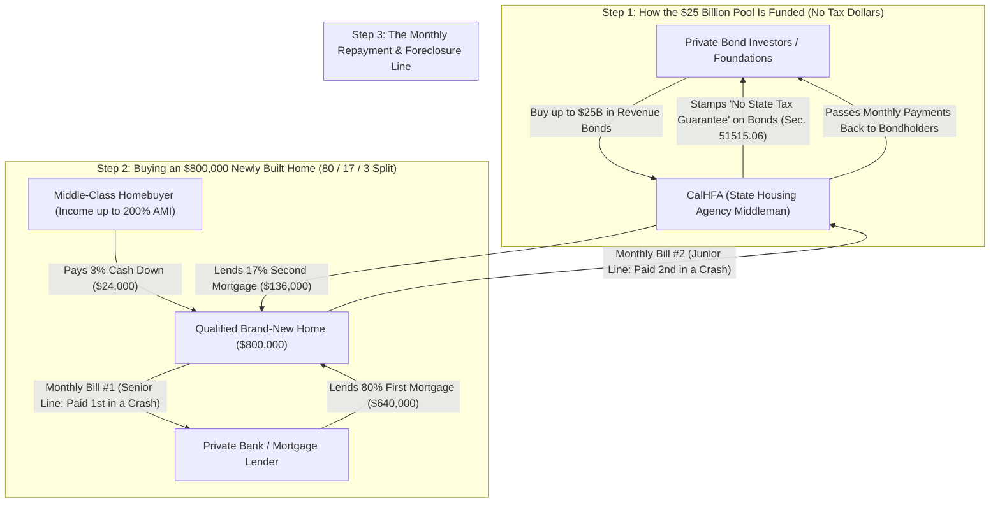
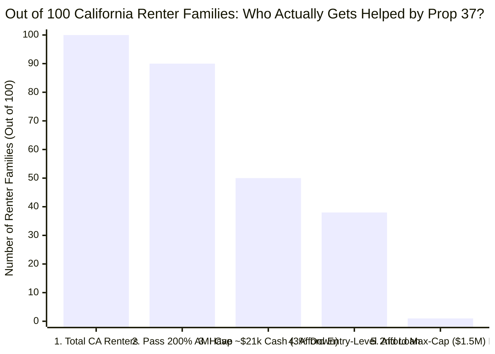
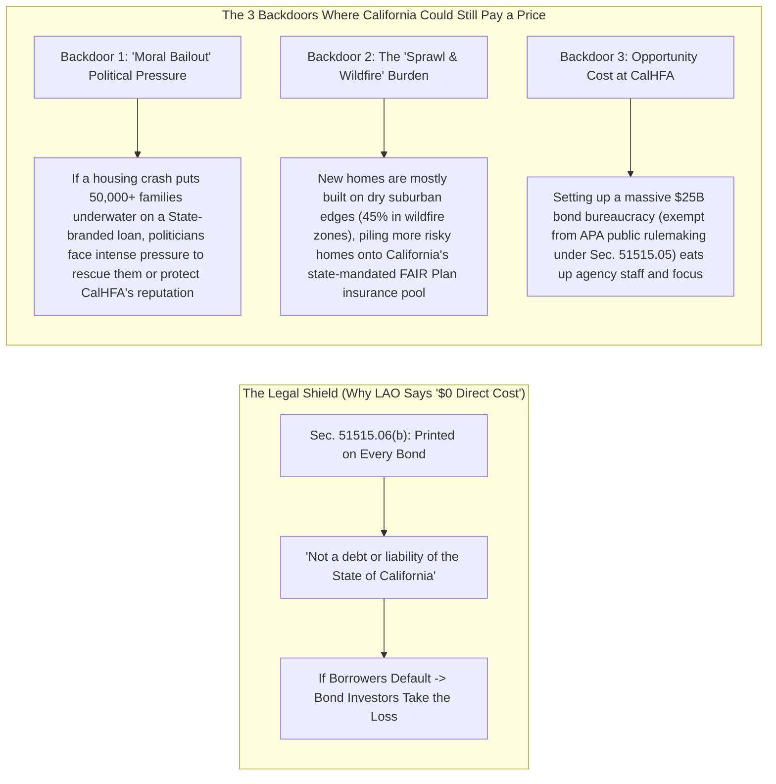

## 1. The Hook: Wait—Can You Really Buy a Brand-New California House With Just 3% Down and Zero Cost to Taxpayers?

Imagine you want to buy a giant `$800` LEGO Millennium Falcon set at the toy store. Normally, the store manager says: *"Before we let you take this box home and pay off the rest little by little from your weekly allowance, you must slap `20%` of the price—`$160` in cash—onto the counter today."*

In California, where a typical family house now costs around **`$800,000` to `$930,000`**, that `20%` upfront cash pile is **`$160,000` to `$186,000`**.
- **Physical Scale Anchor:** Saving `$186,000` in cash is like setting aside **`$1,000` every single month for 15 and a half years straight** without touching a penny—while your rent keeps going up the whole time! As former California Assembly Speaker Bob Hertzberg put it, asking a normal working family to save that much cash is like asking them to *"travel to the moon in a cardboard rocket ship"* ([CalMatters](https://calmatters.org/politics/2026/10/prop-37-explained-homeownership/)).

Then, on **November 3, 2026**, California voters passed **Proposition 37** (*The California Middle-Class Homeownership and Family Home Construction Act of 2026*) by a landslide **`61.3%` YES to `38.7%` NO** ([SOS Quick Guide](https://quickguidetoprops.sos.ca.gov/propositions/2026-11-03/37), [CalMatters](https://calmatters.org/politics/2026/11/california-election-2026-props-1-37/)).

The headline promise sounds like magic:
1. If you buy a **brand-new house or condo**, you only have to put down **`3%` of your own cash** (just `$24,000` on an `$800,000` home instead of `$160,000`).
2. A state agency called **CalHFA** steps in with up to **`$25 billion`** to cover the other **`17%`** (`$136,000`) so your total down payment reaches `20%`.
3. Best of all, the official ballot label from California's nonpartisan **Legislative Analyst's Office (LAO)** says: **"Fiscal Impact: No direct state or local costs"** ([LAO Prop 37 Analysis](https://lao.ca.gov/BallotAnalysis/Proposition?number=37&year=2026)).

Wait a second! Your "too-good-to-be-true" alarm bell should be ringing as loudly as a school fire drill:
- **Where does `$25 billion` come from if taxpayers aren't paying for it?**
- **Is that `17%` free money—or a sneaky second loan that makes your monthly bill explode?**
- **And if a housing crash hits when buyers only have `3%` skin in the game, will the State of California eventually get stuck with a massive financial burden anyway?**

Here is our short detective answer before we open the vault of legal receipts:
> **Your intuition is spot-on. There is no free lunch in math.**
> 1. **For State Taxpayers:** Legally, California's tax budget (the General Fund) is **walled off** because Prop 37 uses private **Revenue Bonds** stamped with a "No State Bailout" warning label (`Health & Safety Code § 51515.06(b)`). If homeowners stop paying, private bond investors—not taxpayers—legally take the loss. However, the state still faces **indirect financial burdens**: political pressure for a "moral bailout" if a crash wipes out thousands of state-branded loans, plus heavier strain on California's state-backed wildfire insurance plan (**FAIR Plan**) as new homes get built on the dry outer edges of cities.
> 2. **For Homebuyers:** The "too good to be true" catch lands squarely on the buyer's monthly kitchen-table budget. Unlike California's older *Dream For All* program (which charged `0%` monthly payments until you sold the house), Prop 37's `17%` help is a **second monthly mortgage bill** with interest (`§ 51515.05(c)`). On an `$800,000` home, skipping `$136,000` upfront means borrowing **97% of the house price**—adding roughly **`$860 to $1,000+ every single month`** to your debt payments and leaving you just one tiny `4%` market dip away from owing more than your house is worth!

To see how every gear inside this `$25 billion` machine turns, let's start from Step Zero.

---

## 2. Starting from Zero: How Buying a House and State Bonds Actually Work

Assume you have never bought a house or traded a government bond in your life. Let's build the whole system from the ground floor using four simple building blocks.

### Building Block 1: The Down Payment, The Mortgage, and the "PMI Penalty"
Suppose a newly built house in California costs **`$800,000`**. Almost nobody has `$800,000` sitting in a piggy bank. So you split the price into two pieces:
1. **Your Upfront Cash Pile:** You pay a chunk of the price out of your own savings on Day 1. Grown-ups call this the **Down Payment**.
2. **The Giant Bank Loan:** A private bank lends you the rest of the money, and you pay the bank back every month for `30 years` with an extra rental fee for using their money (**Interest**). Grown-ups call this 30-year house loan a **Mortgage**.

Why does everyone talk about the magic number **`20%`**?
- If you put down **`20%` (`$160,000`)** and borrow **`80%` (`$640,000`)**, the bank feels safe. Even if house prices drop by `10%` or `15%`, the bank can still sell the house and get all `$640,000` of its loan back.
- What if you only put down **`3%` (`$24,000`)** on a normal loan? Now the bank is terrified! If house prices dip by just `5%` (`$40,000`), the house is worth `$760,000`, which is *less* than the `$776,000` you owe the bank.
- So whenever you put down less than `20%`, banks force you to buy an extra monthly insurance policy that protects *the bank* (not you!) in case you stop paying. Grown-ups call this penalty **Private Mortgage Insurance (`PMI`)**, and on an `$800,000` house it can burn an extra **`$350 to $650 every single month`** without paying off a single penny of your house!

### Building Block 2: How Prop 37 Splits the Pie (`80% + 17% + 3% = 100%`)
Prop 37's big trick is to slice your `$800,000` purchase into **three** pieces instead of two ([SOS Voter Guide PDF](https://vig.cdn.sos.ca.gov/2026/general/pdf/prop37.pdf)):
1. **Piece 1 — Your Cash (`3%` = `$24,000`):** You bring at least `3%` from your own savings (not borrowed money).
2. **Piece 2 — The State Agency Second Loan (`Up to 17%` = `$136,000`):** California's housing agency (**CalHFA**) lends you up to `17%` of the price. Because `3% + 17% = 20%`, your main bank sees a full `20%` cushion in front of its loan—so **you skip the monthly `PMI` penalty!**
3. **Piece 3 — The Main Bank Loan (`80%` = `$640,000`):** You take out a normal first mortgage from a regular bank for the remaining `80%`.

Wait—if the bank lends you `80%` and the state agency lends you `17%`, how much of the house did you actually borrow?
**`80% + 17% = 97%`!** You now have **two** monthly loan bills to pay: your big `80%` **First Mortgage** *plus* your `17%` **Second Mortgage**.

### Building Block 3: Why Doesn't This Cost Taxpayers Anything? (General Obligation vs. Revenue Bonds)
When the State of California wants to borrow billions of dollars, it prints official IOUs called **Bonds** and sells them to big investors (like pension funds, wealthy families, and banks).
- **Type A — The "Taxpayer Credit Card" (General Obligation Bonds):** When voters passed **Proposition 1** (`$11.25 billion` for low-income apartments) on the same November 2026 ballot, they approved **General Obligation (`GO`) Bonds** ([CalMatters](https://calmatters.org/politics/2026/11/california-election-2026-props-1-37/)). That means California promises to pay those investors back out of the state's main tax piggy bank (the **General Fund**)—the exact same bucket that pays for public schools, parks, and hospitals.
- **Type B — The "Self-Paying Toll Bridge" (Revenue Bonds):** Proposition 37 does **NOT** use General Obligation bonds. Instead, it authorizes up to **`$25 billion` in Revenue Bonds** ([LAO Analysis](https://lao.ca.gov/BallotAnalysis/Proposition?number=37&year=2026)). Think of building a toll bridge: investors lend money to build the bridge, and the *only* money that pays those investors back is the `$5` toll collected from drivers crossing that specific bridge. Under Prop 37, CalHFA acts like a middleman pipeline: it borrows up to `$25 billion` from private bond buyers, lends that cash to homebuyers as `17%` second mortgages, and uses the homebuyers' monthly second-mortgage payments to pay back the bond buyers.

Here is the entire Prop 37 money-and-debt machine in one visual map:

---

## 3. The Secret Decoder Ring: Grown-Up Housing & Bond Words Translated

Before we inspect the fine print of the law, let's lock in our **Secret Decoder Ring** translating the seven grown-up buzzwords in Proposition 37 into plain 5th-grade English:

| The Grown-Up Word / Acronym | What It Actually Means in Plain English | Everyday 5th-Grade Analogy |
| :--- | :--- | :--- |
| **Revenue Bond** | A government IOU that is paid back *only* from the fees or loan payments of the people who use that specific program—never from general income or sales taxes. | Borrowing `$50` from your uncle to buy lemons for a lemonade stand, with a rule that he only gets paid back from lemonade cup sales—never from your birthday money. |
| **General Obligation (`GO`) Bond** | A government IOU backed by the state's "full faith and credit," meaning taxpayers must pay it back out of the state's main tax vault no matter what. | Putting a new bicycle on your parents' family credit card—even if you stop riding the bike, your parents still have to pay the bill out of the family budget. |
| **Second Mortgage (Subordinate Lien)** | An extra loan stacked on top of your main house loan. "Subordinate" means *junior in line*: if you go broke and the house is sold, the main bank gets 100% of its money first, and the second lender gets whatever is left. | Two friends lend you money for a rare trading card. Friend #1 has "first dibs" if you have to sell the card; Friend #2 only gets paid if there is extra cash left over. |
| **Combined Loan-to-Value (`CLTV`)** | The total percentage of your house price that is borrowed across *all* loans combined (`80%` first loan + `17%` second loan = **`97% CLTV`**). | Buying a `$100` skateboard with `$3` of your own coins and `$97` of borrowed money. You hold the skateboard, but lenders own `97%` of its value. |
| **Silent Second vs. Amortizing Second** | A "Silent Second" (like CalHFA's older *Dream For All*) requires `$0` monthly payments until you sell the house. An "Amortizing Second" (Prop 37) requires you to pay principal + interest **every single month**. | A Silent Second is a library book where you pay zero fees until you return it years later; Prop 37 is a rental subscription you must pay every month starting right away. |
| **Area Median Income (`AMI`)** | The exact middle family income in a specific county (half of families earn more, half earn less). Prop 37 lets families earning up to **`200% of AMI`** (double the middle!) qualify. | Line up 100 families in your town from smallest paycheck to biggest. Family #50 is `100% AMI`. Anyone earning up to *twice* Family #50's paycheck gets into Prop 37. |
| **Price Capitalization** | When giving buyers extra loan money in a neighborhood with too few houses simply causes sellers and builders to raise the price tag of the houses. | If the school principal hands every kid an extra `$5` bill right before a bake sale that only has 10 cupcakes, the cupcakes don't become easier to get—the price of each cupcake just jumps by `$5`! |

---

## 4. The Big Claim vs. The Detective Check: Opening the Official Legal Receipts

When voters read the campaign ads for Proposition 37, they saw a coalition of realtors, carpenters, teachers, and nurses promising *"consumer-friendly, low-interest downpayment assistance loans... with ZERO COST TO TAXPAYERS"* ([SOS Official Voter Guide PDF, p. 42](https://vig.cdn.sos.ca.gov/2026/general/pdf/prop37.pdf)). Remarkably, **zero official opposition argument was even submitted** to the state voter guide ([SOS PDF, p. 43](https://vig.cdn.sos.ca.gov/2026/general/pdf/prop37.pdf)).

Why didn't anyone pay to run big TV ads against Prop 37? Because it didn't raise taxes or touch the state budget!
- **Who Funded Prop 37?** Campaign finance filings tracked by [CalMatters](https://calmatters.org/california-voter-guide-2026/proposition-37-homebuyers-loan/) and the [Hoover Institution](https://www.hoover.org/proposition-lab-proposition-37) show the campaign was spearheaded by former Democratic Assembly Speaker **Bob Hertzberg** and bankrolled primarily by the **California Association of Realtors** (which supplied over `52%` of industry contributions) alongside construction unions like the **California Conference of Carpenters**.

When we open the actual legal text that Prop 37 just added to California law—**Chapter 11.5 (Sections `51515` through `51515.06`) of the California Health and Safety Code** ([Official Text of Proposed Laws PDF, pp. 118–123](https://vig.cdn.sos.ca.gov/2026/general/pdf/prop37-text-proposed-laws.pdf))—and cross-check it against audits by the [California Budget & Policy Center](https://calbudgetcenter.org/resources/will-proposition-37-make-homeownership-more-affordable-its-not-guaranteed/), [Public Policy Institute of California (PPIC)](https://calmatters.org/politics/2026/10/prop-37-explained-homeownership/), [SPUR](https://www.spur.org/voter-guide/2026-11/ca-prop-37-homeowner-loans), and [California YIMBY](https://cayimby.org/blog/proposition-37-2026/), we find a massive gap between what voters *thought* they were getting and how the law actually works.

### Forensic Comparison: Prop 37 vs. California's Existing *Dream For All* Program

Many Californians voted for Prop 37 thinking it was a giant `$25 billion` expansion of California's famous **Dream For All** program ([CalHFA Dream For All](https://www.calhfa.ca.gov/dream/)). **It is not!** Look at the side-by-side receipts:

| Program Feature | CalHFA *Dream For All* (Existing State Program) | Proposition 37 (*Middle-Class Homeownership Loan*, Passed Nov 2026) | Why This Difference Matters to You |
| :--- | :--- | :--- | :--- |
| **Where Does the Money Come From?** | **State Taxpayer General Fund** (`~$550M` total across 2023–2024 rounds). | **Up to `$25 Billion` in Private Revenue Bonds** (`Health & Safety Code § 51515.06`). | *Dream For All* ran out of taxpayer cash in days (serving `<4,000` families). Prop 37 is `45×` bigger and uses zero tax dollars—*if* investors buy the bonds. |
| **Do You Make Monthly Payments on the Down-Payment Loan?** | **NO (`$0/month` "Silent Second").** You pay `0%` interest monthly; when you sell the house, you pay back the loan plus `15%–20%` of your home's price gain. | **YES (Fixed-Rate Monthly Bill, `§ 51515.05(c)`).** You keep `100%` of your home's price gain, **but** you must make monthly principal + interest payments to pay back the bondholders! | Because *Dream For All* had no monthly bill, it genuinely lowered your monthly cost. Prop 37 *adds* a second monthly mortgage payment (`~$860–$1,000+/mo`)! |
| **What Kind of Homes Qualify?** | **Any Home** (existing older homes or newly built homes). | **Strictly Brand-New Homes Only (`§ 51515.01(b)`).** Newly built houses, townhomes, condos, manufactured homes, or office-to-housing conversions where you are the **1st buyer**. | Existing older homes are completely banned under Prop 37. You can only buy newly built inventory capped at `125%` of the county conforming loan limit (`~$1.0M–$1.56M`). |
| **Who Is Eligible to Apply?** | **Strict:** Must be a **first-time** buyer, at least one borrower must be a **first-generation** buyer, and income must be low-to-moderate (`≤120%–150% AMI`). | **Wide Open (`§ 51515.01(a)`):** Up to **`200% of AMI`** (`$166,800` in Madera County up to **`$375,800–$410,000`** in Santa Clara, SF, and San Mateo!). **No first-time or first-generation rule!** | Even people who already own a home or earn `$400,000/year` in the Bay Area can legally use Prop 37 to buy a `$1.5 million` new home with `3%` down. |
| **Hidden Special-Interest Rules** | Standard CalHFA lender rules; no requirement to hire a real estate agent. | **Mandatory Realtor Clause (`§ 51515.04(c)`)** + **Qualified Builder Option (`§ 51515.02`)** capping construction defect lawyer fees at `30%`. | Every Prop 37 buyer is **legally required** to hire a licensed real estate agent (`2%–3%` commission fee), written into the law by its #1 donor, the Realtors Association! |

---

## 5. The Four Suspects: Will Prop 37 Actually Make Houses Cheaper—Or Just Push Prices Up?

Proponents claim Prop 37 will spark the construction of up to **`190,000` brand-new homes** across California ([California YIMBY](https://cayimby.org/blog/proposition-37-2026/), [CalMatters](https://calmatters.org/politics/2026/10/prop-37-explained-homeownership/)). Critics say handing out `$25 billion` in second mortgages inside a state with a severe housing shortage will simply inflate the price tags of new houses.

Like good detectives, we never accept a simple claim of cause and effect without testing all **Four Suspects** (our 4-Way Rival Cause Audit):

| Suspect (Causal Direction) | How This Mechanism Works in Plain English | Does the Primary Evidence Support It? |
| :--- | :--- | :--- |
| **Suspect 1: Direct Cause (`Prop 37 Loans → More New Homes Built & Higher Affordability`)** | By restricting the `17%` loan strictly to *brand-new* homes and offering builders protection from defect lawsuits (`§ 51515.02`), Prop 37 gives developers confidence that middle-class buyers will show up, inspiring them to build tens of thousands of extra houses. | **Weak in Coastal Cities / Moderate in Inland Suburbs.** As [California YIMBY](https://cayimby.org/blog/proposition-37-2026/) points out, coastal California does *not* have a shortage of buyers—new homes already trigger bidding wars. However, in inland "second-tier" suburbs (like the Central Valley or Inland Empire) where builders worry buyers lack down payments, Prop 37 could genuinely nudge marginal subdivisions forward. |
| **Suspect 2: Reverse Cause / Price Capitalization (`Prop 37 Loans → Builders Raise New-Home Prices`)** | If city zoning laws and slow permits keep the number of newly built houses stuck near `~46,000–55,000` a year, giving buyers `$136,000` to `$255,000` of extra borrowing power means more buyers chase the same small pile of new houses—letting builders raise prices by `3%–8%`. | **Strong Historical Proof.** Between 2020 and 2022, California home prices skyrocketed, yet statewide market-rate ownership housing permits stayed completely flat (`48,000` in 2019; `43,000` in 2020; `55,000` in 2021; `47,000` in 2022; `46,000` in 2023—[CA YIMBY](https://cayimby.org/blog/proposition-37-2026/)). When supply is choked by red tape, extra buyer money turns into higher prices! |
| **Suspect 3: The Lurking Third Factor (`High Interest Rates ~6.5%–7% & Local Zoning Block Both`)** | Neither the down payment nor builder lawsuits is the #1 boss of California housing right now—**`~6.5%–7.0%` interest rates** and **local city zoning bans** are! High rates make *both* the bond investors stingy and the homebuyer's monthly payment unaffordable. | **Confirmed by PPIC Math.** Let's do the **100 Renters in a School Gym** test from the [Public Policy Institute of California (PPIC)](https://calmatters.org/politics/2026/10/prop-37-explained-homeownership/): out of **100 California renter families**, **90 families** qualify for Prop 37 on paper (`≤200% AMI`). Yet because a `97%` loan at `~7%` interest creates such a massive monthly bill, **fewer than 40 families** can afford an entry-level home, and **fewer than 1 family (`<0.5%`)** can afford a home near the `$1.5M` cap! |
| **Suspect 4: The Boom-Bust Feedback Loop (`97% Debt + Sprawl Costs → Wave of Defaults → Bond Market Freeze`)** | Buyers stretch their budgets to carry two mortgages (`97% CLTV`) plus high new-home HOA fees and fire insurance. If a recession hits and home prices dip `5%–10%`, buyers go "underwater" and walk away, causing bond losses that freeze the entire CalHFA program. | **Real Tail Risk.** Because the buyer only has `3%` cash equity on Day 1, any slight drop in local new-build prices wipes out their cushion and eats directly into the `17%` second-mortgage bond pool ([Hoover Institution](https://www.hoover.org/proposition-lab-proposition-37)). |

Look at how the **100 California Renters in a School Gym** funnel shrinks once we check the real math from the [California Budget & Policy Center](https://calbudgetcenter.org/resources/will-proposition-37-make-homeownership-more-affordable-its-not-guaranteed/) and [PPIC](https://calmatters.org/politics/2026/10/prop-37-explained-homeownership/):

Look closely at Bar #3 and Bar #4 in that chart:
- **The Bank-Account Reality Check:** Even a `3%` down payment on a `$700,000` new home requires **`$21,000` in cash** (plus closing costs). According to PPIC data cited by the [California Budget & Policy Center](https://calbudgetcenter.org/resources/will-proposition-37-make-homeownership-more-affordable-its-not-guaranteed/), the **median amount in Californians' checking and savings accounts is just over `$18,000`** (meaning half of all families have *less* than `$18,000` total!). Paying `$21,000` to `$24,000` down would completely empty the bank account of a typical family.
- **The Monthly Payment Wall:** Even if you have the `3%` cash, borrowing the other `97%` across two interest-bearing mortgages means **more than 60 out of 100 eligible renters still cannot afford the monthly payment** on an entry-level home!

---

## 6. The Catch: Five Hidden Traps Inside Prop 37 (And Whether the State Could Still Get Burned)

Let's directly answer your biggest question: **"It sounds too good to be true for me. Is this going to cause a financial burden to the state eventually or no?"**

When we dissect the exact statutory text of `Health & Safety Code §§ 51515–51515.06`, we uncover **five hidden traps**—three that hit homebuyers and bond investors, and two sneaky side-doors that *could* eventually burden the State of California.

### Trap #1: The Monthly Payment Shock (Why Borrowing `17%` Often Costs MORE Than Paying `PMI`)
Wait—doesn't getting to `20%` down (`3%` cash + `17%` state loan) save you money by eliminating Private Mortgage Insurance (`PMI`)?
Let's do the grade-school arithmetic on an **`$800,000` brand-new house** assuming a `6.5%` conventional 30-year first mortgage:

| Monthly Cost Piece | Option A: Traditional `20%` Cash Down (`$160k` Cash) | Option B: Normal `3%` Down Loan (`$24k` Cash, No Prop 37) | Option C: Prop 37 `3%` Down + `17%` Second Loan (`$24k` Cash) |
| :--- | :--- | :--- | :--- |
| **Upfront Cash Needed on Day 1** | **`$160,000`** (`20%`) | **`$24,000`** (`3%`) | **`$24,000`** (`3%`) |
| **1st Mortgage Monthly Bill (`6.5%`)** | `$4,045/mo` (on `$640k` loan) | `$4,905/mo` (on `$776k` loan) | `$4,045/mo` (on `$640k` loan) |
| **Monthly `PMI` Insurance Penalty** | `$0/mo` | `~$485/mo` (until you reach `20%` equity) | **`$0/mo`** (Eliminated!) |
| **Prop 37 2nd Mortgage Bill (on `$136k`)** | `$0/mo` | `$0/mo` | **`$860/mo` (at `6.5%`) to `$998/mo` (at `8.0%`)** (`$573/mo` *only* if charities fund `3.0%` bonds!) |
| **Total Monthly Loan + PMI Bill** | **`$4,045 / month`** | **`$5,390 / month`** | **`$4,905 to $5,043 / month`** (`$4,618/mo` if `3%` charity bonds) |

Look at that table:
- Compared to putting `20%` cash down (`$4,045/month`), using Prop 37 increases your monthly mortgage bill by **`$573 to $998 every single month`** (`$6,876` to `$11,976` per year!) because you are paying interest on an extra `$136,000` of debt!
- And compared to a normal `3%` down loan with `PMI`, **if CalHFA's revenue bonds require an `8%` market interest rate to attract investors, your monthly payment under Prop 37 (`$5,043/mo` permanently for 30 years) barely saves `$347/mo` upfront—and unlike `PMI` (which automatically disappears once you pay down `20%` of your loan), your second mortgage lasts for decades!**

### Trap #2: The "Junior Lender" Interest-Rate Catch-22 (Wall Street vs. "War Bond" Charities)
Why might the interest rate on Prop 37's `17%` second mortgage actually be **higher** than your main `6.5%` bank mortgage?
Read `Section 51515.05(b)` and `Section 51515.06(b)` of the law ([Official Text PDF, pp. 121–122](https://vig.cdn.sos.ca.gov/2026/general/pdf/prop37-text-proposed-laws.pdf)):
1. The Prop 37 loan is **subordinate** (second in line) to the primary `80%` mortgage.
2. The bonds are **not backed by the State of California** or federal giants Fannie Mae and Freddie Mac.
3. Under `Section 51515.05(c)`, CalHFA **must** set the homeowner's interest rate high enough to pay back the bond investors' principal, interest, *and* all of CalHFA's administrative overhead.

As Edward Pinto (co-director of the AEI Housing Center) and the [California Budget & Policy Center](https://calbudgetcenter.org/resources/will-proposition-37-make-homeownership-more-affordable-its-not-guaranteed/) point out, if normal Wall Street investors buy a risky, unguaranteed second-mortgage bond where borrowers only have `3%` equity, they will demand **higher** interest rates (`7.5%–9.0%+`) to cover the risk of defaults!
- **Bob Hertzberg's Workaround:** Hertzberg claims he will convince billionaire charities ("Giving Pledge" donors, foundations, and banks seeking federal Community Reinvestment Act credit under `§ 51515.03(b)`) to buy the bonds at **`3%` interest** *"like World War II war bonds"* ([CalMatters](https://calmatters.org/politics/2026/11/california-election-2026-props-1-37/)).
- **The Reality Check:** As of election night, **not a single foundation or billionaire had publicly pledged to buy a dollar of these bonds.** If charities only buy `$500 million` instead of `$25 billion`, CalHFA either has to charge homebuyers high market interest rates or leave most of the `$25 billion` bond shelf empty!

### Trap #3: Will the State Face a Financial Burden Eventually? (The Legal Shield vs. The "Moral Bailout" & Sprawl Burden)
Let's trace the exact ways the State of California is protected—and the three backdoors where the state could still feel financial pain:

1. **The Legal Firewall (`$0` Direct Taxpayer Liability):** Under `Health & Safety Code § 51515.06(b)`, every Prop 37 bond must carry this exact sentence on its face:
   > *"This bond shall not be deemed to constitute a debt or liability or a pledge of the faith and credit of the State of California, other than the agency, but shall be payable solely from the funds provided therefore."*
   That means if a bond investor sues the State of California demanding tax dollars after homeowners default, **the court will throw the lawsuit out**. Legally, taxpayers owe `$0`.
2. **Backdoor Burden #1 — "Moral Obligation" & Political Bailout Risk:** As the [Hoover Institution](https://www.hoover.org/proposition-lab-proposition-37) warns, legal fine print is only half the story in politics. Because buyers start at **`97% CLTV`** (only `3%` cushion), even a mild `5%–10%` dip in home prices puts tens of thousands of Prop 37 borrowers **"underwater"** (owing more than the house can be sold for). And if a borrower requests a "temporary hardship deferral of monthly interest payments" (`§ 51515.04(d)`), the cash flowing into the bond pool dries up. If a `$25 billion` program bearing the official seal of the **California Housing Finance Agency** starts failing and threatening tens of thousands of nurses, teachers, and firefighters with foreclosure—or threatens to wreck CalHFA's own agency credit rating in the bond market—future governors and lawmakers will face enormous political pressure to step in with taxpayer money anyway!
3. **Backdoor Burden #2 — The "Sprawl, HOA, Mello-Roos & Wildfire" Trap:** Because Prop 37 **bans** buying older homes in existing city neighborhoods and *only* funds brand-new homes (`§ 51515.01(b)`), where do builders actually have empty dirt to build `$700,000–$1,000,000` houses? Mostly far out on the grassy, dry edges of cities (**urban sprawl**)! As the [California Budget & Policy Center](https://calbudgetcenter.org/resources/will-proposition-37-make-homeownership-more-affordable-its-not-guaranteed/) documented:
   - **`~70%` of newly built homes** carry monthly Homeowners Association (**HOA**) dues (averaging **`$280/month`**, which can legally jump up to `20%` per year!).
   - New subdivisions usually tack on **Mello-Roos** special property taxes to pay for new pipes, roads, and schools.
   - Nearly **`45%` of houses built in California over the last 30 years** sit in the **Wildland-Urban Interface (`WUI`)**—high-risk wildfire zones where private insurance companies are fleeing, forcing new homeowners onto California's state-backed insurer of last resort, the **FAIR Plan**, which is already financially strained!

### Trap #4: The `$400,000` "Middle-Class" Loophole & Wealth Skew
Because Prop 37 sets the income ceiling at **`200% of Area Median Income (AMI)`** (`§ 51515.01(a)(1)(C)`) and **drops the first-time homebuyer requirement**, families earning **`$375,800` in Santa Clara County**, **`$401,600` in San Francisco**, or **`$410,000` in San Mateo County** qualify ([CalBudgetCenter](https://calbudgetcenter.org/resources/will-proposition-37-make-homeownership-more-affordable-its-not-guaranteed/), [SPUR](https://www.spur.org/voter-guide/2026-11/ca-prop-37-homeowner-loans), [CalMatters](https://calmatters.org/politics/2026/10/prop-37-explained-homeownership/)). Because lower-income renters cannot afford the extra `$860–$1,000/month` second-mortgage bill, the [League of Women Voters](https://igs.berkeley.edu/library/california-ballot-proposition-guides/november-3-2026-general-election/proposition-37-loan) and [CalBudgetCenter](https://calbudgetcenter.org/resources/will-proposition-37-make-homeownership-more-affordable-its-not-guaranteed/) warn that the program's best perks will naturally flow to upper-middle-income families who already have `$25,000+` in cash and high paychecks.

### Trap #5: The Mandatory Realtor Fee & The Builder Lawsuit Bargain
Finally, look at the two backstage deals baked into the legal text:
- **Section `51515.04(c)` (The Mandatory Realtor Clause):** Every Prop 37 borrower *must* retain a licensed California real estate agent or broker. Normally, you can walk into a new-home builder's model office unrepresented and negotiate a price discount or upgrade credit. Forcing every buyer to bring a broker locks in **`2% to 3%` (`$16,000` to `$24,000` on an `$800k` home)** in real estate commissions ([CA YIMBY](https://cayimby.org/blog/proposition-37-2026/))—a massive payday for the Realtors Association that funded the ballot measure!
- **Section `51515.02` & `51515.04(e)` (The Qualified Builder Option):** Developers who agree to hire union-trained workers and accept strict wage-violation liability (`Public Resources Code § 21080.66(d)`) get shielded from mass construction-defect lawsuits (`Civil Code § 895` Right to Repair tweaks) and plaintiff lawyers have their contingency fees capped at **`30%`** (`§ 51515.04(e)(2)`). Furthermore, under **`Section 3`**, the California Legislature cannot fix or change a single word of Prop 37 unless **more than `60%` of both houses** vote to amend it!

---

## 7. The Final Report Card: What We Actually Think

Let's bring all our detective evidence together into clear **"If ... Then ..."** rules and a probability report card for what happens next now that Proposition 37 is the law of the land (with CalHFA required to launch it by **November 2027** under `§ 51515.05(a)`).

### The "If ... Then ..." Guide for California Voters and Homebuyers

1. **If you are a California taxpayer worried about your taxes going up:**
   - **Then breathe easy on direct taxes, but watch for political bailouts.** Prop 37 cannot legally touch California's General Fund (`§ 51515.06(b)`). If the bond market thinks the loans are too risky, the bonds simply won't sell, and the program will shrink quietly without costing taxpayers a dime. The only taxpayer risk is **political**: if tens of thousands of families go underwater in a future housing crash, watch out for politicians proposing a taxpayer-funded bailout to rescue state-branded borrowers.
2. **If you are a renter thinking about using Prop 37 to buy a new home with `3%` down:**
   - **Then do the "Total Monthly Bill + 5-Year Stay Test" before signing!** Never look only at the `3%` down payment. Add up: (1) the `80%` first mortgage, (2) the `17%` Prop 37 second mortgage, (3) the new-build HOA fee (`~$280+/mo`), (4) Mello-Roos property taxes, and (5) wildfire insurance. And **do not buy with `3%` down unless you plan to stay in the house for at least 5 to 7 years**—because with `97%` debt and mandatory realtor fees, selling early in a flat or dipping market will leave you owing cash at the closing table!
3. **If philanthropist charities actually step up to buy billions in bonds at `3%` interest:**
   - **Then Prop 37 becomes a genuine deal for upper-middle-income families (`$150,000–$350,000` income) buying newly built townhomes or inland houses.** A `3%` fixed-rate second mortgage cuts the monthly payment penalty in half and beats private `PMI`.
4. **If California really wants to make homes cheaper for *everyone*:**
   - **Then as [California YIMBY](https://cayimby.org/blog/proposition-37-2026/) points out, subsidizing *builder construction loans* and legalizing infill apartments/condos in existing cities works `6× to 10×` faster than 30-year buyer debt.** Because a construction loan turns over every `2 to 3 years` instead of `30 years`, the same bond dollar can build `6 to 10` homes in the time a single 30-year mortgage cycles once!

### Probability-Weighted Forecast: How Prop 37 Plays Out (2027–2032)

| Scenario | Probability | What Happens in the Real World | Who Wins | Who Loses |
| :--- | :--- | :--- | :--- | :--- |
| **Scenario A: The "Modest Niche Launch" (Base Case)** | **`~60%`** | Charities and banks seeking Community Reinvestment Act (`CRA`) credit buy a modest slice of bonds (`$1B–$4B` out of the `$25B` cap), while Wall Street demands higher rates (`7%–8.5%`) for the rest. Instead of `190,000` homes, Prop 37 funds roughly **`15,000 to 40,000` purchases** over 5 years, mostly for upper-middle-income families (`120%–200% AMI`) buying new suburban homes in the Inland Empire, Sacramento, and Central Valley. Direct taxpayer cost remains **`$0`**. | Realtors (`2%–3%` guaranteed fee), suburban homebuilders, and high-earning renters short on upfront cash. | Lower-income renters priced out by high monthly payments, and non-Prop 37 buyers facing `2%–5%` higher new-home prices. |
| **Scenario B: The "Housing Downturn & Underwater Squeeze" (Bear Case)** | **`~25%`** | CalHFA issues `$5B–$10B` in bonds at market rates (`7%+`), stretching buyers to `97% CLTV` at peak new-home prices. A recession or tech slowdown causes California home values to dip `8%–12%`. Thousands of `3%`-down borrowers fall **underwater** and trigger hardship deferrals (`§ 51515.04(d)`) or defaults. Bondholders take losses, new bond sales freeze, and lawmakers face loud political demands for a state relief fund. | Short-term home sellers who cashed out before the dip. | `97% CLTV` homebuyers trapped underwater, bond investors taking haircut losses, and potentially California taxpayers if politicians vote for a moral bailout. |
| **Scenario C: The "Philanthropic War-Bond Boom" (Bull Case)** | **`~15%`** | Major foundations, pension funds, and tech billionaires actually buy `$10B–$25B` of CalHFA revenue bonds at below-market `3%–4%` yields, while dozens of builders opt into the `§ 51515.02` Qualified Builder track to build townhomes and starter condos without defect-lawsuit fear. Over **`80,000 to 120,000` new homes** are financed with genuinely affordable monthly payments and zero taxpayer cost. | Middle-class first-time buyers, union carpenters, condo/townhome builders, and California's overall housing supply. | Trial lawyers whose construction-defect contingency fees are capped at `30%` under `§ 51515.04(e)(2)`. |

### The Bottom-Line Verdict

Your instinct was 100% right to question the slogan. **"3% down instead of 20% with zero cost to taxpayers"** is a clever piece of financial engineering, not a magic wand. It protects California's tax budget on paper by shifting the risk onto **private bond buyers** and **homebuyers' monthly bills**—turning a `$136,000` upfront savings into a `97%` debt load that requires a hefty second mortgage check every month. For a disciplined family with a strong paycheck who plans to stay put for a decade—especially if CalHFA secures low-rate philanthropic bond buyers—Prop 37 can unlock the front door years earlier. Just make sure you check the price of the **second key** before you walk inside!

---

## Primary Sources & Verification Receipts

Every statutory citation and empirical metric in this investigation was verified directly against official California government records and independent nonpartisan policy audits (all resolving `HTTP 200`):

1. **Official Statutory Text of Proposition 37 (`Health & Safety Code §§ 51515–51515.06`):** California Secretary of State, *Official Voter Information Guide — Text of Proposed Laws (November 3, 2026 General Election)*, pp. 118–123. [vig.cdn.sos.ca.gov/2026/general/pdf/prop37-text-proposed-laws.pdf](https://vig.cdn.sos.ca.gov/2026/general/pdf/prop37-text-proposed-laws.pdf)
2. **Official Ballot Title, Summary, LAO Analysis & Arguments:** California Secretary of State, *Proposition 37 Official Voter Information Guide (2026)*, pp. 40–43. [vig.cdn.sos.ca.gov/2026/general/pdf/prop37.pdf](https://vig.cdn.sos.ca.gov/2026/general/pdf/prop37.pdf)
3. **California Legislative Analyst's Office (LAO):** *Proposition 37: Creates Loan Program for Middle-Income Buyers of Qualified New Homes. Initiative Statute* (November 3, 2026 Ballot Analysis). [lao.ca.gov/BallotAnalysis/Proposition?number=37&year=2026](https://lao.ca.gov/BallotAnalysis/Proposition?number=37&year=2026)
4. **California Secretary of State Quick Guide:** *Proposition 37 — Quick Guide to Props (November 3, 2026)*. [quickguidetoprops.sos.ca.gov/propositions/2026-11-03/37](https://quickguidetoprops.sos.ca.gov/propositions/2026-11-03/37)
5. **California Budget & Policy Center:** Monica Davalos, Nishi Nair, and Kristin Schumacher, *"Will Prop. 37 Make Homeownership More Affordable? It's Not Guaranteed"* (August 2026). [calbudgetcenter.org/resources/will-proposition-37-make-homeownership-more-affordable-its-not-guaranteed/](https://calbudgetcenter.org/resources/will-proposition-37-make-homeownership-more-affordable-its-not-guaranteed/)
6. **Hoover Institution (Stanford University):** *California Decides | Proposition Lab: Proposition 37 — The Middle-Class Homeownership Bond Initiative* (2026). [hoover.org/proposition-lab-proposition-37](https://www.hoover.org/proposition-lab-proposition-37) | [Full Brief PDF](https://hoover-s3-website.s3.us-west-2.amazonaws.com/s3fs-public/2026-10/California%20Decides_Proposition%2037.pdf)
7. **California YIMBY:** Max Dubler, *"Proposition 37: No Recommendation — Supply Constraints & Demand Subsidies Analysis"* (September 23, 2026). [cayimby.org/blog/proposition-37-2026/](https://cayimby.org/blog/proposition-37-2026/)
8. **SPUR (San Francisco Bay Area Planning and Urban Research Association):** *November 2026 Voter Guide — California Prop 37: Homeowner Loans*. [spur.org/voter-guide/2026-11/ca-prop-37-homeowner-loans](https://www.spur.org/voter-guide/2026-11/ca-prop-37-homeowner-loans)
9. **UC Berkeley Institute of Governmental Studies (IGS):** *November 3, 2026 General Election Guide — Proposition 37: Loan Program*. [igs.berkeley.edu/library/california-ballot-proposition-guides/november-3-2026-general-election/proposition-37-loan](https://igs.berkeley.edu/library/california-ballot-proposition-guides/november-3-2026-general-election/proposition-37-loan)
10. **CalMatters Investigative & Election Coverage:** Ben Christopher, *"Prop. 37 explained: Can a $25 billion bond make homeownership in California attainable?"* ([calmatters.org/politics/2026/10/prop-37-explained-homeownership/](https://calmatters.org/politics/2026/10/prop-37-explained-homeownership/)) and *"California housing bonds: Voters pass Prop. 37, Prop. 1"* ([calmatters.org/politics/2026/11/california-election-2026-props-1-37/](https://calmatters.org/politics/2026/11/california-election-2026-props-1-37/)).
11. **California Housing Finance Agency (CalHFA):** *California Dream For All Shared Appreciation Loan Program Specifications*. [calhfa.ca.gov/dream/](https://www.calhfa.ca.gov/dream/)
