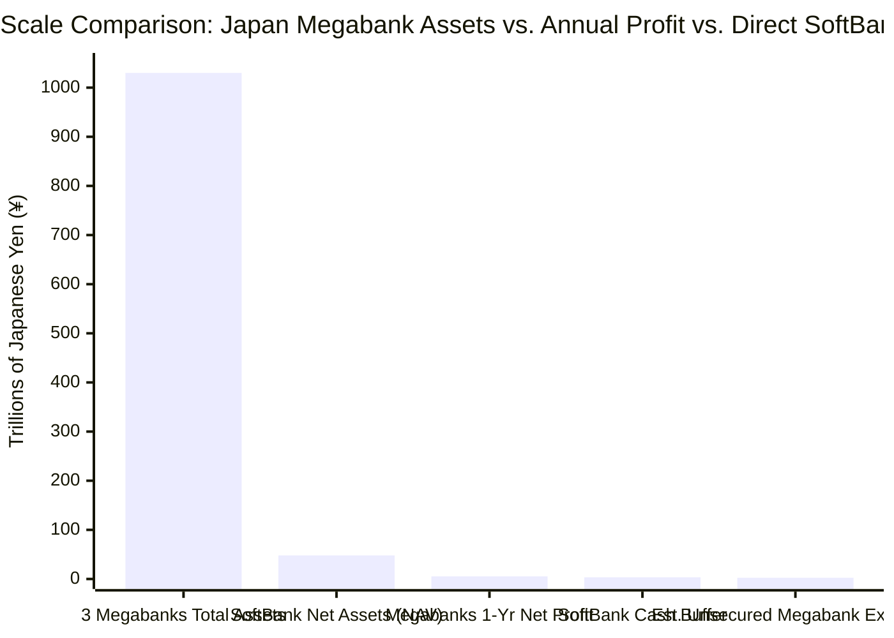
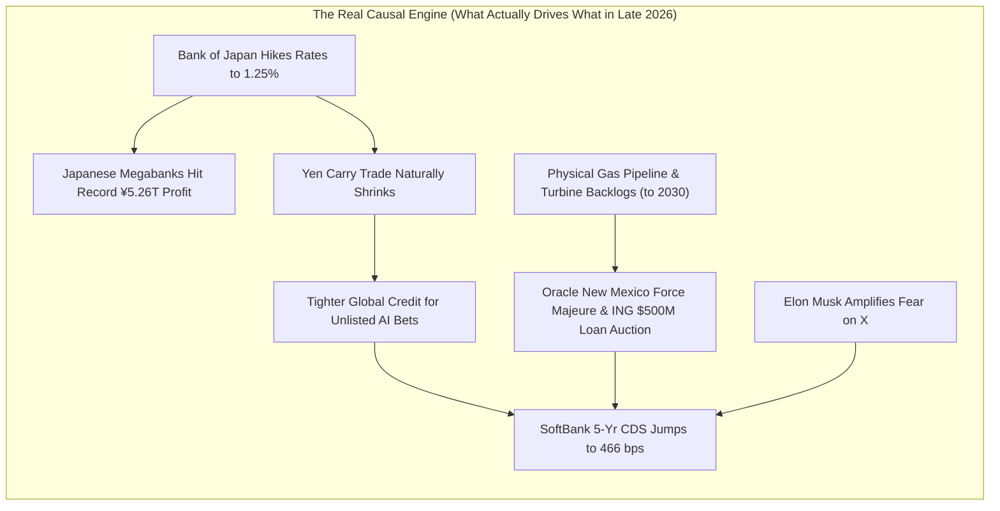

## 1. The Hook: Wait—Can a Six-Word Tweet Really Knock Over the Entire AI World?

Imagine you are on the school playground watching two rival teams build the biggest LEGO castles in history. Suddenly, the captain of Team Rocket (Elon Musk) points at the captain of Team Stargate (a giant Japanese company called SoftBank, teamed up with OpenAI and Oracle) and yells through a megaphone to the whole school:

> *"SoftBank is defaulting on their turbine orders"*
> — **Elon Musk (`@elonmusk`)**, November 6, 2026

Within an hour, financial commentators on X (formerly Twitter) jumped in and stacked two giant panic predictions on top of Elon's six words:

> *"The crash of SoftBank is going to be the most spectacular fireworks show in financial markets since 2008"*
> — **JustDario (`@DarioCpx`)**, November 6, 2026

> *"Elon is speeding up the destruction of financial backing of his competitors, but the SoftBank meltdown (& we will see this spread thru entire Japanese financial sector) will cause some level of Yen Carry Trade unwinding... Keep in mind that a dramatic fall in SB & Japanese bank is a deathblow to OpenAI, which then is a deathblow to all the neoclouds. Which will be deadly to the memory chip makers & Nvidia. SpaceX won't be spared by this, but Elon may feel he has good enough finances to get to the other side of an AI bubble bursting."*
> — **tphuang (`@tphuang`)**, November 6, 2026

Wait a second! Look at that chain of falling dominoes:
1. SoftBank fails to pay for power turbines.
2. SoftBank crashes harder than the 2008 global financial crisis.
3. SoftBank's crash infects all of Japan's giant banks and forces a global money panic called the "Yen Carry Trade unwinding."
4. That kills OpenAI, which kills smaller AI cloud companies ("neoclouds"), which destroys memory chip makers (like SK Hynix) and Nvidia—while Elon Musk's SpaceX survives on the other side.

**Is this viral post true or false?**

Here is our short detective answer before we open the vault of receipts: **The post is a classic "Half-Truth Sandwich"—about 25% real strategic insight wrapped around 75% financial fairy tale and backwards math.** Elon Musk really *is* trying to scare the banks that lend money to his AI rivals, and AI data centers really *are* hitting painful power and loan bumps right now. **But SoftBank has NOT defaulted on its turbines, Japan's giant banks are sitting on record-breaking profits that SoftBank cannot sink, the post has the "Yen Carry Trade" completely backwards, and Nvidia's biggest customers are trillion-dollar American tech giants—not SoftBank.**

To see why—and to understand how Japan's banks, the yen, and the global AI money machine actually work—let's start from Step Zero.

---

## 2. Starting from Zero: How the Giant AI Power-and-Money Machine Actually Works

Before we check a single number, let's picture what these companies are actually building and why a bank in Tokyo cares about a power machine in a New Mexico desert.

### Why Do AI Brains Need Jet Engines?
When you ask an AI like ChatGPT (made by **OpenAI**) or Grok (made by Elon Musk's **xAI**) a question, your message travels to a warehouse stuffed with tens of thousands of special calculator chips made by **Nvidia**, paired with super-fast memory stacks made by companies like **SK Hynix**.

Those calculator chips get hotter than a toaster oven and gulp down an unbelievable amount of electricity. A single giant AI warehouse campus—like the ones OpenAI, Oracle, and SoftBank are building under a `$500 billion` project named **Stargate**—needs `1 gigawatt` to `5 gigawatts` of nonstop electricity.
- **Physical Scale Anchor:** `1 gigawatt` (`1,000 megawatts`) is enough electricity to power **750,000 to 1,000,000 normal family homes at the exact same time**.

Local electric power lines cannot hand out a million homes' worth of extra electricity overnight; waiting in line to plug into the public power grid can take **5 to 7 years**. So how do AI companies cheat the clock? They buy giant spinning metal engines that burn natural gas to make their own electricity right next to the warehouse. Inside, these engines work almost exactly like a jet airplane engine bolted to the floor. Grown-up engineers call them **Natural Gas Turbines**.

### How Does the Money Flow from Tokyo to Texas and New Mexico?
Nobody keeps `$500 billion` of loose dollar bills under a mattress. To build these giant AI warehouses, four groups of players pass money and machines down a chain:

1. **The Piggy-Bank Boss (SoftBank Group):** SoftBank is a huge Japanese investment company run by a billionaire named Masayoshi Son. SoftBank owns roughly `90%` of **Arm Holdings** (the company that designs the brain blueprints inside almost every smartphone on Earth) and has promised over `$30 billion` to **OpenAI** and the **Stargate** data center project.
2. **The Japanese Megabanks (MUFG, SMBC, and Mizuho):** These are Japan's three colossal everyday banks where Japanese citizens and companies keep trillions of yen in savings. They lend money to SoftBank and help organize huge group loans for AI warehouses.
3. **The Middleman Builders & "Neoclouds":** Companies like **Oracle**, **Blue Owl Capital**, and smaller GPU-rental startups (like CoreWeave, Nebius, and Crusoe) borrow money from banks to build the warehouses, buy the gas turbines, and rent the Nvidia chips out to OpenAI. Wall Street calls those smaller GPU-rental companies **Neoclouds**.
4. **The Chip & Memory Makers (Nvidia and SK Hynix):** At the end of the pipe, the borrowed money pays **Nvidia** for the main calculator chips and **SK Hynix** (plus Micron and Samsung) for the ultra-fast memory towers bolted right next to them.

Here is the whole playground in one picture—and the exact chain of dominoes that the viral X post claims is about to fall over:

```mermaid
flowchart TD
    subgraph SG1["What the Viral X Post Claims Will Happen (The Panic Dominoes)"]
        P1["Domino 1: SoftBank 'defaults' on gas turbine orders"] --> P2["Domino 2: SoftBank crashes like the 2008 financial crisis"]
        P2 --> P3["Domino 3: Japanese banks melt down & unwind the Yen Carry Trade"]
        P3 --> P4["Domino 4: OpenAI & Neoclouds lose funding and collapse"]
        P4 --> P5["Domino 5: Nvidia & memory chip makers lose their buyers"]
    end

    subgraph SG2["How the Real-World Financial Plumbings Actually Work"]
        R1["New Mexico regulators delay a gas pipeline -> Oracle sends a legal pause note ('Force Majeure')"]
        R2["SoftBank holds ¥2.3T-¥3.4T cash & 13%-18% LTV -> Walled-off project boxes protect parent vault"]
        R3["Japan's 3 Megabanks earn a record ¥5.26T ($33.1B) because BOJ raised rates to 1.25%"]
        R4["US Big Four Tech Giants spend $720B-$760B/yr -> SK Hynix memory sold out through 2029"]
        R1 --> R2 --> R3 --> R4
    end
```

---

## 3. The Secret Decoder Ring: Grown-Up Financial Words Translated

Before we grade each claim with our detective magnifying glass, let's translate the eight intimidating grown-up words in this story into plain 5th-grade English:

| The Grown-Up Word / Acronym | What It Actually Means in Plain English | Everyday 5th-Grade Analogy |
| :--- | :--- | :--- |
| **Default** | Officially breaking a legal contract by failing to pay a bill or loan payment when the deadline arrives. | Borrowing `$10` from your friend for pizza, promising to pay them back Friday at lunch, and showing up Friday with empty pockets. |
| **Force Majeure** | A French legal phrase meaning *"superior force."* It is a safety clause in a contract that pauses your rent or penalties if an outside surprise (like a hurricane or a government permit denial) blocks construction. | Having a doctor's note when the city closes the road to school—you aren't "skipping school" (defaulting), you are legally excused until the road opens. |
| **Loan-to-Value (`LTV`)** | How much money you owe on loans divided by how much your stuff is worth right now. | If you own `$100` worth of rare Pokémon cards and you borrowed `$15` from your brother, your `LTV` is `15%`. Very safe! |
| **Credit Default Swap (`CDS`)** | An insurance policy that nervous bond traders buy that pays them if a company goes broke. Measured in **basis points (`bps`)**, where `100 bps` equals `1%` per year. | Paying your big sister `$4.66` every year (`466 bps`) so that if your friend never pays back a `$100` loan, your sister covers your `$100` loss. |
| **Special Purpose Vehicle (`SPV`)** | A separate, walled-off mini-company created to hold the debt for just *one* building project so a failure there cannot infect the parent company's main bank account. | Putting your leaky watercolor paints inside a sealed Ziploc bag inside your backpack. Even if the paint spills, your homework stays dry. |
| **Yen Carry Trade** | When global traders borrow money in Japan (where interest rates used to be near `0%`), swap those yen into US dollars, and buy American stocks or bonds paying `4%` to `5%`. | Borrowing toy marbles from a teacher who charges `1` marble a year in fee, and renting them to kids on another playground who pay you `5` marbles a year. |
| **Neoclouds** | Newer, specialized companies (like CoreWeave or Nebius) that borrow billions of dollars to buy Nvidia AI chips and rent them out by the hour. | A kid who takes out a big loan to buy 50 PlayStation 5 consoles and rents them to neighborhood kids by the hour to pay off the loan. |
| **High-Bandwidth Memory (`HBM`)** | Skyscraper stacks of ultra-fast memory chips glued right next to an Nvidia calculator chip so the AI brain never waits for data. | Stacking 12 textbooks open on your desk right next to your notebook instead of running down the hall to the school locker for every single sentence. |

---

## 4. The Big Claim vs. The Detective Check: Fact-Checking Every Domino

Now let's take our magnifying glass and check the primary-source receipts for every single claim in the screenshot.

### Claim-by-Claim Forensic Scorecard

| Who Said It | The Viral Claim | Detective Verdict | The Real-World Primary-Source Receipt |
| :--- | :--- | :--- | :--- |
| **Elon Musk (`@elonmusk`)** | *"SoftBank is defaulting on their turbine orders"* | **Unverified / Misleading Mix-Up** | Zero turbine makers (GE Vernova, Siemens, Mitsubishi) or filings report a SoftBank turbine default ([OfficeChai](https://officechai.com/ai/softbank-is-defaulting-on-its-turbine-orders-claims-elon-musk/)). What actually happened: **Oracle** sent a *force majeure* notice on the New Mexico Stargate site after state regulators rejected a natural gas pipeline ([SiliconANGLE](https://siliconangle.com/2026/09/24/oracle-issues-force-majeure-notice-to-developer-of-new-mexico-data-center-over-energy-delays/)), and Dutch bank **ING** put `$500M` of data center loans (including a `$25M` New Mexico slice) up for auction. |
| **JustDario (`@DarioCpx`)** | *"The crash of SoftBank is going to be the most spectacular fireworks show... since 2008"* | **False / Bad Math** | In 2008, Lehman Brothers had `~97%` debt-to-assets (`30-to-1` leverage). SoftBank's official Loan-to-Value (`LTV`) is **`13%` to `18%`** (or `20%–30%` by S&P's strict private-asset math), backed by **`¥2.3T` to `¥3.4T` (`$15B–$22B`)** in cash and a **`¥48T–¥72.3T`** Net Asset Value ([SoftBank IR](https://group.softbank/en/ir/financials/financial_reports)). |
| **tphuang (`@tphuang`) — Part 1** | *"Elon is speeding up the destruction of financial backing of his competitors"* | **True (Strategic Bullseye)** | AI warehouse loans depend on lender confidence. SoftBank's 5-year CDS insurance cost just spiked to a 4-year high of **`466 bps`** ([Business Recorder](https://www.brecorder.com/news/40447724/softbank-credit-risk-jumps-to-4-year-high-as-ai-fears-roil-market)). By shouting *"Default!"* on X, Elon raises borrowing nervousness for his #1 rival, OpenAI. |
| **tphuang (`@tphuang`) — Part 2** | *"SoftBank meltdown (& we will see this spread thru entire Japanese financial sector) will cause... Yen Carry Trade unwinding"* | **False (Backwards Cause & Effect)** | Japan's 3 megabanks ([MUFG](https://www.mufg.jp/english/ir/index.html), [SMFG](https://www.smfg.co.jp/english/investor/), [Mizuho](https://www.mizuhogroup.com/investors)) hold over **`¥1,000 trillion` (`$6.5T`)** in assets and just earned an all-time record **`¥5.26 trillion` (`$33.1B`)** net profit ([BigGo / FY2026 Filings](https://finance.biggo.com/news/xLQSK54BtCxy99G5uYDd)). Furthermore, the **Bank of Japan hiking interest rates to `1.25%`** ([BOJ](https://www.boj.or.jp/en/mopo/mpmdeci/index.htm)) is what unwinds the Yen Carry Trade—not SoftBank! |
| **tphuang (`@tphuang`) — Part 3** | *"A deathblow to OpenAI, which then is a deathblow to all the neoclouds. Which will be deadly to the memory chip makers & Nvidia."* | **False on Chips / Partly True on Neoclouds** | Smaller debt-heavy **neoclouds** really do get squeezed when loan rates jump. But **Nvidia** ([Nvidia Newsroom](https://nvidianews.nvidia.com/)) and **SK Hynix** ([SK Hynix Newsroom](https://news.skhynix.com/)) are funded primarily by the **`$720B–$760B`** annual spending of cash-rich US giants (Amazon, Microsoft, Google, Meta), and SK Hynix's HBM memory lines are legally **sold out through 2029**. |
| **tphuang (`@tphuang`) — Part 4** | *"SpaceX won't be spared... but Elon may feel he has good enough finances to get to the other side"* | **Partly True (With a `$35B` Catch)** | SpaceX bought xAI (`$250B` stock deal, Feb 2026), went public in June 2026 (`~$1.8T–$2.0T` market cap), and earns **`$2.37B` quarterly profit** from Starlink (`13.6M` subscribers). Plus, Elon bought mobile turbine company **APR Energy (`~$1B`)**. *Catch:* SpaceX spent **`$48.1B` on capex** vs. **`$13.1B` operating cash flow** in 9M 2026—a **`$35B` cash gap**! |

Let's unpack the four biggest surprises hidden inside those receipts.

---

### Surprise #1: What Actually Happened in New Mexico? (A Missing Gas Pipe, Not a Turbine Default)

Why did Elon Musk tweet about "turbine orders" on November 6, 2026? Because two real pieces of news hit the wires around the **Stargate Project**—and online rumors scrambled them like a game of telephone:

1. **The New Mexico Gas Pipeline Block:** In Doña Ana County, New Mexico, developers **Blue Owl Capital** and **STACK Infrastructure** are building a giant multi-gigawatt Stargate campus called *Project Jupiter*, where **Oracle** is the main renter. To power the site's microgrid turbines, the campus needed an extension of a natural gas pipeline. When New Mexico state regulators rejected and delayed that gas pipeline permit, **Oracle sent a formal *Force Majeure* legal notice** to the developer ([DataCenter Digest](https://www.datacenterdigest.net/oracle-sends-force-majeure-notice-to-blue-owl-over-new-mexico-pipeline-rejection/), [SiliconANGLE](https://siliconangle.com/2026/09/24/oracle-issues-force-majeure-notice-to-developer-of-new-mexico-data-center-over-energy-delays/)).
   - **Remember our Decoder Ring:** Sending a *force majeure* note because the state hasn't approved the gas pipe is like handing in a doctor's note when the school bus breaks down. It is a legal move by Oracle to protect itself from paying rent late if the building isn't ready by 2028. It is **not** SoftBank running out of money to pay for turbines.
2. **The `$500 Million` Bank Loan Sale:** At the same time, the Dutch bank **ING** put a roughly `$500 million` bundle of about a dozen data center loans up for auction (called a "bids-wanted-in-competition" or BWIC sale, with a November 19 deadline), which included a **`$25 million` slice** tied to that exact New Mexico Stargate campus.
   - **Physical Scale Anchor:** Compare a **`$25 million`** loan slice being traded between banks to a **`$500 billion`** Stargate blueprint. If `$500 billion` were a **100-foot-tall Redwood tree**, `$25 million` is a single pine needle **less than one-sixteenth of an inch (`0.06 inches`) long**!

Meanwhile, why was Elon Musk thinking about turbines in the first place? Because gas turbines have a **4-to-5-year global waiting list** stretching to 2030! To skip that line for his own Memphis AI supercomputer (*Colossus*), Elon quietly spent roughly **`$1 billion` buying a company called APR Energy** (which owns trailer-mounted mobile gas turbines) and even started manufacturing turbine blades inside SpaceX's rocket factories. So when Stargate hit a gas-pipe delay and a loan auction, Elon took a public swing at SoftBank's weak spot.

---

### Surprise #2: Is SoftBank Going Broke Like 2008? Let's Count the Piggy Bank!

Wait—didn't SoftBank's stock price drop to around `¥4,269–¥4,410` in early November 2026, and didn't its Credit Default Swap (`CDS`) insurance price jump to `466 basis points` (`4.66%` per year)?

Yes! Those two things are 100% real ([Business Recorder](https://www.brecorder.com/news/40447724/softbank-credit-risk-jumps-to-4-year-high-as-ai-fears-roil-market)).
- *(Quick Detective Note on the Stock Price:* On January 1, 2026, SoftBank did a **4-for-1 stock split** ([SoftBank IR](https://group.softbank/en/news/press/20251111))—cutting every 1 big slice of pizza into 4 smaller slices so everyday Japanese families could afford a share. Even after accounting for that split, SoftBank's stock has dropped roughly `30%` to `50%` from its 2026 peak because investors are worried Masayoshi Son is spending too much on OpenAI.)*

Why did SoftBank's `CDS` insurance cost jump to `466 bps` (the highest since October 2022)? Because SoftBank promised an extra **`$30 billion` (`~¥4.5 trillion`)** to **OpenAI**, making OpenAI roughly `30%` of SoftBank's entire investment basket, while OpenAI pushed its expected stock-market debut (IPO) back to 2027. Bond traders hate it when half of a company's treasure chest is locked up in private startups that cannot be sold at the push of a button. That is why credit agency S&P Global Ratings rates SoftBank at **`BB+`** (one step below top-tier "investment grade").

**But does that mean SoftBank is about to crash like Lehman Brothers in 2008?** Let's check the **100-Dollar Backpack Test**:

- **Lehman Brothers in 2008 (`~97%` Debt-to-Assets):** Imagine a kid carrying `$100` of snacks in his backpack, but he borrowed **`$97`** of that money using 24-hour IOU notes that had to be renewed every single morning. The moment snacks dropped in price by just **`$4`** (to `$96`), he owed `$97` with only `$96` of stuff—instant bankruptcy!
- **SoftBank Group in Late 2026 (`13%` to `18%` Official LTV; `20%–30%` S&P Adjusted LTV):** According to SoftBank's audited FY2025 and Q1 FY2026 financial reports ([SoftBank IR](https://group.softbank/en/ir/financials/financial_reports)), SoftBank holds a Net Asset Value (`NAV`) between **`¥25.7 trillion` and `¥72.3 trillion`** (depending on daily swings in its huge stake in chip designer **Arm Holdings**, which is worth over `$200 billion`). Against every `$100` of assets in its vault, SoftBank owes only **`$13` to `$18`** in net holding-company debt (or **`$20` to `$30`** using S&P's strict math).
- Even better, SoftBank keeps **`¥2.3 trillion` to `¥3.4 trillion` (`$15 billion` to `$22 billion`) in pure cash and liquid bonds** sitting in its parent safe—enough cash to pay off every single bond coming due for the next **two full years** without selling a single share of Arm or OpenAI!
- And remember our **Ziploc Bag (`SPV`) rule**: When SoftBank, Oracle, and Blue Owl borrow money to build a specific Stargate warehouse in New Mexico or Texas, that loan lives inside a separate project box (`SPV`). If one warehouse gets delayed, the bank cannot march into Tokyo and empty SoftBank's main corporate safe.

---

### Surprise #3: Can SoftBank Sink Japan's Banks and Unwind the Yen Carry Trade?

Now let's test the biggest macro claim from `@tphuang`:
> *"the SoftBank meltdown (& we will see this spread thru entire Japanese financial sector) will cause some level of Yen Carry Trade unwinding."*

This sounds super smart and scary at a dinner party—until you look up the actual balance sheets of **Japan's banking system** and the **Bank of Japan (BOJ)** in November 2026.

#### First: How Big Are Japan's Three Megabanks Compared to SoftBank?
Japan has three giant banking groups—**Mitsubishi UFJ (`MUFG`)**, **Sumitomo Mitsui (`SMFG` / `SMBC`)**, and **Mizuho Financial Group** ([MUFG IR](https://www.mufg.jp/english/ir/index.html), [Mizuho IR](https://www.mizuhogroup.com/investors), [SMFG IR](https://www.smfg.co.jp/english/investor/)).
- Together, these three banks hold over **`¥1,000 trillion` (`~$6.5 trillion`)** in total assets (`MUFG` alone holds over `¥431 trillion`, and `Mizuho` holds over `¥304 trillion`).
- Are they struggling in 2026? **No—they just had the single most profitable year in Japanese banking history!** For the fiscal year ended March 31, 2026, the three megabanks reported a combined net profit of **`¥5.26 trillion` (`$33.1 billion`)**, up `34%` in a single year ([BigGo / FY2026 Earnings](https://finance.biggo.com/news/xLQSK54BtCxy99G5uYDd)):
  - **MUFG:** `¥2.43 trillion` net profit (up `30.3%`, passing `¥2 trillion` for the first time ever).
  - **SMFG:** `¥1.58 trillion` net profit (up `34.4%`).
  - **Mizuho:** `¥1.25 trillion` net profit (up `41.0%`, passing `¥1 trillion` for the first time ever).
- **Physical Scale Anchor (The 100-Brick Fortress):** Imagine Japan's three megabanks are a giant stone castle built out of **1,000 solid granite blocks** (`¥1,000+ trillion` in assets), and the castle makes **5 brand-new granite blocks of pure profit every single year** (`¥5.26 trillion`). Even though Mizuho, MUFG, and SMBC lend several trillion yen to SoftBank, almost all of those big AI and Arm loans are **split up among dozens of global banks** (like JPMorgan and Goldman Sachs) and **backed by collateral** (shares of Arm Holdings and Japan's domestic phone company, SoftBank Corp.). The portion of SoftBank debt held directly by Japanese megabanks that could actually go bad is **less than 3 granite blocks out of 1,000 (`<0.3%` of total assets)**—less than a single year's profit!

#### Second: The Post Has the "Yen Carry Trade" Completely Backwards!
Why did Japan's banks just make a record `¥5.26 trillion` in profit? Because after decades of keeping Japanese interest rates near `0%` (or even minus!), the **Bank of Japan (`BOJ`)** raised its key interest rate to a **31-year high of `1.25%`** in September 2026 and held it at **`1.25%`** in October 2026 ([Bank of Japan Monetary Policy Decisions](https://www.boj.or.jp/en/mopo/mpmdeci/index.htm)), with economists expecting another step toward `1.50%` in December.

When Japan's central bank raises interest rates from `0%` to `1.25%`:
1. **Japanese banks win:** They finally earn normal interest on their massive pile of domestic yen loans, boosting their profits by `34%`!
2. **The Yen Carry Trade unwinds on its own:** Remember our marble analogy? Global hedge funds used to borrow yen at `0%` to buy US tech stocks. Now that borrowing yen costs `1.25%` (heading toward `1.50%`) and the gap with US interest rates is shrinking, traders are paying back their yen loans.
3. **High-debt tech companies feel the squeeze:** Because cheap yen money is drying up globally, risky borrowers like SoftBank see their borrowing costs (`CDS`) rise.

In other words, `@tphuang` looked at the fire truck at the scene of a fire and blamed the fire truck for starting the fire! **SoftBank isn't causing Japanese banks to fail and unwinding the Yen Carry Trade; instead, the Bank of Japan raising interest rates to `1.25%` is making Japanese banks richer while unwinding the Yen Carry Trade and making debt more expensive for SoftBank!**

---

### Surprise #4: Would a SoftBank Freeze Kill Nvidia and Memory Chip Makers?

What about the last domino in the viral post?
> *"Keep in mind that a dramatic fall in SB & Japanese bank is a deathblow to OpenAI, which then is a deathblow to all the neoclouds. Which will be deadly to the memory chip makers & Nvidia."*

Let's split this into the **part that is true** and the **part that fails the math test**:

- **Where `@tphuang` is right (The Neocloud Squeeze):** Smaller GPU-rental startups (**Neoclouds** like CoreWeave, Nebius, and Lambda) do not have a `$100 billion` search-engine or shopping website printing free cash every month. They borrow money at high interest rates using their GPU chips as collateral, and a huge chunk of their rent checks comes from **OpenAI** and **Microsoft**. If OpenAI or SoftBank slows down Stargate leases, or if banks like ING sell off data center loans, those smaller neoclouds get squeezed hard by tighter loan rules.
- **Where `@tphuang` is wrong (Nvidia and SK Hynix Are Not Kept Alive by SoftBank):** Who actually buys the vast majority of Nvidia's AI chips and SK Hynix's High-Bandwidth Memory (`HBM3E` and `HBM4`)? Not SoftBank!
  - In calendar year 2026 alone, the **Big Four American Hyperscalers** are spending between **`$720 billion` and `$760+ billion` in a single year** on data centers and AI chips:
    - **Amazon (`AWS`):** `~$200 billion` to `$220 billion`
    - **Alphabet (`Google`):** `~$175 billion` to `$205 billion`
    - **Microsoft (`Azure`):** `~$170 billion` to `$190 billion`
    - **Meta (`Facebook/Instagram`):** `~$125 billion` to `$145 billion`
  - **Physical Scale Anchor (100 Kids at the Book Fair):** Imagine **100 kids** lined up with cash in their hands to buy every single copy of the hottest comic book (`Nvidia GPUs` + `SK Hynix HBM4 memory`). **85 of those kids** are giant cash-generating titans (Amazon, Google, Microsoft, Meta, plus sovereign countries), and **15 kids** are funded by SoftBank and debt-heavy neoclouds. Meanwhile, the comic book printer (**SK Hynix**) only has enough paper and machines to print **70 comic books**, and it has already signed legally binding contracts selling out every single HBM memory line **all the way through 2029** ([SK Hynix Newsroom](https://news.skhynix.com/)). Even if 10 of the SoftBank/neocloud kids stepped out of line tomorrow, the other 85 kids in line would immediately buy their comic books!

---

## 5. The Four Suspects: What Is Really Causing This Market Drama?

In our detective kit (based on Browne & Keeley's *Panning for Gold* critical-thinking rules), we never accept a single story of cause and effect without testing **all four possible suspects**. Let's line them up in a table:

| The Suspect (Causal Hypothesis) | How the Story Goes | Does the Evidence Match? | Detective Grade |
| :--- | :--- | :--- | :--- |
| **Suspect 1: Direct Cause** (*"SoftBank's turbine default will crash Japan's banks and unwind the Yen Carry Trade"*) | SoftBank runs out of cash for turbines, defaults on bank loans, bankrupts Mizuho/MUFG, and triggers a global yen panic. | **No.** SoftBank hasn't defaulted on turbines, holds `¥2.3T–¥3.4T` in cash, and its unsecured bank debt is tiny compared to the megabanks' `¥1,000+ trillion` balance sheet. | **Eliminated (False)** |
| **Suspect 2: Reverse Cause** (*"Bank of Japan rate hikes and tight global credit are squeezing SoftBank"*) | The Bank of Japan raised interest rates to `1.25%` (helping Japanese banks hit record `¥5.26T` profits), which narrows the Yen Carry Trade and makes global investors nervous about high-debt AI borrowers like SoftBank. | **Yes!** Rising rates and tighter credit caused SoftBank's CDS to hit `466 bps` and ING to auction `$500M` in data center loans—not the other way around. | **Confirmed Primary Driver** |
| **Suspect 3: Hidden Third Factor (Confounder Z)** (*"Physical Power Grid & Gas Bottlenecks"*) | Neither SoftBank nor Elon Musk can print electricity out of thin air. Multi-year wait times for gas pipelines (New Mexico) and gas turbines (4–5 year backlogs to 2030) are slowing down AI campuses across the whole industry. | **Yes!** Oracle's New Mexico *force majeure* was triggered by a state gas pipeline rejection, not a bank bankruptcy. | **Confirmed Co-Driver** |
| **Suspect 4: Mutual Feedback Loop** (*"Rival Trash-Talk + Nervous Bond Traders"*) | When AI build costs surge and loans get auctioned, bond traders get jumpy (`CDS` rises). Elon Musk amplifies that fear on X (`"defaulting on turbine orders"`), which makes lenders demand even higher interest from OpenAI/SoftBank. | **Yes!** Public psychological warfare between Elon (`xAI`/`SpaceX`) and Sam Altman/Masayoshi Son (`OpenAI`/`SoftBank`) actively feeds bond-market jitters. | **Confirmed Accelerator** |

---

## 6. The Catch: Why Isn't Everything Fine? (Where the Real Danger Hides)

Wait—if the viral post's domino story is mostly exaggerated, does that mean SoftBank, SpaceX, and the AI boom have zero problems?

**Not at all!** A good detective always asks: *What is the real catch? Who actually loses money if things go wrong?* Here are the three real risks that grown-up investors are right to worry about:

1. **SoftBank's "Unlisted Startup" Concentration (`>50%` of Portfolio):** Even though SoftBank isn't going bankrupt tomorrow, Masayoshi Son has bet roughly **`$30 billion`** on OpenAI at sky-high valuations while OpenAI loses billions of dollars a year training new models and delayed its IPO to 2027. If AI software revenues don't grow fast enough to justify a `$300B–$500B+` valuation for OpenAI, SoftBank shareholders will suffer painful write-downs—just like they did when WeWork crashed in 2019.
2. **Elon Musk's Glass House (`$35 Billion` 9-Month CapEx Gap at SpaceX):** `@tphuang` says Elon *"may feel he has good enough finances to get to the other side of an AI bubble bursting."* It is true that after **SpaceX acquired xAI in February 2026** (`$250B` all-stock deal) and completed its blockbuster **June 2026 IPO** (`~$1.8T–$2.0T` valuation), SpaceX has a superpower that OpenAI lacks: **Starlink**, which brought in **`$5.25 billion` in Q3 2026 revenue** and **`$2.37 billion` in operating profit** from `13.6 million` subscribers. **However**, in the first 9 months of 2026, SpaceX spent a jaw-dropping **`$48.1 billion` on capital expenditures** (mostly GPUs and data centers for xAI) while bringing in **`$13.1 billion` in operating cash flow**—leaving a **`$35 billion` cash gap** plugged by IPO cash and GPU debt! If an AI bubble bursts, SpaceX's stock price would take a massive hit right alongside SoftBank's.
3. **Everyday Electricity Bills & Community Pushback:** Why did New Mexico block the natural gas pipeline for Stargate's *Project Jupiter*, and why did environmental groups sue Elon Musk's xAI over mobile gas turbines in Memphis? Because local communities are tired of giant AI warehouses gulping down local water and natural gas while driving up utility costs for regular families. **Physical power permits—not Japanese bank vaults—are the true #1 bottleneck of the 2026 AI race.**

---

## 7. The Final Report Card: What We Actually Think

Let's wrap up our investigation with clear **"If ... Then ..."** rules and our official **Forensic Probability Report Card**.

### Three "If ... Then ..." Rules to Remember
- **If** you hear someone claim that SoftBank is defaulting on power turbines and about to cause a 2008-style Japanese banking collapse, **then** you can smile and point to the receipts: Oracle sent a *force majeure* note over a New Mexico gas pipeline permit, SoftBank holds `¥2.3T–¥3.4T` in cash (`13%–18%` LTV), and Japan's three megabanks just posted a record `¥5.26 trillion` (`$33.1 billion`) profit.
- **If** the Bank of Japan raises interest rates again (from `1.25%` toward `1.50%` in December 2026), **then** the Yen Carry Trade will unwind further—which *helps* Japanese banks earn more interest on yen loans, while making life more expensive for leveraged global tech investors.
- **If** project-finance banks keep tightening loan rules on AI warehouses (like ING auctioning its `$500M` data center loan portfolio), **then** smaller debt-funded **neoclouds** and delayed Stargate sites will be forced to shrink or merge, while cash-rich giants (**Microsoft, Amazon, Google, Meta**, and **Starlink-backed SpaceX**) grab their power permits and chip allocations.

### The Forensic Probability Report Card (Next 12–18 Months)

| Scenario | Probability | What Happens in Plain English | Who Wins & Who Loses |
| :--- | :--- | :--- | :--- |
| **1. Base Case: Power Bottlenecks & Selective Credit Squeeze (No Systemic Crash)** | **~65%** | Several Stargate and neocloud data center sites face 6–18 month delays due to gas pipeline permits, turbine backlogs, and higher loan rates (`CDS` stays elevated at `350–500 bps`). SoftBank sells small slices of T-Mobile or Arm stock if needed to keep its `LTV` under `25%`. Japanese megabanks remain highly profitable (`>¥5T/yr`). | **Winners:** Japanese megabanks (MUFG, SMBC, Mizuho), Big 4 US Hyperscalers, SK Hynix, turbine makers. **Losers:** Over-leveraged neoclouds, impatient SoftBank shareholders. |
| **2. Bear Case: AI Valuation Air-Pocket & Neocloud Shakeout** | **~25%** | Corporate AI software revenue grows slower than the `$720B+` hardware bill. OpenAI's 2027 IPO valuation gets cut by `30%–40%`, forcing SoftBank to take a heavy write-down and pushing its LTV toward `30%+`. Two or three smaller neoclouds default on GPU loans, causing a `20%–30%` stock pullback in Nvidia and SpaceX. Still **zero** Japanese banking crisis. | **Winners:** Cash-rich buyers scooping up cheap GPU clusters, BOJ inflation fighters. **Losers:** SoftBank equity/bonds, neocloud lenders, high-multiple AI stocks (including SpaceX/xAI). |
| **3. Tail-Risk Case: True Stargate Financing Freeze** | **~10%** | Regulatory blocks on off-grid gas turbines combine with a sharp US recession. Stargate scales back by `>50%`, and hyperscalers trim 2027–2028 capex growth by `25%`. SoftBank is forced to sell a major block of Arm shares to protect its credit rating. | **Winners:** Short-sellers, conservative value stocks. **Losers:** SoftBank, OpenAI, Oracle, Nvidia growth multiples. |

### Bottom-Line Verdict for a 5th Grader
Is the viral X post true or false? **Mostly False.** Elon Musk threw a clever stink bomb into his rivals' camp by turning a New Mexico gas-pipeline delay and a `$25 million` loan auction into a rumor that *"SoftBank is defaulting on their turbine orders."* And while `@tphuang` correctly spotted that AI warehouses depend on fragile borrowed money, the idea that SoftBank is about to blow up Japan's record-profit banks, trigger a Yen Carry Trade crash, and destroy Nvidia is **backwards economics**. Keep your eyes on the gas pipes and the Bank of Japan's `1.25%` interest rate—not Twitter fireworks!

---

## Primary Sources & Verified Receipts
1. **SoftBank Group Corp. — Financial Reports & Investor Presentations (FY2025 & Q1 FY2026 NAV, LTV, and Cash Position):** [https://group.softbank/en/ir/financials/financial_reports](https://group.softbank/en/ir/financials/financial_reports)
2. **SoftBank Group Corp. — Notice of 4-for-1 Stock Split (Effective January 1, 2026):** [https://group.softbank/en/news/press/20251111](https://group.softbank/en/news/press/20251111)
3. **SoftBank Group Corp., OpenAI, and Oracle — Stargate Five New AI Data Center Sites Announcement (including Doña Ana County, New Mexico):** [https://group.softbank/en/news/press/20250924](https://group.softbank/en/news/press/20250924)
4. **Bank of Japan (BOJ) — Monetary Policy Meeting Decisions (Policy Rate at `1.25%` in September/October 2026):** [https://www.boj.or.jp/en/mopo/mpmdeci/index.htm](https://www.boj.or.jp/en/mopo/mpmdeci/index.htm)
5. **Mitsubishi UFJ Financial Group (MUFG) — Investor Relations & Financial Disclosures:** [https://www.mufg.jp/english/ir/index.html](https://www.mufg.jp/english/ir/index.html)
6. **Mizuho Financial Group — Investor Relations & Balance Sheet Disclosures:** [https://www.mizuhogroup.com/investors](https://www.mizuhogroup.com/investors)
7. **Sumitomo Mitsui Financial Group (SMFG) — Investor Relations:** [https://www.smfg.co.jp/english/investor/](https://www.smfg.co.jp/english/investor/)
8. **Japan's Three Megabanks Combined Net Profit Tops Record `¥5.26 Trillion` (`$33.1B`) in FY2026:** [https://finance.biggo.com/news/xLQSK54BtCxy99G5uYDd](https://finance.biggo.com/news/xLQSK54BtCxy99G5uYDd)
9. **Business Recorder — SoftBank Credit Risk (5-Year CDS) Jumps to 4-Year High of `466 bps` as AI Fears Roil Market (November 2026):** [https://www.brecorder.com/news/40447724/softbank-credit-risk-jumps-to-4-year-high-as-ai-fears-roil-market](https://www.brecorder.com/news/40447724/softbank-credit-risk-jumps-to-4-year-high-as-ai-fears-roil-market)
10. **SiliconANGLE — Oracle Issues Force Majeure Notice to Developer of New Mexico Stargate Data Center Over Energy Delays:** [https://siliconangle.com/2026/09/24/oracle-issues-force-majeure-notice-to-developer-of-new-mexico-data-center-over-energy-delays/](https://siliconangle.com/2026/09/24/oracle-issues-force-majeure-notice-to-developer-of-new-mexico-data-center-over-energy-delays/)
11. **DataCenter Digest — Oracle Sends Force Majeure Notice to Blue Owl Over New Mexico Pipeline Rejection:** [https://www.datacenterdigest.net/oracle-sends-force-majeure-notice-to-blue-owl-over-new-mexico-pipeline-rejection/](https://www.datacenterdigest.net/oracle-sends-force-majeure-notice-to-blue-owl-over-new-mexico-pipeline-rejection/)
12. **OfficeChai — Elon Musk's "SoftBank Is Defaulting on Their Turbine Orders" Claim & Stargate Loan Auction Context:** [https://officechai.com/ai/softbank-is-defaulting-on-its-turbine-orders-claims-elon-musk/](https://officechai.com/ai/softbank-is-defaulting-on-its-turbine-orders-claims-elon-musk/)
13. **Nvidia Newsroom & Financial Press Releases:** [https://nvidianews.nvidia.com/](https://nvidianews.nvidia.com/)
14. **SK Hynix Official Newsroom (HBM3E & HBM4 Production Commitments):** [https://news.skhynix.com/](https://news.skhynix.com/)
