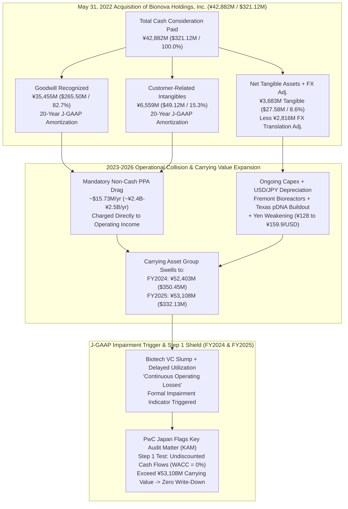
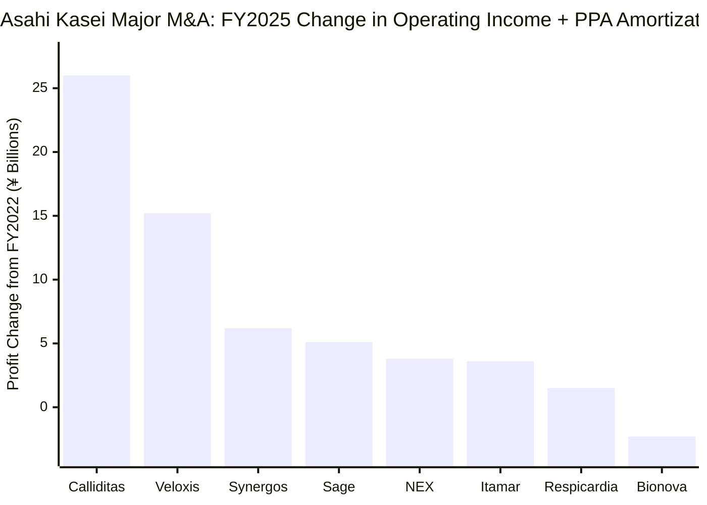
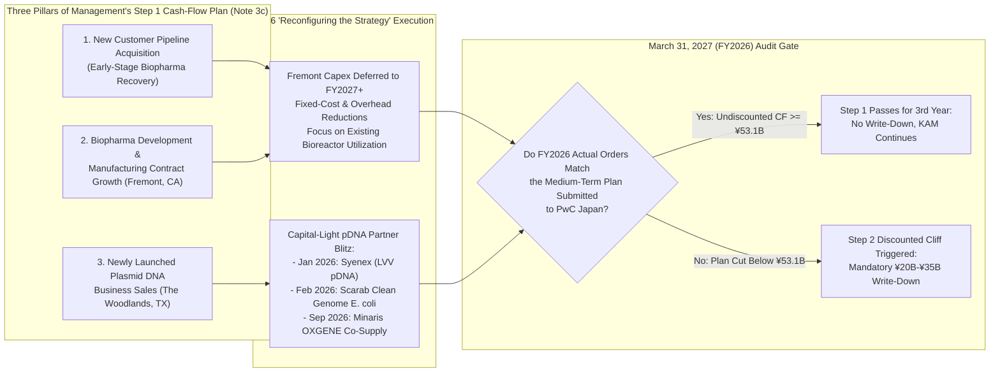

When a wholly owned private subsidiary operates behind the consolidated financial wall of a multinational conglomerate, rumors of distress typically circulate long before anyone outside the parent company's boardroom sees a standalone income statement. For **Bionova Scientific, LLC**—the Fremont, California–based biologics contract development and manufacturing organization (CDMO) acquired by Tokyo-headquartered **Asahi Kasei Corporation** (`TSE: 3407`) at the peak of the post-pandemic bioprocessing boom in May 2022—whispers of underutilized bioreactors, sluggish biotech venture orders, and tightening parent-company oversight have intensified across the biomanufacturing corridor from the San Francisco Bay Area to The Woodlands, Texas.

Because Bionova is privately held inside Asahi Kasei's Healthcare division, it publishes no standalone profit-and-loss statement with the U.S. Securities and Exchange Commission. Yet an exhaustive forensic excavation of Asahi Kasei's audited Japanese GAAP (`J-GAAP`) consolidated financial statements (`FY2022` through `FY2025`, ended March 31, 2026), quarterly earnings supplements (`Q1 FY2025` through `H1 FY2026`, ended September 30, 2026), management briefing decks, and institutional investor Q&A transcripts proves that the core rumors are not merely accurate—they are formally documented in the footnotes and flagged by Asahi Kasei's independent auditor, **PricewaterhouseCoopers Japan LLC** (`PwC Japan`), as a consolidated **Key Audit Matter (`KAM`)** for two consecutive fiscal years.

At the same time, primary-source triangulation exposes crucial structural nuances that secondary rumors and third-party commercial databases miss:

1. **The Hidden Purchase Price Allocation (`PPA`):** While trade press reported the May 2022 acquisition terms as "undisclosed" and unverified commentary speculated on figures up to $473 million, **Note 16(a) of Asahi Kasei's audited FY2022 Consolidated Financial Statements** ([2303statements.pdf](https://www.asahi-kasei.com/content/dam/asahi-kasei/us/en/ir/library/financial-briefing/pdf/2303statements.pdf), pages 44–45) reveals that Asahi Kasei paid exactly **¥42,882 million ($321.12 million)** in cash for 100% of Bionova Holdings, Inc. Of that purchase price, **¥35,455 million ($265.50 million, or 82.7%) was booked as Goodwill** and **¥6,559 million ($49.12 million, or 15.3%) was booked as intangible Customer Relationships**—meaning **98.0% of the entire acquisition price (`¥42,014 million`) consisted of amortizable intangible paper**, resting atop just **¥3,683 million (~$27.58 million) of net tangible assets**.
2. **Two Consecutive Years of Audited Impairment Indicators (`FY2024` and `FY2025`):** In both **Note 3(c) of the FY2024 Audited Statements** ([2503statements.pdf](https://www.asahi-kasei.com/content/dam/asahi-kasei/us/en/ir/library/financial-briefing/pdf/2503statements.pdf), page 15) and **Note 3(c) of the FY2025 Audited Statements** ([2603statements.pdf](https://www.asahi-kasei.com/content/dam/asahi-kasei/us/en/ir/library/financial-briefing/pdf/2603statements.pdf), page 14, signed June 24, 2026), Asahi Kasei disclosed that Bionova's asset group—now swollen by foreign-exchange translation and capital additions to **¥53,108 million ($332.13 million)**—formally triggered impairment indicators due to ***"continuous operating losses, mainly due to sluggish demand resulting from decreased funding inflows to biotech ventures."***
3. **The J-GAAP Undiscounted Cash-Flow Shield:** Had Asahi Kasei reported under IFRS (`IAS 36`) or US GAAP (`ASC 350`), comparing ¥53.1 billion of carrying value against *discounted* present-value cash flows at an `8%–10%` weighted average cost of capital (`WACC`) would almost certainly have forced an immediate write-down. Under J-GAAP (`ASBJ Guidance No. 6`), however, an entity avoids recognizing an impairment loss in Step 1 if **undiscounted** future cash flows (`WACC = 0%`) over the remaining asset/goodwill recovery horizon exceed carrying book value. Management cleared that bar solely by submitting an internal medium-term business plan assuming an aggressive ramp in monoclonal antibody (`mAb`) orders and commercial lift-off at Bionova's new plasmid DNA (`pDNA`) facility in Texas.
4. **The April–November 2026 Pivot from "Expansion" to "Deferrals, Cost Cuts, and Strategy Reconfiguration":** On **Slide 16 of Asahi Kasei's April 15, 2026 Management Briefing** ([e260415en.pdf](https://www.asahi-kasei.com/content/dam/asahi-kasei/us/en/ir/library/initiative/pdf/e260415en.pdf)), management published a chart tracking operating income plus PPA amortization across eight major M&A deals since FY2022. **Bionova was the sole acquisition among all eight whose profit change remained negative across FY2023, FY2024, and FY2025.** Simultaneously, management deleted its Autumn 2025 integrated report language claiming Bionova was *"expanding capacity to meet increased future demand"* and replaced it with explicit disclosures of ***"investment deferrals and fixed-cost reductions"*** ([e260415en.pdf](https://www.asahi-kasei.com/content/dam/asahi-kasei/us/en/ir/library/initiative/pdf/e260415en.pdf), Slides 16 and 44) and ***"Strengthening the fundamentals and reconfiguring the strategy of Bionova (CDMO)"*** ([2603supplement.pdf](https://www.asahi-kasei.com/content/dam/asahi-kasei/us/en/ir/library/financial-briefing/pdf/2603supplement.pdf), page 27; [2606supplement.pdf](https://www.asahi-kasei.com/content/dam/asahi-kasei/us/en/ir/library/financial-briefing/pdf/2606supplement.pdf), page 25; [2609supplement.pdf](https://www.asahi-kasei.com/content/dam/asahi-kasei/us/en/ir/library/financial-briefing/pdf/2609supplement.pdf), page 30).

---

## 1. Executive Framing, Issue Classification & Falsifiability

To separate verifiable accounting mechanics from market speculation, we decompose this investigation into two distinct analytical dimensions:

* **Descriptive Audit (Empirical Fact):** What did Asahi Kasei actually pay for Bionova Scientific in May 2022, how is Bionova's balance sheet structured under Japanese GAAP, what exact operational and accounting triggers caused PwC Japan to flag Bionova's **¥52.4 billion (`FY2024`)** and **¥53.1 billion (`FY2025`)** asset group as a Key Audit Matter, and what concrete corporate restructuring and capital-expenditure delays have already been executed between April 2025 and November 2026?
* **Prescriptive Audit (Forward Risk & Valuation Decision):** Will Bionova's newly reconfigured strategy—anchoring on fixed-cost reductions, delayed Fremont commercial bioreactor expansion, and three 2026 plasmid DNA commercial alliances (`Syenex`, `Scarab Genomics`, `Minaris`)—generate enough verifiable backlog to pass PwC Japan's **March 31, 2027 (`FY2026`)** audit comparison of *historical plan vs. actual performance*, or is Asahi Kasei heading toward a mandatory goodwill and fixed-asset write-down akin to its **¥186.4 billion (`~$1.4 billion`) Polypore battery-separator impairment** in FY2022?

### Epistemic Falsifiability Criteria

Our forensic assessment that Bionova faces high structural impairment risk at the March 31, 2027 (`FY2026`) or March 31, 2028 (`FY2027`) fiscal close would be **falsified** if primary disclosures demonstrate any of the following:
1. Bionova achieves positive standalone operating income *after* J-GAAP goodwill and customer-relationship amortization (`~¥2.4 billion–¥2.6 billion / ~$16 million per year`), removing the "continuous operating losses" impairment trigger in Note 3(c) of the FY2026 consolidated financial statements (to be published in June 2027).
2. `Asahi Kasei Life Science Corp.` reports sustained double-digit revenue growth specifically attributed to **CDMO capacity utilization in Fremont and Texas** rather than viral-filtration (`Planova`) demand or biosafety testing (`ViruSure` / `Bionique`).
3. PwC Japan removes the valuation of Bionova Scientific, LLC's fixed assets and goodwill from the Key Audit Matters (`KAM`) section of its independent auditor's report.

---

## 2. The Primary-Source Schism: Public Expansion Narrative vs. Audited Footnote Reality

A side-by-side comparison of public press releases, commercial database estimates, and early integrated report narratives against Asahi Kasei's audited financial footnotes and April–November 2026 investor supplements reveals a stark epistemic divide.

| Analytical Dimension | Public M&A Narrative & Secondary Estimates (2022–Autumn 2025) | Audited Footnote, PwC KAM & Investor Briefing Reality (June 2025–November 2026) | Primary Source Verification |
| :--- | :--- | :--- | :--- |
| **May 2022 Acquisition Price & Asset Mix** | Acquisition price reported as "undisclosed" in press releases; third-party blogs speculated "$473M" while assuming heavy tangible bioreactor infrastructure. | Exact cash price was **¥42,882M ($321.12M)**. **98.0% (`¥42,014M`)** was allocated to **Goodwill (`¥35,455M`)** and **Customer Relationships (`¥6,559M`)**; net tangible assets were only **¥3,683M (~$27.58M)**. | [FY2022 Audited Statements (`2303statements.pdf`, Note 16(a), pp. 44–45)](https://www.asahi-kasei.com/content/dam/asahi-kasei/us/en/ir/library/financial-briefing/pdf/2303statements.pdf) |
| **Standalone Revenue vs. Segment Consolidation** | Commercial scrapers (`PitchBook`, `LeadIQ`, `ZoomInfo`) estimate standalone revenue at **$50M–$100M** (~140–220 staff); observers conflate Life Science segment totals with Bionova. | Folded inside `Asahi Kasei Life Science Corp.` (`¥55.4B / ~$367M` in FY2025 actual; `¥67.0B / ~$432M` FY2026 forecast after carving out Blood Purification & Diagnostics), where high-margin **Planova** filters mask Bionova's operating deficits. | [FY2025 Supplement (`2603supplement.pdf`, p. 41)](https://www.asahi-kasei.com/content/dam/asahi-kasei/us/en/ir/library/financial-briefing/pdf/2603supplement.pdf) & [H1 FY2026 Supplement (`2609supplement.pdf`, p. 42)](https://www.asahi-kasei.com/content/dam/asahi-kasei/us/en/ir/library/financial-briefing/pdf/2609supplement.pdf) |
| **Post-Acquisition Profit Trajectory (FY2022–FY2025)** | Framed in Autumn 2025 *Asahi Kasei Report* as *"business environment currently on path of recovery, and expanding capacity to meet increased future demand."* | In April 2026, management revealed Bionova's operating income + PPA amortization change since FY2022 has been **negative for 3 straight years (`≈ -¥2.0B to -¥2.5B`)**—the **only** deal among 8 recent M&A transactions in negative territory. | [April 15, 2026 Briefing (`e260415en.pdf`, Slide 16)](https://www.asahi-kasei.com/content/dam/asahi-kasei/us/en/ir/library/initiative/pdf/e260415en.pdf) vs. [Report 2025 (`25en.pdf`, p. 39)](https://www.asahi-kasei.com/content/dam/asahi-kasei/us/en/ir/library/asahikasei-report/pdf/25en.pdf) |
| **Impairment Status & Auditor Scrutiny** | Zero mention of impairment indicators or auditor warnings in Bionova press releases or trade coverage of Texas pDNA facility ribbon-cuttings. | Formal impairment indicators triggered in **both FY2024 (`¥52,403M` carrying value) and FY2025 (`¥53,108M` / `$332.13M`)** due to *"continuous operating losses"*; flagged by **PwC Japan as a Key Audit Matter (`KAM`)** two years running. | [FY2024 Statements (`2503statements.pdf`, pp. 4–6, 15)](https://www.asahi-kasei.com/content/dam/asahi-kasei/us/en/ir/library/financial-briefing/pdf/2503statements.pdf) & [FY2025 Statements (`2603statements.pdf`, pp. 4–5, 14)](https://www.asahi-kasei.com/content/dam/asahi-kasei/us/en/ir/library/financial-briefing/pdf/2603statements.pdf) |
| **Capex Execution & Strategic Posture** | Publicly marketed as rapid multi-site expansion across Fremont, CA (biologics) and The Woodlands, TX (plasmid DNA). | Official strategy bullet changed in May–Nov 2026 to ***"Strengthening the fundamentals and reconfiguring the strategy of Bionova (CDMO)"***; Fremont expansion delayed from `FY2025` to `FY2027 or later`; Texas GMP pDNA pushed from `FY2025` to `FY2026 or later` alongside ***"investment deferrals and fixed-cost reductions."*** | [April 15, 2026 Briefing (`e260415en.pdf`, Slide 44)](https://www.asahi-kasei.com/content/dam/asahi-kasei/us/en/ir/library/initiative/pdf/e260415en.pdf) & [H1 FY2026 Supplement (`2609supplement.pdf`, pp. 30, 49)](https://www.asahi-kasei.com/content/dam/asahi-kasei/us/en/ir/library/financial-briefing/pdf/2609supplement.pdf) |

---

## 3. Forensic Excavation of the May 2022 Purchase Price Allocation: How a $27.6M Tangible Shop Became a ¥53.1 Billion Balance-Sheet Weight

To understand why Bionova Scientific has recorded continuous operating losses and triggered formal J-GAAP impairment indicators two years in a row, an analyst must start not in 2026, but on **May 31, 2022**—the day Asahi Kasei Medical Co., Ltd. closed the acquisition of 100% of voting rights in **Bionova Holdings, Inc.** (Delaware, led by CEO Darren Head), the sole parent of Bionova Scientific, LLC ([Asahi Kasei press release `e220601`](https://www.asahi-kasei.com/news/2022/e220601)).

In April and May 2022, trailing twelve-month venture capital inflows into early-stage biotechnology and cell/gene therapy startups were still coasting on the fumes of the 2020–2021 zero-interest-rate bubble. Biologics CDMOs commanded scarcity multiples because preclinical and Phase I/II emerging biopharma companies were desperate to lock in mammalian cell-culture (`CHO`) bioreactor slots.

When Asahi Kasei published its **FY2022 Detailed Consolidated Financial Statements** (for the fiscal year ended March 31, 2023; [2303statements.pdf](https://www.asahi-kasei.com/content/dam/asahi-kasei/us/en/ir/library/financial-briefing/pdf/2303statements.pdf)), **Note 16(a) (*Business Combinations — Acquisition of Bionova Holdings, Inc.*, pages 44–45)** and the **Consolidated Cash Flow Statement footnote (page 22)** laid bare the exact anatomy of the transaction:

| Purchase Price Allocation (`PPA`) Component (as of May 31, 2022) | Audited JPY Amount (`¥ Millions`) | Audited USD Equivalent (`$ Thousands`) | Share of Total Purchase Price (`%`) | Accounting Treatment & Amortization Horizon (`J-GAAP`) |
| :--- | :--- | :--- | :--- | :--- |
| **Total Cash Acquisition Consideration** | **¥42,882M** | **$321,117K ($321.12M)** | **100.0%** | Cash consideration paid (plus ¥534M / $4.00M in advisory fees expensed in SG&A) |
| Less: Cash & Deposits Held by Bionova at Close | (¥341M) | ($2,555K) | (0.8%) | Net cash outflow for acquisition = **¥42,541M ($318.56M)** |
| **Current Assets Acquired** | ¥1,543M | $11,555K | 3.6% | Working capital (cash, receivables, inventory) |
| **Noncurrent Assets Acquired (Total)** | ¥13,246M | $99,191K | 30.9% | Includes tangible PP&E plus identifiable intangible assets |
| — *Of which: Identifiable Customer-Related Intangible Assets* | **¥6,559M** | **$49,116K ($49.12M)** | **15.3%** | Straight-line amortization over **20 years** (~¥328M/yr at acquisition FX) |
| — *Of which: Tangible PP&E & Other Noncurrent Assets* | ¥6,687M | $50,075K ($50.08M) | 15.6% | Bioreactors, lab equipment, and right-of-use lease assets in Fremont, CA |
| **Total Identifiable Assets Acquired** | **¥14,789M** | **$110,746K ($110.75M)** | **34.5%** | Gross identifiable assets before liabilities |
| **Current Liabilities Assumed** | (¥1,491M) | ($11,165K) | (3.5%) | Trade payables, accrued expenses, unearned revenue |
| **Noncurrent Liabilities Assumed** | (¥3,056M) | ($22,885K) | (7.1%) | Long-term lease obligations and deferred tax liabilities |
| **Total Liabilities Assumed** | **(¥4,547M)** | **($34,050K / -$34.05M)** | **(10.6%)** | Total liabilities assumed at close |
| **Net Identifiable Assets (Book Equity Before Goodwill)** | **¥10,242M** | **$76,696K ($76.70M)** | **23.9%** | Includes ¥6,559M ($49.12M) of intangible Customer Relationships |
| **Net Tangible Assets Acquired (Excl. Customer Intangibles)** | **¥3,683M** | **$27,580K ($27.58M)** | **8.6%** | **Actual physical net asset base acquired (`¥10,242M - ¥6,559M`)** |
| Foreign Currency Translation Adjustment at Allocation | (¥2,816M) | ($21,084K) | (6.6%) | FX reconciliation between closing date and PPA finalization |
| **Goodwill Recognized on Acquisition** | **¥35,455M** | **$265,501K ($265.50M)** | **82.7%** | Straight-line amortization over **20 years** (~¥1,773M/yr at acquisition FX) |
| **Combined Goodwill + Customer Intangible Burden** | **¥42,014M** | **$314,617K ($314.62M)** | **98.0%** | **98.0% of purchase price locked in 20-year amortizable intangibles** |

Pause and examine the bottom two rows of that table. Out of the **¥42,882 million ($321.12 million)** that Asahi Kasei wired to acquire Bionova Holdings, Inc., **only ¥3,683 million ($27.58 million)—or 8.6% of the purchase price—represented net tangible physical assets** (net of liabilities and intangible customer lists). The remaining **¥42,014 million ($314.62 million)—or 98.0% of the total purchase price—was allocated to Goodwill (`¥35,455 million`) and Customer Relationships (`¥6,559 million`)**.

Even during the initial nine-month stub period from July 1, 2022 to March 31, 2023 (`FY2022`), Note 16(a) (page 45) recorded that Bionova contributed just **¥5,400 million ($40.44 million)** in net sales while posting an **operating loss of ¥658 million (-$4.93 million)**—an "immaterial" initial deficit that management assumed would quickly flip positive once commercial-scale bioreactor suites and plasmid DNA lines came online.

### Why J-GAAP Turns Overpriced M&A Into an Immediate Operating-Income Trap

Under US GAAP (`ASC 350`) and IFRS (`IAS 36`), goodwill is not amortized; a company only amortizes finite-lived customer intangibles and tests goodwill annually for impairment. Under **Japanese GAAP (`ASBJ Statement No. 21`)**, however, goodwill must be amortized on a straight-line basis over a period not exceeding **20 years**, and that amortization is charged directly against **Operating Income (`営業利益`)**.

Furthermore, because Bionova is a U.S. dollar–denominated subsidiary, its USD goodwill (`~$265.5 million` initial gross) and USD customer relationships (`~$49.1 million` initial gross) are translated into Japanese yen at each period's exchange rate. As the yen weakened from roughly `¥128/USD` in May 2022 to `¥150–¥160/USD` across FY2024–FY2025, both the yen carrying value of Bionova's asset group and its annual yen amortization burden expanded:

$$\text{Annual J-GAAP PPA Amortization (JPY)} = \left(\frac{\text{USD } 265.50\text{M Goodwill}}{20\text{ yrs}} + \frac{\text{USD } 49.12\text{M Customer Intangibles}}{20\text{ yrs}}\right) \times \text{FX}_{\text{JPY/USD}} = \text{USD } 15.73\text{M/yr} \times \text{FX}_{\text{JPY/USD}}$$

At `¥150–¥160/USD`, Bionova is saddled with **¥2.36 billion to ¥2.52 billion (~$15.73 million) per year in non-cash PPA amortization alone**, plus ongoing depreciation on its Fremont bioreactors and The Woodlands plasmid facility. Before Bionova pays a single bioprocess engineer or buys a liter of cell-culture media, it must generate nearly **$16 million in positive EBITDA** merely to break even at the J-GAAP operating income line!

---

## 4. Semantic Precision & Substitution Test: Decoding Tokyo's Accounting Vocabulary

In Japanese corporate disclosures, management and external auditors use highly standardized legal and accounting phrases that sound benign to casual readers but carry strict statutory meanings under Japan's Financial Instruments and Exchange Act (`FIEA`) and Accounting Standards Board of Japan (`ASBJ`) rules. Applying Browne & Keeley's **Ambiguity & Substitution Test**, we replace three euphemistic phrases from Asahi Kasei's FY2024–FY2026 filings with their exact forensic meanings:

1. ***"Impairment indicators were identified within Bionova Scientific, LLC's asset group"*** ([2503statements.pdf](https://www.asahi-kasei.com/content/dam/asahi-kasei/us/en/ir/library/financial-briefing/pdf/2503statements.pdf), p. 15; [2603statements.pdf](https://www.asahi-kasei.com/content/dam/asahi-kasei/us/en/ir/library/financial-briefing/pdf/2603statements.pdf), p. 14):
   * **Statutory Meaning (`ASBJ Guidance No. 6, Paragraph 12`):** Under Japanese GAAP, an impairment indicator (`減損の兆候`) is not a subjective opinion. It is mandatorily triggered when an asset group records **two consecutive years of operating losses** (or a negative operating cash flow coupled with a severe downward divergence from the acquisition business plan). Because Bionova recorded an operating loss in `FY2022` (`-¥658M`), `FY2023`, `FY2024`, and `FY2025`, it has now posted **four consecutive fiscal years of operating losses** since consolidation, forcing mandatory Step 1 impairment testing in both FY2024 and FY2025.
2. ***"No impairment loss was recognized since the total amount of undiscounted future cash flows exceeded the carrying amount of the assets"*** ([2603statements.pdf](https://www.asahi-kasei.com/content/dam/asahi-kasei/us/en/ir/library/financial-briefing/pdf/2603statements.pdf), p. 14):
   * **Statutory Meaning (`ASBJ Standard for Impairment of Fixed Assets, Section Two, 2(1)`):** Unlike IFRS (`IAS 36`), where an impairment loss is recognized immediately whenever the *discounted present value* (recoverable amount) falls below carrying value, Japanese GAAP uses a two-step gatekeeper. In **Step 1 (Recognition Test)**, the company sums nominal future cash flows over the asset group's remaining recovery period (up to **20 years** when goodwill is included) **with zero discounting (`WACC = 0%`)**. Only if that undiscounted sum falls below `¥53,108 million` does the company drop into **Step 2 (Measurement Test)**, where cash flows are immediately discounted at `WACC` (`~8%–10%`), triggering a massive cliff write-down.
3. ***"Strengthening the fundamentals and reconfiguring the strategy of Bionova (CDMO)"*** ([2603supplement.pdf](https://www.asahi-kasei.com/content/dam/asahi-kasei/us/en/ir/library/financial-briefing/pdf/2603supplement.pdf), p. 27; [2606supplement.pdf](https://www.asahi-kasei.com/content/dam/asahi-kasei/us/en/ir/library/financial-briefing/pdf/2606supplement.pdf), p. 25; [2609supplement.pdf](https://www.asahi-kasei.com/content/dam/asahi-kasei/us/en/ir/library/financial-briefing/pdf/2609supplement.pdf), p. 30):
   * **Forensic Substitution (`e260415en.pdf`, Slides 16 & 44):** We do not have to guess what "strengthening the fundamentals and reconfiguring the strategy" means in operational terms, because Asahi Kasei defined it explicitly on Slide 44 of its April 15, 2026 Management Briefing: ***"Revenue weakness continues due to the prolonged biotech downturn; while focusing on expanding plasmid sales, investment deferrals and fixed-cost reductions are being implemented."*** In plain English: pausing capital expansion in Fremont, cutting overhead, and scrambling to sign plasmid DNA co-marketing partnerships to fill idle Texas cleanrooms.

---

## 5. Two Years Under the Auditor's Microscope: Inside Note 3(c), PwC Japan's KAM, and the Step 1 Cliff

Let us inspect the exact verbatim disclosures inside Asahi Kasei's **FY2024** (`ended March 31, 2025`) and **FY2025** (`ended March 31, 2026`) Detailed Consolidated Financial Statements, alongside PwC Japan's Independent Auditor's Reports.

### The Footnote Evolution (`Note 3(c): Significant Accounting Estimates — Valuation of Fixed Assets of Bionova Scientific, LLC`)

In both **FY2024 ([2503statements.pdf](https://www.asahi-kasei.com/content/dam/asahi-kasei/us/en/ir/library/financial-briefing/pdf/2503statements.pdf), page 15)** and **FY2025 ([2603statements.pdf](https://www.asahi-kasei.com/content/dam/asahi-kasei/us/en/ir/library/financial-briefing/pdf/2603statements.pdf), page 14)**, Asahi Kasei singled out Bionova Scientific as one of only three consolidated entities across the entire ¥4.1 trillion conglomerate requiring a dedicated **Significant Accounting Estimate** warning on fixed-asset and goodwill valuation (alongside U.S. battery-separator subsidiary **Polypore International, LLC** in Note 3(b) and European pharmaceutical acquisition **Calliditas Therapeutics AB** in Note 3(a)):

| Audited Disclosure Metric | FY2024 Consolidated Statements (Ended March 31, 2025) | FY2025 Consolidated Statements (Ended March 31, 2026) | YoY Change & Forensic Significance |
| :--- | :--- | :--- | :--- |
| **Carrying Value of Bionova Asset Group (JPY)** | **¥52,403 million** | **¥53,108 million** | **+¥705 million (+1.3%)** despite 12 months of depreciation & PPA amortization, driven by Texas/CA capex and USD/JPY translation |
| **Carrying Value in Convenience USD** | **$350,451 thousand ($350.45M)** (at ~¥149.53/USD) | **$332,133 thousand ($332.13M)** (at ~¥159.90/USD) | **-$18.32 million (-5.2%)** net USD reduction from amortization partially offset by capex |
| **Share of Asahi Kasei Total Consolidated Assets** | **~1.0%** of total consolidated assets | **1.3%** of total consolidated assets | Concentration risk rose by 30 bps relative to total assets |
| **Stated Trigger for Impairment Indicator** | *"Due to factors such as sluggish demand primarily resulting from decreased funding inflows into Biotech Ventures, continuous operating losses have been recorded, indicating potential impairment indicators"* | *"Bionova identified an indicator of impairment as it recorded continuous operating losses, mainly due to sluggish demand resulting from decreased funding inflows to biotech ventures."* | Second consecutive year of audited "continuous operating losses" |
| **Three Key Assumptions in Management's Business Plan** | 1. Future acquisition of new customer pipelines; 2. Growth in biopharmaceutical development & manufacturing contracts; 3. Sales of the newly launched plasmid DNA business | 1. Future acquisition of new customer pipelines; 2. Growth in biopharmaceutical development & manufacturing contracts; 3. Sales of the newly launched plasmid DNA business | Identical three-pillar turnaround promise submitted to PwC Japan for two straight years |
| **Audited Step 1 Outcome** | *"No impairment loss has been recognized because the total undiscounted future cash flows exceed the carrying amount."* | *"Bionova did not recognize any impairment losses at the end of the current consolidated fiscal year since the total amount of undiscounted future cash flows exceeded the carrying amount of the assets."* | Write-down avoided strictly via J-GAAP Step 1 undiscounted sum (`WACC = 0%`) |

### What PwC Japan Actually Wrote in the Key Audit Matter (`KAM`)

On ** June 24, 2026**, Engagement Partners **Kensuke Koda, Hideki Godai, and Masaki Nitta** of **PricewaterhouseCoopers Japan LLC** signed the Independent Auditor's Report on Asahi Kasei's FY2025 consolidated financial statements ([2603statements.pdf](https://www.asahi-kasei.com/content/dam/asahi-kasei/us/en/ir/library/financial-briefing/pdf/2603statements.pdf), pages 4–5). Explaining why Bionova's ¥53,108 million asset group was elevated to a Key Audit Matter, PwC Japan stated:

> *"We determined that the assessment of whether an impairment loss should be recognized on the fixed assets of Bionova was a key audit matter because of the following factors: Future cash flows were estimated based on the business plan generated by management, and its key assumptions—such as the future acquisition of new customer pipelines, the growth in the number of biopharmaceutical development and manufacturing contracts, and the sales of the newly launched plasmid DNA business—involved **high estimation uncertainty** as they might be affected by future market trends, and required **significant management judgment**."*

Crucially, look at **Audit Procedure (2)** executed by PwC Japan ([2603statements.pdf](https://www.asahi-kasei.com/content/dam/asahi-kasei/us/en/ir/library/financial-briefing/pdf/2603statements.pdf), page 4):

> ***"Furthermore, we compared the historical business plans to actual results, and where actual results fell short of the business plans, evaluated the reasons for such shortfalls and assessed whether they had been appropriately reflected in the formulation of the business plan for the following and subsequent consolidated fiscal years."***

That single sentence is the smoking gun of the audit report. PwC Japan explicitly confirmed that **"actual results fell short of the business plans"** in prior periods, and that the auditors forced management to justify why those historical misses would not invalidate the projections for FY2026 and beyond.

### Mathematical Proof of the J-GAAP "Step 1 Cliff" (`WACC = 0%` vs. `WACC = 9%`)

Why does J-GAAP's two-step impairment architecture create an "all-or-nothing cliff" for a capital-intensive CDMO carrying ¥53.1 billion (`$332.1 million`) in book value?

Let `C_book = ¥53.11 billion` denote the carrying value of Bionova's asset group (including goodwill) as of March 31, 2026, and let `CF_t` denote projected pre-interest operating cash flows in year `t` over a remaining recovery horizon of `T = 16 years` (the remaining 20-year goodwill life from May 2022).

Under **J-GAAP Step 1 (Recognition Test)**, no impairment loss is recognized if and only if:

$$\text{CF}_{\text{Step 1 (Undiscounted)}} = \sum_{t=1}^{16} \text{CF}_t \ge \text{¥53.11 billion}$$

Suppose management submits a Hockey-Stick Medium-Term Plan where Bionova burns or breaks even in Year 1 (`¥0.0B`), ramps gradually in Years 2–4 (`¥1.5B`, `¥2.5B`, `¥3.5B`), and projects steady-state free cash flow of `¥4.0B/year` (`~$25M–$26M/year`) across Years 5–16 (`12 years × ¥4.0B = ¥48.0B`).

* **Undiscounted Step 1 Sum (`WACC = 0%`):**

$$\sum_{t=1}^{16} \text{CF}_t = 0.0 + 1.5 + 2.5 + 3.5 + (12 \times 4.0) = \text{¥55.50 billion} > \text{¥53.11 billion}$$

Because `¥55.50B > ¥53.11B` by a razor-thin `4.5%` buffer (`¥2.39B`), **Step 1 passes and the recognized impairment loss is exactly ¥0.**

Now suppose in `FY2026` (`ended March 31, 2027`), actual orders fall short of the plan by just 10%, forcing PwC Japan to trim the projected steady-state cash flow by 10% (from `¥4.0B/yr` to `¥3.6B/yr`).

* **Revised Undiscounted Step 1 Sum (`WACC = 0%`):**

$$\sum_{t=1}^{16} \text{CF}_t^{\text{revised}} = 0.0 + 1.35 + 2.25 + 3.15 + (12 \times 3.60) = \text{¥49.95 billion} < \text{¥53.11 billion}$$

The moment the undiscounted sum drops even ¥1 below `¥53.11 billion`, **Step 1 fails**. Under J-GAAP (`ASBJ Standard for Impairment of Fixed Assets, Section Two, 2(2)`), the impairment loss is **not** `¥53.11B - ¥49.95B = ¥3.16B`. Instead, management is immediately forced into **Step 2 (Measurement Test)**, where the asset group is written down to its **discounted present value (`recoverable amount`)** at a biopharma CDMO discount rate of `r = 9.0%`:

$$\text{PV}_{\text{Step 2}} = \sum_{t=1}^{16} \frac{\text{CF}_t^{\text{revised}}}{(1 + 0.09)^t} \approx \text{¥23.40 billion}$$

$$\text{Mandatory J-GAAP Step 2 Impairment Loss} = C_{\text{book}} - \text{PV}_{\text{Step 2}} = \text{¥53.11B} - \text{¥23.40B} = \text{¥29.71 billion}\; (\approx \text{USD } 186\text{ million})$$

A mere **10% reduction in undiscounted cash-flow assumptions** triggers a **56% (`~¥29.7 billion`) instant balance-sheet write-down** because crossing the Step 1 threshold switches the discount rate from `0%` to `9%` overnight!

### The Polypore Precedent Sitting Two Paragraphs Above Bionova (`Note 3(b)`)

Critics who assume a Japanese conglomerate can postpone a Step 1 goodwill breach indefinitely need only read **Note 3(b) on the very same page (`page 14`) of Asahi Kasei's FY2024 and FY2025 Consolidated Financial Statements** ([2603statements.pdf](https://www.asahi-kasei.com/content/dam/asahi-kasei/us/en/ir/library/financial-briefing/pdf/2603statements.pdf)):

> *"Note 3(b) Valuation of fixed assets of Polypore International, LLC: ... In fiscal 2022, the business environment surrounding Polypore deteriorated against the backdrop of progressive inflation in the U.S., heightened geopolitical risks, and automotive production cuts... As a result, a review of the future business plan led to the recognition of an **impairment loss of ¥186,376 million** on goodwill, other intangible assets, and property, plant and equipment."*

When Polypore's U.S. medium-term projections failed PwC Japan's historical plan-versus-actual verification in FY2022, Asahi Kasei was forced to take a **¥186.38 billion (~$1.4 billion) one-time impairment charge**. Furthermore, even in FY2025, Asahi Kasei booked **¥20,972 million ($131.16 million) in consolidated impairment losses** across other chemical and healthcare assets ([2603statements.pdf](https://www.asahi-kasei.com/content/dam/asahi-kasei/us/en/ir/library/financial-briefing/pdf/2603statements.pdf), page 20). PwC Japan's track record on Asahi Kasei's U.S. acquisitions is uncompromising once the undiscounted cash-flow buffer evaporates.

---

## 6. Investor Pushback & The Smoking-Gun April 2026 M&A Scorecard

### Forensic Precision Check on the Earnings Call Q&A (`July 31, 2025`)

Institutional equity analysts in Tokyo noticed PwC Japan's KAM warning immediately after the June 2025 annual securities report (`Yukashoken Hokokusho`) was filed. During Asahi Kasei's **Q1 FY2025 Earnings Briefing Q&A on July 31, 2025** ([2506summary.pdf](https://www.asahi-kasei.com/content/dam/asahi-kasei/us/en/ir/library/financial-briefing/pdf/2506summary.pdf), page 2), an institutional analyst confronted management directly on Bionova's impairment risk.

*(Forensic attribution note: Secondary commentary occasionally conflates the name of Asahi Kasei's Chief Financial Officer, **Toshiyasu Horie**, with **Seiji Nakano**, Senior Managing Executive Officer responsible for the Healthcare sector. The official Q1 FY2025 transcript confirms that both Toshiyasu Horie and Seiji Nakano were on the call, and that **Seiji Nakano** fielded the Bionova impairment question under the `Healthcare: Pharmaceuticals & Life Science` section on page 2 of [2506summary.pdf](https://www.asahi-kasei.com/content/dam/asahi-kasei/us/en/ir/library/financial-briefing/pdf/2506summary.pdf).)*

Here is the verbatim exchange from the official investor transcript:

> **Analyst Question:** *"How do you see the risk of impairment related to Bionova Scientific, LLC?"*
>
> **Seiji Nakano (Senior Managing Executive Officer, Healthcare):** *"At this point, we do not anticipate any impairment. We will continue to review our medium-term plans and conduct appropriate verification with our accountants."*

Notice the carefully hedged phrasing: Nakano did **not** say Bionova had returned to profitability or that customer backlog had cleared the hurdle. He stated that management would *"continue to review our medium-term plans and conduct appropriate verification with our accountants"*—the exact Step 1 business-plan verification process that PwC Japan flagged again eleven months later on June 24, 2026.

### The Smoking Gun on Slide 16 of the April 15, 2026 Management Briefing

The most damning quantitative disclosure regarding Bionova's standalone performance appeared on **Slide 16 of Asahi Kasei's April 15, 2026 Management Briefing** (*Update on Medium-Term Management Plan 2025–2027 "Trailblaze Together"*, [e260415en.pdf](https://www.asahi-kasei.com/content/dam/asahi-kasei/us/en/ir/library/initiative/pdf/e260415en.pdf)).

In a bar chart titled **"Profit growth from major recent M&A (Changes in operating income plus PPA amortization from FY2022)"**, management plotted the cumulative profit progression (`FY2023 actual`, `FY2024 actual`, and `FY2025 forecast`) across eight major corporate acquisitions: **Calliditas** (Pharma), **Veloxis** (Pharma), **Synergos** (Homes), **Sage** (Material), **NEX** (Homes), **Itamar** (Critical Care), **Bionova** (Life Science), and **Respicardia** (Critical Care).

Because this metric measures **Operating Income *plus* PPA Amortization (`EBITDA-like operating profit before M&A goodwill/intangible amortization`)** relative to FY2022, it strips out the excuse of non-cash J-GAAP goodwill charges. Even on a pre-PPA basis, **Bionova was the ONLY acquisition among all eight to post negative profit growth in every single year (`FY2023`, `FY2024`, and `FY2025`)**:

Even more revealing is the textual redline between **Page 39 of *Asahi Kasei Report 2025*** (published Autumn 2025, [25en.pdf](https://www.asahi-kasei.com/content/dam/asahi-kasei/us/en/ir/library/asahikasei-report/pdf/25en.pdf)) and **Slides 16 and 44 of the April 15, 2026 Management Briefing** ([e260415en.pdf](https://www.asahi-kasei.com/content/dam/asahi-kasei/us/en/ir/library/initiative/pdf/e260415en.pdf)):

* **Autumn 2025 (*Asahi Kasei Report 2025*, page 39):**
  > *"Bionova Scientific, LLC has been significantly affected by changes in the business environment, with the environment currently on a path of recovery, and expanding capacity to meet increased future demand."*
* **April 15, 2026 (*Management Briefing*, Slide 16):**
  > *"Orders from biotech startups have been sluggish due to stagnant venture-capital financing; signs of recovery seen, **but measures such as investment deferrals and cost reductions are applied to improve performance.**"*
* **April 15, 2026 (*Management Briefing*, Slide 44 — `Measures to enhance CDMO business (Bionova)`):**
  > *"Revenue weakness continues due to the prolonged biotech downturn; while focusing on expanding plasmid sales, **investment deferrals and fixed-cost reductions are being implemented.**"*

---

## 7. Quantitative Segment Deconstruction & Capex Slippage Audit

Why do third-party commercial databases (`PitchBook`, `LeadIQ`, `ZoomInfo`) estimate Bionova's standalone revenue at **$50M–$100M** while observers struggle to reconcile that with Asahi Kasei's reported segment figures? Because Asahi Kasei restructured its Healthcare reporting hierarchy in **April–July 2025**, carving out the **Blood Purification** business (transferred in April 2025) and the **Diagnostics** business (transferred in July 2025), and placing the remaining Bioprocess (`Planova` virus removal filters, `BioOptimal` microfilters, large-scale chromatography hardware), Biosafety Testing CRO (`ViruSure`, `Bionique`), and Biologics CDMO (`Bionova Scientific`) operations inside a newly incorporated standalone legal entity: **Asahi Kasei Life Science Corp.** (established April 1, 2025; [press release `e250401`](https://www.asahi-kasei.com/news/2025/e250401)).

### Deconstructing the `Life Science` Subsegment (`FY2023` – `FY2026 Forecast`)

By cross-referencing the segment breakdown tables across [2503supplement.pdf](https://www.asahi-kasei.com/content/dam/asahi-kasei/us/en/ir/library/financial-briefing/pdf/2503supplement.pdf) (page 37), [2603supplement.pdf](https://www.asahi-kasei.com/content/dam/asahi-kasei/us/en/ir/library/financial-briefing/pdf/2603supplement.pdf) (page 41), and [2609supplement.pdf](https://www.asahi-kasei.com/content/dam/asahi-kasei/us/en/ir/library/financial-briefing/pdf/2609supplement.pdf) (page 42, released November 2026 for H1 FY2026), we can isolate the exact revenue and operating-income progression of the `Life Science` subsegment:

| Healthcare Subsegment Metric (`¥ Billions`) | FY2023 Actual (Pre-Carve-Out Scope) | FY2024 Actual (Pre-Carve-Out Scope) | FY2024 Actual (Post-Divestiture Continuing Scope) | FY2025 Actual (Ended Mar 31, 2026) | H1 FY2026 Actual (6M Ended Sep 30, 2026) | FY2026 Full-Year Revised Forecast (Nov 2026) |
| :--- | :--- | :--- | :--- | :--- | :--- | :--- |
| **Pharmaceuticals & Life Science Combined Net Sales** | ¥216.2B | ¥246.0B | ¥208.1B (Continuing) | **¥237.7B** | **¥128.8B** | **¥255.0B** |
| — *Pharmaceuticals Subsegment Net Sales* | ¥123.6B | ¥153.1B | ¥153.1B | **¥182.3B** | **¥92.9B** | **¥188.0B** |
| — ***Life Science Subsegment Net Sales*** | **¥92.6B** (incl. Blood Purif./Diag.) | **¥93.0B** (incl. Blood Purif./Diag.) | **¥55.0B** (Bioprocess + CRO + Bionova) | **¥55.4B (~$367M)** | **¥36.0B (~$232M)** (+28.4% YoY) | **¥67.0B (~$432M)** (+20.9% YoY) |
| **Pharmaceuticals & Life Science Combined Operating Income** | ¥7.0B | ¥26.5B | ¥26.5B | **¥40.4B** | **¥27.8B** | **¥40.0B** |
| **Estimated Bionova Standalone Revenue Contribution** | ~¥6.0B–¥7.5B (~$42M–$52M) | ~¥6.5B–¥8.0B (~$43M–$53M) | ~¥6.5B–¥8.0B (~$43M–$53M) | **~¥7.0B–¥8.5B (~$45M–$55M)** | ~¥3.8B–¥4.5B (~$25M–$29M) | **~¥8.0B–¥10.0B (~$52M–$65M)** |
| **Bionova Standalone Operating Income (J-GAAP, Post-PPA)** | **Negative (Loss)** | **Negative (Loss; KAM Triggered)** | **Negative (Loss; KAM Triggered)** | **Negative (Loss; KAM Triggered)** | **Negative / Near-Breakeven** | **Targeted Narrowing via Cost Cuts** |

Look closely at the divergence inside `Life Science`:
1. In **FY2025** (ended March 31, 2026), continuing `Life Science` net sales (`Planova` hollow-fiber virus filters, bioprocess equipment, `ViruSure`/`Bionique` biosafety testing, and `Bionova Scientific`) were practically flat year-over-year—edging up just **+0.7% from ¥55.0 billion to ¥55.4 billion (~$367 million)**.
2. In **H1 FY2026** (six months ended September 30, 2026; [2609supplement.pdf](https://www.asahi-kasei.com/content/dam/asahi-kasei/us/en/ir/library/financial-briefing/pdf/2609supplement.pdf), page 42), `Life Science` net sales surged **+28.4% YoY to ¥36.0 billion**, prompting Asahi Kasei to raise its full-year FY2026 `Life Science` sales forecast to **¥67.0 billion (~$432 million)**.
3. **Who drove that FY2026 Life Science surge?** Not Bionova. In the Q1 FY2026 earnings Q&A transcript ([2606summary.pdf](https://www.asahi-kasei.com/content/dam/asahi-kasei/us/en/ir/library/financial-briefing/pdf/2606summary.pdf), page 2, July 31, 2026), Healthcare executive **Ippeiatri/Katsuyuki** (`Katsuyuki`, Healthcare division) explained that strong demand was driven by **Planova™ virus removal filters** (led by newly commercialized next-generation cellulose membrane filter **Planova™ FG1** and bioprocess consumables for commercial biologics manufacturing), whereas on page 25 of [2606supplement.pdf](https://www.asahi-kasei.com/content/dam/asahi-kasei/us/en/ir/library/financial-briefing/pdf/2606supplement.pdf) and page 30 of [2609supplement.pdf](https://www.asahi-kasei.com/content/dam/asahi-kasei/us/en/ir/library/financial-briefing/pdf/2609supplement.pdf), Bionova remained isolated under its own remediation bullet: **`Strengthening the fundamentals and reconfiguring the strategy of Bionova (CDMO)`**.

### The Capex Slippage Scorecard: Proof of Investment Deferrals in California and Texas

In every quarterly financial supplement, Asahi Kasei publishes a table titled **"Major Investments (`Capital expenditure Projects in Progress`)"**. Tracking the two Bionova line items across **May 2025 (`2503supplement.pdf`, page 43)**, **May 2026 (`2603supplement.pdf`, page 48)**, and **November 2026 (`2609supplement.pdf`, page 49)** provides incontrovertible documentary proof of the capex deferrals referenced on Slide 44 of the April 2026 briefing:

| Capital Expenditure Project (Under Construction) | May 2025 Disclosure (`2503supplement.pdf`, p. 43) | May 2026 Disclosure (`2603supplement.pdf`, p. 48) | November 2026 Disclosure (`2609supplement.pdf`, p. 49) | Forensic Schedule Slippage Diagnosis |
| :--- | :--- | :--- | :--- | :--- |
| **Capacity increase at biologics CDMO Bionova (Fremont, California, USA)** | *"To be completed in **FY 2025 or later**"* | *"To be completed in **FY 2027 or later**"* | *"To be completed in **FY 2027 or later**"* | **2+ Year Schedule Pushback:** Commercial-scale mammalian bioreactor expansion in Fremont was explicitly deferred to avoid adding fixed depreciation to an underutilized facility. |
| **Establishment of plasmid DNA manufacturing facility by biologics CDMO Bionova (The Woodlands, Texas, USA — 2635 Technology Forest Blvd, ~10,000 sq ft)** | *"Process development: To be completed in H1 2025; GMP manufacturing: To be completed in **FY 2025 or later**"* | *"Process development: Completed in H1 2025; GMP manufacturing: To be completed in **FY 2026 or later**"* | *"Process development: Completed in H1 2025; GMP manufacturing: To be completed in **FY 2026 or later**"* | **1+ Year GMP Slippage:** While non-GMP PD suites opened in H1 2025, full cGMP commercial validation slipped from FY2025 into FY2026+. |

---

## 8. 4-Way Causal Audit: Why Did Bionova Stall While Planova Boomed?

Why did Bionova Scientific suffer four consecutive years of operating losses inside the exact same parent division where **Planova™** virus removal filters are posting record sales? Using Browne & Keeley's Chapter 9 causal disentanglement framework, we evaluate all four causal pathways:

| Causal Pathway | Mechanistic Hypothesis | Empirical Evidence from Primary Sources | Assigned Explanatory Weight |
| :--- | :--- | :--- | :--- |
| **1. Direct Causation (`X → Y`)** | **Early-Stage Biotech VC Funding Drought → Sluggish Preclinical/Phase I CDMO Orders:** Bionova's legacy customer base in Fremont is heavily concentrated in pre-commercial biotech ventures needing process development (`PD`) and early clinical (`Phase I/II`) `CHO` batches. When Series A/B biotech VC financing contracted in 2022–2025, molecule sponsors shelved second/third pipeline assets, starving Bionova of feed-in development contracts. | Asahi Kasei Note 3(c) (`2503statements.pdf`, `2603statements.pdf`) explicitly attributes losses to *"sluggish demand resulting from decreased funding inflows to biotech ventures."* Meanwhile, `Planova` sells primarily into **late-stage Phase III and commercial plasma/mAb manufacturing**, which grows steadily with commercial drug volumes regardless of early VC funding. | **45% (Primary Cyclical Driver)** |
| **2. Reverse Causation (`Y → X`)** | **Sub-Scale Capacity & Lack of Commercial Phase III/BLA Track Record → Inability to Win Large Pharma Orders:** Rather than macro market weakness causing Bionova's low utilization, Bionova's historical configuration as a clinical-scale (`500L–2,000L` single-use) boutique CDMO prevented it from capturing the booming late-stage commercial biologics outsourcing wave (e.g., commercial ADCs, bispecifics, and blockbusters). | When Asahi Kasei deferred the Fremont commercial capacity expansion from `FY2025` to `FY2027 or later` (`2603supplement.pdf`, p. 48), it locked Bionova out of near-term commercial-scale RFPs, reinforcing its reliance on volatile early-stage biotechs. | **20% (Structural Capability Constraint)** |
| **3. Lurking Third Variable (`Confounder Z`)** | **2021–2022 Peak M&A Valuation + Industry-Wide pDNA/Bioreactor Overbuild (`Z`):** Global zero-interest rates in 2021 caused *both* (a) Asahi Kasei to overpay `¥42.88B` (`98%` goodwill/intangibles) in May 2022 and (b) dozens of competing CDMOs (`Catalent`, `Charles River/Cobra`, `Lonza`, `WuXi`, `Aldevron/Danaher`, `Forge Biologics`) to simultaneously build massive single-use bioreactor and plasmid DNA capacity—creating structural oversupply just as Bionova entered Texas pDNA in 2025. | Even if biotech VC funding recovers to 2019 norms, Bionova must amortize `~$15.73M/yr` (`~¥2.4B–¥2.5B/yr`) of 2022 bubble-era PPA while competing against distressed plasmid DNA cleanrooms across North America. | **25% (Root Accounting & Supply Glut Confounder)** |
| **4. Mutual Feedback Loop (`X ↔ Y`)** | **Impairment Watch → Capex Deferrals & Cost Reductions → Delayed Commercial Readiness → Slower Pipeline Conversion:** To protect free cash flow and appease PwC Japan, Tokyo ordered *"investment deferrals and fixed-cost reductions"* (`e260415en.pdf`, Slide 44). Deferring Fremont bioreactor capex and trimming overhead slows GMP scale-up, which in turn reduces the medium-term cash-flow ceiling management can project in Step 1. | Documented directly by the simultaneous shift from *"Order expansion at Bionova"* (`2503supplement.pdf`, p. 27) to *"Strengthening the fundamentals and reconfiguring the strategy"* (`2603supplement.pdf`, p. 27) alongside the 2-year Fremont project delay. | **10% (Self-Reinforcing Operational Trap)** |

---

## 9. Structural Ring-Fencing & The 2026 Plasmid DNA Alliance Blitz

### Why the April 1, 2025 Carve-Out of `Asahi Kasei Life Science Corp.` Matters

On **April 1, 2025**, Asahi Kasei executed a major corporate reorganization inside its Healthcare sector: it carved the Bioprocess (`Planova`, `BioOptimal`, chromatography equipment), Biosafety Testing (`ViruSure`, `Bionique`), and Biologics CDMO (`Bionova Scientific`) operations out of **Asahi Kasei Medical Co., Ltd.** (which concurrently divested its hemodialysis/apheresis Blood Purification business) and placed them into a newly incorporated, 100%-owned operating company, **Asahi Kasei Life Science Corp.**, headed by President **Ken Shinomiya** ([press release `e250401`](https://www.asahi-kasei.com/news/2025/e250401)).

Strategically and legally, this reorganization accomplishes two simultaneous objectives:
1. **Operational Alignment & Margin Masking at the Reporting Level:** By combining Bionova's money-losing U.S. CDMO facilities with the highly profitable, high-cash-flow **Planova™** virus filter franchise inside a single subsegment (`Life Science`, generating **¥55.4B** in FY2025 and forecasting **¥67.0B** in FY2026), Asahi Kasei presents external equity investors with a profitable, growing `Life Science` umbrella while keeping Bionova's standalone P&L unreportable as a separate segment.
2. **Corporate & Balance-Sheet Ring-Fencing:** Moving the bioprocess and CDMO subsidiaries into a dedicated legal holding structure (`Asahi Kasei Life Science Corp.`) cleanly separates their capital allocation, debt guarantees, and potential M&A/joint-venture restructuring options from Asahi Kasei's two Healthcare crown jewels: **ZOLL Medical** (`Critical Care`, generating **¥348.5B** in FY2025 sales and **¥44.8B** in operating income) and **Asahi Kasei Pharma / Veloxis / Calliditas** (`Pharmaceuticals`, generating **¥182.3B** in FY2025 sales). Critically, however, **corporate ring-fencing does NOT consolidate Bionova's asset group with Planova for J-GAAP impairment testing**: as Note 3(c) proves, PwC Japan still tests **Bionova Scientific, LLC (`¥53,108 million`) as an isolated cash-generating asset group!**

### The 2026 Plasmid DNA Commercial Blitz: Filling Texas Without Heavy Capex

Because Note 3(c) explicitly lists **"the sales of the newly launched plasmid DNA business"** as one of the three mandatory assumptions keeping Bionova's undiscounted cash flows above `¥53,108 million`, Bionova's management team spent the first nine months of 2026 executing three capital-light commercial and licensing partnerships designed to pull immediate customer demand into its **10,000 sq ft facility in The Woodlands, Texas (`2635 Technology Forest Blvd`)**:

1. **Syenex Strategic Alliance (January 8, 2026):** Bionova partnered with lentiviral vector (`LVV`) platform developer **Syenex** to become a preferred plasmid DNA manufacturing partner for cell and gene therapy developers using Syenex's envelope plasmid and producer cell technologies ([Bionova press release, Jan 8, 2026](https://bionovascientific.com/2026/01/08/bionova-scientific-and-syenex-forge-strategic-alliance-to-expand-access-to-high-quality-plasmid-dna-for-advanced-therapies/)).
2. **Scarab Genomics Exclusive Licensing Partnership (February 4, 2026):** Bionova secured an exclusive license to **Scarab Genomics' Clean Genome® *E. coli*** fermentation strain (which has roughly 15% of non-essential bacterial genome sequences removed to eliminate insertion-sequence mobile elements and boost plasmid yield/genetic stability) for CDMO plasmid production ([Bionova press release, Feb 4, 2026](https://bionovascientific.com/2026/02/04/scarab-genomics-and-bionova-enter-exclusive-licensing-partnership-to-advance-high-efficiency-plasmid-dna-production/)).
3. **Minaris Advanced Therapies Co-Supply Partnership (September 9, 2026):** Bionova teamed up with cell and gene therapy CDMO **Minaris Advanced Therapies** to link Minaris's `OXGENE™` plasmid design/optimization system with Bionova's Texas HQD and cGMP plasmid DNA production ([Bionova press release, Sept 9, 2026](https://bionovascientific.com/2026/09/09/bionova-scientific-and-minaris-announce-partnership-to-accelerate-plasmid-dna-supply-for-cell-and-gene-therapy-manufacturing/)).

---

## 10. The Negative View, Distributional Impact & CDMO Graveyard Audit

To fulfill Chapter 11 of Browne & Keeley's framework, we examine what corporate presentations omit: **who bears the cost of Bionova's strategy reconfiguration, and what happened to peer CDMOs that made identical 2021–2022 bets?**

### Distributional Impact: Who Loses Under "Investment Deferrals and Fixed-Cost Reductions"?

1. **Bionova Scientific Employees & Process Engineers (Fremont, CA & The Woodlands, TX):** When a parent conglomerate explicitly commits to *"investment deferrals and fixed-cost reductions"* ([e260415en.pdf](https://www.asahi-kasei.com/content/dam/asahi-kasei/us/en/ir/library/initiative/pdf/e260415en.pdf), Slide 44) while delaying major capital expansion by two years (`FY2025` to `FY2027+`), the immediate operational brunt falls on site headcount, hiring freezes, shift consolidation, and delayed engineering buildouts.
2. **Preclinical & Phase I/II Biotech Sponsors:** Emerging biopharma clients who selected Bionova in 2022–2024 expecting seamless in-house scaling into newly built commercial mammalian suites in Fremont by 2025 now face a deferred commercial expansion timeline (`FY2027 or later`), forcing late-stage tech-transfer considerations if their molecules advance rapidly into pivotal trials.
3. **Asahi Kasei Shareholders:** Shareholders absorbed **¥42.88 billion ($321.12 million)** of capital outflow in May 2022—an acquisition where **98% of the price went to goodwill and customer intangibles**—plus tens of millions of dollars in subsequent capex, for an asset that has diluted consolidated return on invested capital (`ROIC`) for four straight years while tying up **¥53.11 billion** on the balance sheet.

### The 2021–2026 Biologics & Plasmid DNA CDMO Graveyard / Survivorship Audit

Bionova's predicament is not an isolated anomaly; it is a textbook case of the **2021–2022 Bioprocess & Gene Therapy CDMO Peak-Cycle Trap**. Across the global CDMO industry, buyers who paid `15x–25x` revenue (or `80%–98%` goodwill/intangibles) for boutique biologics and plasmid/viral-vector CDMOs in 2021–2022 suffered massive balance-sheet write-downs between 2023 and 2026:

* **Charles River Laboratories (`CRL`) — Acquisition of Cobra Biologics & Cognate BioServices (`2021`):** Charles River paid `$875 million` for Cognate and `$170 million` for plasmid/viral-vector CDMO Cobra Biologics in March 2021. As cell and gene therapy venture funding dried up and plasmid DNA utilization cratered, Charles River took massive goodwill and asset impairment charges across its CDMO business and initiated strategic reviews/closures of underutilized CDMO sites.
* **Catalent (`acquired by Novo Holdings / Danaher paradigm`):** Catalent's 2021–2022 spending spree on gene therapy and biologics biologics facilities (`Paragon`, `MaSTherCell`, Bloomington upgrades) collided with post-pandemic demand normalization and operational fixed-cost bloat, triggering multiple guidance cuts and goodwill write-downs before its buyout.
* **Danaher (`Aldevron`, acquired for `$9.6 billion` in August 2021):** Even the undisputed market leader in plasmid DNA (`Aldevron` in Fargo, North Dakota) saw its post-acquisition growth projections sharply reset during the 2023–2025 biotech funding contraction as gene-therapy customers worked down pandemic-era plasmid inventories.
* **Asahi Kasei's Own Internal Precedent (`Polypore International, LLC`):** Acquired for `$2.2 billion` (`~¥260 billion`), Polypore carried a massive goodwill balance until rising U.S. costs and demand shifts forced Asahi Kasei to record a **¥186,376 million (~$1.4 billion) impairment loss in FY2022** ([2603statements.pdf](https://www.asahi-kasei.com/content/dam/asahi-kasei/us/en/ir/library/financial-briefing/pdf/2603statements.pdf), Note 3(b), p. 14).

---

## 11. Grey Thinking ("If-Clauses") & The Forensic Verdict: What We Actually Think

### Conditional Strategic Synthesis ("If-Clauses")

Rejecting binary claims that Bionova is either "an imminent bankruptcy" (false, given Asahi Kasei's consolidated balance sheet and `Planova`'s cash generation) or "completely fine because no impairment was booked in FY2025" (false, given the razor-thin J-GAAP Step 1 undiscounted shield), we establish three operational **If-Clauses**:

* **If Bionova's three 2026 plasmid DNA alliances (`Syenex`, `Scarab Genomics`, `Minaris`) convert into binding cGMP multi-batch supply contracts by Q4 FY2026 (Jan–Mar 2027) AND fixed-cost reductions narrow standalone operating losses by at least 50%**, then management will have sufficient empirical backing to defend its 16-year undiscounted cash-flow model before PwC Japan in May–June 2027, surviving a third consecutive KAM audit cycle without a balance-sheet write-down.
* **If U.S. preclinical/Phase I mAb and cell/gene therapy order conversion remains below the upward-sloping trajectory baked into the FY2025 medium-term plan**, then PwC Japan's mandatory *historical plan vs. actual shortfall* audit test (`Audit Procedure 2`) will force a downward haircut to terminal cash-flow assumptions at the March 31, 2027 close—pushing undiscounted cash flows below **¥53,108 million** and triggering a J-GAAP Step 2 discounted write-down of **¥20 billion to ¥35 billion ($130M–$225M)**.
* **If a Step 2 goodwill and fixed-asset impairment is recognized in FY2026 or FY2027**, then paradoxically **Bionova's subsequent reported J-GAAP operating income will immediately improve by ~¥1.8 billion to ¥2.5 billion ($12M–$16M) per year**, because wiping out the 2022 goodwill and customer-intangible overhang eliminates the mandatory 20-year straight-line PPA amortization charge that has kept Bionova in an accounting operating deficit since May 2022.

### The Forensic Verdict: Probability-Weighted Scenarios for the March 31, 2027 (`FY2026`) Audit Close

| Scenario & Epistemic Probability | Mechanistic Trigger at the March 31, 2027 (`FY2026`) Audit Close | Accounting & Balance-Sheet Impact (`Asahi Kasei Consolidated`) | Operational Consequence for Bionova Scientific |
| :--- | :--- | :--- | :--- |
| **Scenario A: Mandatory J-GAAP Step 2 Goodwill & Asset Impairment (`55% Probability — Base / Most Probable Case`)** | Bionova's FY2026 actual revenue/EBITDA misses the internal turnaround trajectory handed to PwC Japan in June 2026; auditors enforce a `10%–20%` haircut on medium-term cash-flow projections, dropping undiscounted cash flows below the **¥53.11B** threshold. | **One-time Extraordinary Impairment Loss of ¥20.0B–¥35.0B ($130M–$225M)** on Bionova goodwill, customer intangibles, and PP&E; eliminates `~¥1.8B–¥2.3B/yr` of future PPA amortization drag. | Accelerated consolidation of Bionova under `Asahi Kasei Life Science Corp.`; permanent cancellation or downsizing of the deferred Fremont expansion; focus restricted to niche high-potency/difficult-to-express biologics and partnered Texas pDNA. |
| **Scenario B: Third Consecutive "Barely Cleared" Step 1 Pass via Cost Cuts & pDNA Backlog (`30% Probability — Muddle-Through Case`)** | Fixed-cost reductions in Fremont plus initial commercial traction from the 2026 `Scarab` / `Minaris` / `Syenex` pDNA partnerships allow management to demonstrate incremental progress; undiscounted 16-year cash flows remain `1%–5%` above **¥53.11B**. | **¥0 Impairment Loss in FY2026**, but Note 3(c) remains on the books and **PwC Japan flags Bionova as a KAM for a third straight year** in June 2027; kicking the final reckoning to March 31, 2028 (`FY2027`). | Continued capex austerity (`"investment deferrals and fixed-cost reductions"`); strict headcount and expense discipline across Fremont and The Woodlands while awaiting broader biotech VC recovery. |
| **Scenario C: Genuine Operational Turnaround & Removal of Impairment Indicators (`15% Probability — Bull Case`)** | A sharp rebound in U.S. Series A/B biotech financings and rapid fill-finish/pDNA utilization lifts Bionova's standalone revenue above `$85M–$100M` with positive J-GAAP operating income *after* `~$15.7M/yr` of PPA amortization. | Impairment indicators under Note 3(c) are formally extinguished; PwC Japan removes Bionova from the KAM list by FY2027. | Fremont commercial bioreactor expansion (`currently deferred to FY2027+`) is greenlit for active construction; Texas pDNA expands into adjacent cleanroom suites. |

### Bottom-Line Authorial Stance

The rumors surrounding Bionova Scientific are grounded in hard audited reality, and the underlying structural culprit is hidden in plain sight inside **Note 16(a) of Asahi Kasei's FY2022 financial statements**: in May 2022, Asahi Kasei paid **¥42,882 million ($321.12 million)** for a clinical-scale CDMO with just **¥3,683 million ($27.58 million) of net tangible assets**, loading **98.0% of the purchase price (`¥42,014 million`) into 20-year amortizable goodwill and customer intangibles**.

When the post-pandemic biotech venture downturn collided with that **~$15.7 million/year (`~¥2.4B–¥2.5B/year`) non-cash J-GAAP amortization burden**, Bionova fell into four consecutive years of operating losses—becoming the **only acquisition among Asahi Kasei's eight major post-2022 M&A deals to remain in negative profit territory on Slide 16 of the April 2026 Management Briefing**. For two consecutive years (`FY2024` and `FY2025`), Asahi Kasei has averted a balance-sheet write-down on Bionova's **¥53,108 million ($332.13 million)** asset group solely through **Japanese GAAP's Step 1 undiscounted cash-flow rule (`WACC = 0%`)**. With Fremont capacity expansion now formally delayed to `FY2027 or later`, fixed-cost reductions underway, and PwC Japan explicitly auditing historical plan shortfalls against actual results, Bionova stands at the exact accounting precipice where a modest downward revision in medium-term utilization assumptions will trigger the J-GAAP Step 2 discounting cliff—forcing a **¥20 billion to ¥35 billion ($130M–$225M)** balance-sheet reset to purge the 2022 bubble acquisition premium once and for all.

---

## Primary Sources & Verifiable Filing Index

1. **Asahi Kasei Corp. — FY2022 Detailed Consolidated Financial Statements (Ended March 31, 2023):** Note 16(a) (*Business Combinations — Acquisition of Bionova Holdings, Inc.*, pp. 44–45) and Consolidated Statement of Cash Flows Note (p. 22). [https://www.asahi-kasei.com/content/dam/asahi-kasei/us/en/ir/library/financial-briefing/pdf/2303statements.pdf](https://www.asahi-kasei.com/content/dam/asahi-kasei/us/en/ir/library/financial-briefing/pdf/2303statements.pdf)
2. **Asahi Kasei Corp. — FY2023 Detailed Consolidated Financial Statements (Ended March 31, 2024):** [https://www.asahi-kasei.com/content/dam/asahi-kasei/us/en/ir/library/financial-briefing/pdf/2403statements.pdf](https://www.asahi-kasei.com/content/dam/asahi-kasei/us/en/ir/library/financial-briefing/pdf/2403statements.pdf)
3. **Asahi Kasei Corp. — FY2024 Detailed Consolidated Financial Statements (Ended March 31, 2025):** Independent Auditor's Report (`PwC Japan KAM on Bionova Scientific, LLC`, pp. 4–6) and Note 3(c) (*Valuation of fixed assets of Bionova Scientific, LLC — ¥52,403 million carrying value*, p. 15). [https://www.asahi-kasei.com/content/dam/asahi-kasei/us/en/ir/library/financial-briefing/pdf/2503statements.pdf](https://www.asahi-kasei.com/content/dam/asahi-kasei/us/en/ir/library/financial-briefing/pdf/2503statements.pdf)
4. **Asahi Kasei Corp. — FY2025 Detailed Consolidated Financial Statements (Ended March 31, 2026; Audit Report Signed June 24, 2026):** Independent Auditor's Report (`PwC Japan KAM on Bionova Scientific, LLC`, pp. 4–5), Note 3(b) (*Polypore ¥186,376 million impairment*, p. 14), and Note 3(c) (*Valuation of fixed assets of Bionova Scientific, LLC — ¥53,108 million / $332,133 thousand carrying value*, p. 14). [https://www.asahi-kasei.com/content/dam/asahi-kasei/us/en/ir/library/financial-briefing/pdf/2603statements.pdf](https://www.asahi-kasei.com/content/dam/asahi-kasei/us/en/ir/library/financial-briefing/pdf/2603statements.pdf)
5. **Asahi Kasei Corp. — Management Briefing on Medium-Term Management Plan 2025–2027 "Trailblaze Together" (April 15, 2026):** Slide 16 (*Profit growth from major recent M&A — Bionova operating income + PPA amortization change*) and Slide 44 (*Measures to enhance CDMO business (Bionova): investment deferrals and fixed-cost reductions*). [https://www.asahi-kasei.com/content/dam/asahi-kasei/us/en/ir/library/initiative/pdf/e260415en.pdf](https://www.asahi-kasei.com/content/dam/asahi-kasei/us/en/ir/library/initiative/pdf/e260415en.pdf)
6. **Asahi Kasei Corp. — Q1 FY2025 Financial Results Briefing Q&A Summary (July 31, 2025):** Seiji Nakano (Senior Managing Executive, Healthcare) Q&A response on Bionova impairment risk (p. 2). [https://www.asahi-kasei.com/content/dam/asahi-kasei/us/en/ir/library/financial-briefing/pdf/2506summary.pdf](https://www.asahi-kasei.com/content/dam/asahi-kasei/us/en/ir/library/financial-briefing/pdf/2506summary.pdf)
7. **Asahi Kasei Corp. — Consolidated Results Quarterly Supplements (`FY2024` through `H1 FY2026`):**
   * `FY2024 Supplement` (May 2025, pp. 27, 37, 43): [https://www.asahi-kasei.com/content/dam/asahi-kasei/us/en/ir/library/financial-briefing/pdf/2503supplement.pdf](https://www.asahi-kasei.com/content/dam/asahi-kasei/us/en/ir/library/financial-briefing/pdf/2503supplement.pdf)
   * `FY2025 Supplement` (May 2026, pp. 27, 41, 48): [https://www.asahi-kasei.com/content/dam/asahi-kasei/us/en/ir/library/financial-briefing/pdf/2603supplement.pdf](https://www.asahi-kasei.com/content/dam/asahi-kasei/us/en/ir/library/financial-briefing/pdf/2603supplement.pdf)
   * `Q1 FY2026 Supplement & Q&A Summary` (July 31, 2026): [https://www.asahi-kasei.com/content/dam/asahi-kasei/us/en/ir/library/financial-briefing/pdf/2606supplement.pdf](https://www.asahi-kasei.com/content/dam/asahi-kasei/us/en/ir/library/financial-briefing/pdf/2606supplement.pdf) | [https://www.asahi-kasei.com/content/dam/asahi-kasei/us/en/ir/library/financial-briefing/pdf/2606summary.pdf](https://www.asahi-kasei.com/content/dam/asahi-kasei/us/en/ir/library/financial-briefing/pdf/2606summary.pdf)
   * `H1 FY2026 Supplement` (November 2026, pp. 30, 42, 49): [https://www.asahi-kasei.com/content/dam/asahi-kasei/us/en/ir/library/financial-briefing/pdf/2609supplement.pdf](https://www.asahi-kasei.com/content/dam/asahi-kasei/us/en/ir/library/financial-briefing/pdf/2609supplement.pdf)
8. **Asahi Kasei Report 2025 (Integrated Report, Autumn 2025):** Post-M&A Progress table (pp. 38–39) and Healthcare strategy (p. 43). [https://www.asahi-kasei.com/content/dam/asahi-kasei/us/en/ir/library/asahikasei-report/pdf/25en.pdf](https://www.asahi-kasei.com/content/dam/asahi-kasei/us/en/ir/library/asahikasei-report/pdf/25en.pdf)
9. **Corporate & Commercial Announcements (`2022–2026`):**
   * Completion of acquisition of U.S. biologics CDMO Bionova Scientific (June 1, 2022): [https://www.asahi-kasei.com/news/2022/e220601](https://www.asahi-kasei.com/news/2022/e220601)
   * Start of operations of Asahi Kasei Life Science Corp. (April 1, 2025): [https://www.asahi-kasei.com/news/2025/e250401](https://www.asahi-kasei.com/news/2025/e250401)
   * Bionova Scientific & Syenex Plasmid DNA Strategic Alliance (January 8, 2026): [https://bionovascientific.com/2026/01/08/bionova-scientific-and-syenex-forge-strategic-alliance-to-expand-access-to-high-quality-plasmid-dna-for-advanced-therapies/](https://bionovascientific.com/2026/01/08/bionova-scientific-and-syenex-forge-strategic-alliance-to-expand-access-to-high-quality-plasmid-dna-for-advanced-therapies/)
   * Scarab Genomics & Bionova Exclusive Clean Genome® *E. coli* Licensing Partnership (February 4, 2026): [https://bionovascientific.com/2026/02/04/scarab-genomics-and-bionova-enter-exclusive-licensing-partnership-to-advance-high-efficiency-plasmid-dna-production/](https://bionovascientific.com/2026/02/04/scarab-genomics-and-bionova-enter-exclusive-licensing-partnership-to-advance-high-efficiency-plasmid-dna-production/)
   * Bionova Scientific & Minaris Advanced Therapies Plasmid DNA Co-Supply Partnership (September 9, 2026): [https://bionovascientific.com/2026/09/09/bionova-scientific-and-minaris-announce-partnership-to-accelerate-plasmid-dna-supply-for-cell-and-gene-therapy-manufacturing/](https://bionovascientific.com/2026/09/09/bionova-scientific-and-minaris-announce-partnership-to-accelerate-plasmid-dna-supply-for-cell-and-gene-therapy-manufacturing/)
