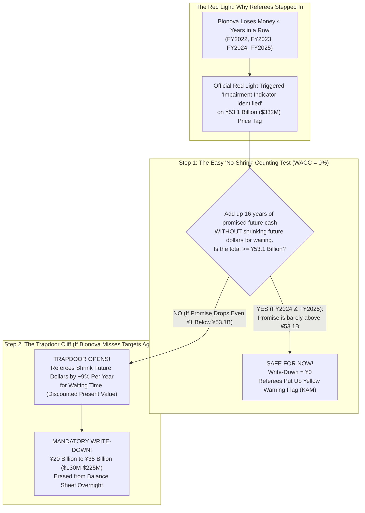
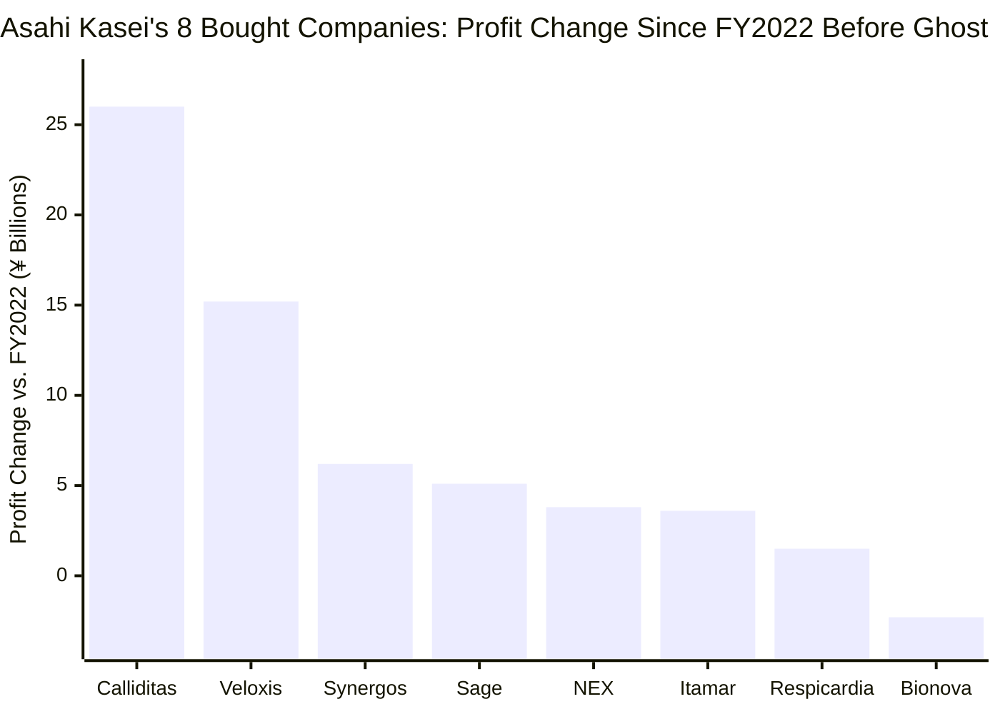
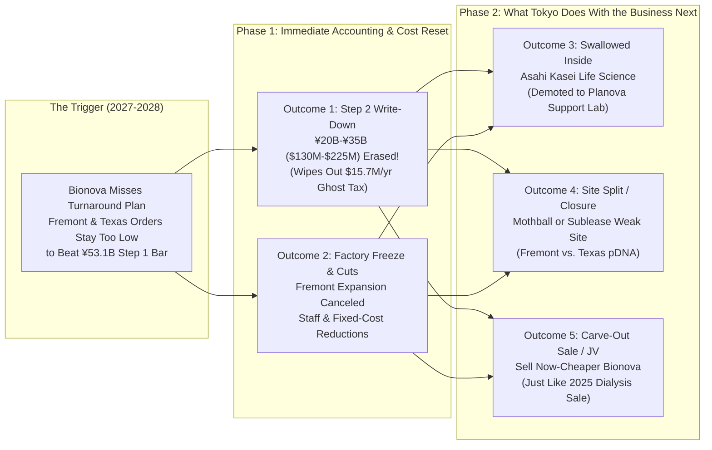

## 1. The Hook: What Happens When a $321 Million Medicine Kitchen Keeps Losing Money?

Imagine your parents gave you **$321 million**—enough money to buy more than **1,000 brand-new yellow school buses**—to buy the coolest custom bakery in California.

When you open the bakery's doors after paying for it, you discover something shocking: the actual ovens, refrigerators, and mixing bowls inside the building are only worth **$27.6 million** (about **86 school buses**). The other **$314.6 million**—a whopping **98 out of every 100 dollars you paid**—was just a giant "Popularity Sticker" on the receipt because, back when you bought it, dozens of neighborhood kids were lining up outside promising to order custom birthday cakes!

Then the neighborhood kids run out of allowance money. The line outside disappears. For **four years in a row**, your expensive bakery loses money every single year. Worse yet, independent rulebook referees show up with yellow warning flags for **two years in a row**, telling everyone: *"If this bakery doesn't start making big money soon, the owners will have to rip up that $314.6 million Popularity Sticker and admit the money is gone!"*

That is not a made-up bedtime story. It is the exact real-life situation happening right now between **Asahi Kasei Corporation** (`TSE: 3407`, a giant Japanese company worth over **$26 billion**) and **Bionova Scientific, LLC**, a custom medicine factory in Fremont, California and The Woodlands, Texas that Asahi Kasei bought on **May 31, 2022** for **¥42,882 million ($321.12 million)** ([FY2022 Audited Financial Statements, Note 16(a), pp. 44–45](https://www.asahi-kasei.com/content/dam/asahi-kasei/us/en/ir/library/financial-briefing/pdf/2303statements.pdf)).

In both **June 2025** and **June 2026**, Asahi Kasei's outside accounting referees—**PricewaterhouseCoopers Japan LLC (`PwC Japan`)**—put Bionova under an official high-alert warning called a **Key Audit Matter (`KAM`)** ([FY2025 Audited Statements, pp. 4–5, 14](https://www.asahi-kasei.com/content/dam/asahi-kasei/us/en/ir/library/financial-briefing/pdf/2603statements.pdf)). And in **April through November 2026**, Asahi Kasei officially stopped calling Bionova an "expansion" story and switched its slide label to: ***"Strengthening the fundamentals and reconfiguring the strategy of Bionova (CDMO)"*** ([H1 FY2026 Supplement, p. 30](https://www.asahi-kasei.com/content/dam/asahi-kasei/us/en/ir/library/financial-briefing/pdf/2609supplement.pdf)).

That brings us to the biggest detective question of all: **What actually happens next if Bionova Scientific does NOT turn things around soon enough?** Does it go bankrupt? Do the referees force a giant write-down? Does Tokyo shut down the buildings, swallow the company inside a bigger division, or sell it off?

Grab your detective notebook. We are going to explain every gear of the machine from scratch—so clearly that a 5th grader can predict all **five possible endings** like a Wall Street pro.

---

## 2. Starting from Zero: Giant Soup Vats, a $314 Million "Popularity Sticker," and the 16-Year Counting Trick

Before we can see what happens when things go wrong, we need to understand three simple building blocks: **what Bionova actually makes**, **why it loses money every year**, and **the counting trick that has protected it so far**.

### Building Block #1: What Is a "Medicine Kitchen for Rent"? (`CDMO`)

Suppose a small group of smart scientists invents a new medicine to fight cancer or a rare genetic disease. Those scientists know how to mix a tiny test tube of the medicine on a lab desk.

Wait—how do they make **10,000 bottles** of that medicine clean enough and safe enough to inject into sick patients in a hospital? Building a sterile medicine factory costs tens of millions of dollars and takes years to pass government safety inspections. Small startups don't have the money or time to build their own factory.

So instead, they **rent a giant professional medicine kitchen** and pay the chefs inside to cook the batches for them! Grown-ups in the medicine business call this kind of rented kitchen a **CDMO** (**Contract Development and Manufacturing Organization**).

Bionova Scientific runs two kinds of medicine kitchens:
1. **The Fremont, California Kitchen (Antibody Soup Vats):** Uses giant tanks (`up to 2,000 liters`—about the size of **5,600 soda cans**) filled with living cells to brew complex protein medicines called **monoclonal antibodies**.
2. **The Woodlands, Texas Kitchen (Genetic Instruction Rings):** A brand-new **10,000-square-foot** space (about the size of **two basketball courts**) that grows harmless bacteria to print tiny circular rings of DNA code called **plasmid DNA (`pDNA`)**, which other companies use as starter ingredients for gene therapies.

### Building Block #2: The $314.6 Million "Popularity Sticker" (`Goodwill`) and the Yearly Ghost Tax

When Asahi Kasei bought Bionova on May 31, 2022 for **¥42,882 million ($321.12 million)**, why did the physical equipment inside only add up to **¥3,683 million ($27.58 million)** after subtracting debts?

Because in 2021 and early 2022, biotech startups were swimming in venture-capital cash and fighting over every open stove in every medicine kitchen. Asahi Kasei paid a massive extra premium for Bionova's future popularity and customer list. Accountants split that extra **$314.62 million (`¥42,014 million`, or 98.0% of the total price)** into two invisible buckets on Asahi Kasei's balance sheet ([FY2022 Statements, Note 16(a), p. 44](https://www.asahi-kasei.com/content/dam/asahi-kasei/us/en/ir/library/financial-briefing/pdf/2303statements.pdf)):
* **Customer Relationships:** **¥6,559 million ($49.12 million)** for the value of existing clients.
* **Goodwill:** **¥35,455 million ($265.50 million)** for the pure "Popularity Sticker" over and above everything else.

Here is the trap: under **Japanese accounting rules (`J-GAAP`)**, you are not allowed to leave that $314.62 million Popularity Sticker sitting quietly on a shelf. You must slice it into **20 equal pieces** and subtract one piece (`$314.62 million ÷ 20 years = $15.73 million per year`, or roughly **¥2.4 billion to ¥2.5 billion every year**) directly from Bionova's yearly operating profit!

Think of that **$15.73 million per year** (about **50 school buses worth of money every year**) as a **"Ghost Tax"** (`PPA amortization`). Even if Bionova collects enough money from customers to pay its scientists, electric bills, and rent, it still shows an **official operating loss** unless it makes *more* than **$15.73 million in extra profit** every single year! And when startup customers ran short of cash in 2023, 2024, and 2025, Bionova couldn't come close—recording **four straight years of operating losses** (`FY2022`, `FY2023`, `FY2024`, and `FY2025`).

### Building Block #3: The 16-Year "No-Shrink" Counting Rule (`J-GAAP Step 1`)

By March 31, 2026 (`FY2025`), after adding new equipment in California and Texas and translating dollars into weaker Japanese yen, Bionova's total price tag on Asahi Kasei's balance sheet sat at **¥53,108 million ($332.13 million)** ([FY2025 Statements, Note 3(c), p. 14](https://www.asahi-kasei.com/content/dam/asahi-kasei/us/en/ir/library/financial-briefing/pdf/2603statements.pdf)).

Because Bionova lost money for multiple years in a row, Japanese rules triggered a red light called an **Impairment Indicator** (`減損の兆候`). That red light forced Asahi Kasei to take a **two-step test** watched closely by the referees at **PwC Japan**:

---

## 3. The Secret Decoder Ring: Grown-Up Accounting & Biotech Words Translated

Before we look at the five things that can happen if Bionova doesn't turn around, here is your **Secret Decoder Ring** so you can translate every grown-up phrase in Asahi Kasei's financial reports:

| The Grown-Up Word or Acronym | What It Actually Means in Plain English | Everyday 5th-Grade Analogy |
| :--- | :--- | :--- |
| **CDMO (Contract Development & Manufacturing Organization)** | A company that rents out its sterile labs and giant vats to design and brew medicines for other drug companies. | A professional commercial bakery that bakes and boxes cookies for smaller neighborhood brands that don't own big ovens. |
| **Goodwill & PPA Amortization** | The extra money paid above the value of physical equipment when buying a company (`Goodwill`), which Japanese rules force you to subtract in 20 yearly slices (`PPA amortization`). | Paying $100 for a $10 LEGO set because it's super popular, and having your parents deduct $4.50 from your allowance report card every year for 20 years. |
| **Impairment Indicator (`減損の兆候`)** | A mandatory warning alarm under Japanese rules that rings when a subsidiary loses money for two or more years in a row. | The smoke detector in the hallway beeping because burnt toast has been coming out of the kitchen for two straight years. |
| **Key Audit Matter (`KAM`)** | A special warning box in the annual report where independent accountants (`PwC Japan`) tell investors: *"This is one of the riskiest numbers in the whole company, and we checked it with a magnifying glass."* | The school principal circling one subject on your report card in bright red marker and writing: *"We are watching this grade very closely."* |
| **Undiscounted vs. Discounted Cash Flows (`Step 1 vs. Step 2`)** | *Undiscounted (`Step 1`)* counts $10 promised 15 years from now as a full $10 today. *Discounted (`Step 2`)* shrinks future dollars because waiting 15 years in a risky business makes a promise worth much less today. | *Undiscounted* says a promise of 10 ice cream cones in the year 2041 is just as good as 10 cones today; *Discounted* says a promise 15 years away is only worth about 2 cones today. |
| **Write-Down / Impairment Loss (`減損損失`)** | When accountants force a company to cross out an overpriced asset on its balance sheet and record the erased amount as a big one-time loss. | Crossing out the "$332 Million" sticker on your toy box with a black Sharpie, writing "$130 Million" instead, and taking a "-$202 Million" penalty score. |
| **Carve-Out / Ring-Fencing** | Moving a business unit into its own separate legal box so its problems don't spill into other divisions—and so it is easier to partner or sell later. | Moving a messy science experiment out of the living room and into a separate backyard shed with its own door and lock. |

---

## 4. The Big Claim vs. The Detective Check: Why the "Step 1 Trapdoor" Is Getting Closer

In July 2025, when an investor in Tokyo asked Healthcare executive **Seiji Nakano** whether Bionova might suffer an impairment write-down, Nakano replied ([Q1 FY2025 Q&A Summary, p. 2](https://www.asahi-kasei.com/content/dam/asahi-kasei/us/en/ir/library/financial-briefing/pdf/2506summary.pdf)):

> *"At this point, we do not anticipate any impairment. We will continue to review our medium-term plans and conduct appropriate verification with our accountants."*

Why did the referees at PwC Japan let Asahi Kasei pass `Step 1` without a write-down in both **June 2025 (`FY2024`)** and **June 2026 (`FY2025`)**? Because Asahi Kasei handed PwC Japan a multi-year business plan promising three big comebacks ([FY2025 Statements, Note 3(c), p. 14](https://www.asahi-kasei.com/content/dam/asahi-kasei/us/en/ir/library/financial-briefing/pdf/2603statements.pdf)):
1. Bionova will win lots of new early-stage biotech customer pipelines.
2. Antibody manufacturing contracts in Fremont, California will grow rapidly.
3. The brand-new plasmid DNA (`pDNA`) kitchen in Texas will bring in fast-growing sales.

### What Our Detective Magnifying Glass Found in the 2026 Receipts

When we check Asahi Kasei's own slides from **April 15, 2026** ([Management Briefing `e260415en.pdf`](https://www.asahi-kasei.com/content/dam/asahi-kasei/us/en/ir/library/initiative/pdf/e260415en.pdf)) and **November 2026** ([H1 FY2026 Supplement `2609supplement.pdf`](https://www.asahi-kasei.com/content/dam/asahi-kasei/us/en/ir/library/financial-briefing/pdf/2609supplement.pdf)), we discover why time is running out on that promise:

* **Clue #1 — Bionova Is the ONLY Acquisition Losing Ground:** On Slide 16 of the April 15, 2026 briefing, Asahi Kasei showed a scoreboard of **8 companies** it bought in recent years (`Calliditas`, `Veloxis`, `Synergos`, `Sage`, `NEX`, `Itamar`, `Respicardia`, and `Bionova`). Even after adding back the Ghost Tax (`PPA amortization`), **7 out of 8 companies made more money than in FY2022—while Bionova was the ONLY one stuck below zero (`about -¥2.3 billion`) for three years straight!**
* **Clue #2 — PwC Japan Explicitly Checked Past Promises vs. Real Scores:** On page 4 of the FY2025 Audit Report ([2603statements.pdf](https://www.asahi-kasei.com/content/dam/asahi-kasei/us/en/ir/library/financial-briefing/pdf/2603statements.pdf)), PwC Japan wrote that *"we compared the historical business plans to actual results, and **where actual results fell short of the business plans**, evaluated the reasons for such shortfalls."* In plain English: if you tell the teacher *"I promise I'll get an A next semester"* two years in a row and keep getting a D, the teacher stops believing your promise for Year 3!
* **Clue #3 — Asahi Kasei AlreadyDid a Giant Write-Down on Another U.S. Subsidiary:** Right above Bionova on page 14 of the exact same report (`Note 3(b)`), Asahi Kasei admits what happened when its U.S. battery-filter company, **Polypore International, LLC**, missed its comeback plan in FY2022: the referees forced a massive **¥186,376 million (~$1.4 billion) write-down**—like erasing **4,600 school buses** of value in one stroke!

---

## 5. The Five Possible Endings: What Happens If Bionova Doesn't Turn Around Soon Enough?

Suppose we reach the end of Asahi Kasei's current fiscal year on **March 31, 2027 (`FY2026`)**—or the one after on **March 31, 2028 (`FY2027`)**—and Bionova's kitchens in California and Texas still haven't filled up with enough paying customers to match the comeback plan.

First, let's clear up one myth: **Bionova will NOT suddenly run out of cash to pay its electric bill tomorrow morning like a tiny startup**, because its parent company Asahi Kasei has a massive **¥4.1 trillion ($26+ billion)** balance sheet. Instead, when a big Japanese parent company owns a struggling U.S. subsidiary, **five specific real-world outcomes** happen—often one right after another!

### Outcome #1: The "Step 2 Trapdoor" Opens — A Mandatory ¥20B–¥35B ($130M–$225M) Balance-Sheet Write-Down (And a Weird Profit Paradox!)

If Bionova misses its sales and profit targets again this year, PwC Japan will tell Asahi Kasei's bosses: *"You cannot keep assuming Bionova will magically collect more than ¥53.1 billion over the next 16 years. Cut your forecast."*

Watch how fast the math flips once that forecast is trimmed by even **10%**:
* **Before the Cut (`Step 1 Passes`):** Suppose management promised Bionova would earn **¥55.5 billion** total over 16 years (`¥0B` in Year 1, ramping up to `¥4.0B/year` in Years 5–16). Because `¥55.5B` is higher than the `¥53.1B` price tag, the write-down is **¥0**.
* **After a 10% Cut (`Step 1 Fails -> Step 2 Trapdoor Opens`):** If PwC Japan trims that forecast by just **10%** (from `¥55.5B` down to `¥49.95B`), the total drops below `¥53.1B`. Under Japanese rules, you don't just subtract the difference (`¥53.1B - ¥49.95B = ¥3.15B`). Instead, you fall into **Step 2**, where every future year's cash is shrunk by **~9% per year** (`WACC` discounting) for waiting time! Shrinking `¥49.95B` over 16 years at `9%` per year cuts its present value down to roughly **¥23.4 billion**.
* **The Instant Eraser:** Asahi Kasei must immediately cross out **¥29.7 billion (~$186 million)**—or broadly between **¥20 billion and ¥35 billion ($130 million to $225 million)**—and report it as a one-time **Extraordinary Impairment Loss**!

**Wait—here is the weirdest Plot Twist in accounting!** What happens to Bionova's yearly operating profit *after* that giant write-down? **It actually looks MUCH BETTER overnight!**
Why? Because erasing the 2022 Goodwill and Customer Intangibles also **erases the ~$15.73 million/year (`~¥2.4B–¥2.5B/year`) Ghost Tax (`PPA amortization`)**! Once the Popularity Sticker is ripped off and thrown in the trash, Bionova no longer has to pay $15.73 million a year for it—meaning Bionova can suddenly break even on paper with far fewer orders!

### Outcome #2: "Shrinking to Survive" — Permanent Capex Cancellation & Cost Cuts

Even before taking a write-down, a parent company tries to stop the bleeding by freezing new construction and cutting everyday bills. In fact, Asahi Kasei already started **Phase 1 of Outcome #2** in 2026:
* On Slide 44 of the April 15, 2026 briefing ([e260415en.pdf](https://www.asahi-kasei.com/content/dam/asahi-kasei/us/en/ir/library/initiative/pdf/e260415en.pdf)), Tokyo ordered ***"investment deferrals and fixed-cost reductions."***
* In the November 2026 project table ([2609supplement.pdf, p. 49](https://www.asahi-kasei.com/content/dam/asahi-kasei/us/en/ir/library/financial-briefing/pdf/2609supplement.pdf)), Asahi Kasei pushed the completion date for **expanding Bionova's Fremont, California factory** back by two years—from `FY2025 or later` to **`FY2027 or later`**—and pushed the **Texas GMP plasmid DNA** completion from `FY2025` to **`FY2026 or later`**.

**If Bionova still doesn't turn around:**
1. The "delayed" Fremont commercial factory expansion (`FY2027+`) gets **permanently canceled** so Asahi Kasei doesn't build expensive new stainless-steel and single-use vats that sit empty.
2. "Fixed-cost reductions" deepen into **staff downsizing, shift consolidations, and overhead cuts** in Fremont and Texas, shrinking Bionova into a leaner, smaller shop that only takes niche custom projects.

### Outcome #3: "Swallowed by the Big Brother" — Losing Independence Inside `Asahi Kasei Life Science Corp.`

Right now, Bionova sits inside a newly created parent division called **Asahi Kasei Life Science Corp.** (launched April 1, 2025; [press release `e250401`](https://www.asahi-kasei.com/news/2025/e250401)). Inside that exact same division lives Bionova's rich, wildly successful older brother: **Planova™**, which makes ultra-fine hollow-fiber filters that catch viruses during medicine manufacturing.

While Bionova was struggling in 2025 and 2026, **Planova** was booming—pushing the combined `Life Science` division's sales from **¥55.4 billion (~$367M)** in FY2025 to an expected **¥67.0 billion (~$432M)** in FY2026 ([2609supplement.pdf, p. 42](https://www.asahi-kasei.com/content/dam/asahi-kasei/us/en/ir/library/financial-briefing/pdf/2609supplement.pdf)).

**If Bionova fails to grow as a standalone CDMO:**
* Tokyo can strip Bionova of its independent growth budget, replace standalone U.S. executive roles, and fold its sales, finance, and engineering teams directly under **Asahi Kasei Life Science Corp.**
* Instead of trying to compete with giant CDMOs like Lonza or WuXi, Bionova becomes a small **"test kitchen and support lab"** whose main job is helping customers test and buy more of Asahi Kasei's high-profit `Planova` filters and `ViruSure` / `Bionique` safety tests.

### Outcome #4: "Splitting the Toy Box" — Closing or Subleasing One Facility (`Fremont vs. Texas`)

Remember that Bionova runs two totally different businesses: **California antibody vats (`Fremont`)** and **Texas plasmid DNA rings (`The Woodlands`)**.
In 2026, Bionova signed three back-to-back rescue partnerships (`Syenex` in January, `Scarab Genomics` in February, and `Minaris` in September) to try to fill up the Texas plasmid DNA building without spending big money on new construction.

**What happens if one building works and the other stays half-empty?**
Look at what happened to rival company **Charles River Laboratories (`CRL`)**, which paid over **$1 billion** in 2021 to buy CDMO factories (**Cobra Biologics** and **Cognate BioServices**) at the exact same bubble peak. When gene-therapy orders dried up, Charles River took a big accounting write-down and **shut down or exited underperforming CDMO buildings** rather than paying rent and utilities on half-empty cleanrooms forever. If Texas plasmid DNA fails to ramp (or if Fremont's older clinical lines stay underused), Asahi Kasei can mothball, sublease, or sell the weaker site.

### Outcome #5: "The Shed in the Backyard" — A Joint Venture or Fire-Sale Divestiture

Does Asahi Kasei ever sell off healthcare businesses that don't hit its profit goals? **Yes—they just did it twice in 2025!**
* In **April 2025**, Asahi Kasei carved out and sold off its **Blood Purification (dialysis)** business ([2603supplement.pdf, p. 41](https://www.asahi-kasei.com/content/dam/asahi-kasei/us/en/ir/library/financial-briefing/pdf/2603supplement.pdf)).
* In **July 2025**, Asahi Kasei carved out and sold off its **Diagnostics** business.

And notice what else Asahi Kasei did on **April 1, 2025**: it moved Bionova out of `Asahi Kasei Medical` and into the separate legal wrapper of `Asahi Kasei Life Science Corp.`, keeping Bionova completely walled off ("ring-fenced") from Asahi Kasei's crown-jewel **ZOLL Medical** (`Critical Care`, making **¥44.8 billion** in profit) and **Pharmaceuticals** divisions.

Right now, nobody would buy Bionova for its inflated **¥53.1 billion ($332 million)** book value. **But once Outcome #1 (the ¥20B–¥35B write-down) erases the 2022 goodwill bubble**, Bionova's book value drops back down near its real physical equipment value (`~$80M–$120M`). At that lower price tag, Asahi Kasei can easily sell Bionova (or merge it into a Joint Venture) with a private-equity fund or a larger CDMO buyer without taking a second loss!

---

## 6. The Catch: Why Is Turning Bionova Around So Hard, and Who Gets Hurt?

A smart detective always checks **why** a turnaround is so tough—and **who pays the price** when a big company reconfigures its strategy.

### The Four Suspects Blocking Bionova's Comeback

| Suspect | How It Blocks Bionova's Turnaround | Real-World Evidence |
| :--- | :--- | :--- |
| **Suspect #1: The Startup Piggy-Bank Drought (45% of the Problem)** | Bionova's main customers are small biotech startups testing brand-new medicines. When investors stopped handing easy cash to startups in 2022–2025, those startups canceled or paused their lab batches. | Asahi Kasei Note 3(c) explicitly blames *"sluggish demand resulting from decreased funding inflows to biotech ventures."* |
| **Suspect #2: The "Too Small for Giants" Trap (20% of the Problem)** | Big drug companies (`Pfizer`, `Eli Lilly`, `Roche`) are spending billions making commercial medicines, but they need giant **10,000-liter to 20,000-liter** factories. Bionova's Fremont tanks (`up to 2,000L`) were built for small early-stage batches, and delaying the Fremont expansion to `FY2027+` keeps Bionova locked out of big commercial deals. | [H1 FY2026 Supplement, p. 49](https://www.asahi-kasei.com/content/dam/asahi-kasei/us/en/ir/library/financial-briefing/pdf/2609supplement.pdf) shows Fremont capacity expansion pushed back to `FY2027 or later`. |
| **Suspect #3: Too Many Empty Kitchens Across America (25% of the Problem)** | During the 2021–2022 boom, dozens of CDMOs (`Catalent`, `Charles River`, `Aldevron`, `Lonza`, `Forge`) built brand-new antibody and plasmid DNA kitchens at the exact same time. Now there are too many kitchens chasing too few customers, forcing price cuts. | Even market leader `Aldevron` (bought by Danaher for $9.6B) suffered steep post-pandemic growth resets as customers used up leftover inventory. |
| **Suspect #4: The Diet-Makes-You-Slower Loop (10% of the Problem)** | To save cash and keep PwC Japan happy, Tokyo ordered *"investment deferrals and fixed-cost reductions."* But freezing new equipment and cutting budgets makes it harder to win big new customers! | [April 15, 2026 Briefing, Slide 44](https://www.asahi-kasei.com/content/dam/asahi-kasei/us/en/ir/library/initiative/pdf/e260415en.pdf) pairs revenue weakness directly with capex deferrals and fixed-cost cuts. |

### Who Actually Gets Hurt If Bionova Doesn't Turn Around?

1. **Engineers, Scientists, and Technicians in Fremont & Texas:** When Tokyo executives write polite words like *"investment deferrals and fixed-cost reductions"* on a slide in Japan, the people who feel it in real life are the 140 to 200 workers in California and Texas facing hiring freezes, tighter budgets, canceled expansion rooms, or layoffs under Outcomes #2, #4, and #5.
2. **Small Biotech Customers Counting on Bigger Tanks:** Startups that hired Bionova in 2023 thinking Bionova would have brand-new commercial tanks ready in Fremont by 2025 now see that project pushed to `FY2027 or later`. If their medicine works well in early tests, they may have to pack up their recipe and move to a bigger CDMO for Phase 3 and commercial launch.
3. **Asahi Kasei Shareholders & Tokyo Executives:** The executives who approved paying **$321.12 million (`98%` goodwill and intangibles)** at the top of the 2022 market bubble face a painful public report card if PwC Japan forces a **¥20B–¥35B write-down**—even though getting rid of the Ghost Tax will actually make future profit reports look cleaner.

---

## 7. The Final Report Card: Our "If ... Then ..." Playbook and 100-Kid Probability Table

Let's bring all the clues together into three crystal-clear **"If ... Then ..."** rules and a final probability scorecard you can count using **100 kids in a school gym**:

* **IF** Bionova's three 2026 Texas plasmid DNA partnerships (`Syenex`, `Scarab Genomics`, and `Minaris`) bring in a wave of real, paid GMP manufacturing contracts before **March 31, 2027**, **AND** cost cuts shrink Fremont's losses by at least half, **THEN** Asahi Kasei will barely pass the `Step 1` 16-year counting test for a third year (`Outcome #2 + #3`: continued cost diet and tighter control inside `Asahi Kasei Life Science Corp.`, but zero write-down in June 2027).
* **IF** biotech orders in Fremont and Texas fall short of management's comeback promise again in `FY2026` (ending March 31, 2027), **THEN** PwC Japan will force Asahi Kasei to trim its 16-year cash forecast below **¥53.1 billion**, opening the `Step 2` trapdoor (`Outcome #1 + #2`: a mandatory **¥20 billion to ¥35 billion / $130M–$225M write-down**, permanent cancellation of the Fremont expansion, and elimination of the $15.7M/year Ghost Tax).
* **IF** Bionova still cannot make money on its own *even after* a write-down wipes out the Ghost Tax, **THEN** Tokyo will move to `Outcome #4` or `Outcome #5`—mothballing/subleasing underused cleanrooms or selling Bionova off to a private-equity or CDMO buyer, just like it sold its Dialysis and Diagnostics businesses in 2025.

### The 100-Kid Gym Probability Scorecard (Through FY2026–FY2027)

Imagine **100 kids** standing in a school gym, where each kid represents **1 out of 100 possible futures** for Bionova Scientific over the next 12 to 24 months:

| Outcome Path | How Many Kids Out of 100? (`Probability`) | What Happens on the Balance Sheet? | What Happens Inside the California & Texas Buildings? |
| :--- | :--- | :--- | :--- |
| **Path A: The Trapdoor Write-Down + Permanent Downsizing (`Outcomes #1, #2 & #3 Combined`)** | **55 out of 100 kids (`55% — Most Likely`)** | PwC Japan forces a **¥20B–¥35B ($130M–$225M) Step 2 impairment write-down**; the `$15.73M/yr` Ghost Tax is wiped clean. | Deferred Fremont commercial expansion is permanently canceled or shrunk; Bionova is folded tightly under `Asahi Kasei Life Science Corp.` as a leaner niche shop. |
| **Path B: The "Barely Passed Again" Cost-Cut Diet (`Outcomes #2 & #3 Without Immediate Write-Down`)** | **20 out of 100 kids (`20% — Muddle-Through`)** | Cost cuts + early Texas pDNA contracts keep the 16-year promise `1%–5%` above `¥53.1B`; **¥0 write-down in FY2026**, but PwC keeps the yellow `KAM` warning flag up for Year 3. | Strict hiring and spending freeze continues; employees work under tight Tokyo budget supervision while waiting for biotech startups to recover. |
| **Path C: Post-Write-Down Site Closure or Carve-Out Sale (`Outcomes #1 + #4 or #5`)** | **10 out of 100 kids (`10% — Restructuring / Exit`)** | After taking the `¥20B–¥35B` write-down to lower Bionova's book value, Tokyo decides CDMO manufacturing is too volatile. | Asahi Kasei subleases/closes the weaker site or sells Bionova to a private-equity fund or larger CDMO (just like its April/July 2025 Dialysis & Diagnostics sales). |
| **Path D: The Real Comeback Surprise (`Full Turnaround`)** | **15 out of 100 kids (`15% — Best-Case Surprise`)** | Biotech startup funding rebounds sharply and the `Scarab` / `Minaris` / `Syenex` deals pack the Texas and Fremont schedules; Bionova makes real profit even after the Ghost Tax! | PwC Japan removes the `KAM` warning flag; Tokyo unfreezes the `FY2027+` Fremont expansion and builds more cleanrooms. |

---

## Primary Sources & Detective Receipt Index

1. **Asahi Kasei Corp. — FY2022 Detailed Consolidated Financial Statements (Ended March 31, 2023):** Note 16(a) (*Acquisition of Bionova Holdings, Inc. — ¥42,882M cash price, ¥35,455M Goodwill, ¥6,559M Customer Intangibles*, pp. 44–45). [https://www.asahi-kasei.com/content/dam/asahi-kasei/us/en/ir/library/financial-briefing/pdf/2303statements.pdf](https://www.asahi-kasei.com/content/dam/asahi-kasei/us/en/ir/library/financial-briefing/pdf/2303statements.pdf)
2. **Asahi Kasei Corp. — FY2024 Detailed Consolidated Financial Statements (Ended March 31, 2025):** PwC Japan KAM & Note 3(c) (*¥52,403M carrying value & impairment indicators*, pp. 4–6, 15). [https://www.asahi-kasei.com/content/dam/asahi-kasei/us/en/ir/library/financial-briefing/pdf/2503statements.pdf](https://www.asahi-kasei.com/content/dam/asahi-kasei/us/en/ir/library/financial-briefing/pdf/2503statements.pdf)
3. **Asahi Kasei Corp. — FY2025 Detailed Consolidated Financial Statements (Ended March 31, 2026; Signed June 24, 2026):** PwC Japan KAM (`historical plan vs. actual shortfall check`, pp. 4–5), Note 3(b) (*Polypore ¥186,376M impairment*, p. 14), and Note 3(c) (*Bionova ¥53,108M / $332.13M carrying value*, p. 14). [https://www.asahi-kasei.com/content/dam/asahi-kasei/us/en/ir/library/financial-briefing/pdf/2603statements.pdf](https://www.asahi-kasei.com/content/dam/asahi-kasei/us/en/ir/library/financial-briefing/pdf/2603statements.pdf)
4. **Asahi Kasei Corp. — Management Briefing on Medium-Term Plan "Trailblaze Together" (April 15, 2026):** Slide 16 (*8-deal M&A profit chart*) and Slide 44 (*Bionova investment deferrals and fixed-cost reductions*). [https://www.asahi-kasei.com/content/dam/asahi-kasei/us/en/ir/library/initiative/pdf/e260415en.pdf](https://www.asahi-kasei.com/content/dam/asahi-kasei/us/en/ir/library/initiative/pdf/e260415en.pdf)
5. **Asahi Kasei Corp. — Financial Briefing Supplements & Q&A Summaries (`2025–2026`):**
   * `Q1 FY2025 Q&A Summary` (July 31, 2025, p. 2): [https://www.asahi-kasei.com/content/dam/asahi-kasei/us/en/ir/library/financial-briefing/pdf/2506summary.pdf](https://www.asahi-kasei.com/content/dam/asahi-kasei/us/en/ir/library/financial-briefing/pdf/2506summary.pdf)
   * `FY2025 Supplement` (May 2026, pp. 27, 41, 48): [https://www.asahi-kasei.com/content/dam/asahi-kasei/us/en/ir/library/financial-briefing/pdf/2603supplement.pdf](https://www.asahi-kasei.com/content/dam/asahi-kasei/us/en/ir/library/financial-briefing/pdf/2603supplement.pdf)
   * `H1 FY2026 Supplement` (November 2026, pp. 30, 42, 49): [https://www.asahi-kasei.com/content/dam/asahi-kasei/us/en/ir/library/financial-briefing/pdf/2609supplement.pdf](https://www.asahi-kasei.com/content/dam/asahi-kasei/us/en/ir/library/financial-briefing/pdf/2609supplement.pdf)
6. **Corporate Reorganization & 2026 Plasmid DNA Partnerships:**
   * Launch of Asahi Kasei Life Science Corp. (April 1, 2025): [https://www.asahi-kasei.com/news/2025/e250401](https://www.asahi-kasei.com/news/2025/e250401)
   * Syenex Alliance (Jan 8, 2026): [https://bionovascientific.com/2026/01/08/bionova-scientific-and-syenex-forge-strategic-alliance-to-expand-access-to-high-quality-plasmid-dna-for-advanced-therapies/](https://bionovascientific.com/2026/01/08/bionova-scientific-and-syenex-forge-strategic-alliance-to-expand-access-to-high-quality-plasmid-dna-for-advanced-therapies/)
   * Scarab Genomics Exclusive License (Feb 4, 2026): [https://bionovascientific.com/2026/02/04/scarab-genomics-and-bionova-enter-exclusive-licensing-partnership-to-advance-high-efficiency-plasmid-dna-production/](https://bionovascientific.com/2026/02/04/scarab-genomics-and-bionova-enter-exclusive-licensing-partnership-to-advance-high-efficiency-plasmid-dna-production/)
   * Minaris Co-Supply Partnership (Sept 9, 2026): [https://bionovascientific.com/2026/09/09/bionova-scientific-and-minaris-announce-partnership-to-accelerate-plasmid-dna-supply-for-cell-and-gene-therapy-manufacturing/](https://bionovascientific.com/2026/09/09/bionova-scientific-and-minaris-announce-partnership-to-accelerate-plasmid-dna-supply-for-cell-and-gene-therapy-manufacturing/)
