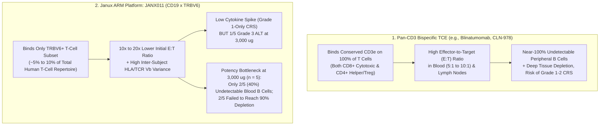
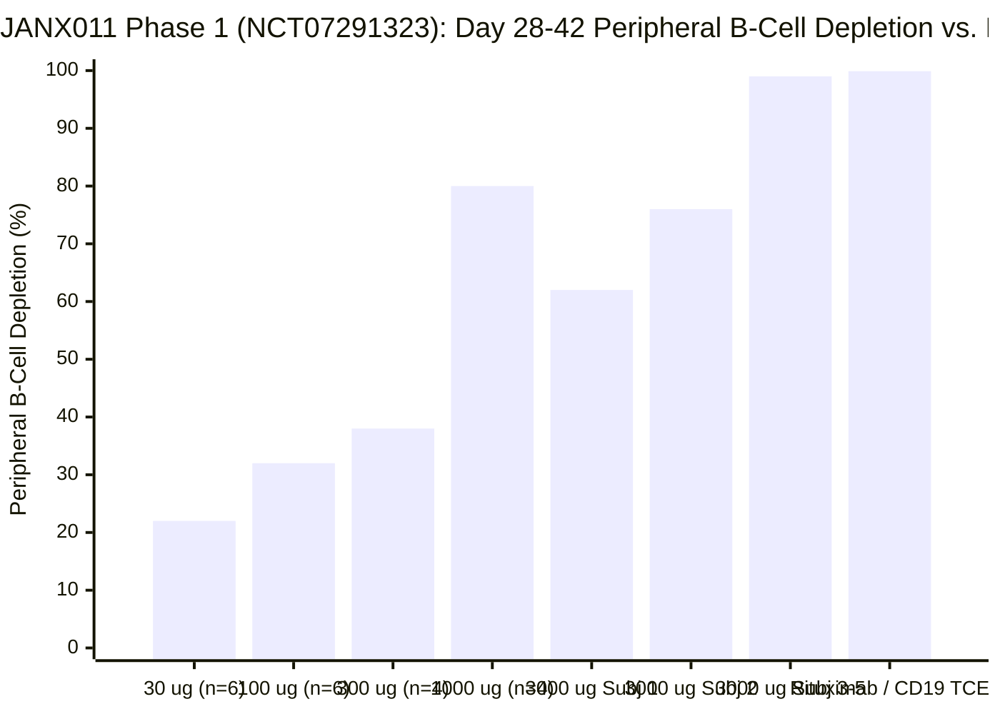
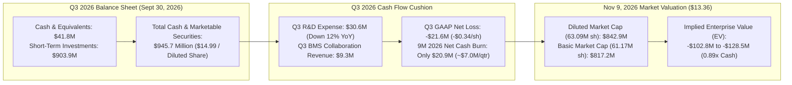

## Executive Summary & Issue Classification

On the morning of November 9, 2026, **Janux Therapeutics, Inc.** (`NASDAQ: JANX`) released initial Phase 1 single-ascending-dose (`SAD`) clinical data from [NCT07291323](https://clinicaltrials.gov/study/NCT07291323) (`ARMV-011-001`) evaluating **JANX011**—a CD19-targeted **Adaptive Immune Response Modulator (`ARM`)** bispecific T-cell engager (`TCE`) that selectively binds the **TRBV6** T-cell receptor beta-chain variable domain rather than pan-`CD3`—across **25 healthy adult volunteers**. Management's press release led with a celebratory framing: a single **3,000 µg (`3.0 mg`)** subcutaneous injection achieved `>90%` peripheral B-cell depletion in "a majority of participants" through Day 42, with **Grade 1-only cytokine release syndrome (`CRS`)** and zero dose-limiting toxicities (`DLTs`).

Within hours of the opening bell, institutional investors drove `JANX` down **24.22% (-$4.27)** from its prior close of **$17.63** to **$13.36** (touching an intraday low near **$12.43**). That single-day selloff erased roughly **$269 million** in market value and pushed Janux's economic market capitalization (**$842.9 million** across `63.09 million` diluted shares) more than **$102.8 million below its Q3 2026 cash pile of $945.7 million** (`$14.99/share` in cash and marketable securities as of September 30, 2026).

As biotech investor Jing Liang (`@AppleHelix`) summarized in a widely circulated critique of the `JANX011` presentation slides on November 9, 2026:

> *"I think the skepticism of `JANX` data is that it has not demonstrated that it is better at B cell depletion than other TCEs. A single dose of Rituximab can achieve the same peripheral B cell depletion (albeit using a higher dose)."*

Applying the **Browne & Keeley critical thinking framework**, we separate today's 25% drop into two distinct analytical questions:

1. **Descriptive & Mechanistic Issue (Immunological Fact):** Does restricting T-cell recruitment to the **TRBV6-expressing T-cell subset (`~5%–10%` of total T cells)** compromise the local Effector-to-Target (`E:T`) stoichiometry required to achieve uniform, complete B-cell eradication—explaining why **only 2 of 5 (`40%`) healthy volunteers** at the highest `3,000 µg` dose reached undetectable peripheral B-cell levels?
2. **Prescriptive & Valuation Issue (Capital Allocation):** When a company with **$945.7 million in cash**, **$9.3 million** in quarterly Bristol Myers Squibb (`BMS`) collaboration revenue, and a net cash burn of **~$7.0 million per quarter** (`$20.9 million` total cash reduction over the first nine months of 2026) trades at **$13.36** (`0.89x cash`, negative `-$102.8 million` enterprise value), is the market rationally pricing a broken platform, or over-discounting `JANX007` (`PSMA-TRACTr`) and the balance sheet?

### Falsifiability Criteria

* **What Would Falsify the Bearish Thesis on `JANX011`:** If step-up or repeat subcutaneous dosing of `JANX011` (`e.g., Day 1 + Day 8`) in autoimmune patients (`ITP` and `RA` starting in 2027) achieves **100% undetectable peripheral B cells** *and* biopsy-verified `>95%` lymph-node/synovial B-cell depletion with zero Grade ≥ 2 CRS and zero recurring Grade 3 transaminitis (`ALT/AST`).
* **What Would Falsify the Bullish Thesis on `JANX011`:** If higher or repeat doses of `JANX011` either fail to clear the `40%` incomplete-depleter tail (due to inter-patient variance in baseline cytotoxic `CD8+ TRBV6+` T-cell repertoire frequency) or trigger dose-limiting Grade 3+ `ALT/AST` hepatotoxicity and Grade 2+ CRS once `TRBV6+` T cells clonally expand upon repeat dosing.

---

## Primary Source Extraction: Press Release Headline vs. Slide-Deck Reality

Cross-examining Janux's November 9, 2026 presentation graphs (`DOSE RESPONSE AND PERSISTENCE` and `3,000 µg | 2/5 subjects with undetectable`), the [NCT07291323](https://clinicaltrials.gov/study/NCT07291323) protocol, and the Q3 2026 Form 10-Q (filed November 5, 2026) exposes five sharp divergences between the bullish press release prose and the underlying clinical data:

| Audit Dimension | Public Press Release Headline (Nov 9, 2026) | Slide-Deck Spaghetti Plots, Protocol & Filing Reality |
| :--- | :--- | :--- |
| **Depth of B-Cell Depletion at `3,000 µg (3.0 mg)` (`n = 5`)** | *"Single 3 mg subcutaneous dose achieved >90% peripheral B-cell depletion in a majority of participants, reaching undetectable peripheral B-cell levels."* | In the `3,000 µg` (`n = 5`) individual spaghetti plot, **"a majority" meant 3 of 5 (`60%`)** achieved `>90%` depletion, and **only 2 of 5 (`40%`) reached undetectable peripheral B-cell levels**. One subject (`blue circles`) bounced to `-15%` at Day 2 and plateaued at **`-55% to -65%`** through Day 28; a second subject (`purple triangles`) hit `-88%` at Day 3 and rebounded to **`-75%`** by Day 28. |
| **Sub-3 mg Cohort Persistence (`30 µg` to `1,000 µg`, `n = 20`)** | *"Sustained pharmacology: dose-dependent B-cell depletion maintained through Day 42 across 25 healthy volunteers."* | In the left-hand dose-response chart (`n = 25`), `30 µg (n = 6)` and `100 µg (n = 6)` rebounded to `-20%` to `-30%` by Day 14; `300 µg (n = 4)` hit `-90%` at Day 3–7 but **rebounded to `-35%` by Day 42**; and `1,000 µg (n = 4)` hit `-90%` at Day 7 before **drifting back toward `-80%` by Day 42**. |
| **Peripheral Blood (`<2%` of B Cells) vs. Tissue Benchmark** | Frames peripheral B-cell depletion in healthy volunteers as validation of "best-in-class" autoimmune disease-modifying potential. | Peripheral blood contains **`<2%` of total body B cells**. As proven by sequential human lymph-node biopsy studies (`Tur & Schett et al., ARD 2025`, [PMID: 39874224](https://pubmed.ncbi.nlm.nih.gov/39874224/) and [PMID: 40651933](https://pubmed.ncbi.nlm.nih.gov/40651933/)), even standard **Rituximab (`anti-CD20`) clears 100% of peripheral blood B cells in virtually every patient** yet still leaves `14%` residual B cells and intact follicular dendritic networks inside lymph nodes, causing autoimmune relapse. |
| **Safety & Transaminase Ceiling at `3,000 µg`** | *"Favorable safety profile with no serious adverse events or dose-limiting toxicities and Grade 1-only CRS."* | At the `3,000 µg` (`n = 5`) cohort, **1 of 5 healthy volunteers (`20%`) developed a Grade 3 ALT liver enzyme elevation** alongside Grade 2 ALT/AST elevations. In healthy volunteers taking zero hepatotoxic background drugs, a `20%` Grade 3 ALT signal constrains single-dose escalation above `3 mg`. |
| **Autoimmune Indication Selection & Timeline** | *"Advancing JANX011 into patient clinical trials in immune thrombocytopenia (ITP) in 1H 2027 and rheumatoid arthritis (RA) in 2H 2027."* | By selecting `ITP` (an intravascular/splenic autoantibody disease where generic Rituximab already works) for 1H 2027 and delaying `RA` to **2H 2027**, Janux avoids head-to-head lymph-node/tissue diseases (`SLE`, `LN`, `SSc`) and trails rival pan-CD3/CD19 and BCMA TCEs (`CLN-978`, `blinatumomab` [[PMID: 38671240](https://pubmed.ncbi.nlm.nih.gov/38671240/)], `teclistamab` [[PMID: 39231353](https://pubmed.ncbi.nlm.nih.gov/39231353/)]) by **18 to 30 months**. |

---

## Ambiguity & Platform Maturity Audit

### The Substitution Test on Key Corporate Claims

* **"Achieved >90% Depletion in a Majority of Participants":** In clinical communications, "a majority" sounds like a sweeping consensus. Applying the **Browne & Keeley Substitution Test** to a 5-person cohort (`n = 5`): "a majority" literally means **`3 out of 5 subjects (60%)`**, while **`2 out of 5 subjects (40%)` failed to achieve 90% depletion** in peripheral blood, and **`3 out of 5 subjects (60%)` failed to reach undetectable peripheral B-cell levels**. When a standard intravenous infusion of generic Rituximab achieves `>99%` undetectable peripheral blood B-cell depletion in `~100%` of healthy volunteers and patients ([PMID: 39874224](https://pubmed.ncbi.nlm.nih.gov/39874224/)), a `40%` rate of undetectable peripheral B cells at the top `3,000 µg` dose is a potency red flag, not a best-in-class breakthrough.
* **"Differentiated Starting Profile in Healthy Volunteers":** Substituting the [NCT07291323](https://clinicaltrials.gov/study/NCT07291323) eligibility criteria: healthy volunteers (`aged 18–65`) have normal baseline B-cell counts, uninflamed lymph nodes, normal BAFF/BLyS survival cytokine levels, and intact unexhausted T cells. In active autoimmune patients (`SLE`, `RA`, `SSc`), B-cell survival signals (`BAFF`, `APRIL`, `IL-6`, `IL-21`) are massively upregulated in germinal centers, and patient T cells are often lymphopenic or immunosuppressed by steroids and DMARDs. A dose (`3,000 µg`) that leaves detectable circulating B cells in **60% of healthy volunteers** will face an even steeper uphill battle inside diseased rheumatoid synovium or lupus lymph nodes.

### 4-Tier Pipeline & Clinical Maturity Scorecard

| Program & Platform | Target & Mechanism | Indication & Trial ID | Clinical Stage & Status (Nov 2026) | Evidence Tier & Forensic Status |
| :--- | :--- | :--- | :--- | :--- |
| **JANX011** (`ARM` Platform) | `CD19 × TRBV6` (Non-masked bispecific engaging `TRBV6+` T-cell subset) | Healthy Volunteers (`FIH`) — [NCT07291323](https://clinicaltrials.gov/study/NCT07291323) (`ITP` 1H 2027; `RA` 2H 2027) | Phase 1 SAD (`N = 25` dosed across `30 µg` to `3,000 µg` SC; target `N = 60`) | **Tier 2 (Healthy Volunteers Only):** `3/5` (`60%`) `>90%` depletion and `2/5` (`40%`) undetectable peripheral B cells at `3,000 µg`; `0%` Grade ≥ 2 CRS; `1/5` (`20%`) Grade 3 ALT; **zero autoimmune patients dosed to date**. |
| **JANX007** (`TRACTr` Platform) | `PSMA × CD3` (Tumor protease-cleavable masked TCE) | Metastatic Castration-Resistant Prostate Cancer (`mCRPC`) — [NCT05519449](https://clinicaltrials.gov/study/NCT05519449) | Phase 1b Expansion (Started Sept 2022; Est. `N = 272`; primary completion `July 2027`) | **Tier 2 (Phase 1b Optimization):** High early PSA50/PSA90 rates in Phase 1a, but prolonged dose/schedule optimization in taxane-naive mCRPC and darolutamide combo arms has delayed pivotal Phase 3 start. |
| **JANX013 + JANX007** (`TRACIr + TRACTr`) | `PSMA × CD28` Co-Stimulator + `PSMA × CD3` | `mCRPC` Combination — [NCT07813637](https://clinicaltrials.gov/study/NCT07813637) | Phase 1 Recruiting (Initiated 2026) | **Tier 1/2 (Early Phase 1 Combo):** Testing whether adding masked `CD28` co-stimulation rescues `JANX007` response durability in mCRPC. |
| **JANX014** (`TRACTr` Platform) | Next-Gen `PSMA × CD3` Masked TCE | `mCRPC` — [NCT07545811](https://clinicaltrials.gov/study/NCT07545811) | Phase 1 Recruiting | **Tier 1/2 (Early Phase 1):** Backup/next-generation PSMA construct. |
| **JANX008** (`TRACTr` Platform) | `EGFR × CD3` (Tumor protease-cleavable masked TCE) | Advanced Solid Tumors (`CRC`, `NSCLC`, `SCCHN`, `RCC`) — [NCT05783622](https://clinicaltrials.gov/study/NCT05783622) | Phase 1 (`N = 130` est., Active Not Recruiting) | **Tier 2 — Discontinued (April 2026):** Officially terminated in Q2 2026 to redirect capital after failing to establish a competitive clinical profile. |

---

## Mechanistic Dissection: The TRBV6 Effector-to-Target (`E:T`) Stoichiometry Trap

Why did Janux design `JANX011` to bind **TRBV6** (T-cell receptor beta-chain variable region 6) instead of pan-**CD3ε**, and why did that exact design choice produce the incomplete (`2/5` undetectable) B-cell depletion curve that spooked investors today?

In oncology (`JANX007`), Janux uses its **TRACTr** platform: a pan-`CD3` bispecific antibody capped with a peptide mask that is cleaved off by tumor-associated proteases inside solid tumors. However, **you cannot use a tumor-protease mask to kill normal or autoreactive B cells in the bloodstream, spleen, and lymph nodes of autoimmune patients**, because circulating B cells and healthy lymph nodes do not overexpress tumor matrix metalloproteinases!

Forced to abandon protease masking for systemic B-cell depletion, Janux created the **ARM (`Adaptive Immune Response Modulator`)** platform (`JANX011`). Instead of engaging `100%` of T cells via `CD3ε`, `JANX011` engages only the subset of T cells whose T-cell receptor beta chain uses the **`TRBV6` gene family**:

### Formal Stoichiometric Proof: Why a 10x–20x Lower `E:T` Ratio Fails in Deep Lymphoid Tissue

Let `B₀` denote the target `CD19+` B-cell concentration and `T_total` denote the total local T-cell concentration in a given physiological compartment (peripheral blood vs. secondary lymphoid follicles). The instantaneous B-cell killing rate `dB/dt` mediated by a bispecific T-cell engager at drug concentration `C` is governed by ternary complex formation (`T cell – Drug – B cell`) and the fraction of cytolytically active effector T cells `f_eff`:

$$\frac{dB}{dt} = -k_{\text{kill}} \cdot \theta(C) \cdot \left(\frac{f_{\text{eff}} \cdot T_{\text{total}}}{B_0}\right) \cdot B(t)$$

where `θ(C) ∈ [0, 1]` is the fraction of surface `CD19` and TCR/`CD3` bridged into productive immunological synapses, and `E:T_effective = (f_eff · T_total) / B₀` is the effective local **Effector-to-Target ratio**.

Look at how `E:T_effective` collapses across compartments when you switch from pan-`CD3ε` (`f_eff = 1.0`) to **`TRBV6`** (`f_eff = f_TRBV6 · f_CD8_EM ≈ 0.02 to 0.08`):

1. **In Peripheral Blood (`<2%` of Total Body B Cells):**
   * In a healthy adult, circulating T cells outnumber B cells roughly `5:1` to `8:1`.
   * A **pan-CD3 TCE** engages `100%` of T cells, enjoying an overwhelming `E:T_blood ≈ 5:1 to 8:1` that wipes out `>99%` of circulating B cells within hours ([PMID: 38671240](https://pubmed.ncbi.nlm.nih.gov/38671240/), [PMID: 40651933](https://pubmed.ncbi.nlm.nih.gov/40651933/)).
   * **`JANX011` (`TRBV6`-restricted)** engages only `~5%–10%` of T cells, reducing `E:T_blood` by **10-to-20-fold** down to `~0.25:1 to 0.8:1`. Worse still, because `TRBV6` expression is non-clonal and shaped by each person's **HLA haplotype and prior viral antigen history**, the fraction of `TRBV6+` T cells that are granzyme-B/perforin-armed `CD8+` effector-memory (`T_EM`) cells varies **3-to-5-fold between healthy individuals**! If a volunteer's `TRBV6+` pool is predominantly naive `CD4+` T cells rather than cytotoxic `CD8+ T_EM` cells, single-dose `JANX011` stalls at **`-60%` to `-75%` peripheral B-cell reduction**—exactly as seen in 2 of the 5 subjects at `3,000 µg`!
2. **Inside Lymph Node Follicles & Inflamed Tissue (`>98%` of Total Body B Cells):**
   * Inside B-cell follicles of lymph nodes, spleen, and rheumatoid synovium, `CD19+` B cells are densely packed and outnumber infiltrating `CD8+` T cells by `10:1` to `50:1` (`E:T_total ≈ 0.02:1 to 0.1:1`).
   * As `Tur & Schett et al.` demonstrated via sequential human lymph-node biopsies in *Annals of the Rheumatic Diseases* (December 2025, [PMID: 40651933](https://pubmed.ncbi.nlm.nih.gov/40651933/)), even protein-based therapies that achieve **100% peripheral blood B-cell depletion** (Rituximab, Obinutuzumab, and low-dose Blinatumomab) leave intact lymph-node follicles in **11 of 12 (`91.7%`) patients**, leading to disease recurrence.
   * If `JANX011` restricts recruitment to `~5%–10%` `TRBV6+` T cells, the effective `E:T_node` inside a B-cell follicle drops to **`≈ 0.001:1 to 0.008:1` (`1 effector cell per 125 to 1,000 B cells`)**! If a drug cannot even clear peripheral blood B cells in `3 of 5` healthy volunteers at `3,000 µg`, expecting it to clear densely packed lymph-node germinal centers is a severe stoichiometric stretch.

---

## Mandatory 4-Way Causal Audit: Why Did `JANX` Fall 24.22% on November 9, 2026?

Following **Chapter 9 of Browne & Keeley** (*Rival Causes*), we test four distinct causal explanations for today's 24.22% drop to **$13.36**:

| Causal Hypothesis | Direction | Mechanistic Pathway | Empirical Evidence & Forensic Weight |
| :--- | :--- | :--- | :--- |
| **1. Direct Clinical Disappointment (`JANX011` Potency & Variance)** | `2/5 Undetectable B Cells + 1/5 Grade 3 ALT → Institutional Selloff` | Investors inspected the `3,000 µg` (`n = 5`) spaghetti plot and realized only `2/5` (`40%`) reached undetectable peripheral B cells while `1/5` (`20%`) suffered Grade 3 ALT elevation—undermining the thesis that `TRBV6` (`ARM`) can outperform pan-`CD3` TCEs or Rituximab. | **Primary Catalyst (Weight: ~55%):** Directly explains the instantaneous gap-down at 8:00–9:30 AM ET immediately following the `JANX011` slide release. |
| **2. Competitive Benchmark Compression (`Confounder Z`)** | `Rival Autoimmune TCE & CAR-T Data (ACR 2026) → Higher Bar for JANX011` | November 2026 coincides with **ACR Convergence 2026**, where competitors presented deep, durable *patient* remission data across pan-CD3 TCEs (`CLN-978`, `blinatumomab`, `teclistamab`) and `CD19` CAR-T. Entering that environment with incomplete healthy-volunteer blood depletion and a **2027 start date** in `ITP`/`RA` highlighted Janux's 2-year competitive lag. | **Major Structural Confounder (Weight: ~25%):** In 2024, any "Grade 1 CRS + B-cell depletion" PR sparked a rally; by November 2026, the autoimmune TCE bar requires **100% peripheral clearance + deep tissue reset in patients**. |
| **3. Cumulative Platform Skepticism (`JANX008` Termination & `JANX007` Drift)** | `Prior Oncology Stumbles → Zero Benefit of the Doubt for ARM Platform` | Janux **discontinued `JANX008` (`EGFR-TRACTr`) in April 2026** ([NCT05783622](https://clinicaltrials.gov/study/NCT05783622)), and flagship `JANX007` (`PSMA-TRACTr`, [NCT05519449](https://clinicaltrials.gov/study/NCT05519449)) has spent over four years in Phase 1/1b optimization without launching a pivotal Phase 3 trial. | **Contextual Multiplier (Weight: ~15%):** Because `JANX011` is unmasked (`ARM`), it does not chemically indict `JANX007` (`TRACTr` masked pan-CD3), but it erodes management's platform-engineering premium. |
| **4. Mutual Feedback Loop (`Negative EV Trap Dynamics`)** | `Sub-Cash Share Price ↔ Fear of Value-Destructive R&D Spend` | Once a biotech stock drops below cash (`$13.36` vs. `$14.99/share` cash), quantitative and generalist funds sell on fear that management will spend the `$945.7M` treasury over the next 5 years on uncompetitive trials (`JANX011`, `JANX013`, `JANX014`) rather than returning capital. | **Secondary Amplifier (Weight: ~5%):** Drives post-announcement momentum selling, though cushioned by Janux's unusually low `~$7M/quarter` net cash burn. |

---

## Financial Forensics: The $945.7 Million Fortress vs. $842.9 Million Valuation

Here we uncover the most important distinction between **Janux (`NASDAQ: JANX`)** and typical clinical-stage biotech selloffs: unlike cash-strapped biotechs that trade below cash because they are burning `$30M–$50M` per quarter, **Janux has one of the cleanest balance sheets and lowest net cash burn rates in mid-cap biotechnology**.

Let us audit the exact figures from Janux's **Q3 2026 Form 10-Q** (reported November 5, 2026, for the quarter ended September 30, 2026):

### Key Financial & Valuation Metrics (As of November 9, 2026)

| Financial Metric | Primary Q3 2026 Filing Figure (Sept 30, 2026) | Per-Share / Valuation Impact at **$13.36** |
| :--- | :--- | :--- |
| **Total Cash, Equivalents & Short-Term Investments** | **$945.7 million** (`$41.8M` cash + `$903.9M` short-term marketable securities; vs. `$966.6M` on Dec 31, 2025) | **$14.99 per economic share** (`63.09M` diluted) / **$15.46 per basic share** (`61.17M` basic) |
| **9-Month 2026 Net Cash Burn (`Dec 31, 2025 → Sept 30, 2026`)** | **$20.9 million** over 3 quarters (**~$6.97 million per quarter** net cash reduction) | Interest income on `$945.7M` (`~$10M–$11M/quarter`) + **BMS collaboration revenue (`$9.3M` in Q3)** offsets `~60%+` of gross operating expenses! |
| **Q3 2026 R&D Expense & Net Loss** | R&D = **$30.6 million** (down 12% from `$34.6M` in Q3 2025); Q3 GAAP Net Loss = **$21.6 million** (`-$0.34/share`) | Low quarterly cash drain gives Janux a **multi-year capital runway (`>8–10 years` at current net burn)** even before future BMS milestones. |
| **Market Capitalization & Enterprise Value at `$13.36`** | **$842.9 million** (`63,089,950` weighted-average diluted shares) / **$817.2 million** (`61.17M` basic shares) | **Enterprise Value = `-$102.8 million` (`0.89x cash`)** — the market is assigning **negative `$103M` value** to `JANX007`, `JANX011`, `JANX013`, `JANX014`, and the BMS partnership combined. |

---

## The "Negative View" & Omitted Information Audit

Applying **Chapter 11 of Browne & Keeley** (*The Negative View & Omitted Information*), we identify four critical omissions in today's `JANX011` disclosure:

1. **Why Were Only 2 of 5 Subjects Undetectable at `3,000 µg`? (Missing Baseline `TRBV6+` T-Cell Phenotyping):**
   * Janux stated that pharmacodynamic data showed "dose-responsive activation concentrated within the targeted `TRBV6`-expressing T-cell subset." Yet the slide deck omitted the most decisive correlation: **Did the 2 non-responders/partial-depleters at `3,000 µg` (`Subject 1` at `-60%` and `Subject 2` at `-75%`) have low baseline percentages of cytotoxic `CD8+ TRBV6+` effector T cells, or did they develop anti-drug antibodies (`ADAs`) that neutralized `JANX011` after Day 3?**
   * If incomplete depletion is driven by low baseline `CD8+ TRBV6+` frequency in `40%` of the human population, every future autoimmune patient would require a companion flow-cytometry diagnostic screen before receiving `JANX011`!
   * Conversely, if the Day 14–28 rebound in `Subject 1`, `Subject 2`, and the `300 µg`/`1,000 µg` cohorts was driven by **early Anti-Drug Antibodies (`ADAs`)** (a notorious problem for engineered bispecific antibodies that killed IGM Biosciences' `imvotamab` in autoimmune disease in early 2025), then repeat dosing in `ITP` and `RA` patients could face rapid loss of response.
2. **The Grade 3 `ALT` Hepatotoxicity Signal in a Healthy Volunteer (`1/5` at `3,000 µg`):**
   * In a healthy 18-to-65-year-old volunteer taking zero concomitant medications, a **Grade 3 `ALT` elevation (`>5× to 20× ULN`)** after a single `3.0 mg` subcutaneous dose is not trivial. Why does a `CD19 × TRBV6` bispecific cause liver transaminase elevation? Hepatic sinusoids are heavily populated by resident `TRBV6+` T cells and Kupffer cells that clear immune complexes and lysed B-cell debris. In Rheumatoid Arthritis (`RA`) patients—who routinely take hepatotoxic background **methotrexate** or **leflunomide**—a `20%` Grade 3 `ALT` rate at `3 mg` could trigger FDA clinical holds or force complex step-up dosing (`NCT07291323` explicitly includes an "Optional Step-Up Dosing" arm in its official protocol title!).
3. **Zero Tissue or Lymph Node Depletion Data:**
   * Unlike `Tur & Schett et al.` ([PMID: 40651933](https://pubmed.ncbi.nlm.nih.gov/40651933/)), healthy volunteer studies cannot biopsy inguinal lymph nodes or inflamed synovium. Showing incomplete *blood* B-cell depletion in healthy volunteers provides zero evidence that `JANX011` can penetrate B-cell follicles.
4. **The Graveyard Precedent (`Imvotamab` & Under-Powered "Low-CRS" Bispecifics):**
   * Investors remember the graveyard of "low-CRS, gentler T-cell engagers" in autoimmunity—most notably **IGM Biosciences (`imvotamab`, IgM `CD20 × CD3`)**, which touted Grade 1-only CRS in oncology/early cuts but failed to achieve consistent deep B-cell depletion in Rheumatoid Arthritis and Lupus patients, leading to program termination in January 2025. Whenever a TCE sacrifices effector potency to eliminate Grade 2 CRS, it risks becoming a more complicated, less reliable version of Rituximab.

---

## Grey Thinking Synthesis & Probability-Weighted Forensic Verdict

Rejecting binary cheerleading and blanket panic, we synthesize the scientific and investment reality of **Janux Therapeutics (`NASDAQ: JANX`)** using conditional **If-Clauses**:

* **If** we evaluate **`JANX011` (`CD19 × TRBV6` ARM)** strictly on its clinical merits today, **then** the market's skepticism is **scientifically justified**: failing to achieve undetectable peripheral blood B cells in `3 of 5` (`60%`) healthy volunteers at `3,000 µg`—accompanied by a `1 of 5` (`20%`) Grade 3 `ALT` liver signal and a delayed 2027 entry into `ITP` and `RA`—places `JANX011` behind both pan-CD3 bispecifics (`CLN-978`, `blinatumomab`, `teclistamab`) and next-generation Fc-engineered anti-CD19/CD20 antibodies (`obinutuzumab` [[PMID: 40651933](https://pubmed.ncbi.nlm.nih.gov/40651933/)], `obexelimab`).
* **If**, however, we evaluate **`JANX` stock at $13.36 (`$842.9M` diluted market cap)** against its **$945.7 million cash balance (`$14.99/share`)** and **~$7.0 million quarterly net cash burn**, **then** today's `-24.22%` drop creates a **classic negative-enterprise-value (`-$102.8M EV`) overreaction**: the market is not merely writing off `JANX011` to `$0`; it is simultaneously assigning **negative `$103 million` in value** to Janux's entire **PSMA-TRACTr prostate cancer franchise (`JANX007` in Phase 1b taxane-naive mCRPC + darolutamide combo [NCT05519449](https://clinicaltrials.gov/study/NCT05519449), `JANX013` combo [NCT07813637](https://clinicaltrials.gov/study/NCT07813637), `JANX014` [NCT07545811](https://clinicaltrials.gov/study/NCT07545811))** *and* its revenue-generating **Bristol Myers Squibb (`BMS`)** collaboration (`$9.3M` in Q3 2026 revenue alone).

### Probability-Weighted Scenarios (12-Month Horizon)

| Scenario | Probability | Mechanistic, Clinical & Financial Trigger | Implied Valuation / Share Price Target |
| :--- | :--- | :--- | :--- |
| **Base Case: Cash-Floor Stabilization & `JANX007` mCRPC Re-Focus** | **55%** | `JANX011` is viewed as a secondary/show-me asset entering `ITP` in 1H 2027 via step-up dosing; low `~$7M/qtr` net cash burn preserves `>$915M` cash (`~$14.50/share`) through 2027; updated `JANX007` Phase 1b taxane-naive mCRPC durability data restores modest positive EV. | Rebounds from negative EV to **1.05x–1.30x cash (`$15.75 – $19.50/share`)**. |
| **Bull Case: `JANX007` Phase 3 Clarity / Pharma Partnering + Step-Up `JANX011` Rescue** | **25%** | `JANX007` + darolutamide ([NCT05519449](https://clinicaltrials.gov/study/NCT05519449)) delivers best-in-class durable PSA90/rPFS in taxane-naive mCRPC, triggering a registrational Phase 3 or major oncology partnership; `JANX011` two-dose step-up regimen achieves `100%` B-cell clearance without Grade 3 `ALT`. | Re-rates to **1.50x–2.00x cash (`$22.50 – $30.00/share`)**. |
| **Bear Case: `JANX007` Durability Erosion + `JANX011` Hepatotoxicity/ADA Stall** | **20%** | `JANX011` step-up dosing triggers recurring Grade 3 `ALT` or neutralizing ADAs; `JANX007` shows short response durability in expanded mCRPC cohorts; R&D burn accelerates without Phase 3 visibility, trapping `JANX` at a persistent conglomerate discount to cash. | Trades at **0.70x–0.85x cash (`$10.50 – $12.75/share`)**. |

### Bottom-Line Verdict ("What We Actually Think")

1. **On `JANX011` (The Biology):** The critics (`@AppleHelix`) are **right**. Clearing peripheral blood B cells is the easiest test in autoimmune immunology—a test that generic Rituximab passes in nearly `100%` of patients ([PMID: 39874224](https://pubmed.ncbi.nlm.nih.gov/39874224/)). Showing that a `3,000 µg` single dose of `JANX011` left detectable peripheral B cells in **3 of 5 (`60%`) healthy volunteers** (with `2 of 5` failing to even reach `90%` depletion) and triggered **Grade 3 `ALT` elevation in 1 of 5 (`20%`)** exposes the stoichiometric penalty of restricting T-cell recruitment to the `~5%–10%` `TRBV6+` T-cell subset.
2. **On `JANX` Stock at $13.36 (The Balance Sheet Math):** Punishing `JANX` by **-$269 million in market cap in a single day** down to **$13.36** (`$842.9M` diluted market cap vs. **$945.7M in cash**, or **`-$102.8M` Enterprise Value**) when the company's net cash burn is only **~$7.0 million per quarter** (`$20.9M` over 9 months thanks to interest income and `$9.3M/qtr` BMS collaboration revenue) is a **structural mispricing of the balance sheet and `JANX007`**. Even if an investor assigns **zero value ($0)** to `JANX011`, buying `$14.99/share` of virtually non-melting cash plus Phase 1b `JANX007` (`PSMA-TRACTr`) and the BMS partnership for **$13.36** offers a favorable risk-asymmetric floor compared to high-burn negative-EV peers.

---

## Primary Sources & Verifiable References

1. **ClinicalTrials.gov ([NCT07291323](https://clinicaltrials.gov/study/NCT07291323)):** *A Phase 1, Open-Label Study to Investigate the Safety, Tolerability, Pharmacokinetics, and Pharmacodynamics of Single Ascending Doses of JANX011 With Optional Step-Up Dosing in Healthy Adult Volunteers (`ARMV-011-001`).* Sponsor: Janux Therapeutics, Inc.
2. **ClinicalTrials.gov ([NCT05519449](https://clinicaltrials.gov/study/NCT05519449)), ([NCT07813637](https://clinicaltrials.gov/study/NCT07813637)), ([NCT07545811](https://clinicaltrials.gov/study/NCT07545811)), & ([NCT05783622](https://clinicaltrials.gov/study/NCT05783622)):** Phase 1/1b clinical trials of `JANX007` (`ENGAGER-PSMA-01`), `JANX013 + JANX007`, `JANX014` in mCRPC, and discontinued `JANX008` (`EGFR-008-001`). Sponsor: Janux Therapeutics, Inc.
3. **Janux Therapeutics Corporate & SEC Filings:** [januxrx.com](https://www.januxrx.com/) — November 9, 2026 Phase 1 `JANX011` Clinical Data Presentation (`N = 25` healthy volunteers) and Q3 2026 Form 10-Q (reported November 5, 2026 for the period ended September 30, 2026).
4. **Tur C, Eckstein M, Bucci L, et al. (Schett G, Raimondo MG).** *Effects of different B-cell-depleting strategies on the lymphatic tissue.* **Annals of the Rheumatic Diseases** (2025 Dec). [PMID: 40651933](https://pubmed.ncbi.nlm.nih.gov/40651933/).
5. **Tur C, Eckstein M, Velden J, et al. (Schett G, Raimondo MG).** *CD19-CAR T-cell therapy induces deep tissue depletion of B cells.* **Annals of the Rheumatic Diseases** (2025 Jan). [PMID: 39874224](https://pubmed.ncbi.nlm.nih.gov/39874224/).
6. **Bucci L, Hagen M, Rothe T, et al. (Schett G, Grieshaber-Bouyer R).** *Bispecific T cell engager therapy for refractory rheumatoid arthritis.* **Nature Medicine** (2024 Jun); 30(6):1593–1601. [PMID: 38671240](https://pubmed.ncbi.nlm.nih.gov/38671240/).
7. **Hagen M, Bucci L, Böltz S, et al. (Schett G, Grieshaber-Bouyer R).** *BCMA-Targeted T-Cell-Engager Therapy for Autoimmune Disease.* **The New England Journal of Medicine** (2024 Sep 5); 391(9):867–869. [PMID: 39231353](https://pubmed.ncbi.nlm.nih.gov/39231353/).
