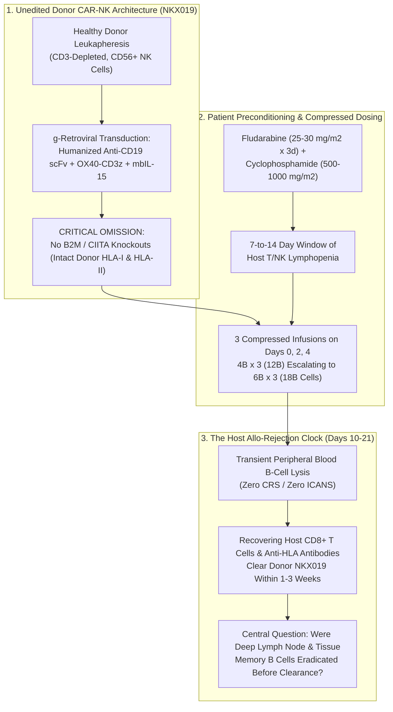
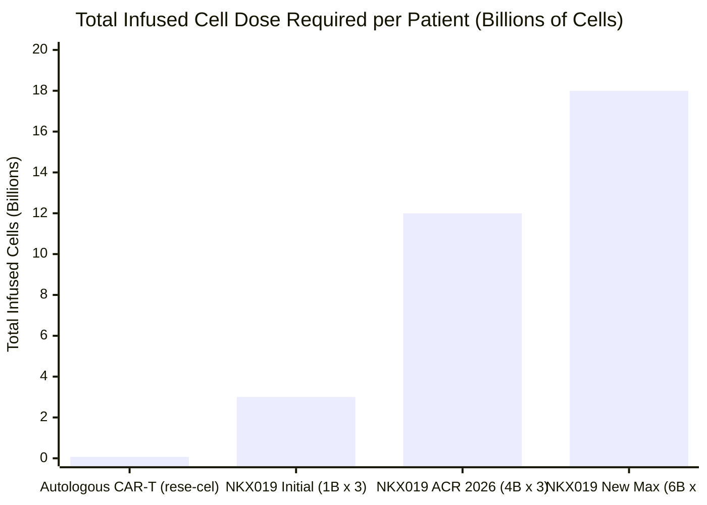
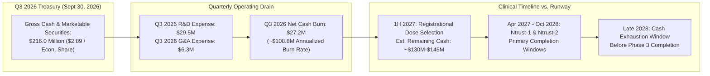

## Executive Summary & Issue Classification

On November 9, 2026, shares of **Nkarta, Inc.** (`NASDAQ: NKTX`) traded at **$1.34**, marking a **58.02% decline (-$1.85)** over the trailing six months from a July 2026 high of **$3.72** and touching an intraday 52-week low of **$1.13**. At first glance, the selloff looks paradoxical: just days earlier at **ACR Convergence 2026** in Orlando, Nkarta announced what management hailed as "impressive" initial clinical data from its Phase 1/2 **Ntrust** program evaluating **NKX019**—an off-the-shelf, allogeneic CD19-directed CAR-NK cell therapy—across severe autoimmune diseases, alongside **$216.0 million** in third-quarter cash and marketable securities against a headline market capitalization of **$95.62 million**.

Why did the institutional biotech market respond to "positive" autoimmune CAR-NK data and a deep negative enterprise value by driving `NKTX` to an all-time low? Applying the **Browne & Keeley critical thinking framework**, we separate this puzzle into two distinct questions:

1. **Descriptive & Mechanistic Issue (Empirical Fact):** Does a three-dose cycle of unedited allogeneic donor CAR-NK cells (`NKX019`) produce durable, drug-free B-cell aplasia and tissue-level remission in autoimmune disease independent of the high-dose **Fludarabine + Cyclophosphamide (`Flu/Cy`)** lymphodepleting chemotherapy given days before infusion?
2. **Prescriptive & Valuation Issue (Capital Allocation):** Does Nkarta's **$216.0 million** cash balance (`$2.89/share` across `74.64 million` economic shares including pre-funded warrants) represent a genuine margin of safety at **$1.34**, or will the company's **$27.2 million to $33.3 million quarterly burn rate** consume that treasury before `NKX019` can select a registrational dose in **1H 2027** and complete Phase 2/3 trials?

### Falsifiability Criteria

To prevent dogmatic confirmation bias, we establish explicit falsifiability thresholds upfront:

* **What Would Falsify the Bearish Thesis:** If Nkarta demonstrates at 12-month follow-up that `≥ 70%` of treated systemic sclerosis (`SSc`), idiopathic inflammatory myopathy (`IIM`), and lupus nephritis (`LN`) patients across all enrolled cohorts (`N ≥ 40`) maintain steroid-free and immunosuppressant-free clinical remission after B-cell reconstitution—matching the 1-to-2-year durability of autologous CD19 CAR-T (`PMID: 38381673`) while holding total manufacturing cost of goods (`COGS`) below `$15,000` per three-dose treatment cycle.
* **What Would Falsify the Bullish Thesis:** If patients evaluated beyond Day 90 (`3 months`) experience rapid recovery of pathogenic memory B-cell clones and clinical relapse once the transient anti-inflammatory effect of `Flu/Cy` chemotherapy wears off, or if escalating to **6 billion cells per dose (`18 billion cells total` on Days 0, 2, and 4)** triggers dose-limiting toxicities, anti-HLA allo-immunization, or destroys the "off-the-shelf" manufacturing economics by consuming an entire donor manufacturing batch for a single patient.

---

## Primary Source Extraction: The Front-Door vs. Clinical Reality Schism

A forensic cross-examination of Nkarta's corporate portal ([nkartatx.com](https://nkartatx.com/) and [ntruststudy.com](https://ntruststudy.com/)), its four registered protocols on ClinicalTrials.gov ([NCT06557265](https://clinicaltrials.gov/study/NCT06557265), [NCT06733935](https://clinicaltrials.gov/study/NCT06733935), [NCT05020678](https://clinicaltrials.gov/study/NCT05020678), [NCT04623944](https://clinicaltrials.gov/study/NCT04623944)), and its Q3 2026 Form 10-Q reveals five structural divergences between headline messaging and underlying clinical mechanics:

| Audit Dimension | Public Corporate Headline & Investor Pitch | Primary Filing, Protocol & Clinical Reality |
| :--- | :--- | :--- |
| **ACR 2026 Sample Size vs. Highlighted Efficacy Subset** | Highlights **83% (5/6)** response in myositis (`IIM`) and **86% (6/7)** `rCRISS-25` response (`-15` point median `mRSS` change) in systemic sclerosis (`SSc`). | **40 patients** were treated across 5 autoimmune indications (`IIM`, `SSc`, `LN`, `AAV`, `pMN`) by the Sept 18, 2026 cutoff, yet headline efficacy was restricted to **13 patients (32.5%)** at the `4 billion cells/dose` tier evaluated at `≥ 3 months`. Outcomes for the other **27 patients** (`67.5%`)—including the flagship [NCT06557265](https://clinicaltrials.gov/study/NCT06557265) (`Ntrust-1`) Lupus Nephritis cohort and lower-dose cohorts—were omitted from headline efficacy tables. |
| **Day 90 Follow-Up vs. `Flu/Cy` Chemotherapy Confounding** | Attributes Day 90 skin (`mRSS`) and muscle (`TIS`) improvements to `NKX019`-mediated "immune reset." | Every patient in the highlighted efficacy cohorts received **Fludarabine (`25–30 mg/m²/day × 3 days`) + Cyclophosphamide (`500–1,000 mg/m²`)** lymphodepletion (`Flu/Cy`). Intravenous cyclophosphamide is an established standard-of-care induction drug for both `SSc` and `IIM` that independently produces 60-to-90-day clinical improvements and lymphocyte depletion. |
| **Allogeneic Rejection & The Dosing Escalation Treadmill** | Markets `NKX019` as a convenient "on-demand, off-the-shelf" therapy engineered for enhanced persistence via membrane-bound IL-15 (`mbIL-15`). | Unlike CRISPR-edited stealth CAR-T/NK constructs, `NKX019` contains **zero HLA class I/II knockouts or allo-evasion edits**. Because host T and NK cells reject unedited donor cells within `7–14 days`, Nkarta had to compress its 3-dose schedule from `Days 0, 7, 14` to **`Days 0, 2, 4`** and escalate total cell burden from `3 billion` (`1B × 3`) to `12 billion` (`4B × 3`) and now **`18 billion cells per patient` (`6B × 3`)**, delaying registrational dose selection to **1H 2027**. |
| **The Oncology Graveyard (`NKX101` & `NKX019` in NHL)** | Positions autoimmune disease as an exciting expansion of a validated CAR-NK platform. | Nkarta pivoted to autoimmunity after its oncology programs stalled: `NKX101` ([NCT04623944](https://clinicaltrials.gov/study/NCT04623944) in AML/MDS, `N = 61`) and `NKX019` ([NCT05020678](https://clinicaltrials.gov/study/NCT05020678) in B-cell lymphomas, `N = 150`) suffered from transient persistence and high relapse rates after month 3, leading to oncology deprioritization and workforce restructuring. |
| **Cash Runway & Share-Count Accounting** | Cites **$216.0 million** in cash (`Sept 30, 2026`) against `71.70M` common shares (`$95.6M` market cap), projecting cash runway "into 2029." | Q3 2026 Form 10-Q shows `74,637,689` weighted-average shares (including `3,000,031` pre-funded warrants at `$0.0001` exercise price), Q3 operating expenses of **$35.8 million** (`$29.5M` R&D + `$6.3M` G&A), Q3 net loss of **$33.3 million**, and Q3 cash burn of **$27.2 million** (`~$108.8M/year` annualized)—implying ~2.0 years of runway at current burn (`late 2028`), just as `Ntrust-1` (est. completion `April 2027`) and `Ntrust-2` (est. completion `October 2028`) require expensive pivotal trials. |

---

## Ambiguity & Clinical Maturity Audit

### The Substitution Test on Key Corporate Phrases

* **"Off-the-Shelf Convenience":** When retail investors hear "off-the-shelf," they envision a subcutaneous biologic pen or a simple outpatient IV antibody infusion. Applying the **Browne & Keeley Substitution Test** via the [NCT06733935](https://clinicaltrials.gov/study/NCT06733935) (`Ntrust-2`) protocol: "off-the-shelf `NKX019`" actually means **three consecutive days of cytotoxic Fludarabine and Cyclophosphamide chemotherapy (`Days -5 to -3`), followed by three separate cryogenic thaw-and-infuse procedures of 4 billion to 6 billion genetically modified donor NK cells on Days 0, 2, and 4 (`12 billion to 18 billion cells total`), accompanied by mandatory monitoring for anti-HLA and anti-NKX019 antibodies**. Compared with genuine off-the-shelf subcutaneous bispecific T-cell engagers (`TCEs` like `teclistamab`, `CLN-978`, or `obexelimab`)—which require **zero chemotherapy lymphodepletion**—`NKX019` retains the chemotherapy toxicity and multi-day infusion center burden of cell therapy.
* **"Trading at Less Than Half of Cash":** Substituting Q3 2026 Form 10-Q figures: at `$1.34` across `74.64 million` economic shares, Nkarta's true market capitalization is **$100.0 million**. While Q3 2026 cash was **$216.0 million** (`$2.89/share`), the company burned **$27.2 million** in Q3 2026 alone (`$0.36/share` per quarter). By the time registrational dose selection occurs in **1H 2027** (`3 quarters` from Sept 30, 2026), cumulative cash burn of `~$80 million to $90 million` will reduce cash to `~$126 million to $136 million` (`~$1.70–$1.82/share`) *before* a single Phase 3 patient is dosed.

### 4-Tier Clinical Maturity Scorecard

| Program & Target | Indication & Trial ID | Clinical Stage & Enrollment | Reported Efficacy & Durability Status | Evidence Tier |
| :--- | :--- | :--- | :--- | :--- |
| **NKX019** (`CD19 CAR + mbIL-15` unedited donor NK) | Systemic Sclerosis (`SSc`) & Myositis (`IIM`) — [NCT06733935](https://clinicaltrials.gov/study/NCT06733935) (`Ntrust-2`) | Phase 1/2 Open-Label (Est. `N = 240`; `40` treated across program) | `5/6` (`83%`) `IIM` TIS response; `6/7` (`86%`) `SSc` `rCRISS-25` (`-15` median `mRSS`) in `13` patients at `4B × 3` dose at **Day 90 (`≥ 3 mos`)**; escalating to `6B × 3` (`18B` cells). | **Tier 2** (Uncontrolled open-label subset; short 3-month window confounded by `Flu/Cy`) |
| **NKX019** (`CD19 CAR + mbIL-15` unedited donor NK) | Lupus Nephritis (`LN`) & Primary Membranous Nephropathy (`pMN`) — [NCT06557265](https://clinicaltrials.gov/study/NCT06557265) (`Ntrust-1`) | Phase 1/2 Open-Label (Est. `N = 120`, started June 2024) | Included within the `40-patient` safety pool (`0%` CRS/ICANS), but **zero cohort-specific efficacy rates (`CRR`) disclosed** in ACR 2026 headline tables. | **Tier 3** (Safety-only disclosure; efficacy unverified in public cut) |
| **NKX019** (`CD19 CAR + mbIL-15` unedited donor NK) | Relapsed/Refractory B-Cell Malignancies (`NHL`) — [NCT05020678](https://clinicaltrials.gov/study/NCT05020678) | Phase 1 (`N = 150`, Active Not Recruiting) | Initial CRs observed, but limited persistence of unedited donor NK cells required retreatments and led to **deprioritization in oncology**. | **Tier 2 — Deprioritized** |
| **NKX101** (`NKG2D CAR + mbIL-15` unedited donor NK) | Relapsed/Refractory `AML` & `MDS` — [NCT04623944](https://clinicaltrials.gov/study/NCT04623944) | Phase 1 (`N = 61`, Active Not Recruiting) | Early `Flu/Ara-C` cohort responses failed to hold in subsequent expansion cohorts; **program terminated/deprioritized**. | **Tier 2 — Discontinued** |

---

## Mechanistic Architecture & 4-Way Causal Audit of the Day 90 Responses

To understand why Nkarta's clinical design is trapped in a race against host immunity, examine the architecture of `NKX019` alongside its trial funnel and lymphodepletion regimen:

### Mandatory 4-Way Causal Audit: Did `NKX019` Cause the Day 90 Clinical Improvements?

When Nkarta reports that `6 of 7` (`86%`) systemic sclerosis patients achieved an `rCRISS-25` response (`-15` median `mRSS` skin score reduction) and `5 of 6` (`83%`) myositis patients achieved a `TIS` response at `≥ 3 months`, **Chapter 9 of Browne & Keeley** requires testing all four causal pathways before attributing the outcome to `NKX019`:

| Causal Hypothesis | Direction | Mechanistic Pathway | Empirical Support & Forensic Verdict |
| :--- | :--- | :--- | :--- |
| **1. Direct Causation** | `NKX019 → B-Cell Reset → Response` | `12 billion` `NKX019` cells lyse `CD19+` B cells in peripheral blood and secondary lymphoid tissues during the first 14 days, resetting the autoimmune repertoire. | **Partial Contributor (Short-Term Verified, Long-Term Unproven):** Peripheral B-cell depletion occurs rapidly, and similar academic CAR-NK constructs (`PMID: 40562027`, `PMID: 41240964`) have shown 6-to-12-month activity when persistence or dual-targeting is sufficient. However, Day 90 is too early to prove deep tissue lymph-node clearance. |
| **2. Lurking Third Variable (`Confounder Z`)** | `Flu/Cy Chemotherapy → Both B-Cell Depletion & Day 90 Clinical Response` | Every highlighted patient received **Fludarabine + Cyclophosphamide (`Flu/Cy`)** plus protocol-permitted baseline corticosteroids (`≤ 20 mg/day` prednisone in `NCT06733935`). High-dose IV cyclophosphamide (`500–1,000 mg/m²`) is an active, guideline-endorsed therapy for severe `SSc` skin/lung fibrosis and refractory myositis that directly ablates proliferating lymphocytes and lowers `mRSS` and `TIS` over a 60-to-90-day window. | **Major Confounder at Day 90:** Without a `Flu/Cy`-alone control arm or `≥ 12-month` immunosuppressant-free follow-up (long after `Flu/Cy` effects wear off), it is scientifically impossible to separate how much of the Day 90 `-15` `mRSS` reduction came from `Flu/Cy` versus `NKX019`. Notably, Nkarta's single-agent `Cy`-only cohorts were not highlighted in the efficacy tables. |
| **3. Selection & Reporting Bias (`Funnel Attrition`)** | `Cohort Filtering (40 → 13) → Inflated Headline Response Rate` | Out of **40 patients** treated across 5 indications and multiple dose levels (`1B`, `1.5B`, `4B` cells/dose), headline efficacy isolated only **13 patients** (`6 IIM`, `7 SSc`) at the `4B × 3` dose with `≥ 3 months` follow-up. | **High Risk of Denominator Distortion:** Excluding `27 of 40` treated patients (`67.5%`)—including lower dose tiers and other indications like `LN` ([NCT06557265](https://clinicaltrials.gov/study/NCT06557265)) and `AAV`—creates a classic post-hoc subgroup filter. Moreover, `mRSS` is an unblinded physical skin-pinch score notoriously susceptible to investigator expectation bias in open-label studies. |
| **4. Mutual Feedback Loop (`Allo-Sensitization vs. Dose Escalation`)** | `Rapid Host Clearance ↔ Schedule Compression & 18B Cell Escalation` | Because unedited donor `NKX019` cells are cleared within `1–2 weeks` by host immunity, insufficient tissue penetration at `1B × 3` (`3B`) forced escalation to `4B × 3` (`12B`) and now **`6B × 3` (`18B cells`)** compressed into **`Days 0, 2, 4`**. | **Confirmed by Trial Conduct:** If `12 billion cells` (`4B × 3`) truly delivered complete, durable tissue B-cell eradication, Nkarta would have locked its registrational Phase 2 dose now rather than escalating another `50%` to **`18 billion cells`** and delaying registrational dose selection to **1H 2027**. |

---

## Statistical & Stoichiometric Deconstruction: The 200x Cell-Mass Penalty

Why does an autologous CD19 CAR-T therapy like Cabaletta Bio's **rese-cel (`CABA-201`)** or academic CD19 CAR-T (`Müller & Schett et al., NEJM 2024`, [PMID: 38381673](https://pubmed.ncbi.nlm.nih.gov/38381673/)) require only a **single infusion of `1 × 10⁶ cells/kg` (`~70 million cells` for a 70 kg adult)**, whereas Nkarta's `NKX019` requires **12,000 million to 18,000 million cells** across three infusions (`171x to 257x more cells`)?

The answer lies in the **in vivo exponential pharmacokinetics (`PK`)** of living autologous T cells versus the **non-expanding, allo-rejected pharmacokinetics** of unedited donor NK cells. We formalize the effective tissue-resident effector exposure (`AUC_tissue`) across time `t ∈ [0, T]` as:

$$AUC_{\text{tissue}} = \int_{0}^{T} D_0 \cdot f_{\text{homing}} \cdot \exp\big((r_{\text{prolif}} - k_{\text{allo}} - k_{\text{apoptosis}}) \cdot t\big) \, dt$$

where `D₀` is the infused cell dose, `f_homing` is the fraction of cells trafficking across vascular endothelium into fibrotic skin, muscle, and deep lymph nodes, `r_prolif` is the antigen-driven *in vivo* clonal expansion rate, and `k_allo` is the host allogeneic rejection rate.

* **For Autologous CD19 CAR-T (`rese-cel` / Schett CAR-T):** Because the cells are the patient's own T cells, host allogeneic rejection is zero (`k_allo = 0`). Upon encountering `CD19+` B cells, `4-1BB` or `CD28` co-stimulation drives massive clonal proliferation (`r_prolif ≫ k_apoptosis`) for `10–14 days`, expanding a `70 million` cell infusion 100-to-1,000-fold *inside* the patient's lymph nodes and maintaining complete B-cell aplasia for **`112 ± 47 days`** ([PMID: 38381673](https://pubmed.ncbi.nlm.nih.gov/38381673/)).
* **For Unedited Allogeneic CAR-NK (`NKX019`):** Mature peripheral blood NK cells have limited proliferative capacity compared to T cells, lack endogenous TCR survival signals, and carry foreign donor HLA molecules (`k_allo ≫ r_prolif` once host lymphocytes begin recovering around Day 7–10). Consequently, `NKX019` acts like a **high-dose biologic bolus** rather than a self-amplifying living drug: to get enough cells into fibrotic scleroderma skin or inflamed muscle before the host immune system destroys them, Nkarta must flood the bloodstream with **12 billion to 18 billion cells** inside a 96-hour window (`Days 0, 2, 4`).

### The Manufacturing Yield & COGS Catch-22

The primary economic justification for allogeneic CAR-NK over autologous CAR-T is manufacturing scalability: one healthy donor leukapheresis run is supposed to produce **100 to 300 off-the-shelf patient doses**, slashing `COGS` per patient to `<$10,000`.

Look at what happens to that math when the required dose per patient escalates 6-fold from `3 billion cells` (`1B × 3`) to **`18 billion cells` (`6B × 3`)**:

1. **6x Compression of Batch Yield:** A bioreactor harvest that previously supplied **60 patients** at `3 billion cells/patient` now supplies only **10 patients** at `18 billion cells/patient` (or fewer after cryopreservation overfill and QC retention vials).
2. **3x Cryogenic Hospital Logistics:** Infusing `6 billion cells` on Day 0, `6 billion cells` on Day 2, and `6 billion cells` on Day 4 requires shipping, storing in vapor-phase liquid nitrogen, thawing, and infusing **three separate multi-bag cryovials per patient** across three clinic visits.
3. **Host Allo-Sensitization Risk ([NCT06733935](https://clinicaltrials.gov/study/NCT06733935) Secondary Outcome #331):** Flooding an autoimmune patient with `18 billion` unedited foreign HLA-bearing cells increases the likelihood of generating **donor-specific anti-HLA antibodies (`DSA`)**. In young female Lupus Nephritis (`LN`) or Systemic Sclerosis (`SSc`) patients who may later require a kidney or lung transplant—or a repeat CAR-NK retreatment—inducing broad anti-HLA sensitization is a serious long-term clinical liability.

---

## Competitive Landscape at ACR Convergence 2026: The Squeeze Play

The market's harsh reaction to `NKTX` during ACR Convergence 2026 cannot be understood in isolation. At the exact same conference in Orlando, competitors presented data that squeezed `NKX019` from both above (efficacy/durability) and below (true off-the-shelf convenience):

| Modality & Asset | Developer | Preconditioning Required | Total Dosing Regimen | Clinical Maturity & ACR 2026 Benchmark Data | Structural Advantage Over `NKX019` |
| :--- | :--- | :--- | :--- | :--- | :--- |
| **Autologous CD19 CAR-T (`rese-cel / CABA-201`)** | Cabaletta Bio (`CABA`) | `Flu/Cy` (single cycle) | **1 infusion** (`1 × 10⁶ cells/kg` ≈ `0.07B` cells) | `>70` patients dosed; **1-to-2-year durable drug-free responses**: `6/6` (`100%`) in DM at 1 yr; `5/7` (`71%`) `rCRISS-50` + `+9%` FVC lung gain in `SSc` at 1 yr; `100%` `LN` DORIS remission with repeat renal biopsies; registrational myositis trial active (`BLA` target 2028). | **4x–8x longer proven follow-up (`1–2 yrs` vs. `3 mos`)** with single infusion and deep tissue/biopsy-proven B-cell reset. |
| **Stealth Gene-Edited Allo CAR-T (`zugo-cel / CTX112`)** | CRISPR Therapeutics (`CRSP`) | `Flu/Cy` | **1 infusion** (`~0.1B–0.3B` cells) | CRISPR-edited (`TRAC`, `B2M`, `TGFBR2` KO) to evade host rejection and T-cell exhaustion; deep B-cell depletion with single infusion. | **Engineered allo-evasion (`B2M` KO)** prevents rapid host clearance without needing `18B` cells across 3 infusions. |
| **iPSC-Derived Edited Dual CAR-NK (`QN-139b`)** | Academic / Qihan (`PMID: 40562027`) | `Flu/Cy` | Clonal iPSC master cell bank (`CD19/BCMA` dual CAR + stealth edits) | Published in *Cell* (Aug 2025, [PMID: 40562027](https://pubmed.ncbi.nlm.nih.gov/40562027/)): reversed skin fibrosis and eliminated plasma-cell autoantibodies at 6 months via dual `CD19 + BCMA` targeting and genetic editing for reduced alloreactivity. | **Clonal homogeneity + `BCMA` plasma-cell coverage + allo-evasion edits**, addressing both short persistence and `CD19-negative` long-lived plasma cells. |
| **Off-the-Shelf Bispecific T-Cell Engagers (`TCEs`: `CLN-978`, `teclistamab`)** | Cullinan / J&J / Amgen / Zenas | **None (Zero `Flu/Cy` Chemo)** | Subcutaneous injection or simple outpatient IV | Deep peripheral and tissue B-cell/plasma-cell depletion in refractory autoimmune diseases without lymphodepleting chemotherapy; mild-to-moderate step-up CRS manageable outpatient. | **True off-the-shelf biologics:** eliminates `Flu/Cy` chemo toxicity, infertility/infection risk, and cryogenic cell-therapy logistics entirely. |
| **Unedited Donor CD19 CAR-NK (`NKX019`)** | **Nkarta (`NKTX`)** | **`Flu/Cy` Required** (for main cohorts) | **3 infusions** (`Days 0, 2, 4` at `4B–6B/dose` = **`12B–18B` cells**) | `13/40` treated patients highlighted at **Day 90 (`≥ 3 mos`)** (`5/6` IIM, `6/7` SSc); `0%` CRS/ICANS; registrational dose delayed to **1H 2027**. | Clean `0%` CRS/ICANS safety profile, but **trapped between `Flu/Cy` chemo burden and unproven post-Day-90 durability**. |

---

## Financial Forensics: Deconstructing the $216.0M Cash Balance vs. $100.0M Valuation

Bullish retail commentary frequently argues that buying `NKTX` at **$1.34** (`$95.62M` basic market cap) is a "free option" on `NKX019` because the company holds **$216.0 million** in cash. A rigorous audit of the Q3 2026 financial statements (period ended September 30, 2026) exposes why institutional cross-over funds value `NKTX` at a steep discount to current cash:

### Key Balance Sheet & Burn Metrics (As of September 30, 2026)

1. **Economic Share Count (`74.64M` vs. `71.70M`):** While financial portals display `71.70 million` basic common shares (`$95.62M` market cap at `$1.34`), Nkarta's Q3 2026 weighted-average share denominator is **`74,637,689` shares** due to **`3,000,031` unexercised pre-funded warrants** (exercisable at `$0.0001/share`). Including these penny warrants, the true economic market capitalization at `$1.34` is **$100.01 million**.
2. **Quarterly Cash Burn Trajectory:**
   * Cash as of June 30, 2026: **$243.2 million**
   * Cash as of September 30, 2026: **$216.0 million**
   * **Q3 2026 Net Cash Burn:** **$27.2 million** (`$108.8 million` annualized)
   * **Q3 2026 GAAP Operating Expenses:** **$35.8 million** (`$29.5M` R&D + `$6.3M` G&A; Q3 GAAP Net Loss = **$33.3 million**).
3. **Why "Runway Into 2029" Is Mathematically Tight:** Dividing `$216.0 million` by the Q3 net cash burn rate of `$27.2 million/quarter` yields **7.94 quarters (`~1.98 years`)**, which lands in **Q3/Q4 2028**—not 2029—unless Nkarta slashes R&D spending, slows trial enrollment, or conducts another workforce reduction. Yet expanding `Ntrust-1` (target `N = 120`) and `Ntrust-2` (target `N = 240`) at an escalated **`18 billion cell`** dose (`6B × 3`) and launching a registrational trial in **2027** will *increase* GMP manufacturing and clinical site costs rather than shrink them.

---

## The "Negative View": Who Loses & What Was Omitted?

Following **Chapter 11 of Browne & Keeley** (*Omitted Information & The Negative View*), we highlight the critical variables omitted from Nkarta's November 2026 presentation:

1. **The Missing 27 Patients (`67.5%` of the Treated Cohort):** Why were efficacy numbers restricted to `6` myositis and `7` systemic sclerosis patients (`13 total`) at the `4B × 3` dose when **40 patients** had been treated by the September 18, 2026 cutoff? Specifically:
   * What were the clinical response rates in the **`1.0B × 3` (`3B`)** and **`1.5B × 3` (`4.5B`)** cohorts? If `3B` and `4.5B` failed to produce durable responses once `Flu/Cy` wore off after Day 90, that proves a steep dose-threshold cliff driven by rapid host rejection.
   * What happened to the patients enrolled in **[NCT06557265](https://clinicaltrials.gov/study/NCT06557265) (`Ntrust-1`: Lupus Nephritis `LN` and Primary Membranous Nephropathy `pMN`)**, which started in **June 2024**—nearly five months *before* `Ntrust-2` (`November 2024`)? Why did a trial that started five months earlier produce zero headline efficacy disclosures at ACR 2026?
2. **The Missing Cellular Pharmacokinetics (`PK`) & B-Cell Recovery Curves:** In `Müller & Schett et al.` ([PMID: 38381673](https://pubmed.ncbi.nlm.nih.gov/38381673/)) and `Marin & Rezvani et al.` ([PMID: 38238616](https://pubmed.ncbi.nlm.nih.gov/38238616/)), the decisive biological biomarkers are **duration of CAR cell persistence (`days`)**, **duration of peripheral B-cell aplasia (`mean 112 ± 47 days` for CAR-T)**, and whether returning B cells are **100% naive (`CD27- IgD+`)** versus relapsing **`CD27+` class-switched memory B cells**. Without 6-to-12-month B-cell phenotype reconstitution data, a Day 90 response following `Flu/Cy` is clinically ambiguous.
3. **Who Bears the Risk if `18B Cells` Fails to Extend Durability:** Patients with refractory `SSc`, `IIM`, `LN`, and `AAV` undergo gonadotoxic, myelosuppressive `Flu/Cy` chemotherapy for `NKX019`. If unedited donor NK cells are rejected before clearing deep lymphoid follicle B cells, those patients absorb the full bone-marrow and infection toxicity of `Flu/Cy` chemotherapy without achieving the multi-year drug-free remission that autologous CAR-T delivers.

---

## Grey Thinking Synthesis & Probability-Weighted Forensic Verdict

Rejecting binary thinking, we synthesize the investment and clinical trajectory of **Nkarta (`NASDAQ: NKTX`)** through conditional **If-Clauses**:

* **If** Nkarta's upcoming **2027 longitudinal readouts (`6-to-12-month follow-up`)** prove that the `4B × 3` (`12B`) and `6B × 3` (`18B`) cohorts maintain complete steroid-free and DMARD-free remission at Month 12—and if the single-agent `Cy`-only preconditioning cohorts replicate that efficacy without Fludarabine—**then** `NKX019`'s **0% CRS / 0% ICANS** safety profile across 40 patients will carve out a defensible outpatient niche in community rheumatology centers that cannot manage CAR-T neurotoxicity, driving a re-rating toward cash value (`$2.50–$3.50/share`).
* **If**, however, patients evaluated at **Month 6 to Month 12** experience pathogenic memory B-cell return and clinical relapse once the 90-day `Flu/Cy` chemotherapy window fades—mirroring the post-Month-3 relapse pattern that derailed `NKX019` in lymphoma ([NCT05020678](https://clinicaltrials.gov/study/NCT05020678)) and `NKX101` in AML ([NCT04623944](https://clinicaltrials.gov/study/NCT04623944))—**then** `NKX019` will be structurally outcompeted by single-infusion autologous CAR-T (`rese-cel`) at the high-efficacy end and chemo-free subcutaneous bispecific antibodies (`TCEs`) at the convenient off-the-shelf end.

### Probability-Weighted Scenarios (12-to-18-Month Horizon)

| Scenario | Probability | Mechanistic & Clinical Trigger | Implied Valuation / Share Price Impact |
| :--- | :--- | :--- | :--- |
| **Base Case: Post-Day-90 Relapse Drift & Cash Attrition** | **55%** | At 6–12 months follow-up, `30%–50%` of initial Day 90 responders require rescue steroids/immunosuppressants as unedited `NKX019` cells clear early; `18B` dose inflates `COGS`; cash drops toward `~$120M` by mid-2027. | Trades at **0.45x–0.65x forward cash (`$0.85 – $1.35/share`)** as a perennial discount-to-cash cell therapy trap. |
| **Bear Case: High Relapse Rate, `LN` Underperformance & Restructuring** | **25%** | Delayed `Ntrust-1` (`LN`) cohorts and lower-dose cohorts show weak durability beyond `Flu/Cy` effect; `6B × 3` (`18B`) triggers anti-HLA sensitization or batch bottlenecks; pipeline restructuring or reverse-split risk emerges in 2027–2028. | Drops to **$0.50 – $0.80/share** (`~0.35x forward cash`), forcing strategic alternatives or distressed consolidation. |
| **Bull Case: Durable 12-Month Remission + `Cy`-Only Validation** | **20%** | `≥ 70%` of `SSc` and `IIM` patients at `12B–18B` cells remain in drug-free remission at Month 12 with naive B-cell reconstitution and `0%` CRS/ICANS; `Cy`-only preconditioning succeeds, enabling a clean 2027 Phase 2/3 start. | Re-rates to **1.0x–1.4x cash (`$2.50 – $4.00/share`)** on partnering or acquisition interest. |

### Bottom-Line Verdict ("What We Actually Think")

The market's **58% six-month selloff in Nkarta (`NKTX`) to $1.34** is not an irrational oversight of `$216.0 million` in cash; it is a rational institutional discounting of **three structural red flags** revealed at ACR Convergence 2026:

1. **A 40-to-13 Patient Reporting Funnel (`32.5%` disclosed efficacy denominator)** that left out `27` treated patients, including the earlier-initiated `Ntrust-1` Lupus Nephritis study ([NCT06557265](https://clinicaltrials.gov/study/NCT06557265));
2. **A 90-Day Evaluation Window Completely Confounded by `Flu/Cy` Chemotherapy**, which independently reduces skin and muscle inflammation over 60 to 90 days; and
3. **An Escalation Treadmill to 18 Billion Unedited Cells (`6B × 3` on Days 0, 2, and 4)** that delays registrational dose selection to **1H 2027** while burning **~$27.2 million per quarter**.

Until Nkarta publishes **unfiltered efficacy across all 40+ treated patients** and proves **12-month immunosuppressant-free durability** long after the `Flu/Cy` chemotherapy effect has vanished, `NKTX` remains a **Show-Me Value Trap** rather than a deep-value bargain.

---

## Primary Sources & Verifiable References

1. **ClinicalTrials.gov ([NCT06557265](https://clinicaltrials.gov/study/NCT06557265)):** *A Phase 1/2 Open-Label Study to Investigate the Safety and Clinical Activity of NKX019 in Participants With Autoimmune Disease (`Ntrust-1`: Lupus Nephritis and Primary Membranous Nephropathy).* Sponsor: Nkarta, Inc.
2. **ClinicalTrials.gov ([NCT06733935](https://clinicaltrials.gov/study/NCT06733935)):** *A Phase 1/2 Study of NKX019 in Autoimmune Diseases (`Ntrust-2`: Systemic Sclerosis, Idiopathic Inflammatory Myopathy, ANCA-Associated Vasculitis, and Rheumatoid Arthritis).* Sponsor: Nkarta, Inc.
3. **ClinicalTrials.gov ([NCT05020678](https://clinicaltrials.gov/study/NCT05020678)) & ([NCT04623944](https://clinicaltrials.gov/study/NCT04623944)):** Phase 1 studies of `NKX019` in B-cell malignancies (`N = 150`) and `NKX101` in AML/MDS (`N = 61`). Sponsor: Nkarta, Inc.
4. **Nkarta Corporate & Trial Disclosures:** [nkartatx.com](https://nkartatx.com/) and [ntruststudy.com](https://ntruststudy.com/) — ACR Convergence 2026 Oral & Poster Presentations (Orlando, FL; data cutoff September 18, 2026) and Q3 2026 Financial Results (Form 10-Q for the period ended September 30, 2026).
5. **Müller F, Taubmann J, Bucci L, et al. (Schett G).** *CD19 CAR T-Cell Therapy in Autoimmune Disease — A Case Series with Follow-up.* **The New England Journal of Medicine** (2024 Feb 22); 390(8):687–700. [PMID: 38381673](https://pubmed.ncbi.nlm.nih.gov/38381673/).
6. **Marin D, Li Y, Basar R, et al. (Rezvani K).** *Safety, efficacy and determinants of response of allogeneic CD19-specific CAR-NK cells in CD19+ B cell malignancies.* **Nature Medicine** (2024 Mar); 30(3):772–784. [PMID: 38238616](https://pubmed.ncbi.nlm.nih.gov/38238616/).
7. **Wang X, Zhang Y, Jin Y, et al. (Xu H).** *An iPSC-derived CD19/BCMA CAR-NK therapy in a patient with systemic sclerosis.* **Cell** (2025 Aug 07). [PMID: 40562027](https://pubmed.ncbi.nlm.nih.gov/40562027/).
8. **Changhai Hospital / Naval Medical University Investigators.** *Efficacy and safety of allogeneic CD19 CAR NK-cell therapy in systemic lupus erythematosus: a case series.* **The Lancet** (2025). [PMID: 41240964](https://pubmed.ncbi.nlm.nih.gov/41240964/).
