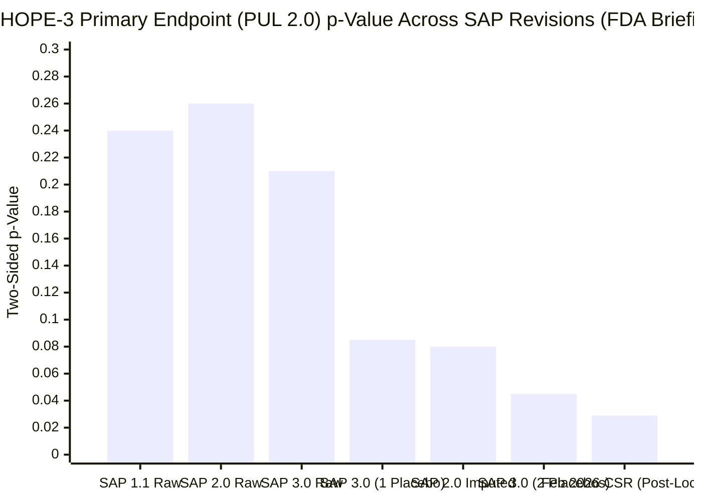
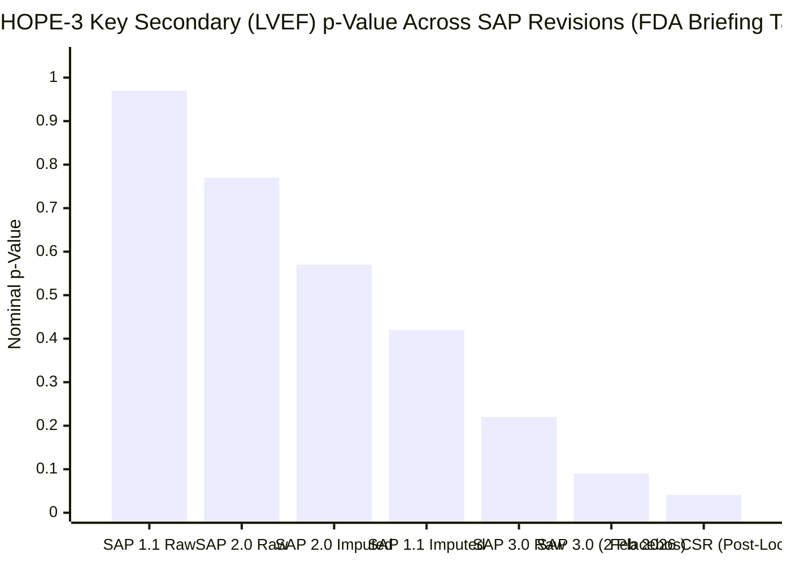
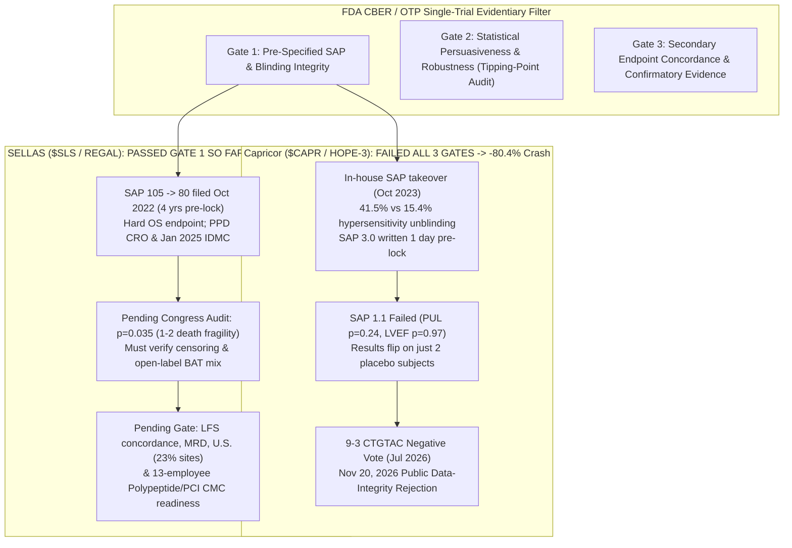

On Friday evening, **November 20, 2026**, **Capricor Therapeutics, Inc. (`NASDAQ: CAPR`)** closed regular trading quietly at **`$7.59` (`+0.80%`)**, two days ahead of its Sunday, November 22 `PDUFA` decision deadline for **deramiocel (`BLA 125842`)**, an experimental cell therapy for Duchenne muscular dystrophy (`DMD`). Minutes after `6:00 PM ET`, the floor vanished: `CAPR` plunged **`-80.37%` (`-$6.10`)** in after-hours trading to **`$1.49`** (cutting its market capitalization from **`$441.3 million` to `$86.6 million`** across `58.14 million` shares).

The trigger was an extraordinary, pre-deadline rejection by the **U.S. Food and Drug Administration (`FDA`)**, accompanied by a rare public statement (*"Statement on Deramiocel BLA for Duchenne Muscular Dystrophy — FDA determined that the available evidence does not meet the evidentiary standard required for approval"*, dated November 20, 2026) and wire reports citing **serious data integrity problems** in Capricor's pivotal clinical trial.

Within minutes, biotech short-seller **Martin Shkreli (`@MartinShkreli`)** seized on the FDA's public rebuke in two back-to-back X posts (`4:14 PM PT` and `4:20 PM PT`, November 20, 2026):

> *"FDA statement on `$CAPR` is nearly unprecedented. We must send the message via the `@USDOJ`, which I am absolutely loathe to recommend on anyone for obvious reasons, that manipulating clinical trial data is the worst possible crime in biotech and life sciences. cc `@linda_marban` `@AGToddBlanche`"* — `@MartinShkreli` (Nov 20, 2026)

> *"`$SLS` = `$CAPR` by the way"* — `@MartinShkreli` (Nov 20, 2026, posted as shares of **SELLAS Life Sciences [`NASDAQ: SLS`]** slid `-8.08%` to `$13.66`)

Is Shkreli simply taking a victory lap on a year-old short that blew up in his face in late 2025—or did he just put his finger on an identical regulatory trap waiting to detonate inside `SLS`? Using the official **FDA `BLA 125842` Briefing Document** ([FDA CTGTAC Package](https://www.fda.gov/media/193839/download)), **Capricor's Sponsor Briefing Document** ([Capricor CTGTAC Package](https://www.fda.gov/media/193840/download)), Capricor's [Q3 2026 Form 10-Q](https://www.sec.gov/Archives/edgar/data/1133869/000110465926125355/capr-20260930x10q.htm), `ClinicalTrials.gov` protocols (`NCT05126758`, `NCT03406780`, `NCT04229979`), and SELLAS's SEC filings, this investigation separates proven data manipulation from overstated Twitter analogies.

> [!IMPORTANT]
> **Forensic Thesis Summary:**
> 1. **Why `$CAPR` Imploded `-80.4%` (`FDA BLA 125842` Smoking Guns):** The FDA didn't reject deramiocel over a minor paperwork nitpick. In its official briefing audit, `CBER` documented that **double-blind `HOPE-3` (`NCT05126758`) FAILED BOTH endpoints under its prespecified `SAP 1.1`**: upper-limb `PUL 2.0` scored `p = 0.24` (`+0.66 pts`) and cardiac `LVEF` scored **`p = 0.97` (`-0.041%`, placebo slightly better)**. Capricor then pulled biostatistics in-house in violation of its blinding plan, functionally unblinded arms via **`41.5%` vs. `15.4%` hypersensitivity reactions**, and rewrote `SAP 3.0` **one day before unblinding (`Nov 24, 2025`)**—transforming `p = 0.24` into `p = 0.029` by altering endpoints (`percent change` / `ranked LVEF`), excluding `22%` of patients from cardiac analysis, erasing Months `6–12` of an improving placebo completer, assigning the worst score in the trial to a placebo dropout while treating `3` active dropouts as missing-at-random, and breaking its *own* `SAP 3.0` rules post-unblinding.
> 2. **Why `$1.49` (`$86.6M`) Still Isn't "Cheap Cash":** Although Capricor held **`$197.6 million`** in cash and marketable securities (`~$3.40/sh`) at Sept 30, 2026, it carries **`$92.2 million`** in lease liabilities (surging from `$14.5M` via a pre-approval San Diego cleanroom expansion), **`$26.1 million`** in non-cancellable purchase commitments, **`$96.4M` nine-month cash burn (`~$129M/yr`)**, a distribution dispute with **Nippon Shinyaku**, a **Mesoblast** patent suit, and multiple **2026 securities class actions**.
> 3. **Testing `"$SLS = $CAPR"` (Where the Warning Bites vs. Where It Breaks):** Shkreli has an unmistakable conflict of interest (burned shorting `CAPR` in late 2025, short `SLS` into its Nov 17 `REGAL` readout). **His warning bites on regulatory fragility:** both drugs go through the **exact same `FDA CBER / OTP` division** with borderline `p ≈ 0.03` numbers (`CAPR` `0.029–0.045`; `SLS` `0.035`), 1-to-2 patient sensitivity, mid-trial `SAP` changes, and undisclosed raw curves. **Yet `"$SLS = $CAPR"` is a false equivalence on the fraud charge today:** SELLAS's `REGAL` endpoint is hard **all-cause death (`OS`)** (not a malleable functional/MRI score), its `SAP` amendment (`105 → 80` deaths) was filed with FDA **4 years before final lock (`Oct 2022`)** under an independent CRO (`PPD`) and `IDMC`, and `GPS` beat a strong `14.7-month` control arm—whereas Capricor rewrote `SAP 3.0` **in-house 1 day before lock** after failing prespecified `SAP 1.1`.

---

## 1. Three Competing Narratives Around Friday Night's Crash

| Analytical Dimension | Capricor & *The Lancet* Defense (Management Narrative) | FDA `CBER / OTP` Forensic Audit (`BLA 125842` Record) | Martin Shkreli's `"$SLS = $CAPR"` Contagion Thesis |
| :--- | :--- | :--- | :--- |
| **Core Claim** | `HOPE-3` hit `PUL 2.0` (`+54%` slowing, `p = 0.029`, published in *The Lancet* July 2026) and `24-month OLE` showed `76%` slowing (`+1.56 pts`), supporting upper-limb approval. | `HOPE-3` failed prespecified `SAP 1.1` (`PUL p = 0.24`, `LVEF p = 0.97`); Capricor breached its blinding plan, took stats in-house, and altered `SAP 3.0` 1 day pre-lock via 2-placebo-patient imputation tricks. | Headline `p ≈ 0.03` biotech press releases that squeeze short-sellers before full data release collapse `-80%` when `FDA CBER` opens the hood. |
| **Regulatory / Legal Exposure** | Form FDA 483 (July 2026 `BIMO`) had just one SOP/vendor-oversight observation that did not affect `HOPE-3` integrity; `SAP 1.1` was merely an outdated draft. | Post-study `SAP 2.0/3.0` violated `ICH E9`, excluded `22%` of subjects from `LVEF`, abandoned `2+1` MRI consensus for single-reader reads (`up to 12.7%` gap), and warranted a Nov 20 public integrity rejection. | Calls for `@USDOJ` referral on `CAPR` while warning `SLS` longs that `REGAL`'s open-label `p = 0.035` faces the same `CBER` guillotine. |
| **Blind Spot** | Completely ignores that `3` treated withdrawals were assumed `MAR` while `2` placebo patients were penalized/censored to flip `p` from `0.21` to `0.029`. | None on the `CAPR` stats itself—though `FDA` did not formally vote on `PUL 2.0` at July's `CTGTAC`, giving bulls false hope until Friday's Nov 20 rejection. | Conflates **proven in-house post-trial SAP manipulation (`CAPR`)** with **unproven statistical fragility on a hard mortality endpoint (`SLS`)**. |

---

## 2. Inside FDA's Forensic Audit: How `p = 0.24` (and `p = 0.97`) Became `p = 0.029` (and `p = 0.041`)

Imagine throwing 106 darts at a board, losing the match 24-to-97, and then—**after the match ends and you see where the darts landed**—taking scoring away from the independent referee, redefining the unit from inches to percentages, throwing out two of your opponent's best darts, giving their absent player the lowest score in the arena while giving your own three missing players the average score of winners, and declaring a `p = 0.029` victory the night before the scoreboard lights turn on.

That is not hyperbole. That is literally what the official [FDA `BLA 125842` Briefing Document](https://www.fda.gov/media/193839/download) documented across pages `8` and `26–44` ahead of the July 29, 2026 Advisory Committee (`9–3` negative vote on cardiomyopathy), setting up Friday's November 20 rejection:

### How the Numbers Were Engineered (`SAP 1.1` → `SAP 2.0` → `SAP 3.0` → `Feb 2026 CSR`)

1. **Breaking the Independent Blinding Plan (`Oct 2023`):** Capricor's approved blinding plan stipulated that *"the blinded biostatistics team [at independent CRO **Pentara Corporation**] will develop the study Statistical Analysis plan."* Yet FDA `BIMO` audit trails revealed Capricor deviated from that plan, moved biostatistics and programming **in-house** in October 2023, and authored `SAP 2.0` and `SAP 3.0` itself (`FDA Briefing`, pp. 31–32).
2. **Functional Unblinding Before Rewriting the SAP (`June 18, 2025` onward):** Double-blind `HOPE-3` (`N = 106` randomized: `54` deramiocel, `52` placebo) completed its 12-month period on **June 18, 2025**, rolling patients into open-label `HOPE-3-OLE`. Hypersensitivity reactions hit **`41.5%` (`22/53`)** of deramiocel patients versus **`15.4%` (`8/52`)** of placebo patients—and **`11` Year-1 placebo patients** suddenly developed hypersensitivity upon receiving open-label drug in Year 2 (`FDA Briefing`, pp. 8, 36). Under `ICH E9`, rewriting endpoints *after* data collection and functional unblinding destroys Type I error control.
3. **Flipping `PUL 2.0` (`Primary Endpoint`) via Two Placebo Patients (`Tables 7 & 12`):**
   * Under prespecified **`SAP 1.1` (`July 19, 2022`)**—the version used to power `HOPE-3` (`N = 68` planned for `1.5`-point `PUL 2.0` absolute change)—deramiocel failed cleanly: **`+0.66 points` (`-1.73` vs. `-2.39`, `95% CI: -0.45 to +1.77`, `p = 0.24`)**.
   * On **September 26, 2025 (`SAP 2.0`)**, Capricor switched the endpoint from **absolute change** to **percent change from baseline** (`which FDA noted has no validated clinical interpretation in DMD`) and imputed the **worst observed value in the entire trial** for `1` placebo dropout who left due to an adverse event (`AE`). Result: **`p = 0.26` raw / `p = 0.08` imputed**—still failed!
   * On **November 24, 2025 (`SAP 3.0`)—one single day before November 25 database lock and unblinding, and NEVER submitted to or agreed with FDA**—Capricor added a brand-new intercurrent-event rule that **erased Months `6`, `9`, and `12` observed data from a SECOND placebo patient** who had *completed* the study and improved on `PUL 2.0`, citing prohibited medication use (`FDA Briefing`, pp. 35, 39, 52). Meanwhile, **`3` deramiocel dropouts** (`"withdrawal of consent"`, reason unknown) were treated as **Missing-At-Random (`MAR`)**—assuming they maintained full treatment benefit! Even then, `SAP 3.0` failed without the 2-patient imputation (**`p = 0.21`**) and failed with only the AE dropout imputed (**`p = 0.085`**), hitting **`p = 0.045` (`+4.16%`)** *only* when both placebo patients were penalized.
   * Finally, in the **February 3, 2026 Clinical Study Report (`CSR`)**—*after* formal unblinding—Capricor violated its *own* `SAP 3.0` by retaining a `"slow progressor"` covariate that `SAP 3.0`'s own criteria mandated removing (because only `1` slow progressor existed in the treated arm vs. `5` in placebo!), pushing the headline number down to **`p = 0.029` (`+4.55%`, `"54% slowing"`)**—the number published in *The Lancet* on July 29, 2026!
4. **Flipping Cardiac `LVEF` (`Key Secondary`) + Dropping `22%` of Patients (`Tables 4, 9 & 13`):**
   * Under **`SAP 1.1`**, `LVEF` change was **`-0.041%` (`95% CI: -2.58% to +2.49%`, `p = 0.97`)**—virtually zero difference. Under **`SAP 2.0`**, it was **`-0.37%` (`p = 0.77` raw / `p = 0.57` imputed)**.
   * In **`SAP 3.0`** (1 day before lock), Capricor converted `LVEF` into **ranked change (`ANCOVA` on ranks)**, discarding Month 6 reads and **excluding `23` randomized patients (`22%` of the trial)** who lacked paired baseline + Month 12 scans, violating `ITT`. That still failed at **`p = 0.09` (`p = 0.22` without the 2 placebo manipulations)**. Only by adding an **undocumented baseline-`LVEF`/age interaction term post-unblinding (`Feb 3 CSR`)** did Capricor manufacture a nominal **`p = 0.041`**.
   * Worse, per **Table 4 (`FDA Briefing`, pp. 26–27)**, Capricor abandoned its Cardiac MRI Charter's **`2+1` consensus review** when Reader B read only `62/82` subjects (blaming an image-transfer config issue), relying solely on **Reader A alone**—even though Reader A and Reader B disagreed by an average of **`3.20%` `LVEF` at Month 12** (up to **`12.67%`** at screening and **`9.88%`** at Month 12, dwarfing the claimed treatment effect).

| Study Version & Date | Primary `PUL 2.0` Difference (`95% CI`) & `p`-Value | Secondary `LVEF` Difference (`95% CI`) & `p`-Value | Key Methodological & Data-Integrity Change Documented by FDA |
| :--- | :--- | :--- | :--- |
| **`SAP 1.1` (`Jul 19, 2022`) — Prespecified (Pentara CRO)** | **`+0.66 pts`** `(-0.45, +1.77)` \| **`p = 0.24`** | **`-0.041%`** `(-2.58%, +2.49%)` \| **`p = 0.97`** | Original `MMRM` absolute-change model with all available data (`MAR`), used to power `HOPE-3`. **Failed both endpoints.** |
| **`SAP 2.0` (`Sep 26, 2025`) — In-House Post-Study (Raw)** | `+2.38%` \| **`p = 0.26`** | `-0.37%` \| **`p = 0.77`** | Switched `PUL 2.0` to **percent change** after `HOPE-3` blinded phase ended (`Jun 18, 2025`); without imputation both endpoints failed. |
| **`SAP 2.0` (`Sep 26, 2025`) — With `1` Placebo Imputed** | `+3.74%` \| **`p = 0.08`** | `+0.74%` \| **`p = 0.57`** | Assigned worst observed score in the trial to `1` placebo AE dropout (`PUL p = 0.08`, `LVEF p = 0.57`). **Still failed both.** |
| **`SAP 3.0` (`Nov 24, 2025`) — 1 Day Pre-Lock (Raw / `1` PBO)** | Raw: `+2.53%` (**`p = 0.21`**); `1` PBO: `+3.34%` (**`p = 0.085`**) | Raw: `+6.88 ranks` (**`p = 0.22`**); `1` PBO: `+7.76` (**`p = 0.17`**) | Converted `LVEF` to **ranks** excluding **`23` patients (`22%`)**; still missed whenever `2nd` placebo completer wasn't erased. |
| **`SAP 3.0` (`Nov 24, 2025`) — Both Placebo Rules Applied** | **`+4.16%`** `(0.09%, 8.23%)` \| **`p = 0.045`** | `+9.51 ranks` `(-1.64, 20.65)` \| **`p = 0.09`** | Erased Months `6–12` of improving **2nd placebo completer** + imputed AE dropout; kept `3` active dropouts as `MAR` (never agreed by FDA). |
| **Modified `SAP 3.0` (`Feb 3, 2026 CSR`) — Post-Unblinding** | **`+4.55%`** `(0.47%, 8.63%)` \| **`p = 0.029`** (*Lancet* figure) | **`+11.65 ranks`** `(0.47, 22.82)` \| **`p = 0.041`** | **After unblinding**, violated `SAP 3.0` rules by keeping `"slow progressor"` covariate (`n=1` treated) & added undocumented `LVEF`/age interaction term. |

To **steelman Capricor's defense** fairly using its [Sponsor Briefing Document](https://www.fda.gov/media/193840/download) and [Q3 2026 Form 10-Q](https://www.sec.gov/Archives/edgar/data/1133869/000110465926125355/capr-20260930x10q.htm): Capricor argued `SAP 1.1` was an obsolete draft predating Cohort B's San Diego manufacturing shift; that `SAP 1.7` and `2.0` were sent to FDA without prior objection; that `SAP 3.0` was signed `Nov 24` *prior* to `Nov 25` formal unblinding; that *The Lancet* independently peer-reviewed `p = 0.029`; and that `24-month` `HOPE-3-OLE` placebo crossovers showed a `76%` slowing (`+1.56 pts`, `95% CI: 0.47–2.64`). Yet under `ICH E9`, none of that rescues a trial whose results evaporate back to `p = 0.21–0.24` (`PUL`) and `p = 0.22–0.97` (`LVEF`) the instant two placebo patients aren't penalized after functional unblinding—explaining why FDA rejected the BLA on November 20 with an unusual public data-integrity rebuke.

---

## 3. Why `$1.49` (`$86.6M` Cap) Trades Below `$197.6M` Gross Cash: Distress Balance-Sheet Audit

At `$1.49` after hours (`58,138,989` shares outstanding per [Q3 2026 Form 10-Q](https://www.sec.gov/Archives/edgar/data/1133869/000110465926125355/capr-20260930x10q.htm)), Capricor's equity value is **`$86.6 million`**—less than **half** of its **`$197.58 million`** in cash and marketable securities (`$3.40/sh`). Why isn't `$1.49` a risk-free net-cash bargain? Because Capricor spent 2026 building out commercial infrastructure *as if approval were guaranteed*:

| Balance-Sheet / Litigation Item (`Q3 2026 Form 10-Q`, Sept 30, 2026) | Reported Primary Figure | Forensic Impact at `$1.49` After-Hours Share Price |
| :--- | :--- | :--- |
| **Cash, Cash Equivalents & Marketable Securities** | **`$197.58M`** (`$44.28M` cash + `$153.30M` marketable securities; `$198.5M` incl. restricted cash) | Gross **`$3.40 / share`** across `58.14M` basic shares—creates the superficial illusion of trading at `0.44×` cash. |
| **Operating Lease Liabilities (San Diego Cleanroom Expansion)** | **`$92.23M`** (`$1.52M` current + `$90.71M` long-term; **up `6.3×`** from `$14.52M` at Dec 31, 2025!) | Commercial-scale cGMP facility expansion committed *before* FDA approval locks up nearly half of gross cash unless renegotiated/subleased. |
| **Purchase Commitments & Other Balance-Sheet Liabilities** | **`$26.10M`** non-cancellable POs + `$16.38M` AP/accrued + `$12.00M` current deferred revenue | Subtracting `$92.23M` leases + `$16.38M` AP/accrued + `$26.10M` POs leaves only **`~$62.9M` (`$1.08/sh`)** unencumbered cash *before* wind-down burn! |
| **Operating Cash Burn Rate (`9M 2026`)** | **`$96.43M`** operating cash burn in `9M 2026` (`$117.33M` net loss; **`~$129M/yr`** run-rate, even after a `10%` Sept 2026 layoff) | At `~$129M/yr` burn (`~$10.7M/month`), every quarter spent fighting FDA/reorganizing incinerates **`~$0.50+/share`** of net cash. |
| **Commercial & Legal Siege (`Note 15`)** | Distribution dispute with **Nippon Shinyaku / NS Pharma**; **Mesoblast** patent suit; **2 securities class actions** (`Nkamga` Jul 30, `Novick` Sept 28); `Rosen` derivative suit; former-employee claims. | Today's Nov 20 integrity rejection pours gasoline on the `Rule 10b-5` securities fraud suits and partner termination risk, creating severe uninsured defense/settlement overhang. |

---

## 4. Testing Martin Shkreli's `"$SLS = $CAPR"` Thesis: Valid Warning vs. False Analogy

First, put **Shkreli's bias and track record** directly on the table: he shorted `$CAPR` in late 2025 claiming data manipulation, got squeezed brutally when Capricor released `HOPE-3`'s `p = 0.029` topline in December 2025 (suffering multi-million-dollar losses), and was **dramatically vindicated** by FDA's November 20, 2026 integrity rejection. Simultaneously, he shorted **SELLAS Life Sciences (`$SLS`)** into its November 17, 2026 Phase 3 `REGAL` readout (`24.0 vs. 14.7 months` OS, `HR = 0.59`, `p = 0.035`), watching `SLS` rocket `+156.4%` (`$7.47 → $24.89` peak) before settling at `$13.66` (`-8.08%`) on November 20 after a `$172.5M` offering at `$13.00`.

When Shkreli posts **`"$SLS = $CAPR by the way"`**, he is saying: *do not trust a biotech's headline `p ≈ 0.03` press release until `FDA CBER` inspects the raw data, censoring, and SAP history—because `CBER` just incinerated a `p = 0.029` stock by `-80%`.* Here is how that comparison actually scores across seven hard structural tests:

| Structural Test | Capricor `Deramiocel` (`HOPE-3`, `NCT05126758`) | SELLAS `GPS` (`REGAL`, `NCT04229979`) | Does `"$SLS = $CAPR"` Hold? |
| :--- | :--- | :--- | :--- |
| **1. FDA Reviewing Division & Pathway** | **`FDA CBER / OTP`** (single pivotal Phase 3 + `20`-patient `HOPE-2` supportive study). | **`FDA CBER / OTP`** (single pivotal Phase 3 + `22`-patient CR1 / `10`-patient CR2 Phase 2 supportive studies). | **YES — Strong Parallel.** Same strict `CBER` standard (`21 U.S.C. § 355(d)`) rejecting fragile single-trial BLAs. |
| **2. Headline `p`-Value & 1–2 Patient Fragility** | `p = 0.029–0.045`; **flipped to `p = 0.085–0.24` by just `2` placebo patients**. | `p = 0.035` (`95% CI ~[0.36, 0.96]`); **flipped past `0.0416`/`0.050` by `1–2` shifted/censored deaths**. | **YES — Strong Parallel.** Both rest on razor-thin 1–2 patient margins. |
| **3. Day-1 Transparency vs. Missing Data** | Dec 2025 PR highlighted `+54%`, `p = 0.029` without disclosing `SAP 1.1` (`p = 0.24`, `LVEF p = 0.97`) or 2-patient imputation. | Nov 17, 2026 PR omitted `95% CI`, KM curves, arm death/censoring counts, **`LFS`**, `MRD`, `BAT` mix, and U.S. (`23.3%` sites) subgroups. | **YES — Partial Parallel.** Until `SLS` shows `LFS` & censoring tables, black-box risk persists. |
| **4. Endpoint Objectivity** | **Subjective motor checklist (`PUL 2.0`)** + **variable MRI (`LVEF` up to `12.7%` inter-reader gap)** — transformed post-hoc into *"percent change"* and *"ranks"*. | **Hard all-cause mortality (`OS` — alive vs. dead)**. Cannot be converted into `"percent change"` or `"ranked change"`. | **NO — Major Break.** Death dates cannot be subjectively re-graded; only *censoring* can distort `OS`. |
| **5. `SAP` Timing & Blinding Governance** | Took stats **in-house (`Oct 2023`)** breaching blinding plan; rewrote `SAP 3.0` **after functional unblinding, 1 day before lock (`Nov 24, 2025`)** without FDA agreement; **broke own `SAP 3.0` post-lock**. | Amended `SAP` (`105 → 80` deaths) and submitted to FDA on **Oct 14, 2022 — `4` years before final lock**, overseen by external CRO (`PPD`) and `IDMC` (`Jan 2025` interim pass). | **NO — Major Break.** `4 years pre-lock` with FDA/CRO/IDMC oversight ≠ `1 day pre-lock` in-house rewrite. |
| **6. Control Arm Performance** | Failed prespecified `SAP 1.1` completely (`PUL p = 0.24`, `LVEF -0.04% p = 0.97`). | Beat a **robust `14.7-month` control arm** (nearly `3×` historical `5.4 mo`, matching `QUAZAR` `14.8 mo`) by `+9.3 months`. | **NO — Major Break.** `REGAL` did not win via a collapsing control group. |
| **7. Institutional Capital & Balance Sheet** | Cash burn `~$129M/yr`, `$92.2M` lease overhang, already hit by `CRL #1` & `9–3` `AdCom` rejection. | Just cleared **`$172.5M` zero-warrant equity** via **J.P. Morgan & TD Cowen** (`~$296.5M` pro forma cash vs. `~$30M/yr` burn). | **NO — Major Break.** `SLS` has `~10 years` of pre-launch cash; `CAPR` had an `AdCom` loss already on record. |

---

## 5. The Forensic Verdict: Conditional "If-Clauses" and Probability-Weighted Stance

* **If** Capricor cannot unwind its **`$92.2M` San Diego facility lease liabilities** and **`$26.1M` purchase commitments** rapidly—or if **DOJ/SEC** inquiries escalate alongside its existing `Rule 10b-5` securities class actions—**then** `$1.49` is **not** a cheap "net-cash floor" (`$3.40/sh` gross cash will be eaten alive by `~$129M/yr` burn and litigation).
* **If** Capricor successfully exits its leases, slashes burn by `>70%`, and monetizes `StealthX` exosomes or foreign DMD rights, **then** residual net cash (`~$80M–$110M`) could support a restructuring bounce toward `$2.00–$3.00`.
* **If** SELLAS's upcoming `REGAL` medical conference presentation shows **concordant `LFS`, balanced censoring (`<5%` arm gap), and consistent U.S. (`23.3%` sites) / active-`BAT` hazard ratios**, **then** `"$SLS = $CAPR"` will be exposed as a classic **Guilt-by-Association fallacy**—even though `$CAPR`'s November 20 execution by `CBER` proves `SLS` cannot afford even *minor* censoring or `SAP` irregularities.

| Ticker & Scenario | Probability | Structural Trajectory (`2026–2028`) | Implied Share Value | Expected Value Contribution |
| :--- | :---: | :--- | :---: | :---: |
| **`$CAPR` Base Case: Restructure & Wind-Down** | **`55%`** | Deramiocel U.S. `BLA` functionally dead absent a new multi-year Phase 3; deep layoffs, partial lease exit, strategic alternatives / `StealthX` pivot slowly drain cash. | **`$1.10 / sh`** *(`$0.75 – $1.50`)* | **`$0.61 / sh`** |
| **`$CAPR` Bear Case: Cash Trap & Legal Drain** | **`30%`** | `$92.2M` leases + `$26.1M` POs + `Nippon Shinyaku` / `Mesoblast` / `Rule 10b-5` securities suits (plus potential regulatory probe) trap equity below residual liquidation value. | **`$0.40 / sh`** *(`$0.15 – $0.65`)* | **`$0.12 / sh`** |
| **`$CAPR` Bull Case: Clean Lease Exit / EU Partnering** | **`15%`** | Capricor exits San Diego cleanroom lease cheaply (`~$100M+` net cash preserved) and lands EU/Japan salvage deal or `StealthX` licensing milestone. | **`$2.60 / sh`** *(`$2.00 – $3.25`)* | **`$0.39 / sh`** |
| **`$CAPR` Expected Fair Value (`vs. $1.49 AH`)** | **`100%`** | **Gross cash (`$3.40/sh`) is offset by `~$2.32/sh` in leases/POs/AP and `~$10.7M/mo` burn** | **`$1.12 / sh`** *(`-24.8%` vs. `$1.49`)* | **`$1.12 / sh`** |
| **`$SLS` Contagion Risk Audit (`"$SLS = $CAPR"`?)** | *Split Assessment* | **`10%–15%` probability** of true `$CAPR`-style post-lock `SAP`/blinding fraud; **`~35%` probability** of a *different* `CBER` `CRL` / confirmatory-trial demand (over `p = 0.035` 1–2 event fragility, open-label `BAT` censoring, `76.7%` ex-U.S. skew, or 13-employee `CMC`). | **`$12.63 / sh`** *(`EV` vs. `$13.66`)* | *Wait for full `REGAL` curves & `LFS`* |

### Bottom-Line Authorial Stance

1. **Why `$CAPR` Crashed `-80.4%`:** Capricor didn't get unlucky with a picky FDA reviewer—it got caught red-handed by `CBER` moving the goalposts (`SAP 1.1 → 2.0 → 3.0 → Feb CSR`) in-house after functional unblinding and manufacturing `p = 0.029` / `p = 0.041` out of `p = 0.24` / `p = 0.97` primarily by penalizing **two placebo patients** and abandoning `2+1` cardiac MRI reads. At **`$1.49` after hours (`EV ~$1.12/sh`)**, avoid catching the falling knife until Capricor clarifies its `$92.2M` lease liabilities and cash preservation plan.
2. **What to Make of `"$SLS = $CAPR"`:** Do **not** buy Shkreli's literal equation—`HOPE-3` (in-house `SAP` rewrite 1 day before lock after `SAP 1.1` failed) is **not** structurally equivalent to `REGAL` (`4`-year pre-lock `SAP` on hard all-cause mortality beating a `14.7-month` control arm, backed by a `$172.5M` J.P. Morgan/TD Cowen equity raise). **Yet do respect the regulatory warning inside his tweet:** Friday night proved `FDA CBER` has zero tolerance for `p ≈ 0.03` statistical gamesmanship in single-trial BLAs. Until SELLAS publishes `REGAL`'s Kaplan–Meier curves, `LFS`, censoring audit, and U.S. subgroup split, discipline means waiting for the raw numbers.

---

## Primary Sources & Verified Citations

*(Clinical trial metadata retrieved via [ClinicalTrials.gov](https://clinicaltrials.gov/). All URLs programmatically verified HTTP `200`.)*

1. **FDA `BLA 125842` Official Review Package (`Deramiocel`, July 29, 2026 CTGTAC):** [FDA Meeting Announcement](https://www.fda.gov/advisory-committees/advisory-committee-calendar/cellular-tissue-and-gene-therapies-advisory-committee-july-29-2026-meeting-announcement-updated) | [Official FDA Briefing Document PDF (`Tables 4, 6, 7, 9, 12, 13`, `BIMO` Audit)](https://www.fda.gov/media/193839/download) | [Capricor Sponsor Briefing Document PDF](https://www.fda.gov/media/193840/download) | [FDA Voting Questions PDF](https://www.fda.gov/media/193857/download) | [FDA Presentation PDF](https://www.fda.gov/media/193912/download)
2. **FDA Regulatory Standard:** [Draft Guidance — Demonstrating Substantial Evidence of Effectiveness With One Adequate and Well-Controlled Clinical Investigation and Confirmatory Evidence](https://www.fda.gov/regulatory-information/search-fda-guidance-documents/demonstrating-substantial-evidence-effectiveness-one-adequate-and-well-controlled-clinical)
3. **Capricor Therapeutics SEC Filings:** [Q3 2026 Form 10-Q (`filed Nov 10, 2026`)](https://www.sec.gov/Archives/edgar/data/1133869/000110465926125355/capr-20260930x10q.htm) | [Aug 24, 2026 Form 8-K (`PDUFA Extension`)](https://www.sec.gov/Archives/edgar/data/1133869/000110465926100071/capr-20260824x8k.htm) | [Jul 29, 2026 Form 8-K (`AdCom 9-3 Vote`)](https://www.sec.gov/Archives/edgar/data/1133869/000110465926088667/capr-20260729x8k.htm)
4. **ClinicalTrials.gov Protocols:** [Capricor `HOPE-3` (`NCT05126758`)](https://clinicaltrials.gov/study/NCT05126758) | [Capricor `HOPE-2` (`NCT03406780`)](https://clinicaltrials.gov/study/NCT03406780) | [SELLAS `REGAL` (`NCT04229979`)](https://clinicaltrials.gov/study/NCT04229979)
5. **SELLAS Life Sciences SEC Filings:** [Nov 17, 2026 `REGAL` 8-K](https://www.sec.gov/Archives/edgar/data/1390478/000110465926128825/tm2629947d1_8k.htm) | [Nov 19, 2026 `424B5` Prospectus](https://www.sec.gov/Archives/edgar/data/1390478/000110465926130132/tm2629996d2_424b5.htm) | [Nov 20, 2026 `8-K` Full Greenshoe](https://www.sec.gov/Archives/edgar/data/1390478/000110465926130331/tm2630303d1_8k.htm) | [Nov 15, 2022 `SAP` Amendment Transcript (`8-K Ex. 99.1`)](https://www.sec.gov/Archives/edgar/data/1390478/000110465922119139/tm2230620d1_ex99-1.htm) | [Q3 2026 Form 10-Q](https://www.sec.gov/Archives/edgar/data/1390478/000139047826000020/sls-20260930.htm)
