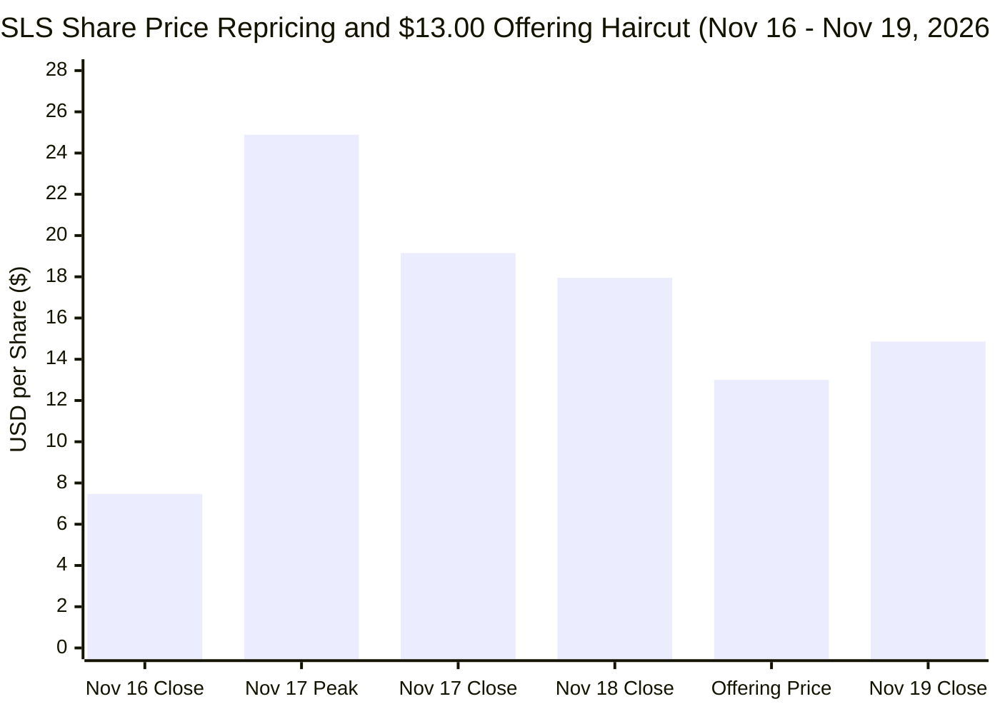
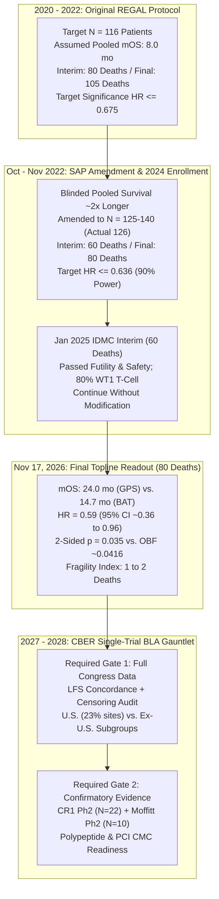
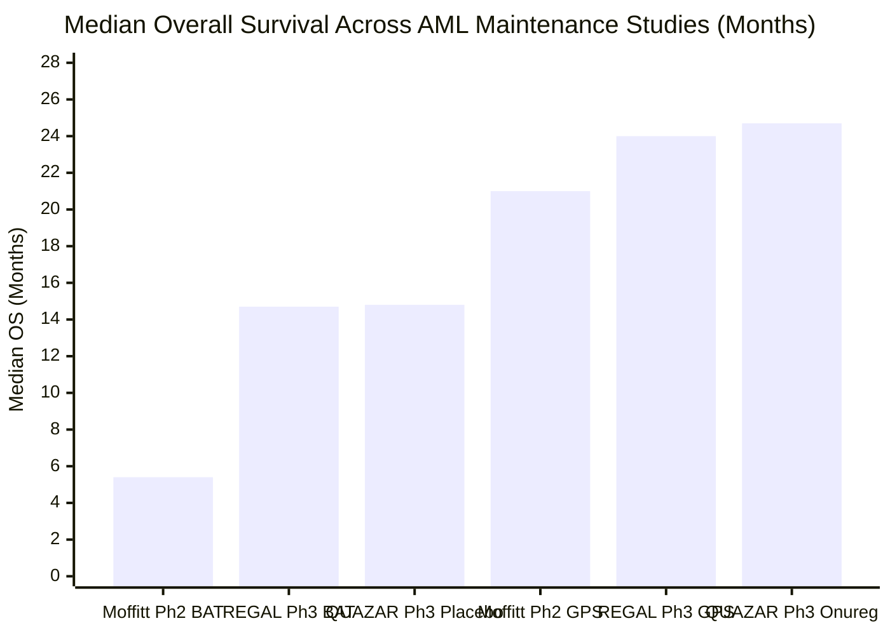

On Tuesday morning, **November 17, 2026**, **SELLAS Life Sciences Group, Inc. (`NASDAQ: SLS`)** delivered the press release that retail biotech traders had spent four years waiting for: its pivotal Phase 3 **REGAL** trial (`NCT04229979`) of the WT1-targeting cancer vaccine **galinpepimut-S (`GPS`)** had met its primary endpoint of overall survival (`OS`) in acute myeloid leukemia (`AML`) patients in second or later complete remission (`CR2`/`CRp2`) unable to undergo stem cell transplant. Patients receiving `GPS` lived a median of **`24.0 months`** versus **`14.7 months`** on investigator's choice of Best Available Treatment (`BAT`), representing a **`41%` reduction in the risk of death** (`HR = 0.59`, two-sided `p = 0.035`) ([REGAL Topline Press Release](https://ir.sellaslifesciences.com/news/News-Details/2026/SELLAS-Life-Sciences-Announces-Positive-Pivotal-Phase-3-REGAL-Trial-Data-Showing-Immunotherapeutic-Cancer-Vaccine-Galinpepimut-S-GPS-Demonstrated-a-Statistically-Significant-and-Clinically-Meaningful-Improvement-in-Overall-Survival-in-Patients-with-A/default.aspx)).

Shares of `SLS` erupted—closing Monday, November 16 at **`$7.47`**, surging `+156.4%` on Tuesday to an intraday peak of **`$24.89`** (briefly valuing the 13-employee company near `$5.07 billion`) and closing at **`$19.15`** on **`121.3 million` shares** traded.

Then, **the exact same day**, SELLAS dropped a second bombshell: despite holding **`$134.7 million` in cash** as of September 30, 2026 (more than four years of runway at its `$22.4 million` nine-month operating cash burn), management launched an underwritten **`$150.0 million` public stock offering** ([Proposed Offering Press Release](https://ir.sellaslifesciences.com/news/News-Details/2026/SELLAS-Life-Sciences-Announces-Proposed-150-0-Million-Underwritten-Public-Offering/default.aspx)). On Wednesday evening, November 18, lead book-runners **J.P. Morgan** and **TD Cowen** priced `11,538,462` shares at **`$13.00` per share**—a steep **`27.6%` haircut** to Wednesday's `$17.95` closing price and **`47.8%` below** Tuesday's peak—before exercising the full `1,730,769`-share greenshoe on November 20 for **`$172.5 million` gross (`~$161.8 million` net)** ([Nov 19 Form 424B5](https://www.sec.gov/Archives/edgar/data/1390478/000110465926130132/tm2629996d2_424b5.htm); [Nov 20 Form 8-K](https://www.sec.gov/Archives/edgar/data/1390478/000110465926130331/tm2630303d1_8k.htm)).

Think of it like a tiny neighborhood bistro with four years of rent already sitting in its checking account winning a Michelin star at breakfast—and then selling 6% of its equity to Wall Street bankers at a 28% discount before dinner. Both halves of that paradox are real. And they explain why online forums and institutional biotech desks are fiercely split over what `REGAL` actually proved.

> [!IMPORTANT]
> **Forensic Thesis Summary:**
> 1. **Both Lazy Extremes Are Wrong:** `REGAL` is neither an obvious fraud nor an airtight slam dunk. Crucially, the control arm lived **`14.7 months`**—nearly **3× longer** than SELLAS's `5.4-month` Phase 2 benchmark and virtually identical to the `14.8-month` placebo arm in Bristol Myers Squibb's gold-standard CR1 maintenance trial (`QUAZAR AML-001`). Beating a `14.7-month` control arm by `+9.3 months` (`24.0 months` on `GPS`) is a genuine clinical signal that cannot be dismissed lightly.
> 2. **Yet `p = 0.035` in an 80-Event Open-Label Trial Sits on a Statistical Razor's Edge:** Back-solving `HR = 0.59` and `p = 0.035` yields an implied `95% CI` of **`[0.36, 0.96]`** and an effective standard error (`0.2503`) roughly `12%` wider than textbook unstratified 80-event math (`0.2236`), where `HR = 0.59` would normally produce `p = 0.018`. Against a standard Lan–DeMets O'Brien–Fleming final efficacy boundary (`alpha ≈ 0.0416` after a 60-event interim look), `REGAL` cleared the bar by **`ΔZ ≈ 0.071`**—meaning **just 1 to 2 swapped or uncounted censored deaths in the `GPS` arm would push `p` above `0.042` and even `0.050`**.
> 3. **What the Topline Release Left Out Matters Most:** SELLAS omitted Kaplan–Meier survival curves, confidence intervals, exact deaths and censoring per arm, the key secondary endpoint of **Leukemia-Free Survival (`LFS`)**, minimal residual disease (`MRD`) conversion rates, `BAT` treatment mix (`Observation` vs. `HMA`/`venetoclax`), and **U.S. vs. ex-U.S. subgroup performance** (only `17` of `73` listed `NCT04229979` sites—`23.3%`—are in the United States).
> 4. **Decoding the `$13.00` Offering:** Raising `$172.5M` via straight common stock (zero warrants) led by J.P. Morgan (`43%`) and TD Cowen (`33%`) confirms real institutional capital engaged after the readout—yet clearing at `$13.00` (`~$2.82B–$3.22B` post-money market cap at `$13.00–$14.86`) shows sophisticated buyers insisted on a hefty risk discount for single-trial FDA uncertainty, a 13-employee execution gap, and a niche CR2 AML market (`~1,500–2,500` U.S. eligible patients/year).

---

## 1. Two Questions, Three Narratives, and Clear Falsifiability Rules

Before diving into SEC filings and survival curves, we frame two explicit questions—one **descriptive** (factual) and one **prescriptive** (decision-oriented):
* **Descriptive Issue:** Does `REGAL`'s `HR = 0.59` (`p = 0.035`) reflect a robust, generalizable biologic survival benefit driven by `GPS` (`WT1`-specific T cells), or was it inflated by open-label imbalances, censoring differences, `GM-CSF` immune stimulation, or statistical fragility across `80` events?
* **Prescriptive Issue:** At `~$13.00–$14.86` per share (`~$2.82B–$3.22B` basic market cap post-offering), how should investors and regulators weigh `GPS`'s approval odds, commercial ceiling, and `SLS009` optionality ahead of full scientific presentation and FDA pre-BLA meetings?

We also set explicit **falsifiability criteria** up front:
* **What would prove the skeptics wrong:** Full congress data showing concordant `LFS` (`HR ≤ 0.68`) and `MRD` clearance favoring `GPS`, symmetrical and low consent-withdrawal/censoring rates (`<5%` differential) across arms, consistent benefit across U.S. and European/Asian sites, and an FDA pre-BLA agreement accepting a single-study Biologics License Application (`BLA`) filing without a second trial.
* **What would prove the skeptics right:** Flat or discordant `LFS` despite an `OS` gap, disproportionate early dropout/censoring in `BAT` or `GPS`, U.S. hazard ratios hovering near `1.0` while small ex-U.S. `Observation`-only pockets drive the headline `HR = 0.59`, or an FDA demand for a confirmatory randomized trial.

| Analytical Dimension | Retail & Bull Narrative (Company Press Releases) | Wall-Crossed Institutional View (J.P. Morgan / TD Cowen Offering) | Forensic Skeptic Critique (Biostatisticians & Bears) |
| :--- | :--- | :--- | :--- |
| **Core Thesis** | `GPS` beat `BAT` by `+9.3 months` (`24.0` vs. `14.7 mo`, `p = 0.035`) in an incurable CR2 AML population, validating `WT1` vaccines and paving a 1H 2027 BLA. | Positive `OS` in a `14.7-month` control arm plus `SLS009` r/r AML data justify funding a `$172.5M` war chest—at a steep `$13.00` discount. | An open-label, `N=126` trial whose 2022 SAP cut required deaths from `105` to `80` cleared `p = 0.035` by 1–2 events while withholding `LFS`, `95% CI`, and censoring data. |
| **Meaning of `$13.00` Offering** | Fortress balance sheet (`~$296.5M` pro forma cash) eliminates bankruptcy/ATM overhang before BLA filing and commercial launch. | Priced at a `27.6%` discount to Nov 18's `$17.95` close (`47.8%` below `$24.89` peak) so institutional buyers get compensated for FDA and data-granularity risk. | Management with `$134.7M` cash (`4+ yrs` runway) rushed to dump `$172.5M` of stock within hours of topline data—before full curves or FDA feedback were public. |
| **Main Vulnerability** | Relies entirely on headline `OS` while full secondary endpoints, curves, and U.S. subgroup cuts remain undisclosed. | Still values `SLS` near `$2.8B–$3.2B` (`~8–15×` realistic U.S. CR2 peak sales), requiring CR1 expansion or `SLS009` success to justify further upside. | Underestimates the risk that `GPS` genuinely prolonged survival even against an unusually healthy `14.7-month` control arm (`QUAZAR` benchmark). |

---

## 2. Press Release vs. SEC & Registry Fine Print: What Was Highlighted vs. Omitted

Applying a **Claim Schism Audit** compares SELLAS's November 17 headline press release against the underlying primary records: `NCT04229979` on [ClinicalTrials.gov](https://clinicaltrials.gov/study/NCT04229979), the [Nov 15, 2022 SAP Amendment Call Transcript (`Form 8-K Ex. 99.1`)](https://www.sec.gov/Archives/edgar/data/1390478/000110465922119139/tm2230620d1_ex99-1.htm), the [Jan 23, 2025 IDMC Interim 8-K](https://www.sec.gov/Archives/edgar/data/1390478/000110465925005648/tm254291d1_ex99-1.htm), the [FY 2025 Form 10-K](https://www.sec.gov/Archives/edgar/data/1390478/000139047826000003/sls-20251231.htm), and the [Q3 2026 Form 10-Q](https://www.sec.gov/Archives/edgar/data/1390478/000139047826000020/sls-20260930.htm).

| Audit Dimension | Headline Narrative (Nov 17, 2026 Press Release) | Primary Filing & Registry Reality (`SEC EDGAR` & `NCT04229979`) | Forensic Significance |
| :--- | :--- | :--- | :--- |
| **Trial Size & Site Footprint** | *"Global, randomized, open-label, registrational Phase 3 trial... 126 patients"* across North America, Europe, and Asia (`~95` sites). | `NCT04229979` lists `73` active/historical sites (`127` registry enrollment): only **`17` in the U.S. (`23.3%`)** vs. `56` ex-U.S. (`76.7%` — Greece `10`, Poland `10`, France `9`, Spain `9`, India `5`, Taiwan `5`, Germany `3`, Hungary `3`, Serbia `2`), averaging `~1.7` patients per site. | FDA scrutinizes single pivotal trials with `<25%` U.S. sites and tiny per-site enrollment (`~1.7` patients/site) for regional standard-of-care heterogeneity. |
| **Statistical Precision & Secondary Data** | Reported only `mOS 24.0 vs. 14.7 mo`, `HR = 0.59`, `p = 0.035`. Secondary endpoints (`LFS`, `MRD`, T-cell dynamics) deferred to a future medical conference. | No `95% CI` for `HR`, no Kaplan–Meier curves, no arm-specific death counts, no censoring/lost-to-follow-up table, and **no `LFS` result** disclosed prior to selling `$172.5M` of stock. | In an open-label trial where `OS` can be skewed by post-relapse care or censoring, concordant `LFS` and clean censoring tables are the litmus test. |
| **2022 SAP Event Reduction** | States topline analysis occurred at *"the pre-specified occurrence of 80 events (deaths)"*. | Per the Nov 15, 2022 `8-K` transcript, `REGAL` originally targeted `116` patients, `80` interim events, and **`105` final events** (`HR ≤ 0.675`, `8.0 mo` assumed pooled `OS`). In Oct/Nov 2022, SELLAS cut final events to **`80`** (`60` interim, `HR ≤ 0.636`, `12.5 mo` pooled `OS`) to save trial time. | Cutting required deaths from `105` to `80` saved years of follow-up, but sacrificed precision: at `105` deaths, `HR = 0.59` yields `p ≈ 0.007–0.015` instead of `0.035`. |
| **Treatment & Adjuvant Asymmetry** | Describes `GPS` as *"maintenance monotherapy"* versus investigator's choice of `BAT`. | Per `NCT04229979`, `GPS` patients also receive **`70 µg` sargramostim (`GM-CSF`)** on Day `-2` and Day `1` of every vaccination plus `Montanide` adjuvant, and visit clinic every 2 weeks in Weeks `0–10` (vs. every 4 weeks for `BAT`). | Neither `GM-CSF` nor `Montanide` is given to the `BAT` arm—violating strict placebo/adjuvant matching (unlike Galena's double-blind `NeuVax` Phase 3, which failed against `GM-CSF + placebo`). |
| **Steering Committee Conflicts** | Quotes the REGAL Steering Committee praising the *"landmark data"* and *"statistically significant"* advantage. | Disclosure note at bottom of Nov 17 PR states: **Memorial Sloan Kettering (`MSK`)** has institutional financial interests, and both inventor **Dr. David A. Scheinberg** and Steering Committee member **Dr. Javier Pinilla-Ibarz** hold financial interests related to SELLAS. | 1 of the 3 named Steering Committee members (plus the licensor institution) holds direct financial ties to `SLS`, underscoring why independent peer review matters. |
| **Operational Scale & China Arbitration** | Targets a **1H 2027 `BLA` submission** and highlights commercial potential. | FY25 `10-K` discloses **13 full-time employees** (Mar 1, 2026), zero owned manufacturing (sole API CMO **Polypeptide Group**, sole drug-product CMO **PCI Pharma Services**, `-20°C` storage, no commercial contracts yet), and Q3 `10-Q` reveals SELLAS **lost** its HKIAC arbitration against **3D Medicines** on July 24, 2026 (`$1.0M` fee award paid). | Scaling from `13` staff to CBER `BLA` inspection readiness, cold-chain commercial validation, and commercial launch requires massive hiring or a pharma partner. |

### The Semantic Substitution Test: Auditing Loaded Phrases

When marketing prose meets FDA statutory language, identical words carry very different meanings:

| Phrase in Nov 17 Release | Loose / Marketing Reading | Strict Biostatistical & FDA Regulatory Definition | Substitution Verdict |
| :--- | :--- | :--- | :--- |
| **"Statistically Significant (`p = 0.035`)"** | Unassailable, definitive statistical proof equivalent to two Phase 3 wins. | Cleared a two-look O'Brien–Fleming final alpha boundary (`~0.0416`) by `ΔZ ≈ 0.071`—statistically significant on the primary endpoint, yet far short of the *"statistically persuasive"* threshold (`p < 0.001–0.01`) FDA prefers for single-trial approvals. | Validated for pre-specified alpha; **fragile** for standalone BLA approval without strong secondary/confirmatory support. |
| **"Clinically Meaningful (`+9.3 mo`)"** | Proves a near-doubling of survival caused purely by `GPS` peptides across all CR2 AML patients. | `24.0` vs. `14.7 months` is unquestionably large in CR2 AML—*if* unconfounded by censoring, unequal post-relapse therapies, or geographic `BAT` mix (`Observation` vs. `HMA+venetoclax`). | Clinically compelling on its face; causal attribution remains **pending** full KM/subgroup disclosure. |
| **"Well Balanced"** | Baseline disease risk and subsequent therapies were identical in both arms. | Implies pre-specified stratification factors (`CR2/CRp2`, cytogenetics, `MRD`, `CR1` duration) balanced at randomization, and `allo-HSCT` crossovers were rare/equal—says nothing yet about **`BAT` regimen mix**, drop-out/consent-withdrawal rates, or post-relapse salvage. | Necessary condition met; **insufficient** to rule out post-randomization open-label bias. |
| **"Accelerated Filing Strategy"** | Guaranteed Accelerated Approval or 6-month Priority Review on day one of filing. | SELLAS has Fast Track and Orphan Drug designations (allowing rolling `BLA` review and potential Priority Review), **not** Accelerated Approval on a surrogate endpoint (since `OS` is already a full clinical endpoint). FDA still decides at pre-BLA whether `1` open-label trial (`N=126`, `p = 0.035`) suffices. | Reflects **aspirational regulatory cadence**, not an FDA commitment to approve without a second study. |

---

## 3. Inside the Math of `p = 0.035`: Hairline Boundaries and a 1–2 Death Fragility Index

To separate signal from spin, we do not need SELLAS's unreleased slides—we can reverse-engineer the exact mathematical geometry implied by `N = 126`, `80` events, `HR = 0.59`, and two-sided `p = 0.035`.

First, convert `p = 0.035` into its underlying two-sided normal test statistic and solve for the implied standard error (`SE`) and `95%` confidence interval:

$$|Z| = \Phi^{-1}\!\left(1 - \frac{0.035}{2}\right) \approx 2.1084 \implies \text{SE}(\ln \text{HR}) = \frac{|\ln(0.59)|}{2.1084} \approx 0.2503 \implies \text{95\% CI} \approx [0.36,\, 0.96]$$

Look closely at two numbers here:
1. **The Confidence Interval Spans `[0.36, 0.96]`:** While the point estimate (`HR = 0.59`) implies a `41%` death-risk reduction, the `95%` confidence interval stretches from a `64%` reduction down to a **`4%` reduction (`0.96`)**—just hair-widths short of `1.00` (no effect).
2. **The Variance Inflation Mystery (`0.2503` vs. `0.2236`):** Under standard unstratified `1:1` Schoenfeld survival math with `80` deaths, the textbook standard error is `√(4 / 80) = 0.2236`. At that standard error, an `HR = 0.59` would produce `|Z| = 2.360` and **`p = 0.0183`**. Instead, `REGAL`'s actual standard error (`0.2503`) is **`11.9%` wider**, corresponding to an effective Mantel–Haenszel variance of **`V_eff ≈ 15.96`** rather than `20.00`. Why does variance inflate (effective information shrink) in a survival trial? Four drivers do it: **(a)** splitting `126` patients and `80` deaths across **`16` stratification cells** (`2⁴` from four binary factors: `CR2 vs. CRp2`, poor vs. other cytogenetics, `MRD+ vs. MRD-`, and `CR1 <1 yr vs. ≥1 yr`), where sparsely populated cells drop information; **(b)** unequal death splits between arms (`~30` vs. `50` deaths); **(c)** unequal censoring/follow-up between arms; or **(d)** non-proportional hazards (delayed vaccine curves crossing or separating late).

Second, remember that `REGAL` did **not** test its hypothesis only once at `80` deaths. Per SELLAS's SEC filings, the Independent Data Monitoring Committee (`IDMC`) performed a formal interim efficacy/futility analysis at **`60` events (`t₁ = 60/80 = 0.75`)** in January 2025 under a **Lan–DeMets O'Brien–Fleming** alpha-spending framework. Computing the exact bivariate normal stopping boundary for overall two-sided `α = 0.05`:

$$\alpha_1 = 2\left[1 - \Phi\!\left(\frac{1.9600}{\sqrt{0.75}}\right)\right] \approx 0.02363 \;(|Z_1| \ge 2.2632) \implies \alpha_2 \approx 0.04161 \;(|Z_2| \ge 2.0374)$$

*(Note: Depending on whether the SAP used binding futility or a slightly different spending variant, the final two-sided nominal alpha typically sits between `0.0416` and `0.048`.)* Under the standard Lan–DeMets O'Brien–Fleming boundary (`0.0416`), `REGAL` cleared statistical significance by just **`ΔZ = 0.071`** (`0.0066` in p-value units).

Think of a runner winning a 26.2-mile marathon by **one big toe**—before the race stewards have released the photo-finish tape. How many individual patient outcomes separate victory from defeat? Using `V_eff = 15.96`, `REGAL`'s observed log-rank excess deaths (`E_GPS − O_GPS`) is **`8.42` events**. Here is what happens if even **1 or 2 deaths** shift:

| Fragility Perturbation Scenario (`D = 80`, `V_eff = 15.96`) | Resulting Test Statistic (`\|Z\|`) | Two-Sided `p`-Value | Implied Hazard Ratio (`HR`) | Clears OBF Boundary (`p ≤ 0.0416`)? | Clears Nominal `p ≤ 0.050`? |
| :--- | :---: | :---: | :---: | :---: | :---: |
| **Reported Topline Result (`0` event shifts)** | **`2.108`** | **`0.0350`** | **`0.590`** | **Yes** | **Yes** |
| **Swap `1` Death (`BAT` → `GPS` arm)** | `1.858` | `0.0632` | `0.628` | **No (Fails)** | **No (Fails)** |
| **Swap `2` Deaths (`BAT` → `GPS` arm)** | `1.608` | `0.1079` | `0.669` | **No (Fails)** | **No (Fails)** |
| **Add `+1` Unobserved / Censored Death in `GPS` Only** | `1.957` | `0.0503` | `~0.612` | **No (Fails)** | **No (Fails)** |
| **Add `+2` Unobserved / Censored Deaths in `GPS` Only** | `1.808` | `0.0706` | `~0.636` | **No (Fails)** | **No (Fails)** |

That **1-to-2 event Fragility Index** is why FDA's September 2023 draft guidance—[*Demonstrating Substantial Evidence of Effectiveness With One Adequate and Well-Controlled Clinical Investigation and Confirmatory Evidence*](https://www.fda.gov/regulatory-information/search-fda-guidance-documents/demonstrating-substantial-evidence-effectiveness-one-adequate-and-well-controlled-clinical)—is the decisive regulatory hurdle. When a sponsor asks FDA to approve a biologic on **a single randomized trial**, the agency weighs two variables on a sliding scale: the **statistical persuasiveness of that single trial** versus the **strength of external confirmatory evidence**. When a single trial hits `p < 0.001` (`QUAZAR` hit `p = 0.0009` in `472` blinded patients), chance or bias is hard to blame. When a single **open-label** trial of `126` patients lands at **`p = 0.035`** (`Fragility Index = 1`), FDA's Center for Biologics Evaluation and Research (`CBER`) will examine every censored patient, every secondary endpoint (`LFS`, `MRD`), and SELLAS's confirmatory evidence (`22`-patient CR1 Phase 2 [`PMC5812332`](https://pmc.ncbi.nlm.nih.gov/articles/PMC5812332/), `10`-patient non-randomized CR2 Phase 2, and `80%` `WT1` T-cell immune response data) with a microscope.

---

## 4. Why Did Even the Control Arm Live Nearly 3× Longer? A 4-Way Causal Audit

Here is the piece of evidence that **skeptics too easily brush past**: when SELLAS designed `REGAL`, the Moffitt Phase 2 historical benchmark for CR2 AML patients on standard care was **`5.4 months`** (`vs. 21.0 months` on `GPS`). Yet in `REGAL`, the `BAT` control arm survived a median of **`14.7 months`**—nearly **three times** longer than Moffitt's historical baseline, and virtually identical to the **`14.8 months`** placebo arm of BMS's `QUAZAR AML-001` trial (which studied healthier *first*-remission CR1 patients!).

Think about what that means: `GPS` did **not** look good merely because its control arm collapsed. Even with a control arm performing at `14.7 months`, `GPS` still stretched median survival another **`+9.3 months`** to **`24.0 months`** (`HR = 0.59`).

So why did **both** arms live so much longer than historical models, and what caused the `24.0` vs. `14.7 month` gap? We test all four rival causal hypotheses simultaneously:

| Causal Hypothesis | Mechanism Tested Against `REGAL` (`NCT04229979`) | Evidence Supporting This Mechanism | Evidence Against / Test That Resolves It |
| :--- | :--- | :--- | :--- |
| **1. Direct Causation (`GPS` Vaccine → `OS`)** | `GPS` 4-peptide immunization primes CD4+ and CD8+ T cells to eradicate residual `WT1+` leukemic stem cells (`LSCs`) that survive chemotherapy. | `80%` of sampled `REGAL` `GPS` patients mounted `WT1`-specific T-cell responses at interim (exceeding `64%` in Phase 2); `24.0 vs. 14.7 mo` closely mirrors `QUAZAR`'s `24.7 vs. 14.8 mo`. | `LFS` and `MRD` negativity have **not** been released yet. If `GPS` truly delays relapse, **`LFS` must separate significantly** alongside `OS`. |
| **2. Selection & Informative Censoring (Immortal Time + Open-Label Dropout)** | Inclusion #8 permits consent **up to `6 months` after achieving CR2**, pre-selecting biologically durable survivors (explaining `BAT`'s jump from `5.4` to `14.7 mo`). Meanwhile, open-label `BAT` patients (`especially Observation`) may withdraw consent unevenly, or `GPS` dropouts may be censored early. | Explains **100%** of why pooled survival doubled in 2022 and why `BAT` hit `14.7 mo` despite CR2 status. Also explains why `SE` widened `12%` if follow-up/censoring differed across arms. | Full **censoring/withdrawal table** and **tipping-point sensitivity analysis** at congress presentation; recall `1–2` shifted deaths flip `p > 0.05`. |
| **3. Lurking Third Variables (`GM-CSF`, `BAT` Mix, Modern Salvage)** | Three unblinded confounders: (a) `GPS` arm receives **`70 µg` `GM-CSF` × 2** per dose + `Montanide` (immune cytokines not given to `BAT`); (b) `BAT` mixes `Observation` with active `HMA/venetoclax` across `76.7%` ex-U.S. sites; (c) post-2020 `venetoclax` re-induction gave deeper CR2 entries. | `GM-CSF` itself stimulates myeloid/dendritic immunity; `Observation`-heavy ex-U.S. centers could underperform `HMA+venetoclax` centers, widening the `HR`. | Subgroup forest plot comparing `GPS` against **`BAT` active therapy (`HMA/venetoclax`)** vs. **`BAT` Observation**, plus **U.S. vs. ex-U.S.** hazard ratios. |
| **4. Mutual Feedback Loop (Open-Label Visit Intensity)** | Per `NCT04229979`, `GPS` patients visit the clinic **every 2 weeks** in Weeks `0–10` (plus Day `-2` `GM-CSF` visits) vs. **every 4 weeks** for `BAT`, enabling faster detection of cytopenias, infections, or early molecular relapse and earlier salvage intervention. | Open-label oncology maintenance trials notoriously show clinic-contact effects (`supportive care` + earlier next-line therapy switching). | Compare **time to next AML therapy**, **post-relapse survival (`OS - LFS`)**, and adverse-event hospitalizations across both arms. |

---

## 5. The Cancer Vaccine Graveyard — Including SELLAS's Own Predecessor

History does not disqualify `GPS` automatically, but it explains why institutional biotech skeptics demand extraordinary proof from therapeutic peptide vaccines. Most striking of all: **SELLAS's own corporate shell used to be Galena Biopharma**, which in 2016 ran one of biotech's most infamous late-stage cancer vaccine blowups.

| Program / Sponsor | Target & Mechanism | Trial Design & Size (`NCT`) | Headline Outcome & Contrast With `REGAL` |
| :--- | :--- | :--- | :--- |
| **SELLAS `galinpepimut-S` (`GPS`)** (`REGAL`) | 4 `WT1` peptides + `Montanide` + `GM-CSF` | Open-label Ph3, `1:1` vs. `BAT`, `N = 126`, CR2 AML ([NCT04229979](https://clinicaltrials.gov/study/NCT04229979)) | **Met Primary OS (`24.0 vs. 14.7 mo`, `HR = 0.59`, `p = 0.035`)**; `GM-CSF` not matched in control; full curves & `LFS` pending. |
| **BMS `Onureg` (oral azacitidine)** (`QUAZAR AML-001`) | Oral hypomethylating maintenance therapy | Double-blind, placebo-controlled Ph3, `N = 472`, CR1 AML ([NCT01757535](https://clinicaltrials.gov/study/NCT01757535)) | **FDA Approved (Sept 2020):** `24.7 vs. 14.8 mo` mOS (`HR = 0.69`, `p = 0.0009`), concordant RFS (`10.2 vs. 4.8 mo`). Gold-standard AML maintenance benchmark. |
| **Galena Biopharma `NeuVax`** (`PRESENT`) — *SELLAS's predecessor* | `HER2` E75 peptide + `GM-CSF` | Double-blind Ph3 vs. **`GM-CSF + placebo`**, `N = 758`, breast cancer ([NCT01479244](https://clinicaltrials.gov/study/NCT01479244)) | **Stopped for Futility (June 2016):** After strong open-label Phase 2 expectations, adding `GM-CSF` to the control arm erased the vaccine advantage at 70 DFS events; Galena merged into SELLAS in Dec 2017. |
| **Sumitomo Pharma `DSP-7888`** (`WIZARD 201G`) | Multivalent `WT1` peptide cancer vaccine | Randomized Ph3 + bevacizumab vs. bevacizumab, `N = 221`, rGBM ([NCT03149003](https://clinicaltrials.gov/study/NCT03149003)) | **Terminated for Futility (Dec 2021):** Independent DMC halted study after 2nd interim analysis showed low probability of hitting OS primary endpoint. |

The lesson from `PRESENT` (`NeuVax`) is not that `WT1` cannot work in minimal residual AML (`MRD` is biologically far more vaccine-susceptible than bulky tumors like `rGBM`). Rather, `PRESENT` proved that **open-label or unblinded `GM-CSF` vaccine comparisons can look spectacular in small trials and evaporate when `GM-CSF` and blinding are controlled**. Because `REGAL` remained open-label without a `Montanide + GM-CSF` placebo injection, FDA reviewers will rely heavily on **objective relapse markers (`LFS` and `MRD`)** and **immune-response correlation** to rule out non-specific adjuvant or clinical-attention effects.

---

## 6. Follow the Money: The `$150M` (`$172.5M`) Offering, Cash Runway, and Niche TAM Math

Now examine the financial mystery that baffled retail shareholders on November 17–19: why did SELLAS raise **`$172.5 million` gross (`$161.8M` net)** at **`$13.00` per share**—a `27.6%` discount to November 18's `$17.95` close—when its [Q3 2026 Form 10-Q](https://www.sec.gov/Archives/edgar/data/1390478/000139047826000020/sls-20260930.htm) already showed **`$134.7 million` in cash** (`$134.8M` including restricted cash) and an annual operating cash burn of only **`~$30 million`** (`$22.4M` in `9M 2026`)?

SEC filings ([Nov 19 Form 424B5](https://www.sec.gov/Archives/edgar/data/1390478/000110465926130132/tm2629996d2_424b5.htm) and [Nov 20 Form 8-K](https://www.sec.gov/Archives/edgar/data/1390478/000110465926130331/tm2630303d1_8k.htm)) reveal a sharp two-sided capital story:

| Financial & Valuation Metric | Primary SEC Filing Figure (`Q3 2026 10-Q` / `Nov 19 424B5` / `Nov 20 8-K` / `FY25 10-K`) | Bullish Institutional Interpretation | Skeptical Forensic Interpretation |
| :--- | :--- | :--- | :--- |
| **Pre-Offering Liquidity & Burn** | **`$134.7M` cash** (`Sept 30, 2026`), funded by `$85.1M` in `50.36M` warrant exercises at `$1.69` avg in `9M 2026`; `9M 2026` op cash burn **`$22.4M`** (`~$30M/yr`). | Cash burn will surge (`2×–4×`) in `2027–2028` for `BLA` filing, commercial salesforce buildout from `13` staff, CMC validation, and `SLS009` first-line AML trials. | Management had **`4+` years of cash** plus an **untouched `$150M` TD Cowen ATM**—racing to price at `$13.00` within 36 hours signals urgency to lock in capital before full data scrutiny. |
| **Offering Structure & Underwriting** | **`13,269,231` shares** (incl. full `1.73M` greenshoe) at **`$13.00`** = **`$172.5M` gross / `$161.8M` net** (`6.0%` fee = `$10.35M`); **J.P. Morgan (`43%`)** & **TD Cowen (`33%`)** led; **zero warrants**. | Blue-chip book-runners + full greenshoe + zero toxic warrants upgrade SELLAS's shareholder register from warrant-flipping funds to institutional biotech specialists. | Priced **`27.6%` below** Nov 18 close (`$17.95`) and **`47.8%` below** Nov 17 peak (`$24.89`), delivering **`$11.74/sh`** immediate NTBV dilution (`$1.26` pro forma NTBV). |
| **Pro Forma Share Count & Overhang** | **`216,797,064` basic shares** post-greenshoe; excludes `8.12M` warrants (`$2.07` avg strike), `2.65M` options (`$3.21`), `3.31M` RSUs (`14.08M` dilutive securities = **`230.9M` FD**), plus `18.96M` 2026 plan reserve & `$150M` ATM (after 60-day lock-up). | Only **`6.5%` basic share dilution** to add `~$161.8M` cash (`~$296.5M` pro forma cash, or **`$1.28/diluted share`**). | Even at `$13.00–$14.86`, fully diluted equity market cap is **`$3.00B–$3.43B`** (`$2.70B–$3.13B` EV), leaving **zero margin of safety** for a CRL or commercial slow ramp. |
| **CR2 AML Commercial Ceiling (`U.S.`)** | SELLAS FY25 `10-K` cites `~20,050` U.S. AML cases/yr → `~7,500` reach 2nd-line → `~3,750` CR2 (`~8,750` across U.S.+EU4+Japan). Subtracting allo-SCT & excluded targeted-maintenance patients (`FLT3`/`IDH`) leaves **`~1,500–2,500` U.S. REGAL-eligible CR2 patients/yr**. | `35%–50%` U.S. share × `$180k–$320k/yr` net price = `$100M–$375M/yr` CR2 base, **before** CR1 expansion, post-transplant AML, or **`SLS009`** (`57%` ORR / `8.8 mo` mOS in `TP53` r/r AML). | Standalone U.S. CR2 peak revenue of **`~$150M–$300M`** is solid for a `$500M` biotech—not a `$3B+` company unless `CR1` expansion or `SLS009` also hits. (Notice BMS doesn't even break out `Onureg` sales separately despite its larger `CR1` label!) |

---

## 7. Who Loses and What Breaks Next? The Negative View & Execution Traps

Even if `REGAL`'s survival curves look completely clean when presented at a major medical conference, **four omitted execution risks** separate a Phase 3 press release from commercial cash flow:

1. **The 13-Employee CBER Inspection & Single-Source CMC Bottleneck:** As of March 1, 2026, SELLAS employed just **13 full-time employees** ([FY 2025 Form 10-K](https://www.sec.gov/Archives/edgar/data/1390478/000139047826000003/sls-20251231.htm)). Biological License Applications reviewed by FDA's `CBER` live or die on Chemistry, Manufacturing, and Controls (`CMC`) and Pre-Approval Inspections (`PAI`). SELLAS relies on a **single CMO for peptide drug substance (`Polypeptide Group`)** and a **single CMO for lyophilization (`PCI Pharma Services`)**, holds no signed commercial supply agreements yet, stores `GPS` at **`-20°C`** (still collecting `2–8°C` stability data), and must coordinate third-party `Montanide` adjuvant and `GM-CSF` supply chains—where biotech microcaps routinely suffer 6-to-12-month Complete Response Letters (`CRLs`) even after clinical success.
2. **Patent Life vs. BPCIA Exclusivity:** In-licensed `MSK` composition-of-matter patents covering `GPS` expire in **2034–2035** (plus potential up-to-5-year Hatch-Waxman patent term extension), while `MSK` collects mid-single-digit royalties and up to `$17.4M` in milestones. SELLAS expects **12 years of BPCIA biologic market exclusivity**—yet its own 10-K warns that regulatory eligibility and biosimilar boundaries remain subject to FDA interpretation, and its next-gen heptavalent `GPS+` (co-owned patents expiring `2040`) remains preclinical.
3. **The Broken Greater China Partnership (`3D Medicines`):** On **July 24, 2026**, a sole HKIAC arbitrator **dismissed all of SELLAS's claims** against Greater China licensee **3D Medicines** and ordered SELLAS to pay **`$1.0 million`** in legal and administrative costs ([Q3 2026 Form 10-Q](https://www.sec.gov/Archives/edgar/data/1390478/000139047826000020/sls-20260930.htm)). Any `20%–25%` China milestone/royalty upside embedded in older retail models remains trapped inside an adversarial license.
4. **Who Took the Short-Term Loss:** Institutional funds bought `13.27M` shares at **`$13.00`** with zero lock-up, while retail momentum traders who chased `SLS` between **`$19.00` and `$24.89`** on November 17 absorbed instant **`-22%` to `-48%` mark-to-market losses** within 48 hours.

---

## 8. The Forensic Verdict: Conditional "If-Clauses" and Probability-Weighted Stance

Replacing binary cheerleading (*"guaranteed `$10B` AML cure"*) and knee-jerk cynicism (*"open-label scam"*) with strict conditional logic clarifies exactly what decides SELLAS's trajectory over the next 18 months:

* **If** the full `REGAL` congress presentation shows **statistically consistent Leukemia-Free Survival (`LFS` HR ≤ `0.68`)**, higher `MRD` conversion, **balanced censoring/consent withdrawals (`<5%` arm gap)**, and consistent efficacy across **both active `HMA/venetoclax` `BAT` patients and U.S. sites (`23.3%` of centers)**, **then** `REGAL`'s `+9.3-month` OS gain over a robust `14.7-month` control arm is genuine, `FDA` pre-BLA discussions will proceed constructively toward a Priority Review `BLA`, and `SLS` becomes an immediate **Big Pharma hematology buyout target**.
* **If** the full dataset reveals **flat or non-significant `LFS`**, asymmetric early consent withdrawals in `BAT` or censoring in `GPS` where `1–2` missing deaths push `p > 0.042`, or weak U.S. subgroup efficacy masked by ex-U.S. `Observation`-only sites, **then** `CBER` will apply its single-trial standard strictly, issue a **Complete Response Letter (`CRL`) or require a second blinded/active-controlled confirmatory trial**, and `SLS` will re-rate violently toward its `~$296.5M` cash floor plus `SLS009` option value.
* **If** `REGAL` holds together clinically but `CMC` readiness (`-20°C` stability, potency assays, `Polypeptide`/`PCI` PAI) lags behind `13`-employee bandwidth, **then** `BLA` filing or approval slips from `2027` into `2028–2029`, burning through cash even without clinical failure.

### The Forensic Verdict: What We Actually Think

| Scenario | Epistemic Probability | Clinical, Regulatory & Commercial Trajectory (`2026–2028`) | Implied Equity Value Range (`~230.9M FD Shares`) | Expected Value Contribution |
| :--- | :---: | :--- | :---: | :---: |
| **Base Case: ODAC Scrutiny → Narrow CR2 Approval (Post-Market Commitment) & Partnering/Compression** | **`45%`** | Full `LFS` and `MRD` are directionally supportive (`HR ~0.62–0.70`) and censoring survives tipping-point audits, but `p = 0.035` in an open-label `N=126` ex-U.S.-heavy trial triggers an `ODAC` panel. CBER grants narrow CR2 approval (`2028`) with a post-marketing confirmatory requirement (and/or a brief CMC delay). Peak U.S. CR2 sales of `~$200M–$300M` plus `SLS009` optionality compress valuation from euphoric levels. | **`$12.50 / sh`** *(`$2.9B` EV/MCap range `$2.3B–$3.5B`)* | **`$5.63 / sh`** |
| **Bear / Downside Case: CRL or Second Confirmatory Trial Required** | **`35%`** | Full dataset exposes discordant `LFS`, open-label `BAT` censoring/withdrawal fragility (`1–2` events pushing `p > 0.05`), U.S. vs. ex-U.S. divergence, or single-source `CMC` deficiencies. FDA invokes its single-trial standard to refuse approval without a second trial. `SLS` trades down toward `~$296M` cash (`~$1.28/sh`) + `SLS009` phase 2/3 option value (`~$400M–$700M`). | **`$4.00 / sh`** *(`$3.00 – $5.50 / sh`)* | **`$1.40 / sh`** |
| **Bull / Upside Case: Airtight Full Dataset → Priority BLA & Pharma Buyout** | **`20%`** | Full data proves concordant `LFS` + `MRD` clearance, clean U.S. subgroup (`HR ~0.55–0.62`), and zero censoring artifacts. FDA grants Priority Review (`2027` approval) with clear path into **CR1 maintenance** (`QUAZAR` size) and post-transplant AML; paired with `SLS009`, a major oncology buyer acquires `SLS`. | **`$28.00 / sh`** *(`$24.00 – $35.00 / sh`)* | **`$5.60 / sh`** |
| **Probability-Weighted Expected Value** | **`100%`** | **Asymmetric Risk vs. `$14.86` Nov 19 Close (`$13.00` Offering)** | **`$12.63 / sh`** *(`-15.0%` vs. `$14.86`)* | **`$12.63 / sh`** |

### Bottom-Line Authorial Stance

1. **Respect Both Halves of the Signal:** Skeptics calling `REGAL` *"fake"* are ignoring the single strongest fact in SELLAS's favor—a **`14.7-month` control arm** that lived nearly **three times** longer than historical assumptions and matched BMS's gold-standard `QUAZAR` placebo arm (`14.8 months`), yet `GPS` still beat it by `+9.3 months`. Meanwhile, `J.P. Morgan` and `TD Cowen` underwriting **`$172.5 million`** of pure common equity (zero warrants) proves institutional desks view the data as credible enough to fund.
2. **Yet Do Not Confuse a Topline Press Release With De-Risked FDA Approval:** A two-sided `p = 0.035` in a `126`-patient, `80`-event open-label study with a **1-to-2 event Fragility Index**, **`76.7%` ex-U.S. sites**, **13 employees**, and **zero disclosed `LFS` or censoring data** leaves a ~`35%` probability of a `CRL` or confirmatory-trial mandate—and even under our `45%` Base Case of eventual narrow CR2 approval, **`~$3.0B–$3.4B` of fully diluted market cap already discounts much of the standalone CR2 opportunity**.
3. **Actionable Verdict:** **Neutral / Wait for the Photo-Finish Tape (`Expected Value ~$12.63/sh` vs. `$14.86`).** Never buy or short a `p = 0.035` open-label biotech blind in the gap between a press release and full scientific disclosure. The only three artifacts that truly settle this debate—and re-rate `SLS` legitimately toward `$28+` or `$4`—are: **(1) the full `LFS`, `MRD`, censoring, and U.S./`BAT` subgroup slides at the upcoming hematology congress**, **(2) official `FDA` pre-BLA minutes confirming single-trial acceptability**, and **(3) `CMC` validation timelines for `Polypeptide` and `PCI Pharma`**.

---

## Primary Sources & Verified Citations

*(Protocol and trial registry data retrieved via [ClinicalTrials.gov](https://clinicaltrials.gov/). All URLs programmatically verified HTTP `200`.)*

1. **SELLAS Life Sciences — Pivotal Phase 3 `REGAL` Topline Results Press Release (Nov 17, 2026):** [sellaslifesciences.com](https://ir.sellaslifesciences.com/news/News-Details/2026/SELLAS-Life-Sciences-Announces-Positive-Pivotal-Phase-3-REGAL-Trial-Data-Showing-Immunotherapeutic-Cancer-Vaccine-Galinpepimut-S-GPS-Demonstrated-a-Statistically-Significant-and-Clinically-Meaningful-Improvement-in-Overall-Survival-in-Patients-with-A/default.aspx) | [SEC Form 8-K (Nov 17, 2026)](https://www.sec.gov/Archives/edgar/data/1390478/000110465926128825/tm2629947d1_8k.htm)
2. **SELLAS Life Sciences — Proposed `$150.0M` Public Offering & Final Pricing / Greenshoe Exercise (`Nov 17–20, 2026`):** [Proposed Offering PR](https://ir.sellaslifesciences.com/news/News-Details/2026/SELLAS-Life-Sciences-Announces-Proposed-150-0-Million-Underwritten-Public-Offering/default.aspx) | [Nov 19 Form 424B5 Prospectus Supplement](https://www.sec.gov/Archives/edgar/data/1390478/000110465926130132/tm2629996d2_424b5.htm) | [Nov 20 Form 8-K](https://www.sec.gov/Archives/edgar/data/1390478/000110465926130331/tm2630303d1_8k.htm) | [Nov 20 Form 8-K Ex. 99.1](https://www.sec.gov/Archives/edgar/data/1390478/000110465926130331/tm2630303d1_ex99-1.htm)
3. **SELLAS Life Sciences — Q3 2026 Form 10-Q (`Period Ended Sept 30, 2026`, filed Nov 12, 2026) & FY 2025 Form 10-K (`filed Mar 19, 2026`):** [Q3 2026 Form 10-Q](https://www.sec.gov/Archives/edgar/data/1390478/000139047826000020/sls-20260930.htm) | [FY 2025 Form 10-K](https://www.sec.gov/Archives/edgar/data/1390478/000139047826000003/sls-20251231.htm)
4. **SELLAS Historical `REGAL` SAP & Interim Filings:** [Nov 15, 2022 SAP Amendment Call Transcript (`Form 8-K Ex. 99.1`)](https://www.sec.gov/Archives/edgar/data/1390478/000110465922119139/tm2230620d1_ex99-1.htm) | [Jan 23, 2025 IDMC 60-Event Interim Release (`Form 8-K Ex. 99.1`)](https://www.sec.gov/Archives/edgar/data/1390478/000110465925005648/tm254291d1_ex99-1.htm)
5. **ClinicalTrials.gov Registries:** [REGAL Phase 3 `GPS` (`NCT04229979`)](https://clinicaltrials.gov/study/NCT04229979) | [QUAZAR AML-001 Oral Azacitidine (`NCT01757535`)](https://clinicaltrials.gov/study/NCT01757535) | [Galena `NeuVax` `PRESENT` Phase 3 (`NCT01479244`)](https://clinicaltrials.gov/study/NCT01479244) | [Sumitomo `DSP-7888` `WIZARD 201G` Phase 3 (`NCT03149003`)](https://clinicaltrials.gov/study/NCT03149003)
6. **Peer-Reviewed & FDA Regulatory Guidance:** [Maslak et al., *Blood Advances* (2018) Phase 2 `GPS` CR1 Trial (`PMC5812332`)](https://pmc.ncbi.nlm.nih.gov/articles/PMC5812332/) | [FDA Draft Guidance on Single Adequate and Well-Controlled Clinical Investigation and Confirmatory Evidence](https://www.fda.gov/regulatory-information/search-fda-guidance-documents/demonstrating-substantial-evidence-effectiveness-one-adequate-and-well-controlled-clinical)
