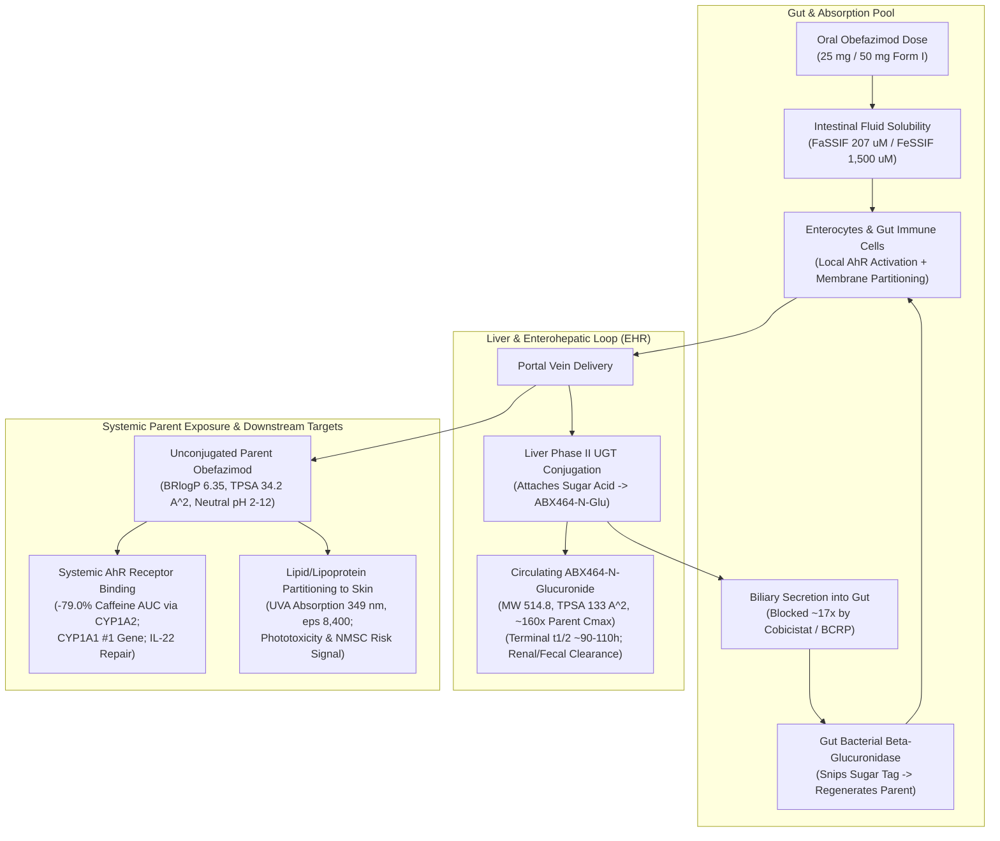
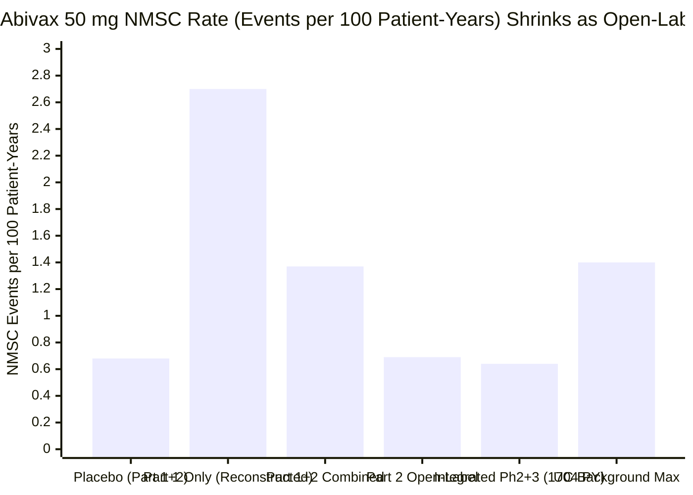
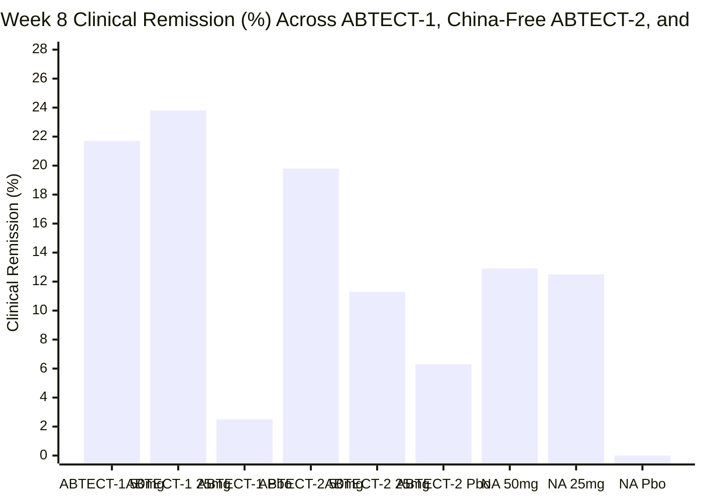

On Friday, **November 20, 2026**, activist short-seller **Scorpion Capital LLC** (led by Gurkirat "Kir" Kahlon) dropped a **297-page investigative dossier** alongside **four commissioned contract-lab manuscripts** ([main report](https://scorpionreports.s3.us-east-2.amazonaws.com/ABVX.pdf), [A1](https://scorpionreports.s3.us-east-2.amazonaws.com/A1.pdf), [A2](https://scorpionreports.s3.us-east-2.amazonaws.com/A2.pdf), [A3](https://scorpionreports.s3.us-east-2.amazonaws.com/A3.pdf), [A4](https://scorpionreports.s3.us-east-2.amazonaws.com/A4.pdf)) branding French biotech **Abivax SA (`NASDAQ / Euronext Paris: ABVX`)** *"A Biotech Fraud For The Ages."* Its headline accusation could hardly be more incendiary: Abivax's once-daily ulcerative colitis (`UC`) pill, **obefazimod (`ABX464`)**, is allegedly an ultra-lipophilic membrane poison *"in the range of DDT, dioxin, and persistent organic pollutants"* that triggers UVA-driven skin cancers while hiding behind a fictitious `miR-124` mechanism of action.

By Friday's closing bell on Nasdaq, `ABVX` slid **`-9.24%` (`-$7.45`) to `$73.20`**—giving the company a basic market capitalization of **`$6.37 billion`** across **`87,054,535` post-offering shares** (per Abivax's [July 2, 2026 SEC `424B5` prospectus](https://www.sec.gov/Archives/edgar/data/1956827/000119312526294491/d111359d424b5.htm)), now **`-41.4%` below** its `$920 million` July follow-on offering price (`$125.00/ADS`) and a world away from early-2026 rumors of a `€15 billion` (`$17.5 billion`) Eli Lilly takeover.

Abivax fired back the same day, stating that Scorpion's report *"contains numerous factually inaccurate and misleading statements, assumptions, and conclusions, including those based on studies commissioned and funded by Scorpion Capital itself,"* reaffirming the integrity of its **Phase 3 `ABTECT` program** and its target to file a U.S. **FDA New Drug Application (`NDA`) before the end of 2026**—while pointing out that Scorpion openly disclosed plans to begin covering a substantial portion of its short position immediately upon publication.

Is Scorpion Capital exposing the next *Avacopan/Tavneos* disaster before FDA opens the file, or recycling a chemical scare tactic against a real Phase 3 winner? Answering that requires auditing two distinct questions: first, **what is factually true** about obefazimod's chemistry, biological mechanism, skin-cancer math, and clinical trial execution; and second, **what that evidence implies** for FDA approval, commercial labeling, and buyout odds. Cross-examining PubChem structures, Abivax's SEC filings, unredacted `ClinicalTrials.gov` protocols, and peer-reviewed records produces a far more nuanced verdict than either side wants you to believe.

> [!IMPORTANT]
> **Forensic Thesis Summary:**
> 1. **Where Scorpion Draws Real Blood (Mechanism, Omissions & Geography):** Abivax's own human `CYP1A2` drug-interaction trial (`NCT05121714`) proves obefazimod triggered a **`-79.0%` crash in caffeine `AUC`** (`7,420 → 1,560 h·ng/mL`)—the unmistakable clinical footprint of **systemic Aryl Hydrocarbon Receptor (`AhR`) activation**, not a pure `miR-124` splicing switch. Meanwhile, Abivax's `FY2025 Form 20-F` omits nonclinical **phototoxicity**, **teratogenicity (`6-month` contraception for men and women)**, and **marmoset cardiac fibrosis** warnings written right inside its unredacted 2022 Phase 2b protocol (and visibly redacted out of its 2024 Phase 3 protocol). Add **`~2.70` NMSCs per `100` patient-years** reconstructed in randomized `50 mg` Part 1 maintenance (`4×` placebo) and a **`25 mg` failure in China-free `ABTECT-2` (`11.3%` vs. `6.3%`, `p = 0.165`)**, and FDA review friction is genuinely high.
> 2. **Where Scorpion Overreaches ("DDT" & "Zero Efficacy" Collapse Under Primary Data):** Calling obefazimod *"DDT in a capsule"* ignores rapid human **N-glucuronidation**, which attaches a water-soluble sugar tag (`ABX464-N-glucuronide`, `TPSA 133 Ų`) that reaches **`~160×` higher plasma `Cmax`** and clears with a **`~90–110 hour` (`~4-day`) terminal half-life**—lightyears from DDT's `6–11 year` persistence. More decisively, **`50 mg` obefazimod cleanly won in China-free `ABTECT-2` (`19.8%` vs. `6.3%` remission, `p = 7.23 × 10⁻⁵`; endoscopic improvement `35.5%` vs. `10.1%`)** and crushed placebo in **`ABTECT-Maintenance` (`51.3%` vs. `10.4%`, `p < 0.0001`)**. Ironically, Scorpion's own proof that obefazimod activates **`AhR`** explains why that clinical efficacy is real: `AhR → IL-22` is a well-established mucosal-healing pathway in IBD!
> 3. **The Bottom-Line Valuation Reality:** Unlike cash-starved microcap promotions, Abivax sits on **`€1,169.5 million` (`~$1.33 billion`, or `~$15.31/share`)** in virtually debt-free pro forma cash (`€1.2M` borrowings, `0` royalty overhang, runway into **Q4 2029**) and already cleared a **positive July 30, 2026 FDA Pre-NDA interaction**. The real threat at `$73.20` (`$6.37B` cap) is not insolvency or a `$0` fraud—it is **FDA `BIMO` inspection risk, `NDA` review delays, and boxed/label warnings (teratogenicity, skin/UVA monitoring, `CYP1A2` DDIs)** that turn a rumored `€15B` buyout into a heavily discounted commercial grind.

---

## 1. Three Competing Narratives at `$73.20`

Before zooming into the molecules and clinical spreadsheets, it helps to put Abivax's pitch, Scorpion's indictment, and the cold primary record side by side.

| Analytical Dimension | Abivax Management Narrative | Scorpion Capital Short Thesis (`297 pp. + 4 Labs`) | Independent Primary-Source Audit |
| :--- | :--- | :--- | :--- |
| **Mechanism of Action (`MOA`)** | First-in-class oral enhancer that binds the Cap-Binding Complex (`CBC`) to selectively upregulate anti-inflammatory **`miR-124`**. | `miR-124` is a mirage (`0.00013` copies/cell on ddPCR); obefazimod is a nonspecific lipophilic **mass-action membrane toxicant / anthelmintic** and an **AhR agonist**. | **Scorpion wins on `AhR` vs. `miR-124`, loses on "toxic only":** Human `CYP1A2` (`-79.0%` caffeine AUC) & `GSE116073` (`CYP1A1` `#1` gene) prove systemic `AhR` agonism—which *genuinely* heals colitis via `IL-22`. |
| **Chemistry & Bioaccumulation** | Small molecule rapidly metabolized to active `ABX464-N-glucuronide`; steady state in `4` weeks; tolerable long-term oral profile. | Neutral `BRlogP = 6.35` (`2.2M:1` lipid preference), `0.16 µM` solubility, `V/F = 1,228 L`, enterohepatic recycling (`EHR`)—*"in the range of DDT & dioxin."* | **Extreme parent lipophilicity + probable `EHR` are real**, violating Lipinski/Pfizer `3/75` screens; yet `~4-day` N-glucuronide clearance disproves multi-year DDT bioaccumulation. |
| **Skin Cancer & Safety Profile** | No new safety signals; integrated Phase 2+3 `1,704 PY` NMSC (`0.59/100 PY`) and non-NMSC (`0.35/100 PY`) rates match UC background. | `16/17` malignancies on active drug; UVA absorption `8.4×` ICH S10 limit (`349 nm`); `64` unexplained skin lesions; `4` active NMSCs deemed possibly/probably related. | **Both sides spin denominators:** `50 mg` Part 1 NMSC (`~2.70/100 PY`, Poisson `95% CI: 0.74–6.91`) was diluted via pooling; SEC `20-F` hides protocol phototoxicity & teratogenicity. |
| **Phase 3 `ABTECT` Integrity** | Both `50 mg` and `25 mg` succeeded across induction (`ABTECT-1/2`) and maintenance (`∆39.3%` and `∆40.3%`, `p < 0.0001`); on track for Q4 `NDA`. | Reliance on `41` Chinese sites (incl. `PLA` military hospitals) & `15` Ukraine sites; zero `0/36` NA placebo remission; histology index switching (`Robarts → Geboes`). | **Divided verdict:** `50 mg` clearly succeeded *without* China in `ABTECT-2` (`19.8%` vs `6.3%`, `p = 7.23 × 10⁻⁵`) and Maintenance; **`25 mg` collapsed in `ABTECT-2` (`p = 0.165`)** and `NA` (`0/36` placebo) is razor-thin. |
| **Balance Sheet & M&A Outlook** | `€1.17B` cash runway to **Q4 2029**, zero royalty overhang, positive **July 30, 2026 Pre-NDA**; positioned to transform UC care or attract Big Pharma. | *"A biotech fraud for the ages"*; FDA `CRL` or worse; Big Pharma (`AbbVie`, `Lilly`) laughing at safety profile after `Avacopan` (`$4B`) and `Etrasimod` (`$7B`) busts. | **No financial distress (`~$15.31/sh` net cash)**, preventing near-term collapse; however, `AhR`/teratogenicity/phototoxicity/China `BIMO` baggage severely cools an immediate `€15B` buyout. |

---

## 2. "DDT in a Capsule" vs. Sugar-Coated Metabolism: Auditing the Chemistry

To understand the chemistry battle, picture dropping a bead of motor oil into a glass of water. It refuses to mix and immediately clings to the greasy wall of the container. That is **parent obefazimod (`ABX464`)**.

On [PubChem (`CID 49846599`)](https://pubchem.ncbi.nlm.nih.gov/compound/49846599), obefazimod (`8-chloro-N-[4-(trifluoromethoxy)phenyl]quinolin-2-amine`, `MW 338.71`) already posts an elevated computed **`XLogP` of `5.9`** and a tiny topological polar surface area (**`TPSA` of `34.2 Ų`**)—small, flat, rigid, and uncharged. In [Manuscript A1](https://scorpionreports.s3.us-east-2.amazonaws.com/A1.pdf), Scorpion Capital's contracted lab measured two missing parameters directly:
- **Experimental Lipophilicity (`BRlogP`):** **`6.35 ± 0.07`** across three runs (`6.31`, `6.32`, `6.43`)—a **`2.2 million-to-1`** preference for octanol/lipids over water.
- **Ionization (`Sirius T3` titration):** **No measurable `pKa` between `pH 2` and `pH 12`**, meaning obefazimod stays electrically neutral throughout the gut, bloodstream, and tissues (`logD = logP`). Paired with Abivax's patent melting point (`120.5°C`), the General Solubility Equation yields an intrinsic water solubility of just **`0.16 µM`** (`0.000054 mg/mL`), matching Abivax's own patent disclosures of `207 µM` in fasted intestinal fluid (`FaSSIF`) and `1,500 µM` in fed fluid (`FeSSIF`).
- **Apparent Distribution Volume (`V/F`):** From Abivax's own fasted `50 mg` healthy-volunteer pharmacokinetics (`Scherrer 2017`), Scorpion computes `CL/F = 966 L/h` and `V/F ≈ 1,228 L`—nearly **`29×` total human body water (`42 L`)** (or `~123 L` even if oral bioavailability were only `10%`), signaling that un-metabolized parent drug rapidly flees plasma into lipid membranes, adipose tissue, and lipoproteins.

So is obefazimod literally *"DDT or dioxin in a capsule"*? Let's put Scorpion's central phrase through the **Semantic Substitution Test**—swapping two strictly defined meanings into the claim to see where the argument holds and where it breaks:

- **Definition A (Strict — Persistent Organic Pollutants like DDT / TCDD):** A halogenated molecule that resists human liver metabolism, stays locked in fat for years (`6–11 year` biological half-life), and bioaccumulates indefinitely without ever reaching steady state. **Obefazimod FAILS Definition A.** Why? Because human liver enzymes immediately bolt a bulky, negatively charged sugar acid onto obefazimod's nitrogen atom—a process called **N-glucuronidation**. Once tagged, the metabolite **`ABX464-N-glucuronide` ([PubChem `CID 122499702`](https://pubchem.ncbi.nlm.nih.gov/compound/122499702))** balloons to `MW 514.8`, shoots its **`TPSA` up nearly `4×` to `133 Ų`**, ionizes at blood `pH 7.4` (`logD7.4 ~0.5–1.5`), circulates at **`~160×` higher peak plasma concentrations (`Cmax`)** than the parent drug, and clears with a **`~90–110 hour` (`~4-day`) terminal half-life**, hitting clinical steady state by **Week 4** (per Abivax's [unredacted Phase 2b protocol](https://cdn.clinicaltrials.gov/large-docs/96/NCT04023396/Prot_000.pdf) and PK literature).
- **Definition B (Pharmacological — High-Lipophilicity Outlier with Enterohepatic Recycling):** A neutral `logP > 6` parent that escapes water into cell membranes and lipoproteins, then undergoes **enterohepatic recycling (`EHR`)**—meaning the liver pumps water-soluble `N-glucuronide` into bile, meals dump bile into the intestine, gut bacteria snip the sugar tag off (`β-glucuronidase`), and regenerated lipophilic parent re-enters the gut wall and bloodstream repeatedly before final excretion. **Obefazimod MEETS Definition B.** Six independent clues in Abivax's own human PK studies point directly to `EHR`: a `≥2.8×` jump in parent exposure with food, the `~4-day` terminal tail on a glucuronide that should normally clear renally in hours, a statistically significant **`10–12 hour` post-meal rebound shoulder (`p = 0.003`)** in digitized curves, and a **`~17×` collapse in `N-glucuronide` `AUC` (vs. only `~5×` in `Cmax`)** when HIV patients took **cobicistat**—an inhibitor of the `BCRP` biliary pump that loads glucuronides into bile!

How extreme is obefazimod's parent chemistry compared with banned pollutants, failed/restricted high-`logP` drugs, and rival UC medications? Every figure below comes directly from **PubChem** primary compound records (paired with Scorpion's experimental `BRlogP` where tested):

| Compound (PubChem `CID`) | Drug Class / Status | Molecular Weight | PubChem `XLogP` (Scorpion `BRlogP`) | `TPSA` (`Ų`) | Real-World Clinical / Regulatory Reality |
| :--- | :--- | :--- | :--- | :--- | :--- |
| **Obefazimod (`CID 49846599`)** | UC Phase 3 Oral Pill (Parent) | `338.71` | **`5.9`** (`6.35` exp.) | **`34.2`** | Neutral `pH 2–12`; `V/F ~1,228 L`; enters Phase 3 UC; strict protocol sun/contraception rules. |
| **`ABX464-N-glucuronide` (`CID 122499702`)** | Major Active Human Metabolite | `514.8` | `4.1` (neutral); ionizes (`pH 7.4`) | **`133.0`** | **`~160×` parent `Cmax`**; `t1/2 ~90–110 h`; hits steady state Wk 4; **phototoxic in animals**. |
| **DDT (`CID 3036`)** | Banned Organochlorine Pesticide | `354.5` | `6.9` | `0.0` | Non-metabolizable; `6–11 year` human adipose persistence. (*False direct PK equivalence to ABX464.*) |
| **TCDD / Dioxin (`CID 15625`)** | Industrial Pollutant (`POP`) | `322.0` | `6.4` | `18.5` | Archetypal irreversible `AhR` super-agonist; `~7–11 year` half-life; chloracne & cancer. |
| **Avacopan / `Tavneos` (`CID 49841217`)** | Oral C5aR Antagonist (Amgen `$4B`) | `581.6` | `7.2` | `61.4` | Neutral high-`logP` precedent: **[FDA CDER proposed withdrawal (Apr 27, 2026)](https://www.fda.gov/drugs/drug-alerts-and-statements/cder-proposes-withdraw-approval-tavneos)** over fatal `DILI` & trial manipulation. |
| **Acitretin (`CID 5284513`)** | Oral Psoriasis Retinoid (FDA Approved) | `326.4` | `6.1` | `46.5` | Teratogenic **Pregnancy Category X**; **3-year** post-stop pregnancy ban & blood donation ban. |
| **Amiodarone (`CID 2157`)** | Antiarrhythmic (FDA Approved) | `645.3` | `7.6` | `42.7` | Classic tissue-loading drug; `40–55 day` half-life; boxed pulmonary/liver toxicity & photosensitivity. |
| **Clofazimine (`CID 2794`)** | Orphan Leprosy Antibiotic (Approved) | `473.4` | `7.1` | `40.0` | Crystalline GI/adipose deposition; skin discoloration; multi-month tissue retention. |
| **Etrasimod / `Velsipity` (`CID 44623998`)** | Oral S1P Modulator for UC (Pfizer `$6.7B`) | `457.5` | `6.4` | `62.3` | Approved for UC (ionizable acid lowers `logD7.4`); commercial launch underperformed expectations. |
| **Tapinarof / `Vtama` (`CID 6439522`)** | Topical `AhR` Agonist (Approved) | `254.3` | `4.6` | `40.5` | Proves **`AhR` agonism is a real FDA-approved anti-inflammatory MOA**—though used **topically**, not daily systemic pill. |
| **Upadacitinib (`CID 58557659`)** | Oral `JAK1` Inhibitor for UC (`Rinvoq`) | `380.4` | **`2.7`** | `78.3` | Conventional oral small-molecule `logP`; carries boxed MACE/malignancy/thrombosis warnings. |
| **Tofacitinib (`CID 9926791`)** | Oral `JAK` Inhibitor for UC (`Xeljanz`) | `312.37` | **`1.5`** | `88.9` | Water-friendly `logP`; carries boxed malignancy & cardiovascular warnings (`ORAL Surveillance`). |

---

## 3. The Mechanism Smoking Gun: A `-79%` Human Caffeine Crash Unmasks `AhR` Behind the `miR-124` Curtain

Imagine buying a luxury electric sedan whose glossy brochure explains every detail of its whisper-quiet battery pack—until an independent mechanic opens the hood and finds a roaring diesel engine doing 90% of the work, while the electric battery gauge reads `0.00013` volts.

That is the exact scientific scandal Scorpion Capital just dragged into daylight—and **the single strongest proof doesn't come from Scorpion's paid labs. It comes straight from Abivax's own clinical trial registry.**

### Proof #1: Abivax's Own Human `CYP1A2` Trial (`NCT05121714`)
In 2022–2023, Abivax ran a Phase 1 drug-drug interaction (`DDI`) study ([`NCT05121714`](https://clinicaltrials.gov/study/NCT05121714), `N = 59`) giving healthy volunteers a probe dose of **caffeine**—the gold-standard clinical test substrate for the liver enzyme **`CYP1A2`**. Under FDA clinical pharmacology rules, `CYP1A2` is almost exclusively turned on in humans by one master transcription switch: the **Aryl Hydrocarbon Receptor (`AhR`)**.

Here is what `NCT05121714` actually posted on `ClinicalTrials.gov`:
- **Day 1 (Caffeine alone):** Mean caffeine `AUC` = **`7,420 ± 4,760 h·ng/mL`** (`Cmax = 931 ± 285 ng/mL`).
- **Day 4 (Caffeine + `ABX464`):** Mean caffeine `AUC` fell to **`5,460 ± 2,740 h·ng/mL`** (`-26.4%`).
- **Day 17 (Caffeine + Steady-State `ABX464`):** Mean caffeine `AUC` collapsed to **`1,560 ± 719 h·ng/mL`** (`Cmax = 564 ± 242 ng/mL`)—a **`-79.0%` crash in systemic caffeine exposure!**

Under FDA DDI guidance, a `≥80%` drop in probe substrate `AUC` classifies a drug as a **strong `CYP1A2` inducer**. At **`-79.0%`**, obefazimod behaves in living humans right on the knife-edge of a strong `CYP1A2` inducer—meaning it is unmistakably firing up **`AhR` across human livers in vivo** at clinical doses! (Meanwhile, Part B of that very same study confirmed `ABX464` parent exposure rose ~`32%` from Day 1 to Day 11: `AUC` `55.2 → 73.0 h·ng/mL`, `Cmax` `23.2 → 33.4 ng/mL`.)

### Proof #2: Every Independent Dataset Points Straight to `AhR`—Including Abivax's Own RNA-Seq
1. **Abivax's own human CD4 T-cell transcriptome ([`GSE116073`](https://www.ncbi.nlm.nih.gov/geo/query/acc.cgi?acc=GSE116073)):** Scorpion's bioinformatics reanalysis (Pages 204–205) shows `CYP1A1`—the canonical `AhR` target gene—was the **`#1` most upregulated gene out of `40,475` genes** (`+9.93×` in uninfected T cells, `+14.39×` in HIV-infected T cells; competitive `p = 1.6 × 10⁻⁴`), accompanied by coordinated activation of all six canonical `AhR` battery genes (`CYP1A1`, `CYP1B1`, `CYP1A2`, `TIPARP`, `AHRR`, `NQO1`).
2. **Third-party biotech validation (`Equillium Inc.`, May 27, 2026 webinar):** Independently testing its own oral `AhR` agonist (`EQ504`) head-to-head against `ABX464`, Equillium docked obefazimod directly into the solved human `AhR PAS-B` crystal pocket (`PDB 7ZUB`), measured a direct **`AhR` reporter `EC50` of `404.2 nM`** (**`92%` maximal receptor activation** at `5 µM`, the exact concentration Abivax uses in most cellular papers—while `ABX464-N-Glu` showed undetectable `AhR` activity), and proved that adding the selective `AhR` antagonist **`GNF-351` completely erased `ABX464`'s `7.7×` RT-PCR `"miR-124"` signal down to `0.85×`**!
3. **Abivax's own 2017 colitis paper ([Chebli et al., *Sci Rep* 2017](https://pmc.ncbi.nlm.nih.gov/articles/PMC5501810/)):** Long before pivoting away from HIV, Abivax co-founder Jamal Tazi's lab proved `ABX464` dampened gut inflammation by triggering **`IL-22`**—the textbook mucosal-healing cytokine driven by **`AhR` activation**!

### The `miR-124` Credibility Collapse (and Scorpion's Lab Tests)
Why did Abivax insist for a decade that obefazimod works strictly by binding the **Cap-Binding Complex (`CBC`)** to splice out mature **`miR-124`**, rather than acknowledging `AhR`? Look at the glaring contradictions embedded across Abivax's own records:
- **Zero Copies vs. `8,517` Copies in the Same Program:** In Phase 2b maintenance ([`NCT04023396`](https://clinicaltrials.gov/study/NCT04023396)), absolute droplet digital PCR (`ddPCR`, which directly counts RNA molecules without normalization ratios) recorded whole-blood `miR-124` at **`0.00000 ± 0.00000 copies/cell` at baseline**, rising to **`0.00011` at Week 24** and **`0.00013 copies/cell` at Week 48** (`1` molecule per `~7,692` blood cells!). Rectal biopsies moved from `0.00065` to `0.00255 copies/cell`. Yet in Phase 2b induction ([`NCT03760003`](https://clinicaltrials.gov/study/NCT03760003)), the exact same label—**`unit: copies number/cell`**—lists Week 8 blood `miR-124` as **`4,598` (`25 mg`), `8,517` (`50 mg`), and `13,753` (`100 mg`)**, values roughly **`57 to 69 million times` larger**, identical to the `miR-16`-normalized fold values published in [Apolit et al. 2023](https://pmc.ncbi.nlm.nih.gov/articles/PMC10132720/)!
- **Retractions & Lab Artifacts:** In `2023`, *Journal of Cell Biology* issued a rare **"Retract and Replace" notice ([`PMC10482727`](https://pmc.ncbi.nlm.nih.gov/articles/PMC10482727/))** on a foundational RNA-binding paper from Tazi's lab after outside scientists repeatedly flagged defective constructs and unreachable co-authors. In `2024`, *Frontiers in Oncology* retracted the Chinese `miR-124 → STAT3` cancer paper ([Lin et al., `10.3389/fonc.2024.1506202`](https://www.frontiersin.org/journals/oncology/articles/10.3389/fonc.2024.1506202/full)) that Abivax's 2023 corporate decks had cited directly on its main mechanism slide. And Scorpion's contracted lab studies showed that in [Campos et al. 2015 (`PMC4422473`)](https://pmc.ncbi.nlm.nih.gov/articles/PMC4422473/)—the lone UV cross-linking proof of `CBC` binding and the `"safe below 60 µM"` cytotoxicity claim—`ABX464` precipitated above `0.16 µM` ([`A3.pdf`](https://scorpionreports.s3.us-east-2.amazonaws.com/A3.pdf)) and centrifugation spun **`84.9%` of the drug into the discarded pellet** ([`A4.pdf`](https://scorpionreports.s3.us-east-2.amazonaws.com/A4.pdf)), leaving only **`19.4%` (`~5×` lower than plotted)** in the test wells!
- **Why Scorpion's Own `AhR` Discovery Undercuts Its "Fake Efficacy" Thesis:** Ironically, by proving obefazimod activates **`AhR`** (`EC50 = 404 nM`) and drives the `LINC00599` host transcript (`5–8×`), Scorpion demolished its *other* thesis—that obefazimod is merely a toxic worm-killer (`PMID:38134663`, [`PMC13270096`](https://pmc.ncbi.nlm.nih.gov/articles/PMC13270096/)) producing colitis illusion via non-specific cell damage. In gastroenterology, **`AhR` activation (`AhR → IL-22 → mucosal barrier repair + Treg balance`) is one of the hottest clinically validated pathways in ulcerative colitis** (the exact mechanism behind *indigo naturalis* clinical remissions, FDA-approved topical **tapinarof**, and Equillium's `EQ504`). Abivax may have branded the wrong passenger (`miR-124`) on the ticket—and concealed a potent systemic `AhR` / `CYP1A2` liability—while its drug nevertheless hit a real biological receptor in the colon.

---

## 4. The Disclosure Schism: What Vanished Between the Clinical Protocols and SEC Filings

In forensic biotech auditing, one of the fastest ways to spot regulatory vulnerability is comparing what a sponsor quietly tells trial physicians inside `65–115`-page clinical protocols versus what it tells Wall Street inside its `Form 20-F` and `$920 million` offering prospectus.

| Safety / Pharmacology Topic | Buried in Abivax's Unredacted `2022` Phase 2b Protocol ([`Prot_NCT04023396.pdf`](https://cdn.clinicaltrials.gov/large-docs/96/NCT04023396/Prot_000.pdf)) & `ClinicalTrials.gov` | Public SEC Filings (`FY2025 20-F`, `July 2026 424B5` Prospectus) & Redacted Phase 3 Protocol ([`Prot_NCT05507203.pdf`](https://cdn.clinicaltrials.gov/large-docs/03/NCT05507203/Prot_000.pdf)) | Forensic & FDA Labeling Implication |
| :--- | :--- | :--- | :--- |
| **Nonclinical Phototoxicity & Sun Precautions** | **Page 39, §8.2:** *"Subjects are informed via the ICF that oral administration of **ABX464-N-Glu was phototoxic in a nonclinical model at clinically relevant exposure levels**."* Mandated hat, **sunglasses**, `SPF ≥15`, shade, skin photos, and central dermatologist review. | **`0` mentions of `"phototox"`** in both the `1.04M`-character [`FY2025 Form 20-F`](https://www.sec.gov/Archives/edgar/data/1956827/000195682726000012/abvx-20251231.htm) and July 2026 [`424B5` prospectus](https://www.sec.gov/Archives/edgar/data/1956827/000119312526294491/d111359d424b5.htm). **Section `8.1.2` AESI text visibly redacted** on p. 75 of Phase 3 `ABTECT-1` protocol! | Strong presumption of an **FDA photosensitive/sun-protection warning** on any future label; raises questions about why `64` maintenance skin lesions lack subtype detail. |
| **Teratogenicity & `6-Month` Contraception** | **Page 17–18:** **"ABX464 appears to have teratogenic activity."** Rabbit embryo-fetal `NOAEL < 1 mg/kg/day`; rat pup survival `NOAEL < 15 mg/kg/day`. Required highly effective contraception for **both WOCBP and male partners + `180 days` (`6 months`) post-study** & sperm-donation ban. | **`0` mentions of `"teratogen"`, `"embryo-fetal"`, or `"contracep"`** in either the `20-F` or `424B5` prospectus (`424B5` discloses `2` trial pregnancies). Rivals like AbbVie's R&D leadership publicly pointed to aggressive contraception rules as a red flag. | Major commercial drag in UC (a young, childbearing-age patient population!): risks a **Boxed Warning or Contraindication in pregnancy + REMS/contraception counseling**. |
| **Strong Human `CYP1A2` Induction (`AhR`)** | [`NCT05121714`](https://clinicaltrials.gov/study/NCT05121714) posted **`-79.0%` caffeine `AUC` drop** (`7,420 → 1,560 h·ng/mL` by Day 17)—virtually meeting FDA's `≥80%` strong inducer cutoff; Phase 1 `Prot` / `ClinicalTrials` also flags `ART` (`cobicistat`) `~17×` `N-Glu` drop. | **`0` mentions of `CYP1A2`** in `FY2025 Form 20-F` or `424B5`. `AhR` appears **once** in `20-F`, solely as an external *combination* pathway Abivax is exploring alongside `a4b7`, `IL-23`, and `S1P`. | Real **drug-drug interaction (`DDI`) label risk** (`CYP1A2` substrates like tizanidine, clozapine, theophylline, duloxetine, caffeine) and undeniable proof of systemic `AhR` engagement. |
| **Marmoset Cardiac Fibrosis & Minipig Liver** | **Page 17 & 39:** `2` cases of cardiac fibrosis in 9-month marmosets at high `ABX464-N-Glu` (attributed to *marmoset wasting syndrome*); centrilobular liver necrosis/fibrosis in minipigs at `≥10 mg/kg` (`NOAEL 5 mg/kg`), triggering echo, troponin, `NT-proBNP`, and `ICVSC` monitoring. | `20-F` & `6-K` maintenance tables explicitly report **`0` cardiac fibrosis events** clinically, normal troponin/`NT-proBNP`, `DILIsym` negative, and no `Hy's Law` DILI signals. | Reassuring clinical safety *so far* on heart and liver, neutralizing the worst acute organ-failure comparisons to `Tavneos` (`VBDS`)—though `FDA` will audit `9-month` nonclinical margins closely. |
| **Non-Human Primate Immunosuppression** | **Page 39:** *"Immunosuppression has been observed during the 9-month cynomolgus monkey study with `ABX464-N-Glu`."* Required `Grade ≥3` / opportunistic infection AESI reporting. | Phase 3 `ABTECT-Maintenance` recorded very low serious/opportunistic infections: `2` (`1.0%`) placebo, `2` (`1.0%`) `25 mg`, **`1` (`0.5%`) `50 mg`** (incl. `1` lymph node TB on `25 mg`). | Clinical infection signal appears benign relative to anti-TNF or JAK inhibitors—a genuine bright spot if maintained over multi-year follow-up. |

---

## 5. The Clinical & Statistical Audit: Catching Both Sides Spinning the Denominators

### 5A. Skin Cancer (`NMSC`), Malignancies, and the Exposure Dilution Game

Scorpion's sharpest clinical attack centers on **skin cancer and systemic malignancies**. On **June 1/2, 2026** ([SEC 6-K](https://www.sec.gov/Archives/edgar/data/1956827/000119312526252360/d98688dex991.htm)), Abivax unveiled dazzling Week 44 `ABTECT-Maintenance` efficacy—paired with **`7` malignancy/dysplasia events in the `50 mg` arm (`N = 195`)** versus `1` on `25 mg` (`N = 193`) and `1` on placebo (`N = 192`):
- **Non-Melanoma Skin Cancers (`NMSC`):** `4` cases on `50 mg` (`2` basal cell carcinoma [`BCC`], `2` squamous cell carcinoma [`SCC`]), `1` `SCC` on `25 mg`, and `1` `BCC` on placebo.
- **Non-NMSC Malignancies / Dysplasia:** `1` prostate cancer, `1` breast cancer, and `1` colonic dysplasia—all `3` on `50 mg` (`0` on `25 mg`, `0` on placebo).

Then, just **27 days later on June 29, 2026** ([SEC 6-K](https://www.sec.gov/Archives/edgar/data/1956827/000119312526288752/d110874dex991.htm)), Abivax released **ABTECT Maintenance Part 2** (open-label `25 mg` and `50 mg` in induction non-responders and Part 1 relapsers), reporting `4` additional `NMSC` cases (`2` at `25 mg`, `2` at `50 mg`) and `2` non-NMSC malignancies (`50 mg`, myeloproliferative neoplasm & prostate cancer), and presenting exposure-adjusted incidence rates (`EAIRs`) per `100` patient-years (`PY`).

Notice what happens when we reconstruct the **unreported Part 1-only `EAIR`** directly from Abivax's own June 29 numbers:
- In Phase 3 Maintenance (`Part 1 + Part 2`), Abivax reports `50 mg` `NMSC EAIR = 1.37 / 100 PY` (based on `6` events → `6 / 0.0137 = ~438.0 PY`).
- In `Part 2 Only`, Abivax reports `50 mg` `NMSC EAIR = 0.69 / 100 PY` (`2` events → `2 / 0.0069 = ~289.9 PY`).
- Subtracting Part 2 from Parts `1 + 2` leaves **`~148.1 PY` in randomized, placebo-controlled Part 1**—yielding an implied **`50 mg` Part 1 `NMSC` rate of `4 / 1.481 = ~2.70 per 100 PY`** (`~4.0×` placebo's `0.68 / 100 PY` and nearly **`2×` the top of Abivax's `0.70–1.40 / 100 PY` UC background benchmark**!).

| Analysis Cohort (Source: `2026-06-29 6-K` & Reconstruction) | Placebo `NMSC` (`IR / 100 PY`) | `25 mg` `NMSC` (`IR / 100 PY`) | `50 mg` `NMSC` (`IR / 100 PY`) | `50 mg` Non-NMSC (`IR / 100 PY`) | Expected UC Background (`NMSC` / Non-NMSC) |
| :--- | :--- | :--- | :--- | :--- | :--- |
| **Phase 3 Maint. Part 1 Only (`N = 580`, Reconstructed)** | `1` event (`0.68`) | `1` event (`~0.70`) | **`4` events (`~2.70`)** *(95% CI: `0.74–6.91`)* | `2–3` events (`~1.35–2.03`) | `0.70–1.40` / `0.30–0.70` |
| **Phase 3 Maint. `Part 1 + Part 2` (Reported)** | `1` event (`0.68`) | `3` events (`1.09`) | `6` events (`1.37`) | **`4` events (`0.91`)** | `0.70–1.40` / `0.30–0.70` |
| **Phase 3 Maint. `Part 2 Only` (Open-Label, Reported)** | `—` | `2` events (`1.52`) | `2` events (`0.69`) | `2` events (`0.69`) | `0.70–1.40` / `0.30–0.70` |
| **Integrated UC Program (`Phase 2 + Phase 3`, `1,704 PY` Active)** | `0.46` | `0.53` | `0.64` | **`0.64`** (`0.35` All Active) | `0.70–1.40` / `0.30–0.70` |

Here is the honest, **two-sided statistical verdict** on that skin-cancer signal:
- **Where Abivax spun the numbers:** Pooling lower-rate open-label cohorts pushed `50 mg` `NMSC` from `~2.70` (Part 1) down to `1.37` (Part 1+2) and `0.64` (Integrated). Even after pooling Part 1+2, `50 mg` **non-NMSC malignancy (`0.91 / 100 PY`) still exceeded Abivax's own `0.30–0.70` UC benchmark**. Worse, Abivax revealed `68` skin lesions in its July 2026 deck (`4` NMSCs + `64` lumped under *"Skin Lesions, All types"* without disclosing how many were photosensitivity reactions), and Scorpion's `A2.pdf` confirmed parent `ABX464` absorbs deep-penetrating **UVA at `349 nm` (`ε = 8,400 M⁻¹cm⁻¹`)**—**`8.4×` above the `1,000 M⁻¹cm⁻¹` `ICH S10` photosafety screening gate**—and investigators judged `4` active-arm NMSCs as possibly or probably drug-related (`2` Part 1 per Abivax's remaining cases, `2` Part 2 per Scorpion's attribution log).
- **Where Scorpion spun the numbers:** Headlining `"16 of 17 malignancies occurred on active drug"` without spotlighting that **over `85%` of total exposure patient-years were on active drug** (`>1,704` active PY vs. `~217` placebo PY in Integrated UC) is textbook **missing-denominator math**. Likewise, an observed count of **`4` events in `148` patient-years** carries an exact **Poisson `95% confidence interval` spanning `0.74 to 6.91` per `100 PY`**—meaning random Poisson noise alone still overlaps the `0.70–1.40` UC background! Furthermore, Abivax's `NMSC` patients averaged **age `62` versus `42`** trial-wide and carried prior thiopurine, biologic, and skin-cancer histories, and `A2.pdf` admits in Footnote 2 that Scorpion measured UV absorbance—**Step 1 screening only**, never reactive oxygen species (`ROS`) generation or mouse photocarcinogenesis!

### 5B. `ABTECT-1` vs. `ABTECT-2`, `41` Chinese Sites, and the `0/36` North America Cliff

Scorpion's boldest Phase 3 attack alleges that Abivax relied on an undisclosed Chinese "black hole" (`41` Chinese sites in `ABTECT-1`, including **`The 900th Hospital of the PLA Joint Logistics Support Force`** and **`General Hospital of Eastern Theater Command`** per [`ClinicalTrials.gov NCT05507203`](https://clinicaltrials.gov/study/NCT05507203)), plus `15–16` Ukrainian sites, to manufacture efficacy while North America (`N = 122`, `10%` of patients) rested on an anomalous `0/36` placebo remission rate.

Does Phase 3 efficacy actually collapse without China? Let's check the exact posted primary-source records across `ABTECT-1` (`NCT05507203`), **China-free `ABTECT-2` ([`NCT05507216`](https://clinicaltrials.gov/study/NCT05507216) — `0` China sites!)**, `ABTECT-Maintenance` (`2026-06-02 6-K`), and the North America ECCO Feb 2026 poster:

| Trial / Cohort (`Primary Source`) | China Sites? | Placebo Remission (`n/N`, `%`) | `25 mg` Remission (`n/N`, `%`) | `50 mg` Remission (`n/N`, `%`) | Endoscopic Improvement (`50 mg` vs. Pbo) | Forensic Diagnostic |
| :--- | :--- | :--- | :--- | :--- | :--- | :--- |
| **`ABTECT-1` Induction Wk 8 (`NCT05507203`)** | **Yes (`41` sites, incl. `2` PLA)** | `4/158` (**`2.5%`**) | `38/160` (**`23.8%`**, `p = 7.5 × 10⁻⁹`) | `69/318` (**`21.7%`**, `p = 1.9 × 10⁻⁹`) | **`33.3%` vs. `5.7%`** (`HEMI`: `23.0%` vs `3.2%`) | Ultra-low `2.5%` placebo; flat/inverted dose response (`25 mg > 50 mg`). |
| **`ABTECT-2` Induction Wk 8 (`NCT05507216`)** | **NO (`0` China sites; Japan `49`, US `46`)** | `10/159` (**`6.3%`**) | `18/159` (**`11.3%`**, **`p = 0.165` FAIL**) | `63/318` (**`19.8%`**, **`p = 7.2 × 10⁻⁵` PASS**) | **`35.5%` vs. `10.1%`** (`HEMI`: `23.9%` vs `7.5%`) | **Refutes "China-only hoax" for `50 mg`**, **EXPOSES `25 mg` collapse (`p = 0.0049` vs ABTECT-1!)**. |
| **`ABTECT-Maintenance` Part 1 Wk 44 (`2026-06-02 6-K`)** | `20` sites (`4.8%` of `413` sites) | `20/192` (**`10.4%`**) | `98/193` (**`50.8%`**, `∆39.3%`, `p < 0.0001`) | `100/195` (**`51.3%`**, `∆40.3%`, `p < 0.0001`) | **`64.1%` vs. `12.5%`** (`MES=0`: `47.7%` vs `9.9%`) | Massive centrally read mucosal & histologic (`HEMI` `57.4%` vs `10.4%`) durability. |
| **North America Wk 8 Subgroup (`ECCO Feb 2026`, `N = 122`)** | **NO (US/Canada only)** | **`0/36` (`0.0%`)** | `3/24` (`12.5%`, Fisher `p = 0.059`) | `8/62` (`12.9%`, Fisher `p = 0.025`) | Objective Endoscopic Improv: **`p = 0.08` (`50 mg`), `p = 0.15` (`25 mg`) — FAIL** | **Ultra-fragile:** `1` placebo remitter (`1/36`) pushes `50 mg` to **`p = 0.148`** & `25 mg` to `p = 0.292`! |

Look closely at what that side-by-side table proves:
1. **Scorpion is wrong that Phase 3 efficacy was fabricated in China:** **`ABTECT-2` had ZERO sites in China** (its largest footprints were Japan at `49` sites and the U.S. at `46`), yet **`50 mg` still beat placebo `19.8%` to `6.3%` (`p = 7.23 × 10⁻⁵`)**, more than **tripled endoscopic improvement (`35.5%` vs. `10.1%`)**, and tripled **HEMI (`23.9%` vs. `7.5%`)**. Likewise, Europe's China-free **Phase 2b 96-week open-label extension** ([`PMID:40417999`](https://clinicaltrials.gov/study/NCT04023396)) saw **`75.6%` (`164/217`) retention** and `52.5%` non-responder-imputed clinical remission at two years—impossible for a pure gut poison.
2. **Yet Scorpion uncovered two genuine FDA regulatory grenades:** First, **`25 mg` completely failed induction in China-free `ABTECT-2` (`11.3%` vs. `6.3%`, `p = 0.165`)**—a statistically significant geographic crash versus `ABTECT-1`'s `25 mg` (`23.8%`, `p = 0.0049`), strongly suggesting `25 mg` induction could face FDA rejection or non-approval even if `50 mg` passes! Second, in **North America (`N = 122`)**, `50 mg` remission dropped to **`12.9%`**, objective endoscopic improvement missed (`p = 0.08`), and significance rested entirely on **`0/36` placebo remitters** (`1` single placebo remission breaks `p = 0.025 → 0.148`). Combine that with **2 military PLA hospitals in `ABTECT-1`**, `15–16` sites in Ukraine, and Phase 2b dropping the failed **Robarts Histopathology Index (`50 mg p = 0.187/0.200`)** in favor of Geboes for Phase 3, and FDA **BIMO site inspections** will be intense.

---

## 6. Rival Causes, Graveyard Precedents, Balance Sheet, & Auditing Scorpion Itself

Why do we see **strong `50 mg` endoscopic efficacy** *alongside* **a `-79%` human `CYP1A2` crash, `~2.70` Part 1 NMSC rate, and a `25 mg` China/non-China split**? Testing all four causal hypotheses prevents falling for single-cause storytelling:

| Causal Hypothesis | Mechanism Tested | Evidence That Fits | Where This Explanation Breaks | Verdict |
| :--- | :--- | :--- | :--- | :--- |
| **1. Direct Drug Effect (`AhR` Agonist + Parent Lipophilicity)** | `ABX464` activates **`AhR` (`IL-22`, `CYP1A1/2`)** for colitis healing while parent lipophilicity/UVA absorption/chronic `AhR` creates photosensitivity & NMSC promotion risk. | Explains `-79.0%` caffeine AUC, `ABTECT-2` `50 mg` endoscopic healing without China, and dose-ordered `50 mg` NMSC/malignancy skew. | Does not alone explain why `25 mg` performed better in `ABTECT-1` (`23.8%`) than `ABTECT-2` (`11.3%`) or why `ABTECT-1` placebo was `2.5%`. | **Primary Mechanistic Driver** (real `AhR` efficacy + real safety trade-off). |
| **2. Reverse / Selection Bias (`Refractory UC Population`)** | Older (`age 62`), heavily pre-treated UC patients with prior thiopurine/biologic/skin-cancer history naturally develop more NMSCs & low `4.4%` placebo rates. | `45%–49%` of `ABTECT` subjects failed prior advanced therapies (`AT-IR`); `NMSC` patients were `~20` years older than trial mean (`62` vs. `42`). | Randomization balances age & prior thiopurine across `50 mg`, `25 mg`, and placebo in Part 1—cannot explain a `4×` Part 1 `50 mg` vs. placebo NMSC gap alone. | **Partial Contributor** (explains baseline risk, not `50 mg` vs. placebo split). |
| **3. Confounding Third Variable (`Geographic Site Mix & Pooling`)** | Country mix (`41` China sites in `ABTECT-1` vs `0` in `ABTECT-2`; `38%` E. Europe) + open-label cohort pooling jointly drove `25 mg` divergence & low pooled NMSC rates. | Directly explains why `ABTECT-1` (`2.5%` Pbo; `23.8%` `25 mg`) diverged from `ABTECT-2` (`6.3%` Pbo; `11.3%` `25 mg`) and why Part 1 `2.70` shrank to `0.64`. | Cannot explain `ABTECT-2` `50 mg` endoscopic improvement (`35.5%` vs `10.1%`) or `ABTECT-Maintenance` (`51.3%` vs `10.4%`) across global sites. | **Major Methodological Confounder** (drives `25 mg` & Part 1 pooling skew). |
| **4. Mutual Feedback Loop (`EHR + UVA + Immunosuppression`)** | Enterohepatic recycling (`EHR`) sustains tissue parent exposure (`t1/2 ~4d`), while sunlight UVA excites skin-partitioned parent/N-Glu to damage DNA & `AhR` promotes existing clones. | Integrates `EHR` PK (`10–12h` shoulder, cobicistat `17×` drop), `349 nm` UVA absorbance, and older patients carrying occult sun-damaged skin lesions. | Still hypothetical in humans over `44` weeks given small absolute NMSC counts (`6` at `50 mg` vs `1` Pbo, wide Poisson CIs). | **Plausible Long-Term Hazard** (requires FDA `2-year` carcinogenicity & Tier-2 photosafety audit). |

### Who Loses, Big Pharma Graveyards, and Abivax's `$1.33 Billion` Fortress

- **Who bears the hidden costs?** First, **young UC patients of childbearing potential**, if a `180-day` teratogenicity contraception burden turns an "easy oral pill" into a restricted therapy. Second, **patients on narrow-therapeutic-index `CYP1A2` drugs** (tizanidine, clozapine, theophylline), unless strong `DDI` monitoring is added. Third, **July 2026 `$125/ADS` equity buyers (`-41.4%`)** and **M&A hopefuls**: Big Pharma has fresh scar tissue from **Amgen's `$4 billion` ChemoCentryx (`avacopan`/`Tavneos`) acquisition**—which in [April 2026 drew an FDA CDER withdrawal proposal](https://www.fda.gov/drugs/drug-alerts-and-statements/cder-proposes-withdraw-approval-tavneos) over fatal drug-induced liver injury and *post-lock* trial manipulation, followed by a June 2026 *NEJM* retraction—and **Pfizer's `$6.7 billion` Arena (`etrasimod`/`Velsipity`) impairment**.
- **Why Abivax is NOT a fragile cash-starved microcap:** Per Abivax's [Sept 21, 2026 H1 `6-K`](https://www.sec.gov/Archives/edgar/data/1956827/000195682726000027/a6-kpressreleaseq22026fina.htm), Abivax held `€402.4M` in cash as of June 30 plus `€767.1M` (`$874.1M`) net from July's offering = **`€1,169.5 million` (`~$1.33 billion`, or `~$15.31/share`)**, with just **`€1.2 million`** in debt/leases, **`$0` royalty overhang** (repurchased May 7 for `$90M`), and an H1 2026 operating cash burn of `€102.5M` (`~€205M/yr`) providing **cash runway into Q4 2029**. Moreover, Abivax already completed a **positive July 30, 2026 Pre-NDA meeting with FDA** and appointed commercial-scale medical/CMC leadership (`Chris Rabbat, Ph.D.` & `Tim Kelly`).

### Auditing the Short Seller: Scorpion Capital's Conflicts & Track Record

To follow *"Panning for Gold"* discipline, we audit Scorpion Capital ([`scorpioncapital.com`](https://scorpioncapital.com/)) with the same skepticism we apply to Abivax:

| Biotech Short Campaign | Scorpion Core Allegations & Threat | Actual Regulatory & Market Outcome | Forensic Takeaway for `ABVX` |
| :--- | :--- | :--- | :--- |
| **Allakos (`ALLK`)** *(2021)* | Attacked eosinophilic GI mechanism & trial claims; steep valuation collapse. | Clinical trials failed; stock collapsed **`-99%`**. | Shows Scorpion can spot weak GI mechanisms early when pivotal trials fail. |
| **Harmony Biosciences (`HRMY`)** *(Mar 2023)* | 366-page report attacking `WAKIX` safety/efficacy; filed **FDA Citizen Petition** seeking market withdrawal. | **FDA formally DENIED Scorpion's Citizen Petition on June 25, 2024** and expanded `WAKIX` to pediatric narcolepsy! | Proves commissioned short-seller reports do **not** automatically sway FDA reviewers when controlled clinical data hold up. |
| **TransMedics (`TMDX`)** *(Jan 2025)* | Alleged billing/operational misconduct; slapped **`$0` price target** (`-13%` initial drop). | Retained counsel, refuted allegations, continued commercial organ-care rollout. | Extreme rhetorical framing (`$0` / *"fraud for the ages"*) often outruns actual regulatory collapse. |
| **Soleno Therapeutics (`SLNO`)** *(Aug 2025)* | Attacked FDA-approved `VYKAT XR` safety & trial robustness (`-8%` to `-12%` initial drop). | `VYKAT XR` stayed approved, though post-launch safety volatility triggered securities lawsuits into 2026. | Even when FDA approves a drug, unaddressed safety/label overhang can punish equity multiples. |
| **Abivax (`ABVX`)** *(Nov 20, 2026)* | 297-pp. report + 4 paid lab studies; **Page 2 disclosure states intent to *"begin covering a substantial portion of our short position"* upon publication**, and relies on paid anonymous ex-employees. | **`ABVX` fell `-9.24%` to `$73.20` (`$6.37B` cap)**; Abivax reaffirmed Q4 2026 NDA filing. | Treat Scorpion's **primary-source catches (`NCT05121714`, `20-F` vs protocol gaps, `ABTECT-2 25 mg`)** seriously while discounting *"DDT / $0 fraud"* hyperbole and trading-desk cover timing. |

---

## 7. Grey Thinking & "The Forensic Verdict: What We Actually Think"

Reject both binary extremes—neither *"obefazimod is safe, clean, selective `miR-124` magic heading for a `$15B` buyout"* nor *"obefazimod is `DDT` with zero clinical efficacy worth `$0`."* Everything hinges on four concrete conditional **If-Clauses**:

- **If** Abivax's confidential NDA submission contains clean **2-year rodent carcinogenicity (`Tg.rasH2` / rat)** and **Tier-2 functional photosafety (`ROS`/in vivo)** data that clear ICH S10/M3 thresholds, **then** Scorpion's `349 nm` UV-absorbance and `2.70` Part 1 NMSC claims narrow into manageable **sun-protection labeling** rather than an approval blocker.
- **If** FDA `BIMO` audits of `ABTECT-1`'s `41` Chinese sites (including `2` PLA hospitals) or `15–16` Ukrainian sites uncover protocol or source-document deficiencies, **then** the collapse of `25 mg` in China-free `ABTECT-2` (`p = 0.165`) and fragile `0/36` North American placebo rate could force a **Complete Response Letter (`CRL`)**, restricting approval or requiring Western confirmatory data.
- **If** FDA evaluates **`50 mg` alone** on the strength of **China-free `ABTECT-2` (`p = 7.23 × 10⁻⁵`) + `ABTECT-Maintenance` (`∆40.3%`, `p < 0.0001`) + 7-year `Study 108` safety**, **then** clinical efficacy strongly clears the statutory substantial-evidence bar—even if `25 mg` induction is rejected and `miR-124` marketing claims are stripped from the label in favor of **`AhR` / strong `CYP1A2` induction warnings**.
- **If** any label carries **embryo-fetal toxicity / `6-month` contraception**, **photosensitivity / NMSC monitoring**, and **strong `CYP1A2` DDI language**, **then** Big Pharma acquirers post-`Tavneos` (`$4B`) and post-`Velsipity` (`$6.7B`) will likely demand steep discounts or commercial proof rather than paying `€15B` upfront.

### Probability-Weighted Scenarios (`12–18 Month` Horizon from `$73.20`)

| Scenario (`Probability`) | Key Triggering Events | Implied Regulatory & Commercial Outcome | Indicative Valuation Range |
| :--- | :--- | :--- | :--- |
| **Base Case (`50%`): Approved With Label Baggage / Review Friction** | Q4 2026 NDA accepted; FDA `BIMO` flags minor/isolated site issues or delays PDUFA (+3 mo) / rejects `25 mg` induction; `50 mg` approved on `ABTECT-2` + Maintenance durability. | Approved UC pill (`50 mg`), but **heavy label warnings** (teratogenicity/contraception, sun protection/NMSC surveillance, `CYP1A2` DDI) & `miR-124` skepticism cap market share (`vs. TL1A / IL-23 / JAK`) and cool `$15B+` M&A. | **`$40 – $85 / share`** |
| **Bear Case (`30%`): Major `CRL`, `AdCom` Rebuke, or Safety Hold** | `BIMO` invalidates key Chinese/E. European induction sites, confidential 2-year carcinogenicity/photosafety shows a tumor signal, or `AdCom` balks at `0/36` NA placebo + `50 mg` malignancy EAIR (`0.91` non-NMSC / `2.70` Part 1 NMSC). | Multi-year regulatory reset or confirmatory Western trial; stock reprices toward **`~$15.31/share`** cash cushion (`€1.17B`) plus option value on Crohn's (`ENHANCE-CD`, mid-2027). | **`$15 – $35 / share`** |
| **Bull Case (`20%`): Clean First-Cycle `50 mg` (or `25/50 mg`) Approval & Buyout** | Confidential NDA holds clean `2-year` carcinogenicity & Tier-2 phototoxicity studies; Western/Japanese `ABTECT-2` + Maintenance pass `BIMO` cleanly; FDA imposes routine `IBD` class warnings only. | Clean oral `UC` label (`51.3%` Wk 44 remission, `MES=0` `47.7%`, low `0.5%` serious infections) re-ignites strategic M&A bidding. | **`$100 – $145+ / share`** |

### The Forensic Verdict: What We Actually Think

Neither Abivax nor Scorpion Capital owns the whole truth—**and our evidence audit awards the decisive empirical points differently across science vs. clinical reality:**

1. **On the pharmacology and disclosure critique, Scorpion holds the stronger hand:** Abivax's own **`-79.0%` caffeine `AUC` crash (`NCT05121714`)** and **`CYP1A1` `#1` RNA-seq rank (`GSE116073`)** leave zero credible doubt that obefazimod acts clinically as a **systemic `AhR` agonist** while `miR-124` (`0.00013` copies/cell on ddPCR) has been wildly oversold. Equally troubling, leaving **phototoxicity**, **teratogenicity (`6-month` contraception)**, and **`-79%` `CYP1A2` induction** completely out of the `FY2025 Form 20-F` while redacting `§8.1.2` of the Phase 3 protocol was an avoidable governance blunder that invites FDA and investor distrust.
2. **On acute poisoning and clinical efficacy, Abivax's clinical datasets decisively refute Scorpion's most apocalyptic claims:** A drug that produces **`19.8%` vs. `6.3%` remission (`p = 7.23 × 10⁻⁵`)** and **`35.5%` vs. `10.1%` endoscopic improvement in China-free `ABTECT-2`**, **`51.3%` vs. `10.4%` Week 44 remission (`p < 0.0001`)**, and **`75.6%` 2-year retention in Europe** is *not* *"DDT causing colitis illusion via gut poisoning."* It is an active `AhR`/`IL-22` modulator that cleared rapidly enough via `ABX464-N-glucuronide` (`t1/2 ~4 days`) to generate real mucosal healing alongside benign infection/liver/cardiac clinical rates.
3. **Actionable Bottom-Line Stance:** At **`$73.20` (`$6.37 billion`)**, the pre-report narrative of a friction-free approval and imminent `€15 billion` Eli Lilly buyout is **broken**. Yet shorting `ABVX` down here expecting a `$0` *Capricor*-style data-fabrication bust is equally dangerous given **`~$1.33 billion` (`$15.31/sh`) in debt-free cash** and China-independent `50 mg` efficacy. Until Abivax publicly discloses **(a)** its completed 2-year carcinogenicity and Tier-2 photosafety results, **(b)** the full pathology breakdown of the **`64` maintenance skin lesions**, **(c)** sensitivity analyses of `ABTECT-1/2` excluding China/`PLA` sites, and **(d)** clear labeling expectations for teratogenicity and `CYP1A2` DDIs, `ABVX` is an asymmetric **"show-me" regulatory execution story—not a risk-free buyout bargain**.

---

## 8. Primary Source Verification Ledger

Every external primary artifact cited in this investigation was programmatically verified for live accessibility (`HTTP 200`):

- **Scorpion Capital Reports & Lab Manuscripts (Nov 20, 2026):** [Main Report (`ABVX.pdf`, 297 pp.)](https://scorpionreports.s3.us-east-2.amazonaws.com/ABVX.pdf) | [A1: `logP`/`pKa` & Meyer-Overton](https://scorpionreports.s3.us-east-2.amazonaws.com/A1.pdf) | [A2: UVA Phototoxicity (`349 nm`)](https://scorpionreports.s3.us-east-2.amazonaws.com/A2.pdf) | [A3: `DLS` & Autofluorescence](https://scorpionreports.s3.us-east-2.amazonaws.com/A3.pdf) | [A4: `LC-MS/MS` Campos Re-analysis](https://scorpionreports.s3.us-east-2.amazonaws.com/A4.pdf) | [Scorpion Capital Portal](https://scorpioncapital.com/)
- **SEC EDGAR Filings (Abivax SA, `CIK 0001956827`):** [FY2025 Form 20-F (`abvx-20251231.htm`)](https://www.sec.gov/Archives/edgar/data/1956827/000195682726000012/abvx-20251231.htm) | [June 2, 2026 Form 6-K (`ABTECT-Maint` Part 1)](https://www.sec.gov/Archives/edgar/data/1956827/000119312526252360/d98688dex991.htm) | [June 29, 2026 Form 6-K (`ABTECT-Maint` Part 2 & `EAIR` Tables)](https://www.sec.gov/Archives/edgar/data/1956827/000119312526288752/d110874dex991.htm) | [July 2, 2026 `424B5` Prospectus (`$920M` Offering / `87.05M` Shares)](https://www.sec.gov/Archives/edgar/data/1956827/000119312526294491/d111359d424b5.htm) | [Sept 21, 2026 Form 6-K (H1 2026 Cash & Leadership)](https://www.sec.gov/Archives/edgar/data/1956827/000195682726000027/a6-kpressreleaseq22026fina.htm)
- **ClinicalTrials.gov Records & Protocols:** [`ABTECT-1` (`NCT05507203`)](https://clinicaltrials.gov/study/NCT05507203) | [`ABTECT-2` (`NCT05507216`)](https://clinicaltrials.gov/study/NCT05507216) | [`ABTECT-Maintenance` (`NCT05535946`)](https://clinicaltrials.gov/study/NCT05535946) | [`CYP1A2` DDI (`NCT05121714`)](https://clinicaltrials.gov/study/NCT05121714) | [Phase 2b Induction (`NCT03760003`)](https://clinicaltrials.gov/study/NCT03760003) | [Phase 2b Maintenance (`NCT04023396`)](https://clinicaltrials.gov/study/NCT04023396) | [Unredacted 2022 Phase 2b Protocol (`Prot_000.pdf`)](https://cdn.clinicaltrials.gov/large-docs/96/NCT04023396/Prot_000.pdf) | [Redacted 2024 `ABTECT-1` Protocol (`Prot_000.pdf`)](https://cdn.clinicaltrials.gov/large-docs/03/NCT05507203/Prot_000.pdf)
- **PubChem, GEO, Retractions & FDA Precedents:** [PubChem: Obefazimod (`CID 49846599`)](https://pubchem.ncbi.nlm.nih.gov/compound/49846599) | [PubChem: `ABX464-N-glucuronide` (`CID 122499702`)](https://pubchem.ncbi.nlm.nih.gov/compound/122499702) | [NCBI `GEO GSE116073`](https://www.ncbi.nlm.nih.gov/geo/query/acc.cgi?acc=GSE116073) | [Campos et al. 2015 (`PMC4422473`)](https://pmc.ncbi.nlm.nih.gov/articles/PMC4422473/) | [Chebli et al. 2017 `IL-22` (`PMC5501810`)](https://pmc.ncbi.nlm.nih.gov/articles/PMC5501810/) | [Vautrin et al. 2019 (`PMC6349857`)](https://pmc.ncbi.nlm.nih.gov/articles/PMC6349857/) | [Apolit et al. 2023 (`PMC10132720`)](https://pmc.ncbi.nlm.nih.gov/articles/PMC10132720/) | [JCB 2023 Tazi Retract & Replace (`PMC10482727`)](https://pmc.ncbi.nlm.nih.gov/articles/PMC10482727/) | [2026 Sheep/Nematode Biotransformation (`PMC13270096`)](https://pmc.ncbi.nlm.nih.gov/articles/PMC13270096/) | [Frontiers 2024 Lin Retraction](https://www.frontiersin.org/journals/oncology/articles/10.3389/fonc.2024.1506202/full) | [FDA CDER Proposal to Withdraw `Tavneos` (Apr 27, 2026)](https://www.fda.gov/drugs/drug-alerts-and-statements/cder-proposes-withdraw-approval-tavneos)
