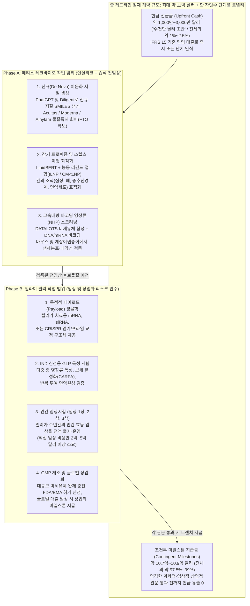
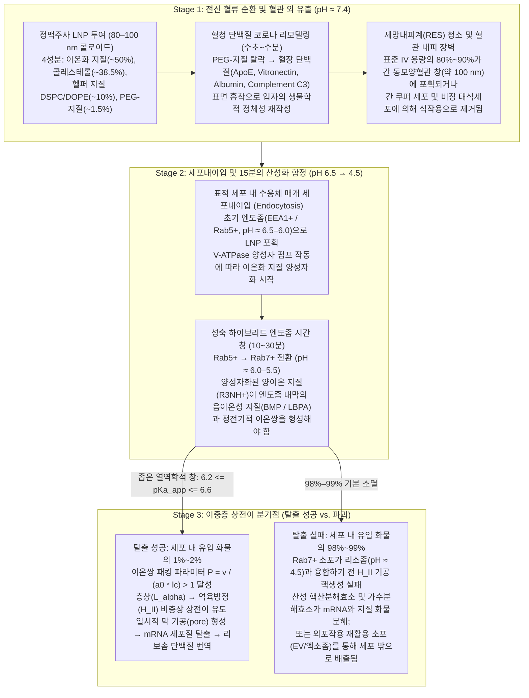
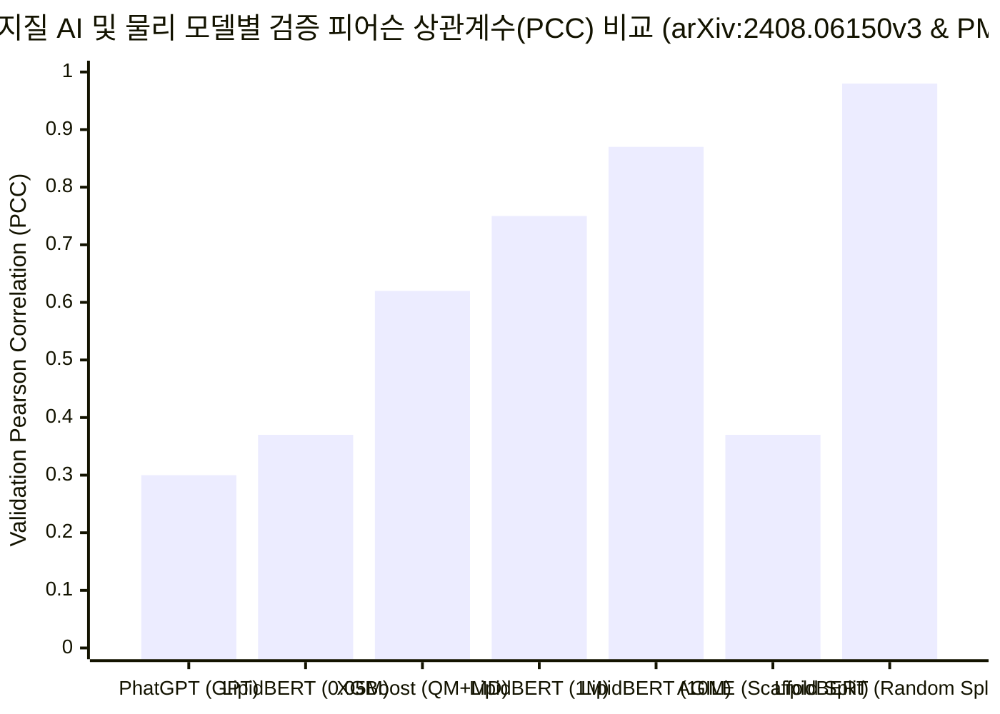

2026년 10월 19일, *"제약업계의 스페이스X(SpaceX)"*가 되겠다는 포부를 내걸고 5개월 전 홍콩증권거래소(HKEX)에 상장한 **메티스 테크바이오(METiS TechBio Co., Ltd., `7666.HK`, 剂泰科技)**가 글로벌 제약 시가총액 1위 기업 **일라이 릴리(Eli Lilly and Company, `NYSE: LLY`)**와 초대형 전략적 제휴를 발표했습니다:

> *"본 계약 조건에 따라 메티스 테크바이오는 수천만 달러 초반(low double-digit millions of U.S. dollars) 규모의 선급금(upfront payment)을 수령하며, 개발·규제 승인·상업화 마일스톤으로 최대 약 11억 달러(US$1.1 billion)를 받을 수 있는 자격을 갖는다. 또한 협업 결과물인 제품의 연간 순매출에 따른 한 자릿수 단계별 로열티(single-digit tiered royalties)를 수령하게 된다."*
> — **[메티스 테크바이오 공식 보도자료](https://metistechbio.com/en/qyxw/253.html)** 및 **[BioSpace 보도](https://www.biospace.com/deals/lilly-puts-1-1b-on-the-line-for-hong-kong-biotechs-ai-drug-delivery-platform)**, 2026년 10월 19일

AI 기반 바이오테크 기업이 세계 최대 제약사와 **11억 달러** 규모의 파트너십을 발표할 때, 비판적 관찰자라면 자연스럽게 여섯 가지 소크라테스식 질문을 던지게 됩니다:
1. **일라이 릴리는 정확히 어떤 작업의 대가로 11억 달러를 지불하는가?**
2. **지질나노입자(LNP) 전달 파이프라인에서 기술적으로 가장 어려운 단계는 무엇인가?**
3. **AI 모델 아키텍처 자체가 가장 어려운 부분은 아닌가?**
4. **생물학에서의 AI는 그저 '쉬운' 조합 탐색만 빠르게 처리할 뿐, 생체 내(in vivo) 물리적 장벽 앞에서는 멈춰 서는 것 아닌가?**
5. **AI가 설계한 LNP가 실제 인간 환자에서 작동한다는 임상적 증거(proof)가 존재하는가?**
6. **가장 핵심적인 20%의 창의적 돌파구를 위해 더 중요한 전문성은 AI인가, 아니면 '물리생물학(Physical Biology)'인가?**

이 여섯 가지 질문은 본 조사의 정확한 척추를 이룹니다. 일반적인 업계 해설도 거시적 직관은 정확히 짚어냅니다. 즉, 헤드라인에 찍힌 "11억 달러" 바이오 딜의 97%~99%는 조건부 마일스톤인 '바이오벅스(bio-bucks)'이며, 세포 내로 유입된 RNA 화물의 98%~99%가 산성화된 리소좀 안에서 파괴되는 **엔도좀 탈출(endosomal escape)**이 최고의 생물물리학적 병목이고, 범용 딥러닝 엔지니어가 구현하는 귀납적 편향(inductive bias)을 설계하는 것은 연성 응집물질 물리학('물리생물학')이라는 점입니다.

그러나 거시적 직관을 넘어 1차 사료(Primary Source) 포렌식 발굴을 수행하면—메티스 테크바이오의 **[홍콩거래소(HKEX) 제18C장 2026년 반기 재무보고서(2026년 8월 25일)](https://metistechbio.com/en/uploads/ueditor/20260825/e9df709ecbe3eb62c7c5916f62af97c1.pdf)**, **[공식 파이프라인 진행률 표시줄(`ywgx.html`)](https://metistechbio.com/en/ywgx.html)**, 핵심 기술 논문인 **[`LipidBERT` / `PhatGPT` 프리프린트(`arXiv:2408.06150v3`)](https://arxiv.org/html/2408.06150v3)**, `VERVE-101`([`NCT05398029`](https://clinicaltrials.gov/study/NCT05398029))의 임상 1b상 LNP 독성 중단 사태 이후 단행된 일라이 릴리의 **버브 테라퓨틱스(Verve Therapeutics) 13억 달러 인수**, 그리고 동료심사 벤치마크 문헌([`AGILE`, *Nature Communications* 2024](https://pmc.ncbi.nlm.nih.gov/articles/PMC11282250/))을 교차 검증하면—훨씬 더 충격적인 재무적·수학적·생물물리학적 실체가 드러납니다.

**일라이 릴리 – 메티스 테크바이오(11억 달러) 및 AI-LNP의 실체: 포렌식 감사 스코어카드**

| 소크라테스식 질문 | 표면적 내러티브 / 일반적 직관 | 1차 사료 포렌식 실체 (2026년 10월 기준) |
| :--- | :--- | :--- |
| **1. 릴리는 무엇에 11억 달러를 지불하는가?** | 릴리는 `AiLNP` 간외(extrahepatic) 전달체 설계에 선급금 약 1,000만~3,000만 달러만 지불하고, 약 10.8억 달러는 임상 및 상업화 마일스톤에 묶어 둔다. | **사실이며, 여기에 숨겨진 HKEX 18C장 규정 동기와 버브(Verve) 심장 유전자교정 동기가 결합됨:** 릴리는 `VERVE-101`의 LNP가 3등급 간독성·혈소판감소증을 일으킨 뒤 2025년 7월 최대 13억 달러에 버브를 인수했고, 메티스가 CRS 2026에서 **전신 투여 심근세포 mRNA 형질주입률 >95%(`CM-tLNP`)**를 발표한 지 3개월 만에 계약했다([보도자료 246](https://metistechbio.com/en/qyxw/246.html)). 한편 메티스는 [HKEX 상장규정 제18C.19(5)조](https://metistechbio.com/en/uploads/ueditor/20260825/e9df709ecbe3eb62c7c5916f62af97c1.pdf)에 따른 **상업화 이전(Pre-Commercial) 특장기술기업**으로, 상장폐지를 피하려면 2027년까지 **연간 매출 2.5억 홍콩달러(Rule 18C.03(4))**를 반드시 달성해야 하므로 선급금 라이선스 딜이 절실했다. |
| **2. 현재 메티스의 임상 파이프라인과 매출의 실체는 무엇인가?** | 메티스는 임상 3상 및 다수의 임상 파이프라인으로 플랫폼이 검증된 "AI 기반 mRNA/LNP 전달 유니콘"이다. | **메티스의 임상 1~3상 자산(`MTS-004`, `MTS-201`)은 100% 저분자(small molecule) 개량신약이지 LNP가 아니다:** 메티스의 [HKEX 반기보고서](https://metistechbio.com/en/uploads/ueditor/20260825/e9df709ecbe3eb62c7c5916f62af97c1.pdf)에 따르면, 2025년 매출(1.05억 위안)의 약 95%(1억 위안)는 제네릭 *누에덱스타(Nuedexta)*를 구강붕해정(ODT)으로 제형 변경한 `MTS-004` 기술수출에서 나왔다. 2026년 상반기 매출(1.54억 위안)의 **89.35%(1.379억 위안 / 2,000만 달러)** 역시 반기 마지막 날인 **2026년 6월 30일** 체결된 `MTS-128`(LNP가 아닌 재조합 삼중특이성 항체 단백질) 단일 계약(`Boulevard Bio`)에서 발생했으며, **매출의 88.3%(1.363억 위안)가 미수 매출채권(Trade Receivables)**으로 남아 있는 동안 실제 습식 실험실 재료 소모비는 단 **848만 위안(약 118만 달러)**에 불과했다! |
| **3. 파이프라인 중 기술적으로 가장 어려운 단계는?** | **엔도좀 탈출:** 유입된 LNP 화물의 95%~99%가 리소좀에서 분해되며, `6.2 ≤ pKa_app ≤ 6.6` 범위 내에서 `Lα → HII` 상전이가 일어나야 한다. | **정량 전자현미경 및 단일 소포 이미징으로 입증됨:** Gilleron 등(*Nature Biotech* 2013)은 유입된 LNP-siRNA 중 단 **1%~2%**만이 초기 엔도좀에서 후기 엔도좀으로 성숙하는 하이브리드 `EEA1+/Rab5+/Rab7+` 소포 내 10~15분의 시간 창 안에서 세포질로 탈출함을 증명했다([Wittrup et al., `PMC4663660`](https://pmc.ncbi.nlm.nih.gov/articles/PMC4663660/)). 탈출을 위해서는 양성자화된 3차 아민이 엔도좀 내막의 음이온성 지질(`BMP/LBPA`)과 이온쌍을 형성하여 이스라엘라슈빌리 패킹 파라미터 `P = v / (a₀ · lc) > 1`을 유도해야 한다. |
| **4. 왜 AI 모델 아키텍처는 가장 어려운 부분이 아닌가?** | GNN, BERT/GPT, 베이지안 최적화는 이미 표준화된 도구이며, 진짜 병목은 교란된 대리(proxy) 실험 라벨과 시뮬레이션 불가능한 다중스케일 물리학이다. | **메티스 자체 `LipidBERT` 논문([`arXiv:2408.06150v3`](https://arxiv.org/html/2408.06150v3)) 내부에서 직접 입증됨:** `LipidBERT`는 1,000만 개 가상 SMILES로 사전학습한 표준 12계층 `BERT-base`(768차원)다. 메티스의 자체 생성모델 `PhatGPT`는 물성 회귀에서 상관계수 `PCC ≈ 0.30`으로 붕괴했고, 자동화 양자역학(QM) + 분자동역학(MD) 이중층 기술자로 학습한 `XGBoost`도 `PCC = 0.62`에 그쳤다. 나아가 `AGILE` 데이터셋에서 `LipidBERT`가 기록했다는 `0.98 / 0.78`의 PCC는 조합 유사체 간 **무작위 80/10/10 분할**에 의존한 수치인 반면, `AGILE` 원논문의 엄격한 **Murcko 스캐폴드 분할**([`PMC11282250`](https://pmc.ncbi.nlm.nih.gov/articles/PMC11282250/))에서는 `0.37 / 0.23`으로 급락한다! |
| **5. AI가 설계한 LNP의 인간 임상 증거가 있는가?** | AI가 설계한 신규(de novo) LNP의 인간 임상 2/3상 효능 증거는 전무하며, 동물 GFP/루시퍼라제 발현은 인간 안전성·효능을 보증하지 못한다. | **ClinicalTrials.gov 전수 조사로 확인됨:** 메티스의 가장 앞선 LNP 자산(`MTS-105`, [`NCT06689540`](https://clinicaltrials.gov/study/NCT06689540))은 진행률 `22.72%`(`IIT/IND` 임상 1상 용량 증량) 단계이며, LNP가 수동적으로도 모이는 **간암(`HCC`)**을 표적으로 한다! 메티스 파이프라인 내 모든 간외 표적 `AiLNP` 자산(`MTS-107`, `108`, `110`, `111`, `112`, `118`)은 **전임상(`PCC`, 11.7%~16.7%)** 단계에 머물러 있다. 현재 인간 임상 1b상 개념증명(PoC)에 성공한 유일한 간외 LNP(`RCT1100`, [`NCT05737485`](https://clinicaltrials.gov/study/NCT05737485))는 **AI가 아닌 물리화학적 합리적 설계에 기반한 ReCode의 5성분 SORT 플랫폼**([`PMC7735425`](https://pmc.ncbi.nlm.nih.gov/articles/PMC7735425/))뿐이다. |
| **6. 20%의 창의적 코어에서 AI와 물리생물학 중 무엇이 우위인가?** | 순수 ML 아키텍처보다 물리생물학(연성 응집물질 생물물리학 및 제형 공학)이 압도적으로 중요하다. | **창업자 이력과 문제 정의 구조로 증명됨:** 메티스의 공동창업자 3인—라이차이달(Chris Lai, MIT 화학공학 박사), 천훙밍(Hongming Chen, MIT 로버트 랭거 연구실 화학공학 박사·미국 공학한림원 정회원·전 Kala CSO 및 Transform Pharma), 왕원서우(Wenshou Wang, MIT 랭거 연구실 고분자화학자)—모두 NLP 컴퓨터공학자가 아니라 MIT 출신 **화학공학·고분자·제형 물리학자**들이다([경영진 공시](https://metistechbio.com/en/gsgl.html)). |

본 심층 분석에서는 브라운과 킬리(Browne & Keeley)의 8단계 **"사금 채취(Panning for Gold)"** 비판적 사고 프레임워크를 적용하여, AI 기반 약물전달의 재무적 구조, 분자 생물물리학, 머신러닝 아키텍처, 그리고 임상 번역의 장벽을 철저히 감사(audit)합니다.

---

## Phase 1: 쟁점 분류(Issue Classification) 및 반증 가능성 기준

우리는 본 조사의 질문을 검증 가능한 두 가지 축으로 명확히 분리합니다:

1. **기술적·실증적 쟁점 (Descriptive Issue — 생물물리학 및 계산과학):** 왜 현재의 머신러닝 아키텍처(`LipidBERT`, `PhatGPT`, `Diligent`, `AGILE`)와 분자동역학(MD) 엔진은 완전히 새로운 화학 스캐폴드에서 생체 내(in vivo) 간외 표적 전달과 **엔도좀 탈출**을 예측하는 데 실패하는가? 그리고 2026년 10월 기준 메티스 테크바이오의 감사된 재무 및 임상 발자국은 실제로 무엇을 보여주는가?
2. **규범적·전략적 쟁점 (Prescriptive Issue — R&D 전략 및 자본 배분):** 제약 R&D 리더, 바이오테크 투자자, 머신러닝 엔지니어는 **인실리코(in silico) 생성형 AI 스케일링**과 **습식 실험실(wet-lab) 생물물리학적 어세이 공학 및 연성물질 제형 설계** 사이에 자본과 인재를 어떻게 배분해야 하는가?

### 반증 가능성 기준 (Falsifiability Criteria)
우리의 결론이 교조적 회의주의에 빠지지 않고 과학적 반증 가능성을 유지하도록, 2026~2030년 사이 우리의 비판을 **기각(disconfirm)**할 수 있는 세 가지 구체적 실증 임계치를 제시합니다:
- **계산 일반화 반증 조건:** 사전학습된 지질 언어 모델이나 그래프 확산 모델(`LipidBERT`, `Diligent`, `AGILE`)이 훈련 세트와 아민 헤드그룹이나 링커 하위 구조가 전혀 겹치지 않는 **엄격히 분리된(held-out) Murcko 화학 스캐폴드** 블라인드 테스트 세트에서 **비인간 영장류(NHP) 생체 내 기능적 mRNA 전달 효율**에 대해 피어슨 상관계수 `PCC ≥ 0.75`를 달성할 경우.
- **생물물리 시뮬레이션 반증 조건:** 경험적 습식 실험 보정 없이, 자동화된 조립자(coarse-grained) 또는 고정 pH 분자동역학(`CpHMD`) 파이프라인이 100개의 서로 다른 4성분 LNP 제형에 대해 실험적 겉보기 `pKa`(`pKa_app`)를 `±0.15` pH 단위 오차 이내로 예측하고 층상-역육방정(`Lα → HII`) 상전이 온도/pH를 직접 예측할 경우.
- **임상 번역 반증 조건:** AI가 신규(de novo) 생성한 이온화 지질 LNP에 치료용 mRNA나 CRISPR 유전자 교정기를 봉입한 후보물질이 **전신 투여 간외 적응증**(예: 정맥주사 심근세포, 폐, 중추신경계 전달)에 대한 인간 임상 2상 시험을 통과하여, 지속적인 임상 효능과 함께 용량 제한 보체 활성화(`CARPA`), 간독성(`ALT/AST` 3등급 이상 상승), 혈소판감소증 부재를 동시에 입증할 경우.

---

## Phase 2: 1차 사료 발굴, "11억 달러" 바이오벅스 해부 및 HKEX 제18C장 포렌식 회계 감사

### 1. 1차 사료 추적 매트릭스 (Primary Source Traceability Matrix)

본 보고서에 인용된 모든 재무 수치, 임상시험 단계, 알고리즘 지표는 2026년 10월 실시간으로 검증된 공식 규제 공시, 임상 레지스트리, 동료심사 논문에서 직접 추출되었습니다:

| 사료 범주 | 1차 문서 / 아티팩트 | 발행 기관 / 저자 | 추출된 핵심 검증 사실 |
| :--- | :--- | :--- | :--- |
| **계약 공식 발표** | [일라이 릴리 전략적 제휴 보도자료 (2026.10.19)](https://metistechbio.com/en/qyxw/253.html) 및 [BioSpace 리포트](https://www.biospace.com/deals/lilly-puts-1-1b-on-the-line-for-hong-kong-biotechs-ai-drug-delivery-platform) | 메티스 테크바이오(`7666.HK`) & 일라이 릴리(`LLY`) | 수천만 달러 초반(low double-digit millions) USD 선급금 + 개발·규제·상업화 마일스톤 최대 약 11억 달러 + 한 자릿수 단계별 로열티. |
| **홍콩거래소(HKEX) 검토 재무제표** | [2026년 반기 실적 공시 (2026년 6월 30일 종료 6개월)](https://metistechbio.com/en/uploads/ueditor/20260825/e9df709ecbe3eb62c7c5916f62af97c1.pdf) | Metis TechBio Co., Ltd. (`7666.HK`, PwC 검토) | 2026년 상반기 매출 1.5429억 위안(단일 고객 비중 89.35%, 미수 매출채권 1.3631억 위안); R&D 비용 1.7237억 위안; 실험 재료 소모비 단 848만 위안; HKEX 규정 18C.19(5) 상업화 이전 기업 경고문. |
| **공식 파이프라인 및 진행률 바** | [메티스 공식 파이프라인 (`ywgx.html`)](https://metistechbio.com/en/ywgx.html) 및 [HKEX 상장 보도자료 (`244.html`)](https://metistechbio.com/en/qyxw/244.html) | 메티스 테크바이오 (`7666.HK`) | 임상 3상 `MTS-004`(`71.72%`)와 임상 1상 `MTS-201`(`37.72%`)은 저분자 화합물임을 확인; 모든 간외 LNP 바이오의약품(`MTS-107`~`MTS-118`)은 `11.72%~16.72%`(`PCC` 전임상 단계)에 위치. |
| **심장 선택적 LNP 돌파구** | [CRS 2026 최우수 연구자상 (`246.html`)](https://metistechbio.com/en/qyxw/246.html) 및 [Late-Breaking 초록 (`240.html`)](https://metistechbio.com/en/qyxw/240.html) | 류안둥 박사 (Dr. Andong Liu, 메티스 부사장 겸 기술플랫폼 총괄) | 전신 투여 심장 선택적 `CM-tLNP`가 마우스에서 심근세포 mRNA 형질주입 >95% 및 CRISPR 유전자 교정 >50% 달성(간 비표적 교정 최소화). |
| **메티스 AI 아키텍처 프리프린트** | [*LipidBERT: A Lipid Language Model Pre-trained on METiS de novo Lipid Library* (`arXiv:2408.06150v3`)](https://arxiv.org/html/2408.06150v3) | Tianhao Yu, Cai Yao, Wenshou Wang, Chris Lai, Kai Wang 등 (METiS) | 1,000만 가상 지질 라이브러리, `LipidBERT`(BERT-base), `PhatGPT`(`PCC ≈ 0.30`), `Diligent`(DiT), 고정 몰비 한계, 신규 스캐폴드 성능 저하 명시, 일라이 릴리의 Michelle Lynn Hall 박사 감사 표기. |
| **벤치마크 비교 논문** | [*AGILE platform: a deep learning powered approach to accelerate LNP development for mRNA delivery* (*Nature Comms*, 2024, `PMC11282250`)](https://pmc.ncbi.nlm.nih.gov/articles/PMC11282250/) | Yue Xu, Shihao Ma, Haotian Cui, Bo Wang, Bowen Li 등 (토론토대) | 1,200개 조합 지질 데이터셋([GitHub](https://github.com/bowang-lab/AGILE))을 엄격한 **Murcko 스캐폴드 80/10/10 분할**로 평가 시 `PCC = 0.37`(HeLa), `0.23`(RAW 264.7) 기록. |
| **엔도좀 탈출 생물물리학** | [Wittrup et al. (*Nature Biotech* 2015, `PMC4663660`)](https://pmc.ncbi.nlm.nih.gov/articles/PMC4663660/), [Maugeri et al. (*Nature Comms* 2019, `PMC6760118`)](https://pmc.ncbi.nlm.nih.gov/articles/PMC6760118/), [Chatterjee et al. (*PNAS* 2024, `PMC10945858`)](https://pmc.ncbi.nlm.nih.gov/articles/PMC10945858/) | Lieberman/Anderson/Langer 연구실; AstraZeneca; Siegwart 연구실 | 1%~2% 세포질 탈출 병목 정량화, 단일 소포 Galectin-8/9 파열 동역학, 실시간 직접 탈출 고효율 어세이 부재 입증. |
| **겉보기 `pKa` 및 SORT LNP** | [Jayaraman et al. (*Angew. Chem.* 2012, `PMC3470698`)](https://pmc.ncbi.nlm.nih.gov/articles/PMC3470698/), [Hassett et al. (*Mol. Ther. Nucleic Acids* 2019, `PMC6383180`)](https://pmc.ncbi.nlm.nih.gov/articles/PMC6383180/), [Cheng et al. (*Nature Nanotech* 2020, `PMC7735425`)](https://pmc.ncbi.nlm.nih.gov/articles/PMC7735425/) | Alnylam/Cullis; Moderna; UT Southwestern (Siegwart) | 정맥주사 간 표적(`6.2–6.5`) 및 근육주사 백신(`6.6–6.9`)의 `pKa_app` 최적 창과 5성분 SORT 장기 트로피즘 법칙 확립. |
| **임상시험 레지스트리** | [`NCT06689540` (`MTS-105`)](https://clinicaltrials.gov/study/NCT06689540), [`NCT05398029` (`VERVE-101`)](https://clinicaltrials.gov/study/NCT05398029), [`NCT06164730` (`VERVE-102`)](https://clinicaltrials.gov/study/NCT06164730), [`NCT05737485` (`RCT1100`)](https://clinicaltrials.gov/study/NCT05737485) | ClinicalTrials.gov (METiS, Verve/Lilly, ReCode) | 인간 임상 단계, 중대 이상반응(`VERVE-101` 3등급 ALT 상승 및 혈소판감소증), 투여 경로 검증. |

---

### 2. 질문 1 해부: 일라이 릴리는 정확히 무엇에 "11억 달러"를 지불하는가?

바이오제약 사업개발(BD)에서 "11억 달러" 헤드라인 계약은 현금 송금이 아니라 **비대칭적 콜옵션 사다리("바이오벅스")**입니다. 2026년 10월 19일 체결된 일라이 릴리–메티스 테크바이오 계약의 재무적·운영상 구조를 도식화하면 다음과 같습니다:

#### 숨겨진 전략적 방아쇠: 13억 달러 버브(Verve) 인수 이후 릴리가 메티스를 필요로 했던 이유
왜 일라이 릴리는 하필 2026년 10월에 메티스 테크바이오를 선택했을까요? 그 해답은 2024년 4월에서 2026년 7월 사이에 일어난 두 가지 1차 사료 사건에 있습니다:

1. **`VERVE-101` LNP 독성 사태라는 경종 (2024년 4월 ~ 2025년 7월):**
   2024년 4월, 일라이 릴리의 심혈관 유전자 교정 파트너인 **버브 테라퓨틱스(Verve Therapeutics)**는 `PCSK9`을 표적으로 하여 LDL 콜레스테롤을 영구적으로 낮추는 생체 내 아데닌 염기 교정제 `VERVE-101`의 임상 1b상(`Heart-1`, [`NCT05398029`](https://clinicaltrials.gov/study/NCT05398029)) 환자 등록을 전격 중단했습니다. `0.45 mg/kg` 용량을 투여받은 6번째 환자에서 투여 4일 이내에 **3등급 일과성 알라닌 아미노전이효소(`ALT`) 간효소 상승**과 **3등급 혈소판감소증(심각한 혈소판 급락)**이 발생했기 때문입니다. 독립 안전성 모니터링 위원회의 조사 결과, 이 독성의 원인은 **CRISPR 염기 교정기 mRNA나 가이드 RNA 페이로드가 아니라 라이선스 도입한 1세대 이온화 지질 LNP 외피(envelope)** 때문인 것으로 밝혀졌습니다. 버브는 동일한 `PCSK9` 염기 교정 페이로드를 **다른 이온화 지질과 `GalNAc` 리간드가 결합된 맞춤형 LNP**에 봉입한 **`VERVE-102`**([`NCT06164730`](https://clinicaltrials.gov/study/NCT06164730))로 급히 선회했고, 임상 1b상에서 깨끗한 안전성과 함께 최대 **88%의 PCSK9 감소 및 62%의 LDL-C 감소**를 입증했습니다. 이를 확인한 일라이 릴리는 2025년 6~7월 버브를 **10억~13억 달러**에 인수했습니다.
2. **심근세포(Cardiomyocyte) 전달의 벽과 메티스의 2026년 7월 CRS 돌파구:**
   버브를 인수한 뒤에도 릴리는 해부학적 한계에 직면해 있었습니다. `VERVE-102`는 혈중 지질을 낮추기 위해 **간의 간세포(hepatocyte)**만 교정할 뿐, 치밀한 근절(sarcomere) 구조와 지속적인 기계적 수축, 연속적인 미세혈관 내피 장벽, 낮은 기본 내포작용(endocytosis)을 가진 **심근세포(심장 근육 세포)** 내부로는 RNA나 유전자 교정기를 전달할 수 없었기 때문입니다.
   바로 이 시점인 2026년 5~7월, 메티스 테크바이오의 **류안둥(Andong Liu) 부사장**이 포르투갈 리스본에서 열린 **2026년 제어방출학회(CRS) 연례학술대회**에서 *"고효율 생체 내 전달 및 심근세포 유전자 교정을 위한 전신 투여 심장 선택적 지질나노입자(Systemic Heart-Selective Lipid Nanoparticles for High-Efficiency In Vivo Delivery and Cardiomyocyte Gene Editing)"*라는 제목의 Late-Breaking 구두 발표를 진행했습니다([메티스 보도자료 240](https://metistechbio.com/en/qyxw/240.html); [보도자료 246](https://metistechbio.com/en/qyxw/246.html); [2026 반기보고서 11쪽](https://metistechbio.com/en/uploads/ueditor/20260825/e9df709ecbe3eb62c7c5916f62af97c1.pdf)). 능동 표적화 **`CM-tLNP`** 플랫폼을 사용하여 마우스 정맥주사 후 **>95%의 심근세포 mRNA 형질주입률**과 **>50%의 생체 내 심근세포 CRISPR 유전자 교정 효율**을 달성하면서 간·비장의 비표적 교정은 최소화한 것입니다. 더구나 메티스의 `LipidBERT` 논문([`arXiv:2408.06150v3`](https://arxiv.org/html/2408.06150v3)) 감사의 글(Acknowledgements)을 보면, 일라이 릴리의 계산과학자 **미셸 린 홀(Michelle Lynn Hall) 박사**가 이미 2024년부터 LNP 연구를 위한 AI·양자역학·분자동역학 자문을 제공해 왔음이 확인됩니다.

일라이 릴리 입장에서 연간 R&D 예산의 0.25%도 안 되는 약 1,500만~2,500만 달러의 선급금을 지불하고 메티스의 `AiLNP` 및 `CM-tLNP` 전달체가 릴리의 유전자 페이로드를 심장·중추신경계·폐로 전달할 수 있는지 테스트하는 것은 지극히 저렴하고 비대칭적인 콜옵션입니다.

---

### 3. HKEX 제18C장 포렌식 회계 발견: 왜 메티스는 선급금(Upfront) 매출이 절실했는가?

일라이 릴리의 경제적 논리는 명확합니다. 그렇다면 메티스 테크바이오의 입장은 어떨까요? 메티스 테크바이오의 **[2026년 반기 실적 공시(`7666.HK`, 2026년 8월 25일)](https://metistechbio.com/en/uploads/ueditor/20260825/e9df709ecbe3eb62c7c5916f62af97c1.pdf)**를 정밀 감사하면, 어떤 바이오 전문 매체도 보도하지 않은 결정적인 규제 및 회계 메커니즘이 드러납니다.

메티스 테크바이오 2026년 반기보고서 **25쪽**을 보십시오:

> **"상장규정 제18C.19(5)조에 따른 주의문(Cautionary Statement under Rule 18C.19(5) of the Listing Rules):** *당사는 특장기술기업(Specialist Technology Company, 상장규정 제18C장 정의)입니다. 또한 당사는 상장규정 제18C.03(4)조에 규정된 매출 요건을 충족하지 못한 상업화 이전 기업(Pre-Commercial Company)입니다. 당사는 궁극적으로 상장규정 제18C.03(4)조의 매출 요건을 충족하지 못할 수도 있습니다... 당사는 2027년에 상장규정 제18C.03(4)조에 따른 매출 요건을 충족할 것으로 예상합니다."*

홍콩증권거래소 **제18C장(특장기술기업)** 규정에 따르면, 감사된 연간 매출이 **2.5억 홍콩달러(약 2.3억 위안 / 약 3,200만 미국 달러)** 미만인 상태로 상장한 기업은 **상업화 이전 기업(Pre-Commercial Company)**으로 지정되며, **제18C.03(4)조**에 따른 **연간 매출 2.5억 홍콩달러 임계치**를 통과하지 못할 경우 엄격한 규제 제한과 상장폐지 시계에 직면하게 됩니다.

메티스 테크바이오가 이 2.5억 홍콩달러 임계치를 넘기 위해 2024년, 2025년, 그리고 2026년 상반기에 걸쳐 어떻게 IFRS 15 매출을 구조화했는지 살펴보겠습니다:

**메티스 테크바이오(`7666.HK`) 매출, 현금흐름 및 파이프라인 포렌식 분해 (2024년 ~ 2026년 상반기)**

| 재무 / 운영 지표 | FY2024 (감사) | FY2025 (감사) | 1H 2026 (2026.06.30 종료 6개월) | 1차 사료 포렌식 감사 주석 ([2026 반기보고서](https://metistechbio.com/en/uploads/ueditor/20260825/e9df709ecbe3eb62c7c5916f62af97c1.pdf)) |
| :--- | :--- | :--- | :--- | :--- |
| **총 IFRS 15 매출액** | 150만 위안 (~$0.21M) | 1.05억 위안 (~$14.5M) | **1.5429억 위안** (~$21.3M) | 공식 보도자료는 2026년 상반기 매출이 전년 동기(114만 위안) 대비 **"+13,399% 폭증"**했다고 홍보함. |
| **특정 시점(Point-in-Time) 라이선스 매출 vs. 기간 경과(Over-Time) 용역 매출** | — | ~1.00억 위안 (~95.2%) | **1.5361억 위안(`99.56%`)** 특정 시점 인식 vs. **68.4만 위안(`0.44%`)** 기간 경과 인식 | **2026년 상반기 매출의 99.56%**가 라이선스 이전에 따른 단일 시점 인식이었으며, 지속적인 실험실 연구 용역 매출은 6개월간 단 **68.4만 위안(약 9.5만 달러)**에 불과함(주석 3, 36쪽). |
| **단일 고객 집중도 (`Customer A`)** | — | ~95.2% (`저장 인안`, `MTS-004` 기술수출) | **`89.35%` (1.3786억 위안 / 2,000만 달러)**가 단일 고객 `Customer A`(`Boulevard Bio`)에서 발생 | 반기 보고기간의 문자 그대로 마지막 날인 **2026년 6월 30일**에 체결된 계약([보도자료 245](https://metistechbio.com/en/qyxw/245.html))으로, 대상 자산은 **LNP가 아니라 전임상 재조합 삼중특이성 항체 단백질(`MTS-128`)**임. |
| **대차대조표상 미수 매출채권 (Trade Receivables)** | — | 18.1만 위안 (2025.12.31 기준) | **1.3631억 위안 (상반기 총매출의 `88.35%`)** | 2,000만 달러 Boulevard Bio 딜이 6월 30일에 계상되었기 때문에 **기말 시점까지 해당 딜의 현금은 거의 회수되지 않았으며**, 매출채권이 18.1만 위안에서 1.3631억 위안으로 **753배 폭증**함(주석 9, 40쪽). |
| **영업활동 현금흐름 (`Net Cash Used in Operating Activities`)** | — | — | **-1.6220억 위안** (1H 2025: -9,631만 위안) | 회계상 매출이 "+13,399%" 급증했음에도 불구하고 실제 영업 현금 소진(burn)은 전년 동기 대비 **68.4% 악화**됨(현금흐름표, 34쪽). |
| **R&D 비용 총액 vs. 실제 습식 실험실 재료 소모비** | — | R&D 2.698억 위안 | **R&D 1.7237억 위안**, 그러나 실제 습식 실험실 **재료 소모비(Material Consumption)는 단 848만 위안(`$1.18M`)** | 상반기 총비용 2.9098억 위안 중 **1.5174억 위안(52.1%)**이 인건비(주식보상비용 **9,120만 위안** 포함)였고 **8,396만 위안**이 외부 CRO 용역비였으며, 자체 습식 실험 소모품비는 단 **848만 위안**에 그침(주석 5, 37쪽). |

---

### 4. 2열 주장 괴리 매트릭스(Claim Schism Matrix): 대중적 "AI 나노로켓 유니콘" 내러티브 vs. 규제 공시 및 프리프린트 실체

메티스 테크바이오의 대중 마케팅 보도자료와 HKEX 재무제표 주석, 파이프라인 진행률 표시줄, 그리고 `arXiv` 기술 논문을 교차 대조하면 다섯 가지 극명한 괴리(schism)가 드러납니다:

| 감사 차원 | 대중 마케팅 및 상장 홍보 내러티브 | HKEX 공시, 파이프라인 및 프리프린트 내부의 실체 |
| :--- | :--- | :--- |
| **1. AI 설계 LNP(`AiLNP`)의 임상 성숙도** | *"세계 최초의 상장 AI 기반 약물전달 기업 메티스 테크바이오... 인체 8대 주요 장기와 조직에 걸친 혁신적 표적 전달 달성."* ([HKEX 상장 보도자료 244](https://metistechbio.com/en/qyxw/244.html)) | **인간 임상시험에 진입한 간외(Extrahepatic) LNP는 0건:** 메티스의 [공식 파이프라인 표(`ywgx.html`)](https://metistechbio.com/en/ywgx.html)에서 유일한 임상 3상/NDA 준비 자산(**`MTS-004`**, `data-line = 71.72%`)은 제네릭 *누에덱스타*(덱스트로메토르판+퀴니딘)의 **구강붕해정(ODT) 저분자 개량신약**(`AiTEM`)이다. 유일한 임상 1상 자산(**`MTS-201`**, `37.72%`) 역시 경구용 저분자 `TGR5` 작용제다. `IIT/IND` 단계 바이오의약품 2건(`MTS-105` `22.72%` 간암, `MTS-109` `27.72%`)은 간과 림프절을 표적하며, **6개의 간외/고형암 LNP 후보물질(`MTS-107`, `108`, `110`, `111`, `112`, `118`)은 전부 `11.72%~16.72%`(`PCC` 전임상 단계)**에 머물러 있다. |
| **2. 상업적 매출(`+13,399% YoY`)의 출처** | *"메티스 테크바이오, 2026년 반기 매출이 2025년 연간 매출을 47% 초과 달성하며 AI for Science 상업화 선도."* ([보도자료 251](https://metistechbio.com/en/qyxw/251.html)) | **2025년~2026년 상반기 누적 매출의 94%가 비(非)LNP 자산에서 발생:** 2025년 1억 위안은 저분자 구강붕해정 `MTS-004` 기술수출에서, 2026년 상반기 1.3786억 위안은 6월 30일 체결된 재조합 삼중특이성 항체 단백질 `MTS-128`(`BLVD201`) 라이선스에서 나왔다([2026 반기보고서 12, 15, 36쪽](https://metistechbio.com/en/uploads/ueditor/20260825/e9df709ecbe3eb62c7c5916f62af97c1.pdf)). LNP 옵션 딜(BioThunder AG)에서 나온 매출은 **1,500만 위안(약 210만 달러)**뿐이다! |
| **3. `LipidBERT`의 진정한 신규(De Novo) 일반화 능력** | *"AiLNP는 독자적인 지질 라이브러리, 지질 언어 모델 및 생성 알고리즘을 활용하여 기존 양성 이온화 지질이 없는 미개척 영역에서 최적의 지질 후보를 설계한다."* ([플랫폼 페이지](https://metistechbio.com/en/jsyyf.html)) | **프리프린트 내 명시적 스캐폴드 내삽(Interpolation) 한계 고백:** [`arXiv:2408.06150v3`](https://arxiv.org/html/2408.06150v3) 섹션 2.4.1에서 저자들은 다음과 같이 인정한다: *"LipidBERT는 당사 실험 세트에 잘 대표된 스캐폴드를 가진 이온화 지질에서 특히 뛰어난 성능을 보이지만, **완전히 새로운 스캐폴드(entirely novel scaffolds)를 가진 화합물에 대해서는 예측 정확도가 떨어질 수 있다.**"* |
| **4. 4성분 제형 최적화 vs. 단일 지질 SMILES 입력** | *"본 플랫폼은 이온화 지질, 헬퍼 지질, 콜레스테롤, PEG-지질 및 그 비율의 체계적 설계 및 최적화를 가능케 한다."* ([플랫폼 페이지](https://metistechbio.com/en/jsyyf.html)) | **`LipidBERT` 연구의 고정 성분비(Fixed Component Ratios):** [`arXiv:2408.06150v3`](https://arxiv.org/html/2408.06150v3) 섹션 2.4.1은 *"본 연구의 모든 데이터는 LNP 제형에서 **고정된 성분 비율(fixed component ratios)**을 사용하여 생성되었다"*고 명시한다. `LipidBERT`는 이온화 지질의 1차원 SMILES 문자열(128자로 패딩)만 입력받을 뿐 몰비 변화나 헬퍼 지질 교체를 모델링하지 않는다. |
| **5. 수동적 지질 트로피즘 vs. 능동 항체 접합(`tLNP`)** | 대중 보도자료는 AI가 설계한 이온화 지질 화학 구조만으로 LNP가 심장, T세포, 폐 등 원하는 장기로 스스로 찾아가는 것처럼 묘사한다. | **능동 항체/리간드 접합(`tLNP` / `CM-tLNP`)으로의 피벗:** [2026 반기보고서](https://metistechbio.com/en/uploads/ueditor/20260825/e9df709ecbe3eb62c7c5916f62af97c1.pdf) 5, 10, 11쪽을 보면, 메티스의 T세포(`in vivo CAR-T tLNP`) 및 심근세포(`CM-tLNP`) 전달 돌파구는 실제로는 **생리학적으로 '스텔스(stealth, 불활성)' 특성을 갖는 이온화 지질을 설계**한 뒤 LNP 표면에 **능동 표적 항체나 리간드를 화학적으로 접합(conjugation)**한 결과임이 밝혀져 있다! |

> [!IMPORTANT]
> **괴리 #5에 주목하십시오:** AI가 설계한 이온화 지질 구조만으로는 간의 수동적 ApoE 흡수 싱크(sink)를 극복하고 T세포나 심근세포로 선택적 이동(homing)을 달성할 수 없게 되자, 메티스는 2026년 반기보고서(5, 10~11쪽)에서 **'스텔스' 이온화 지질**(간 단백질과 결합하지 않도록 불활성화한 지질)에 `AiProtein` 플랫폼으로 설계한 **부위-특이적 접합 항체(`tLNP` 및 `CM-tLNP`)**를 결합하는 전략으로 선회했습니다. 즉, 장기 특이성은 점점 더 **표면 항체/리간드-수용체 결합**이 담당하고, 이온화 지질의 본래 임무는 혈중 순환 중 독성을 일으키지 않고 버틴 뒤 항체 접합 입자가 세포 내로 유입되었을 때 **엔도좀 탈출(endosomal escape)**을 수행하는 것으로 회귀한 것입니다!

---

## Phase 3: 의미론적 정밀성, 모호성 치환 테스트 및 4단계 LNP 전달 성숙도 계층

마케팅 용어가 공학적 실체를 가리는 것을 방지하기 위해, AI 약물전달 담론에서 남용되는 네 가지 핵심 용어에 브라운과 킬리의 **모호성 치환 테스트(Ambiguity Substitution Test)**를 적용합니다.

### 1. 모호성 치환 테스트 (Ambiguity Substitution Test)

- **용어 1: "AI가 신규 설계한 이온화 지질 (De Novo AI-Designed Ionizable Lipid)"**
  - *느슨한 / 마케팅적 정의:* 심층 생성 신경망이 제1원리(first principles)로부터 이전에 알려지지 않은 막 융합 물리 메커니즘을 발견하여 발명해 낸 완전히 새로운 화학 물질 원형.
  - *엄격한 / 조작적 정의 ([`arXiv:2408.06150v3`](https://arxiv.org/html/2408.06150v3) 구현 기준):* 기존 특허 및 문헌의 이온화 지질을 `7~12`개의 하위 절편(아민 헤드그룹, 에스테르/아미드/카바메이트 링커, 분지형 탄화수소 꼬리)으로 절단한 뒤, 규칙 기반 강화학습(`PhatGPT` / `Diligent`)으로 절편들을 재조합하고, 사내 습식 실험 스캐폴드로 훈련된 `BERT-base` 회귀 모델(`LipidBERT`)로 유사체를 필터링하는 작업.
  - *치환 판정:* 알려진 헤드그룹-링커-꼬리 절편을 재조합하는 것은 **자동화된 조합적 스캐폴드 호핑(combinatorial scaffold hopping)**입니다. 이는 제3자 물질특허(`Acuitas ALC-0315`, `Moderna SM-102`, `Alnylam MC3`)를 회피하는 데는 매우 가치 있는 방법이지만, 미지의 물리화학 영역으로 외삽(extrapolation)하는 것과는 수학적으로 전혀 다릅니다.
- **용어 2: "장기 표적 / 간외 전달 (Organ-Targeted / Extrahepatic Delivery)"**
  - *느슨한 / 마케팅적 정의:* 정맥주사 후 투여된 LNP 용량의 80% 이상이 표적 장기(예: 폐, 심장, 뇌)에만 배타적으로 축적되고 간에는 거의 가지 않는 현상.
  - *엄격한 / 조작적 정의:* (a) 물리적 지질 질량의 60%~80%가 여전히 간의 쿠퍼(Kupffer) 대식세포에 포획·분해되더라도 IVIS 카메라 상에서 표적 장기의 **발광/형광 단백질 발현 비율**(`I_organ / I_liver`)이 높게 나타나는 현상, 또는 (b) **능동 리간드/항체 접합 `tLNP`**나 **국소 투여**(폐 흡입 에어로졸, 중추신경계 척수강 내 주사, 난소암 복강 내 주사)를 통한 전달.
  - *치환 판정:* *단백질 발현 비율*(표적 조직에서의 mRNA 번역)과 *물리적 질량 생체분포*를 혼동하면 전신 투여 LNP의 용량 제한 독성 원인을 놓치게 됩니다. 설령 mRNA에 장기 특이적 비번역 부위(`UTR`)나 마이크로RNA 표적 서열(예: 간세포 내 번역을 억제하는 `miR-122`)을 삽입하더라도, **물리적인 지질 외피 자체는 여전히 간과 비장으로 쏟아져 들어가** 보체 활성화와 간효소 급등을 유발합니다!
- **용어 3: "엔도좀 탈출 효율 (Endosomal Escape Efficiency)"**
  - *느슨한 / 마케팅적 정의:* 투여 24시간 후 측정한 높은 반딧불이 루시퍼라제(`Fluc`) 생물발광 또는 `eGFP` 형광 단백질 수치.
  - *엄격한 / 조작적 정의:* 세포 내로 유입된 핵산 화물 분자 중 리소좀 가수분해효소에 의해 파괴되기 전에 엔도좀 한계 지질 이중층을 물리적으로 통과하여 세포질로 이동한 정확한 몰 분율(`N_cytosol / N_endocytosed`, 표준 LNP의 경우 `약 1%~2%`).
- **용어 4: "물리생물학 (Physical Biology / 연성 응집물질 생물물리학)"**
  - *조작적 정의:* 생물학적 구조를 추상적인 기호 문자열(`A, C, G, T` 또는 `SMILES` 토큰)로 다루지 않고, 자유에너지 지형(`ΔG`), 막 곡률 탄성(`Helfrich 해밀토니안`), 콜로이드 DLVO 힘, 비평형 상평형도(`Lα ↔ HII`), 전단 유변학(shear rheology)의 지배를 받는 **연속적인 열역학적·기계적·전기동역학적 시스템**으로 모델링하는 정량 과학 분야.

---

### 2. 4단계 핵산 LNP 전달 성숙도 계층 (4-Tier Maturity Hierarchy)

메티스 테크바이오의 `AiLNP`, 토론토대의 `AGILE`, ReCode의 `SORT`, 그리고 Alnylam/Moderna/Acuitas의 임상 플랫폼을 객관적 척도 위에 배치하기 위해 4단계 성숙도 계층을 수립합니다:

**4단계 핵산 LNP 전달 성숙도 계층 (2026년 10월 기준)**

| 성숙도 계층 | 물리적 및 생물학적 메커니즘 | 대표 플랫폼 및 지질 | 인간 임상 검증 상태 (2026년 10월) |
| :--- | :--- | :--- | :--- |
| **Tier 1: 수동적 간 표적 및 국소 근육주사(IM) 백신 LNP** | 4성분 LNP가 혈중 `ApoE`를 흡착 → 간세포 `LDLR` 결합(IV) 또는 국소 수지상/근육세포 유입(IM); `1%~3%` 엔도좀 탈출. | **Alnylam/Cullis** (`DLin-MC3-DMA`), **Acuitas/Pfizer** (`ALC-0315`), **Moderna** (`SM-102`), **Intellia** (`NTLA-2001/2002`) | **상업화 완료 / 임상 3상 입증:** *온파트로(Onpattro, 2018)*, *코미나티*, *스파이크박스*, *mRESVIA* FDA 승인; 임상 3상 유전자교정 시험 진행 중. |
| **Tier 2: 리간드 접합 간 표적 및 합리적 설계 5성분 SORT LNP** | 5번째 `SORT` 지질(폐 표적 양이온성 `DOTAP`, 비장 표적 음이온성 `18PA`) 또는 `GalNAc` 리간드(LDLR 결핍 환자용 `ASGPR` 흡수) 추가. | **Verve/Eli Lilly** (`VERVE-102` GalNAc-LNP), **ReCode Therapeutics** (`RCT1100` & `RCT2100` 흡입형 SORT LNP) | **인간 임상 1b / 2상 개념증명(PoC) 완료:** `VERVE-102`([`NCT06164730`](https://clinicaltrials.gov/study/NCT06164730))는 안전하게 88% PCSK9 녹다운 달성; `RCT1100`([`NCT05737485`](https://clinicaltrials.gov/study/NCT05737485))은 원발성 섬모운동이상증(PCD) 환자의 57%에서 점액섬모 청소율 개선(2026년 5월). **비(非)AI 합리적 설계.** |
| **Tier 3: AI 내삽 조합형 및 능동 표적(`tLNP`) 전달체** | 절편 기반 강화학습 + SMILES/그래프 신경망 필터(`LipidBERT`, `AGILE`)에 고속 바코딩 마우스/영장류 스크리닝 및 항체 접합(`CM-tLNP`) 결합. | **METiS TechBio** (`AiLNP`, `CM-tLNP`, `MTS-105`), **Bowen Li Lab** (`AGILE`, [`PMC11282250`](https://pmc.ncbi.nlm.nih.gov/articles/PMC11282250/)) | **전임상 / 초기 임상 1상 IIT 단계에 국한:** `MTS-105`([`NCT06689540`](https://clinicaltrials.gov/study/NCT06689540))는 **간암** 대상 임상 1상 IIT 진행 중; 모든 간외 표적 AI 설계 LNP(`CM-tLNP`, `MTS-108`)는 현재까지 **인간 임상 효능 데이터 0건**. |
| **Tier 4: 제1원리 다중스케일 생물물리 시뮬레이터 & 제로샷 신규 LNP 엔진** | 고정 pH 양자/조립자 동역학을 결합하여 습식 스캐폴드 학습 없이 단백질 코로나 형성, 내피 세포간 이동, `Lα → HII` 엔도좀 탈출을 제로샷 예측. | 차세대 다중스케일 AI + CpHMD 플랫폼의 궁극적 목표 | **미구축(Unbuilt):** 현재 MD + QM 기술자는 `PCC = 0.62`에 불과하며([`arXiv:2408.06150v3` Fig. 11](https://arxiv.org/html/2408.06150v3)), 스캐폴드 외(out-of-scaffold) ML 예측력은 `PCC = 0.23–0.37`로 급락함. |

---

## Phase 4: 병목의 생물물리학(엔도좀 탈출) 및 4방향 인과 감사

왜 Gemini와의 대화에서는 전체 핵산 전달 파이프라인 중 기술적으로 가장 어려운 문제로 **엔도좀 탈출(endosomal escape)**을 지목했을까요? 그리고 나노입자가 표적 장기에 도달하여 세포 내부로 삼켜진(endocytosis) 뒤에도 왜 투여된 RNA 분자의 95%~99%가 세포 안에서 사멸하는 것일까요?

정맥주사부터 세포질 내 리보솜 번역에 이르기까지 LNP가 통과해야 하는 물리적 관문을 추적하고, 유기화학자와 딥러닝 모델 모두가 이 지점에서 벽에 부딪히는 이유를 설명하는 세 가지 지배 방정식을 유도해 보겠습니다.

### 1. 98%~99% 엔도좀 무덤의 정량적 실험 증거
세포 내부의 개별 핵산 분자를 물리적으로 직접 카운팅한 두 편의 기념비적 실험 연구가 이 병목을 정량적으로 증명했습니다:
- **Gilleron, Zerial 등 (*Nature Biotechnology*, 2013, `PMID: 23792630`)**은 `DLin-MC3-DMA` / `LNP01` 지질나노입자 내부의 siRNA에 콜로이드 금 나노입자(`6 nm`)를 접합한 뒤, HeLa 세포와 생체 내 마우스 간세포에서 정량 전자현미경(EM)과 자동화 고해상도 형광현미경을 결합하여 추적했습니다. 그 결과 **세포 내로 유입된 siRNA 분자 중 단 1%~2%만이 세포질로 탈출**하며(세포당 약 `2,000~4,000`개 siRNA 분자), 탈출은 오직 초기 엔도좀이 다중소포성 후기 엔도좀으로 성숙하는 좁은 진행 단계에서만 일어난다는 사실을 증명했습니다.
- **Wittrup, Lieberman, Anderson, Langer 등 (*Nature Biotechnology*, 2015, [`PMC4663660`](https://pmc.ncbi.nlm.nih.gov/articles/PMC4663660/))**은 실시간 단일 소포 형광현미경과 세포질 내 막 손상 센서인 **갈렉틴-8 / 갈렉틴-9 (`Gal8/Gal9`)** 모집 추적을 통해 살아있는 세포에서 개별 LNP 함유 엔도좀이 파열되는 순간을 관찰했습니다. 이들은 엔도좀 탈출이 **세포내이입 후 5~15분 사이**에 성숙 중인 `EEA1+/Rab5+/Rab7+` 하이브리드 엔도좀에서 일어나는 확률적(stochastic)이고 돌발적인 단발성 분출 현상이며, 막이 다시 봉합되거나 자가포식(`LC3`)에 의해 격리되기 전 소포 내 RNA 화물의 극히 일부만 방출된다는 사실을 밝혀냈습니다.
- **Maugeri 등 (*Nature Communications*, 2019, [`PMC6760118`](https://pmc.ncbi.nlm.nih.gov/articles/PMC6760118/))**은 나아가 리소좀에서 분해되지 않은 유입 LNP-mRNA와 이온화 지질의 상당 부분이 내강 소포(intraluminal vesicles)로 분류되어 **세포외 소포(`EV` / 엑소좀) 안에 담겨 세포 밖으로 역배출**된다는 사실을 규명했습니다.

---

### 2. 유도 1: 이스라엘라슈빌리 패킹 파라미터(`P`)와 층상-역육방정(`Lα → HII`) 상전이

왜 혈류(`pH 7.4`)에서는 적혈구를 용혈(`hemolysis`)시키지 않으면서 엔도좀(`pH 5.8`) 안에서만 막을 파열시키는 지질을 설계하는 것이 그토록 어려울까요? 지질 분자가 단 `1.0` pH 단위의 차이 안에서 자신의 **초분자 기하학적 구조(supramolecular geometry)**를 동적으로 뒤집어야 하기 때문입니다.

연성 응집물질 물리학(Jacob Israelachvili의 *Intermolecular and Surface Forces* 및 Pieter Cullis의 막 융합 다형성 상이론)에서 양친매성 지질의 자기조립 상(phase)은 무차원 **분자 패킹 파라미터(`P`, Molecular Packing Parameter)**에 의해 결정됩니다:

$$P = \frac{v}{a_0 \cdot l_c}$$

여기서:
- `v`는 탄화수소 꼬리의 유효 소수성 부피(nm³),
- `a₀`는 지질-물 계면에서 극성 헤드그룹의 최적 단면적(nm²),
- `lc`는 아실 사슬의 임계 최대 연장 길이(nm)입니다.

`P` 값은 **헬프리히(Helfrich) 막 굽힘 탄성 에너지**를 통해 지질 집합체의 자발적 곡률 `C₀`와 열역학적 상을 지배합니다:

$$E_{\text{bend}} = \int_{\text{membrane}} \left[ \frac{\kappa}{2} (2H - C_0)^2 + \bar{\kappa} K_G \right] dA$$

여기서 `κ`는 굽힘 강성 계수, `κ̄`는 가우시안 안장-벌림(saddle-splay) 계수, `H = ½(c₁ + c₂)`는 평균 곡률, `K_G = c₁·c₂`는 가우시안 곡률입니다:

1. **전신 혈류 내 (`pH = 7.4`):** 이온화 지질의 3차 아민 헤드그룹(`R₃N`)은 **전하를 띠지 않는 중성 상태**입니다. 헬퍼 인지질(`DSPC`) 및 콜레스테롤과 결합된 상태에서 유효 패킹 파라미터는 `½ < P ≤ 1`(`C₀ ≈ 0`)을 만족합니다. 지질들은 원통(cylinder) 형태로 패킹되어, RNA를 봉입한 무정형 소수성 코어를 둘러싼 안정적이고 비용혈성인 **평면 층상 이중층(`Lα` 상)**을 형성합니다.
2. **산성화되는 엔도좀 내부 (`pH = 6.0 → 5.5`):** V-ATPase 양성자 펌프가 엔도좀 내강으로 `H⁺` 이온을 주입합니다. 3차 아민 헤드그룹은 양성자화되어 양전하를 띤 암모늄 양이온(`R₃NH⁺`)이 됩니다. 동시에 성숙/후기 엔도좀의 내막(inner leaflet)에는 원뿔 모양의 음이온성 인지질인 **비스(모노아실글리세로)포스페이트(`BMP`, 일명 리소비스포스파티드산 `LBPA`)**가 최대 `15–20 mol%`까지 특이적으로 농축되어 있습니다.
3. **이온쌍 기하학적 스위치 (`P_pair > 1`):** LNP 외막의 양성자화된 양이온 지질 `R₃NH⁺`가 엔도좀 내막의 음이온성 `BMP⁻` 지질과 정전기적으로 접촉하면, 수화 물 분자를 밀어내며 **단단한 중성 이온쌍(neutral ion pair)**을 형성합니다. 이때 결합된 극성 헤드그룹 단면적은 `a_pair ≪ a_cation + a_anion`으로 급격히 수축하는 반면, 네 개의 벌어진 분지형 탄화수소 꼬리는 거대한 소수성 원뿔 부피 `v_pair = v_LNP + v_BMP`를 형성합니다:

$$P_{\text{pair}} = \frac{v_{\text{LNP}} + v_{\text{BMP}}}{a_{\text{pair}}(\text{pH}, I) \cdot l_c} > 1 \implies C_0 < 0 \quad (\text{L}_\alpha \longrightarrow \text{H}_{\text{II}} \text{ Phase Inversion})$$

`P_pair > 1`이 되고 가우시안 안장-벌림 에너지 `κ̄·K_G`가 음의 가우시안 곡률(`K_G < 0`, 안장 모양의 융합 줄기 및 막 관통 기공의 기하학)을 선호하게 되면, 평면 이중층은 **역육방정(`HII`, inverted hexagonal) 비층상 상**으로 불안정화되면서 일시적인 지질 기공(lipidic pore)을 엽니다. 바로 이 좁은 기공을 통해 4,000 뉴클레오타이드 길이의 거대한 mRNA 분자(약 `1.3 MDa`, 유체역학적 직경 `~30–50 nm`)가 세포질로 빠져나와야 합니다!

왜 단일 사슬이나 선형 포화 지질보다 **분지형 다중 꼬리(branched multi-tail) 이온화 지질**(예: 생분해성 분지형 에스테르 꼬리를 가진 Acuitas의 `ALC-0315`와 Moderna의 `SM-102`, 또는 메티스 `LipidBERT` 사전학습 과제 #2의 `3~6`개 꼬리를 가진 덴드리머/다중 꼬리 지질)이 훨씬 더 강력한지 여기서 명확히 설명됩니다. 사슬 길이 `lc`는 고정한 채 꼬리 분지화를 통해 단면 부피 `v`를 극대화함으로써, 엔도좀 내 양성자화 순간 `P_pair`를 극적으로 끌어올리기 때문입니다!

---

### 3. 유도 2: 겉보기 `pKa` 역설(Apparent `pKa` Paradox)과 본-구이-채프먼(Born-Gouy-Chapman) 이동

Gemini 대화의 세 번째 포인트는 **"겉보기 `pKa` 역설"**을 강조했습니다. 왜 물속에서 측정한 지질 단량체의 이론적 `pKa`(`pKa_wat ≈ 8.5–9.5`)는 조립된 나노입자 내부에서의 실제 작동 `pKa`(`pKa_app ≈ 6.2–6.6`)에 대해 아무것도 알려주지 못할까요?

이 이동을 지배하는 정확한 물리화학 방정식을 유도해 보겠습니다. 3차 아민이 자기조립된 4성분 LNP의 조밀하고 유전율이 낮은 표면에 묻혀 있을 때, 그 양성자화 자유에너지는 두 가지 큰 정전기적 페널티에 의해 섭동됩니다:
1. **본(Born) 유전 자기에너지 페널티 (`ΔG_Born`):** 이온 반경 `r₀`인 점전하 `+e`를 벌크 물(25°C에서 상대 유전율 `ε_w ≈ 78.5`)에서 소수성 지질-콜레스테롤 계면(유효 국소 유전상수 `ε_r ≈ 5~20`)으로 옮기면 정전기적 용매화 에너지 손실이 발생하여, **전하가 없는 중성 상태**(`R₃N`)를 강하게 선호하게 만들고 `pKa`를 아래쪽으로 끌어내립니다.
2. **구이-채프먼(Gouy-Chapman) 표면 전위 페널티 (`e·ψ₀`):** LNP 표면 아민의 첫 분율 `α`가 양성자화(`R₃NH⁺`)되면, 나노입자는 양의 표면 전하 밀도 `σ(α)`를 띠게 되어 양의 정전기적 표면 전위 `ψ₀ > 0`를 형성합니다. 이 양전위가 주변 완충액에서 다가오는 추가적인 `H⁺` 이온을 정전기적으로 밀어냅니다!

이 두 열역학적 항을 결합하면 **나노입자 겉보기 `pKa` 방정식(Apparent Nanoparticle `pKa` Equation)**이 도출됩니다:

$$\text{p}K_a^{\text{app}}(\alpha) = \text{p}K_a^{\text{wat}} - \underbrace{\frac{e^2}{2.303 \, k_B T \cdot 8\pi \varepsilon_0 r_0}\left(\frac{1}{\varepsilon_r(x_{\text{chol}}, x_{\text{helper}})} - \frac{1}{\varepsilon_w}\right)}_{\text{Born Dielectric Shift } (\approx 1.0 \text{ to } 2.0 \text{ pH units})} - \underbrace{\frac{e \, \psi_0(\sigma, I_{\text{salt}})}{2.303 \, k_B T}}_{\text{Coulombic Crowding Shift } (\approx 0.5 \text{ to } 1.0 \text{ pH units})}$$

이 방정식이 증명하는 바를 보십시오:
- `pKa_app`는 **고립된 단일 SMILES 문자열의 고유 분자 물성이 아닙니다!** 국소 유전상수 `ε_r`과 표면 전하 간격 `σ`가 **콜레스테롤 몰 분율(`x_chol`)**, **헬퍼 지질 헤드그룹(`x_helper`: 양쪽성이온 `DSPC` vs. `DOPE` vs. 음이온/양이온 `SORT` 지질)**, 그리고 **N/P 전하비**(질소 대 RNA 인산염 비율)에 비선형적으로 의존하기 때문에, 이는 4성분 집합체 전체의 **창발적 콜로이드 물성(emergent colloidal property)**입니다!
- **Jayaraman, Cullis, Hope 등 (*Angewandte Chemie*, 2012, [`PMC3470698`](https://pmc.ncbi.nlm.nih.gov/articles/PMC3470698/))**이 마우스에서 56종의 맞춤형 아미노 지질을 스크리닝하여 증명했듯, 간 siRNA 유전자 침묵 효능은 **`6.2 ≤ pKa_app ≤ 6.5`**에 중심을 둔 면도날처럼 좁은 종 모양 곡선을 따릅니다(`DLin-MC3-DMA`는 `pKa_app = 6.44`에서 `ED50 = 0.005 mg/kg` 달성). `pKa_app`가 이 창에서 단 `0.5` 단위만 벗어나도(`6.0` 미만 또는 `7.0` 초과), 생체 내 효능은 **100배에서 1,000배까지 폭락**합니다!
- 마찬가지로 모더나(Moderna)의 **Hassett 등 (*Molecular Therapy - Nucleic Acids*, 2019, [`PMC6383180`](https://pmc.ncbi.nlm.nih.gov/articles/PMC6383180/))**은 30종의 생분해성 이온화 지질을 스크리닝하여(`SM-102` 도출), 근육주사(IM) mRNA 백신 면역원성은 이보다 약간 더 높은 **`6.6 ≤ pKa_app ≤ 6.9`** 창을 요구한다는 사실을 입증했습니다.

---

### 4. 유도 3: 교란된 대리 손실 함수 (왜 표준 AI는 오염된 기울기로 학습하는가)

왜 딥러닝은 엔도좀 탈출을 분리해 내지 못할까요? `AGILE`의 1,200개 지질 시험관 내(in vitro) 발광 스크리닝([`PMC11282250`](https://pmc.ncbi.nlm.nih.gov/articles/PMC11282250/))과 메티스의 마우스 장기 생체 외(ex vivo) 형광 스크리닝([`arXiv:2408.06150v3` 섹션 2.4.1](https://arxiv.org/html/2408.06150v3))을 포함한 고속대량 습식 스크리닝에서, 신경망의 회귀 타깃 `Y_obs`가 **투여 24시간 후의 하류 단백질 발현 스칼라 값**(반딧불이 루시퍼라제 생물발광 `Fluc` 또는 형광 단백질 강도 `FI`)이기 때문입니다.

수학적으로, LNP 제형 `i`를 용량 `D₀`로 투여한 후 관찰되는 형광 강도 `I_obs`는 **여섯 가지 순차적이고 비정상(non-stationary) 상태인 생물학적 효율의 곱**입니다:

$$I_{\text{obs}}(i) = D_0 \cdot \eta_{\text{stability}}(i) \cdot \eta_{\text{corona\_homing}}(i) \cdot \eta_{\text{extravasation}}(i) \cdot \eta_{\text{endocytosis}}(i) \cdot \eta_{\text{escape}}(i) \cdot \eta_{\text{translation}}(i) \cdot V_{\text{cell}}(i)$$

머신러닝 엔지니어가 평균제곱오차(MSE) 손실 함수 하에서 신경망 회귀기 `f_θ(SMILES_i)`를 학습시키기 위해 로그 변환을 취하면 다음과 같습니다:

$$Y_{\text{obs}}(i) = \log I_{\text{obs}}(i) = \log D_0 + \sum_{k=1}^{6} \log \eta_k(i) + \log V_{\text{cell}}(i) + \epsilon_i$$

이는 **심각하게 불량 설정된 역문제(underdetermined inverse problem)**입니다. 단 하나의 스칼라 지도학습 라벨 `Y_obs(i)`가 측정되지 않은 일곱 개의 잠재 변수(latent variables)의 합으로 뒤엉켜 있기 때문입니다!
- 만약 후보 지질 A가 후보 지질 B보다 **실제 엔도좀 탈출 효율(`η_escape`)은 5배 더 높지만**, 경미한 막 스트레스를 유발하여 통합 스트레스 반응(`ISR` / `eIF2α` 인산화)이나 선천 면역 `TLR7/8` 감지를 촉발해 리보솜 번역 효율 `η_translation`과 세포 생존율 `V_cell`을 10분의 1로 깎아먹었다고 가정해 보십시오. 24시간 루시퍼라제 어세이에서 지질 A는 "실패"(`Y_obs ≈ 0`)로 판독되고, AI 모델은 기공 형성 능력이 뛰어난 지질 A의 화학형을 *배척하는 방향으로* 가중치 `θ`를 업데이트해 버립니다!
- 반대로 1세대 **DNA 바코딩 LNP 스크리닝**(장기 전체 균질액에서 추출한 벌거벗은 DNA 바코드만 시퀀싱하는 방식)에서는 판독값이 오직 `η_corona_homing · η_extravasation`만 측정합니다. 즉, **쿠퍼 대식세포 리소좀 안에 죽어 있거나 혈관 내피 벽에 들러붙어 있는 98%의 LNP**까지 모두 "성공(hit)"으로 카운팅하는 것입니다! 조지아공대의 **Sago, Dahlman 등 (*PNAS*, 2018, [`PMC6196543`](https://pmc.ncbi.nlm.nih.gov/articles/PMC6196543/))**이 **`FIND`**(*Functional In Vivo Delivery*, `Lox-Stop-Lox-tdTomato` 마우스에 DNA 바코드와 함께 `Cre` 재조합효소 mRNA를 봉입하여 실제로 핵 유전자 교정이 일어나 `tdTomato+` 형광을 띠는 세포만 FACS로 분리해 시퀀싱하는 기법)를 개발하며 증명했듯, 단순 생체분포 DNA 바코드 카운트는 실제 세포질 기능적 mRNA 전달과 상관관계가 매우 낮습니다!

---

### 5. 4방향 인과 감사 (4-Way Causal Audit): 무엇이 실제로 간외 LNP 돌파구를 만들어내는가?

*"AI 파운데이션 모델(`LipidBERT`, `PhatGPT`, `AGILE`)이 간외 장기 표적화의 일차적 인과 동력이다"*라는 핵심 주장을 검증하기 위해 필수 **4방향 인과 감사**를 실행합니다:

**4방향 인과 감사: 간외 전달에서 AI 파운데이션 모델 vs. 제형 및 리간드 생물물리학**

| 인과 가설 | 기전적 증거 및 실증 테스트 | 1차 사료 판정 |
| :--- | :--- | :--- |
| **1. 직접 인과 (`AI 모델 → 간외 전달`)** | `LipidBERT`(`1,000만` 가상 SMILES)와 `AGILE`(`6만` 조합 지질)은 이미 학습된 스캐폴드 내에서 이온화 지질 유사체의 가상 스크리닝을 가속화하여 근육/대식세포(`AGILE` `H9`/`R6`) 또는 비장/간(`LipidBERT` `PCC = 0.87`)에서 리포터 발현이 높은 후보를 찾아낸다. | **부분적 / 내삽(Interpolation)에 국한:** 알려진 화학 패밀리 내 유사체 필터링 속도는 높여주지만, 완전히 새로운 스캐폴드로의 제로샷 외삽에는 실패함([`PMC11282250`](https://pmc.ncbi.nlm.nih.gov/articles/PMC11282250/)의 Murcko 스캐폴드 분할에서 `PCC = 0.23–0.37`). |
| **2. 역인과 (`습식 바코딩 처리량 → AI 정확도`)** | [`arXiv:2408.06150v3` Fig. 10](https://arxiv.org/html/2408.06150v3) 및 `2026 반기보고서`(10쪽)에 나타나듯, 모델의 상관계수는 고속대량 습식 로봇 합성(`DATALOTS`, `>100,000` 데이터 포인트)과 바코딩 영장류 스크리닝의 결과물(downstream)이다. 습식 스캐폴드 커버리지가 없으면 언어 모델은 장님과 같다(`PhatGPT` `PCC ≈ 0.30`). | **강력함 (STRONG):** 고속 자동화 미세유체 제형화 + 바코딩 생체 내 어세이가 먼저 유효 물질(hit)을 만들어내고, AI 모델은 사후적으로 그 습식 스크리닝 데이터를 요약함. |
| **3. 잠재 제3변수 교란 (`Z`: 능동 항체 접합 `tLNP`, 5번째 `SORT` 지질 및 투여 경로)** | 왜 메티스의 `CM-tLNP`는 심근세포 >95%([반기보고서 11쪽](https://metistechbio.com/en/uploads/ueditor/20260825/e9df709ecbe3eb62c7c5916f62af97c1.pdf))를, `in vivo CAR-T tLNP`는 T세포를 정확히 타격했는가? 메티스가 '스텔스' LNP 표면에 **능동 표적 항체/리간드(`tLNP`)를 화학적으로 접합**했기 때문이다! 마찬가지로 ReCode의 폐 전달(`RCT1100`)은 **5번째 양이온 `SORT` 지질 + 네뷸라이저 흡입**을 사용하며, 메티스의 CNS 특허(`WO2024156083A1`)는 **척수강 내 직접 주사**를 사용한다. | **지배적 교란변수 (DOMINANT CONFOUNDER):** `tLNP` 항체 매개 수용체 결합이나 척수강/흡입 국소 투여의 성과를 "AI 이온화 지질 발굴" 덕분으로 돌리는 것은 전형적인 제3변수 교란 오류임. |
| **4. 상호 피드백 루프 (`능동 학습 Dry–Wet 루프`)** | 독성(`ALT/AST`, `CARPA`) 및 생체분포에 대한 습식 실험 실패 데이터가 `LipidBERT` QSAR 필터로 피드백되어 다음 합성 라운드 전에 독성 화학형을 가지치기한다. | **유효한 공학적 플라이휠:** 반복적인 실험계획법(`DoE`) + 베이지안 능동 학습 루프는 3~5회 사이클에 걸쳐 습식 합성 낭비를 실질적으로 줄여줌. |

---

## Phase 5: 정량 및 통계 감사 — `LipidBERT`(`arXiv:2408.06150v3`) vs. `AGILE`(`PMC11282250`) 정밀 해부

이제 메티스 테크바이오의 핵심 기술 논문인 ***["LipidBERT: A Lipid Language Model Pre-trained on METiS de novo Lipid Library" (`arXiv:2408.06150v3`, 2025년 5월 3일 개정)](https://arxiv.org/html/2408.06150v3)***의 실제 수치와 토론토대학교의 ***[`AGILE` (*Nature Communications*, 2024년 7월, `PMC11282250`)](https://pmc.ncbi.nlm.nih.gov/articles/PMC11282250/)***를 직접 비교하여 Gemini 대화의 질문 3과 질문 4에 답하겠습니다.

### 1. 메티스의 계산 엔진 내부 (`LipidBERT`, `PhatGPT`, `Diligent` & `XGBoost-QM/MD`)

`arXiv:2408.06150v3`에서 메티스 연구진은 `AiLNP`의 정확한 계산 파이프라인을 공개했습니다:
- **1,000만 가상 지질 코퍼스:** 공개된 특허와 논문에 존재하는 이온화 지질 구조가 수만 개 미만에 불과하기 때문에, 메티스는 알려진 이온화 지질을 `7~12`개의 절편으로 자르고 절편별 화학적 보상 규칙을 가진 강화학습(RL) 에이전트를 훈련시켜 새로운 빌딩 블록을 생성한 뒤, 이를 재연결하여 **1,000만 개의 가상 이온화 지질 SMILES 문자열** 데이터베이스를 구축했습니다.
- **모델 1 — `LipidBERT` (`BERT-base` 아키텍처):** 표준 12계층 양방향 트랜스포머 인코더(`12 어텐션 헤드`, `768 은닉 차원`, `3,072 FFN 차원`, `128` 토큰으로 패딩된 문자 수준 SMILES 토크나이저, 학습률 `5e-5`의 `AdamW`로 `10 에포크` 학습). 표준 마스크드 언어 모델링(`MLM`, SMILES 문자의 15% 마스킹)과 함께 `LipidBERT`는 **다섯 가지 구조적 보조 과제**로 사전학습됩니다:
  1. *소수성 꼬리 개수 예측* (`2, 3, 4, 5, 6`개 꼬리),
  2. *연결 원자 서열 분류*,
  3. *연결 원자 토큰 분류*,
  4. *헤드그룹 대 꼬리 토큰 분류*,
  5. *재배열된 동등 SMILES 대 디코이(decoy) SMILES 분류* (BERT의 다음 문장 예측 `NSP` 대체).
- **모델 2 — `PhatGPT` (*Precision High-throughput AI-driven Targeting using Generative Pre-trained Transformer*):** 동일한 1,000만 가상 지질 코퍼스로 학습된 자기회귀(autoregressive) GPT 스타일 SMILES 생성기.
- **모델 3 — `Diligent` (*Diffusion-based Lipid Generation Technology*):** SMILES 토큰과 분자 그래프 위에서 작동하는 확산 트랜스포머(`DiT`).
- **모델 4 — 자동화 고속 물리 시뮬레이션 베이스라인 (`RDKit + QM + MD 이중층 기술자` 기반 `XGBoost`):** 메티스는 지질 SMILES를 입력받아 단일 분자에 대한 **양자역학(`QM`)** 계산을 수행하고, 3차원 다성분 지질 이중층을 구축하여 **분자동역학(`MD`)** 궤적을 실행한 뒤, 결합된 `RDKit + QM + MD` 기술자를 `XGBoost`에 입력하는 완전 자동화 시뮬레이션 파이프라인을 구축했습니다.

### 2. `arXiv:2408.06150v3` 내부의 정량적 결과 (Figures 9, 10, 11 & 12)

메티스가 이 모든 모델들을 마우스 장기 생체 외 형광 강도(`FI`: 간, 비장, 폐, 심장, 신장) 예측 과제에서 평가하고 `AGILE`의 공개 1,200개 지질 데이터셋(`HeLa` 및 `RAW 264.7` 세포)과 벤치마킹했을 때 보고된 피어슨 상관계수(`PCC`)를 보십시오:

**`LIPIDBERT`, `PHATGPT`, `XGBOOST-QM/MD` 및 `AGILE` 벤치마크 정량 감사**

| 모델 / 벤치마크 구성 | 사전학습 코퍼스 크기 | 평가 데이터셋 및 분할(Split) 방식 | 보고된 검증 `PCC` | 포렌식 통계 및 생물물리학적 해석 |
| :--- | :--- | :--- | :--- | :--- |
| **`PhatGPT` (자기회귀 GPT)** | 10,000,000 가상 지질 | 메티스 사내 습식 장기 `FI` | **`~0.30`** | 왼쪽에서 오른쪽으로 생성하는 자기회귀 SMILES 모델은 물성 회귀에 필요한 양방향 3D 양친매성 기하학을 학습하지 못함([`arXiv:2408.06150v3` §2.4.1](https://arxiv.org/html/2408.06150v3)). |
| **`XGBoost (RDKit + QM + 자동화 MD 이중층)`** | 해당 없음 (물리 + 화학정보학) | 메티스 사내 습식 전체 `FI` | **`0.62`** (QM+RDKit이 최고치; MD 기술자 추가 시 오히려 하락) | **물리 시뮬레이션 장벽의 실증:** 짧은 시간 스케일의 평형 MD 이중층 시뮬레이션은 혈청 코로나 교환, `pKa` 이동, 비평형 `Lα → HII` 엔도좀 탈출을 모델링할 수 없음! |
| **`LipidBERT` 스케일링 (`0.05M → 0.25M → 1M → 5M → 10M`)** | `5만`~`1,000만` 가상 지질 | 메티스 사내 생체 외 간 & 비장 `FI` (고정 4지질 비율) | **간:** `0.37 → 0.64 → 0.75 → 0.80 → 0.87` **비장:** `0.31 → 0.30 → 0.67 → 0.87` | 간/비장 내 **대표된 스캐폴드**에서는 강력한 내삽(`0.87`)을 보이나, *"폐 FI 곡선은 큰 변동성을 보였고"* 신규 스캐폴드에서는 정확도가 하락함([§2.4.1](https://arxiv.org/html/2408.06150v3)). |
| **`AGILE` GNN (`PMC11282250` 공식 벤치마크)** | 60,000 가상 조합 지질 | 1,200개 조합 지질 (`HeLa` & `RAW 264.7`) — **엄격한 Murcko 스캐폴드 분할 (80/10/10)** | **HeLa:** `0.37` **RAW 264.7:** `0.23` | 모델이 **보지 못한 새로운 화학 코어 스캐폴드**에 대해 효능을 외삽 예측해야 할 때 나타나는 현실적인 분포 외(OOD) 일반화 성능([`PMC11282250`](https://pmc.ncbi.nlm.nih.gov/articles/PMC11282250/)). |
| **`AGILE` 데이터셋 상의 `LipidBERT` ([`arXiv:2408.06150v3` Fig. 12](https://arxiv.org/html/2408.06150v3))** | 10,000,000 가상 지질 | 1,200개 조합 지질 (`HeLa` & `RAW 264.7`) — **80/10/10 분할** | **HeLa:** `0.98` **RAW 264.7:** `0.78` | **조합 분할의 함정(Combinatorial Split Trap):** `AGILE`의 1,200개 지질은 조합 격자(`20 헤드그룹 × 12 꼬리 × 5 링커`)로 합성되었기 때문에, 헤드그룹/꼬리 패밀리를 엄격히 격리하지 않는 분할에서는 고용량 트랜스포머가 공유된 빌딩 블록을 단순 암기해 버림! |

---

### 3. 왜 `XGBoost + 분자동역학(MD)`은 `PCC = 0.62`에서 멈췄는가: 9자릿수(9-Order-of-Magnitude) 물리학 격차

위 표의 **두 번째 행**([`arXiv:2408.06150v3`](https://arxiv.org/html/2408.06150v3) Figure 11의 자동화 고속 지질 이중층 분자동역학 + 양자역학 + RDKit 기술자로 학습한 `XGBoost`)을 자세히 보십시오. 왜 자동화된 물리 시뮬레이션의 상관계수는 고작 **`0.62`**에 그쳤고, MD 이중층 기술자를 추가했을 때 단순 `QM + RDKit` 기술자보다도 성능이 낮았을까요?

주사기에서 리보솜까지 이어지는 LNP의 여정을 시뮬레이션하는 작업이 **세 가지 계산물리학적 장벽**에 부딪히기 때문입니다:
1. **공간 스케일의 장벽 (`약 3,000만 개 원자`):** 단일 `80–100 nm` LNP는 약 **10만~30만 개의 지질 분자**(`~50%` 이온화 지질, `~38.5%` 콜레스테롤, `~10%` 헬퍼 인지질, `~1.5%` PEG-지질), `1~10`개의 `4,000-nt` mRNA 분자, 그리고 수백만 개의 물 분자와 반대 이온을 포함하여 총 **`2,000만~5,000만 개의 원자`**로 구성됩니다. 따라서 메티스의 자동화 고속 MD 플랫폼은 수백 개의 지질로 이루어진 **작은 주기적 평면 이중층 패치(flat bilayer patch)**만 시뮬레이션할 수밖에 없으며, 나노입자 곡률, 내부 역미셀 RNA 포켓, PEG 탈락 현상을 완전히 누락합니다!
2. **시간 스케일의 장벽 (`10⁻⁶초` vs. `10³초` — 9자릿수의 격차):** 전(全)원자 MD는 펨토초 적분 시간 간격(`Δt = 1–2 × 10⁻¹⁵ s`)을 사용하므로 고속 스크리닝에서 후보 지질당 현실적으로 `100 ns ~ 1 µs`(`10⁻⁷ ~ 10⁻⁶ s`)만 시뮬레이션할 수 있습니다. 반면 생체 내 단백질 코로나 리모델링, V-ATPase 엔도좀 산성화(`pH 7.4 → 5.5`), 그리고 비층상 `Lα → HII` 기공 핵생성은 **수초에서 30분(`10⁰ ~ 10³ s`)**에 걸쳐 일어납니다!
3. **고정 전하(Fixed-Charge) 역장의 붕괴:** 표준 전원자 및 조립자(`Martini 3`) 역장은 시뮬레이션 시작 시 원자에 **정적이고 고정된 부분 전하**를 할당합니다. 그러나 엔도좀 탈출은 국소 수분 침투, 막 전위 `ψ₀`, 음이온성 `BMP/LBPA` 헤드그룹과의 거리에 따라 아민의 전하 상태가 매 피코초마다 요동치는 **동적 양성자화-탈양성자화 평형**에 의해 구동됩니다! 수천만 원자 규모의 LNP-엔도좀 융합 접합부에 대해 밀리초 시간 스케일에 걸쳐 진정한 양자역학/분자역학(**QM/MM**)이나 **고정 pH 분자동역학(`CpHMD`)**을 실행하는 것은 2026년 현존하는 어떤 슈퍼컴퓨터로도 계산 불가능합니다.

---

## Phase 6: "부정적 관점(Negative View)", 임상 번역의 무덤, 그리고 왜 물리생물학이 순수 AI를 이기는가

### 1. 질문 5 감사: 왜 "인간 임상 증거 부재"에 대한 회의론이 100% 정당한가

사용자의 대화에서 회의론자는 이렇게 반박했습니다: *"하지만 아직 그것이 작동한다는 증거(proof)가 없지 않은가."*
2026년 10월 현재 모든 LNP 모달리티에 걸친 정확한 임상 증거 상태를 감사해 보겠습니다:

**임상 번역 감사: 전통적 LNP vs. 합리적 설계 SORT LNP vs. AI 설계 LNP (2026년 10월 기준)**

| 플랫폼 범주 | 대표 임상 자산 | 전달체 설계 방식 | 표적 장기 및 투여 경로 | 인간 임상 단계 및 안전성/효능 입증 수준 (2026년 10월) |
| :--- | :--- | :--- | :--- | :--- |
| **1. 1세대 간 표적 및 근육주사(IM) 백신 LNP** | *온파트로* (`DLin-MC3-DMA`), *코미나티* (`ALC-0315`), *스파이크박스* (`SM-102`), `NTLA-2001/2002` | 경험적 의약화학 및 `pKa_app` 스크리닝 (비AI) | 간(IV) 또는 국소 근육/림프절(IM) | **수백만 명의 인간에서 입증됨:** FDA 승인 의약품 및 임상 3상 CRISPR 시험; 정맥주사 간 전달 시 스테로이드/항히스타민 전처치를 통한 안전성 프로토콜 확립. |
| **2. 1세대 염기교정 간 표적 LNP (임상 좌초 사례)** | **Verve `VERVE-101`** ([`NCT05398029`](https://clinicaltrials.gov/study/NCT05398029)) | 라이선스 도입 Acuitas 이온화 지질 LNP (비AI) | 간세포 (IV) | **임상 1b상 중단 (2024년 4월):** `0.45 mg/kg`에서 LNP 제형 자체에 기인한 **3등급 ALT 간효소 상승 및 3등급 혈소판감소증** 발생으로 임상 보류. |
| **3. 리간드 표적 간 LNP (기사회생 사례)** | **Verve / Eli Lilly `VERVE-102`** ([`NCT06164730`](https://clinicaltrials.gov/study/NCT06164730)) | 맞춤형 이온화 지질 + **`GalNAc` `ASGPR` 표적 리간드** (비AI) | 간세포 (IV) | **임상 1b상 성공 (2025–2026):** 깨끗한 안전성 프로파일(3등급 ALT 상승이나 혈소판 급락 0건); 최대 **88% PCSK9 및 62% LDL-C 감소** 달성; 릴리의 13억 달러 인수 견인. |
| **4. 합리적 설계 5성분 `SORT` LNP** | **ReCode `RCT1100`** ([`NCT05737485`](https://clinicaltrials.gov/study/NCT05737485)) & **`RCT2100`** ([`NCT06237335`](https://clinicaltrials.gov/study/NCT06237335)) | Siegwart 연구실 **5성분 `SORT` 생물물리학** ([`PMC7735425`](https://pmc.ncbi.nlm.nih.gov/articles/PMC7735425/), 비AI) | 폐 섬모 상피 (**네뷸라이저 흡입**) | **인간 최초의 간외 mRNA 임상 개념증명 달성 (2026년 5월):** `RCT1100` 임상 1b상에서 12주 차 PCD 환자의 **57%에서 점액섬모 청소율 개선**; `RCT2100` 임상 2a상 등록 완료(2026년 4분기 판독 예정). |
| **5. AI 설계 간 표적 LNP (`AiLNP`)** | **METiS `MTS-105`** ([`NCT06689540`](https://clinicaltrials.gov/study/NCT06689540)) | `AiLNP` + `GPC3×CD3` 이중특이성 TCE 암호화 `AiRNA` mRNA | **간** (`HCC` 간세포암, IV) | **초기 임상 1상 / IIT 용량 증량 단계 (`22.72%` 바):** LNP의 기본 수동 축적 장기인 **간**을 표적으로 함; 아직 발표된 인간 임상 2상 효능 데이터 없음. |
| **6. AI 설계 전신 투여 간외(Extrahepatic) LNP** | **METiS `CM-tLNP`** (심장), **`MTS-108`** (소세포폐암), **Bowen Li `AGILE`** (`H9`/`R6`) | `LipidBERT` / `PhatGPT` / `AGILE` + 능동 항체 접합 | 심장, 폐, 비장, 고형암 (IV) | **인간 임상 증거 0건 (100% 전임상):** 마우스와 게잡이원숭이에서만 검증되었으며, 인간 효능이나 반복 투여 안전성은 아직 테스트된 바 없음. |

이 임상 감사가 밝혀내는 사실을 보십시오:
1. **2026년 10월 현재 지구상의 모든 간외(extrahepatic) 표적 AI 설계 LNP는 아직 전임상 단계입니다.** 메티스가 [`NCT06689540`](https://clinicaltrials.gov/study/NCT06689540)에서 진행 중인 유일한 임상 단계 mRNA-LNP(`MTS-105`, 병원 IIT 단계인 림프 표적 `MTS-109`와 함께)조차 거의 모든 정맥주사 LNP가 자연스럽게 모이는 **간의 간세포암(HCC)**을 표적으로 삼고 있습니다!
2. **마우스에서 인간으로의 번역 함정(Mouse-to-Human Translation Trap)은 가혹합니다:** 왜 마우스에서 "100%에 가까운 장기 형질주입"을 달성한 나노입자들이 인간 임상 1/2상에서는 번번이 실패할까요?
   - **종 특이적 단백질 코로나 괴리:** 혈장 아포지단백질(`ApoE`, `ApoA-I`, `ApoB`), 비트로넥틴(vitronectin), 피브리노겐, 면역글로불린의 조성은 근교계 실험용 마우스, 게잡이원숭이, 그리고 실제 인간 환자 사이에 큰 차이가 있습니다. 마우스 폐 내피로 향하기 위해 비트로넥틴을 모집하던 표면 전하가 인간 환자의 혈액에서는 보체 `C3b`와 `IgM` 옵소닌화를 유발할 수 있습니다!
   - **보체 활성화 관련 가성알레르기(`CARPA`) 및 반응원성:** 인간은 설치류보다 지질 유발 보체 활성화, 선천 면역 `TLR4/TLR7/TLR8` 자극, `IL-1β / IL-6` 사이토카인 방출에 수 자릿수 더 민감합니다(`mg/kg` 단위의 마우스 최대내약용량은 인간의 안전 용량을 10배~50배 과대평가하는 경우가 허다합니다).
   - **항-PEG 면역 및 가속 혈중 청소(`ABC`, Accelerated Blood Clearance):** 무균 케이지에서 자란 실험용 마우스와 달리, 2026년 현재 인간 인구의 대다수는 화장품과 기존 mRNA 코로나19 백신 접종으로 인해 기존 **항-PEG `IgM` 및 `IgG` 항체**를 보유하고 있습니다. 만성 유전질환이나 자가면역질환 치료를 위해 반복 정맥 투여할 경우, 항-PEG 항체가 LNP 스텔스 코팅에 결합하여 간 대식세포에 의한 급속 청소(`ABC`)를 유발하고 심각한 주입 반응이나 혈소판감소증(`VERVE-101` 사례처럼)을 일으킬 위험이 있습니다.

---

### 2. 질문 6 & 7 감사: 왜 20%의 창의적 코어에서 '물리생물학'이 순수 AI를 압도하는가

왜 Gemini 대화는 20%의 창의적 아키텍처 작업에서 순수 딥러닝보다 **물리생물학(physical biology)과 물리화학**이 훨씬 더 중요하다고 결론지었을까요?

이를 의심의 여지 없이 증명하는 두 가지 구체적인 1차 사료 증거를 살펴보겠습니다:

#### 증거 A: 메티스 테크바이오 공동창업자 3인의 이력 (`7666.HK` 경영진 공시)
[회사 경영진 공시(`gsgl.html`)](https://metistechbio.com/en/gsgl.html)와 [2026년 반기보고서](https://metistechbio.com/en/uploads/ueditor/20260825/e9df709ecbe3eb62c7c5916f62af97c1.pdf) 50쪽에 기재된 메티스 테크바이오 공동창업자 3인의 공식 약력을 확인해 보십시오:
1. **라이차이달 박사 (Dr. Tsai-Ta Chris Lai, 赖才达, 36세 — 공동창업자, 이사회 의장 겸 CEO):** 국립대만대학교 화학공학 학사(2011); 노바티스–MIT 센터에서 연속 결정화(continuous crystallization) 및 공정 모델링을 전공하여 **MIT 화학공학 석사(2014) 및 박사(2016)** 취득; 양자물리 결정구조 예측 기업인 **크리스탈파이(XtalPi, `2228.HK`)** 전략 총괄(겸임) 역임.
2. **천훙밍 박사 (Dr. Hongming Chen, 陈红明, 54세 — 공동창업자, 사내이사 겸 최고연구개발책임자 CSO):** **미국 공학한림원(NAE) 정회원**; **MIT 로버트 랭거(Robert Langer) 교수 지도하에 화학공학 박사** 취득; **머크(Merck)**, **아스트라제네카(AstraZeneca)**, **트랜스폼 파마슈티컬스(Transform Pharmaceuticals, 2000–2009, 고속 결정 및 제형 공학 기업, J&J에 인수)**, 그리고 **칼라 파마슈티컬스(Kala Pharmaceuticals, `NASDAQ: KALA`, 2010–2021) CSO**로서 29년간 산업계 제형 연구를 이끌며 점액 투과 나노입자(`MPP`) 약물전달 제형을 개발해 2개의 FDA 승인 안과 신약(*Inveltys*, *Eysuvis*)을 탄생시킴.
3. **왕원서우 박사 (Dr. Wenshou Wang, 王文首 — 공동창업자, 사내이사 겸 COO):** 고분자화학 박사 및 **MIT 랭거 연구실(Langer Lab)** 박사후연구원 출신으로 고분자 나노소재 및 고속 제형 합성 전문가.

패턴이 보이십니까? **세계 최초의 상장 "AI 약물전달 유니콘"을 만든 창업자 3인 중 NLP나 컴퓨터비전 연구자는 단 한 명도 없습니다.** 세 명 모두 MIT에서 훈련받은 **화학공학자, 고분자화학자, 연성물질 제형 과학자**들입니다! 실제로 메티스의 유일한 임상 3상 성공 자산(`MTS-004`)과 항서제약(Hengrui Pharma) 플랫폼 라이선스 계약(`AiTEM`, [보도자료 247](https://metistechbio.com/en/qyxw/247.html))은 천훙밍 박사의 전통적 전문 분야인 *Transform Pharmaceuticals / Kala*의 영역—즉 **고체 상태 저분자 부형제 제형 및 용출 물리학**—에서 직접 나온 것입니다!

#### 증거 B: 물리생물학과 머신러닝 간의 지적 분업 구조

왜 생물물리학적 훈련을 받지 않은 천재 LLM 연구자는 혁신적인 LNP 플랫폼을 발명할 수 없을까요? 약물전달 분야에서는 **신경망 아키텍처는 범용 상품(commodity)인 반면, 물리적 표현형(representation)과 실험적 손실 함수 설계가 전부**이기 때문입니다:

**구조적 비교: 약물전달에서 전통적 분자생물학 vs. 순수 생성형 AI vs. 물리생물학**

| 분석 차원 | 전통적 분자생물학 | 순수 생성형 AI / 딥러닝 (`NLP / GNN`) | 물리생물학 (연성 응집물질 생물물리학) |
| :--- | :--- | :--- | :--- |
| **핵심 수학적 추상화** | 중심 원리(`DNA → mRNA → 단백질`), 자물쇠-열쇠 수용체 경로, 유전자 온톨로지. | 1차원 문자열(`LipidBERT`의 `SMILES` 토큰) 또는 정적 2D/3D 공유결합 분자 그래프(`AGILE`). | **초분자 자유에너지 지형(`ΔG`)**, 이스라엘라슈빌리 패킹 파라미터 `P = v/(a₀·lc)`, 헬프리히 곡률 탄성 `κ`, DLVO 콜로이드 정전기학 `ψ₀`. |
| **LNP를 바라보는 시각** | 유전적 화물(`mRNA` 서열, `UTR` 모티프, `CRISPR` 가이드 RNA)과 표적 세포 수용체(`LDLR`, `CD8`). | 768차원 `[CLS]` 임베딩 벡터로 매핑되는 128자짜리 텍스트 문자열(`CCCCC(CC)COC(=O)...`). | pH 구동 상전이(`Lα → HII`)와 혈청 단백질 교환을 겪는 동적 다성분 액정 콜로이드(`10⁵`개 지질 집합체). |
| **단독 접근 시 실패하는 이유** | 강력한 `CRISPR` 교정기나 `mRNA`를 설계하더라도 간 쿠퍼 세포나 표적 세포 리소좀에서 99% 파괴됨. | 1차원 SMILES에 콜로이드 상물리학이 결여되어 훈련 스캐폴드는 암기(`PCC = 0.98` 무작위 분할)하지만 신규 스캐폴드에서는 붕괴함(`PCC = 0.23–0.37`). | 계산 대리 모델 없이는 `10⁶⁰`개의 화학 구조나 `10⁷`개의 다성분 제형 비율을 수작업으로 탐색할 수 없음. |
| **"20% 창의적 코어"에 대한 기여** | 조직 특이적 `UTR`, `IRES` 요소(`AiRNA` 내 `>20,000` 서열) 및 항체 탄두(`tLNP`) 설계. | PyTorch에서 표준 `BERT`, `DiT`(`Diligent`), `SE(3)-GNN`, 다목적 베이지안 최적화 루프 구현. | **귀납적 편향 및 대리 어세이 정의:** 헤드/꼬리 절편화 규칙, `pKa_app` TNS 적정 게이트, `BMP/LBPA` 막 융합 리포좀 FRET 어세이, `SORT` 전하 규칙 설계. |

---

## Phase 7: 회색 사고("If-Clauses") 및 포렌식 최종 판정

*"AI가 간외 약물전달을 해결했다"*는 과장된 홍보와 *"계산 지질 설계는 무용지물이다"*라는 냉소적 이분법을 모두 거부하며, 우리는 조사 결과를 세 가지 조건부 **If-절(If-Clauses)**과 확률 가중치가 부여된 명확한 **포렌식 최종 판정(Forensic Verdict)**으로 종합합니다.

### 1. 조건부 종합 ("If-Clauses")

- **IF (만약)** 제약사의 목표가 **지식재산권(IP) 우회 항해 및 국소/리간드 보조 최적화**라면—즉 제3자 특허망을 피해 `ALC-0315` / `SM-102`와 동등 이상의 효능을 내는 특허 가능한 이온화 지질 유사체를 생성하거나, '스텔스' 이온화 지질을 능동 항체/리간드 접합체(`GalNAc`, `CD8 tLNP`, `CM-tLNP`)와 결합하는 것이라면—**THEN (그렇다면)** 메티스 테크바이오의 `AiLNP`(`LipidBERT` + `DATALOTS` 고속 바코딩 영장류 스크리닝)는 **1,000만~3,000만 달러의 선급금 옵션 수표**를 지불할 가치가 충분한 산업적 엔진입니다.
- **IF (만약)** 반대로 투자자나 경영진이 **1,000만 개의 가상 1차원 SMILES 문자열**로 `BERT`나 `GPT` 언어 모델을 사전학습시키는 것(`LipidBERT` / `PhatGPT`)만으로 **98%의 엔도좀 탈출 병목**이 해결되거나, 능동 표적 리간드 및 습식 재학습 없이 미지의 화학 스캐폴드에서 제로샷 전신 간외 표적화가 가능하다고 믿는다면, **THEN (그렇다면)** 그들은 곧바로 **Murcko 스캐폴드 일반화 절벽(`PCC = 0.23–0.37`)**과 인간 임상 안전성 장벽(`CARPA`, 항-PEG 면역, `ALT`/혈소판 독성)에 정면으로 충돌할 것입니다.
- **IF (만약)** 약물전달 AI 분야가 **Tier 3(스캐폴드 내삽)**를 넘어 **Tier 4(제1원리 생물물리 예측)**로 도약하고자 한다면, **THEN (그렇다면)** 연구팀들은 고정 몰비에서 측정된 교란된 24시간 복합 루시퍼라제/GFP 판독값(`Y_obs`)만으로 모델을 학습시키는 관행을 중단하고, **단계별로 분리된(decoupled) 생물물리학적 학습 라벨**을 생성해야 합니다:
  1. pH `7.4 → 5.0` 구간에서의 직접적인 고속 **TNS 겉보기 `pKa_app` 곡선** 및 **음이온성 `BMP/LBPA` 엔도좀 모사 리포좀 FRET 융합 동역학**,
  2. 마우스 혈청이 아닌 **인간 혈장(human plasma)**에서의 정량적 **질량분석 혈청 단백질 코로나 프로파일**,
  3. 단백질 번역과 분리된 직접적 세포질 탈출 센서(**split-NanoBiT / HiBiT 상보성 어세이** 또는 **Galectin-8/9 모집 정량**).

---

### 2. 포렌식 최종 판정 (The Forensic Verdict)

1. **일라이 릴리의 11억 달러 메티스 계약은 스마트하고 리스크가 낮은 심폐·간외 전달 콜옵션이지, AI가 약물전달을 해결했다는 보증서가 아닙니다:**
   2025년 최대 13억 달러를 들여 버브 테라퓨틱스를 인수하기 직전, 1세대 LNP의 간독성과 혈소판감소증 때문에 `VERVE-101`이 좌초되고 `VERVE-102`의 GalNAc-LNP가 프로그램을 구출하는 과정을 직접 목격한 일라이 릴리는 유전자 의약품의 성패가 지질 외피에 달려 있음을 누구보다 잘 알고 있습니다. 메티스가 CRS 2026에서 **>95%의 전신 투여 심근세포 형질주입(`CM-tLNP`)**을 발표한 지 3개월 만에 헤드라인 금액의 약 1%~2%에 불과한 약 1,500만~2,500만 달러의 선급금을 지불한 것은 교과서적인 빅파마 리스크 관리입니다. 릴리는 저렴한 비용으로 1,000만 지질 IP 라이브러리와 영장류 스크리닝 엔진에 대한 접근권을 확보하면서, 대금의 98%는 통과하기 극히 까다로운 임상 및 상업화 마일스톤 뒤로 미뤄두었습니다.
2. **메티스 테크바이오(`7666.HK`)의 재무 구조는 HKEX 상장규정 제18C.03(4)조를 통과하기 위한 선급금 BD 딜 중심으로 설계되어 있습니다:**
   `7666.HK`를 "AI mRNA/LNP 유니콘"으로 보고 매수하는 투자자라면 반드시 재무제표 주석([2026년 반기보고서](https://metistechbio.com/en/uploads/ueditor/20260825/e9df709ecbe3eb62c7c5916f62af97c1.pdf))을 읽어야 합니다. **2025년과 2026년 상반기 누적 매출의 94% 이상**이 두 건의 비(非)LNP 자산—즉 제네릭 *누에덱스타* 저분자 구강붕해정 개량신약인 **`MTS-004`** 기술수출과, 2026년 6월 30일에 체결된 전임상 재조합 삼중특이성 항체 단백질 **`MTS-128`** 라이선스—에서 발생했습니다. 게다가 6월 30일 기준 **상반기 매출의 88.3%(1.3631억 위안)가 미수 매출채권으로 남아 있는 상태**에서 영업 현금 소진은 **-1.6220억 위안**에 달했고, 자체 습식 실험실 재료 소모비는 고작 **848만 위안(약 118만 달러)**이었습니다. 상업화 이전 제18C장 기업([규정 18C.19(5) 25쪽](https://metistechbio.com/en/uploads/ueditor/20260825/e9df709ecbe3eb62c7c5916f62af97c1.pdf))인 메티스는 **연간 매출 2.5억 홍콩달러 기준(규정 18C.03(4))**을 넘기기 위해 2026~2027년 동안 선급금 BD 계약을 공격적으로 쌓아야만 하는 구조적 압박 아래 있습니다.
3. **물리생물학이 건축가(Architect)이고, AI는 고차원 탐색 조수(Assistant)입니다:**
   핵산 치료제 분야에서 가장 어려운 미해결 과제는 여전히 **엔도좀 탈출**입니다. 즉, 전신 보체 활성화나 간 손상을 유발하지 않으면서 15분 이내에 양성자화 평형(`pKa_app ∈ [6.2, 6.6]`)과 엔도좀 내막 `BMP/LBPA`와의 이온쌍 형성을 통해 이스라엘라슈빌리 패킹 파라미터를 `P ≤ 1`(`Lα` 이중층)에서 `P > 1`(`HII` 역육방정상)로 뒤집는 초분자 집합체를 공학적으로 구현하는 것입니다. 1차원 SMILES 문자열 위에 `BERT`나 `DiT`를 올리는 것은 80%에 해당하는 표준화된 엔지니어링 계층일 뿐이며, 핵심 20%의 창의적 돌파구는 노이즈가 가득한 생물학적 블랙박스를 학습 가능한 자유에너지 지형으로 바꾸어 놓는 스텔스 지질, 능동 항체 접합체(`tLNP`), 그리고 분리된 생물물리 어세이를 설계하는 **물리생물학자와 연성물질 화학공학자**들의 몫입니다.

#### 확률 가중 5년 전망 시나리오 (2026–2031)

| 시나리오 | 인식론적 확률 | 5년 후 실증 및 임상 결과 (2031년 기준) |
| :--- | :--- | :--- |
| **기본 시나리오 (Base Case): 능동 표적(`tLNP`) 및 특허 우회 유틸리티 입증, 높은 마일스톤 탈락률** | **55%** | 메티스 테크바이오가 일라이 릴리, Boulevard Bio 및 중국 제약 파트너들로부터 받은 선급금 매출을 활용해 **2027년 HKEX 규정 18C.03(4)의 2.5억 홍콩달러 매출 기준을 통과**하고, 저분자 구강붕해정 `MTS-004`의 중국 NDA 승인을 획득한다. 일라이 릴리 협업에서는 `AiLNP`가 특허 자유도(FTO)를 확보한 '스텔스' 이온화 지질을 릴리의 능동 표적 리간드(`GalNAc`, 항체/펩타이드)와 결합하여 `1~2`개 후보물질을 임상 1상에 진입시켜 초기 마일스톤(약 3,000만~8,000만 달러)을 수령하나, 11억 달러 헤드라인 바이오벅스의 85% 이상은 미수령 상태로 남거나 수십 년 뒤의 과제로 남는다. |
| **비관 시나리오 (Bear Case): 마우스-인간 간외 독성 및 임상 번역 장벽 충돌** | **30%** | 마우스에서 90% 이상의 형질주입을 보였던 전신 정맥주사 간외 LNP(`CM-tLNP` 심장 표적, 고형암 표적 `tLNP`)가 인간 특이적 혈청 단백질 코로나에 의한 간 쿠퍼 세포 포획, 용량 제한 `ALT/AST` 상승, `CARPA`, 또는 반복 투여 시 항-PEG/항-약물 항체 발생으로 인해 영장류 GLP 독성 시험이나 인간 임상 1상에서 실패하며(`VERVE-101` 임상 중단 재현), 릴리가 전임상/임상 1상 관문 이후 협업을 종료하거나 축소한다. |
| **낙관 시나리오 (Bull Case): 폐루프 생물물리 AI가 전신 간외 유전자 교정 임상 돌파** | **15%** | 단계별 생물물리 어세이(직접적 `BMP` 막 융합 FRET, 인간 혈장 코로나 프로테오믹스, split-NanoBiT 세포질 탈출 센서)를 능동 표적 `CM-tLNP` / `tLNP` 설계와 통합함으로써, 릴리와 메티스가 2030년까지 계열 내 최초(first-in-class) **전신 정맥주사 심근세포 또는 중추신경계 유전자 의약품**의 인간 임상 2상 개념증명(PoC)에 성공하여 3억 달러 이상의 마일스톤을 잠금 해제하고 AI 기반 연성물질 공학을 임상에서 입증한다. |

---

## Phase 8: 1차 사료 아카이브 및 검증 링크

본 조사에 인용된 모든 외부 사료는 2026년 10월 21일 기준 프로그래밍 방식으로 HTTP `200` 응답이 검증되었습니다:

1. **메티스 테크바이오(`7666.HK`) 및 일라이 릴리 공식 계약 발표 (2026.10.19):** [*METiS TechBio Announces Strategic Collaboration with Lilly to Advance Next-Generation Tissue-Specific LNP Delivery Technologies*](https://metistechbio.com/en/qyxw/253.html) 및 [*BioSpace Deal Report*](https://www.biospace.com/deals/lilly-puts-1-1b-on-the-line-for-hong-kong-biotechs-ai-drug-delivery-platform)
2. **메티스 테크바이오 HKEX 2026년 반기 재무보고서 (2026.08.25):** [*Interim Results Announcement for the Six Months Ended June 30, 2026 (Stock Code: 7666, Reviewed by PwC)*](https://metistechbio.com/en/uploads/ueditor/20260825/e9df709ecbe3eb62c7c5916f62af97c1.pdf) 및 [*2026년 상반기 실적 요약 보도자료 (`251.html`)*](https://metistechbio.com/en/qyxw/251.html)
3. **메티스 테크바이오 파이프라인, 플랫폼, 경영진 및 IPO 공시:** [*공식 파이프라인 단계 표 (`ywgx.html`)*](https://metistechbio.com/en/ywgx.html), [*NanoForge 플랫폼 (`jsyyf.html`)*](https://metistechbio.com/en/jsyyf.html), [*이사회 및 창업자 약력 (`gsgl.html`)*](https://metistechbio.com/en/gsgl.html), [*HKEX 상장 보도자료 (`244.html`)*](https://metistechbio.com/en/qyxw/244.html), [*Boulevard Bio 16억 달러 라이선스 (`245.html`)*](https://metistechbio.com/en/qyxw/245.html), [*항서제약 `AiTEM` 구축 (`247.html`)*](https://metistechbio.com/en/qyxw/247.html), [*루예제약 파트너십 (`252.html`)*](https://metistechbio.com/en/qyxw/252.html)
4. **메티스 테크바이오 심장 선택적 심근세포(`CM-tLNP`) CRS 2026 발표:** [*CRS 2026 최우수 연구자상 (`246.html`, 2026.07.09)*](https://metistechbio.com/en/qyxw/246.html) 및 [*CRS Late-Breaking 심근세포 초록 (`240.html`, 2026.05.20)*](https://metistechbio.com/en/qyxw/240.html)
5. **Yu, Yao, Wang, Lai 등 (`arXiv:2408.06150v3`, 2025.05.03 개정):** [*LipidBERT: A Lipid Language Model Pre-trained on METiS de novo Lipid Library* (초록)](https://arxiv.org/abs/2408.06150) 및 [*전체 HTML 원문 (`arXiv:2408.06150v3`)*](https://arxiv.org/html/2408.06150v3)
6. **Xu, Ma, Cui, Wang, Li 등 (*Nature Communications*, 2024년 7월):** [*AGILE platform: a deep learning powered approach to accelerate LNP development for mRNA delivery* (`PMC11282250`)](https://pmc.ncbi.nlm.nih.gov/articles/PMC11282250/) 및 [*공식 `bowang-lab/AGILE` GitHub 저장소*](https://github.com/bowang-lab/AGILE)
7. **엔도좀 탈출 생물물리학 및 단일 소포 추적:** [*Chatterjee et al., PNAS 2024: Endosomal escape: A bottleneck for LNP-mediated therapeutics (`PMC10945858`)*](https://pmc.ncbi.nlm.nih.gov/articles/PMC10945858/), [*Wittrup et al., Nature Biotechnology 2015: Visualizing lipid-formulated siRNA release from endosomes (`PMC4663660`)*](https://pmc.ncbi.nlm.nih.gov/articles/PMC4663660/), [*Maugeri et al., Nature Communications 2019: Linkage between endosomal escape of LNP-mRNA and loading into EVs (`PMC6760118`)*](https://pmc.ncbi.nlm.nih.gov/articles/PMC6760118/)
8. **겉보기 `pKa`, 기능적 바코딩(`FIND`) 및 `SORT` 장기 트로피즘:** [*Jayaraman et al., Angewandte Chemie 2012: Maximizing the potency of siRNA lipid nanoparticles for hepatic gene silencing in vivo (`PMC3470698`)*](https://pmc.ncbi.nlm.nih.gov/articles/PMC3470698/), [*Hassett et al., Molecular Therapy - Nucleic Acids 2019: Optimization of LNPs for IM mRNA Vaccines (`PMC6383180`)*](https://pmc.ncbi.nlm.nih.gov/articles/PMC6383180/), [*Cheng et al., Nature Nanotechnology 2020: Selective organ targeting (SORT) nanoparticles (`PMC7735425`)*](https://pmc.ncbi.nlm.nih.gov/articles/PMC7735425/), [*Sago et al., PNAS 2018: High-throughput in vivo screen of functional mRNA delivery (`PMC6196543`)*](https://pmc.ncbi.nlm.nih.gov/articles/PMC6196543/)
9. **임상시험 레지스트리 (ClinicalTrials.gov):** [*METiS `MTS-105` 진행성 간세포암 임상 1상 (`NCT06689540`)*](https://clinicaltrials.gov/study/NCT06689540), [*Verve `VERVE-101` Heart-1 임상 (`NCT05398029`)*](https://clinicaltrials.gov/study/NCT05398029), [*Verve/Lilly `VERVE-102` Heart-2 임상 (`NCT06164730`)*](https://clinicaltrials.gov/study/NCT06164730), [*ReCode `RCT1100` PCD 임상 (`NCT05737485`)*](https://clinicaltrials.gov/study/NCT05737485), [*ReCode `RCT2100` 낭포성 섬유증 임상 (`NCT06237335`)*](https://clinicaltrials.gov/study/NCT06237335)
