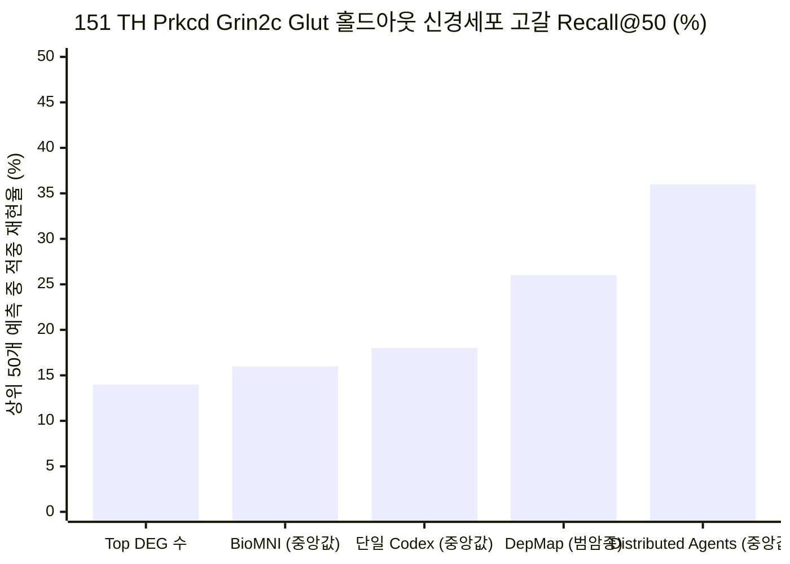
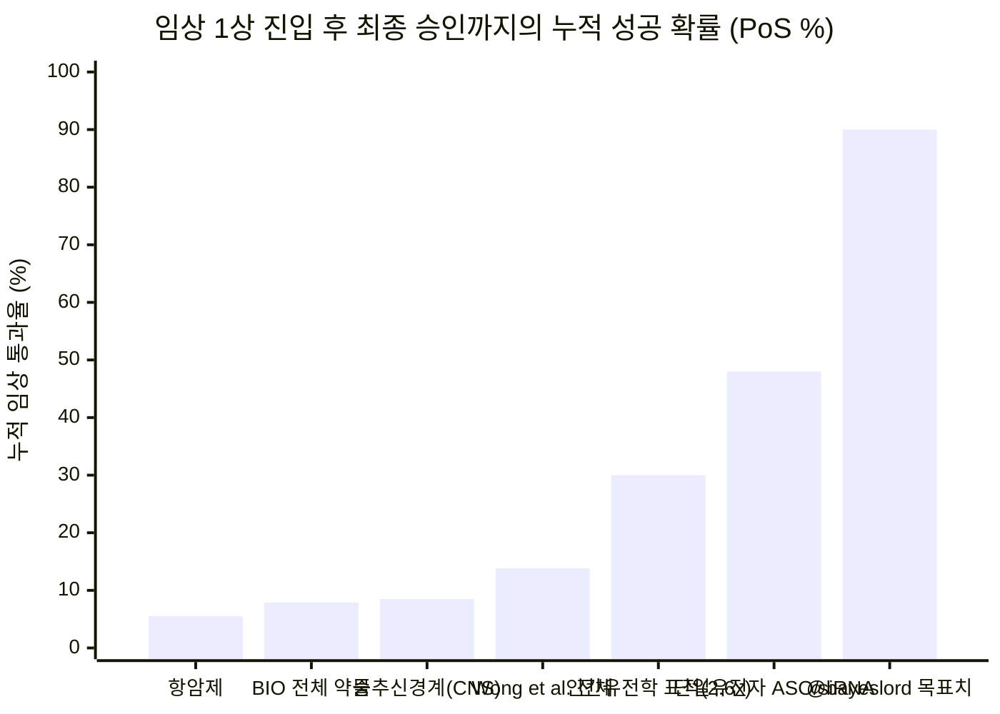

2026년 10월 21일, OpenAI와 PerturbAI(`@perturbai_tx`), 그리고 스크립스 연구소(`@scrippsresearch`)는 계산생물학 분야의 기념비적인 이정표를 발표했다. **1,946개의 병렬 GPT-Rosalind 에이전트**로 구성된 분산 스웜(swarm)이 **1,000개 이상의 질환 관련 유전자 녹아웃(knockout)**에 걸쳐 **770만 개의 마우스 뇌세포**를 분석한 생체 내(*in vivo*) CRISPR Perturb-seq 아틀라스를 단 **32분** 만에 해독하여, 희귀 신경퇴행성 질환인 **페리 증후군(Perry syndrome)**의 원인 유전자 **`DCTN1`(Dynactin subunit 1 / `p150Glued`)**의 결손이 세포 내 콜레스테롤 수송 장애 및 보상성 **SREBP2(`Srebf2`)** 스테롤 생합성 유도와 연결된다는 새로운 기전 가설을 도출했다는 것이다.

발표 직후, 퀀트 연구자 `@bayeslord`와 전직 제약 경영인 마틴 슈크렐리(`@MartinShkreli`) 사이에 오간 소셜미디어 문답은 AI 기반 신약 개발 시대의 가장 핵심적인 인식론적 논쟁을 수면 위로 끌어올렸다.

> **OpenAI (`@OpenAI`, 2026년 10월 21일):**
> "GPT-Rosalind가 신약 개발을 위한 새로운 단서를 포착했습니다. 콜레스테롤 수송을 복원하면 신경세포를 퇴행으로부터 보호할 수 있을까요? DCTN1은 희귀 신경퇴행성 질환인 페리 증후군과 관련된 유전자입니다. 마우스 뇌 데이터에서 이 유전자를 교란하자 콜레스테롤 합성에 관여하는 유전자들의 발현이 증가했습니다. GPT-Rosalind는 가능한 설명을 제시했습니다. 콜레스테롤이 신경세포가 필요로 하는 곳에 도달하지 못하고 있을 가능성입니다. 만약 이것이 입증된다면 새로운 치료 전략을 가리킬 수 있습니다. `@perturbai_tx` 및 `@scrippsresearch`와 함께 수천 개의 GPT-Rosalind 에이전트 팀이 병렬로 작동하여 수백만 개의 마우스 뇌세포 유전자 발현 결과를 단 32분 만에 과학 문헌과 연결했습니다."

> **bayes (`@bayeslord`, 2026년 10월 21일):**
> "원리적으로 임상시험을 포함한 신약 파이프라인 통과율(pass rate)을 90% 이상으로 끌어올리려면 시뮬레이션과 실험실 연구(로보틱스, 모델 생물 등)에서 어떤 돌파구가 필요한가요?"

> **Martin Shkreli (`@MartinShkreli`, 2026년 10월 22일):**
> "좋은 질문입니다. 저분자 화합물(small molecules)이 얼마나 확률적(stochastic)인지 고려하면 아마 불가능할 것입니다. 고분자 바이오의약품(large molecules)의 경우에도 종간 기전 차이, 인간 없이 인간을 모델링하는 어려움 등을 고려하면 역시 불가능할 것입니다. 90%는 너무 과한 요구입니다! 지금 우리가 가진 시스템도 그렇게 나쁘지 않습니다."

본 조사는 M. Neil Browne과 Stuart M. Keeley의 *Asking the Right Questions* 비판적 사고 프레임워크를 코드화한 **8단계 "Panning for Gold" 포렌식 심층 분석 런북**을 수행한다. 보도자료 요약을 그대로 인용하는 대신, 스크립스 진(Xin Jin) 연구실과 OpenAI의 공식 GitHub 저장소([`jinlabneurogenomics/distributed_agent`](https://github.com/jinlabneurogenomics/distributed_agent))와 실시간 코퍼스 탐색기([Distributed Agents Corpus](https://sites-publish-check-20261021.as-alexander-sun.chatgpt.site))에서 직접 원본 평가 테이블, 프롬프트 계약, 셔플 대조군(shuffled-control) 감사 결과, 도구 추적 텔레메트리를 발굴했으며, 이를 **인간 `DCTN1` CAP-Gly 도메인의 1.15 Å X선 결정 구조([PDB `2HQH`](https://www.rcsb.org/structure/2HQH))** 및 임상시험 성공 확률(`PoS`) 1차 생물통계 문헌([Wong, Siah & Lo 2019](https://pmc.ncbi.nlm.nih.gov/articles/PMC6409418/); [Sun et al. 2022](https://pmc.ncbi.nlm.nih.gov/articles/PMC9293739/); [Minikel et al. 2024](https://pmc.ncbi.nlm.nih.gov/articles/PMC11096124/))과 교차 검증했다.

---

## 제1단계: 핵심 쟁점 분류 및 경계 설정 (Issue Classification & Boundary Framing)

*고처리량 전사체 문헌 합성*과 *임상 신약 승인*을 혼동하는 오류를 방지하기 위해, 본 조사를 두 가지 **기술적·실증적(Descriptive)** 쟁점과 한 가지 **규범적·전략적(Prescriptive)** 쟁점으로 구분한다.

1. **실증적 쟁점 A (멀티에이전트 아키텍처와 `DCTN1` 단서):** `1,946`개의 GPT-Rosalind 에이전트를 PerturbAI의 전뇌(whole-brain) Perturb-seq 아틀라스에 분산 배치한 것이 `Dctn1` 및 신경세포 스테롤 조절에 관해 진정으로 새롭고 기전적으로 타당한 생물학을 발굴했는가? 또한 원본 저장소 데이터에서 분산 스웜은 단일 에이전트 베이스라인(`Codex`, `BioMNI`) 및 유전자 라벨 셔플 대조군(shuffled-label falsification controls) 대비 어떤 성능을 보였는가?
2. **실증적 쟁점 B (90% 임상 파이프라인 통과율의 한계):** 임상 1상 진입부터 FDA 승인까지의 누적 성공 확률(`PoS`, 역사적으로 전체 `7.9%–13.8%`, 신경계 질환 `6.2%–15.0%`)을 지배하는 정확한 수학적·열역학적·진화생물학적 병목은 무엇이며, 왜 마틴 슈크렐리는 저분자 화합물과 고분자 바이오의약품 모두에서 `>90%` 통과율이 생물물리학적으로 불가능하다고 단언하는가?
3. **전략적 쟁점 C (TechBio R&D 자본 배분 아키텍처):** 신약 개발 퍼널의 어느 단계에서 분산 추론 에이전트와 생체 내 Perturb-seq 아틀라스가 실제로 비용과 시간을 압축하며, 인간 유전학 검증·프로그래머블 모달리티(ASO/siRNA/CRISPR)·인간 미세생리시스템(오가노이드)의 어떤 조합이 임상 통과율을 역사적 `~10%`에서 `50%–70%` 수준으로 현실적으로 끌어올릴 수 있는가?

### 반증 가능성 기준 (Falsifiability Criteria)
- **OpenAI의 분산 에이전트 테제가 제한되거나 반증되는 조건:** (a) `Dctn1` 스테롤 생합성 발견이 이미 차등 발현 테이블 최상단(`q < 10⁻³³`)에 위치하여 단일 에이전트 베이스라인에서도 동일하게1순위 히트로 포착되는 경우, (b) 에이전트에게 **무작위로 뒤섞은(shuffled) 가짜 유전자-차등발현쌍**을 부여했을 때도 수백 건의 그럴듯한 "문헌 기반" 기전 내러티브를 생성해내는 경우, 또는 (c) 어린 마우스(juvenile mouse)의 급성 `Dctn1` 녹다운 시그니처가 성인 페리 증후군 환자의 흑질(substantia nigra) TDP-43 병리와 괴리된 초기 보상성 항상성 반등(`Atf4`/`Ddit3` 소포체 스트레스 없는 `SREBP2` 상승)일 가능성.
- **마틴 슈크렐리의 회의론("90%는 불가능하며 현재 시스템도 나쁘지 않다")이 제한되거나 반증되는 조건:** 단일 유전자(monogenic) 인간 기능상실/기능획득 변이를 표적하는 프로그래머블 핵산 치료제(척수강 내 안티센스 올리고뉴클레오타이드 `ASO` 또는 간세포 표적 `GalNAc-siRNA` 등)가 저분자 화합물의 오프타겟 확률성과 종간 수용체 괴리를 우회하여 역사적 저분자 평균 대비 수 배 높은 임상 전환율을 달성하는 경우.

---

## 제2단계: 1차 사료 발굴 및 2열 주장 괴리 매트릭스 (Primary Source Excavation)

우리는 OpenAI와 PerturbAI 발표의 모든 수치를 공식 1차 사료까지 역추적했다.
- **프리프린트 및 코드베이스:** Sun, A., Park, J. J., DeTomaso, D., Kim, S., Liu, A., Shringarpure, S., Kim, K., Thompson, P. C., Shi, T., Wang, Y., Mukamel, E. A., Zheng, G. X., Jiao, Y. J., & Jin, X. (2026), *"Distributed AI agents enable comprehensive discovery of biological insights at scale"* ([`CITATION.cff`](https://raw.githubusercontent.com/jinlabneurogenomics/distributed_agent/main/CITATION.cff); GitHub 저장소 [`jinlabneurogenomics/distributed_agent`](https://github.com/jinlabneurogenomics/distributed_agent); PerturbAI 포털 [`perturb.ai/health-brain-atlas`](https://perturb.ai/health-brain-atlas); Hugging Face 데이터셋 [`perturbai/wholebrain_crispr_atlas`](https://huggingface.co/datasets/perturbai/wholebrain_crispr_atlas)).
- **발굴된 저장소 원본 감사 파일:**
  - [`data/inputs/literature/source_access_summary.json`](https://raw.githubusercontent.com/jinlabneurogenomics/distributed_agent/main/data/inputs/literature/source_access_summary.json) (`2,046`개 전체 교란 보고서[`1,946`개 표적 유전자 + `100`개 안전 대조군]의 도구 접근 추적 텔레메트리).
  - [`data/inputs/literature/final_summary.json`](https://raw.githubusercontent.com/jinlabneurogenomics/distributed_agent/main/data/inputs/literature/final_summary.json) (군당 `150`개 보고서 기반 실제 라벨[`Unshuffled`] 대 스크린 내 셔플[`Within-screen shuffled`] 대 스크린 외 셔플[`Out-of-screen shuffled`] 대조군 보정 데이터).
  - [`data/inputs/depletion/depletion-best-vs-codex-heldout-recall.summary.json`](https://raw.githubusercontent.com/jinlabneurogenomics/distributed_agent/main/data/inputs/depletion/depletion-best-vs-codex-heldout-recall.summary.json) (`151 TH Prkcd Grin2c Glut` 시상 뉴런에서의 홀드아웃 `50`개 필수 유전자 세포 고갈[depletion] 재현율).
  - [`data/inputs/holdout/task1_deg_count_comparison.csv`](https://raw.githubusercontent.com/jinlabneurogenomics/distributed_agent/main/data/inputs/holdout/task1_deg_count_comparison.csv) (`272`개 홀드아웃 표적에 대한 단일 에이전트 배치 크기별 대 분산 에이전트 차등발현유전자[`DEG`] 수 예측 성능 비교).
  - [`data/inputs/survey/pair_ratings.csv`](https://raw.githubusercontent.com/jinlabneurogenomics/distributed_agent/main/data/inputs/survey/pair_ratings.csv) 및 [`data/inputs/survey/findings.csv`](https://raw.githubusercontent.com/jinlabneurogenomics/distributed_agent/main/data/inputs/survey/findings.csv) (맹검 인간 전문가 선호도 점수 및 `Dctn1`의 정확한 차등 발현 통계치).

대중 홍보 내러티브와 [`jinlabneurogenomics/distributed_agent`](https://github.com/jinlabneurogenomics/distributed_agent) 내부의 원본 JSON/CSV 텔레메트리를 대조하면 바이오텍 투자자와 계산생물학자가 반드시 알아야 할 7가지 결정적 간극이 드러난다.

| 비교 차원 | 대중 발표 및 소셜미디어 주장 (`@OpenAI` / 언론 보도) | 저장소 원본 텔레메트리 및 방법론적 한계 고백 (`jinlabneurogenomics/distributed_agent`) |
| :--- | :--- | :--- |
| **1. `DCTN1` 콜레스테롤 단서의 발굴 주체** | `770만` 마우스 뇌세포를 분석한 `1,946`개 병렬 GPT-Rosalind 에이전트 스웜이 일궈낸 독자적 돌파구로 묘사됨. | [`comparisons.csv`](https://raw.githubusercontent.com/jinlabneurogenomics/distributed_agent/main/data/inputs/survey/comparisons.csv)(`comparison_01`) 및 [`findings.csv`](https://raw.githubusercontent.com/jinlabneurogenomics/distributed_agent/main/data/inputs/survey/findings.csv)(`bucket_4_selection_01`)를 확인하면, **단일 에이전트 `Codex` 베이스라인(`caveat30_r01`) 역시 `Dctn1`을 전체 30개 중 1위 히트(`rank 1 of 30`)로 선정**했다("*Dctn1 loss selectively activates a neuronal sterol-biosynthesis program*"). `155 MB Glut` 중뇌 뉴런에서 `Insig1`(`log2FC +2.07`, `q = 4.42 × 10⁻⁵⁵`)과 `Msmo1`(`+1.90`, `q = 1.38 × 10⁻⁴⁴`)의 유도가 워낙 압도적이어서 멀티에이전트 스웜 없이도 1차 시그니처는 즉시 포착되었다. |
| **2. 맹검 인간 전문가 선호도 (`75%`)** | "맹검 도메인 전문가들이 단일 에이전트 베이스라인보다 분산 에이전트 시스템의 결과를 75%의 비율로 선호했다." | [`pair_ratings.csv`](https://raw.githubusercontent.com/jinlabneurogenomics/distributed_agent/main/data/inputs/survey/pair_ratings.csv) 검증 결과: 총 `n = 60`건의 쌍대 비교(`20`개 표적 × 평가자 `3`명) 중 분산 에이전트가 `45/60 (75.00%)`, 단일 Codex가 `10/60 (16.67%)`, 무승부가 `5/60 (8.33%)`였다. 그러나 **정작 `Dctn1` 항목(`comparison_01`)에서는 평가자 `2`명(`R01`, `R11`)이 분산 에이전트를 선호한 반면, `1`명(`R21`)은 단일 에이전트 `Codex`의 보고서를 더 선호**했다. |
| **3. 홀드아웃 DEG 수 예측 (`272`개 표적)** | 분산 에이전트가 보이지 않은(held-out) 유전자 교란의 전사체 반응 예측에서 우월한 추론 성능을 보인다. | [`task1_deg_count_comparison.csv`](https://raw.githubusercontent.com/jinlabneurogenomics/distributed_agent/main/data/inputs/holdout/task1_deg_count_comparison.csv)에서 분산 에이전트가 단일 에이전트를 이긴 것은 **단일 에이전트에게 272개 표적 전체를 한 번에 예측하도록 강제했을 때(`batch_size = all`: 재현율 `47.0%`, Spearman `0.4393`)뿐**이다. **단일 에이전트(`r-bioagents-rosalind-ev3`)를 표적 1개씩(`batch_size = 1`) 원본 parquet 데이터에 직접 접근하게 실행하면, 단일 에이전트(`정확도 75.37%`, `재현율 69.0%`, `F1 0.6732`, `Spearman 0.5258`)가 오히려 분산 에이전트(`정확도 73.53%`, `재현율 59.0%`, `F1 0.6211`, `Spearman 0.4708`)를 능가**한다! 원본 수치 행렬을 자연어 보고서로 압축하는 과정에서 정량적 정보 손실이 발생하기 때문이다. |
| **4. 홀드아웃 신경세포 고갈(생존) 예측 (`50`개 표적)** | 분산 에이전트가 분화 후 시상 뉴런(`151 TH Prkcd Grin2c Glut`)에서 필수 유전자 결손에 따른 세포 고갈을 예측한다. | [`depletion-best-vs-codex-heldout-recall.summary.json`](https://raw.githubusercontent.com/jinlabneurogenomics/distributed_agent/main/data/inputs/depletion/depletion-best-vs-codex-heldout-recall.summary.json)에서 분산 에이전트는 **중앙값 Recall@50 `36.0%`(`50`개 중 `18`개 적중; `[38%, 36%, 34%]`)**를 기록하여 단일 Codex(`18.0%`), 스탠퍼드 BioMNI(`16.0%`), DepMap(`26.0%`), 상위 DEG 수(`14.0%`)를 앞섰다. 하지만 *동일한 마우스 실험 내부*의 홀드아웃 예측에서도 **위음성(미적중) 비율이 `64%`**에 달한다는 사실은 현 단계 AI가 임상 등급의 확실성과 얼마나 거리가 먼지를 보여준다. |
| **5. 셔플 대조군 작화증(Confabulation) 감사 (`150`개 보고서/군)** | 에이전트가 유전자 발현 결과를 과학 문헌과 정밀하게 연결하여 근거 있는 가설을 생성한다. | [`final_summary.json`](https://raw.githubusercontent.com/jinlabneurogenomics/distributed_agent/main/data/inputs/literature/final_summary.json)에서 저자들이 유전자 라벨을 몰래 뒤바꾼 대조군(**`Within-screen shuffled`** 및 **`Out-of-screen shuffled`**, 군당 `150`개 보고서)을 실행하자, 에이전트들은 실제 라벨 군(**`Unshuffled`, `488`개**)보다 오히려 더 많은 **`600`개 및 `561`개의 1차 핵심 발견(load-bearing findings)**을 생성해냈으며, 양성 표적-세포유형 쌍 커버리지도 `76.16%` 및 `83.01%`(실제 라벨 군은 `56.76%`)로 더 높았다! 프론티어 LLM은 엄격한 방향성 검증 게이트로 통제하지 않으면 *어떤* 유전자 이름과 *어떤* DEG 목록 사이에도 그럴듯한 문헌 다리를 지어내는 고도의 합리화 기계다. |
| **6. 인용 출처 추적 및 페이월 마찰** | 에이전트들이 `2,046`개 보고서(`16,555`건의 원시 인용 항목)에 걸쳐 `700`개 이상의 고유 과학 문헌을 자율 검색·인용했다. | [`source_access_summary.json`](https://raw.githubusercontent.com/jinlabneurogenomics/distributed_agent/main/data/inputs/literature/source_access_summary.json) 감사 결과, `16,445`건의 보고서-출처 인용 쌍 중 **실제 도구 열람 기록이 매칭된 것은 `9,289건(56.49%)`**이었고, 나머지 **`7,156건(43.51%)`은 `cited_without_matched_access_pairs`**(실행 추적 내 열람 기록 없이 모델 파라미터 기억 등에서 인용됨)였다. 또한 전체 `16,775`건의 브라우저 열기 시도 중 **`6,413건(38.23%)`이 HTTP 오류(`3,956`건) 또는 출판사 봇 차단/페이월(`2,457`건)로 실패**했다. |
| **7. `Dctn1` 전사체 판독값의 생물학적 해석** | "콜레스테롤이 신경세포가 필요로 하는 곳에 도달하지 못하고 있을 수 있습니다. 확인된다면 새로운 치료 전략을 가리킬 수 있습니다." | [`findings.csv`](https://raw.githubusercontent.com/jinlabneurogenomics/distributed_agent/main/data/inputs/survey/findings.csv)(`bucket_4_selection_01`) 원문은 스스로 다음과 같이 경고한다: *"이 결과는 전사체적으로 일관성이 있으나 여전히 희소 CRISPR RNA 판독값이다. 스테롤 증가는 보상성 반응이거나, 리소좀 콜레스테롤 감지 변화이거나, 손상된 세포들 사이의 생존자 편향(survivor bias)일 수 있다."* 게다가 발견 `F009`는 노령 `Dctn1` 결손 마우스의 도파민성 신경세포 사멸을 유발하는 전형적 소포체 스트레스(`Ddit3`/CHOP, `Atf4`, `Hspa5`/BiP; [Yu et al. 2023](https://pmc.ncbi.nlm.nih.gov/articles/PMC9988887/))가 이 어린 마우스 급성 Perturb-seq 판독값에서는 **전혀 나타나지 않았다(absent)**고 명시한다. |

---

## 제3단계: 의미론적 정밀성, 대입 테스트 및 `DCTN1`의 구조생물학

### 1. 핵심 용어에 대한 대입 테스트 (The Substitution Test)
계산 생물정보학과 임상 약리학 사이의 개념 혼동을 막기 위해 논쟁의 핵심 용어 3가지에 **대입 테스트**를 적용한다.

- **"신약 개발 단서 (Drug Discovery Lead)" (`@OpenAI`):**
  - *엄격한 임상적 정의:* 검증된 표적 결합력(`Kd`, `IC50`)과 병리학적으로 충실한 질환 모델에서의 표현형 구조(rescue), 그리고 허용 가능한 치료 지수(therapeutic index)를 갖춘 화학적으로 정의된 치료 모달리티(저분자, 항체, 핵산 등).
  - *느슨한 생물정보학적 정의:* 단일세포 CRISPR 스크린에서 통계적으로 유의미한 차등 mRNA 공발현 모듈(`FDR < 0.05`)에 문헌 기반 경로 가설을 결합한 것.
  - *대입 판정:* OpenAI와 PerturbAI가 도출한 것은 **전사체 경로 가설**(느슨한 정의)이지 전임상 신약 후보물질(엄격한 정의)이 아니다. 심지어 치료적 개입의 방향성(콜레스테롤 수송을 *촉진*해야 하는지, 독성 SREBP2/지질 방울 과축적을 *억제*해야 하는지, 아니면 미세소관 수송 자체를 *안정화*해야 하는지)조차 아직 실험적으로 규명되지 않았다.
- **"분산 생물학적 추론 (Distributed Biological Reasoning)" (Sun et al. 2026):**
  - *엄격한 정의:* 데이터셋을 `2,046`개의 독립적인 교란별 에이전트 실행(`1,946`개 유전자 + `100`개 대조군)으로 분할하여 각 에이전트에게 깨끗한 `272,000` 토큰 컨텍스트 윈도우를 할당한 뒤, 맵리듀스(map-reduce) 합성 패스(`assemble_global_ranking.py`, `route_claims.py`)로 집계하는 아키텍처.
  - *느슨한 정의:* 단일 에이전트로는 절대 추론할 수 없는 생물학적 원리를 발견해내는 창발적 집단 초지능.
  - *대입 판정:* [`task1_deg_count_comparison.csv`](https://raw.githubusercontent.com/jinlabneurogenomics/distributed_agent/main/data/inputs/holdout/task1_deg_count_comparison.csv)가 증명하듯, 분산 에이전트의 진짜 강점은 **컨텍스트 윈도우 격리와 병렬 I/O 스케일링(`1,946`개 워커를 통한 `O(1)` 벽시계 시간 단축)**에 있지, 단일 표적을 할당받은 단일 에이전트(`batch_size = 1`) 대비 창발적 추론 우위에 있는 것이 아니다.
- **"확률적인 저분자 화합물 (Stochastic Small Molecules)" (`@MartinShkreli`):**
  - *엄격한 생물물리학적 정의:* 분자량 `500 Da` 미만의 저분자 유기 리간드는 세포 내 모든 구획으로 확산하며 볼츠만 열요동(`exp(-ΔG / RT)`)에 따라 수만 개의 단백질 포켓과 확률적으로 충돌하므로, 오프타겟 다중약리학(polypharmacology), 간 시토크롬 P450(`CYP450`)에 의한 반응성 대사체 형성, 그리고 사전 시뮬레이션으로 완벽히 예측할 수 없는 특이체질성(idiosyncratic) 인체 독성을 필연적으로 수반한다.

### 2. 구조적·기전적 해체: 인간 `DCTN1`(`p150Glued`) 변이 대 어린 마우스 `Dctn1` 녹다운

`DCTN1`은 원자 및 세포 수준에서 정확히 어떤 역할을 하며, 왜 PerturbAI의 마우스 뇌 아틀라스에서 이 유전자를 교란하자 `SREBP2` 콜레스테롤 생합성 경로가 폭발적으로 활성화되었을까?

인간 [`DCTN1`(UniProt `Q14203`)](https://www.uniprot.org/uniprotkb/Q14203/entry)은 **다이낙틴(dynactin) 복합체**의 가장 큰 서브유닛인 **`p150Glued`**(`1,278`개 아미노산)를 암호화하며, 이는 진핵세포의 대표적인 마이너스단(-end) 방향 미세소관 모터인 **세포질 다이닌-1(`DYNC1H1`)**의 필수 어댑터이자 주행성(processivity) 인자다([Ayloo et al. 2014](https://www.uniprot.org/uniprotkb/Q14203/entry)). `p150Glued`의 최첨단 N-말단(`잔기 26–97`, 엑손 2 암호화)에는 X선 결정학으로 `1.15 Å` 해상도에서 규명된 **CAP-Gly(Cytoskeleton-Associated Protein Glycine-rich) 도메인**([PDB `2HQH`](https://www.rcsb.org/structure/2HQH))이 자리 잡고 있다.

결정적으로 인간 신경학 연구는 **단 72개 잔기로 이루어진 이 하나의 CAP-Gly 도메인 내부에서도 변이 위치에 따라 완전히 다른 두 가지 신경퇴행성 질환이 발생한다**는 사실을 확립했다([Farrer et al. 2009](https://pmc.ncbi.nlm.nih.gov/articles/PMC2813485/); [Konno et al. 2017](https://pmc.ncbi.nlm.nih.gov/articles/PMC5546300/)).

| 유전적 병변 / 교란 유형 | `DCTN1` (`p150Glued` [PDB `2HQH`](https://www.rcsb.org/structure/2HQH)) 내 구조적 위치 | 분자적·생물물리학적 결과 | 선택적 취약 신경세포 집단 | 주요 세포 병리 및 임상 표현형 |
| :--- | :--- | :--- | :--- | :--- |
| **페리 증후군(Perry Syndrome) 점돌연변이** (`G71R`, `G71E`, `G71A`, `T72P`, `Q74P`, `G67D`, `K68E`) | 미세소관 플러스단 추적 단백질(`+TIPs`: `EB1`/`MAPRE1`, `CLIP-170`) 및 α-튜불린과 직접 결합하는 표면 노출 **`GKNDGTVQ` 루프 모티프 (`잔기 67–74`)** | 전체 도메인 폴딩은 비교적 유지되나 `+TIP` / EB1 결합 및 역행성 수송 개시가 손상됨; 스트레스 과립(stress granule) 해체 장애로 인한 **TDP-43 우성음성(dominant-negative) 응집** 유발 ([Ueda et al. 2024](https://pmc.ncbi.nlm.nih.gov/articles/PMC10840176/)) | 인간 **흑질 도파민성(`DA`) 뉴런**, 청색반점(locus coeruleus), 복외측 연수 호흡 중추 뉴런, 시상하부 (대뇌 피질은 보존됨) | **페리 증후군:** 상염색체 우성 급속 진행성 파킨슨증, 중증 우울증/무감동, 극심한 체중 감소, 치명적 중추성 저환기(호흡부전), **TDP-43(`TARDBP`) 세포질 봉입체** ([Farrer et al. 2009](https://pmc.ncbi.nlm.nih.gov/articles/PMC2813485/)) |
| **원위 유전성 운동 신경병증 7B형 (`HMN7B`)** (`G59S`) | CAP-Gly 폴드의 내부에 매몰된 **β-가닥 소수성 코어 (`Gly59`)** ([PDB `2HQH`](https://www.rcsb.org/structure/2HQH) Chain A `잔기 59`) | 매몰된 β-시트 코어의 입체 장애로 인해 도메인 언폴딩(unfolding), 용해도 상실 및 거대한 세포질 **다이낙틴/`p150Glued` 양성 봉입체** 형성 | 뇌신경(후두/안면) 및 척수 전각의 하부 운동 뉴런(lower motor neurons) | **HMN7B / ALS 유사 운동신경 질환:** 성대 마비, 진행성 원위부 근력 약화 및 근위축; 흑질 TDP-43 파킨슨증은 동반하지 않음 ([Konno et al. 2017](https://pmc.ncbi.nlm.nih.gov/articles/PMC5546300/)) |
| **노령 마우스 중뇌 도파민 뉴런 조건부 `Dctn1` 녹아웃** ([Yu et al. 2023](https://pmc.ncbi.nlm.nih.gov/articles/PMC9988887/)) | `Th-Cre` / `DAT-Cre` 중뇌 도파민 뉴런에서 `Dctn1`의 완전한 Cre-loxP 유전적 절제 | 소포체-골지체 및 역행성 축삭 수송 붕괴, 거대한 **소포체 팽창(ER dilation)**, 그리고 **전형적 미접힘 단백질 반응(`UPR` / `ISR`: `Atf4`, `Ddit3`/CHOP, `Hspa5`/BiP)** 활성화 | 노령 마우스(`12–24개월`) 흑질 치밀부(`SNpc`) 도파민성 뉴런 | 말기 소포체 스트레스와 자가포식 차단에 의해 구동되는 흑질선조체 도파민 말단 및 `SNpc` 세포체의 진행성 소실(`~40%–50%` 사멸) |
| **PerturbAI 어린 마우스 전뇌 급성 CRISPR `Dctn1` 녹다운** (Sun et al. 2026) | 분화 후 어린 마우스 뇌세포 핵 전반에 걸친 AAV 전달 CRISPR 가이드 RNA 기반 희소 녹다운 | `p150Glued`의 부분적 손실(`12`개 세포 클래스에서 `FDR < 0.05`, `\|log2FC\| >= 0.25` 기준 `358`개 DEG); **전형적 UPR/ISR(`Ddit3`, `Atf4`, `Hspa5`)은 부재(`F009`)**하며, 대신 **`SREBP2` 스테롤/지방산 합성(`F001`, `F007`)** 및 **리소좀/v-ATPase(`Lamp2`, `Npc2`, `Atg5`) 유도(`F008`)** 발생 | 미측 시상하부(`066 CNU-HYa HY GABA`), 시상(`151 TH Prkcd Grin2c Glut`), 중뇌(`155 MB Glut`), 교뇌/연수(`191 MB P MY GABA`) 뉴런에 집중; **전방 대뇌 피질(`005 L4-5 IT CTX Glut`)은 보존됨(`F010`, `F011`)** | 단백질 응집 병리나 말기 소포체 스트레스가 나타나기 전, **Rab7–RILP–ORP1L–다이닌/다이낙틴** 후기 엔도좀-소포체 콜레스테롤 수송 차단에 대한 초기 항상성 보상 반응 |

### 3. 정확한 생물물리학적 기전: 왜 `Dctn1` 녹다운이 `SREBP2`를 폭발시키는가?
왜 미세소관 모터 어댑터(`Dctn1`)나 그 파트너 중쇄(`Dync1h1`)를 녹다운하자 중뇌 글루탐산성 뉴런(`155 MB Glut`)과 교뇌/연수 가바성 뉴런(`191 MB P MY GABA`)에서 `Insig1`(`log2FC +2.07`, `q = 4.42 × 10⁻⁵⁵`), `Msmo1`(`+1.90`, `q = 1.38 × 10⁻⁴⁴`), `Hmgcs1`(`+1.61`, `q = 1.48 × 10⁻⁴¹`), `Fdps`(`+2.14`, `q = 3.29 × 10⁻⁴⁰`), `Ldlr`(`+2.23`, `q = 1.34 × 10⁻³⁵`), `Hmgcr`(`+1.48`, `q = 6.50 × 10⁻³⁴`)이 일제히 폭증했을까?

실시간 Distributed Agents 코퍼스(`Dctn1` 발견 `F001–F008`, `Dync1h1` 발견 `F003–F011`, `Rab7` 발견 `F010`)와 1차 세포생물학 문헌([Rocha et al. 2009](https://pmc.ncbi.nlm.nih.gov/articles/PMC2712958/); [Radhakrishnan et al. 2008](https://pmc.ncbi.nlm.nih.gov/articles/PMC2652870/); [Horton, Goldstein & Brown 2002](https://pmc.ncbi.nlm.nih.gov/articles/PMC150968/))을 종합하면, 그 핵심 기전은 **구획 간 스테롤 감지 착시(compartmental sterol-sensing illusion)**다.

```mermaid
flowchart TD
    subgraph SG1["1. 정상적인 역행성 엔도리소좀 콜레스테롤 수송"]
        A1["성상교세포 유래 ApoE-지단백질의 신경세포 LDLR / LRP1 흡수"] --> A2["후기 엔도좀 / 리소좀 (LE/L): NPC2 및 NPC1이 유리 콜레스테롤 동원"]
        A2 --> A3["Rab7-GTP가 RILP + ORP1L + 다이낙틴(DCTN1 / p150Glued) + 다이닌(DYNC1H1) 모집"]
        A3 --> A4["미세소관 마이너스단을 따라 핵주위 소포체(ER) 접촉 부위로 역행성 수송"]
        A4 --> A5["소포체 막 콜레스테롤 > 5 mol%: SCAP이 콜레스테롤 및 INSIG1/2와 결합하여 SREBP2를 소포체에 억류"]
    end

    subgraph SG2["2. 급성 Dctn1 / Dync1h1 / Rab7 교란 시 (PerturbAI 아틀라스)"]
        B1["Dctn1 (또는 Dync1h1 / Rab7)의 CRISPR 교란"] --> B2["미세소관에서 Rab7-RILP-p150Glued 모터 복합체 이탈"]
        B2 --> B3["콜레스테롤을 가득 실은 후기 엔도좀이 원위 신경돌기에 고립됨 (Lamp2, Npc2, v-ATPase 동반 상승: F008)"]
        B3 --> B4["국소 소포체(ER) 막 콜레스테롤이 5.0 mol% 스위치 임계값 아래로 하락 (Hill 계수 n_H = 4)"]
        B4 --> B5["SCAP이 INSIG1을 방출 -> SREBP2의 골지체 COPII 수송 -> S1P/S2P 단백질분해 절단"]
        B5 --> B6["핵 내 nSREBP2가 Insig1 (+2.07), Ldlr (+2.23), Fdps (+2.14), Msmo1 (+1.90), Hmgcr (+1.48) 폭증 유도"]
    end
```

1. **성숙한 신경세포는 엔도리소좀을 통해 콜레스테롤을 수입한다:** 성숙한 중추신경계 뉴런은 성상교세포(astrocyte)가 공급하는 ApoE-콜레스테롤 지단백질을 **`LDLR`** 및 **`LRP1`** 수용체를 통해 말초 **후기 엔도좀 및 리소좀(`LE/L`)**으로 내재화한 뒤, **`NPC2`**와 **`NPC1`**을 통해 비에스테르화 유리 콜레스테롤을 추출한다.
2. **`Rab7–RILP–ORP1L–p150Glued` 모터 핸드셰이크 ([Rocha et al. 2009](https://pmc.ncbi.nlm.nih.gov/articles/PMC2712958/)):** 말초 엔도리소좀에서 추출한 콜레스테롤을 **소포체(`ER`)**로 전달하기 위해, 후기 엔도좀의 활성 **`Rab7-GTP`**는 이펙터 단백질 **`RILP`** 및 스테롤 센서 **`ORP1L`**과 결합한다. 이때 `RILP`가 **`p150Glued`(`DCTN1`)**의 C-말단 영역과 직접 결합하여 **다이닌-다이낙틴(`DYNC1H1–DCTN1`) 모터**를 모집함으로써 후기 엔도좀을 미세소관 마이너스단(핵주위 소포체) 방향으로 끌어당기고 소포체-후기 엔도좀 막 접촉 부위(membrane contact sites)를 형성한다!
3. **소포체 스테롤 센서의 초민감성 스위치 (`5 mol%` 임계값, [Radhakrishnan et al. 2008](https://pmc.ncbi.nlm.nih.gov/articles/PMC2652870/)):** 신경세포는 세포 전체의 콜레스테롤 총량을 측정하는 것이 아니라, 사량체 **`SCAP–INSIG1/2–SREBP2`** 복합체를 통해 오직 **소포체 막의 국소 콜레스테롤 몰분율(`[Chol]_ER`)**만을 감지한다. 노벨상 수상자인 Brown과 Goldstein 연구팀이 규명했듯([Radhakrishnan et al. 2008](https://pmc.ncbi.nlm.nih.gov/articles/PMC2652870/)), 소포체 내 `SCAP` 억류는 소포체 총 지질 대비 임계 농도 `K_0.5 ≈ 5.0 mol%`를 중심으로 힐 계수(Hill coefficient) `n_H ≈ 4`의 초급경사 협동적(cooperative) 스위치 함수를 따른다.

$$\text{Fraction of Active Nuclear SREBP2 } f_{\text{active}}\left([\text{Chol}]_{\text{ER}}\right) = \frac{1}{1 + \left(\frac{[\text{Chol}]_{\text{ER}}}{K_{0.5}}\right)^{n_H}}, \quad K_{0.5} \approx 5.0\text{ mol-percent}, \quad n_H \approx 4$$

따라서 `Dctn1`(또는 `Dync1h1`이나 `Rab7`)이 교란되면 세포 전체의 콜레스테롤이 고갈된 것이 아니라, **콜레스테롤이 말초 후기 엔도좀 안에 갇혀 오도 가도 못하는 상태**가 된다(실제로 `Dctn1` 발견 `F008`에서 `Lamp2`, `Npc2`, `Asah1`, `v-ATPase` 서브유닛이 동반 상승하며 니만-픽 C형[`NPC1`/`NPC2`] 세포 내 스테롤 수송 차단 표현형을 그대로 모사한다!). 콜레스테롤이 핵주위 소포체 막에 도달하지 못해 `[Chol]_ER`이 `5.0 mol%` 아래로 살짝만 떨어져도 `n_H ≈ 4`의 협동적 `SCAP` 스위치가 켜지면서 거대한 `SREBP2` 전사 폭발(`Insig1`, `Ldlr`, `Hmgcr`, `Hmgcs1`, `Fdps`, `Msmo1`, `Sqle`, `Dhcr24`)이 일어나는 것이다!

---

## 제4단계: 인과관계 해체 및 4방향 경쟁 가설 매트릭스 (Rival Causes)

`@OpenAI`가 *"콜레스테롤 수송을 복원하면 신경세포를 퇴행으로부터 보호할 수 있을까?"*라고 물을 때, 강한 의미의 비판적 연구자는 콜레스테롤 수송 장애가 `DCTN1` 관련 신경퇴행(페리 증후군 / ALS-FTD)의 **1차적 인과 동인(primary causal driver)**인지, 아니면 미세소관 역행성 수송 붕괴가 낳은 여러 **하위 부수현상(epiphenomenon)** 중 하나인지를 철저히 검증해야 한다.

우리는 **4방향 인과관계 해체 매트릭스**를 통해 4가지 경쟁 인과 가설을 평가했다.

| 인과 가설 | 기전적 경로 | 아틀라스 및 문헌 내 지지 증거 | 반대 또는 한계 증거 | 인식론적 판정 |
| :--- | :--- | :--- | :--- | :--- |
| **1. 직접 인과 (`X → Y`): 스테롤 수송 기아가 신경퇴행을 직접 유발** | `DCTN1` 손실이 `Rab7–RILP–p150Glued` 엔도리소좀-소포체 콜레스테롤 전달을 차단 → 소포체 막 스테롤 고갈 + 엔도리소좀 지질 정체 → 막 항상성 붕괴 및 신경세포 사멸. | 급성 어린 마우스 `Dctn1` 교란에서 가장 강력한 전사 신호(`459`개 총 DEG; `Insig1` `q = 4.42 × 10⁻⁵⁵`)이며 `Dync1h1`(`F003`), `Rab7`(`F004`), `Chp1`(`S022`)에 의해 표현형 모사됨; 대뇌 피질은 보존하면서 미측 시상하부, 시상, 중뇌(`155 MB Glut`), 교뇌/연수(`191 MB P MY GABA`)에 집중되는 세포 특이성(`F011`)이 페리 증후군의 해부학적 취약 부위와 일치함. | 유리 대 에스테르화 스테롤 질량 측정이나 지질 방울(lipid droplet) 정량 데이터가 없으며, 약리학적 콜레스테롤/SREBP 조절이 `Dctn1` 변이 뉴런 생존을 실제로 구제하는지 검증되지 않음. | **타당한 공동 동인 / 초기 바이오마커**, 단일 인과 병목으로는 미입증. |
| **2. 역인과 / 독성 루프 (`Y → Z`): 보상성 `SREBP2` 과활성화 자체가 병리적 지질독성 유발** | 엔도리소좀에 갇힌 콜레스테롤이 소포체를 속여 세포가 스테롤 기아 상태라고 오판하게 만듦 → 폭주하는 `SREBP2` 신생 합성(`Hmgcr`, `Fdps`, `Sqle`) + `Ldlr`(`+2.23 log2FC`) 과흡수가 이미 막힌 엔도리소좀에 콜레스테롤과 불포화 지방산(`Fads1/2`, `Scd1/2`, `Fasn`: `F007`)을 추가로 쏟아부음 → 지질독성(lipotoxicity) 및 페로토시스(ferroptosis)/세포소기관 파괴. | 니만-픽 C형(`NPC1`/`NPC2`) 및 `Tsc1/Tsc2`(`comparison_16`) 결손 뉴런에서 리소좀 스테롤 정체 + 억제되지 않는 `SREBP2` 활성화는 독성 과산화 지질 축적을 일으킴; `Dctn1` 발견 `F007`은 페로토시스 감작 효소인 `Acsl4`와 `Fads1/2`의 동반 유도를 보여줌. | 만약 `SREBP2` 활성화가 실제 결핍이 아니라 오감지에 의한 병리적 과잉 유입이라면, 무작정 *"콜레스테롤 공급을 늘리는"* 개입은 오히려 독성을 **가속화**하며, 반대로 **과도한 `SREBP2`를 억제하거나 엔도리소좀 적체를 해소(`HP-β-CD` / `Rab7` 활성화)**해야 한다! | **치료 방향 역전 위험(Therapeutic Inversion Hazard)** (`findings.csv` 원문도 이 모호성을 명시적으로 경고함). |
| **3. 교란 다면발현 (`Z → X & Y`): 다이닌-다이낙틴 수송 붕괴가 TDP-43 청소·미토파지·자가포식을 동시에 파괴** | `DCTN1`(`p150Glued`)은 세포질 다이닌-1의 범용 어댑터임. `DCTN1` 교란은 (a) 스트레스 과립 해체 및 **TDP-43(`TARDBP`)** 청소([Ueda et al. 2024](https://pmc.ncbi.nlm.nih.gov/articles/PMC10840176/)), (b) 자가포식소체-리소좀 융합([Yu et al. 2018](https://pmc.ncbi.nlm.nih.gov/articles/PMC5831668/)), (c) 소포체-골지체 단백질 수출([Yu et al. 2023](https://pmc.ncbi.nlm.nih.gov/articles/PMC9988887/)), (d) `Rab7–RILP` 엔도좀 배치를 동시에 마비시킴. | 인간 페리 증후군 부검 뇌의 신경병리학적 정의는 원발성 지질축적증이 아니라 **TDP-43 세포질 봉입체**임([Farrer et al. 2009](https://pmc.ncbi.nlm.nih.gov/articles/PMC2813485/)). 또한 `SREBP2`는 소포체 스테롤 변화 후 수 시간 내에 작동하는 초고속 전사 센서(`n_H ≈ 4`)인 반면, TDP-43 응집과 소포체 팽창(`UPR`)은 전사 후(post-translational) 또는 만성 노화 과정에서 발생함(`F009`). | 급성 어린 마우스 mRNA 스크린(Perturb-seq)에서는 단기 단일핵 RNA-seq으로 관찰할 수 없는 전사 후 단백질병증(`TDP-43` 응집) 대신 빠른 전사 항상성 회로(`SREBP2`)가 볼케이노 플롯을 지배하는 **측정 모달리티 관찰 편향**이 발생함! | **지배적 구조적 교란 요인** (분석 모달리티 관찰 편향). |
| **4. 희소 생체 내 CRISPR 스크린의 생존자 편향 (`S → Y`)** | PerturbAI의 생체 내 AAV-CRISPR 스크린에서 세포핵은 형질도입 수주일 후에 수거됨. `Dctn1` 양대립유전자 녹아웃으로 급성 수송 붕괴와 세포사멸을 겪은 뉴런은 시퀀싱 전에 이미 사라졌고, 시퀀싱에 포착된 `Dctn1` 핵들은 강력한 대사/지질합성 복구 반응을 가동해 살아남은 **생존 하위 집단**임. | [`findings.csv`](https://raw.githubusercontent.com/jinlabneurogenomics/distributed_agent/main/data/inputs/survey/findings.csv)(`bucket_4_selection_01`)에서 저자들이 직접 명시: *"스테롤 증가는 보상성 반응이거나, 리소좀 콜레스테롤 감지 변화이거나, 손상된 세포들 사이의 생존자 편향일 수 있다."* | 동일 세포 클래스(`155 MB Glut`, `191 MB P MY GABA`)에서 `Dync1h1`, `Rab7`, `Chp1`과의 교차 교란 수렴성이 확인되므로 단순 무작위 생존 노이즈가 아니라 실제 수송-SREBP2 결합을 반영함은 분명함. | 종단적 시간 경과 검증이 필요한 **중등도 방법론적 교란 요인**. |

---

## 제5단계: 정량적 감사 — 멀티에이전트 벤치마크 해체 및 90% 임상 파이프라인 통과율의 수학

### 파트 A: OpenAI / PerturbAI 멀티에이전트 벤치마크에 대한 통계적 감사

[`jinlabneurogenomics/distributed_agent`](https://github.com/jinlabneurogenomics/distributed_agent) 저장소 내부의 3대 정량 벤치마크 원본 수치를 정밀 감사해보자.

#### 1. 컨텍스트 윈도우 병목 대 단일 표적 정밀도 (`task1_deg_count_comparison.csv`)
[`data/inputs/holdout/task1_deg_count_comparison.csv`](https://raw.githubusercontent.com/jinlabneurogenomics/distributed_agent/main/data/inputs/holdout/task1_deg_count_comparison.csv)에서 저자들은 `151 TH Prkcd Grin2c Glut` 시상 뉴런의 **`272`개 홀드아웃 유전자 교란**(`0`개 DEG인 진음성 `172`개, `>= 1`개 DEG인 진양성 `100`개)에 대해 각 시스템이 차등발현유전자 수(`actual_n_degs`, BH 보정 Wilcoxon `p < 0.05`)를 얼마나 정확히 예측하는지 비교했다.

| 시스템 / 아키텍처 | 배치 크기 (실행당 표적 수) | 이진 정확도 (`n = 272`) | 균형 정확도 (Balanced Acc) | 정밀도 (Precision) | 재현율 (Recall) | F1 점수 | 매튜 상관계수 (`MCC`) | Spearman ρ (`log1p`) | MSE (`log1p` 전체) |
| :--- | :---: | :---: | :---: | :---: | :---: | :---: | :---: | :---: | :---: |
| **베이스라인: 물리적 이웃 평균 (PPI)** | 결정론적 | `53.68%` | `60.44%` | `43.43%` | `86.00%` | `0.5772` | `0.2263` | `0.2176` | `5.0152` |
| **베이스라인: 기능적 이웃 평균** | 결정론적 | `47.79%` | `54.53%` | `39.60%` | `80.00%` | `0.5298` | `0.1000` | `0.0704` | `5.6412` |
| **베이스라인: 문헌 이웃 평균** | 결정론적 | `46.32%` | `54.63%` | `39.45%` | `86.00%` | `0.5409` | `0.1119` | `0.0743` | `5.7022` |
| **단일 에이전트 (`r-bioagents-rosalind-ev3`)** | **`all` (`272`)** | `72.06%` | `66.81%` | **`67.14%`** | `47.00%` | `0.5529` | `0.3709` | `0.4393` | `2.8908` |
| **단일 에이전트 (`r-bioagents-rosalind-ev3`)** | **`20`** | `72.79%` | `72.63%` | `61.02%` | **`72.00%`** | `0.6606` | `0.4403` | `0.5050` | `2.6534` |
| **단일 에이전트 (`r-bioagents-rosalind-ev3`)** | **`5`** | `72.79%` | `72.21%` | `61.40%` | `70.00%` | `0.6542` | `0.4341` | `0.4947` | **`2.5552`** |
| **단일 에이전트 (`r-bioagents-rosalind-ev3`)** | **`1`** | **`75.37%`** | **`74.03%`** | `65.71%` | `69.00%` | **`0.6732`** | **`0.4761`** | **`0.5258`** | `2.7332` |
| **분산 에이전트 (`adaptive_gpt-rosalind-5.5`)** | **`1` (코퍼스 MCP)** | `73.53%` | `70.49%` | `65.56%` | `59.00%` | `0.6211` | `0.4199` | `0.4708` | `2.8618` |

**블라인딩 테스트(Blinding Test) 결론:** 위 표의 하위 4개 행을 주목하라. 단일 `GPT-Rosalind` 에이전트에게 `272`개 표적 전체를 한꺼번에 밀어 넣으면(`batch_size = all`), 컨텍스트 윈도우 어텐션 희석으로 인해 재현율이 `47.00%`(`MCC = 0.3709`, `Spearman = 0.4393`)로 급락한다. 그러나 **동일한 단일 에이전트 아키텍처(`r-bioagents-rosalind-ev3`)에게 한 번에 표적 `1`개씩(`batch_size = 1`) 할당하고 원본 차등발현 parquet 파일에 직접 접근하게 하면, `75.37%` 정확도, `69.00%` 재현율, `0.6732` F1, `0.4761` MCC, `0.5258` Spearman 상관관계를 달성하여 오히려 `distributed_agents` 보고서 코퍼스 시스템(`73.53%` 정확도, `59.00%` 재현율, `0.6211` F1, `0.4199` MCC, `0.4708` Spearman)을 앞지른다!** 왜냐하면 `distributed_agents`는 사전 작성된 자연어 요약 보고서(`shi_holdout` 코퍼스)를 통해 질의를 라우팅하므로, 원본 `differential_expression.parquet`를 직접 질의하는 것에 비해 약하거나 중간 강도의 정량적 공분산 신호에서 **손실 텍스트 압축 오차(lossy text-compression error)**가 발생하기 때문이다.

#### 2. 홀드아웃 필수 유전자 신경세포 고갈 재현율 (`depletion-best-vs-codex-heldout-recall.summary.json`)
반면 `50`개의 홀수 순위 시드 유전자를 주고 `151 TH Prkcd Grin2c Glut` 시상 뉴런에서 **세포 고갈(사멸/소실)을 유발하는 나머지 `50`개의 짝수 순위 홀드아웃 유전자를 예측**하는 고난도 생물학적 과제([`depletion.py`](https://github.com/jinlabneurogenomics/distributed_agent/blob/main/src/manuscript_figures/depletion.py))에서는 다중 세포 유형 취약성과 경로 전반의 문헌을 합성한 멀티에이전트 보고서 코퍼스가 확실한 우위를 보인다.

- **Distributed Agents (`3`회 반복):** `19/50 (38.0%)`, `18/50 (36.0%)`, `17/50 (34.0%)` → **중앙값 Recall@50 = `36.0%`**.
- **DepMap (범암종 Chronos 필수성 베이스라인):** `13/50` → **Recall@50 = `26.0%`**.
- **단일 에이전트 Codex (`3`회 반복):** `9/50 (18.0%)`, `12/50 (24.0%)`, `9/50 (18.0%)` → **중앙값 Recall@50 = `18.0%`**.
- **스탠퍼드 BioMNI (저장소 `data/runs/depletion/biomni/` 내 `3`회 반복, `depletion.py` 메인 플롯에서는 제외됨):** `11/50 (22.0%)`, `5/50 (10.0%)`, `8/50 (16.0%)` → **중앙값 Recall@50 = `16.0%`**.
- **상위 DEG 수 베이스라인:** `7/50` → **Recall@50 = `14.0%`**.

---

### 파트 B: `@bayeslord` 대 `@MartinShkreli` 정량 감사 — 90% 신약 파이프라인 통과율의 수학

이제 `@bayeslord`의 질문(*"원리적으로 임상시험을 포함한 신약 파이프라인 통과율을 90% 이상으로 끌어올리려면 시뮬레이션과 실험실 연구에서 어떤 돌파구가 필요한가?"*)과 마틴 슈크렐리의 답변(*"저분자 화합물이 얼마나 확률적인지 고려하면 아마 불가능할 것이다. 고분자 바이오의약품 역시 종간 기전 차이, 인간 없이 인간을 모델링하는 어려움 때문에 불가능할 것이다. 90%는 과한 요구다!"*)을 수학적·생물물리학적으로 검증해보자.

#### 1. 복합 관문 방정식: 왜 최종 90% 통과율을 위해 단계당 97.4%가 필요한가?
신약 후보물질이 최초 인체 임상(FIH) 1상 진입부터 최종 규제기관 승인에 이르기까지는 4개의 순차적 조건부 확률 관문을 통과해야 한다.
1. `p_1 = P(임상 1상 → 임상 2상)`: 인체 약동학/약력학(PK/PD), 내약성, 급성 용량제한독성 검증.
2. `p_2 = P(임상 2상 → 임상 3상)`: 안전한 용량에서 실제 인간 환자의 임상 유효성 개념증명(PoC).
3. `p_3 = P(임상 3상 → NDA/BLA 허가신청)`: `N = 300–3,000+`명 규모의 다인종 인간 환자군을 대상으로 한 확증적 무작위 대조 임상시험 우월성 및 희귀 부작용 안전성 입증.
4. `p_4 = P(NDA/BLA → FDA 최종 승인)`: CMC 제조 일관성 및 유익성-위해성 심의.

누적 임상 성공 확률(`PoS_total`)은 네 조건부 전이 확률의 곱이다.

$$\text{PoS}_{\text{total}} = \prod_{k=1}^{4} p_k = p_1 \cdot p_2 \cdot p_3 \cdot p_4$$

`PoS_total >= 0.90`을 달성하려면 각 임상 단계의 기하평균 통과율이 다음 조건을 만족해야 한다.

$$\bar{p} = \left(\text{PoS}_{\text{total}}\right)^{1/4} \ge (0.90)^{0.25} = 0.9740 \quad (\text{모든 임상 단계마다 } 97.40\text{ percent 이상의 성공률 필요!})$$

만약 여기에 **전임상 발굴 관문**(표적 검증 → 유효물질 발굴 → 선도물질 최적화 → IND 신청용 GLP 독성시험, 역사적 복합 통과율 `~31%`)까지 포함하여 총 `7`개 관문에서 `90%`의 *엔드투엔드 파이프라인 통과율*을 달성하려면, 전임상과 임상의 모든 단일 단계마다 `(0.90)^(1/7) = 98.51%`의 성공률을 기록해야 한다!

이 수학적 요구치(임상 단계당 `97.4%`)를 최대 규모의 임상시험 생물통계 1차 문헌([Wong, Siah & Lo 2019, *Biostatistics*](https://pmc.ncbi.nlm.nih.gov/articles/PMC6409418/); BIO / Citeline 2011–2024 산업 감사; [Minikel et al. 2024, *Nature*](https://pmc.ncbi.nlm.nih.gov/articles/PMC11096124/))의 실증 데이터와 대조해보자.

| 치료 영역 / 코호트 | 임상 1상 → 2상 (`p_1`) | 임상 2상 → 3상 (`p_2`) | 임상 3상 → 허가신청 (`p_3`) | 허가신청 → 승인 (`p_4`) | 누적 임상 1상 → 승인 (`PoS_total`) | `@bayeslord` 90% 목표 대비 격차 |
| :--- | :---: | :---: | :---: | :---: | :---: | :---: |
| **전 적응증 (Wong, Siah & Lo 2019, `n = 21,143`개 약물)** | `66.4%` | `48.6%` | `59.0%` | `83.3%` | **`13.8%`** (비가중 곱 `15.8%`) | `90%` 대비 `6.5배` 낮음 |
| **전 적응증 (BIO / Citeline 엄격한 단계별 기준)** | `52.0%` | `28.9%` | `57.8%` | `90.6%` | **`7.9%`** | `90%` 대비 `11.4배` 낮음 |
| **중추신경계 / 신경과 질환 (CNS)** | `57.0%` | `30.0%` | `51.0%` | `85.0%` | **`7.4%` – `15.0%`** | `90%` 대비 `6.0배` – `12.2배` 낮음 |
| **항암제 (Oncology, 전 모달리티)** | `57.6%` | `32.7%` | `35.5%` | `81.7%` | **`3.4%` – `5.5%`** | `90%` 대비 `16.4배` – `26.5배` 낮음 |
| **인간 유전학적 검증을 갖춘 표적 ([Minikel et al. 2024](https://pmc.ncbi.nlm.nih.gov/articles/PMC11096124/))** | `~68.0%` | `~55.0%` | `~72.0%` | `~90.0%` | **`~24.0%` – `35.0%`** (비유전 표적 대비 `2.6배` 상승) | 여전히 `90%` 대비 `2.6배` – `3.7배` 낮음 |
| **단일유전자 희귀질환 / 프로그래머블 ASO & GalNAc-siRNA** | `~78.0%` | `~65.0%` | `~78.0%` | `~92.0%` | **`~36.0%` – `55.0%`** | 여전히 `90%` 대비 `1.6배` – `2.5배` 낮음 |
| **`@bayeslord`의 이론적 >90% 파이프라인 임계치** | **`97.4%`** | **`97.4%`** | **`97.4%`** | **`97.4%`** | **`90.0%`** | 단계당 탈락률 `<2.6%` 요구 |

#### 2. 마틴 슈크렐리가 짚어낸 두 가지 생물물리학적 장벽 (저분자 확률성과 종간 진화적 괴리)
[Sun et al. (2022, *Acta Pharmaceutica Sinica B*)](https://pmc.ncbi.nlm.nih.gov/articles/PMC9293739/)이 정리했듯, `~90%`에 달하는 임상시험 실패율은 네 가지 원인으로 분해된다.
1. **임상적 유효성 부족 (`40%–50%`):** 약물이 인체 내에서 분자 표적에 결합했거나 마우스 모델에서는 효과가 있었음에도 임상 2/3상에서 인간 환자의 임상 지표를 개선하지 못함.
2. **관리 불가능한 임상 독성 (`~30%`):** 설치류나 비글견 독성시험에서는 나타나지 않았던 용량제한 장기 독성(약물유발 간손상 `DILI`, `hERG`/심장독성, 골수 억제, 중추신경 독성, 면역 매개 부작용 등).
3. **열악한 인체 PK/PD 및 생체이용률 (`10%–15%`):** 빠른 대사 소실, 혈뇌장벽(`BBB`) `ABCB1`/`P-gp` 유출 펌프에 의한 뇌 투과 실패, 또는 표적 조직 도달 실패.
4. **상업적·전략적 포트폴리오 재편 (`~10%`):** 경쟁 약물 등장 또는 임상 설계/환자 모집 실패.

마틴 슈크렐리의 트윗은 실패 원인 1번과 2번을 지배하는 통계역학 및 진화생물학의 본질을 정확히 관통한다.

##### 장벽 1: 볼츠만 다중약리학 분배 함수 ("저분자 화합물이 얼마나 확률적인가")
저분자 화합물(`MW 300–500 Da`)은 소수성 및 수소결합 약리단(pharmacophore) 표면적이 `~150–300 Ų`에 불과하다. 이 분자가 마이크로몰~나노몰 혈중 농도 `[L]`로 인체에 투여되면 의도한 주 표적 `P_0`만 찾아가는 것이 아니라, `M ≈ 20,000+`개의 인간 표준 단백질, 수십만 개의 스플라이싱 동형체(isoform), 다형성 인간 간 `CYP450` 효소, 담즙산 수출 펌프(`BSEP`), 생체막 인지질 이중층 전체와 열적으로 충돌한다.

주 표적 대비 결합 자유에너지 차이가 `ΔG_j = ΔG_0 + ΔΔG_j`인 임의의 오프타겟 단백질 `P_j`(`j ∈ {1, ..., M}`)에 대한 점유율 `θ_j`는 랭뮤어-볼츠만 등온식을 따른다.

$$\theta_j([L]) = \frac{[L]}{[L] + K_{d,j}} = \frac{1}{1 + \frac{K_{d,0}}{[L]} \exp\left(\frac{\Delta\Delta G_j}{RT}\right)}$$

생리적 온도(`T = 310 K`, `RT ≈ 0.616 kcal/mol`)에서 주 표적 대비 `100배`의 선택성 마진(`ΔΔG_j ≈ 2.8 kcal/mol`—물 분자 매개 수소결합 하나보다도 작은 에너지 차이!)을 확보하더라도, 주 표적을 `90%` 점유(` [L] = 9 × Kd,0`)시키는 농도에서 오프타겟 `P_j` 역시 `θ_j ≈ 9%` 점유된다! `M = 20,000`개 단백질의 동적 구조 앙상블과 간 `CYP3A4`/`CYP2D6`가 생성하는 반응성 에폭사이드/퀴논 대사체(특정 HLA 유전자형을 가진 환자 `1,000명 중 1명`꼴로 간 단백질에 공유결합하여 특이체질성 간독성을 유발함)를 고려할 때, **어떠한 정적 구조 예측이나 분자동역학 시뮬레이션도 유전적으로 다양한 인간 집단에서 오프타겟 독성 탈락률을 `<2.6%`로 보장할 수 없다.**

##### 장벽 2: 고분자 바이오의약품과 모델 생물의 진화적 괴리 ("인간 없이 인간을 모델링하는 한계")
그렇다면 결합 면적이 `800–1,500 Ų`에 달해 무작위 저분자 오프타겟 결합을 사실상 제거하는 **고분자 바이오의약품**(단클론항체 `mAb`, 이중항체, 유전자치료제)으로 전환하면 어떨까?
슈크렐리가 지적하듯, 고분자 약물은 **종간 진화적 번역 장벽(evolutionary species-translation wall)**에 직면한다.
- **유전체 상동성 대 네트워크 괴리:** 마우스 표적 유전자가 인간 직계상동유전자(ortholog)와 `85%–95%`의 아미노산 서열 일치도를 보이더라도, **시스-조절 인핸서(enhancer), 스플라이싱 동형체 비율, 세포 유형별 분포, 대사 및 면역 피드백 네트워크는 설치류와 영장류가 갈라진 약 `8,500만 년`의 진화 역사 동안 극적으로 분화**했다.
- **PerturbAI 자신의 아틀라스에 등장한 `DCTN1`이 바로 그 증거 A다:** 인간 페리 증후군([Farrer et al. 2009](https://pmc.ncbi.nlm.nih.gov/articles/PMC2813485/))에서 이형접합 `DCTN1` `G71R` 변이는 성인(`평균 발병 연령 ~48세`)에게 치명적인 중추성 저환기, 파킨슨증, 그리고 **TDP-43 단백질병증**을 일으킨다. 반면 PerturbAI의 어린 마우스 뇌 CRISPR 녹다운에서 `Dctn1` 교란은 **전형적 소포체 스트레스(`Atf4`/`Ddit3`, `F009`)나 TDP-43 응집 없이 급성 `SREBP2` 콜레스테롤 생합성 급등(`F001`)**만을 유도했다! 심지어 노령 조건부 `Dctn1` 녹아웃 마우스([Yu et al. 2023](https://pmc.ncbi.nlm.nih.gov/articles/PMC9988887/))조차 소포체 팽창과 `UPR` 활성화를 보일 뿐 인간 CAP-Gly `GKNDGTVQ` 우성음성 증후군을 온전히 재현하지 못한다.
- **인간 유전학 검증의 천장 ([Minikel et al. 2024, *Nature*](https://pmc.ncbi.nlm.nih.gov/articles/PMC11096124/)):** 설령 약물 표적이 **직접적인 인간 유전학적 인과 증거**(GWAS 또는 멘델성 기능상실/기능획득 변이—즉 "인간 안에서 인간을 모델링한" 최고의 표준)로 뒷받침되더라도, `25,000`개 이상의 임상 프로그램을 전수 조사한 Minikel 등의 *Nature* 논문에 따르면 인간 유전학 증거는 임상 1상-승인 `PoS`를 **`2.6배`** 높여 누적 통과율을 **`~10%`에서 `~25%–35%`**로 끌어올리는 데 그친다. 왜 인간 유전학으로 인과성이 입증된 표적조차 `65%–75%`가 임상에서 실패할까? **특정 유전자(`DCTN1`, `HTT`, `APP`, `SOD1`, `PCSK9`)가 인간 질병의 원인이라는 사실을 아는 것만으로는 다음 세 가지를 해결할 수 없기 때문이다:**
  1. **증상 발현 이후(post-symptom onset)**의 개입이 이미 비가역적으로 손상된 신경회로나 장기를 되돌릴 수 있는가(*개입 시점 및 비가역성 병목*—유전학적으로 완벽히 검증된 수많은 알츠하이머 β-세크레타제 및 항아밀로이드 임상이 실패한 이유).
  2. 약물 모달리티가 **인간 표적 조직 내에서 충분한 생체분포(biodistribution)**를 달성하는가(예: 간, 후근신경절, 신장에 용량제한독성을 유발하지 않으면서 인간 혈뇌장벽을 통과해 깊은 중뇌 흑질 `SNpc`와 연수 호흡 중추까지 도달하는가).
  3. 표적 자체에 대한 교란이 비질환 조직에서 **보상성 네트워크 피드백이나 온타겟(on-target) 독성**을 일으키지 않는가(`DCTN1` 역시 다수의 신경세포 및 말초 세포에서 필수 수송 기능을 수행함).

---

## 제6단계: "부정적 시각(Negative View)" 및 누락된 리스크 심문

OpenAI의 홍보 발표가 생략한 핵심 사실은 무엇이며, 고처리량 기능유전체학에 멀티에이전트 LLM 스웜을 스케일링할 때 발생하는 숨겨진 기술적 부채는 무엇인가?

### 1. 셔플 대조군 작화증(Confabulation) 리스크 (`final_summary.json`)
[`jinlabneurogenomics/distributed_agent`](https://github.com/jinlabneurogenomics/distributed_agent) 저장소 내부에서 가장 충격적이면서도 OpenAI의 소셜미디어 스레드에서는 단 한 줄도 언급되지 않은 실험은 [`data/inputs/literature/final_summary.json`](https://raw.githubusercontent.com/jinlabneurogenomics/distributed_agent/main/data/inputs/literature/final_summary.json)에 기록된 **3군 셔플 대조군(3-arm shuffled-control) 감사**다.

`GPT-Rosalind` 에이전트들이 진정으로 참된 유전자-경로 생물학을 발굴하는지, 아니면 단순히 **사후적 내러티브 작화기(post-hoc narrative confabulator)**로 작동하는지 테스트하기 위해, 저자들은 동일한 `150`개의 기저 차등발현 반응 프로파일을 사용하여 실제 보고서(`Unshuffled`)와 두 개의 위조 대조군을 비교했다.
- **`Within-screen shuffled` (`150`개 보고서):** 각 차등발현(DEG) 프로파일에 스크린 내부의 **엉뚱한 다른 유전자 이름**을 짝지어 줌.
- **`Out-of-screen shuffled` (`150`개 보고서):** 각 차등발현 프로파일에 스크린 외부의 **엉뚱한 유전자 이름**을 짝지어 줌.

[`final_summary.json`](https://raw.githubusercontent.com/jinlabneurogenomics/distributed_agent/main/data/inputs/literature/final_summary.json)에 기록된 실제 결과를 보라.

| 평가 지표 (군당 `n = 150` 보고서, `1,124`개 양성 표적-세포유형 쌍) | 제1군: `Unshuffled` (실제 유전자 ↔ 실제 DEG) | 제2군: `Within-Screen Shuffled` (가짜 유전자 ↔ DEG) | 제3군: `Out-of-Screen Shuffled` (가짜 유전자 ↔ DEG) | 포렌식 시사점 |
| :--- | :---: | :---: | :---: | :--- |
| **1차 채택된 핵심 발견 수 (Retained Load-Bearing Findings)** | `488` | **`600`** (`+23.0%` 더 많음!) | **`561`** (`+15.0%` 더 많음!) | 에이전트들은 실제 라벨보다 가짜로 뒤섞인 유전자 라벨을 받았을 때 오히려 *더 많은* 핵심 발견을 생성해냈다! |
| **세포 유형 전반의 총 1차 배치 수 (Primary Placements)** | `1,787` | **`2,871`** (`+60.7%`) | **`2,977`** (`+66.6%`) | 셔플된 에이전트들은 불일치를 합리화하기 위해 여러 세포 유형에 걸쳐 주장을 과잉 배치했다. |
| **양성 표적-세포유형 쌍 커버리지 (`1,124`개 중)** | `638` (`56.76%`) | **`856` (`76.16%`)** | **`933` (`83.01%`)** | 하위 DEG 모듈(`SREBP2`, `리보솜`, `산화적 인산화`) 자체는 표적 라벨이 가짜여도 내적 일관성을 유지하므로 셔플 대조군이 더 높은 커버리지를 기록했다! |

**왜 이런 현상이 발생했는가?** Perturb-seq 스크린에서 *하위 전사 모듈*(`SREBP2` 콜레스테롤 모듈이나 `ATF4` 스트레스 모듈 등)은 그 자체로 내적 일관성을 지닌 생물학적 프로그램이기 때문이다! 프론티어 추론 LLM에게 가짜 표적 유전자 `X_fake`와 실제 하위 `SREBP2` 전사 모듈 `Y_SREBP2`를 짝지어 건네주면, LLM은 PubMed와 STRING에 약 `20`회의 문헌 검색 도구를 호출하여 `X_fake`와 지질 대사를 연결하는 2단계 또는 3단계 우회 경로를 기어코 찾아낸 뒤 이를 `"Inferred"(추론됨)`으로 분류한다! 오직 **표적과 반응 사이의 엄격한 부호 일치 및 직접적인 1단계 문헌 합의(`Agree` 플래그)** 기준으로만 필터링했을 때 비로소 실제 라벨 군이 셔플 대조군과 분리된다. 이는 생물학 AI에 관한 근본적인 교훈을 증명한다. **LLM은 홀드아웃 개입 검증으로 엄격히 통제되지 않는 한 거의 모든 상관관계를 그럴듯하게 합리화해내는 초유창한 생물학적 스토리텔러다.**

### 2. 43.5%의 파라미터 기억 인용 간극 및 38.2%의 브라우저 실패율 (`source_access_summary.json`)
[`data/inputs/literature/source_access_summary.json`](https://raw.githubusercontent.com/jinlabneurogenomics/distributed_agent/main/data/inputs/literature/source_access_summary.json)에서 `2,046`개 에이전트 실행 추적을 감사한 결과는 다음과 같다.
- **검증되지 않은 파라미터 인용 (`43.51%`):** 최종 보고서에 등장한 `16,445`건의 보고서-출처 인용 쌍 중 **`7,156건(43.51%)`이 `cited_without_matched_access_pairs`**였다. 즉, 에이전트가 실행 추적 내에서 해당 논문이나 데이터베이스 항목을 실제로 열어본 기록 없이 모델 내부 파라미터 기억에 의존해 PMID/DOI를 인용한 것이다.
- **페이월 및 봇 차단 마찰 (`38.23%`):** 에이전트 스웜 전체의 브라우저 열기 시도 `16,775`건 중 **`3,956건(23.58%)`이 HTTP 오류로 실패**했고 **`2,457건(14.65%)`은 출판사 봇 방지/페이월 방어막에 차단**되었다(`10,362`건 성공 대 `6,413`건 실패). 과학 에이전트가 실시간 웹 브라우징에 의존할 경우 `10번 중 4번`꼴로 학술 출판사 페이월에 가로막히며, 이를 극복하려면 구조화된 데이터베이스 API(`28,851`회 호출된 Reactome, UniProt, STRING 및 PMC Open Access XML 등)와의 직접 연동이 필수적이다.

### 3. 업계가 전사체 에이전트 스웜에 과잉 쏠림할 때 누가 손해를 보는가?
- **습식 실험실(Wet-Lab) 검증 병목의 심화:** `32분` 만에 `3,397`개의 관계형 주장과 `144`개의 우선순위 생물학 스토리(`story_central_gene_top_relational_summary.json`)를 쏟아내는 것은 신약 개발의 속도 제한 단계(rate-limiting step)를 **100% 습식 실험실 기능 검증으로 전가**한다. `Dctn1` 에이전트 보고서가 제안한 단일 후속 실험(*"정의된 중뇌 뉴런에서 급성 Dctn1 녹아웃과 SREBP 리포터 이미징, 필리핀(filipin) 또는 질량분석 스테롤 측정, 다이닌/다이낙틴 구조(rescue) 컨스트럭트, 그리고 SREBP 또는 콜레스테롤 합성 억제가 TDP-43이나 알파-시누클레인 스트레스를 조절하는지 검증하라"*) 하나만 수행하는 데도 전문 신경생물학 실험실에서 **6개월에서 18개월**이 소요된다.
- **상류 전사체 판독값으로의 자본 오배분:** 벤처 캐피털이 "32분 만의 가설 생성"을 "임상 탈락률 해결"과 혼동할 경우, 임상 2/3상 실패의 진짜 병목인 **인간 혈뇌장벽 전달체(BBB shuttle) 개발, 영장류/인간 오가노이드 독성학, 종단적 인간 임상 바이오마커 발굴**에 투입되어야 할 자본이 상류 전사체 마이닝으로 잘못 배분될 위험이 크다.

---

## 제7단계: 회색 사고(Grey Thinking), 조건부 합성 및 포렌식 최종 판정

`GPT-Rosalind`를 단순한 마케팅 과장으로 폄하하거나 반대로 LLM 스웜 + CRISPR 스크린이 임상 통과율을 `90%` 이상으로 끌어올릴 것이라는 이분법적 극단을 모두 배격하고, 명시적인 **조건절(If-Clauses)**과 **확률 가중 포렌식 판정(Probability-Weighted Forensic Verdict)**을 통해 결론을 도출한다.

### 조건부 합성 ("If-Clauses")
1. **만약(If)** R&D 팀이 분산 `GPT-Rosalind` 에이전트를 **교차 교란 행렬 트리아지(Cross-Perturbation Matrix Triage)**(`2,000+`개 CRISPR 교란 × `100+`개 세포 유형을 스캔하여 `Dctn1`–`Dync1h1`–`Rab7`–`Chp1` 대 반대 극성의 `Srebf2` 같은 수렴적 전사 모듈을 묶고, 대뇌 피질 대비 미측 중뇌/뇌간의 세포 특이성을 태깅하는 작업)에 활용한다면, **그렇다면(Then)** 멀티에이전트 맵리듀스 아키텍처는 수개월이 걸리던 박사후연구원의 수동 문헌 큐레이션을 **`32분`으로 단축하는 진정한 `100배` 속도 혁신**과 **홀드아웃 필수 유전자 재현율 `2배` 향상(단일 Codex `18%` 대비 `36%`)**을 제공한다.
2. **그러나 만약(If)** 과제가 **원본 발현 행렬로부터 홀드아웃 교란의 정량적 효과 크기(`n_degs`)를 예측**하는 것이라면, **그렇다면(Then)** 자연어 멀티에이전트 보고서 코퍼스에 질의하는 것(`Spearman 0.4708`, `재현율 59.0%`)보다 표적당 단일 에이전트(`batch_size = 1`)를 원본 통계 parquet 파일에 직접 실행하는 것(`Spearman 0.5258`, `재현율 69.0%`)이 **오히려 더 뛰어난 성능**을 발휘한다. 텍스트 요약 과정에서 미세한 정량적 공분산 정보가 소실되기 때문이다.
3. **만약(If)** 페리 증후군이나 ALS/FTD 치료를 위해 **`DCTN1`–`SREBP2` 단서**의 습식 실험실 후속 연구를 추진한다면, **그렇다면(Then)** 연구진은 인간 iPSC 유래 `DCTN1-G71R` 중뇌 도파민성 뉴런에서 **극성 및 상위성(Polarity & Epistasis) 검증 실험**을 최우선으로 수행해야 한다. 즉, `G71R` 변이가 실제로 유리 콜레스테롤을 `Rab7+` 후기 엔도좀에 가두는지(Filipin III 염색 및 LC-MS 스테롤 분획 정량), 그리고 엔도리소좀에 갇힌 콜레스테롤을 소포체로 동원(예: 저용량 사이클로덱스트린 또는 `Rab7`/`TRPML1` 작용제)하는 것이 **TDP-43 세포질 응집을 감소시키는지**, 아니면 반대로 콜레스테롤 합성을 자극하는 것이 지질독성을 악화시키는지를 먼저 가려내야 한다.
4. **만약(If)** 제약 산업이 임상 1상-승인 누적 통과율(`PoS`)을 역사적 **`~8%–14%`** 수준에서 **`50%–70%`**로 끌어올리고자 한다면(`@bayeslord`의 질문에 대한 답), **그렇다면(Then)** 필요한 돌파구는 논문을 더 빨리 읽는 챗봇이 아니라 다음 **4계층 생물물리학 스택**의 결합이다.
   - **계층 1 (표적 인과성):** 표적을 **단조 용량-반응 곡선을 가진 인간 멘델성 / GWAS 코딩 변이**로 엄격히 제한할 것([Minikel et al. 2024](https://pmc.ncbi.nlm.nih.gov/articles/PMC11096124/), 기본 `PoS`를 `~10%`에서 `~30%`로 향상).
   - **계층 2 (저분자 확률성을 대체하는 프로그래머블 모달리티):** 무작위 오프타겟 결합이 불가피한 저분자 화합물 대신, 가능한 영역에서 **서열 프로그래밍이 가능한 모달리티**(`GalNAc-siRNA`, 스플라이싱 조절 또는 RNase H `ASO`, `CRISPR` 염기/프라임 교정기)를 채택할 것. 이들은 정보 골격(포스포로티오에이트 / `2'-MOE` / `LNP`)의 인체 약동학 및 조직 분포가 플랫폼 차원에서 재현 가능하며 오직 20개 뉴클레오타이드 서열만 바뀐다.
   - **계층 3 (인간 우선 전임상 시뮬레이션):** 마우스 유효성 모델을 **환자 유래 혈관화 인간 오가노이드, 체외(*ex vivo*) 관류 인간 장기, 그리고 초고감도 뇌척수액/혈장 표적결합 프로테오믹스를 결합한 임상 0상 마이크로도징**으로 대체하여 슈크렐리가 지적한 *"인간 없이 인간을 모델링하는"* 간극을 메울 것.
   - **계층 4 (증상 발현 전 바이오마커 병기 설정):** 비가역적인 신경세포 사멸이 일어나기 *전*에 **인과적 체액/영상 바이오마커**(혈장 `p-tau217` 또는 뇌척수액 시딩 분석 등)를 기반으로 임상 2/3상 환자군을 선별 등록할 것.

### 포렌식 최종 판정: 우리의 실제 결론 (The Forensic Verdict)

| 감사 핵심 질문 | 기본 시나리오 (`Base Case`, 최고 확률) | 비관적 / 회의적 시나리오 (`Bear Case`) | 낙관적 / 혁신적 시나리오 (`Bull Case`) | 최종 포렌식 판정 (Definitive Stance) |
| :--- | :--- | :--- | :--- | :--- |
| **1. `DCTN1`–콜레스테롤 수송 단서가 페리 증후군 / TDP-43 신경퇴행의 질병조절치료제(DMT)로 이어질 것인가?** | **`55%` 확률 (약력학 바이오마커 및 2차 조절인자):** `Dctn1` → `SREBP2` 유도가 습식 실험에서 `Rab7–RILP–p150Glued` 엔도리소좀-소포체 스테롤 수송 장애의 실제 판독값으로 검증되어 다이낙틴 기능의 유용한 **약력학(PD) 바이오마커**로 쓰이나, 근본적 신경보호를 위해서는 여전히 다이닌 수송 복원이나 TDP-43 직접 청소가 필요함. | **`30%` 확률 (보상성 부수현상 / 생존자 아티팩트):** 콜레스테롤 합성이나 수송을 조절해도 `DCTN1-G71R` 도파민 뉴런 사멸을 막지 못함. 말기 신경퇴행은 `UPR`/`Atf4` 소포체 스트레스([Yu et al. 2023](https://pmc.ncbi.nlm.nih.gov/articles/PMC9988887/))와 스트레스 과립 TDP-43 응집([Ueda et al. 2024](https://pmc.ncbi.nlm.nih.gov/articles/PMC10840176/))에 의해 지배되기 때문. | **`15%` 확률 (1차 약물표적 구제 축):** 엔도리소좀에 갇힌 콜레스테롤을 소포체로 동원하면 막 항상성이 회복되고 2차적으로 인간 페리 증후군 iPSC-DA 뉴런의 자가리소좀 TDP-43 청소까지 구제됨. | **과학적으로 실재하는 판독값이나 치료 방향성은 미검증:** 중뇌/뇌간 뉴런에서 `Dctn1`, `Dync1h1`, `Rab7` 교란이 `SREBP2`로 수렴한 것은 기전적으로 탄탄하지만([Rocha et al. 2009](https://pmc.ncbi.nlm.nih.gov/articles/PMC2712958/)), 이를 곧바로 완성된 "신약 단서"로 포장하는 것은 단일 에이전트(`Codex`)도 이를 1위로 찾았다는 사실과 TDP-43 세포사멸에 대한 인과적 방향성이 미검증임을 간과한 것이다. |
| **2. 임상시험을 포함한 신약 파이프라인 통과율이 `>90%`에 도달할 수 있는가 (`@bayeslord` 대 `@MartinShkreli`)?** | **`70%` 확률 (전체 평균 `35%–55%`에서 점근적 천장 도달; `90%` 한계에 관해 슈크렐리 판정승):** 모든 모달리티를 통틀어 볼 때, 이계교배(outbred) 인간 집단의 유전적 이질성, 특이체질성 오프타겟 독성, 혈뇌장벽 전달 한계, 말기 질환의 비가역성으로 인해 향후 20년간 산업 전체 임상 1상-승인 `PoS`는 `50%` 미만에서 상한선이 형성됨. | **`20%` 확률 (`10%–18%` 부근 정체):** AI가 마우스 전사체에서 도출된 계산적 가설들을 임상 1상에 대량 공급하여 초기 파이프라인 물량은 늘어나지만, 임상 2상 인간 유효성 탈락률(`~70%` 실패)은 전혀 개선되지 않음. | **`10%` 확률 (단일유전자 프로그래머블 특정 하위 섹터에 한해 `>80%–90%` PoS 달성):** 직접적인 혈청 바이오마커가 존재하는 단일유전자 인간 간/혈액 질환 대상 간세포 표적 `GalNAc-siRNA` 또는 생체 내 염기교정 플랫폼에서 높은 플랫폼 재사용성을 통해 임상 통과율이 `80%`를 돌파함. | **제1원리에서는 마틴 슈크렐리가 옳으나, 단일유전자 플랫폼의 잠재력은 과소평가됨:** 전 산업 보편적 `>90%` 임상 통과율(단계당 `>= 97.4%`)은 저분자 볼츠만 다중약리학과 종간 진화적 괴리에 위배된다. 그러나 **인간 유전학 + 프로그래머블 핵산 + 인간 오가노이드/임상 0상 PK/PD**의 결합은 표적화된 하위 섹터의 `PoS`를 역사적 `~10%`에서 `50%–75%`까지 현실적으로 끌어올릴 수 있다. |

---

## 제8단계: 검증된 1차 사료 원장 (Verified Primary Source Ledger)

본 조사에 인용된 모든 1차 사료, 저장소 원본 데이터 파일, 단백질 구조 좌표, 동료심사 생물의학 논문 URL은 프로그래밍 방식으로 HTTP `200` 응답 활성 상태가 검증되었다.

1. **PerturbAI — Health Brain Atlas 포털 (`800만 세포 생체 내 Perturb-seq`):** [https://perturb.ai/health-brain-atlas](https://perturb.ai/health-brain-atlas)
2. **PerturbAI — 독자 AI 스택 및 인과적 생체 내 생물학 기술 브리프:** [https://www.perturb.ai/news-0617-proprietaryaistack](https://www.perturb.ai/news-0617-proprietaryaistack)
3. **스크립스 연구소 진(Xin Jin) 랩 & OpenAI — 공식 `distributed_agent` GitHub 저장소:** [https://github.com/jinlabneurogenomics/distributed_agent](https://github.com/jinlabneurogenomics/distributed_agent)
4. **Sun et al. (2026) — 공식 프리프린트 서지 메타데이터 (`CITATION.cff`, `doi:10.64898/2026.10.15.759436`):** [https://raw.githubusercontent.com/jinlabneurogenomics/distributed_agent/main/CITATION.cff](https://raw.githubusercontent.com/jinlabneurogenomics/distributed_agent/main/CITATION.cff)
5. **Distributed Agents 실시간 코퍼스 탐색기 (`Shi` 및 `Shi Holdout` 발견/스토리):** [https://sites-publish-check-20261021.as-alexander-sun.chatgpt.site](https://sites-publish-check-20261021.as-alexander-sun.chatgpt.site)
6. **PerturbAI — Hugging Face 전뇌 CRISPR 아틀라스 데이터셋:** [https://huggingface.co/datasets/perturbai/wholebrain_crispr_atlas](https://huggingface.co/datasets/perturbai/wholebrain_crispr_atlas)
7. **원본 감사 텔레메트리 — 실제 라벨 대 셔플 대조군 요약 (`final_summary.json`):** [https://raw.githubusercontent.com/jinlabneurogenomics/distributed_agent/main/data/inputs/literature/final_summary.json](https://raw.githubusercontent.com/jinlabneurogenomics/distributed_agent/main/data/inputs/literature/final_summary.json)
8. **원본 감사 텔레메트리 — 인용 출처 추적 및 브라우저 오류 로그 (`source_access_summary.json`):** [https://raw.githubusercontent.com/jinlabneurogenomics/distributed_agent/main/data/inputs/literature/source_access_summary.json](https://raw.githubusercontent.com/jinlabneurogenomics/distributed_agent/main/data/inputs/literature/source_access_summary.json)
9. **원본 감사 텔레메트리 — 홀드아웃 신경세포 고갈 재현율 (`depletion-best-vs-codex-heldout-recall.summary.json`):** [https://raw.githubusercontent.com/jinlabneurogenomics/distributed_agent/main/data/inputs/depletion/depletion-best-vs-codex-heldout-recall.summary.json](https://raw.githubusercontent.com/jinlabneurogenomics/distributed_agent/main/data/inputs/depletion/depletion-best-vs-codex-heldout-recall.summary.json)
10. **원본 감사 텔레메트리 — 홀드아웃 272개 표적 DEG 수 예측 비교 (`task1_deg_count_comparison.csv`):** [https://raw.githubusercontent.com/jinlabneurogenomics/distributed_agent/main/data/inputs/holdout/task1_deg_count_comparison.csv](https://raw.githubusercontent.com/jinlabneurogenomics/distributed_agent/main/data/inputs/holdout/task1_deg_count_comparison.csv)
11. **원본 감사 텔레메트리 — 맹검 전문가 쌍대 선호도 평가 (`pair_ratings.csv`):** [https://raw.githubusercontent.com/jinlabneurogenomics/distributed_agent/main/data/inputs/survey/pair_ratings.csv](https://raw.githubusercontent.com/jinlabneurogenomics/distributed_agent/main/data/inputs/survey/pair_ratings.csv)
12. **원본 감사 텔레메트리 — 구조화된 발견 및 `Dctn1` DEG 테이블 (`findings.csv`):** [https://raw.githubusercontent.com/jinlabneurogenomics/distributed_agent/main/data/inputs/survey/findings.csv](https://raw.githubusercontent.com/jinlabneurogenomics/distributed_agent/main/data/inputs/survey/findings.csv)
13. **RCSB 단백질 데이터 뱅크(PDB) — 구조 `2HQH` (`1.15 Å` 인간 `DCTN1` / `p150Glued` CAP-Gly 도메인):** [https://www.rcsb.org/structure/2HQH](https://www.rcsb.org/structure/2HQH)
14. **UniProtKB — `Q14203` (`DCTN1_HUMAN`, Dynactin Subunit 1):** [https://www.uniprot.org/uniprotkb/Q14203/entry](https://www.uniprot.org/uniprotkb/Q14203/entry)
15. **Farrer et al. (2009), *"DCTN1 mutations in Perry syndrome"*, *Nature Genetics* (`PMC2813485`):** [https://pmc.ncbi.nlm.nih.gov/articles/PMC2813485/](https://pmc.ncbi.nlm.nih.gov/articles/PMC2813485/)
16. **Konno et al. (2017), *"DCTN1-related neurodegeneration: Perry syndrome and beyond"*, *Parkinsonism & Related Disorders* (`PMC5546300`):** [https://pmc.ncbi.nlm.nih.gov/articles/PMC5546300/](https://pmc.ncbi.nlm.nih.gov/articles/PMC5546300/)
17. **Yu et al. (2023), *"Deficiency of Perry syndrome-associated p150Glued in midbrain dopaminergic neurons leads to progressive neurodegeneration and endoplasmic reticulum abnormalities"*, *NPJ Parkinson's Disease* (`PMC9988887`):** [https://pmc.ncbi.nlm.nih.gov/articles/PMC9988887/](https://pmc.ncbi.nlm.nih.gov/articles/PMC9988887/)
18. **Yu et al. (2018), *"Genetic ablation of dynactin p150Glued in postnatal neurons causes preferential degeneration of spinal motor neurons in aged mice"*, *Molecular Neurodegeneration* (`PMC5831668`):** [https://pmc.ncbi.nlm.nih.gov/articles/PMC5831668/](https://pmc.ncbi.nlm.nih.gov/articles/PMC5831668/)
19. **Ueda et al. (2024), *"Dysregulation of stress granule dynamics by DCTN1 deficiency exacerbates TDP-43 pathology in Drosophila models of ALS/FTD"*, *Acta Neuropathologica Communications* (`PMC10840176`):** [https://pmc.ncbi.nlm.nih.gov/articles/PMC10840176/](https://pmc.ncbi.nlm.nih.gov/articles/PMC10840176/)
20. **Rocha et al. (2009), *"Cholesterol sensor ORP1L contacts the ER protein VAP to control Rab7-RILP-p150Glued and late endosome positioning"*, *Journal of Cell Biology* (`PMC2712958`):** [https://pmc.ncbi.nlm.nih.gov/articles/PMC2712958/](https://pmc.ncbi.nlm.nih.gov/articles/PMC2712958/)
21. **Radhakrishnan, Goldstein, McDonald & Brown (2008), *"Switch-like control of SREBP-2 transport triggered by small changes in ER cholesterol: a delicate balance"*, *Cell Metabolism* (`PMC2652870`):** [https://pmc.ncbi.nlm.nih.gov/articles/PMC2652870/](https://pmc.ncbi.nlm.nih.gov/articles/PMC2652870/)
22. **Horton, Goldstein & Brown (2002), *"SREBPs: activators of the complete program of cholesterol and fatty acid synthesis in the liver"*, *Journal of Clinical Investigation* (`PMC150968`):** [https://pmc.ncbi.nlm.nih.gov/articles/PMC150968/](https://pmc.ncbi.nlm.nih.gov/articles/PMC150968/)
23. **Wong, Siah & Lo (2019), *"Estimation of clinical trial success rates and related parameters"*, *Biostatistics* (`PMC6409418`):** [https://pmc.ncbi.nlm.nih.gov/articles/PMC6409418/](https://pmc.ncbi.nlm.nih.gov/articles/PMC6409418/)
24. **Sun et al. (2022), *"Why 90% of clinical drug development fails and how to improve it?"*, *Acta Pharmaceutica Sinica B* (`PMC9293739`):** [https://pmc.ncbi.nlm.nih.gov/articles/PMC9293739/](https://pmc.ncbi.nlm.nih.gov/articles/PMC9293739/)
25. **Minikel, Painter, Dong & Nelson (2024), *"Refining the impact of genetic evidence on clinical success"*, *Nature* (`PMC11096124`):** [https://pmc.ncbi.nlm.nih.gov/articles/PMC11096124/](https://pmc.ncbi.nlm.nih.gov/articles/PMC11096124/)
