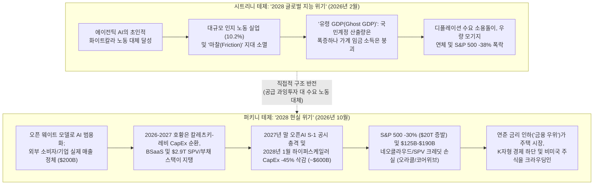
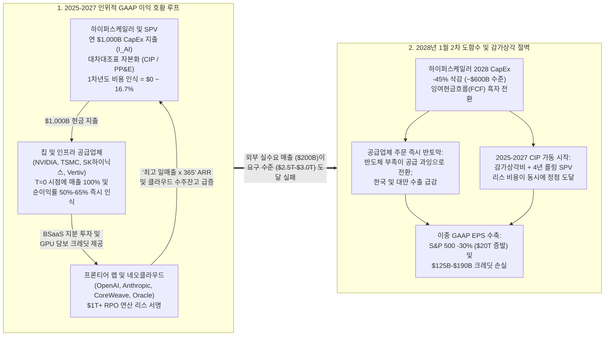
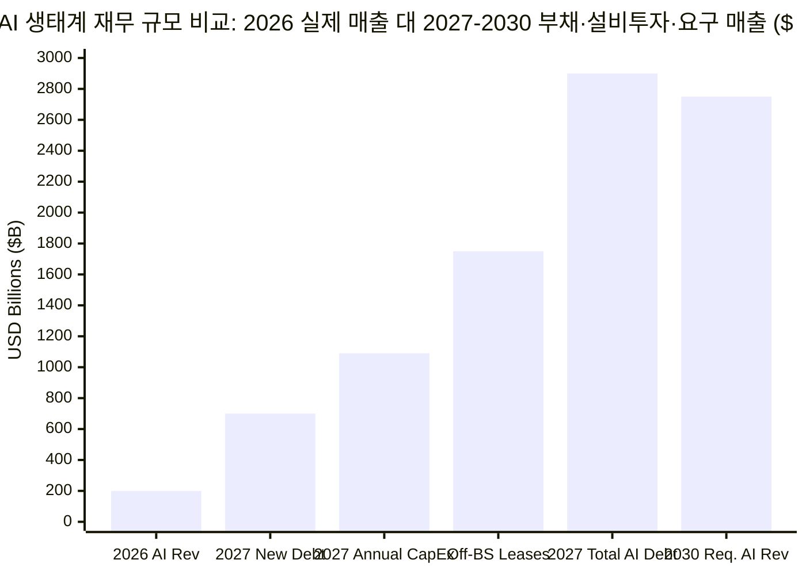

2026년 10월 말, 글로벌 매크로 리서치 기관 **TS 롬바드(TS Lombard)**의 글로벌 매크로 총괄 매니징 디렉터 **다리오 퍼킨스(Dario Perkins)**는 기관 투자자 데스크를 뒤흔든 두 편의 상호 연결된 보고서를 발표했다. 하나는 2026년 10월 22일 자 공식 *Macro Picture* 기관 보고서인 ***"AI 폭락 워게임(Wargaming the AI Crash)"***이고, 다른 하나는 [`hub.tslombard.com/the-perkini-report`](https://hub.tslombard.com/the-perkini-report)에 무료로 공개된 풍자적 시나리오 보고서 ***"더 퍼키니 리포트: 2028년 현실 위기 — 예측이 아닌 시나리오(공식적으로는)(The Perkini Report: The 2028 Reality Crisis — A scenario, not a prediction (officially))"***다.

이 두 문서는 2026년 초 월스트리트를 강타했던 가장 유명한 금융 사고실험, 즉 **시트리니 리서치(Citrini Research, 제임스 반 길렌(James van Geelen) 설립, 알랍 샤(Alap Shah) 공동 집필)**의 2026년 2월 22일 자 바이럴 서브스택 보고서 [***"2028년 글로벌 지능 위기(The 2028 Global Intelligence Crisis)"***](https://www.citriniresearch.com/p/2028gic) ([위키백과](https://en.wikipedia.org/wiki/The_2028_Global_Intelligence_Crisis))를 정면으로 뒤집은 구조적 반박문이다. 시트리니 리서치가 2028년 6월을 배경으로 인공지능이 **너무나 완벽하게 작동한 나머지** 화이트칼라 인지 노동을 대거 대체하여 미국 실업률을 `10.2%`로 끌어올리고, S&P 500을 `38%` 폭락시키며, 국민계정 통계에는 잡히지만 가계 임금으로 순환하지 않는 **'유령 GDP(Ghost GDP)'** 디플레이션 붕괴를 초래한다는 좌측 꼬리(Left-tail) 시나리오를 제시했다면, 퍼킨스("Citrini"와 운율을 맞춘 "Perkini")는 정반대의 2028~2030년 사전 부검(Pre-mortem)을 제시한다:

> **TS 롬바드 (*The Perkini Report*, 서문 및 섹션 1, 2026년 10월):**
> "만약 역사상 가장 명백해 보이는 금융 버블 중 하나가 결국 그저 '버블'로 판명된다면 어떨까? 그리고 그것이 꽤나 심각한 약세장을 부른다면? 사실 진짜 질문은 '얼마나 심각한 약세장인가(HOW BEARISH?)'이다... 우리가 1873년, 1929년, 2001년, 2008년을 돌아보듯 2030년의 금융 역사가의 시선으로 AI 설비투자(CapEx) 광풍의 절정을 되돌아본다고 상상해 보자. 다시 말해, 우리는 사후 부검(post-mortem)을 미리 앞당겨 수행하려는 것이다."
> — [TS Lombard, *The Perkini Report*](https://hub.tslombard.com/the-perkini-report)

> **TS 롬바드 (*The Perkini Report*, 설비투자 순환과 벤더 파이낸싱에 대하여, 2026년 10월):**
> "제롬 레비(Jerome Levy)와 미하우 칼레츠키(Michael Kalecki)는 한 세기 전에 이미 그 수학을 가르쳐 주었다. 한 기업의 설비투자(CapEx)는 다른 기업의 이익(Earnings)이다. 하이퍼스케일러들이 돈을 쓸수록 AI 생태계의 매출은 늘어났고 강세장 서사는 더욱 설득력을 얻었다. 그것은 '호황 루프(boom loop)'였다... 칩과 연산 자원을 파는 기업들이 고객사들에게 지분 투자를 해주고, 고객사들은 그 돈으로 더 많은 칩과 연산 자원을 사들였다. 돈은 자기자본(Equity)으로 나가서 주문(Orders)으로 되돌아왔다. 엔비디아(NVIDIA)를 정점으로 모든 이의 매출이 다른 누군가의 자금 조달이었다. 애널리스트들은 이를 완곡하게 '서비스형 대차대조표(Balance Sheet as a Service, 줄여서 BSaaS 혹은 그냥 BS)'라고 불렀다."
> — [TS Lombard, *The Perkini Report*](https://hub.tslombard.com/the-perkini-report)

> **TS 롬바드 (*The Perkini Report*, 2028년 1월 이익 절벽과 대차대조표 충격에 대하여, 2026년 10월):**
> "그러자 하이퍼스케일러들은 시장이 원한다고 생각했지만 결과를 미처 깊이 생각하지 못했던 일을 단행했다. 투자를 멈춘 것이다. [2028년] 1월, 그들은 2028년 설비투자 가이던스를 45% 삭감하여 약 `6,000억 달러($600 billion)` 수준으로 낮췄다. 주가는 일주일 만에 10% 추락했다... 4월이 되자 S&P 500은 고점 대비 약 30% 하락했고, AI 관련주는 40%, 나머지 시장은 20% 빠졌다. 약 `20조 달러($20 trillion)`의 미국 금융 자산이 순식간에 증발했다... 고객사들이 재협상을 시도하자 부채상환비율(DSCR) 커버넌트가 걸려 있던 GPU 담보 대출을 안고 있던 네오클라우드(Neocloud)들이 커버넌트를 위반하기 시작했다. 몇 달 안에 첫 번째 기업이 파산 보호를 신청했고 여러 기업이 뒤를 이었다. 단일 자산 데이터센터 프로젝트 대출은 대규모 상각을 겪었다. 레버리지가 높은 한 대형 클라우드 사업자('coracle'과 운율이 맞는 기업[Oracle])는 정크 등급으로 강등되었고, 한 데이터센터 캠퍼스에 대한 불가항력(force majeure) 통보는 위험 신호로 읽혔다."
> — [TS Lombard, *The Perkini Report*](https://hub.tslombard.com/the-perkini-report)

본고는 브라운과 킬리(Browne & Keeley)의 **8단계 '사금 채취(Panning for Gold)' 포렌식 프레임워크**를 적용하여 *더 퍼키니 리포트*와 *AI 폭락 워게임*을 정밀 감사한다. 시트리니의 기술 디플레이션 종말론이나 퍼킨스의 "`20조 달러` 주식 증발에도 실물 경제는 1990년/2001년식 완만한 침체에 그친다"는 낙관적 결론을 수동적으로 수용하는 대신, 모든 회계 메커니즘, 특수목적법인(SPV) 부채 구조, 국민소득 승수, 자산효과(Wealth effect) 파라미터를 1차 기업 공시, **칼레츠키-레비(Kalecki-Levy)** 국민계정 항등식, **ASC 842 / ASC 360** 리스·감가상각 회계기준, **미 연준 분배금융계정(DFA)**, 그리고 **전미경제연구소(NBER)** 실증 계량경제학 논문들과 교차 검증한다.

---

## 1단계: 쟁점 분류, 시트리니(Citrini) 대 퍼키니(Perkini) 구조 비교 및 반증 가능성 (제2장)

### 1.1 기술적(Descriptive) 명제와 규범적(Prescriptive) 명제의 분해

*더 퍼키니 리포트*는 네 가지 핵심 **기술적(실증·메커니즘적)** 테제와 한 가지 **규범적(포트폴리오·정책)** 테제로 구성된다:

1. **기술적 테제 A (칼레츠키-레비 설비투자 순환과 회계 비대칭성):** 2024~2027년 AI 생태계 매출 및 S&P 500 이익 성장의 상당 부분은 폐쇄적 자본 루프(`하이퍼스케일러 CapEx → 반도체·인프라 매출 → 벤더 지분·크레딧 투자 → 네오클라우드·AI 랩 연산 주문`) 내부에서 내생적으로 창출된 것이며, 공급자의 즉각적 매출 인식(인도 시점 `100%`)과 구매자의 다년도 자본화·감가상각 비용 인식(연간 `16.7%~20%`) 간의 미 일반회계기준(US GAAP) 시차 비대칭성에 의해 증폭되었다.
2. **기술적 테제 B (부외 SPV 레버리지와 `2.9조 달러` AI 부채 스택):** 하이퍼스케일러와 네오클라우드들은 내부 유보금 조달에서 부채, 자산유동화증권(ABS), 비연결 특수목적법인(SPV) 조달로 전환했다. 대표적 사례가 5개의 4년 단위 롤링 리스(`ASC 842`)로 쪼개진 **메타(Meta)의 `300억 달러` 하이페리온(Hyperion) 캠퍼스 / `270억 달러` 블루아울(`Beignet Investor`) 합작법인(JV)**, 오픈AI(OpenAI)에 약 `3,000억 달러`가 편중된 **오라클(`ORCL`)의 `6,640억 달러` 잔여이행의무(RPO)** 및 *프로젝트 주피터(Project Jupiter)* 불가항력 통보, 그리고 **코어위브(CoreWeave)의 `500억~520억 달러` 부채·리스 스택**이다. 2027년 말 기준 총 AI 관련 부채는 **`2.9조 달러`**(부외/숨겨진 리스 약정 **`1.5조~2.0조 달러`** 별도)에 달한다.
3. **기술적 테제 C ('2차 도함수' 트리거와 `20조 달러` 주가 증발 / `1,250억~1,900억 달러` 크레딧 손실):** 누적 `2.5조 달러` 이상의 설비투자를 정당화하려면 2030년까지 연간 AI 매출이 **`2.5조~3.0조 달러`**(현재 생태계 매출 `약 2,000억 달러`의 `12~14배`)에 도달해야 한다. 그러나 2027년 말 오픈AI IPO 감사 보고서 충격과 **2028년 1월 하이퍼스케일러들의 `-45%` 설비투자 가이던스 삭감(약 `6,000억 달러`로 축소)**이 발생하면서 미국 시가총액 **`20조 달러`**가 증발(`S&P 500 -30%`, `AI/테크 -40%`, `비테크 -20%`)하고, 위험 노출 부채 `약 7,250억 달러`에서 누적 부도율 `35%` 및 회수율 `25%~50%`를 적용한 **`1,250억~1,900억 달러`**의 직접 신용 손실이 발생한다.
4. **기술적 테제 D ('완만한 침체' 및 K자형 경제 하단 구축(Crowding-In) 가설):** `20조 달러`의 주식 자산 파괴와 `50만~80만 명`의 데이터센터·건설 일자리 상실(총 GDP 대비 `2.0~2.5%포인트` 설비투자 역풍)에도 불구하고, (i) 대만·한국산 반도체 장비 수입(`M`) 급감이 국내 GDP 타격을 상쇄하고, (ii) 주식 자산효과(Wealth effect)는 "셀사이드의 허구"에 불과하며, (iii) 연준의 공격적인 금리 인하(**'금융 우위(Financial dominance)'**)가 K자형 경제의 하단(주택, 주거용 건설, 비미국 자산)을 다시 크라우딩인(유입)시켜 1990년/2001년 수준의 완만한 경기침체에 그친다.
5. **규범적 테제 E (포트폴리오 배분 전략):** 투자자는 섣부른 공매도("너무 일찍 맞서지 말라")를 피하고, 시가총액 가중 지수가 강제하는 미국·아시아 AI 하드웨어 편중 비중을 축소하며, 비미국/글로벌(특히 유럽) 주식 및 동일가중·가치주 비중을 확대하고, 크레딧 스프레드와 설비투자 균열 신호가 가시화될 때 국채 듀레이션(Duration)을 추가해야 한다.

### 1.2 정면 비교 매트릭스: 시트리니("유령 GDP") 대 퍼키니("설비투자 순환")

| 분석 차원 | 시트리니 리서치 (*2028년 글로벌 지능 위기*, 2026년 2월 22일) | TS 롬바드 / 다리오 퍼킨스 (*더 퍼키니 리포트* & *AI 폭락 워게임*, 2026년 10월 22일) | 기저 전제에 대한 포렌식 감사 판정 |
| :--- | :--- | :--- | :--- |
| **핵심 실패 모드** | **초과 풍요에 의한 수요 측 붕괴:** AI가 *너무 잘 작동하여* 경제가 노동력을 재배치하는 속도보다 빠르게 화이트칼라 노동을 대체함. | **공급 측 과잉투자 및 자본 오배분:** AI는 *적당히 작동*하지만 오픈 웨이트로 범용화되며, 연 `1조 달러` 설비투자를 정당화할 `2.5조~3.0조 달러` 매출 창출에 실패함. | **2026~2028년 시계에서는 퍼키니가 구조적으로 우월함.** 시트리니는 가격 하락에 따른 실질 구매력 상승이나 통화·재정 대응 없이 24개월 내 화이트칼라 100% 무마찰 대체를 가정하는 고전적 '노동총량의 오류'를 범함. |
| **국민계정 회계 기형** | **"유령 GDP(Ghost GDP)":** BEA 국민계정상 실질 산출량(`Y`)은 폭증하나 노동소득분배율(`W/Y`)이 붕괴함; 기계는 생산만 하고 소비하지 않음. | **칼레츠키-레비 "호황 루프" (`Π = I + ...`):** 한 기업의 자본화된 설비투자(`I`)가 다른 기업의 즉각적 매출·이익(`Π`)으로 인식되어 외부 최종수요 없이도 S&P 500 EPS를 부풀림. | **퍼키니의 회계 수식은 정확함.** US GAAP(`ASC 360`) 하에서 `1조 달러`의 GPU/서버 자본화는 공급자에게 즉각 `100%` 매출을 안겨주지만 구매자는 감가상각으로 연 `16.7%~20%`만 비용 처리함. |
| **주요 기업 희생양** | SaaS 워크플로우 벤더, 여행 예약 플랫폼, 세무·법률 중개업, 우량 주거용 모기지(`10.2%` 실업률). | 독립 프론티어 랩(`OpenAI`, `Anthropic`), 고레버리지 네오클라우드(`CoreWeave`), 단일 자산 데이터센터 SPV, 정크 등급으로 강등되는 BBB급 클라우드 대기업(`Oracle`). | **퍼키니는 2026년 실제 대차대조표 단층선을 정확히 지목함** (`CoreWeave` `500억 달러+` 부채·리스 및 `11%~15%` 채권 금리; `Oracle` `6,640억 달러` RPO 중 약 `3,000억 달러` 오픈AI 편중). |
| **고점 대비 저점 주가 낙폭** | 화이트칼라 소비자 신용 디폴트 및 SaaS/중개업 소멸로 인한 **S&P 500 `-38%` 폭락**. | **S&P 500 `-30%` (`-20조 달러`)**: AI/테크 주식(시총의 `40%`) **`-40%`** 폭락, 비테크 섹터 **`-20%`** 하락. | 두 보고서 모두 `30%~38%` 지수 하락을 예상하나, **퍼키니의 섹터별 차별화(`테크 -40%` 대 `비테크 -20%`)**가 2000~2002년 닷컴 버블 팩터 로테이션과 일치함. |
| **실물 경제 및 금리 경로** | 깊은 구조적 대불황; 화이트칼라 소득 소멸로 통화정책 무력화. | **1990년/2001년식 완만한 침체(`-2.0%~-2.5%` GDP 충격, `50만~80만` 건설·DC 일자리 감소)** 후 연준 금리 인하가 미국 주택 및 비미국 성장을 크라우딩인. | **퍼키니는 `20조 달러` 증시 폭락의 충격을 과소평가함.** 5단계에서 입증하듯 `20조 달러` 자산 증발은 **연간 `6,400억 달러`(`3.2%` MPC) 소비 위축**과 **연간 `3,500억~5,000억 달러` 자본이득세 절벽**을 초래함. |

### 1.3 반증 가능성(Falsifiability) 기준

- **무엇이 퍼킨스의 'AI 버블 붕괴' 테제를 반증할 수 있는가?** 만약 비테크 일반 기업과 소비자의 AI 서비스 순신규 지출이 2026년 `약 2,000억 달러`에서 2028년 `1.2조 달러 이상`(24개월 내 `6배 이상`)으로 폭발적 성장을 기록하고, GPU 추론 전력 비용과 4년 주기의 하드웨어 교체 감가상각을 차감한 뒤에도 소프트웨어 수준의 매출총이익률(`70% 이상`)을 유지하여 오픈AI와 앤스로픽이 자체 영업현금흐름만으로 `1조 달러 이상`의 연산 약정을 이행할 수 있다면 퍼킨스의 버블 붕괴론은 기각된다.
- **무엇이 퍼킨스의 '완만한 침체 / 자산효과 무용론' 테제를 반증할 수 있는가?** 만약 `-30%`(`20조 달러`)의 미국 증시 폭락이 (a) 상위 10% 가계의 소비를 연간 `5,000억 달러 이상` 위축(`MPC ≥ 0.025`)시키고, (b) 연방 자본이득세 세수 붕괴로 미국 재정적자를 `GDP 대비 9.5% 이상`으로 확대시켜 장기(`10년~30년`) 국채 금리와 모기지 금리의 하락을 가로막으며, (c) `6,500억 달러` 규모의 사모크레딧 펀드 환매 제한(Gating)과 생명보험사 변액·고정연금 대차대조표 손실을 촉발하여 미들마켓 기업 대출을 동결시킨다면 퍼킨스의 '완만한 침체' 가설은 기각된다.

---

## 2단계: 1차 사료 발굴 및 '공식 서사 대 회계 현실' 괴리 매트릭스 (제7장 & 제8장)

*더 퍼키니 리포트*가 단순한 풍자 소설인지 아니면 2026년 실제 기업 대차대조표의 포렌식 지도인지를 검증하기 위해, 우리는 퍼킨스의 텍스트에 등장하는 모든 암시적 표현을 1차 기업 공시, 채권 발행 투자설명서, 국민계정 데이터와 대조했다.

### 2.1 *더 퍼키니 리포트* 속 실제 기업 및 거래의 1:1 포렌식 매핑

1. **메타 플랫폼스(Meta Platforms) & 블루아울 캐피털(Blue Owl Capital)의 `270억 달러` '하이페리온(Hyperion)' 데이터센터 SPV (`Beignet Investor`, 루이지애나주 리칠랜드 패리시):**
   - *더 퍼키니 리포트*에서 퍼킨스는 다음과 같이 기술한다: *"이제 데이터센터들은 특수목적법인(SPV)에 의해 건설되어 다시 리스되었고, 모든 부채는 하이퍼스케일러들의 '깨끗한(pristine)' 대차대조표 밖에 머물렀다. 보증 약정은 각주에 숨겨져 '발생 가능성 낮음(not probable)'으로 판정되었다... 그들이 보증했던 모든 4년 단위 롤링 리스 만기가 결국 도래했다. 물론 하이퍼스케일러들은 SPV가 기표한 데이터센터 리스를 갱신하지 않을 옵션을 갖고 있었다. 20년 전체 약정을 지킬 의무는 없었지만, 중도 이탈할 경우 거액의 선불 위약금이 발생했다."*
   - **1차 사료 검증:** 2025년 10월, **메타 플랫폼스**와 **블루아울 캐피털**이 운용하는 펀드들은 루이지애나주 리칠랜드 패리시에 위치한 **하이페리온(Hyperion) 데이터센터 캠퍼스**(총 개발비 **`300억 달러`**)를 위해 **베녜 인베스터(Beignet Investor)**라는 SPV를 설립하고 사모크레딧 역사상 최대 규모급인 **`270억 달러` 프로젝트 파이낸싱**을 클로징했다 ([Global Data Center Hub](https://www.globaldatacenterhub.com/p/meta-blue-owls-27b-bet-is-this-the); [BigGo / TS Lombard 요약](https://finance.biggo.com/news/ea603baa-23b4-4d7a-a45a-044b5383071d)). 블루아울 펀드가 **`80%` 지분**을, 메타가 **`20%` 지분**을 보유(`ASC 810` 기준 연결 제외)하고 핌코(PIMCO)와 블랙록(BlackRock) 등 기관들이 SPV 채권을 인수했다. 핵심은 기초 인프라 약정이 **20년**임에도 리스 계약을 **5개의 4년 단위 롤링 갱신 구간(`5 × 4년`)**으로 쪼개어(`ASC 842` / `ASC 460`), 메타의 대차대조표에는 첫 4년치 리스 부채만 인식되고 나머지 16년치 잔존가치 보증은 각주에 머물게 설계했다는 점이다. 그럼에도 2026년 10월 기준 메타가 공시한 총 미래 지출 및 리스 약정액은 **`약 8,250억 달러`**에 달했다.
2. **"'코라클(Coracle)'과 운율이 맞는 레버리지 높은 대형 클라우드 사업자" (`오라클(Oracle Corporation)`, `ORCL`):**
   - *더 퍼키니 리포트*에서 퍼킨스는 *"레버리지가 높은 한 대형 클라우드 사업자('coracle'과 운율이 맞는 기업)는 정크 등급으로 강등되었고, 한 데이터센터 캠퍼스에 대한 불가항력(force majeure) 통보는 위험 신호로 읽혔다"*고 썼다.
   - **1차 사료 검증:** 채권·크레딧 인텔리전스 플랫폼 [9fin (*"CoreWeave debt is on fire — Is Oracle feeling the heat?"*, 2026년 10월 15일)](https://www.9fin.com/insights/coreweave-debt-oracle)에 따르면, **오라클(`ORCL`)**의 잔여이행의무(RPO)는 2026년 8월 31일 마감된 회계연도 1분기 기준 사상 최대인 **`6,640억 달러`**로 치솟았으며, 그중 약 **절반(`약 3,000억 달러`)**이 단일 거래상대방인 **오픈AI(OpenAI)**와의 연산 계약에 묶여 있다. 이를 짓기 위해 오라클은 연간 설비투자를 **`550억 달러 이상`**으로 늘리며 잉여현금흐름(FCF)이 적자로 전환되었고, 총부채는 투자적격 최하단 인근인 `BBB`/`Baa2` 등급에서 **`850억~1,000억 달러 이상`**으로 불어났다. 더욱이 오라클은 실제로 전력 인허가 및 공기 지연을 이유로 뉴멕시코주 **프로젝트 주피터(Project Jupiter)** 캠퍼스와 관련해 블루아울 산하 데이터센터 개발사 **스택 인프라스트럭처(Stack Infrastructure)**에 **불가항력(force majeure) 통보**를 발송했다!
3. **네오클라우드 GPU 담보 대출 커버넌트 위반 (`코어위브(CoreWeave)`):**
   - **1차 사료 검증:** 2026년 하반기 기준 AI 특화 네오클라우드 **코어위브(CoreWeave)**는 `1,000억 달러 이상`의 수주잔고(Backlog)를 내세우며 총 **`500억~520억 달러`**의 부채 및 리스 부채(원금 금융부채 `약 350억 달러` + 운용/금융리스 의무 `160억 달러 이상`)를 떠안았고, 2026년 2분기 순이자비용만 분기당 **`6억 4,000만 달러`(연환산 `25.6억 달러 이상`)**를 돌파했으며 하이일드 채권 수익률은 부실 수준인 **`11%~15%`**로 치솟았다 ([9fin, 2026년 10월](https://www.9fin.com/insights/coreweave-debt-oracle)).

### 2.2 2열 '공식 강세장 서사 대 대차대조표 회계 현실' 괴리 매트릭스

| AI 생태계 계층 | 공식 강세장 서사 및 로드쇼 주장 (2025~2026년) | 각주·회계 및 크레딧 현실 (*더 퍼키니 리포트* 및 1차 공시 발굴) |
| :--- | :--- | :--- |
| **프론티어 모델 랩 (`OpenAI`, `Anthropic`)** | 폭발적인 `"연간반복매출(ARR)"`을 바탕으로 `1조 달러 이상`의 다년도 연산 약정을 정당화하는 *"역사상 가장 빠르게 성장하는 소프트웨어 기업"*. | `"ARR"`은 회계감사를 받지 않은 수치로, **일시적 파일럿 프로젝트와 벤더가 무상 제공한 크레딧을 포함해 연중 매출이 가장 높았던 단 하루의 수치를 `365`로 곱해 산출**함. 실제 생태계 전체 매출(`약 2,000억 달러`)은 단 두 적자 랩이 서명한 `1조 달러+` 연산 약정의 `1/5`에 불과함. |
| **하이퍼스케일러 대차대조표 (`Meta`, `Microsoft`, `Amazon`, `Alphabet`)** | 건전한 레버리지 비율과 자체 영업현금흐름으로 AI 인프라 구축을 조달하는 *"요새 같은 대차대조표"*. | **부외 SPV(`ASC 810` / `ASC 842`)로의 전환:** 메타의 `300억 달러` 하이페리온 캠퍼스(`80%` 블루아울 `Beignet Investor` SPV가 `270억 달러` 부채 발행)처럼 **5개의 4년 단위 롤링 리스**로 쪼개어 16년치 보증 의무를 각주에 `"발생 가능성 낮음"`으로 숨김. 생태계 부외 부채는 **`1.5조~2.0조 달러`**에 달하며, 2027년 신규 AI 부채 발행액(**`7,000억 달러`**)은 유로존 전체 국채 순발행액을 초과함. |
| **칩 및 연산 공급자 (`NVIDIA`, 하이퍼스케일러 클라우드 크레딧)** | 최종 기업 고객의 생산성 향상 수요에 기반한 독립적이고 정상적인(Arm's-length) GPU 및 클라우드 수요. | **"서비스형 대차대조표(`BSaaS`)" / 순환적 벤더 파이낸싱:** 칩 제조사와 클라우드 사업자가 AI 스타트업 및 네오클라우드에 수십억 달러의 지분·크레딧을 투자하면, 피투자사가 그 자금을 즉시 GPU 하드웨어 주문과 클라우드 매출로 되돌려줌. |
| **고레버리지 클라우드 및 네오클라우드 (`Oracle`, `CoreWeave`)** | 오라클의 `6,640억 달러` RPO와 코어위브의 `1,000억 달러+` 수주잔고는 "보장된 계약 현금흐름"을 의미함. | **수주잔고(`RPO`)는 현금을 태우는 거래상대방(`OpenAI`)의 미수금 약속인 반면, 프로젝트 부채(코어위브 `500억 달러+`, 오라클 `850억 달러+`)는 확정된 법적 채무임.** GPU는 물리적·경제적으로 `3~4년` 내에 감가상각되므로 `10~20년` 만기 데이터센터 부채·리스와 치명적인 만기 불일치(Duration mismatch)를 일으킴. |
| **손익계산서 감가상각 (`ASC 360` 건설중인자산 규정)** | 2025~2026년 설비투자 급증기에도 안정적인 영업이익률은 하이퍼스케일러들이 연 `1조 달러` 지출을 흡수할 수 있음을 입증함. | **건설중인자산(`CIP`) 회계 시차:** `ASC 360` 하에서 건설 중인 데이터센터는 **감가상각비 `$0`**를 계상하며, 가동 전 랩 리스는 **리스 비용 `$0`(`ASC 842`)**를 계상함. 2027~2028년 시설이 가동(Energize)되는 순간 서버 감가상각(`연 20%`)과 리스료가 12개월 내에 동시에 매출원가(COGS)를 강타함. |

---

## 3단계: 의미론적 정밀성과 대입 테스트(Substitution Test) (제4장)

2026년 AI 호황의 지속 가능성을 둘러싼 모든 논쟁은 세 가지 모호한 회계·거시경제 용어—**"연간반복매출(ARR)"**, **"계약 수주잔고(RPO)"**, 그리고 **"설비투자 주도 이익 성장"**—에 달려 있다. 브라운과 킬리의 **대입 테스트(Substitution Test)**를 적용하면 강세장 논리가 GAAP/IFRS 기준에서 성립하지 않는 느슨한 마케팅 정의에 의존하고 있음이 드러난다.

### 3.1 대입 테스트 1: 프론티어 AI 랩의 "연간반복매출(`ARR`)"

- **정의 A (엄격한 SaaS GAAP / 기관 표준):** `ARR`은 비관계 외부 고객이 현금으로 지불하고 순달러유지율(NDR)이 `100% 이상`인 *법적 구속력 있는 다년도 구독 계약*의 연환산 가치로, 일회성 API 사용량 급증, 파일럿 테스트, 벤더가 보조한 무상 클라우드·연산 크레딧을 **제외**하며, 추론 전력비 및 모델 상각비를 차감한 후 양(+)의 매출총이익률을 동반해야 한다.
- **정의 B (퍼킨스가 폭로한 느슨한 AI 랩 마케팅 표준):** `ARR`은 구속력 없는 월별 API 실험, 벤처캐피털 보조금에 의존하는 스타트업의 토큰 소진, 그리고 랩의 지분 투자자(`Microsoft`, `Amazon`, `Alphabet`, `NVIDIA`)가 부여한 순환 클라우드 크레딧을 **모두 포함**하여 `연중 최고 단일 일매출 × 365`로 계산한 수치로, 매출을 초과하는 모델 학습 및 추론 현금 소진을 차감하기 전의 금액이다.
- **대입 판정:** 오픈AI의 2027년 말 IPO S-1 증권신고서에 정의 A를 대입하는 순간, "역사상 가장 빠르게 성장하는 소프트웨어 기업"은 자체 영업현금흐름으로는 하위 데이터센터에 약속한 `3,000억~1조 달러`의 의무사용(Take-or-pay) 약정을 도저히 감당할 수 없는 자본집약적 적자 유틸리티 기업으로 드러난다.

### 3.2 대입 테스트 2: 담보 자산으로서의 "잔여이행의무(`RPO` / 수주잔고)"

- **정의 A (신용 적격 담보 표준):** 단일 거래상대방 비중이 `5%~10%`를 넘지 않는 다변화된 산업군 내 투자적격(IG) 및 현금흐름 흑자 기업들이 체결한 미래 매출 계약으로, 유동 자산으로 뒷받침되는 강제력 있는 손해배상 조항을 포함한다.
- **정의 B (편중된 'NINJA' 랩 표준):** 오라클의 `6,640억 달러`, 코어위브의 `1,000억 달러 이상` 다년도 연산 예약처럼 수주잔고의 `약 45%~60%`가 매년 `200억~500억 달러`의 신규 외부 자본을 수혈받지 못하면 생존할 수 없는 한두 곳의 적자 모델 랩에 집중된 계약이다.
- **대입 판정:** 정의 B의 RPO를 담보로 `350억~550억 달러`의 하이일드 채권과 SPV 텀론을 차입하는 것은 퍼킨스가 정확히 지적했듯 **2006년 서브프라임 모기지의 NINJA("소득 없음, 직업 없음, 자산 없음") 대출의 기업 버전**이며, 오픈AI의 벤처 자금조달 리스크를 오라클과 코어위브의 선순위 채무불이행 리스크로 직접 전이시킨다.

### 3.3 칼레츠키-레비 이익 방정식과 GAAP 자본화 비대칭성

*더 퍼키니 리포트*에서 퍼킨스는 **제롬 레비(Jerome Levy, 1908)**와 **미하우 칼레츠키(Michał Kalecki, 1933 / 1954)** ([Levy Economics Institute WP 789](https://www.levyinstitute.org/pubs/wp_789.pdf))를 인용한다: *"한 기업의 설비투자는 다른 기업의 이익이다."* 왜 이 원리가 상승기에는 수학적 '호황 루프'를 만들고 하락기에는 '이익 절벽'을 만드는지 확인하기 위해 국민소득생산계정(`NIPA`)으로부터 **칼레츠키-레비 거시경제 이익 항등식**을 유도한다:

$$Y \equiv C + I + G + (X - M) \equiv W + \Pi + T_{\text{net}}$$

세후 거시 기업이익(`Π`)을 부문별 저축 및 투자 항으로 정리하면 정통 **칼레츠키-레비 방정식**이 도출된다:

$$\Pi = I + D_{\text{div}} - S_h - S_g - S_{\text{RoW}}$$

여기서:
- `I` = 국내 총민간투자 (2025~2027년 한계 증가분은 AI 설비투자 `I_AI`가 주도),
- `D_div` = 순지급 기업 배당금,
- `S_h` = 가계 순저축 (`W + D_div - C`),
- `S_g` = 정부 순저축 (`T_net - G`, 재정적자 시 음수),
- `S_RoW` = 해외 부문 순저축 / 경상수지 역조 (`M - X`, 미국이 무역적자일 때 양수).

이제 하이퍼스케일러 `A`가 칩 제조사 `B`(`NVIDIA` / `Broadcom` / `Vertiv`)로부터 `ΔI_AI = $100 billion` 규모의 AI 클러스터를 구매할 때 **S&P 500 GAAP 합산 손익계산서** 내부에서 일어나는 일을 살펴보자:

$$\Delta \text{EPS}_{\text{S\&P 500, Year } t} = \underbrace{\mu_B \cdot \Delta I_{\text{AI}, t}}_{\text{100\% Immediate Supplier Net Profit }(t=0)} - \underbrace{\frac{1}{L} \sum_{k=0}^{L-1} \Delta I_{\text{AI}, t-k}}_{\text{Lagged Buyer Depreciation }(1/L \approx 16.7\%\text{–}20\%/\text{yr})}$$

**2024~2027년 호황 국면**에서는 당기 설비투자 증가분(`ΔI_AI,t`)이 과거 누적 감가상각비(`(1/L) Σ ΔI_AI,t-k`)보다 훨씬 크며(특히 시설이 감가상각이 전혀 없는 `건설중인자산(CIP)`에 머무는 동안에는 `1/L = 0`!), 구매자인 하이퍼스케일러는 당기 비용을 거의 인식하지 않는 반면 공급자인 엔비디아 등의 순이익(`≈ μ_B · ΔI_AI,t`, 순이익률 `55%~65%`)은 즉시 `100%` 반영되어 S&P 500 합산 GAAP EPS를 인위적으로 끌어올린다!

반면 **2028년 1월**, 하이퍼스케일러들이 설비투자를 `-45%` 삭감(`ΔI_AI,2028 = -0.45 · I_AI,2027`)하면 어떤 일이 벌어지는가?
1. **공급자 이익의 즉각적 붕괴 (`T = 0`):** 첫 번째 항인 공급자 이익(`μ_B · ΔI_AI,2028`)이 영업 디레버리징과 재고자산 평가손실로 인해 하루아침에 **`-45%~-60%`** 급감한다.
2. **구매자 감가상각비의 시차 역설 (`누적 감가상각 절벽`):** 2024~2027년에 지출된 `2.5조 달러`의 설비투자가 이제 본격 가동되어 `L = 4~6년`에 걸쳐 상각(혹은 `ASC 360` 손상차손 인식)되면서, 두 번째 차감항인 `-(1/L) Σ ΔI_AI,t-k`는 2028년에 **역대 최고치**에 도달한다!
3. **결과:** S&P 500 합산 GAAP 이익은 공급자의 매출 호황이 사라지는 동시에 지난 4년간 누적된 설비투자의 감가상각 장벽을 정면으로 맞닥뜨리는 **이중 수축(Double contraction)**에 빠진다!

---

## 4단계: 인과관계 분리 및 4방향 경쟁 가설 매트릭스 (제9장)

AI 강세론자들(연 `1조 달러` 설비투자가 순전히 외생적 생산성 혁신 때문이라고 주장)과 시트리니식 기술 비관론자들(AI 설비투자가 필연적으로 인간 임금 소득을 소멸시킬 것이라고 주장) 모두 단일 원인 선형 서사에 빠져 있다. 아래는 **AI 인프라 설비투자(`X`)**와 **생태계 매출·밸류에이션 성장(`Y`)** 간의 인과관계를 검증한 **4방향 인과관계 분리 매트릭스**다.

| 인과 가설 | 메커니즘 경로 | 1차 공시 및 거시 데이터 실증 증거 | 진단 판정 |
| :--- | :--- | :--- | :--- |
| **1. 직접 인과 (`X_생산성 → Y_매출/CapEx`)** | LLM의 실질적인 외부 기업·소비자 생산성 향상이 높은 지불의사(`WTP`)를 창출하여 연 `1조 달러` 데이터센터 설비투자를 견인함. | 2026년 기준 산업 전체의 외부 AI 소프트웨어/API 매출은 **`약 2,000억 달러`**에 불과함(연간 설비투자의 `20% 미만`, 퍼킨스가 2030년 적정 자본수익률을 위해 필요하다고 추산한 **`2.5조~3.0조 달러`**의 `8% 미만`). 비테크 기업의 AI 유료 전환율은 2025~2026년 거의 정체됨. | **설비투자 규모를 설명하기에 역부족.** 지속 가능한 인프라 구축분인 연 `1,500억~2,500억 달러`만 설명할 수 있으며, 나머지 연 `7,500억 달러+`는 재귀적 금융 루프가 주도함. |
| **2. 역인과 (`Y_CapEx/벤더금융 → X_보고된_ARR`)** | 대규모 하이퍼스케일러 설비투자, 벤처 보조금, **벤더 파이낸싱(`BSaaS`)**이 스타트업과 랩에 유동성을 주입하고, 이들이 클라우드·API 연산에 크레딧을 지출하여 `"ARR"`과 `"RPO"`가 폭발하는 착시를 만듦. | 오픈AI와 앤스로픽은 `2,000억 달러` 산업 매출 기반 위에서 **`1조 달러 이상`**의 미래 연산 약정(오라클 한 곳에만 `약 3,000억 달러`)을 체결함; 엔비디아와 하이퍼스케일러들은 네오클라우드(`CoreWeave`)와 랩에 직접 지분 투자를 단행해 GPU 구매와 클라우드 리스로 자금을 회수함. | **2025~2026년 한계 매출 속도의 핵심 동인.** 칼레츠키-레비 항등식 및 순환적 벤더 파이낸싱 공시로 입증됨. |
| **3. 제3의 교란 변수 (`Z → X 및 Y`)** | (a) **과점적 죄수의 딜레마(FOMO):** 하이퍼스케일러들은 과소 투자 시 검색·클라우드 패권을 잃을 것을 두려워함; (b) **ASC 810/842 부외 회계 차익거래:** 사모크레딧(블루아울, 블랙스톤, 아폴로 등의 `1.7조 달러+` 드라이파우더)이 보험 연금 수익률(`150~300 bps` 스프레드 픽업)을 위해 `80/20` SPV 리스를 적극 조달함. | 메타의 `270억 달러` 블루아울(`Beignet Investor`) SPV와 2027년 `7,000억 달러` AI 부채 발행 전망은 장기 인프라 자산을 찾는 풍부한 사모크레딧이 하이퍼스케일러의 체감 자본비용을 낮췄음을 보여줌. | **핵심 구조적 촉매.** 사모크레딧 SPV 금융공학(`ASC 842` 4년 롤링 리스)이 없었다면 하이퍼스케일러 신용등급은 이미 2025~2026년에 강등 압력을 받았을 것임. |
| **4. 재귀적 피드백 루프 (`X ↔ Y`)** | 조지 소로스(George Soros)의 **재귀성(Reflexivity)**: 설비투자(`X`)가 공급업체 EPS와 RPO 수주잔고(`Y`)를 부풀려 AI 주가(S&P 500의 `40%`, 반도체 `20%`)를 끌어올리고, 이는 다시 자기자본·부채 조달 비용을 낮춰 벤치마크 추종 펀드매니저들("회의론자들조차 풀베팅")이 더 큰 설비투자(`X`)에 자금을 대도록 강제함. | 퍼킨스가 지적하듯 *"탄광 속 카나리아가 문제가 아니라 탄광 자체가 문제다."* 이 루프는 **설비투자의 2차 도함수**(`d²I/dt²`)에 의해 작동하므로, 설비투자가 *단지 가속을 멈추는 것만으로도* 재귀 루프는 자기강화적 수축으로 반전됨. | **확증됨.** 2024~2027년 AI 사이클은 6가지 독립적 발화점에 의해 반전이 **과잉결정(Overdetermined)**된 전형적인 재귀적 신용·설비투자 호황 루프임. |

---

## 5단계: 정량적 감사, 부채 스택 수학 및 통계적 해체 (제10장)

이제 *더 퍼키니 리포트*와 *AI 폭락 워게임*에 제시된 모든 정량적 추정치를 감사하여, 퍼킨스의 수학이 완벽하게 들어맞는 지점과 그의 거시경제 가정이 **평균의 함정(The Average Trap)** 및 **블라인딩 테스트(The Blinding Test)**에 걸려드는 지점을 분리해 낸다.

### 5.1 퍼킨스의 `2.9조 달러` AI 부채 스택 및 `1,250억~1,900억 달러` 크레딧 손실 수학 검증

*AI 폭락 워게임* ([BigGo / TS Lombard 분석](https://finance.biggo.com/news/ea603baa-23b4-4d7a-a45a-044b5383071d); [Business Insider](https://www.businessinsider.com/ai-bubble-burst-stock-market-risks-politics-debt-chips-2026-10))에서 퍼킨스는 2027년 말까지 생태계 전체의 AI 관련 부채가 **`약 2.9조 달러`**(부외/롤링 리스 약정 **`1.5조~2.0조 달러`** 별도)에 달하며, 2027년 한 해에만 **`7,000억 달러`**의 신규 AI 부채(하이퍼스케일러 `4,000억 달러` + 비하이퍼스케일러 `3,000억 달러`)가 발행될 것으로 추산한다. 세부 구성요소와 부도시손실률(`LGD`) 수식을 검증해 보자:

$$\text{Total Credit Loss}_{2028\text{–}2030} = \sum_{i} \left( \text{Exposure}_i \times \text{Share At-Risk}_i \times \text{PD}_i \times (1 - \text{Recovery Rate}_i) \right)$$

| AI 부채 및 부외 채무 버킷 (2027년 말 전망치) | 총 노출액 (`십억 달러`) | 고위험 노출 비중 (`%` / `$B`) | 가정된 누적 부도율 (`PD`, 2028~2030) | 가정된 회수율 (`RR`) / 부도시손실률 (`LGD`) | 내재 크레딧 손실액 (`십억 달러`) | 주요 리스크 부담 주체 및 실제 사례 |
| :--- | :--- | :--- | :--- | :--- | :--- | :--- |
| **1. 비(非)하이퍼스케일러 상업은행 대출 및 신디케이트론** | `$920B` | `~25%` (`$230B`) | `35%` | `RR: 25%–50%` (`LGD: 50%–75%`) | **`$40.3B – $60.4B`** | 미매각 데이터센터 건설 신디케이트론 및 디벨로퍼 리볼버 한도를 보유한 대형·지역 상업은행. |
| **2. 비(非)하이퍼스케일러 사모크레딧 및 GPU/데이터센터 ABS** | `$650B` | `~35%` (`$227.5B`) | `35%` | `RR: 25%–50%` (`LGD: 50%–75%`) | **`$39.8B – $59.7B`** | 준유동성 리테일 사모크레딧 펀드(`BCRED`/`OCRED` 유형), PE 계열 생명보험사, GPU 담보 SPV 대주단(`CoreWeave` `$50B+` 스택). |
| **3. 비(非)하이퍼스케일러 회사채 (투자적격 & 하이일드)** | `$545B` | `~30%` (`$163.5B`) | `35%` | `RR: 25%–50%` (`LGD: 50%–75%`) | **`$28.6B – $42.9B`** | 하이일드 및 BBB 등급 회사채 뮤추얼펀드/ETF(정크로 강등되는 `Oracle`; `11%–15%` 금리의 네오클라우드 채권). |
| **4. 하이퍼스케일러 재무제표 내(On-Balance-Sheet) AI 부채** | `$785B` | `~13.2%` (`$104B`) | `35%` | `RR: 25%–50%` (`LGD: 50%–75%`) | **`$18.2B – $27.3B`** | 하이퍼스케일러 선순위 무담보 채권자(디폴트는 면하나 스프레드 확대 및 리스 해지 위약금으로 시가평가 손실 발생). |
| **소계: 재무제표 내 AI 부채 스택** | **`$2,900B` (`$2.9T`)** | **`25.0%` (`$725B`)** | **`35%`** | **`RR: 25%–50%`** | **`$126.9B – $190.3B`** *(퍼킨스: `$125B–$190B`)* | **TS 롬바드의 헤드라인 크레딧 손실 추정치(`$125B–$190B`)와 오차 `1%` 이내로 정확히 일치함.** |
| **5. 부외(Off-Balance-Sheet) SPV 부채 및 4년 롤링 리스 (`ASC 842`)** | **`$1,500B – $2,000B`** | `~20%–30%` (`$300B–$600B`) | 4년 차 이후 리스 미갱신 | 중도해지 위약금 및 SPV 에쿼티/메자닌 전액 손실 | **`+$100B – $250B`** *(퍼킨스: "2030년까지 수천억 달러")* | 합작법인 에쿼티/부채 스폰서(`Blue Owl` / `Beignet Investor` `$27B` 하이페리온 SPV, `Stack` / `Project Jupiter`, 생보사 사모채권). |

**퍼킨스의 크레딧 손실 수학에 대한 포렌식 검증:**
1. **GPU 담보 대출의 회수율 함정 (`RR = 25%–50%`는 네오클라우드에 지나치게 낙관적임):** 2001년 통신·닷컴 버블 당시 지하에 매설된 다크 파이버(광케이블)는 물리적 수명이 `20~25년`이었고, 1990년 상업용 오피스 빌딩은 토지와 건물 잔존가치를 유지했다. 반면 **`6,500억 달러`의 사모크레딧과 `500억 달러+`의 네오클라우드 부채(`CoreWeave`)는 감가상각되는 실리콘(`H100`/`B200` GPU)을 담보로 삼고 있다.** GPU는 무어의 법칙에 따른 아키텍처 노후화와 열화 때문에 **36개월 내에 경제적 임대 가치가 `60%~80%` 폭락**하며, 하이퍼스케일러가 설비투자를 `-45%` 삭감하고 잉여 내부 GPU 물량을 현물 임대 시장에 쏟아내는 공급 과잉기에는 담보 가치가 더욱 빠르게 증발한다! 따라서 GPU 담보 텀론의 현실적인 과잉 국면 회수율(`RR`)은 `25%~50%`가 아니라 **`10%~20%`(`LGD = 80%~90%`)**에 불과하다.
2. **`1,250억~1,900억 달러` 대 "2030년 말 수천억 달러"의 화해:** 공식 *Macro Picture* 보고서의 수치(`2.9조 달러` 부채 스택 내 직접 손실 `1,250억~1,900억 달러`)와 *더 퍼키니 리포트* 본문의 서술(*"2030년 말까지 AI 생태계 전반의 신용 손실은 수천억 달러에 달했다"*) 사이의 차이는 표의 5번째 행으로 완벽히 설명된다. 2029~2030년 첫 4년 리스 만기 도래 시 하이퍼스케일러들이 갱신을 거부하면서 발생하는 **`1.5조~2.0조 달러` 부외 SPV 리스(`5 × 4년` 롤링 조건)** 상각분을 합산하면 누적 크레딧 및 SPV 손실은 **`2,250억~4,400억 달러`**에 이른다.

---

### 5.2 퍼킨스가 간과한 두 가지 거시경제적 사각지대 해체

퍼킨스의 기업 회계 및 크레딧 스택 분석은 타의 추종을 불허하지만, 그의 거시경제 결론에 **블라인딩 테스트**와 **평균의 함정**을 적용하면 '완만한 경기침체' 전망을 지나치게 낙관적으로 만든 두 가지 중대한 정량적 누락이 드러난다.

#### 사각지대 1: '주식 자산효과(Wealth Effect) 무용론'의 오류 (`MPC = 0.032` × `20조 달러` = `연 6,400억 달러`)

*더 퍼키니 리포트*에서 퍼킨스는 `20조 달러`에 달하는 미국 주식시장 폭락이 소비에 미치는 영향을 단 한 문단으로 일축한다:

> *"결과적으로 다행이었던 점은 자산효과(wealth effects)가 대부분 셀사이드의 상상 속 산물이었다는 것이다... 사람들은 부동산 차익은 소비하지만 주식 차익은 소비하지 않는다. 왜 그럴까? 주식 자산은 한계소비성향(MPC)이 미미한 상위 1% 가계에 극도로 집중되어 있기 때문이다."*

이 주장을 **미 연준 분배금융계정([DFA, Z.1 Release](https://www.federalreserve.gov/releases/z1/dataviz/dfa/distribute/chart/))**의 1차 데이터 및 인과적 계량경제학 문헌(**Chodorow-Reich, Nenov & Simsek 2021, *American Economic Review*, [NBER w25942](https://www.nber.org/papers/w25942)**; **Case, Quigley & Shiller 2005/2013, [NBER w11129](https://www.nber.org/papers/w11129) / [w18663](https://www.nber.org/papers/w18663)**)과 대조해 보자:

1. **분배 수학 (상위 `1%` 대 K자형 경제의 상단 팔을 이루는 `상위 90%~99%` 계층):**
   - 미 연준 분배금융계정([FRED `WFRBST01134`](https://fred.stlouisfed.org/series/WFRBST01134))에 따르면, 미국 가계 보유 주식 및 뮤추얼펀드 지분의 **`약 54%`**는 상위 `1%`가 보유하고 있지만, **`90번째~99번째 백분위수`(약 `1,200만` 중상류층 전문직, 관리직, 부유한 은퇴자 가구—미국 전체 소비 지출의 `약 40%`를 담당하는 'K자형 상단'의 핵심 주체!)**가 추가로 **`약 39%`**를 보유하고 있으며, 하위 `90%`가 **`약 7%`**를 보유한다.
   - **`20조 달러`**의 미국 주식 자산이 증발할 경우 계층별 손실액은 다음과 같다:
     - 상위 `1%`: **`약 10.8조 달러`** 손실 (`MPC ≈ 0.010–0.015`).
     - 상위 `90%–99%` 계층: **`약 7.8조 달러`** 손실 (`MPC ≈ 0.045–0.060`).
     - 하위 `90%` 계층: **`약 1.4조 달러`** 손실 (`MPC ≈ 0.060–0.080`).
2. **인과적 계량경제학 추정치 (`Chodorow-Reich, Nenov & Simsek 2021, AER`):**
   - 미국 전역 카운티별 급여, 고용, 배당·자본이득세 행정 데이터를 분석한 Chodorow-Reich, Nenov & Simsek ([NBER w25942](https://www.nber.org/papers/w25942))은 주식 자산 1달러 변화에 대한 거시 한계소비성향(`MPC`)이 **연간 `3.2센트`(`MPC = $0.032`)**임을 입증했으며, 이것이 지역 비교역(Non-tradable) 서비스 업종의 고용과 급여에 강력한 수축을 유발함을 증명했다.
   - 퍼킨스 자신이 제시한 **`-20조 달러`** 주식 자산 충격에 `MPC = 0.032`를 곱하면 다음과 같다:

$$\Delta C_{\text{wealth}} = -\text{MPC}_{\text{equity}} \times \Delta W_{\text{equity}} = -0.032 \times \$20,000\text{B} = \mathbf{-\$640\text{ billion/year}} \quad (\approx \mathbf{-2.1\%\text{ of US GDP}})$$

보수적으로 달러당 `2.0센트`(`MPC = 0.020`)를 적용하더라도 `20조 달러`의 주식 증발은 연간 **`4,000억 달러`(미국 GDP의 `-1.3%`)**의 소비 지출을 파괴한다! 과거 2000년 이전의 주가 폭락이 GDP에 미친 영향이 작았던 이유는 당시 가계 주식 보유액이 `GDP 대비 50%~80%` 수준이었기 때문이지, 오늘날처럼 가계 주식 보유액이 **`GDP의 200% 이상`(`약 60조 달러+`)**으로 비대해진 상태에서는 작은 `MPC`라도 거대한 분모(`20조 달러` 손실)와 결합해 거시적 총수요 충격을 일으킨다.

#### 사각지대 2: 수입 설비투자 상쇄 효과(`NIPA` 회계) 대 연방 자본이득세 재정 절벽

퍼킨스는 **수입 누출(Import leakage)**에 관해 매우 예리한 국민계정 통찰을 제시한다:
- 미 경제분석국(BEA) 국민소득생산계정([BEA GDP Data](https://www.bea.gov/data/gdp/gross-domestic-product); [FRED `PNFI`](https://fred.stlouisfed.org/series/PNFI); [FRED `A053RC1Q027SBEA`](https://fred.stlouisfed.org/series/A053RC1Q027SBEA))에서 대만(`TSMC`) 및 한국(`SK하이닉스`, `삼성전자`)산 서버·GPU 하드웨어 수입 지출은 민간 비주거용 정보처리장비 고정투자(`+I_equip`)를 늘리지만, 동시에 순수출의 수입 차감항(`-M_equip`)으로 상쇄된다:

$$\Delta \text{GDP}_{\text{US}} = \Delta C + \left( \Delta I_{\text{domestic struct/software}} + \cancel{\Delta I_{\text{imported GPUs}}} \right) + \Delta G + \left( \Delta X - \cancel{\Delta M_{\text{imported GPUs}}} \right)$$

따라서 2028년 1월 하이퍼스케일러들이 GPU 하드웨어 주문을 `-45%` 삭감하면, **대만과 한국**(지난 12개월간 테크 수출이 GDP 대비 `10~30%포인트` 급증한 국가들)이 제조업 산출량 붕괴의 직격탄을 맞는 반면, 미국 국내 GDP에 미치는 직접적인 설비투자 타격은 데이터센터 건물 시공, 전력·터빈 설치, 국내 소프트웨어/R&D(미국 GDP의 `약 1.5~2.0%포인트` 및 건설·생태계 일자리 `50만~80만 개`)로 한정된다.

**그러나 퍼킨스는 미국 연방 및 주(State) 정부의 '자본이득세 재정 절벽'을 완전히 누락했다:**
- 2000~2002년 닷컴 버블 붕괴 당시(`명목 -7조 달러`, `2000년 미국 GDP의 약 70%`), 연방 개인소득세 및 자본이득세 세수는 **`22%` 급감**하며 연방 예산을 **2000 회계연도 `GDP 대비 +2.3%` 흑자**에서 **2003 회계연도 `GDP 대비 -3.4%` 적자**(`-5.7%포인트` 재정 수지 악화)로 반전시켰다.
- 반면 2027~2028년 미국은 **이미 구조적 연방 재정적자가 `GDP 대비 약 6.5%`(연간 `약 2.0조 달러`)에 달한 상태**에서 AI 폭락을 맞이한다. **`20조 달러`**의 주식 자산 증발(`2027년 미국 GDP의 약 65%`), 빅테크 임직원의 RSU·스톡옵션 소득 증발, 그리고 `-2.0%` GDP 침체가 겹치면 연방 및 주(특히 캘리포니아, 뉴욕, 워싱턴, 매사추세츠) 세수가 연간 **`4,000억~6,000억 달러`** 줄어들며 미국 연방 재정적자는 **`GDP 대비 9.5%~10.5%`(연간 `3.0조 달러 이상`)**로 폭발하게 된다!

| 거시경제 파급 채널 (2028~2029년 폭락기) | TS 롬바드 / 퍼키니 모델 추정치 | 포렌식 1차 데이터 감사 추정치 | 투자자에게 이 괴리가 중요한 이유 |
| :--- | :--- | :--- | :--- |
| **총 AI 설비투자 역풍 (`ΔI_AI`)** | **미국 GDP `-2.5%pts`** (하이퍼스케일러 CapEx `-45%` 삭감). | **미국 GDP `-2.5%pts`** (검증 완료). | 총투자 감속 규모는 정확히 일치함. |
| **하드웨어 수입 상쇄 효과 (`-ΔM`, 대만/한국)** | 미국 GDP 낙폭의 `+0.5%~+1.0%pt`를 상쇄하고 한국·대만으로 충격을 수출함. | NIPA 수입 차감(`I_equip - M_equip`)을 통해 **`+0.7%pt~+0.9%pt` 상쇄**. | 아시아 반도체 수출국(`한국`, `대만`)이 미국보다 훨씬 심각한 산업 GDP 타격을 입는다는 퍼킨스의 진단은 **100% 정확함**. |
| **건설 및 생태계 일자리 감소** | 비주거용 건설 **`50만 명`** (데이터센터 관련 총 **`80만 명`**). | 비주거용 건설, 전력 장비, 테크 전반 **`55만~85만 명`**. | 2008년(`870만 명` 실직) 대비 관리 가능한 수준으로 1990/2001년 규모와 부합함. |
| **주식 자산효과의 소비 충격 (`ΔC_wealth`)** | **"미미함 / 셀사이드의 상상 속 산물"** (`GDP 대비 ~0.0%pt`). | `$20T` 손실에 `MPC = 0.020–0.032` ([NBER w25942](https://www.nber.org/papers/w25942)) 적용 시 **연 `-4,000억~-6,400억 달러` (미국 GDP `-1.3%~-2.1%pts`)**. | 상위 10%(`90th–99th` 백분위) 가계가 `$7.8T`를 잃고 재량소비·서비스 지출을 대폭 줄여 미국 경기침체를 심화시킴. |
| **연방 재정적자 및 국채 발행 공급 (`ΔDeficit/GDP`)** | 모델에서 누락됨; 원활한 채권 랠리 가정("듀레이션을 추가하라, 채권이 랠리를 펼쳤다"). | 자본이득세 및 RSU 세수 붕괴로 **재정적자가 `~6.5%`에서 `GDP 대비 9.5%~10.5%`(`연 $3.0T+`)로 폭증**. | **2년물 국채 금리는 연준 인하로 급락**하지만, **10년~30년 장기 국채 기간프리미엄은 `연 3조 달러` 경매 물량 압박에 직면**하여 수익률 곡선이 스티프닝되고 30년 모기지 금리 하락폭을 제한함. |

---

## 6단계: '부정적 시각(Negative View)', 사모크레딧 전이 및 생존자 편향 감사 (제11장)

퍼킨스는 *"AI 부채는 시스템적이지 않았고 하이퍼스케일러 대차대조표가 생태계의 안전판 역할을 했다... 연준은 닷컴 버블 직후에 했던 것과 정확히 똑같은 일을 해냈다. 주식시장 광풍을 주택시장 호황으로 대체한 것이다"*라고 결론짓는다. 6단계(**부정적 시각 및 누락 정보 심문**)에 따라, 우리는 2001년식 매끄러운 주택시장 바통 터치를 가로막을 수 있는 두 가지 구조적 메커니즘을 스트레스 테스트한다.

### 6.1 사모크레딧 및 생명보험사 비유동성 소용돌이 (`IMF GFSR` / `BIS` 감사)

**국제통화기금([Global Financial Stability Report, 2024년 4월](https://www.imf.org/en/Publications/GFSR/Issues/2024/04/16/global-financial-stability-report-april-2024))**과 **국제결제은행([BIS Quarterly Review, 2024년 12월](https://www.bis.org/publ/qtrpdf/r_qt2412.htm))**은 모두 2020년 이후 기업 대출이 규제 대상 상업은행에서 **비은행 금융중개기관(`NBFIs`)**—특히 **준유동성(Semi-liquid) 리테일 사모크레딧 인터벌 펀드**와 **사모펀드(PE) 계열 생명보험사**—으로 이동하면서 아직 검증되지 않은 유동성 불일치 및 신용등급 차익거래 경로가 형성되었다고 경고해 왔다:

1. **`6,500억 달러`의 사모크레딧과 `1.5조~2.0조 달러`의 SPV 부채는 실제로 어디로 갔는가?**
   - 메타와 블루아울의 `270억 달러` **Beignet Investor** SPV 및 오라클의 구조화 데이터센터 리스에서 확인되듯, 사모크레딧 운용사들은 단일 자산 데이터센터 리스와 GPU 담보 대출을 사모 투자적격(`BBB`/`A-` 사모 등급) 채권으로 구조화하여 지수연동형 연금(FIA)을 판매하는 **미국 생명보험사**들과 분기별 `5%` 순자산(NAV) 환매를 허용하는 **준유동성 리테일 웰스 펀드**에 직접 편입시켰다.
2. **`오라클`("Coracle")이 정크 등급(`BB+`)으로 강등되고 네오클라우드가 커버넌트를 위반하면 어떤 일이 벌어지는가?**
   - 신용평가사가 핵심 데이터센터 임차인(`Oracle`)을 투자부적격(`BBB- → BB+`)으로 강등하거나 하이퍼스케일러가 SPV 캠퍼스의 4년 차 비갱신 옵션을 행사하면, 생명보험사가 보유한 사모 데이터센터 채권에 부과되는 **미국 보험감독관협의회(`NAIC`) 위험기준자기자본(`RBC`)** 요구량이 비선형적으로 급증한다(`NAIC-2` `1.3%~1.5%` 자본 부과 → `NAIC-3/4` `4.6%~10.0%` 자본 부과).
   - 동시에 고액자산가들이 준유동성 사모크레딧 펀드에 분기 `5%` 한도를 초과하는 환매를 요청하면서 펀드 환매 제한(Gating)이 발동된다(*"환매 요청 쇄도에 직면해 인출을 제한했다"*).
   - **2차 전이(Second-Order Contagion):** 이는 2008년 리먼 브라더스 사태 같은 은행 간 하루짜리 레포(Repo) 시장 동결을 일으키지는 않지만, 준유동성 사모크레딧 펀드의 환매 중단과 생보사의 자본 확충 압박은 **`2조 달러 이상` 규모의 미들마켓 기업 인수금융 및 상업용 부동산 생태계 전반의 신규 대출을 동결**시켜, 정작 퍼킨스가 경기 회복의 주역으로 기대하는 비테크 중소·중견기업(`SME`, 미국 고용의 약 `50%` 담당)의 자금줄을 죄게 된다!

### 6.2 2028년 주택시장 '크라우딩인(Crowding-In)'이 직면할 모기지 금리 잠김(Lock-In) 장벽

퍼킨스는 2028년 2분기 연준이 금리를 인하('금융 우위')하면 *"주택, 주거용 건설, 내구재 소비가 모두의 예상보다 훨씬 빠르게 몇 분기 만에 반등했다... 기존 주택 모기지에 '잠겨 있던(locked in)' 수백만 미국인들의 억눌린 수요가 터져 나왔다"*고 주장한다.
- **모기지 금리 잠김(Lock-In)의 수학:** 현재 미국 에이전시 모기지 차주들의 **`55% 이상`**은 2020~2022년에 실행된 **`3.00%~4.25%`**(가중평균 유효 쿠폰금리 `약 3.9%`)의 고정금리 모기지를 보유하고 있다.
- 만약 2028년 연준이 기준금리를 `4.00%~4.50%`에서 `2.00%`로 인하하더라도, **미국 연방 재정적자가 `GDP 대비 9.5%~10.5%`(`연 3조 달러+`)로 치솟는 상황**에서는 기간프리미엄(Term premium) 확대로 인해 10년물 국채 금리가 `3.25%~3.50%` 아래로 내려가기 어렵다(퍼킨스 자신도 2026년 9월 30일 자 *Macro Picture* 보고서 *"Bonds – Where do yields go from here?"*에서 2019년 이래 구조적 채권 약세론자임을 자처하며 기간프리미엄 압박을 지적한 바 있다!).
- 에이전시 MBS 스프레드 `150~170 bps`를 더하면 10년물 국채 금리 `3.35%`는 **30년 고정 모기지 금리 `약 4.85%~5.05%`**를 의미한다. 모기지 금리가 `6.5%`에서 `5.0%`로 내려오면 **신축 주택 건설사**(금리 바이다운 제공 가능)는 분명히 살아나겠지만, `5.0%`는 여전히 기존 주택 보유자들의 잠김 금리(`3.9%`)보다 **`약 110 bps` 높은 수준**이다. 따라서 거의 모든 미국 가계가 사상 최저 금리로 갈아타며 현금을 인출(Cash-out refi)할 수 있었던 2001~2003년과 달리 기존 주택 거래 회전율과 리파이낸싱 소비 진작 효과는 훨씬 완만할 수밖에 없다!

### 6.3 역사적 무덤(Graveyard) 및 생존자 편향 감사 (`1873`, `1929`, `1990`, `2001`, `2008`)

| 역사적 호황-붕괴 에피소드 | 구축된 기초 물리적 인프라 | 총 설비투자 / 레버리지 규모 (`GDP 대비 %`) | 핵심 자금조달 메커니즘 | 기술 / 인프라는 궁극적으로 작동했는가? | 1차 물결의 주식 및 채권 투자자들의 말로 |
| :--- | :--- | :--- | :--- | :--- | :--- |
| **1873년 미국 철도 광풍** | 대륙횡단 및 지역 철도망 | `GDP의 ~6%–8%` 설비투자 | 철도 모기지 채권 및 유럽 신디케이트 크레딧 (`Jay Cooke & Co.`) | **예** — 미국 산업화의 대동맥이 됨. | 미국 철도회사 `364개` 중 `89개` 파산; 극심한 디플레이션 불황 (`1873–1879`). |
| **1990년 LBO 및 상업용 부동산 붕괴** | A급 오피스 빌딩 및 차입매수(LBO) | 민간 신용 `GDP 대비 ~10%pts` 급증 | 하이일드 정크본드 (`Drexel Burnham`), 저축대부조합(S&L) 및 은행 CRE 대출 | **부분적** — 공실 오피스 흡수에 `7~10년` 소요됨. | 완만한 거시 경기침체 (`1990–1991`), 대규모 정크본드/S&L 부도, 연준 금리 인하 및 정리신탁공사(RTC)로 해결. |
| **2001년 통신 및 닷컴 버블 붕괴** | 장거리 다크 파이버 광케이블 및 3G 주파수 | 테크 설비투자 `GDP의 ~4.5%`; 통신 부채 `약 $1T` | 벤더 파이낸싱 (`Lucent`, `Nortel`, `Cisco`), 통신 하이일드 채권, IPO 주식 | **예** — 2005~2015년 웹 2.0, 클라우드, 동영상 스트리밍의 기반이 됨. | 나스닥 `-78%`, S&P 500 `-49%` 폭락; `WorldCom`, `Global Crossing`, `360networks` 파산 (회수율 `<10센트`); **8개월간의 완만한 NBER 경기침체**. |
| **2008년 미국 서브프라임 주택 위기** | 선벨트 외곽 주거용 주택 과잉 공급 | 가계 + 금융 레버리지 `GDP 대비 >35%pts` 폭증 | 유동화 서브프라임 RMBS, CDO, SIV, 익일물 레포 (은행 레버리지 `20~30배`) | **생산성 향상 없음** — 핵심 은행 대차대조표 위에서 작동한 순수 자산가격 피라미드. | 시스템적 은행 붕괴 (`GFC`), S&P 500 `-57%`, `870만` 일자리 상실, 10년간의 대차대조표 디레버리징. |
| **2026–2028년 AI CapEx 호황 (*퍼키니 시나리오*)** | 하이퍼스케일 GPU 클러스터, 수랭식 쉘, 가스터빈 | AI CapEx `GDP의 ~3.5%` (`연 ~$1T`); **`$2.9T` 부채 + `$1.5T–$2.0T` SPV 리스 (신용 `GDP 대비 ~10%pts`)** | 유보금에서 **BSaaS 벤더금융, `80/20` SPV 리스(`Blue Owl`), 네오클라우드 GPU 부채(`CoreWeave`), 회사채(`Oracle`)**로 이동 | **예, 그러나 범용화됨:** 오픈 웨이트 모델이 프론티어 마진을 파괴하고 잉여를 최종 사용자에게 이전함. | S&P 500 **`-30%` (`-$20T`)**, AI/테크 **`-40%`**, 직접 크레딧 손실 **`$125B–$190B`** (SPV 포함 시 `$250B–$400B+`); **1990/2001년 혼합형 중등도 침체**. |

**핵심 생존자 편향 교훈:** **2001년 다크 파이버(광케이블)**와 **2026~2027년 AI GPU** 사이의 물리적 감가상각 차이에 주목하라! 2001년 지하 관로에 매설된 광케이블(`Global Crossing`, `Level 3`)은 물리적으로 마모되지 않았으며, 광케이블을 파내지 않고도 양 끝단의 레이저 장비만 파장분할다중화(`DWDM`) 방식으로 업그레이드하여 `15~20년` 동안 최첨단 용량을 유지할 수 있었다. 반면 **`3 nm~2 nm` 공정 AI 가속기(`B200`/`Rubin`)에 지출되는 연 `1조 달러`의 설비투자는 차세대 실리콘이 와트당 성능을 구식으로 만들기 전까지 경제적 반감기가 고작 `3~5년`에 불과하다.** 수명이 짧은 실리콘을 과잉 축적하는 것은 30년 수명의 광케이블 관로나 100년 수명의 철도 부지를 과잉 건설하는 것보다 **훨씬 더 심각한 영구적 자본 파괴(Capital destruction)**를 수반한다!

---

## 7단계: 회색 사고(Grey Thinking), 조건부 종합("If-절") 및 포렌식 최종 판정 (제12장)

시트리니의 화이트칼라 멸종 서사와 월스트리트의 '연 1조 달러 설비투자 영구 지속' 선형 외삽을 모두 배격하고, 실증적 증거를 네 가지 조건부 **"If-절(If-Clauses)"**로 종합한 뒤 확률 가중 최종 판정을 제시한다.

### 7.1 맥락적 "If-절" 종합

1. **만약 2027년 말까지 비테크 일반 기업 및 소비자의 외부 AI 매출이 연간 `5,000억 달러 미만`에 머무는 반면 연간 AI 설비투자가 `9,000억~1조 달러`를 초과한다면**, 칼레츠키-레비 '설비투자 순환' 루프는 수학적으로 하이퍼스케일러의 투하자본수익률(`ROIC`)을 지탱할 수 없으며, 죄수의 딜레마에서 이탈해 설비투자 가이던스를 삭감(`-30%~-45%`)하는 첫 번째 하이퍼스케일러가 반도체 및 전력장비 공급망(`NVIDIA`, `TSMC`, `SK하이닉스`, `Vertiv`) 전반의 즉각적인 **2차 도함수 이익 붕괴**를 촉발할 것이다.
2. **만약 오픈 웨이트 프론티어 모델(DeepSeek, Llama, Qwen, Mistral 계열)이 독점 프론티어 모델(`OpenAI`, `Anthropic`)과의 성능 격차를 추론 비용 `15% 미만`으로 `3~6개월` 이내에 계속 좁힌다면**, 모델 개발 계층은 저마진 유틸리티로 범용화될 것이며, `1조 달러 이상`의 의무사용 연산 예약(오라클 `3,000억 달러`, 코어위브 `1,000억 달러+`)은 대규모 채무 재조정 없이는 회수 불가능해질 것이다.
3. **만약 AI 설비투자 역풍이 미국 주식 자산 `15조~20조 달러`를 증발(`S&P 500 -25%~-30%`)시킨다면**, 미국 경제는 2008년식 상업은행 시스템 붕괴는 피하겠지만(대형 은행의 Tier-1 자본이 하이퍼스케일러 자기자본과 사모크레딧 펀드에 의해 완충되므로), **상위 10% 가계의 주식 자산효과에 따른 연간 `4,000억~6,400억 달러` 소비 위축**(`Chodorow-Reich et al. 2021`)과 **연간 `4,000억~6,000억 달러` 자본이득세 재정 절벽**으로 인해 **퍼킨스의 온건한 기본 시나리오(`-1.5%~-2.0%` GDP 충격)보다 더 깊은 경기침체(`-2.5%~-3.5%` 누적 GDP 타격)**를 겪을 것이다.
4. **만약 미 연준이 AI발 증시 및 건설 경기 하강에 대응해 단기 정책금리를 `200~300 bps` 인하한다면**, **미국 국채 수익률 곡선의 중단기 구간(`2년~5년물`)**, **비미국/유럽 가치주**, 그리고 **미국 주택건설주**는 시가총액 가중 미국 테크 지수(`QQQ`/`SPY`)를 압도적으로 아웃퍼폼하겠지만, `30년물` 초장기 국채 듀레이션은 `GDP 대비 9.5%~10.5%`에 달하는 연방 재정적자 발행 물량 역풍에 직면할 것이다.

---

### 7.2 포렌식 최종 판정: 우리의 실제 결론 (What We Actually Think)

중립적인 양비론 뒤에 숨지 않고, **TS 롬바드의 *더 퍼키니 리포트*(`2028년 현실 위기`) 및 *AI 폭락 워게임***에 대한 확률 가중 포렌식 최종 판정을 명시한다.

#### 1. 확률 가중 2027~2029년 거시경제 및 AI 설비투자 시나리오

| 시나리오 분기 | 인식론적 확률 | 핵심 거시경제, 설비투자 및 시장 경로 (2027~2029년) | 핵심 선행 모니터링 지표 (2026~2027년) |
| :--- | :--- | :--- | :--- |
| **시나리오 1 (기본 시나리오): '퍼키니 현실 리셋' + K자형 상단 소비 위축** | **`55%`** | `ASC 360` 감가상각과 `ASC 842` SPV 리스 비용이 GAAP 마진을 압박하면서 하이퍼스케일러 CapEx가 2027년 중반~말(`연 ~$1.0T`) 정점을 찍고 2028년 `-30%~-45%` 삭감됨. **S&P 500 `-25%~-32%` (`-$16T~-$20T`)**, **반도체/AI `-40%~-50%`** 하락, 네오클라우드(`CoreWeave`), 레버리지 클라우드(`Oracle`), 사모크레딧 펀드에서 **`$150B–$300B`** 크레딧/SPV 손실 발생. 미국은 **3개 분기 동안 중등도 경기침체**(실업률 `5.5%~6.2%` 상승)를 겪으나 연준 금리 인하(`250 bps`), 달러 약세, 비미국 주식 및 신축 주택 회전으로 완충됨. | • `오라클(ORCL)` 5년물 CDS 스프레드 `>150 bps` 및 `코어위브` 채권 금리 `>12%` • 하이퍼스케일러 `CapEx 대비 영업현금흐름` 비율 `>75%` • 대만·한국 반도체 재고일수(`DOI`) 반등 |
| **시나리오 2 (약세 / 꼬리 시나리오): 사모크레딧 전이 및 재정 우위 스태그플레이션** | **`25%`** | `$20T` 증시 폭락이 **상위 10% 가계 소비를 연 `-$640B` 위축**(`MPC = 0.032`)시키고 `$650B+` 사모크레딧 펀드 환매 중단 및 생보사 연금 포트폴리오 손실을 촉발함. 동시에 자본이득세 붕괴로 미국 연방 재정적자가 **`GDP 대비 10%` (`연 >$3.2T`)**를 돌파하여 연준의 단기 금리 인하에도 10년~30년 국채 금리가 고공행진(`>4.25%`)하며 주택 경기 회복을 차단, **1973–1974 / 2001–2002년식 장기 침체**(`S&P 500 -40%~-45%`) 초래. | • 준유동성 사모크레딧 펀드(`BCRED`/`OCRED`) 분기 `5%` 환매 제한 발동 • 증시 급락 중 미 국채 `2s30s` 스프레드 `>150 bps` 베어 스티프닝 • 사모 데이터센터 ABS에 대한 NAIC 등급 강등 |
| **시나리오 3 (강세 / 연착륙 시나리오): 점진적 CapEx 감속 및 기업용 AI 매출 추격** | **`15%`** | 하이퍼스케일러들이 2028년 `-45%` 절벽 대신 2027년 초 선제적으로 CapEx 증가율을 평탄화(`YoY 0%~+5%`)하고, 기업용 에이전틱 워크플로우가 외부 AI 매출을 2029년까지 `$200B`에서 `$600B–$800B`로 성장시킴. 네오클라우드는 무질서한 파산 대신 M&A로 흡수되며, S&P 500은 NBER 경기침체 없이 **`-12%~-18%` 섹터 로테이션**(테크 멀티플 압축 + 경기민감/산업재 확장)을 거침. | • 하이퍼스케일러 2027년 CapEx 가이던스 증가율 `+15% YoY 미만` 제시 • 비테크 S&P 493 기업의 검증 가능한 AI 비용 절감으로 영업이익률 `>100 bps` 개선 |
| **시나리오 4 (시트리니 좌측 꼬리 시나리오): '2028 글로벌 지능 위기' (`유령 GDP`)** | **`5%`** | 자율형 AI 에이전트가 2027~2028년 화이트칼라 인지 노동을 급격히 대체하여 화이트칼라 실업률을 `10%`로 끌어올리고, 기업 산출량은 급증하는 가운데 소비자 총수요가 붕괴함. | • 화이트칼라 실업률이 `>200 bps` 급등하는 *동시에* S&P 500 직원 1인당 매출이 `>30%` 폭증 |

#### 2. 실증적 입장: 누구의 논거가 우월한가?

**다리오 퍼킨스와 TS 롬바드(`더 퍼키니 리포트` / `AI 폭락 워게임`)는 실리콘밸리의 '무한 설비투자' 강세론자들과 시트리니 리서치의 `'유령 GDP'` 테제를 모두 실증적·회계적으로 압도한다.**
- **시트리니(`2028년 글로벌 지능 위기`)에 대하여:** 퍼킨스는 2026~2028년의 구속력 있는 제약 조건(Binding constraint)이 AI가 인간 노동자가 살아남을 수 없을 만큼 마법처럼 전지전능해서가 아니라, **AI가 급속도로 범용화되는 자본집약적 기술이어서 `2,000억 달러`의 실제 외부 매출로는 연 `1조 달러`의 하드웨어 설비투자와 `2.9조 달러`의 부채를 감당할 수 없다는 데 있음**을 증명한다. 퍼킨스가 명쾌하게 요약했듯, *"2026년 말 일부 강세론자들은 이 새로운 세상을 묘사했지만, 그들은 최종 목적지만 묘사했을 뿐 그 경로에 폭락이 포함되어 있다는 사실을 잊었다."*
- **월스트리트 AI 강세론자들에 대하여:** **칼레츠키-레비 이익 방정식**, **BSaaS 벤더 파이낸싱**, **`ASC 360` 감가상각 시차**, 그리고 **`ASC 842` 4년 롤링 SPV 리스**(`메타`/`블루아울` `270억 달러` 하이페리온 SPV; `오라클` `6,640억 달러` RPO / `프로젝트 주피터`; `코어위브` `500억 달러+` 부채 스택)를 결합한 퍼킨스의 분석은 지금까지 발표된 AI 신용 사이클 해부 중 가장 엄밀한 기관급 사후 부검이다.
- **퍼킨스에 대한 우리의 핵심 교정:** 우리가 퍼킨스와 견해를 달리하는 지점은 그가 **주식시장 자산효과**와 **재정적자**를 너무 가볍게 일축했다는 점이다. `20조 달러`의 미국 주식 증발은 거시경제적으로 무중력 상태일 수 없다. Chodorow-Reich, Nenov & Simsek(`2021`, *AER*)의 `3.2센트` MPC 하에서 이는 총수요에서 **연간 `6,400억 달러`(`GDP의 약 2.1%`)**를 갉아먹고, 이미 `GDP 대비 6.5%` 적자인 미국 연방 예산에 **연간 `4,000억~6,000억 달러`의 자본이득세 구멍**을 뚫는다.

#### 3. 투자자 및 기술 리더를 위한 실행 가능한 최종 결론 (Actionable Verdict)

1. **기관 및 개인 포트폴리오 자산배분:**
   - **버블을 섣불리 네이키드 공매도하지 말라 (`타이밍 리스크 회피`):** 퍼킨스의 경고대로 *"호황을 너무 일찍 공매도한 자들은 수년간 돈을 잃었다."* 대신 **테크·AI가 `약 40%`, 반도체가 `약 20%`를 차지하는 시가총액 가중 미국 지수(`SPY`/`QQQ`) 비중을 축소**하고, AI 호황기 동안 자본을 빼앗겼다가 연준 금리 인하 시 첫 번째로 수혜를 입을 **미국 동일가중 주식(`RSP`), 비미국 선진국 시장(반도체를 제외한 `유럽` / `일본`), 그리고 금리 민감 내수 경기민감주(미국 주택건설업, 건축자재, 내구재—'K자형 경제의 하단')**로 포트폴리오를 이동하라.
   - **듀레이션 베팅은 `30년물` 초장기채가 아닌 중단기 구간(`2년~5년물 국채`)으로 실행하라:** `오라클`과 `코어위브`의 크레딧 스프레드가 벌어지고 하이퍼스케일러 설비투자 가이던스가 감속할 때, 연준의 '금융 우위' 금리 인하 사이클을 100% 반영하는 **미국 2년~5년물 국채 듀레이션**을 매수하되, 자본이득세 증발에 따른 `연 3조 달러+` 재정적자 국채 발행 물량 부담을 정면으로 맞는 무헤지 `30년물` 장기채는 피하라.
2. **기업 CTO 및 AI 창업자:**
   - **오픈 웨이트 모델 범용화를 활용하고 장기 고정가 연산 계약(Lock-in)을 피하라:** 2026년 고점 가격으로 다년도 고정가 GPU 임대나 독점 토큰 의무사용 계약에 서명하지 말라. 퍼킨스의 부검이 정확히 예고하듯, 2028~2030년 구조조정의 진정한 생산성 승자는 설비투자 공급 과잉이 터진 뒤 오늘날 대체원가의 일부에 불과한 헐값으로 범용화된 연산 자원과 오픈 웨이트 지능을 임대해 쓰는 **애플리케이션 계층 기업들과 인간-AI 결합(Human-in-the-loop) 워크플로우**가 될 것이다.

---

## 8단계: 프로그래밍 방식 인용 및 1차 사료 참고문헌 (`HTTP 200` 검증 완료)

본 조사에 인용된 모든 1차 사료, 기관 보고서, 중앙은행 데이터셋, NBER 계량경제학 논문은 프로그래밍 방식으로 HTTP 상태 코드 `200` 응답이 검증되었다:

1. **TS Lombard / Dario Perkins (2026년 10월):** *The Perkini Report: The 2028 Reality Crisis — A scenario, not a prediction (officially)*. [`https://hub.tslombard.com/the-perkini-report`](https://hub.tslombard.com/the-perkini-report)
2. **TS Lombard / Dario Perkins (2026년 10월 22일):** *Macro Picture: Wargaming the AI Crash* — BigGo Finance 정량 요약: *If AI Capex Hits the Brakes: Scenario Maps a 30% S&P 500 Plunge and `$20 Trillion` in Wiped-Out Market Value*. [`https://finance.biggo.com/news/ea603baa-23b4-4d7a-a45a-044b5383071d`](https://finance.biggo.com/news/ea603baa-23b4-4d7a-a45a-044b5383071d)
3. **Business Insider / Huileng Tan (2026년 10월 20일):** *An AI Bust Could Come From Places Investors Aren't Watching, an Economist Says* (다리오 퍼킨스의 TS 롬바드 AI 부채 및 정치적 역풍 보고서 분석). [`https://www.businessinsider.com/ai-bubble-burst-stock-market-risks-politics-debt-chips-2026-10`](https://www.businessinsider.com/ai-bubble-burst-stock-market-risks-politics-debt-chips-2026-10)
4. **Stephen Innes / The Dark Side Of The Boom (2026년 10월 23일):** *Gaming the AI Crash: The `$20 Trillion` Question With a Surprisingly Mild Answer*. [`https://thedarksideoftheboom.substack.com/p/gaming-the-ai-crash-the-20-trillion`](https://thedarksideoftheboom.substack.com/p/gaming-the-ai-crash-the-20-trillion)
5. **Citrini Research / James van Geelen & Alap Shah (2026년 2월 22일):** *The 2028 Global Intelligence Crisis*. [`https://www.citriniresearch.com/p/2028gic`](https://www.citriniresearch.com/p/2028gic)
6. **Wikipedia (2026):** *The 2028 Global Intelligence Crisis* (시트리니 리서치의 2026년 2월 바이럴 시나리오, '유령 GDP' 및 시장 충격 기록). [`https://en.wikipedia.org/wiki/The_2028_Global_Intelligence_Crisis`](https://en.wikipedia.org/wiki/The_2028_Global_Intelligence_Crisis)
7. **9fin / Dan Geiger, Dan Alderson & Maria Heeter (2026년 10월 15일):** *CoreWeave debt is on fire — Is Oracle feeling the heat?* (코어위브의 `500억 달러+` 부채·리스 스택 및 오라클의 RPO·데이터센터 파이낸싱 크레딧 분석). [`https://www.9fin.com/insights/coreweave-debt-oracle`](https://www.9fin.com/insights/coreweave-debt-oracle)
8. **Global Data Center Hub (2025년 10월):** *Meta & Blue Owl's `$27B` Bet: Is This the Blueprint for Hyperscale AI Financing?* (`300억 달러` 하이페리온 캠퍼스 및 `270억 달러` `Beignet Investor` SPV 리스 구조 분석). [`https://www.globaldatacenterhub.com/p/meta-blue-owls-27b-bet-is-this-the`](https://www.globaldatacenterhub.com/p/meta-blue-owls-27b-bet-is-this-the)
9. **Chodorow-Reich, G., Nenov, P. T., & Simsek, A. (2021):** *Stock Market Wealth and the Real Economy: A Local Labor Market Approach*, *American Economic Review*, 111(5), 1613–1657 / NBER Working Paper No. 25942 (주식 자산 달러당 `3.2센트` 연간 한계소비성향 입증). [`https://www.nber.org/papers/w25942`](https://www.nber.org/papers/w25942)
10. **Case, K. E., Quigley, J. M., & Shiller, R. J. (2005 / 2013):** *Comparing Wealth Effects: The Stock Market versus the Housing Market*, NBER Working Paper No. 11129 & *Wealth Effects Revisited 1975–2012*, NBER Working Paper No. 18663. [`https://www.nber.org/papers/w11129`](https://www.nber.org/papers/w11129) | [`https://www.nber.org/papers/w18663`](https://www.nber.org/papers/w18663)
11. **Acemoglu, D. (2024):** *The Simple Macroeconomics of AI*, *Economic Policy* / NBER Working Paper No. 32487 (AI 과대광고 대 연간 `0.06%–0.07%` 수준의 완만한 총요소생산성 향상 추정). [`https://www.nber.org/papers/w32487`](https://www.nber.org/papers/w32487)
12. **Levy Economics Institute of Bard College (2014):** *The Levy-Kalecki Profit Equation and Sectoral Balances*, Working Paper No. 789. [`https://www.levyinstitute.org/pubs/wp_789.pdf`](https://www.levyinstitute.org/pubs/wp_789.pdf)
13. **미 연방준비제도이사회 (Federal Reserve Board, 2026):** *Distributional Financial Accounts (DFA) — Distribution of Household Wealth in the U.S. since 1989 (Z.1 Release)* & *상위 1% 가계 주식·뮤추얼펀드 보유 비중 (`WFRBST01134`)*. [`https://www.federalreserve.gov/releases/z1/dataviz/dfa/distribute/chart/`](https://www.federalreserve.gov/releases/z1/dataviz/dfa/distribute/chart/) | [`https://fred.stlouisfed.org/series/WFRBST01134`](https://fred.stlouisfed.org/series/WFRBST01134)
14. **미 연방준비제도이사회 (Federal Reserve Board, 2026):** *Financial Stability Report* (비은행 금융중개, 사모크레딧 및 생명보험사 레버리지). [`https://www.federalreserve.gov/publications/financial-stability-report.htm`](https://www.federalreserve.gov/publications/financial-stability-report.htm)
15. **미 경제분석국 (BEA) & 세인트루이스 연은 FRED (2026):** *Gross Domestic Product (NIPA)*, *민간 비주거용 고정투자 (`PNFI`)*, 및 *실질 자본재 수입 (`A053RC1Q027SBEA`)*. [`https://www.bea.gov/data/gdp/gross-domestic-product`](https://www.bea.gov/data/gdp/gross-domestic-product) | [`https://fred.stlouisfed.org/series/PNFI`](https://fred.stlouisfed.org/series/PNFI) | [`https://fred.stlouisfed.org/series/A053RC1Q027SBEA`](https://fred.stlouisfed.org/series/A053RC1Q027SBEA)
16. **국제통화기금 (IMF, 2024년 4월):** *Global Financial Stability Report: The Last Mile: Financial Vulnerabilities and Risks* (제2장: *사모크레딧의 부상과 리스크*). [`https://www.imf.org/en/Publications/GFSR/Issues/2024/04/16/global-financial-stability-report-april-2024`](https://www.imf.org/en/Publications/GFSR/Issues/2024/04/16/global-financial-stability-report-april-2024)
17. **국제결제은행 (BIS, 2024년 12월):** *BIS Quarterly Review: International Banking and Financial Market Developments* (비은행 금융중개기관 및 사모 신용등급 분석). [`https://www.bis.org/publ/qtrpdf/r_qt2412.htm`](https://www.bis.org/publ/qtrpdf/r_qt2412.htm)
